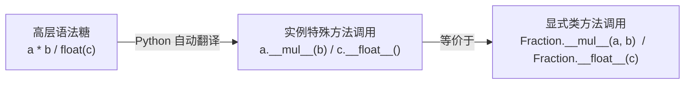

# L18 Python 类的特殊方法与进阶设计

%% learning-vault-navigation:v1 %%
> [!abstract]- 笔记导航
> 目录：[[CS Learning/Python MIT6.100L/MIT Python导航|MIT Python 导航]]
> 上一章：[[CS Learning/Python MIT6.100L/Lecture 17 Python Classes/L17 Python 类与面向对象基础|L17 Python 类与面向对象基础]] · 下一章：[[CS Learning/Python MIT6.100L/Lecture 19 Inheritance/L19 类的继承与类变量|L19 类的继承与类变量]]

> [!abstract] 本讲核心概览
> 本讲（MIT 6.100L Lecture 18）进一步深化 Python 面向对象设计：展示如何通过**对象组合（Composition）**用已有类（`Coordinate`）构建更复杂的类（`Circle`）并在 `__init__` 中做防御性类型检查；重点揭示 Python 运算符与内建函数背后的==特殊方法 / 双下划线方法（Dunder Methods）==机制（`__str__`、`__add__`、`__mul__`、`__truediv__`、`__float__`、`__pow__`、`__eq__` 等）；最后通过 `Fraction` 分数类的化简（`reduce`）剖析**返回类型一致性**与**展示逻辑与数据表示分离**的 OOP 设计哲学。

---

## 1. 对象组合（Composition）与防御性初始化

面向对象不仅能孤立地定义类，更强大的能力是**把已有类的实例作为另一个类的数据属性**，自底向上搭积木（称为**组合 Composition**，即 `has-a` 关系）。

### 用 `Coordinate` 构建 `Circle`
一个圆由两个数据属性唯一确定：圆心 `center`（一个 `Coordinate` 实例）与半径 `radius`（一个 `int`）：

```python
class Circle(object):
    def __init__(self, center, radius):
        # 防御性类型检查（结合 L13 异常处理）
        if type(center) != Coordinate or type(radius) != int:
            raise ValueError("center must be Coordinate and radius must be int")
        self.center = center
        self.radius = radius

    def is_inside(self, point):
        """判断 Coordinate 实例 point 是否严格落在圆内"""
        return self.center.distance(point) < self.radius
```

> [!note] 课堂思辨（Slide 11）：`point.distance(self.center)` vs `self.center.distance(point)` 等价吗？
> - 当 `point` 和 `self.center` 都是 `Coordinate` 实例时，由于欧氏距离满足对称性 $d(p, c) = d(c, p)$，两者**功能完全等价**。
> - 从稳健性角度看，`self.center.distance(point)` 往往更清晰，因为 `self.center` 已经由 `Circle.__init__` 保证一定是 `Coordinate` 对象。

### 方法的副作用设计：原地修改 vs 返回新值
对比 `Coordinate.to_origin(self)` 与 `SimpleFraction` 的两个倒数方法（Slide 17）：

| 方法 | 行为 | 返回值 | 设计意图 |
| --- | --- | --- | --- |
| `c.to_origin()` | 原地将 `self.x = 0; self.y = 0` | `None` | Mutator（状态修改器） |
| `f.get_inverse()` | 计算 `self.denom / self.num`，不修改 `f` | `float` | 只读查询，无副作用 |
| `f.invert()`（`SimpleFraction`） | `(self.num, self.denom) = (self.denom, self.num)` | `None` | 原地翻转分子分母 |
| `f.invert()`（`Fraction`） | `return Fraction(self.denom, self.num)` | 新 `Fraction` | 不可变风格，返回新对象避免别名副作用 |

---

## 2. 特殊方法（Dunder Methods）与运算符重载

如果直接 `print(f1)` 或计算 `f1 * f2`，Python 默认只会打印毫无信息量的内存地址 `<__main__.SimpleFraction object at 0x...>`，甚至直接抛出 `TypeError: unsupported operand type(s) for *`。

> [!important] Big Idea：Python 的一切运算符本质上都是方法调用！
> `+`, `-`, `*`, `/`, `**`, `==`, `<`, `len()`, `print()`, `float()`, `[]` 等常见操作，全都是 Python 提供的**语法糖（Shorthand Notations）**——在底层都会被自动翻译为调用对象所属类中的**双下划线特殊方法（Dunder Methods，Double-Underscore Methods）**！

### 常用 Dunder Methods 速查表（Lecture 18 Slide 20）

| 特殊方法 | 对应的 Python 语法 | 典型用途 |
| --- | --- | --- |
| `__init__(self, ...)` | `MyClass(...)` | 实例初始化 |
| `__str__(self)` | `print(obj)` / `str(obj)` | 面向用户的可读字符串表示（必须返回 `str`） |
| `__repr__(self)` | 交互式回显 / `repr(obj)` | 面向开发者的精确对象表示（见 L16 PS4 `Message`） |
| `__add__(self, other)` | `self + other` | 加法运算符重载 |
| `__sub__(self, other)` | `self - other` | 减法运算符重载 |
| `__mul__(self, other)` | `self * other` | 乘法运算符重载 |
| `__truediv__(self, other)` | `self / other` | 真除法 `/` 重载 |
| `__pow__(self, other)` | `self ** other` | 幂运算 `**` 重载 |
| `__eq__(self, other)` | `self == other` | 相等比较（默认比较内存身份 `is`，重载后按值比较） |
| `__lt__(self, other)` | `self < other` | 小于比较（支持排序） |
| `__len__(self)` | `len(self)` | 容器长度 |
| `__float__(self)` | `float(self)` | 显式转换为浮点数 |

### 三种完全等价的调用方式（Abstraction at Work, Slide 32）



这正是**抽象（Abstraction）**的魅力：类的实现者写好 `__mul__`、`__add__` 后，类的使用者可以像操作普通数字一样自然地写 `a * b + c`，完全无需关心内部分子分母如何通分相乘！

### 类型检查：`type()` 与 `isinstance()`（Slide 24）
```python
c = Coordinate(3, 4)
type(c)                    # <class '__main__.Coordinate'>
type(Coordinate)           # <class 'type'>（类本身也是类型为 type 的对象！）
isinstance(c, Coordinate)  # True（推荐用于类型判断，后续对子类继承同样返回 True！）
```

---

## 3. 核心案例：`Fraction` 分数类与返回类型一致性原则

对比 `SimpleFraction`（返回 `float`）与进阶 `Fraction`（四则运算全部返回新的 `Fraction` 实例，并支持 `float(c)` 按需转换）：

```python
class Fraction(object):
    """有理数分数类：内部由整数分子 num 与分母 denom 表示"""

    def __init__(self, num, denom):
        self.num = num
        self.denom = denom

    def __str__(self):
        """展示优化：分母为 1 时只显示分子，否则显示 num/denom"""
        if self.denom == 1:
            return str(self.num)
        return f"{self.num}/{self.denom}"

    def __add__(self, other):
        return Fraction(self.num * other.denom + self.denom * other.num,
                        self.denom * other.denom)

    def __sub__(self, other):
        return Fraction(self.num * other.denom - self.denom * other.num,
                        self.denom * other.denom)

    def __mul__(self, other):
        return Fraction(self.num * other.num, self.denom * other.denom)

    def __truediv__(self, other):
        return Fraction(self.num * other.denom, self.denom * other.num)

    def __float__(self):
        return self.num / self.denom

    def __pow__(self, other):
        return float(self) ** float(other)

    def reduce(self):
        """用欧几里得算法化简分数，始终返回新的 Fraction 对象"""
        def gcd(n, d):
            while d != 0:
                (d, n) = (n % d, d)
            return n
        if self.denom == 0:
            return None
        elif self.denom == 1:
            return Fraction(self.num, 1)    # 关键：保持返回类型为 Fraction！
        else:
            g = gcd(self.num, self.denom)
            return Fraction(self.num // g, self.denom // g)
```

> [!important] 极其重要的 OOP 设计教训：`reduce()` 为什么不能在分母为 1 时返回 `int`？（Slides 36–39）
> 最初版本在 `reduce()` 里写了 `elif self.denom == 1: return self.num`：
> - 看起来 `print(Fraction(4, 1).reduce())` 输出了整洁的 `4`；
> - **但紧接着做链式运算就崩溃了**！
>   ```python
>   ar = Fraction(4, 1).reduce()   # 类型变成了 int！
>   br = Fraction(3, 9).reduce()   # 类型是 Fraction(1, 3)
>   c = ar * br                    # TypeError! int.__mul__ 不认识 Fraction！
>   ```
> - **正确设计（关注点分离）**：
>   1. **运算闭合（Type Closure）**：`reduce()` 无论分母是否为 1，都应始终返回 `Fraction` 实例（`Fraction(self.num, 1)`），保证后续 `ar * br`、`ar + br` 永远成立；
>   2. **展示解耦（Presentation in `__str__`）**：把“分母为 1 时省略 `/1`”的显示需求放到 `__str__` 中处理，做到**内部类型一致、外部显示美观**两全其美！

---

## 4. 课后作业与 Finger Exercise 复盘

- **`homework.py` Q1 (`Circle.__str__`)**：
  ```python
  def __str__(self):
      return "circle: " + str(self.center) + ", " + str(self.radius)
  ```
  当 `self.center` 是一个定义了 `__str__` 的 `Coordinate` 对象时，这里的 `str(self.center)` 会**自动委派**调用 `Coordinate.__str__()`（输出 `<2,2>`），体现了对象组合下特殊方法的协同复用！
- **`homework.py` Q2 (`Fraction.__pow__`)**：通过 `float(self) ** float(other)` 复用已实现的 `__float__`，使 `Fraction(4, 1) ** Fraction(1, 2)` 直接求出 `2.0`。
- **Finger Exercise 18 (`mit6_100l_f22_ex18.py`)**：为简化版 `Circle(radius)` 实现了 `__add__(self, c)` 返回新实例 `Circle(self.r + c.r)` 与 `__str__(self)` 返回 `str(self.r)`，与官方解答完全一致。

---

## 5. 自测检验

> [!question]- 自测 1：如果类 `Point` 没有自定义 `__eq__`，那么 `Point(1, 2) == Point(1, 2)` 的结果是什么？为什么？
> 结果是 **`False`**！默认情况下继承自 `object` 的 `__eq__` 仅比较两个对象是否为内存中的**同一个实例**（等价于 `is`）。只有重写 `__eq__(self, other)`（例如 `return self.x == other.x and self.y == other.y`），`==` 才会按数值内容判断是否相等。

> [!question]- 自测 2：在 `Fraction.__add__(self, other)` 中，应该修改 `self.num` / `self.denom` 还是 `return Fraction(top, bottom)`？
> 应该**返回一个新的 `Fraction` 实例**，绝不原地修改 `self`！因为执行 `c = a + b` 时，使用者预期 `a` 和 `b` 保持原值不变（就像 `1 + 2` 不会改变 `1` 一样）。

---

## 6. 配套资料

| 资料名称 | 说明 | 仓库路径 |
| --- | --- | --- |
| Lecture 18 课件 | 对象组合、Dunder Methods 全表、`Fraction` 化简与类型一致性 | [[CS Learning/Python MIT6.100L/Lecture 18 More Python Class Methods/mit6_100l_f22_lec18.pdf\|mit6_100l_f22_lec18.pdf]] |
| Lecture 18 课堂代码 | `Coordinate`、`Circle`、`SimpleFraction` 与完整 `Fraction` 演化代码 | [[CS Learning/Python MIT6.100L/Lecture 18 More Python Class Methods/mit6_100l_f22_lec18_code.py\|mit6_100l_f22_lec18_code.py]] |
| 课后作业代码 | `Circle.__str__` 与 `Fraction.__pow__` | [[CS Learning/Python MIT6.100L/Lecture 18 More Python Class Methods/homework.py\|homework.py]] |
| Finger Exercise 18 | `Circle` 类 `__add__` 与 `__str__` 练习与解答 | [[CS Learning/Python MIT6.100L/Lecture 18 More Python Class Methods/mit6_100l_f22_ex18.py\|mit6_100l_f22_ex18.py]] · [[CS Learning/Python MIT6.100L/Lecture 18 More Python Class Methods/mit6_100l_f22_ex18_sol.pdf\|官方解答 PDF]] |
