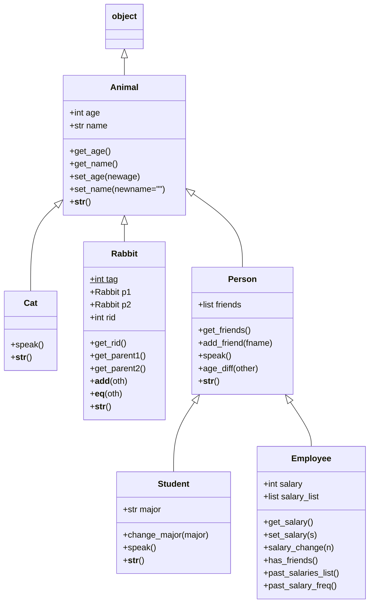
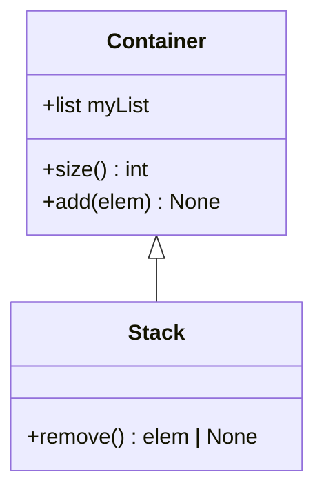

# L19 类的继承与类变量

%% learning-vault-navigation:v1 %%
> [!abstract]- 笔记导航
> 目录：[[CS Learning/Python MIT6.100L/MIT Python导航|MIT Python 导航]]
> 上一章：[[CS Learning/Python MIT6.100L/Lecture 18 More Python Class Methods/L18 Python 类的特殊方法与进阶设计|L18 Python 类的特殊方法与进阶设计]] · 下一章：[[CS Learning/Python MIT6.100L/Lecture 20 Fitness Tracker Object Oriented Programming Example/L20 面向对象综合实战：Fitness Tracker|L20 面向对象综合实战：Fitness Tracker]]

> [!abstract] 本讲核心概览
> 本讲在 [[CS Learning/Python MIT6.100L/Lecture 18 More Python Class Methods/L18 Python 类的特殊方法与进阶设计|L18]] 的基础上，从“封装与信息隐藏（Information Hiding）”切入，系统引入面向对象编程（OOP）的两大核心机制：**类的继承体系（Class Hierarchies / Inheritance）** 与 **类变量（Class Variables）**。通过 `Animal -> Cat / Person / Student / Employee / Rabbit` 的完整层次设计与 `Container -> Stack` 练习，建立起用类层次结构实现**代码复用（Reuse）**与**抽象分层（Abstraction）**的工程思维。
>
> **配套源文件**：[[CS Learning/Python MIT6.100L/Lecture 19 Inheritance/mit6_100l_f22_lec19.pdf|Lecture 19 讲义 PDF]] · [[CS Learning/Python MIT6.100L/Lecture 19 Inheritance/mit6_100l_f22_lec19_code.py|课堂代码与练习]] · [[CS Learning/Python MIT6.100L/Lecture 19 Inheritance/mit6_100l_f22_ex19.py|Finger Exercise 19 代码]] · [[CS Learning/Python MIT6.100L/Lecture 19 Inheritance/mit6_100l_f22_ex19_sol.pdf|Finger Exercise 19 参考解答]]

---

## 1. 信息隐藏与 Getter / Setter 规范

### 1.1 为什么类外部应该通过方法访问数据属性？

在 OOP 中，一个类包含两类属性：
- **数据属性（Data Attributes）**：描述对象“是什么（What it is）”，例如 `Animal` 的 `age` 和 `name`。
- **过程属性 / 方法（Procedural Attributes / Methods）**：描述对象“能做什么（What it does）”，定义外界与对象交互的接口。

以基类 `Animal` 为例：

```python
class Animal(object):
    def __init__(self, age):
        self.age = age
        self.name = None

    def get_age(self):
        return self.age

    def get_name(self):
        return self.name

    def set_age(self, newage):
        self.age = newage

    def set_name(self, newname=""):
        self.name = newname

    def __str__(self):
        return "animal:" + str(self.name) + ":" + str(self.age)
```

> [!important] Big Idea：信息隐藏（Information Hiding）
> ==在类定义外部，应当始终通过 Getter / Setter 方法（如 `a.get_age()`）访问或修改数据属性，而不是直接读写 `a.age`。==
>
> 如果类的作者日后重构内部表示（例如把 `self.age` 改名为 `self.years`），只要 `get_age()` 和 `set_age()` 同步更新为读写 `self.years`，所有通过方法访问对象的外部代码都能无缝继续工作；而直接写 `a.age` 的代码会立即抛出 `AttributeError`。

### 1.2 Python 在信息隐藏上的“宽松性”与风格约束

与 Java / C++ 的 `private` 强制访问控制不同，Python 语法层面**并不禁止**以下操作：

```python
a = Animal(4)
print(a.age)          # 直接读取内部属性
a.age = "infinite"    # 甚至可以写入完全错误的数据类型
a.size = "tiny"       # 运行时动态给单个实例挂上新属性
```

> [!warning] 工程纪律
> Python 允许上述操作，但讲义明确强调**这三种写法都属于不良风格（bad style）**。直接破坏封装不仅会让内部数据结构失效，还会导致同一类的不同实例拥有不一致的属性集合，增加调试难度。
>
> 此外，若某数据属性是可变对象（如 `Person.friends` 列表），Getter 方法应当返回拷贝（`return self.friends.copy()`），避免调用方通过返回值意外修改对象内部状态（防止别名污染）。

### 1.3 容器中打印自定义对象的细节

在 `animal_dict(L)` 示例中，字典 `animals` 将非负整数映射为 `Animal` 实例：

```python
L = [2, 5, 'a', -5, 0]
animals = animal_dict(L)
print(animals)
# 输出：{2: <__main__.Animal object at 0x...>, 5: <__main__.Animal object at 0x...>, ...}

for n, a in animals.items():
    print(f'key {n} with val {a}')
# 输出：key 2 with val animal:None:2 ...
```

> [!tip] 为什么 `print(animals)` 不调用 `Animal.__str__`？
> `print(x)` 会调用 `x.__str__()`；但当 `x` 是内置容器（`list`、`dict`、`tuple`）时，容器的 `__str__` 在展示内部元素时会调用元素的 `__repr__()` 而非 `__str__()`。如果自定义类只重写了 `__str__` 而未重写 `__repr__`，直接打印列表或字典就会看到默认的内存地址 `<__main__.Animal object at 0x...>`，需要逐个遍历打印元素才会触发 `__str__`。

---

## 2. 类的继承与层次结构（Inheritance & Hierarchies）

### 2.1 类层次结构图

本讲及课后练习围绕 `Animal` 家族与 `Container` 家族构建了如下继承体系：



### 2.2 子类的三种能力与方法解析顺序

定义子类时在类名后的括号内写明父类（超类，Superclass），例如 `class Cat(Animal):`。

> [!important] Big Idea：子类的三大核心行为
> ==子类（Subclass）可以从父类继承所有数据与方法属性，并在此基础上完成三种操作：==
> 1. **直接复用（Use）**：不重新定义的方法自动沿用父类实现（如 `Cat` 没有写 `__init__`、`get_age`，直接复用 `Animal` 的版本）。
> 2. **重写覆盖（Override）**：定义与父类同名的方法以定制行为（如 `Cat.__str__`、`Student.speak`）。
> 3. **新增扩展（Define New）**：添加父类不具备的新属性与新方法（如 `Cat.speak`、`Person.friends`、`Student.change_major`）。

**方法查找规则（Method Lookup）**：
当对某个实例调用方法（如 `s1.get_age()` 或 `s1.speak()`）时，Python 按以下顺序自底向上检索：
1. 先在**当前实例所属的类定义**中查找该方法名；
2. 若未找到，沿继承链向上查找**父类 -> 祖父类 -> … -> `object`**；
3. ==使用沿途找到的**第一个**匹配方法定义==；若直到 `object` 仍未找到，则抛出 `AttributeError`。

> [!note] 单向性约束
> 继承是单向的：`Cat` 实例可以使用 `Animal` 的 `get_age()`，但 `Animal` 实例调用 `a.speak()` 会报错，因为 `speak()` 只定义在子类中。

### 2.3 逐层剖析典型子类

#### 1. `Cat(Animal)`：最小扩展与重写
```python
class Cat(Animal):
    def speak(self):
        print("meow")

    def __str__(self):
        return "cat:" + str(self.name) + ":" + str(self.age)
```
- 未定义 `__init__`，实例化 `Cat(5)` 时自动调用 `Animal.__init__(self, 5)`。

#### 2. `Person(Animal)`：显式调用父类构造器
```python
class Person(Animal):
    def __init__(self, name, age):
        Animal.__init__(self, age)   # 复用父类初始化逻辑（现代 Python 也常用 super().__init__(age)）
        self.set_name(name)          # 借助父类 setter 设置 name
        self.friends = []            # 新增数据属性

    def get_friends(self):
        return self.friends.copy()   # 防御性拷贝，避免外部篡改内部列表

    def add_friend(self, fname):
        if fname not in self.friends:
            self.friends.append(fname)

    def speak(self):
        print("hello")

    def age_diff(self, other):
        diff = self.age - other.age
        print(abs(diff), "year difference")

    def __str__(self):
        return "person:" + str(self.name) + ":" + str(self.age)
```

#### 3. `Student(Person)`：多层继承与默认参数
```python
import random

class Student(Person):
    def __init__(self, name, age, major=None):
        Person.__init__(self, name, age)
        self.major = major

    def change_major(self, major):
        self.major = major

    def speak(self):
        r = random.random()
        if r < 0.25:
            print("--> i have homework")
        elif 0.25 <= r < 0.5:
            print("--> i need sleep")
        elif 0.5 <= r < 0.75:
            print("--> i should eat")
        else:
            print("--> i'm zooming")

    def __str__(self):
        return "student:" + str(self.name) + ":" + str(self.age) + ":" + str(self.major)
```
- `Student` 继承了 `Person`（`friends`、`age_diff` 等）和 `Animal`（`get_age`、`get_name` 等）两层父类的全部接口，同时用随机概率重写了 `speak()`。

---

## 3. 类变量（Class Variables）与 `Rabbit` 深度案例

### 3.1 实例变量 vs 类变量

| 维度 | 实例变量（Instance Variable） | 类变量（Class Variable） |
| --- | --- | --- |
| 定义位置 | 通常在 `__init__` 中通过 `self.xxx = ...` 创建 | 直接定义在 `class` 代码块内部、所有方法之外 |
| 归属与内存 | 每个实例各自持有一份独立副本 | 归属于类本身，==所有实例共享同一份值== |
| 修改影响 | 修改 `r1.age` 仅影响 `r1` | 修改 `Rabbit.tag += 1` 对所有实例可见 |
| 典型用途 | 个体状态（如 `age`、`rid`、`p1`、`p2`） | 全局自增 ID、对象计数器、共享常量配置 |

### 3.2 `Rabbit` 类的完整设计与特殊方法

```python
class Rabbit(Animal):
    # 类变量：所有 Rabbit 实例共享，用于生成全局唯一编号
    tag = 1

    def __init__(self, age, parent1=None, parent2=None):
        Animal.__init__(self, age)
        self.p1 = parent1
        self.p2 = parent2
        self.rid = Rabbit.tag     # 把当前 tag 固化为该实例自己的实例变量 rid
        Rabbit.tag += 1           # 递增类变量，供下一只兔子使用

    def get_rid(self):
        return str(self.rid).zfill(5)   # 补零为 5 位字符串，例如 '00001'

    def get_parent1(self):
        return self.p1

    def get_parent2(self):
        return self.p2

    def __add__(self, oth):
        # 定义 r1 + r2：产生一只 age=0、父母为 self 与 oth 的新 Rabbit 实例
        return Rabbit(0, self, oth)

    def __eq__(self, oth):
        # 比较父母的唯一 rid，忽略 parent1 / parent2 的先后顺序
        parents_same = (self.p1.rid == oth.p1.rid and self.p2.rid == oth.p2.rid)
        parents_opp = (self.p2.rid == oth.p1.rid and self.p1.rid == oth.p2.rid)
        return parents_same or parents_opp

    def __str__(self):
        return "rabbit:" + self.get_rid()
```

### 3.3 关键陷阱解析：`__eq__` 为什么不能直接写 `self.p1 == oth.p1`？

假设我们判定两只兔子相等（同一对父母所生）时，错误地写成了：

```python
# 错误示范！
parents_same = (self.p1 == oth.p1 and self.p2 == oth.p2)
```

> [!warning] 递归死循环与 `AttributeError` 陷阱
> 1. `self.p1` 和 `oth.p1` 都是 `Rabbit` 对象，执行 `self.p1 == oth.p1` 会**再次触发 `Rabbit.__eq__`**；
> 2. 递归沿着家谱不断向上追踪祖先，直到第一代兔子（其 `p1`、`p2` 为 `None`）；
> 3. 对 `None` 访问 `.rid` 或 `.p1` 时立即抛出 `AttributeError: 'NoneType' object has no attribute ...`！
>
> **正确做法**：直接比较唯一标识符 `self.p1.rid == oth.p1.rid`（整数比较，不触发 `Rabbit.__eq__`）。同时注意：在生产代码中，若任意一只兔子是第一代（`self.p1 is None` 或 `oth.p1 is None`），还需额外判断 `None` 以避免报错。

> [!warning] 修改类变量的常见错误：`self.tag += 1` vs `Rabbit.tag += 1`
> 在 `__init__` 中必须写成 `Rabbit.tag += 1` 而不是 `self.tag += 1`。
> 因为 `self.tag += 1` 等价于 `self.tag = self.tag + 1`，会在当前实例的字典里**新建一个同名的实例变量 `tag`** 遮蔽（shadow）类变量，导致类变量 `Rabbit.tag` 永远停留在 `1`！

---

## 4. 课堂练习、课后作业与 Finger Exercise 复盘

### 4.1 课堂 & At-Home 练习要点（[[CS Learning/Python MIT6.100L/Lecture 19 Inheritance/mit6_100l_f22_lec19_code.py|mit6_100l_f22_lec19_code.py]]）

| 题目 | 核心考察点 | 实现复盘与注意点 |
| --- | --- | --- |
| `make_animals(L1, L2)` | 批量实例化与 Setter 调用 | 遍历下标创建 `Animal(L1[i])`，通过 `a.set_name(L2[i])` 赋值后加入列表 |
| 简易 `Rabbit(Animal)` | 继承重写 `speak` 与 `__str__` | 练习版 `__str__` 中使用了逗号分隔（`'rabbit,'+...`），注意规范要求为冒号 `:` 且应优先调用 `self.get_name()`、`self.get_age()` |
| `make_pets(d)` | 自定义对象作为字典键与值 | `Person` 与 `Cat` 默认可哈希（按对象身份），遍历 `d.items()` 调用 `p.get_name()` 和 `c.get_name()` |
| `Employee(Person)` | 多层状态追踪与防御性拷贝 | 维护 `self.salary` 和 `self.salary_list = [0]`；`salary_change(n)` 将负薪水截断为 `0` 并记录历史；`past_salaries_list()` 返回 `.copy()`；`past_salary_freq()` 统计各薪资出现次数 |
| `counts(L)` | `type(x) == Cls` vs `isinstance(x, Cls)` | 统计 `L` 中 `Person`、`Employee` 各自数量与去重姓名数；==此处必须用 `type(i) == Person`==，若用 `isinstance(i, Person)` 则会把所有 `Employee` 也计入 `Person` |

### 4.2 Finger Exercise 19：`Container` 与 `Stack`（LIFO）

源文件：[[CS Learning/Python MIT6.100L/Lecture 19 Inheritance/mit6_100l_f22_ex19.py|mit6_100l_f22_ex19.py]] · [[CS Learning/Python MIT6.100L/Lecture 19 Inheritance/mit6_100l_f22_ex19_sol.pdf|官方解答 PDF]]



核心思想：用 Python `list` 的**末尾**作为栈顶（Top），`add()` 调用 `append(elem)`，`remove()` 调用 `pop()`，均满足 **后进先出（LIFO, Last-In First-Out）** 且在列表尾部操作均为摊还 $O(1)$ 时间复杂度：

```python
class Container(object):
    def __init__(self):
        self.myList = []

    def size(self):
        return len(self.myList)

    def add(self, elem):
        self.myList.append(elem)

class Stack(Container):
    def remove(self):
        if self.size() > 0:
            return self.myList.pop()
        return None
```

> [!tip] 细节提示
> 个人练习代码 [[CS Learning/Python MIT6.100L/Lecture 19 Inheritance/mit6_100l_f22_ex19.py|mit6_100l_f22_ex19.py]] 在空栈时没有显式写 `return None`——虽然 Python 函数默认返回 `None` 使得行为完全正确，但在接口规范明确规定“空栈返回 `None`”时，显式写出 `return None` 可读性更强。

---

## 5. 自测与复习思考

> [!question]- 自测 1：`type(e) == Person` 和 `isinstance(e, Person)` 有何区别？
> 当 `e = Employee("ana", 35)` 且 `Employee` 继承自 `Person` 时：
> - `type(e) == Person` 返回 **`False`**（只做精确类型匹配，不考虑继承）；
> - `isinstance(e, Person)` 返回 **`True`**（识别继承关系，`Employee` “是一个” `Person`）。
> 因此在做精确分类统计（如 `counts(L)`）时用 `type()`，而在要求“支持某类及其所有子类”（多态类型检查）时用 `isinstance()`。

> [!question]- 自测 2：为什么说类（Class）与函数（Function）本质上都是分解（Decomposition）与抽象（Abstraction）的机制？
> 函数封装**过程/算法细节**，调用方只关心输入输出规范；类封装**数据表示 + 相关操作**，并借助**继承**进一步按“共性上提、个性下沉”的原则分层复用代码，让复杂系统可以按对象职责清晰拆分。
