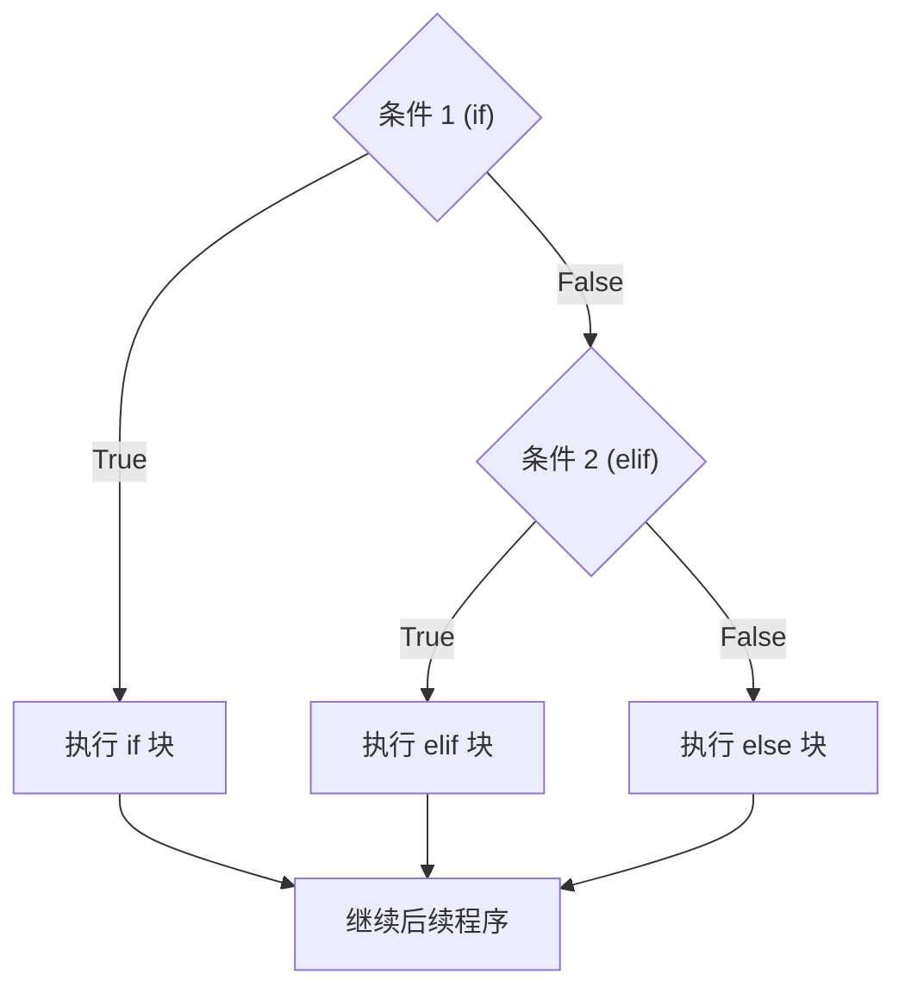

# L02 字符串、输入输出与分支控制

%% learning-vault-navigation:v1 %%
> [!abstract]- 笔记导航
> 目录：[[CS Learning/Python MIT6.100L/MIT Python导航|MIT Python 导航]]
> 上一讲：[[CS Learning/Python MIT6.100L/Lecture 1 Introduction/L01 课程导论与 Python 基础|L01 课程导论与 Python 基础]] · 下一讲：[[CS Learning/Python MIT6.100L/Lecture 3 Iteration/L03 迭代与循环结构|L03 迭代与循环结构]]

> [!abstract] 本讲定位与核心脉络
> 在 L01 掌握标量对象与顺序执行后，本讲引入第一个**非标量（Non-scalar）序列类型**——字符串（`str`），系统讲解索引、切片与**不可变性（Immutability）**；随后介绍程序与外界交互的**输入输出（`print`、`input`、f-string）**，以及打破线性顺序执行的第一类控制流——基于布尔表达式与缩进的**分支控制（Branching）**。本讲目录同时配套 **Problem Set 1（复利储蓄与购房首付）**。

---

## 一、字符串（Strings）：索引、切片与不可变性

### 1. 基本操作与长度

字符串 `str` 是**区分大小写（Case-sensitive）的字符序列**，可用单引号 `'...'` 或双引号 `"..."` 成对包裹。

```python
a = "me"
b = "myself"
c = a + b           # "memyself"（拼接 Concatenation）
d = a + " " + b     # "me myself"
silly = a * 3       # "mememe"（重复 Repetition，仅支持 str * int）
len("abc")          # 3（返回字符总数，含空格与标点）
```

### 2. 索引（Indexing）与切片（Slicing）

Python 序列索引**从 `0` 开始**，同时支持**负索引**（`-1` 指向最后一个字符，`-len(s)` 指向第一个字符）。访问越界（如对 `"abc"` 取 `s[3]`）会触发 `IndexError`。

切片通用语法为 `s[start:stop:step]`：
- ==第一步先看 `step` 的正负号==：`step > 0` 从左向右取值，`step < 0` 从右向左取值；默认 `step = 1`；
- 区间遵循**左闭右开**：包含 `start`，**不包含 `stop`**（正向到 `stop - 1`，反向到 `stop + 1`）；
- 当方向与起止位置矛盾（如 `s[6:3]` 且默认 `step = +1`）时，**不会报错，而是返回空字符串 `""`**。

以 `s = "abcdefgh"`（索引 `0..7` / `-8..-1`）与课堂练习 `t = "ABC d3f ghi"` 为例：

| 切片表达式 | 求值结果 | 规则说明 |
| --- | --- | --- |
| `s[3:6]` | `"def"` | 等价于 `s[3:6:1]`，取索引 `3, 4, 5` |
| `s[3:6:2]` | `"df"` | 步长为 2，取索引 `3, 5` |
| `s[:]` | `"abcdefgh"` | 省略起止，复制整个字符串（`0:len(s):1`） |
| `s[::-1]` | `"hgfedcba"` | 负步长且省略起止，实现字符串**反转** |
| `s[4:1:-2]` | `"ec"` | 从索引 4 向左步进 -2 到索引 2（不含 1） |
| `t[4:0:-1]` | `"d CB"` | 从索引 4 反向到索引 1（**不含索引 0 的 `'A'`**） |
| `t[4::-1]` | `"d CBA"` | 省略 `stop` 才能取到索引 0 |
| `t[6:3]` | `""` | `step = +1` 但 `start > stop`，返回空串 |

### 3. 不可变性（Immutability）

==字符串是不可变对象（Immutable）==：无法在原地修改某个位置上的字符，但可以构造新字符串并**重新绑定（Re-bind）**原变量名：

```python
s = "car"
# s[0] = 'b'          # TypeError: 'str' object does not support item assignment
s = 'b' + s[1:len(s)] # 合法：创建新对象 "bar" 并让 s 指向它
```

---

## 二、输入输出与格式化字符串

### 1. `print()` 与字符串拼接

- 逗号分隔多个参数：`print(a, b, c)` 会自动调用转换并在参数间插入空格，可混排不同类型；
- 加号拼接：`print(a + str(b) + c)` 要求所有操作数都是 `str`（否则报 `TypeError`），且**不自动加空格**。

### 2. `input()` 的强制字符串返回特性

==`input(prompt)` 永远返回 `str` 类型==，即使输入的是数字也必须显式转换（`int()` / `float()`）才能做数值运算：

```python
num1 = input("Type a number: ")      # 用户输入 3 -> num1 绑定为 "3" (str)
print(5 * num1)                      # 输出 "33333"（字符串重复！）

num2 = int(input("Type a number: ")) # 显式转换为 int
print(5 * num2)                      # 输出 15（数值乘法）
```

> [!note] 课堂算法预告：牛顿法（Newton–Raphson）单步迭代
> 讲义借 `input()` 预览了求多项式根 $f(g, x) = g^3 - x = 0$ 的牛顿法迭代公式（后续将在 [[CS Learning/Python MIT6.100L/Lecture 6 Bisection Search/L06 二分查找（Bisection Search）|L06 二分查找（Bisection Search）]] 完整展开）：
>
> $$
> g_{\text{next}} = g - \frac{f(g)}{f'(g)} = g - \frac{g^3 - x}{3g^2}
> $$

### 3. f-string（Python 3.6+ 推荐格式化方式）

在字符串前加 `f`，花括号 `{}` 内的任意表达式会在运行时求值、自动转为字符串并嵌入，还支持冒号后的格式说明符（如千位分隔符与小数位数）：

```python
num = 3000
fraction = 1 / 3
print(f'{num * fraction} is {fraction * 100}% of {num}')
# 1000.0 is 33.33333333333333% of 3000

print(f'{num * fraction:,.0f} is {fraction * 100:,.2f}% of {num:,}')
# 1,000 is 33.33% of 3,000
```

---

## 三、布尔逻辑与分支控制（Branching）

### 1. 比较运算符与逻辑运算符

- **关键区分**：`=` 是**赋值绑定**；`==` 是**相等性测试**（不改变变量绑定，整体求值为 `True` 或 `False`）。
- **比较运算符**：`>`、`>=`、`<`、`<=`、`==`、`!=`，适用于数字、字符串等可比较对象，结果均为 `bool`。
- **逻辑运算符**：`not`、`and`、`or`。

| `A` | `B` | `not A` | `A and B` | `A or B` |
| :---: | :---: | :---: | :---: | :---: |
| `True` | `True` | `False` | `True` | `True` |
| `True` | `False` | `False` | `False` | `True` |
| `False` | `True` | `True` | `False` | `True` |
| `False` | `False` | `True` | `False` | `False` |

### 2. `if / elif / else` 结构与缩进语义

Python 通过**缩进（Indentation）**而非花括号界定代码块，「视觉结构即语义结构」。



**核心执行规则**：
1. 在 `if - elif - ... - else` 链中，**至多只有一个分支会被执行**（即第一个条件为 `True` 的分支，其余分支全部跳过）；
2. 嵌套分支（Nested Branching）按缩进层级决定归属（例如仅当 `x == y` 成立时再检查内层 `if y != 0:` 避免除零错误）；
3. **并列 `if` 与互斥 `elif` 语义截然不同**：讲义的 `M / i / T` 练习中，当 `x = 11, y = 11` 时，若第二条是独立的 `if x <= y:`，会先后追加 `'M'` 和 `'i'` 输出 `"Mi"`；若改为 `elif x <= y:`，则只会命中第一条并输出 `"M"`。

> [!tip] 课程工程原则（Big Idea）
> **Debug early, debug often. Write a little and test a little.**
> 不要一口气写完整个程序再运行；每写几行逻辑就测试一次，遇到反直觉结果时善用 **Python Tutor** 单步追踪内存绑定与分支走向。

---

## 四、个人练习与 Problem Set 1 实践复盘

### 1. 课堂与课后练习（`learn.py`、`homework.py`、`mit6_100l_f22_ex02.py`）

- **`learn.py`**：动手验证了切片边界差异（`s[4:0:-1]` 漏掉首字符而 `s[4::-1]` 包含首字符）、空切片（`s[6:3]`、`s[2:0]`）及动词重复输出。注意 `(verb + " ") * 5` 末尾会多一个尾随空格，而官方答案 `(verb + " ") * 4 + verb` 恰好无多余空格。
- **`homework.py`（Practice 1–4）**：完整手推了字符串拼接、切片、嵌套 `if` 以及 Practice 4 的**双 `if` + `else` 类型转换陷阱**——当 `a = 6, b = "6"` 时两个 `if` 均成立，依次输出 `int conversion` 和 `int and str conversion`；当 `a = 3, b = 3` 时第一条成立但第二条因 `str(3) != 3` 进入 `else`，输出 `int conversion` 与 `interesting`。
- **Finger Exercise 2（`mit6_100l_f22_ex02.py`）**：用 `if number > 0 / elif number < 0 / else` 三分支准确区分正数、负数与零。

### 2. Problem Set 1：复利储蓄购房（`ps1a.py` / `ps1b.py` / `ps1c.py`）

PS1 将分支控制、循环迭代（衔接 L03）与二分查找（衔接 L06）综合应用到个人理财模型中：

| 部分 | 文件 | 核心数学模型与实现要点 |
| --- | --- | --- |
| **Part A** | `ps1a.py` | 目标首付 $D = 0.25 \times \text{cost}$，年化收益 $r = 0.05$；每月末按月初存款计息再加月储蓄：$S_{t+1} = S_t \left(1 + \frac{r}{12}\right) + \frac{\text{salary}}{12} \cdot p_{\text{saved}}$，循环累加 `months` 直至 $S \ge D$ |
| **Part B** | `ps1b.py` | 在 Part A 基础上每满 6 个月加薪一次：`if months % 6 == 0: yearly_salary *= (1 + semi_annual_raise)`（注意判断在 `months += 1` 之后，确保第 6、12、18 月末触发） |
| **Part C** | `ps1c.py` | 给定初始本金 $S_0$ 与 36 个月复利公式 $A(r) = S_0 \left(1 + \frac{r}{12}\right)^{36}$，在 $r \in [0, 1]$ 上用二分法寻找使 $|A(r) - 200{,}000| \le 100$ 的最小年化利率 $r$，记录二分步数 `steps` |

> [!warning] `ps1c.py` 复盘发现的隐蔽边界 Bug
> 在个人提交版 `ps1c.py` 中，判断「即使 $r = 100\%$ 也无法达标」的分支写成了：
> ```python
> elif abs(initial_deposit * (1 + high / 12) ** 36 - 200000 <= 100):
>     r = None
> ```
> 这里括号位置将比较运算符 `<= 100` 放进了 `abs(...)` 内部，导致 Python 先算出布尔值再取 `abs(True) == 1` 或 `abs(False) == 0`。虽然在常见测试用例（如 `1000`、`65000`、`150000`）下碰巧表现一致，但若某初始本金在 $r = 1.0$ 时恰巧落在 `[199900, 200100]` 区间内，该写法会误判为 `None`！
> **正确无歧义的条件应为**：
> ```python
> elif initial_deposit * (1 + high / 12) ** 36 < down_payment - 100:
>     r = None
> ```
> 另外，`put_in_function.py` 通过定位注释行 `## Initialize other variables ... ##` 将脚本自动封装为 `part_a` / `part_b` / `part_c` 供 `ps1_tester.py` 测试，因此**切勿删除模板注释或更改规定变量名**。

---

## 五、常见陷阱与自检

> [!warning] 本讲高频易错点
> 1. **忘记转换 `input()` 类型**：直接把 `input()` 返回的 `"10"` 与数字相加或比较会报错或触发字符串拼接/字典序比较（如 `"9" > "10"` 为 `True`）。
> 2. **负步长切片的 `stop` 陷阱**：`s[4:0:-1]` 停在索引 `1`，不包含索引 `0`；要包含开头必须省略 `stop` 写成 `s[4::-1]`。
> 3. **把 `=` 错写成 `==` 或反向混用**：条件判断必须用 `==`，否则语法报错。
> 4. **并列 `if` 与 `elif` 混淆**：多个独立的 `if` 会逐个判断，且 `else` 仅与紧邻的上一条 `if/elif` 配对。
> 5. **缩进错位导致语句脱离分支**：如课堂 Debug 题中 `print("These are equal!")` 未缩进，会在 `x != y` 时也照常打印。

> [!question]- 课后自检（点击展开）
> 1. `s = "ABC d3f ghi"`，求 `s[2::-1]` 和 `s[8:len(s):3]` 的值。
>    - 依次为 `"CBA"` 和 `"g"`。
> 2. 为什么不能写 `s[0] = 'X'` 来修改字符串首字母？应该怎么写？
>    - 因为 `str` 是不可变对象（Immutable）；应构造新字符串并重绑定：`s = 'X' + s[1:]`。
> 3. PS1 Part A 中如果先加当月储蓄再算当月投资收益，会导致什么问题？
>    - 会多算当月新增储蓄的利息，导致最终月数出现 off-by-one（差 1 个月）错误。题目明确规定月收益基于**月初已有存款**计算。

---

## 六、配套资料

| 资料名称 | 类型 | 本地链接 |
| --- | --- | --- |
| Lecture 2 讲义 Slides | 讲义 PDF | [[CS Learning/Python MIT6.100L/Lecture 2 Strings, InputOutput, Branching/mit6_100l_f22_lec02.pdf\|mit6_100l_f22_lec02.pdf]] |
| Lecture 2 课堂演示代码 | 源码 `.py` | [[CS Learning/Python MIT6.100L/Lecture 2 Strings, InputOutput, Branching/mit6_100l_f22_lec02_code.py\|mit6_100l_f22_lec02_code.py]] |
| 课堂随练代码 `learn.py` | 个人练习 `.py` | [[CS Learning/Python MIT6.100L/Lecture 2 Strings, InputOutput, Branching/learn.py\|learn.py]] |
| 课后手推练习 `homework.py` | 个人练习 `.py` | [[CS Learning/Python MIT6.100L/Lecture 2 Strings, InputOutput, Branching/homework.py\|homework.py]] |
| Finger Exercise 2 个人代码 | 练习 `.py` | [[CS Learning/Python MIT6.100L/Lecture 2 Strings, InputOutput, Branching/mit6_100l_f22_ex02.py\|mit6_100l_f22_ex02.py]] |
| Finger Exercise 2 官方参考解 | 题解 PDF | [[CS Learning/Python MIT6.100L/Lecture 2 Strings, InputOutput, Branching/mit6_100l_f22_ex02_sol.pdf\|mit6_100l_f22_ex02_sol.pdf]] |
| Problem Set 1 题目说明 | 作业 PDF | [[CS Learning/Python MIT6.100L/Lecture 2 Strings, InputOutput, Branching/mit6_100l_f22_ps1/mit6_100l_f22_ps1.pdf\|mit6_100l_f22_ps1.pdf]] |
| PS1 Part A 实现 | 作业 `.py` | [[CS Learning/Python MIT6.100L/Lecture 2 Strings, InputOutput, Branching/mit6_100l_f22_ps1/mit6_100l_f22_ps1_code/ps1a.py\|ps1a.py]] |
| PS1 Part B 实现 | 作业 `.py` | [[CS Learning/Python MIT6.100L/Lecture 2 Strings, InputOutput, Branching/mit6_100l_f22_ps1/mit6_100l_f22_ps1_code/ps1b.py\|ps1b.py]] |
| PS1 Part C 实现 | 作业 `.py` | [[CS Learning/Python MIT6.100L/Lecture 2 Strings, InputOutput, Branching/mit6_100l_f22_ps1/mit6_100l_f22_ps1_code/ps1c.py\|ps1c.py]] |
| PS1 自动封装脚本 | 工具 `.py` | [[CS Learning/Python MIT6.100L/Lecture 2 Strings, InputOutput, Branching/mit6_100l_f22_ps1/mit6_100l_f22_ps1_code/put_in_function.py\|put_in_function.py]] |
| PS1 学生测试套件 | 测试 `.py` | [[CS Learning/Python MIT6.100L/Lecture 2 Strings, InputOutput, Branching/mit6_100l_f22_ps1/mit6_100l_f22_ps1_code/ps1_tester.py\|ps1_tester.py]] |
