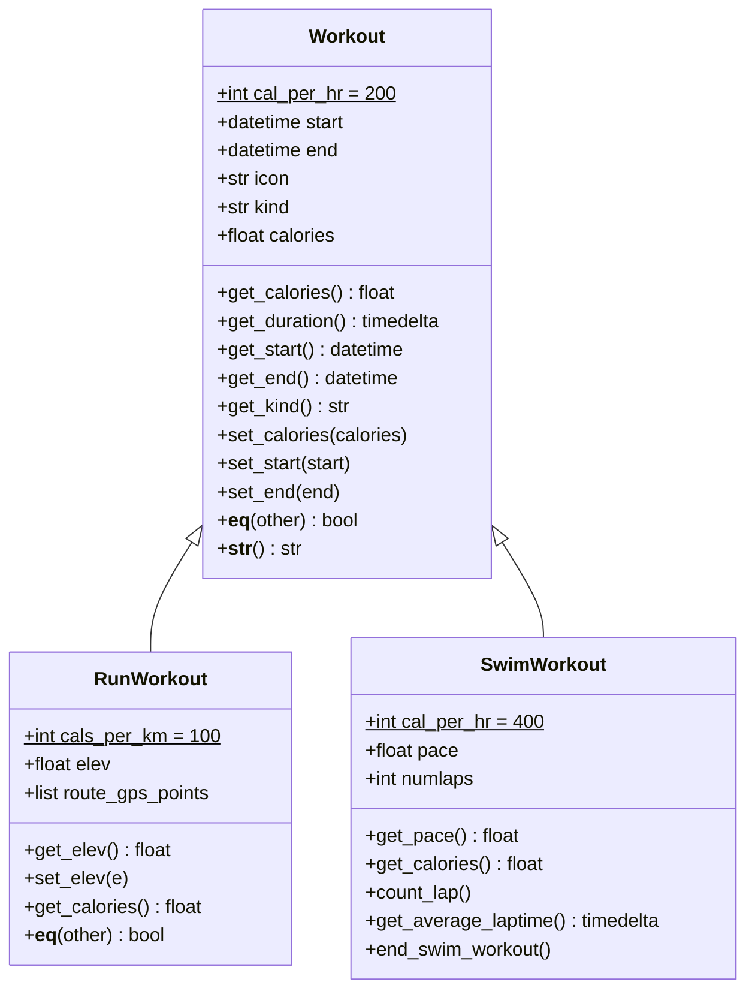

# L20 面向对象综合实战：Fitness Tracker

%% learning-vault-navigation:v1 %%
> [!abstract]- 笔记导航
> 目录：[[CS Learning/Python MIT6.100L/MIT Python导航|MIT Python 导航]]
> 上一章：[[CS Learning/Python MIT6.100L/Lecture 19 Inheritance/L19 类的继承与类变量|L19 类的继承与类变量]] · 下一章：[[CS Learning/Python MIT6.100L/Lecture 21 Timing Programs, Counting Operations/L21 程序计时与操作计数|L21 程序计时与操作计数]]

> [!abstract] 本讲核心概览
> 本讲是 MIT 6.100L 面向对象编程模块的综合收官实战：以智能手表中的 **运动追踪器（Fitness Tracker）** 为真实工程场景，完整演示如何从零抽象基类 `Workout`、利用类字典与实例字典理解内存模型、借助 `super()` 与方法重写构建 `RunWorkout` / `SwimWorkout` 继承体系，并结合 **Recitation 09**、**Finger Exercise 20（`Queue`）** 与 **Problem Set 5（Pillow 图像滤镜与 LSB 隐写术）** 串联起“面向对象设计 + 外部库调用”的完整能力闭环。
>
> **配套源文件**：[[CS Learning/Python MIT6.100L/Lecture 20 Fitness Tracker Object Oriented Programming Example/mit6_100l_f22_lec20.pdf|Lecture 20 讲义 PDF]] · [[CS Learning/Python MIT6.100L/Lecture 20 Fitness Tracker Object Oriented Programming Example/mit6_100l_f22_lec20_code/lec20.py|课堂主代码 lec20.py]] · [[CS Learning/Python MIT6.100L/Lecture 20 Fitness Tracker Object Oriented Programming Example/mit6_100l_f22_lec20_code/lec20_helpers.py|GPS 距离工具 lec20_helpers.py]] · [[CS Learning/Python MIT6.100L/Lecture 20 Fitness Tracker Object Oriented Programming Example/mit6_100l_f22_ex20.py|Finger Exercise 20 代码]] · [[CS Learning/Python MIT6.100L/Lecture 20 Fitness Tracker Object Oriented Programming Example/mit6_100l_f22_ps5/mit6_100l_f22_ps5.pdf|PS5 题目说明]] · [[CS Learning/Python MIT6.100L/Lecture 20 Fitness Tracker Object Oriented Programming Example/mit6_100l_f22_ps5/mit6_100l_f22_ps5_code/1_ps5/ps5.py|PS5 实现代码]] · [[CS Learning/Python MIT6.100L/Lecture 20 Fitness Tracker Object Oriented Programming Example/mit6_100l_f22_rec09/1_rec9/R09_summary.docx|Rec09 总结文档]]

---

## 1. Fitness Tracker 的类体系与内存模型

### 1.1 两种编程视角：实现类 vs 使用类

讲义开篇区分了 OOP 中两种截然不同的角色视角：
- **实现类（Implementing the Class）**：抽象出一类对象的共性，决定用哪些数据属性表达“它是什么”，用哪些方法表达“如何与它交互”。
- **使用类（Using the Class）**：创建具有具体属性值的实例，只依赖类暴露的公开方法接口，而不关心其内部数据结构如何演化。

### 1.2 从 `SimpleWorkout` 到 `Workout`：信息隐藏的工程价值

初期的 `SimpleWorkout` 直接把 `start`、`end` 当普通字符串保存，并要求必须传入 `calories`。随后需求升级为 `Workout`：
1. 引入第三方库 `dateutil.parser`：将任意日期字符串解析为 `datetime.datetime` 对象，两个时间相减直接得到 `timedelta`，调用 `.total_seconds()` 即可精确计算运动时长；
2. 引入类变量 `cal_per_hr = 200`：`calories` 参数变为可选（默认 `None`），若调用者未指定卡路里，则在 `get_calories()` 内按时长自动估算：

$$
\text{calories} = \text{cal\_per\_hr} \times \frac{(\text{end} - \text{start}).\text{total\_seconds}()}{3600.0}
$$

> [!important] 为什么信息隐藏在大型工程中至关重要？
> 如果外部代码先前通过 `w.get_calories()` 获取热量，那么从 `SimpleWorkout` 升级到 `Workout`（内部属性改成 `datetime`、`self.calories` 可能为 `None`）后，==调用方代码一行都无需改动==。反之，如果外部直接写 `w.calories + 100`，一旦 `w.calories` 为 `None` 就会立刻崩溃。**写一个类供他人使用，本质上是在承诺长期维护它的接口契约。**

### 1.3 类状态字典与实例状态字典（`__dict__`）

在 Python 内存中，**类定义**和**具体实例**分别维护着独立的状态字典：

- **类状态字典（`Workout.__dict__`）**：存放类变量（`cal_per_hr`）以及该类定义的所有方法（`__init__`、`get_calories`、`__str__`、`__eq__` 等）。
- **实例状态字典（`my_workout.__dict__`）**：只存放该实例独有的数据属性（`start`、`end`、`icon`、`kind`、`calories`）。

当访问 `rw.get_calories()` 或 `rw.cal_per_hr` 时，Python 会沿着 `实例.__dict__ -> 子类.__dict__ -> 父类.__dict__ -> ... -> object.__dict__` 的查找链解析属性。

---

## 2. `Workout` 继承体系设计详解

### 2.1 完整类图（含 Rec09 扩展）



### 2.2 `super()` 与子类扩展：`RunWorkout` 和 `SwimWorkout`

#### 1. 使用 `super()` 初始化父类状态
相比 L19 显式写 `Animal.__init__(self, age)`，L20 正式引入了更推荐的 `super()` 写法：

```python
class RunWorkout(Workout):
    cals_per_km = 100

    def __init__(self, start, end, elev=0, calories=None, route_gps_points=None):
        super().__init__(start, end, calories)   # 委托父类完成公共字段解析与初始化
        self.icon = '🏃🏽‍'
        self.kind = 'Running'
        self.elev = elev
        self.route_gps_points = route_gps_points
```

#### 2. 多级回退的方法重写：`RunWorkout.get_calories()`
`RunWorkout` 将热量计算细分为三级优先级：**GPS 轨迹距离优先 -> 手动传入 calories -> 按时长估算**，其中后两级直接通过 `super().get_calories()` 复用父类逻辑：

```python
def get_calories(self):
    if self.route_gps_points is not None:
        dist = 0
        lastP = self.route_gps_points[0]
        for p in self.route_gps_points[1:]:
            dist += gpsDistance(lastP, p)        # 基于 Haversine 球面距离公式（地球半径 R=6373 km）
            lastP = p
        return dist * RunWorkout.cals_per_km
    else:
        return super().get_calories()
```

其中 [[CS Learning/Python MIT6.100L/Lecture 20 Fitness Tracker Object Oriented Programming Example/mit6_100l_f22_lec20_code/lec20_helpers.py|lec20_helpers.py]] 中的 `gpsDistance(p1, p2)` 使用 **半正矢公式（Haversine Formula）** 计算两点经纬度 $(\phi_1, \lambda_1)$ 与 $(\phi_2, \lambda_2)$ 间的球面距离：

$$
a = \sin^2\!\left(\frac{\Delta\phi}{2}\right) + \cos\phi_1 \cos\phi_2 \sin^2\!\left(\frac{\Delta\lambda}{2}\right), \quad d = 2R \cdot \operatorname{atan2}\!\left(\sqrt{a},\, \sqrt{1-a}\right)
$$

#### 3. 模板方法式的代码复用与多态（Polymorphism）
- **复用父类 `__str__`**：`Workout.__str__` 负责绘制统一宽度的运动信息卡片（图标、类型、时长、热量）。`RunWorkout` 与 `SwimWorkout` 即使不重写 `__str__`，也能直接复用该卡片渲染逻辑——因为 `Workout.__str__` 内部调用的是 `self.get_calories()`，在运行时会**动态分派（Dynamic Dispatch）**到各自子类重写后的 `get_calories()`！
- **子类型可替换性（Substitutability）**：

```python
def total_calories(workouts):
    return sum(w.get_calories() for w in workouts)

def total_elevation(run_workouts):
    return sum(w.get_elev() for w in run_workouts)
```

> [!important] 替换原则（方向不可逆）
> ==任何期待父类 `Workout` 的函数（如 `total_calories([w1, w2, rw1, rw2])`），都可以无缝传入子类 `RunWorkout` / `SwimWorkout` 实例；但反过来，期待子类特有方法 `get_elev()` 的 `total_elevation([w1, rw1])` 传入父类 `Workout` 实例时会报错。==

#### 4. 子类的相等性判断 `__eq__`
子类重写 `__eq__` 时，通常既要确保父类属性全部相等，又要校验子类新增属性：

```python
# Workout.__eq__
def __eq__(self, other):
    return (type(self) == type(other) and
            self.start == other.start and
            self.end == other.end and
            self.kind == other.kind and
            self.get_calories() == other.get_calories())

# RunWorkout.__eq__
def __eq__(self, other):
    return super().__eq__(other) and self.elev == other.elev
```

> [!tip] 为什么要先检查 `type(self) == type(other)`？
> 短路求值（Short-circuit evaluation）保证如果 `other` 不是 `RunWorkout`，`super().__eq__(other)` 会立刻返回 `False`，不会再去访问 `other.elev` 而引发 `AttributeError`。

### 2.3 OOP 设计哲学：工程是艺术而非教条

讲义第 33 页给出了极其清醒的工程提醒（**Object Oriented Design: More Art than Science**）：
- **警惕过度设计（Over-engineering）**：初学者容易沉迷于构造极深、极复杂的类层次，反而增加理解与维护成本；
- **换位思考使用者体验**：你的类拆分方式对调用者来说直观吗？
- **控制流隐式化的代价**：在多层继承中，真正被调用的方法取决于运行时对象类型，层次过深会让代码阅读与排错变得困难。

---

## 3. 配套练习与 Recitation 09 复盘

### 3.1 课堂 At-Home 练习：`total_elapsed_time(L)`

在 [[CS Learning/Python MIT6.100L/Lecture 20 Fitness Tracker Object Oriented Programming Example/mit6_100l_f22_lec20_code/lec20.py|lec20.py]] 末尾，要求对日期时间字符串二元组列表 `L = [(e1, e2), ...]` 累加总耗时（秒）：

```python
def total_elapsed_time(L):
    total = 0
    for e in L:
        e1 = parser.parse(e[0])
        e2 = parser.parse(e[1])
        total += (e2 - e1).total_seconds()
    return total
```

### 3.2 Finger Exercise 20：`Queue(Container)`（FIFO）与 `Stack` 对比

源文件：[[CS Learning/Python MIT6.100L/Lecture 20 Fitness Tracker Object Oriented Programming Example/mit6_100l_f22_ex20.py|mit6_100l_f22_ex20.py]] · [[CS Learning/Python MIT6.100L/Lecture 20 Fitness Tracker Object Oriented Programming Example/mit6_100l_f22_ex20_sol.pdf|官方解答 PDF]]

```python
class Queue(Container):
    def remove(self):
        if self.size() > 0:
            return self.myList.pop(0)   # 弹出队首（最早进入的元素）
        else:
            return None
```

| 对比维度 | `Stack(Container)`（[[CS Learning/Python MIT6.100L/Lecture 19 Inheritance/L19 类的继承与类变量\|L19 练习]]） | `Queue(Container)`（L20 练习） |
| --- | --- | --- |
| 语义规则 | 后进先出（LIFO，如叠煎饼） | 先进先出（FIFO，如收银台排队） |
| 入容器 `add` | `self.myList.append(elem)` | `self.myList.append(elem)`（继承自 `Container`） |
| 出容器 `remove` | `self.myList.pop()`（尾端移除） | `self.myList.pop(0)`（首端移除） |
| `remove` 复杂度预告 | 摊还 $O(1)$ | $O(n)$（需整体左移后续元素；工程上常用 `collections.deque` 实现 $O(1)$） |

### 3.3 Recitation 09 复习与细节勘误

源文件：[[CS Learning/Python MIT6.100L/Lecture 20 Fitness Tracker Object Oriented Programming Example/mit6_100l_f22_rec09/1_rec9/R09_summary.docx|R09_summary.docx]] · [[CS Learning/Python MIT6.100L/Lecture 20 Fitness Tracker Object Oriented Programming Example/mit6_100l_f22_rec09/1_rec9/R09_problems.py|R09_problems.py]] · [[CS Learning/Python MIT6.100L/Lecture 20 Fitness Tracker Object Oriented Programming Example/mit6_100l_f22_rec09/1_rec9/R09_reviewcode.py|R09_reviewcode.py]]

- `R09_reviewcode.py` 回顾了 `Coordinate` 与 `Person`（含待办列表 `todo`、队列式 `mark_off()` 切片删除）基础类设计；
- `R09_problems.py` 扩展了 `SwimWorkout`：新增 `self.numlaps = 0`、`count_lap()`、`get_average_laptime()`（直接用 `timedelta` 除以整数 `self.get_duration() / self.numlaps`，若 `numlaps == 0` 返回 `None`）、重写 `__str__` 显示圈数以及 `end_swim_workout()`。

> [!warning] 练习代码排错笔记（`R09_problems.py` 第 173 行）
> 在 [[CS Learning/Python MIT6.100L/Lecture 20 Fitness Tracker Object Oriented Programming Example/mit6_100l_f22_rec09/1_rec9/R09_problems.py|R09_problems.py]] 的 Exercise 2 中写了：
> ```python
> print(rw3.get_average_laptime)     # 漏掉了 ()，只会打印 <bound method SwimWorkout.get_average_laptime of ...>
> ```
> 正确调用应为 `print(rw3.get_average_laptime())`。忘记括号是 Python 中最常见的“把函数/方法对象本身当成返回值”错误。

---

## 4. Problem Set 5 实战复盘：第三方库、图像滤镜与 LSB 隐写术

源文件：[[CS Learning/Python MIT6.100L/Lecture 20 Fitness Tracker Object Oriented Programming Example/mit6_100l_f22_ps5/mit6_100l_f22_ps5.pdf|mit6_100l_f22_ps5.pdf]] · [[CS Learning/Python MIT6.100L/Lecture 20 Fitness Tracker Object Oriented Programming Example/mit6_100l_f22_ps5/mit6_100l_f22_ps5_code/1_ps5/ps5.py|ps5.py]] · [[CS Learning/Python MIT6.100L/Lecture 20 Fitness Tracker Object Oriented Programming Example/mit6_100l_f22_ps5/mit6_100l_f22_ps5_code/1_ps5/test_ps5_student.py|test_ps5_student.py]]

PS5 的核心训练目标并非手写冗长代码，而是学会**查阅文档并组合第三方库（`PIL.Image`、`numpy`、`pathlib`）解决实际问题**。

### 4.1 Part 1：色盲模拟滤镜（Colorblindness Filters）

利用 Pillow（`PIL.Image`）将图片转为像素序列，再用 `numpy.matmul` 对每个 RGB 像素向量左乘 $3 \times 3$ 色盲变换矩阵（如红色盲 Protanopia），实现石原色盲测试图（`image_15.png`）的视觉模拟：


关键实现细节（见 [[CS Learning/Python MIT6.100L/Lecture 20 Fitness Tracker Object Oriented Programming Example/mit6_100l_f22_ps5/mit6_100l_f22_ps5_code/1_ps5/ps5.py|ps5.py]]）：
- **上下文管理器**：`with Image.open(filename) as image: return list(image.getdata())`，自动关闭文件句柄；
- **矩阵乘法顺序与类型转换**：必须以变换矩阵为第一参数、RGB 向量为第二参数；`matrix_multiply` 返回浮点列表，需转换并裁剪到合法像素范围 `[0, 255]`：
  ```python
  values = tuple(max(0, min(255, int(value))) for value in values)
  ```

### 4.2 Part 2：图像隐写术与最低有效位（LSB Steganography）

8-bit 图像中每个通道取值为 $0 \sim 255$（即 8 位二进制）。人眼对最低的 $1 \sim 3$ 个比特（**Least Significant Bits, LSB**）变化几乎不可察觉，因此可以把秘密图像隐藏在宿主像素的最低位中。

#### 1. 不转二进制字符串直接提取低 $k$ 位
对于整数像素值 $p$，其二进制表示的最低 $k$ 位正好等于 $p$ 除以 $2^k$ 的余数：

$$
\text{LSB}_k(p) = p \bmod 2^k
$$

```python
def extract_end_bits(num_end_bits, pixel):
    modulus = 2 ** num_end_bits
    if isinstance(pixel, tuple):
        return tuple(channel % modulus for channel in pixel)
    return pixel % modulus
```

#### 2. 对比度重缩放（Rescaling）与模式分派
直接提取出的低位值域极小（1 bit 仅为 $\{0, 1\}$，3 bits 仅为 $\{0, \dots, 7\}$），直接渲染几乎全黑，必须线性拉伸回 $[0, 255]$：
- **灰度图（`hidden1.bmp`，mode `"1"` / `"L"`，1 LSB）**：`revealed = 255 * extract_end_bits(1, pixel)`；
- **彩色图（`hidden2.bmp`，mode `"RGB"`，每通道 3 LSBs）**：将 $[0, 7]$ 线性映射到 $[0, 255]$：
  $$
  c_{\text{out}} = \left\lfloor c_{\text{lsb}} \times \frac{255}{7} \right\rfloor
  $$
- **总入口 `reveal_image(filename)`**：读取 `image.mode` 后分发给 `reveal_bw_image` 或 `reveal_color_image`，非法模式则抛出 `ValueError`。

> [!note] 仓库文件提示
> PS5 目录中的 `tester_bw_img.obj` 与 `tester_rgb_img.obj` 是 `test_ps5_student.py` 依赖的序列化测试图片数据，而非编译产物，运行单元测试前请确保工作目录位于 `1_ps5/` 下。

---

## 5. 自测与复习思考

> [!question]- 自测 1：在 `lec20.py` 的 You Try It 中，`rw1 = RunWorkout('9/30/2021 2:20 PM', '9/30/2021 2:50 PM', 250)` 和 `rw3 = RunWorkout(..., calories=300)` 的热量与爬升分别是多少？
> 运动时长为 30 分钟（0.5 小时），`Workout.cal_per_hr = 200`：
> - `rw1`：第 3 个位置参数对应 `elev=250`，`calories` 默认为 `None`，因此 `rw1.get_calories()` 按时长估算得 `100.0`，`rw1.get_elev()` 为 `250`；
> - `rw3`：通过关键字参数指定 `calories=300`，`elev` 取默认值 `0`，因此 `rw3.get_calories()` 为 `300`，`rw3.get_elev()` 为 `0`。

> [!question]- 自测 2：为什么 `SwimWorkout` 重定义了 `cal_per_hr = 400` 之后，还需要重写 `get_calories()` 才能生效？有没有更优雅的写法？
> 因为 `Workout.get_calories()` 中写死了 `Workout.cal_per_hr`，而不是 `self.cal_per_hr`（或 `type(self).cal_per_hr`）。如果父类改写成 `self.cal_per_hr`（注意仅读取不赋值，不会产生实例遮蔽），那么所有子类只需重定义类变量 `cal_per_hr`，就可以直接复用父类的 `get_calories()`，进一步减少重复代码。
