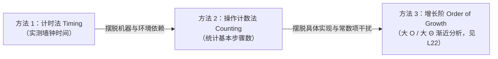

# L21 程序计时与操作计数

%% learning-vault-navigation:v1 %%
> [!abstract]- 笔记导航
> 目录：[[CS Learning/Python MIT6.100L/MIT Python导航|MIT Python 导航]]
> 上一章：[[CS Learning/Python MIT6.100L/Lecture 20 Fitness Tracker Object Oriented Programming Example/L20 面向对象综合实战：Fitness Tracker|L20 面向对象综合实战：Fitness Tracker]] · 下一章：[[CS Learning/Python MIT6.100L/Lecture 22 Big Oh and Theta/L22 渐近复杂度：大 O 与大 Θ 记号|L22 渐近复杂度：大 O 与大 Θ 记号]]

> [!abstract] 本讲核心概览
> 从本讲开始，课程重心从“写出**正确（Correct）**的程序”迈向“写出**高效（Efficient）**的程序”。本讲系统梳理评估程序效率的三条路径——**计时法（Timing）**、**操作计数法（Counting Operations）**与**增长阶（Order of Growth）**，通过 `c_to_f`、`mysum`、`square` 三个代表性函数实测前两种方法的表现，并剖析它们各自的局限性，从而自然引出下一讲的渐近复杂度分析框架。
>
> **配套源文件**：[[CS Learning/Python MIT6.100L/Lecture 21 Timing Programs, Counting Operations/mit6_100l_f22_lec21.pdf|Lecture 21 讲义 PDF]] · [[CS Learning/Python MIT6.100L/Lecture 21 Timing Programs, Counting Operations/mit6_100l_f22_lec21_code.py|课堂计时与计数代码]]

---

## 1. 为什么效率至关重要？

正确性永远是程序设计的第一前提，但在面对大规模真实数据（例如搜索引擎处理 $3 \times 10^{13}$ 级网页与上亿 GB 数据）时，仅靠“能跑通”远远不够。

### 1.1 时间效率 vs 空间效率（Time-Space Tradeoff）
衡量程序效率必须同时区分两个维度，并在二者之间权衡：
- **时间效率（Time Efficiency）**：完成计算需要多少执行步骤/运行时间；
- **空间效率（Space Efficiency）**：计算过程中需要占用多少内存。
- **典型权衡**：以斐波那契数列为例，朴素递归几乎不占额外存储但重复计算爆炸；加入**记忆化（Memoization）**字典后，付出少量额外内存即可换取运行时间的指数级加速。

### 1.2 分离“算法选择”与“具体实现”
解决同一个问题往往只有少数几种核心**算法（Algorithm）**，但每种算法可以写出无数种细节略有不同的**代码实现（Implementation）**。理想的效率评估方法应当聚焦于算法本身的可扩展性，而非某一台电脑或某几行语法微调带来的差异。



---

## 2. 方法一：程序计时（Timing Programs）

### 2.1 Python 模块回顾与 `time` 模块计时

模块（Module）是封装了一组 Python 函数与类定义的文件，使用前需通过 `import` 导入，再以点号调用（如 `math.sin(math.pi / 2)`、`time.time()`）。

基本计时三步法（启动计时器 -> 调用目标函数 -> 计算时间差）：

```python
import time

def time_wrapper(f, L):
    print('Timing', f.__name__)
    for i in L:
        t = time.time()
        f(i)
        dt = time.time() - t
        print(f"{f.__name__}({i}) took {dt} sec")
```

### 2.2 三个基准函数的实测现象

课堂代码 [[CS Learning/Python MIT6.100L/Lecture 21 Timing Programs, Counting Operations/mit6_100l_f22_lec21_code.py|mit6_100l_f22_lec21_code.py]] 构造了按 10 倍递增的输入规模列表 `L_N = [1, 10, 100, ..., 10^8]`，分别测试三个函数：

```python
# 1. 常数级：摄氏度转华氏度
def c_to_f(c):
    return c * 9.0 / 5 + 32

# 2. 线性级：累加 0 + 1 + ... + x
def mysum(x):
    total = 0
    for i in range(x + 1):
        total += i
    return total

# 3. 平方级：低效计算 n * n
def square(n):
    sqsum = 0
    for i in range(n):
        for j in range(n):
            sqsum += 1
    return sqsum
```

| 函数 | 实测表现（输入按 10 倍增长） | 直观观察 |
| --- | --- | --- |
| `c_to_f(c)` | 单次执行耗时极短，几乎为 `0.0 s` | 计时精度不足，甚至无法准确测出耗时；与输入大小无关 |
| `mysum(x)` | 例如 `0.009 s -> 0.05 s -> 0.5 s -> 5 s` | 规模增大后呈现出约 **10 倍输入 -> 10 倍时间** 的规律 |
| `square(n)` | 当 $n = 10^5$ 时需数百秒，$n = 10^6$ 时需数万秒 | 输入稍微变大就在可接受时间内无法跑完 |

### 2.3 计时法为什么不够用？

讲义用 5 条理想评估标准检验计时法：

| 评估标准 | 计时法是否满足？ | 原因说明 |
| --- | --- | --- |
| 不同算法间能区分优劣 | 部分满足 | 能看出快慢，但混杂了其他变量 |
| 不随具体代码实现变化 | 否 | 换一种循环写法耗时就会变 |
| 不随运行机器变化 | 否 | CPU、后台负载、内存不同结果迥异 |
| 不随编程语言变化 | 否 | C 与 Python 常数速度差距巨大 |
| 对小输入也可预测 / 能建立输入与时间的解析关系 | 否 | 小输入噪声极大；只能**事后（a posteriori）**运行完才能测出，且无法给出通用公式 |

---

## 3. 方法二：操作计数（Counting Operations）

### 3.1 基本操作假设（RAM 模型直觉）

为摆脱硬件、操作系统与后台进程的干扰，我们假设以下原子步骤各消耗**常数时间（1 个单位操作）**：
1. **数学运算**（`+`, `-`, `*`, `/` 等）
2. **比较运算**（`==`, `<`, `>` 等）
3. **变量赋值**（`=`）
4. **内存访问**（读取变量、列表索引等）

随后将总操作数表示为输入规模的函数。

### 3.2 三个基准函数的精确操作计数

在讲义第 13 页与课堂代码 [[CS Learning/Python MIT6.100L/Lecture 21 Timing Programs, Counting Operations/mit6_100l_f22_lec21_code.py|mit6_100l_f22_lec21_code.py]] 中，对三个函数插入计数器 `counter`：

| 函数 | 讲义 / 代码计数拆解 | 操作总数公式 | 规模扩大时的增长倍数 |
| --- | --- | --- | --- |
| `c_to_f(c)` | 1 次乘 + 1 次除 + 1 次加 | $T(c) = 3$ | 恒定 $1\times$（与输入无关） |
| `mysum(x)` | 初始赋值 `1` + 循环 $(x+1)$ 次，每次迭代取 `i`（1）+ 加法赋值 `total += i`（2） | $T(x) = 1 + 3(x + 1) = 3x + 4$ | 输入 $\times 10 \implies$ 操作数 $\approx \times 10$ |
| `square(n)` | 初始赋值 `1` + 外层 $n$ 次 $\times$ 内层 $n$ 次 $\times$ `3` ops（代码中还计入外层取 `i` 的 $+n$） | 讲义：$3n^2 + 1$<br>代码：$3n^2 + n + 1$ | 输入 $\times 2 \implies$ 操作数 $\approx \times 4$<br>输入 $\times 10 \implies$ 操作数 $\approx \times 100$ |

> [!example] `count_wrapper` 的倍率验证
> 课堂代码通过 `count_wrapper(f, L)` 连续计算相邻规模下的比值 `multiplier = counter / float(prev)`：
> - 对 `mysum` 传入 `L1 = [100, 1000, 10000, ...]`，倍率迅速收敛到 `10.0`；
> - 对 `square` 传入 `L2_a = [128, 256, 512, 1024, 2048, 4096, 8192]`，倍率迅速收敛到 `4.0`；传入 `L2_b = [1, 10, 100, 1000, 10000]`，倍率迅速收敛到 `100.0`。

### 3.3 操作计数法的进步与残余局限

> [!important] 操作计数法的得与失
> - **核心进步**：彻底摆脱了机器快慢和硬件差异，并能推导出操作数与输入规模之间的显式数学关系（如 $3x+4$、$3n^2+n+1$）。
> - **仍然存在的缺陷**：
>   1. **没有统一标准界定“哪些算一步”**：例如讲义对 `square` 算得 $3n^2+1$，而代码里多计入了外层循环控制变为 $3n^2+n+1$；`return` 算不算 1 步？`for` 循环隐含的迭代器推进算几步？
>   2. **依然依赖具体代码实现与语言细节**：换一种写法，常数系数可能从 $3x+4$ 变成 $5x+2$，但二者本质上都是“随 $x$ 线性增长”。

因此，我们需要一种**忽略低阶项与常数系数、直接刻画算法在输入趋于无穷时的可扩展性（Scalability）**的数学工具——这就是 [[CS Learning/Python MIT6.100L/Lecture 22 Big Oh and Theta/L22 渐近复杂度：大 O 与大 Θ 记号|L22 渐近复杂度：大 O 与大 Θ 记号]] 的主题。

---

## 4. 自测与复习思考

> [!question]- 自测 1：同样求 $0 + 1 + \dots + x$，如果把 `mysum(x)` 改成高斯求和公式 `return x * (x + 1) // 2`，操作数会如何变化？
> 原本的循环需要 $3x + 4$ 步（随 $x$ 线性增长）；改成高斯公式后只需 1 次加法、1 次乘法、1 次整除，操作数变为**常数 $3$ 步**，无论 $x$ 是 $10$ 还是 $10^9$，耗时都恒定不变。这正是“换一个算法”胜过“微调代码实现”的典型例证。

> [!question]- 自测 2：为什么在 `square(n)` 的分析中，$3n^2 + 1$ 与 $3n^2 + n + 1$ 的微小差别在评估大输入可扩展性时并不重要？
> 当 $n = 10000$ 时，$3n^2 = 3 \times 10^8$，而低阶项 $n = 10^4$ 仅占约 $0.0033\%$，常数项 $1$ 更是微不足道。无论算成哪一个公式，当 $n$ 翻倍时操作数都趋近于原来的 $4$ 倍——真正主导增长趋势的是最高阶项 $n^2$。
