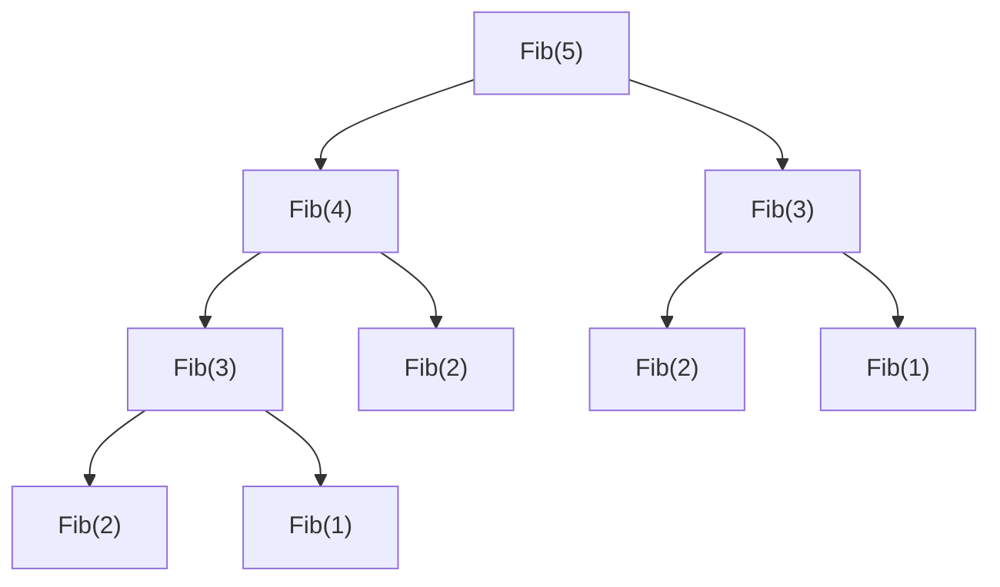

# L23 常见复杂度类别与实例分析

%% learning-vault-navigation:v1 %%
> [!abstract]- 笔记导航
> 目录：[[CS Learning/Python MIT6.100L/MIT Python导航|MIT Python 导航]]
> 上一章：[[CS Learning/Python MIT6.100L/Lecture 22 Big Oh and Theta/L22 渐近复杂度：大 O 与大 Θ 记号|L22 渐近复杂度：大 O 与大 Θ 记号]] · 下一章：[[CS Learning/Python MIT6.100L/Lecture 24 Sorting Algorithms/L24 经典排序算法|L24 经典排序算法]]

> [!abstract] 本讲核心概览
> 本讲将 [[CS Learning/Python MIT6.100L/Lecture 22 Big Oh and Theta/L22 渐近复杂度：大 O 与大 Θ 记号|L22]] 建立的 $\Theta$ 渐近理论落到真实代码上，逐类剖析**常数、线性、多项式（平方/立方）、指数、对数**五大核心复杂度类别的经典代码片段，汇总 Python `list` 与 `dict` 内置操作的隐藏复杂度，通过**切片版 vs 索引版二分查找**揭示“实现细节足以改变增长阶”的核心教训，并引入**摊还成本（Amortized Cost）**讨论“先排序再查找”的权衡。
>
> **配套源文件**：[[CS Learning/Python MIT6.100L/Lecture 23 Complexity Classes Examples/mit6_100l_f22_lec23.pdf|Lecture 23 讲义 PDF]] · [[CS Learning/Python MIT6.100L/Lecture 23 Complexity Classes Examples/mit6_100l_f22_lec23_code.py|课堂完整代码]] · [[CS Learning/Python MIT6.100L/Lecture 23 Complexity Classes Examples/mit6_100l_f22_ex23.py|Finger Exercise 23 代码]] · [[CS Learning/Python MIT6.100L/Lecture 23 Complexity Classes Examples/mit6_100l_f22_ex23_sol.pdf|Finger Exercise 23 官方解答]] · [[CS Learning/Python MIT6.100L/Lecture 23 Complexity Classes Examples/mit6_100l_f22_rec10/1_rec10/R10_summary.pdf|Rec10 总结讲义]] · [[CS Learning/Python MIT6.100L/Lecture 23 Complexity Classes Examples/mit6_100l_f22_rec10/1_rec10/R10_problems.py|Rec10 练习代码]]

---

## 1. 快速估算代码复杂度的四步法

面对一段陌生代码，无需逐行手算类似 $5\cdot\text{len}(L_1) + 5\cdot\text{len}(L_2) + 3$ 的精确公式，只需按讲义（Slide 68）与 Rec10 总结检查四个关键点：
1. **锁定输入参数**：先明确复杂度是关于哪个输入（数值大小、列表长度还是多参数组合）；
2. **定位循环结构**：循环次数是否依赖输入？是串联（相加）还是嵌套（相乘）？
3. **审查递归结构**：递归调用栈有多深？每层产生几个分支？每次调用自身做多少工作？
4. **排查隐式内置操作**：如 `e in L`、列表切片 `L[:half]`、列表拼接 `small + extra`、`del L[i]` 等都==不是== $\Theta(1)$！

---

## 2. 五大复杂度类别典型代码剖析

### 2.1 常数复杂度 $\Theta(1)$

运行时间与输入规模完全无关。即便代码中包含循环，只要循环次数是与输入无关的常数，依然属于 $\Theta(1)$：

```python
def loop(x):
    y = 100
    total = 0
    for i in range(y):   # 循环固定执行 100 次，与输入 x 无关！
        total += x
    return total         # 关于 x：Θ(1)
```

### 2.2 线性复杂度 $\Theta(n)$

常见于单层遍历输入、单分支递归（每次规模减 1 且每层耗时 $\Theta(1)$）：

| 示例函数 | 代码要点 | 渐近复杂度 | 关键注意点 |
| --- | --- | --- | --- |
| `mul(x, y)` | `for i in range(y): tot += x` | 关于 `y`：$\Theta(y)$；关于 `x`：$\Theta(1)$ | ==警惕多参数函数的不同视角== |
| `add_digits(s)` | 遍历数字字符串 `s` 逐字符累加 | $\Theta(\text{len}(s))$ | 输入是字符串本身，长度为 $\text{len}(s)$ |
| `fact_iter(n)` / `fact_recur(n)` | 迭代与递归阶乘 | 同为 $\Theta(n)$ | 递归因函数调用栈开销实测略慢，但**增长阶相同**（注：Python 任意精度大整数乘法在 $n$ 极大时会超线性，本课忽略） |
| `compound(invest, interest, n_months)` | 按月循环复利 | $\Theta(n_{\text{months}})$ | 仅随月数线性增长 |
| `fib_iter(n)` | 用 `fib_i, fib_ii` 迭代递推 | $\Theta(n)$ | 与递归版斐波那契形成天壤之别 |

### 2.3 多项式复杂度 $\Theta(n^c)$（重点：平方与立方）

典型来源是**循环嵌套**，或者**循环内部隐含了线性内置操作**：

- **`g(n)`**：双重 `range(n)` 嵌套 $\implies \Theta(n^2)$。
- **`is_subset(L1, L2)`**：外层遍历 `L1`，内层遍历 `L2` 匹配 $\implies$ 最坏 $\Theta(\text{len}(L_1) \cdot \text{len}(L_2))$（等长时为 $\Theta(n^2)$）。
- **`intersect(L1, L2)`**：第一段双重循环找公共元素写入 `tmp`（耗时 $\Theta(|L_1||L_2|)$，最坏如 `[7,7,7]` 与 `[7,7,7]` 会生成 $|L_1||L_2|$ 个元素）；第二段去重 `if not (e in unique)`，综合最坏仍为 $\Theta(\text{len}(L_1) \cdot \text{len}(L_2))$。
- **`diameter(L)`**：内层 `range(i+1, len(L))` 共执行 $\frac{n(n-1)}{2}$ 次 $\implies \Theta(\text{len}(L)^2)$。

> [!warning] 两道经典的“嵌套循环陷阱”题（Slides 29–30）
> 1. **`all_digits(nums)`**：虽然写了双层 `for` 循环，但内层遍历的是固定长度 10 的 `digits = [0,1,...,9]`，属于 $\Theta(1)$，因此总复杂度是 **$\Theta(\text{len}(\text{nums}))$** 而非平方！
> 2. **`f(L1, L2, L3)`**：双层循环 `for e1 in L1: for e2 in L2:` 内部写了 `if e1 in L3 and e2 in L3:`。由于列表的 `in` 是 $\Theta(\text{len}(L_3))$，总复杂度为 **$\Theta(|L_1|\cdot|L_2|\cdot|L_3|)$**，三者等长时高达立方级 **$\Theta(n^3)$**！

### 2.4 指数复杂度 $\Theta(c^n)$

典型来源是**每次问题规模减小常数但触发多个递归分支**，或输出本身规模就是指数级。

#### 1. 递归斐波那契 `fib_recur(n)`
```python
def fib_recur(n):
    if n == 0:
        return 0
    elif n == 1:
        return 1
    else:
        return fib_recur(n - 1) + fib_recur(n - 2)
```



尽管右侧分支略早触底（更紧的数学界为黄金比例 $\Theta(\phi^n),\; \phi \approx 1.618$），讲义将其归为指数级 **$\Theta(2^n)$**。对比 `fib_iter(n)` 的 $\Theta(n)$，仅仅消除重复子问题就带来了指数到线性的质变。

#### 2. 幂集生成 `gen_subsets(L)`
```python
def gen_subsets(L):
    if len(L) == 0:
        return [[]]
    extra = L[-1:]
    smaller = gen_subsets(L[:-1])
    new = []
    for small in smaller:
        new.append(small + extra)   # 列表拼接复制元素，耗费 O(len(small))
    return smaller + new
```
设 $n = \text{len}(L)$：
- 规模为 $k$ 的集合恰好有 $2^k$ 个子集；从 $k=0$ 到 $n-1$ 各层循环次数之和为：
  $$
  \sum_{k=0}^{n-1} 2^k = 2^n - 1 = \Theta(2^n)
  $$
- **精细分析（Slide 43）**：每次 `small + extra` 复制子列表需消耗最高 $\Theta(n)$ 时间，因此计入列表复制开销后，整体时间复杂度为 **$\Theta(n \cdot 2^n)$**（若将拼接近似视作常数，课堂代码注释则简记为 $\Theta(2^n)$）。

### 2.5 对数复杂度 $\Theta(\log n)$

#### 经典易错题：整数各位求和 `digit_add(n)` / `sum_f(n)`
```python
def digit_add(n):
    answer = 0
    s = str(n)
    for c in s[::-1]:
        answer += int(c)
    return answer
```
为什么表面上看是一层单循环，复杂度却**不是** $\Theta(n)$ 而是 **$\Theta(\log n)$**？
- 因为输入的 `n` 是一个**整数值**，循环次数等于 `n` 的十进制位数 `len(str(n))`；
- 每次迭代相当于把 $n$ 除以 $10$，直到只剩 1 位数字：

$$
\frac{n}{10^k} = 1 \implies k = \log_{10} n \implies \Theta(\log n)
$$

> [!tip] 对比记忆：`add_digits(s)` vs `digit_add(n)`
> - 若输入本身是**字符串 `s`**，规模度量是字符个数 $\text{len}(s)$，故为 $\Theta(\text{len}(s))$；
> - 若输入是**整数 `n`**，规模度量是数值大小 $n$，位数只有 $\lfloor \log_{10} n \rfloor + 1$，故为 $\Theta(\log n)$！

---

## 3. Python 内置容器复杂度速查表（List vs Dict）

分析自己编写的代码时，**必须把调用的 Python 内置操作复杂度也纳入计算**（汇总自 Slide 51 与 [[CS Learning/Python MIT6.100L/Lecture 23 Complexity Classes Examples/mit6_100l_f22_rec10/1_rec10/R10_summary.pdf|R10_summary.pdf]]）：

| 操作 | `list`（$n = \text{len}(L)$） | `dict`（$n = \text{len}(d)$，平均/哈希良好） |
| --- | --- | --- |
| 按索引/键读取 `L[i]` / `d[k]` | $\Theta(1)$ | $\Theta(1)$ |
| 按索引/键写入 `L[i]=v` / `d[k]=v` | $\Theta(1)$ | $\Theta(1)$ |
| 求长度 `len(...)` | $\Theta(1)$ | $\Theta(1)$ |
| 尾部追加 `L.append(x)` | $\Theta(1)$（摊还） | — |
| 删除元素 | `del L[i]` / `L.remove(x)` / `L.pop(0)`：$\Theta(n)$ | `del d[k]`：$\Theta(1)$ |
| 成员测试 `e in ...` | $\Theta(n)$（顺序扫描） | `k in d`：$\Theta(1)$（哈希查找） |
| 切片 / 拷贝 / 反转 / 相等比较 | `L[:k]`、`L.copy()`、`L.reverse()`、`L1 == L2`：$\Theta(n)$ | `.keys()` / `.values()` / 迭代遍历：$\Theta(n)$ |
| 排序 `L.sort()` / `sorted(L)` | $\Theta(n \log n)$ | — |

---

## 4. 查找算法对比与“实现决定复杂度”

### 4.1 线性查找（Linear Search）
- **无序列表**：必须扫描完整个列表才能确认元素不存在，最坏 $\Theta(n)$；
- **有序列表（提前终止版 `search`）**：遇到 `L[i] > e` 即可提前返回 `False`，但当 `e` 大于所有元素时仍需扫完整张表，因此最坏复杂度**依然是 $\Theta(n)$**。

### 4.2 二分查找的两种实现：$\Theta(n \log n)$ / $\Theta(n)$ vs $\Theta(\log n)$

> [!important] Big Idea：同一算法的不同实现，可能落入完全不同的 $\Theta$ 类别！

#### 实现 1：`bisect_search1(L, e)` —— 每次递归切片复制列表（反面教材）
```python
def bisect_search1(L, e):
    if L == []:
        return False
    elif len(L) == 1:
        return L[0] == e
    else:
        half = len(L) // 2
        if L[half] > e:
            return bisect_search1(L[:half], e)   # 切片复制了半个列表！
        else:
            return bisect_search1(L[half:], e)
```
- 递归深度为 $\log_2 n$（由 $\frac{n}{2^k} = 1 \implies k = \log_2 n$）；
- **课程估算口径（Slide 61）**：每层切片近似按 $\Theta(n)$ 计，得 $\Theta(\log n) \times \Theta(n) = \Theta(n \log n)$；
- **严格几何级数紧界（Slide 61 补充）**：各层实际复制长度之和为 $\frac{n}{2} + \frac{n}{4} + \frac{n}{8} + \dots + 1 = n - 1 = \Theta(n)$。无论按哪种口径，**切片复制都彻底毁掉了二分查找的对数优势**！

#### 实现 2：`bisect_search2(L, e)` —— 传递上下界下标（零拷贝正解）
```python
def bisect_search2(L, e):
    def bisect_search_helper(L, e, low, high):
        if high == low:
            return L[low] == e
        mid = (low + high) // 2
        if L[mid] == e:
            return True
        elif L[mid] > e:
            if low == mid:
                return False
            return bisect_search_helper(L, e, low, mid - 1)
        else:
            return bisect_search_helper(L, e, mid + 1, high)

    if len(L) == 0:
        return False
    return bisect_search_helper(L, e, 0, len(L) - 1)
```
- 列表 `L` 仅按引用重传，**从不拷贝**，每层仅做 $\Theta(1)$ 算术与索引比较；
- 总复杂度：$\Theta(\log n) \times \Theta(1) = \Theta(\log n)$！

### 4.3 何时值得“先排序再二分查找”？（摊还成本 Amortized Cost）

- **只查 1 次**：要让“排序 + 二分”快于直接线性扫描，必须满足 $\text{SORT} + \Theta(\log n) < \Theta(n)$，即 $\text{SORT} < \Theta(n)$。这**永远不可能**（排序至少得把每个元素看一遍，比较排序更需 $\Theta(n\log n)$）。
- **连续查询 $K$ 次**：比较两者总开销：
  $$
  \text{SORT} + K \cdot \Theta(\log n) \quad \text{vs} \quad K \cdot \Theta(n)
  $$
  ==当查询次数 $K$ 足够大时，一次性的排序开销被**摊还（Amortize）**到 $K$ 次查询中变得微不足道，此时“先排序、后多次二分”具有压倒性优势。==

---

## 5. Finger Exercise 23 与 Recitation 10 练习复盘

### 5.1 Finger Exercise 23（[[CS Learning/Python MIT6.100L/Lecture 23 Complexity Classes Examples/mit6_100l_f22_ex23.py|mit6_100l_f22_ex23.py]]）

| 题号 | 函数 | 最坏复杂度 | 关键解析 |
| --- | --- | --- | --- |
| Q1 | `running_product(a)` | $\Theta(n)$（$n=a$） | `range(5, a+5)` 迭代 $a$ 次，内部均为 $\Theta(1)$ |
| Q2 | `tricky_f(L, L2)` | $\Theta(n^2)$（$n=\text{len}(L)$） | 两段串联循环，但每段循环内均有 `e1 in L2` / `e2 in L`（$\Theta(n)$），合并得 $\Theta(n^2) + \Theta(n^2) = \Theta(n^2)$ |
| Q3 | `sum_f(n)` | $\Theta(\log n)$ | `while n > 0: n = int(n/10)` 每次缩小 10 倍，共执行 $\Theta(\log_{10} n) = \Theta(\log n)$ 次 |

### 5.2 Recitation 10 亮点题复盘（[[CS Learning/Python MIT6.100L/Lecture 23 Complexity Classes Examples/mit6_100l_f22_rec10/1_rec10/R10_problems.py|R10_problems.py]] · [[CS Learning/Python MIT6.100L/Lecture 23 Complexity Classes Examples/mit6_100l_f22_rec10/1_rec10/R10_solutions.py|R10_solutions.py]]）

- **Problem 2（函数增长率排序）**：
  $$
  g(n) = \log(n^2) = 2\log n \equiv h(n) = \log_2 n \;\prec\; n^2 + 4n + 2 \;\prec\; 3n^3 + 2 \;\prec\; 2^n \;\prec\; n!
  $$
  注意 $\log(n^2)$ 凭借对数性质降为 $2\log n$，与 $\log_2 n$ 属于**完全相同的复杂度类别** $\Theta(\log n)$！
- **Problem 3（`program3(n)`）**：用二分逼近法在 $[0, n]$ 上求 $\sqrt[4]{n}$（精度 $\epsilon = 0.01$），每步区间减半，复杂度为 $O(\log n)$（精确说是 $O(\log(n/\epsilon))$）。
- **Problem 4（求列表最大值）**：一次线性扫描维护当前最大值为 $O(n)$；若把每个数与列表其余所有数两两比较则是低效的 $O(n^2)$。

---

## 6. 自测与复习思考

> [!question]- 自测 1：把 `tricky_f(L, L2)` 中的列表 `L2` 和 `L` 提前转换成集合（`set`）或字典，复杂度能从多少降到多少？
> 集合/字典的成员查询 `e in s` 平均为 $\Theta(1)$，构建两个集合各需 $\Theta(n)$，随后两段遍历各需 $\Theta(n) \times \Theta(1) = \Theta(n)$。整体复杂度可从 **$\Theta(n^2)$ 直接优化到 $\Theta(n)$**——这是用空间换时间（哈希数据结构）最常见的工程手法！

> [!question]- 自测 2：为什么说 `bisect_search1` 的严格紧界是 $\Theta(n)$ 而课程却常把它算作 $\Theta(n \log n)$？
> 课程按“递归层数 $\Theta(\log n) \times$ 最坏单层拷贝 $\Theta(n)$”给出了一个简明易记的**上界** $O(n \log n)$；但因为每次拷贝的数组长度按 $\frac{n}{2}, \frac{n}{4}, \frac{n}{8}, \dots$ 等比衰减，等比数列求和结果是 $n - 1 = \Theta(n)$。无论如何，它都比 `bisect_search2` 的 $\Theta(\log n)$ 慢了一个数量级（甚至比普通线性查找多出大量内存分配开销）。
