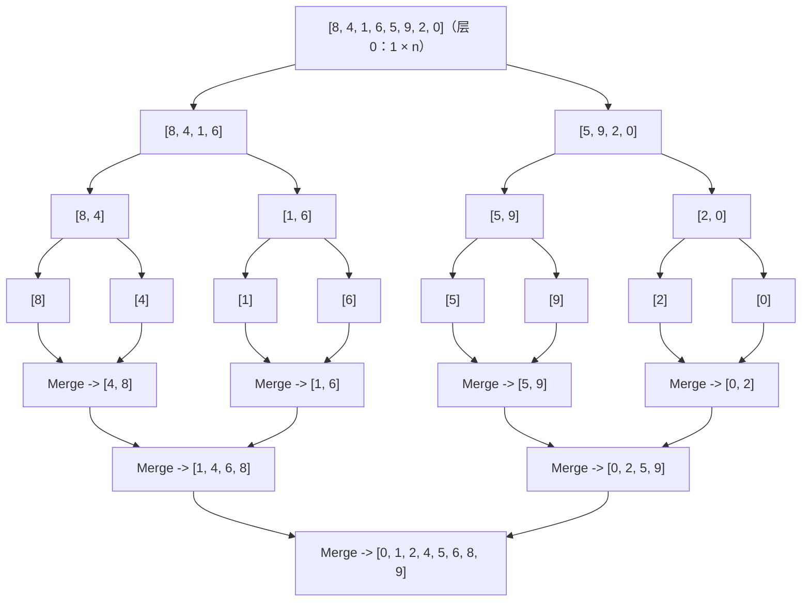

# L24 经典排序算法

%% learning-vault-navigation:v1 %%
> [!abstract]- 笔记导航
> 目录：[[CS Learning/Python MIT6.100L/MIT Python导航|MIT Python 导航]]
> 上一章：[[CS Learning/Python MIT6.100L/Lecture 23 Complexity Classes Examples/L23 常见复杂度类别与实例分析|L23 常见复杂度类别与实例分析]] · 下一章：[[CS Learning/Python MIT6.100L/Lecture 25 Plotting/L25 数据可视化与绘图（Plotting）|L25 数据可视化与绘图（Plotting）]]

> [!abstract] 本讲核心概览
> 本讲从 [[CS Learning/Python MIT6.100L/Lecture 23 Complexity Classes Examples/L23 常见复杂度类别与实例分析|L23]] 留下的核心动机——“先排序再多次二分查找的摊还优势”切入，依次拆解四种经典排序算法：**猴子排序（Bogo Sort）**、**冒泡排序（Bubble Sort）**、**选择排序（Selection Sort 及其少交换变体）**与**归并排序（Merge Sort）**。重点深入归并排序的**分治思想（Divide and Conquer）**、递归树逐层求和推导 $\Theta(n \log n)$，并从时间、空间、稳定性与原地性四个维度完成横向对比。
>
> **配套源文件**：[[CS Learning/Python MIT6.100L/Lecture 24 Sorting Algorithms/mit6_100l_f22_lec24.pdf|Lecture 24 讲义 PDF]] · [[CS Learning/Python MIT6.100L/Lecture 24 Sorting Algorithms/mit6_100l_f22_lec24_code.py|四种排序完整实现代码]]

---

## 1. 为什么要排序？——摊还成本视角回顾

对无序列表执行单次查找时，“先排序再二分”永远不划算（因为排序至少需扫描全部元素，不可能低于 $\Theta(n)$）。但当需要对同一批数据执行 **$K$ 次查询**时：

$$
T_{\text{sort}}(n) + K \cdot \Theta(\log n) \;\ll\; K \cdot \Theta(n) \quad (K \text{ 较大时})
$$

一次性排序成本被**摊还（Amortized）**到 $K$ 次高效查询中，排序本身的时间复杂度越低，回本所需的查询阈值 $K$ 就越小。

---

## 2. 四种经典排序算法详解

### 2.1 猴子排序（Bogo / Random / Monkey Sort）

思想如同把一副扑克牌抛向空中再捡起来：检查是否有序，若无序就完全随机打乱重来。

```python
import random

def is_sorted(L):
    for i in range(len(L) - 1):
        if L[i] > L[i + 1]:
            return False
    return True

def bogo_sort(L):
    count = 0
    while not is_sorted(L):
        random.shuffle(L)
        count += 1
    return count
```

- **最好情况**：输入本身已有序，仅检查一遍即返回，耗时 $\Theta(n)$；
- **平均情况**：$n$ 个互异元素共有 $n!$ 种排列，期望随机打乱 $n!$ 次，每次校验/洗牌耗时 $\Theta(n)$，期望复杂度高达 $\Theta(n \cdot n!)$；
- **最坏情况**：如果运气极差永远摇不出有序排列，时间**无上界（Unbounded）**！

### 2.2 冒泡排序（Bubble Sort）

每一轮从左到右比较**相邻元素对** `(L[j-1], L[j])`，若逆序（`L[j-1] > L[j]`）则交换，使较大元素像气泡一样逐步“浮”到末尾；重复多轮直到一整轮扫描没有任何交换发生（`did_swap == False`）。

```python
def bubble_sort(L):
    did_swap = True
    while did_swap:
        did_swap = False
        for j in range(1, len(L)):
            if L[j - 1] > L[j]:
                did_swap = True
                L[j], L[j - 1] = L[j - 1], L[j]
```

> [!quote] Donald Knuth 在《计算机程序设计艺术（TAOCP）》中的名言
> *"The bubble sort seems to have nothing to recommend it, except a catchy name and the fact that it leads to some interesting theoretical problems."*

- **最好情况**：输入已经有序，带 `did_swap` 标志只需扫描 1 轮即退出，$\Theta(n)$；
- **最坏 / 平均情况**：最多需 $n-1$ 轮、每轮做 $n-1$ 次比较，耗时 **$\Theta(n^2)$**；
- **稳定性**：因比较条件严格为 `>`（相等元素不交换），冒泡排序是**稳定排序（Stable）**。

### 2.3 选择排序（Selection Sort）与减少交换变体

**核心循环不变式（Loop Invariant）**：==在第 $i$ 轮结束后，列表左侧前 $i$ 个元素已经处于最终有序位置，且全部小于等于右侧剩余元素。==

#### 1. 讲义基础版（边比较边交换）
```python
def selection_sort(L):
    for i in range(len(L)):
        for j in range(i, len(L)):
            if L[j] < L[i]:
                L[i], L[j] = L[j], L[i]
```

#### 2. 优化变体 `selection_sort_var`（每轮仅记录最小值下标，末尾交换一次）
```python
def selection_sort_var(L):
    for i in range(len(L)):
        smallestj = i
        for j in range(i, len(L)):
            if L[j] < L[smallestj]:
                smallestj = j
        L[i], L[smallestj] = L[smallestj], L[i]
```

- **复杂度分析**：无论输入是否已经有序，内外两层循环的比较次数恒为：
  $$
  \sum_{i=0}^{n-1} (n - i) = n + (n - 1) + \dots + 1 = \frac{n(n+1)}{2} = \Theta(n^2)
  $$
  因此**最好、平均、最坏时间复杂度全都是 $\Theta(n^2)$**。优化变体虽不改变渐近阶，但把写内存/交换次数从最坏 $O(n^2)$ 降至最多 $n$ 次。
- **不稳定性反例**：对 `[2a, 2b, 1]`，第一轮将最小值 `1` 与 `L[0]`（`2a`）远距离交换，结果变为 `[1, 2b, 2a]`，两个相等元素 `2a`、`2b` 的相对先后顺序被破坏，因此选择排序**不稳定（Unstable）**。

---

## 3. 归并排序（Merge Sort）与分治深度剖析

### 3.1 分治策略（Divide and Conquer）三步曲

1. **基线条件（Base Case）**：长度小于 2 的列表（空列表或单元素列表）天然有序，直接返回浅拷贝 `L[:]`；
2. **分解（Divide）**：从中间位置 `middle = len(L) // 2` 拆成左右两个子列表，各自递归调用 `merge_sort`；
3. **合并（Conquer / Merge）**：用双指针 `i, j` 线性扫描两个已排序子列表 `left` 与 `right`，每次取出较小的队首元素追加到 `result`，当其中一方耗尽后，将另一方剩余元素直接拷贝到末尾。

```python
def merge(left, right):
    result = []
    i, j = 0, 0
    while i < len(left) and j < len(right):
        if left[i] < right[j]:          # 若改为 <= 即可保证排序稳定性！
            result.append(left[i])
            i += 1
        else:
            result.append(right[j])
            j += 1
    while i < len(left):
        result.append(left[i])
        i += 1
    while j < len(right):
        result.append(right[j])
        j += 1
    return result

def merge_sort(L):
    if len(L) < 2:
        return L[:]
    middle = len(L) // 2
    left = merge_sort(L[:middle])
    right = merge_sort(L[middle:])
    return merge(left, right)
```

> [!tip] 稳定性细节提醒（`<` vs `<=`）
> 课堂代码 [[CS Learning/Python MIT6.100L/Lecture 24 Sorting Algorithms/mit6_100l_f22_lec24_code.py|lec24_code.py]] 第 106 行写的是严格小于 `if left[i] < right[j]:`。当 `left[i] == right[j]` 时会走 `else` 分支先取右半边元素，从而破坏稳定性。只需改为 **`left[i] <= right[j]`**，相等时优先取左半边元素，归并排序即成为经典的**稳定排序**。

### 3.2 归并排序递归树与执行追踪（Slide 23 示例）

对 `[8, 4, 1, 6, 5, 9, 2, 0]` 执行深度优先分解与自底向上合并的过程如下：



### 3.3 复杂度推导：递推式与递归树逐层求和

1. **单次 `merge` 复杂度**：指针 `i` 和 `j` 各自单调前进到底，每个元素只被复制一次，耗时为：
   $$
   T_{\text{merge}}(|L|, |R|) = \Theta(|L| + |R|)
   $$
2. **整棵递归树的逐层工作量**：
   - 递推关系：$T(n) = 2\,T\!\left(\frac{n}{2}\right) + \Theta(n)$（其中切片 `L[:middle]` 与 `L[middle:]` 同样是每层总计 $\Theta(n)$）；
   - **第 $k$ 层**：共有 $2^k$ 个子列表，每个长度为 $\frac{n}{2^k}$，该层合并与切片的总工作量恒为 $2^k \cdot \Theta\!\left(\frac{n}{2^k}\right) = \Theta(n)$；
   - **递归总层数**：当子列表拆到长度为 1 时停止，即 $\frac{n}{2^d} = 1 \implies d = \log_2 n = \Theta(\log n)$；
   - **总时间复杂度**：
     $$
     T(n) = \underbrace{\Theta(n)}_{\text{每层工作量}} \times \underbrace{\Theta(\log n)}_{\text{递归层数}} = \Theta(n \log n)
     $$
3. **空间复杂度**：`merge` 需创建新列表 `result`（且递归切片创建子列表），峰值额外空间占用为 **$\Theta(n)$**（外加 $O(\log n)$ 递归调用栈），因此归并排序**不是原地排序**。

> [!important] 比较排序的理论下界
> ==$\Omega(n \log n)$ 是所有**基于元素两两比较**的排序算法所能达到的理论速度极限==（因为 $n$ 个元素共有 $n!$ 种可能排列，决策树高度至少为 $\log_2(n!) = \Theta(n \log n)$）。因此归并排序在渐近意义上已经达到**渐近最优**！
>
> （延伸：Python 内置的 `list.sort()` / `sorted()` 采用 **Timsort**，结合了归并排序与插入排序的优点，最坏 $O(n \log n)$、最好（已有序数据）可达 $O(n)$ 且保证稳定。）

---

## 4. 四大排序算法全景对比表

| 算法 | 最好时间 | 平均时间 | 最坏时间 | 额外空间 | 稳定性（Stable） | 原地排序（In-place） | 核心机制与评价 |
| --- | --- | --- | --- | --- | --- | --- | --- |
| **Bogo Sort** | $\Theta(n)$ | $\Theta(n \cdot n!)$ | 无上界（$\infty$） | $O(1)$ | 否 | 是 | 随机洗牌直到有序，纯教学反例 |
| **Bubble Sort** | $\Theta(n)$（带早停标志） | $\Theta(n^2)$ | $\Theta(n^2)$ | $O(1)$ | 是（使用 `>`） | 是 | 相邻比较交换，工程中几乎不用 |
| **Selection Sort** | $\Theta(n^2)$ | $\Theta(n^2)$ | $\Theta(n^2)$ | $O(1)$ | 否 | 是 | 每轮锁定未排序区最小值放左侧；变体仅 $O(n)$ 次交换 |
| **Merge Sort** | $\Theta(n \log n)$ | $\Theta(n \log n)$ | $\Theta(n \log n)$ | $\Theta(n)$ | 是（需用 `<=`；讲义版 `<` 不稳定） | 否 | 经典分治算法，性能稳定且达比较排序下界 |

---

## 5. 自测与复习思考

> [!question]- 自测 1：在 [[CS Learning/Python MIT6.100L/Lecture 23 Complexity Classes Examples/L23 常见复杂度类别与实例分析|L23]] 中，二分查找每次递归做切片 `L[:half]` 把复杂度从 $\Theta(\log n)$ 拖垮到了 $\Theta(n)$；为什么 `merge_sort` 同样在递归里做了切片 `L[:middle]` 和 `L[middle:]`，却没有拖垮它的 $\Theta(n \log n)$ 复杂度？
> 因为在 `merge_sort` 中，每一层无论切片与否，**`merge` 本身就已经需要 $\Theta(n)$ 的线性时间**！把切片（每层 $\Theta(n)$）加进每层工作量只是 $\Theta(n) + \Theta(n) = \Theta(n)$，只增加了常数系数，不会改变总体 $\Theta(n \log n)$ 的增长阶。而在二分查找里，本应每层只需 $\Theta(1)$，切片直接把每层抬高到了线性级，才导致复杂度恶化。

> [!question]- 自测 2：为什么冒泡排序、选择排序的函数都直接就地修改原列表 `L`（无返回值），而 `merge_sort(L)` 却需要 `return` 一个新列表？
> 冒泡排序和选择排序都是**原地排序（In-place）**，只通过索引交换元素即可完成排序；而 `merge_sort` 在基线返回 `L[:]`、递归中拆分切片并在 `merge` 中构造全新的 `result` 列表，**不会修改调用方传入的原列表 `L`**，因此必须返回排序后的新列表。
