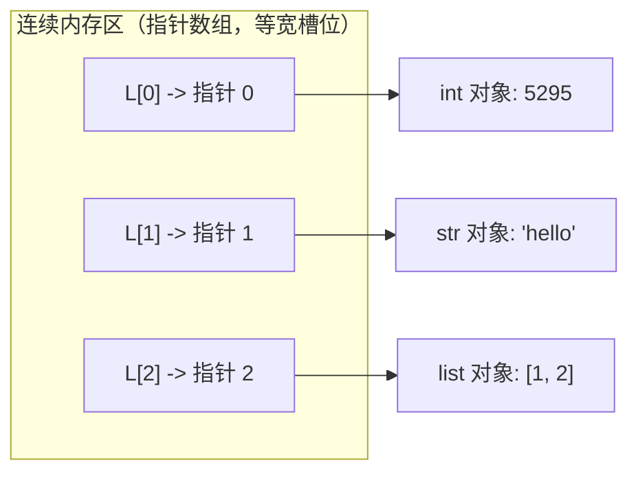
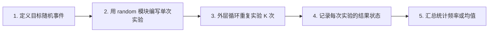

# L26 列表访问、哈希、仿真与课程总结

%% learning-vault-navigation:v1 %%
> [!abstract]- 笔记导航
> 目录：[[CS Learning/Python MIT6.100L/MIT Python导航|MIT Python 导航]]
> 上一章：[[CS Learning/Python MIT6.100L/Lecture 25 Plotting/L25 数据可视化与绘图（Plotting）|L25 数据可视化与绘图（Plotting）]] · 下一章：[[CS Learning/Python MIT6.100L/Extention/Extention NumPy、Pandas 与 Matplotlib 扩展练习|Extention：NumPy、Pandas 与 Matplotlib 扩展练习]]

> [!abstract] 本讲核心概览
> 本讲是 MIT 6.100L 的收官课程，前半部分揭开 [[CS Learning/Python MIT6.100L/Lecture 23 Complexity Classes Examples/L23 常见复杂度类别与实例分析|L23]] 留下的底层“黑盒”——解释为什么 Python 列表随机访问是 $\Theta(1)$、为什么字典查找平均能做到 $\Theta(1)$ 以及为什么字典键必须可哈希/不可变；后半部分展示**随机仿真（Simulations / Monte Carlo）**如何用几行代码求解直觉极易出错的概率与期望问题；最后系统梳理全课知识图谱与后续进阶路线。
>
> **配套源文件**：[[CS Learning/Python MIT6.100L/Lecture 26 List Access, Hashing, Simulations, and Wrap-Up/mit6_100l_f22_lec26.pdf|Lecture 26 讲义 PDF]] · [[CS Learning/Python MIT6.100L/Lecture 26 List Access, Hashing, Simulations, and Wrap-Up/mit6_100l_f22_lec26_code.py|课堂仿真代码]]

---

## 1. 列表底层原理：为什么 `L[i]` 是 $\Theta(1)$？

### 1.1 同构数组直觉：连续内存 + 偏移量直达

如果一个列表只存固定宽度（如 4 字节 / 32 位）的整数，系统只需分配一块连续内存（总计 $4 \times \text{len}(L)$ 字节），变量名指向首地址 `base`。访问第 `i` 个元素时，无需遍历前面元素，直接通过一次算术运算定位地址：

$$
\text{addr}(L[i]) = \text{base} + \text{slot\_size} \times i
$$

该计算和单次内存读取耗时完全不随列表长度变化，故为 **$\Theta(1)$**。

### 1.2 Python 异构列表的秘密：间接寻址（Indirection）

Python 列表可以同时装整数、字符串、甚至另一个列表——它们在内存里大小各不相同，不可能直接塞进等宽槽位。Python 的解决方案是：
- 连续内存块中不直接存放对象本体，而是存放**等宽的对象指针（References / Pointers）**；
- 访问 `L[i]` 时，先用 `base + ptr_size * i` 找到第 `i` 个指针（1 步），再顺着指针跳转到堆上的真实对象（+1 步）；
- 总步骤数仍然是常数，因此异构列表的索引访问依然严格保持 **$\Theta(1)$**！



> [!note] 顺带理解为什么 `del L[i]` 和 `x in L` 是 $\Theta(n)$
> - `del L[i]` 删除中间槽位后，为维持内存连续性，必须把后续所有指针整体向前挪动一位，耗时 $\Theta(n)$；
> - `x in L` 不知道目标在哪个槽位，只能逐个解引用比对，最坏耗时 $\Theta(n)$。

---

## 2. 哈希表与字典原理：为什么 `d[key]` 平均是 $\Theta(1)$？

### 2.1 朴素实现 vs 哈希表（Hash Table）

如果把字典朴素地实现成键值对列表 `[['Ana', True], ['John', False], ...]`，查找键只能做 $\Theta(n)$ 线性扫描。Python `dict` 底层采用**哈希表（Hash Table）**，把任意键转换为数组下标：

$$
\text{key} \;\xrightarrow{\;\text{hash(key)}\;}\; \text{整数} \;\xrightarrow{\;\bmod M\;}\; \text{桶索引 } [0, M-1] \;\xrightarrow{\;\Theta(1)\;}\; \text{value}
$$

### 2.2 为什么必须允许哈希冲突（Collisions）？

如果不允许任何两个不同键映射到同一位置（例如直接把字符串每个字符的 8 位二进制拼接成大整数）：
- `'Ana Bell'` 就会变成 $4{,}714{,}812{,}651{,}084{,}278{,}892$；
- 仅存储 MIT 约 $4{,}000$ 名本科生、假设姓名最长 20 字符（160 bits），就需要开设 $2^{160} \approx 1.46 \times 10^{48}$ 个槽位——空间上完全荒谬！

因此，工程上必须**使用有限大小的哈希表并允许冲突**（如讲义示例：对姓名各字母序号求和后 $\bmod\, 16$，`'Ana'` 得 $16 \bmod 16 = 0$，`'Eve'` 得 $32 \bmod 16 = 0$，两者落入同一号桶，再通过拉链法或开放寻址在局部解决冲突）。

### 2.3 优秀哈希函数的四大性质

1. **有界映射**：将输入域映射到 $[0, M-1]$ 的合法表索引；
2. **确定性（Deterministic）**：相同输入必须永远产生相同哈希值（不能含随机性）；
3. **充分利用完整输入**：综合所有字符/位信息以减少撞车；
4. **均匀分布（Uniform）**：哈希值尽可能均匀散落在各个槽位，避免聚集导致局部退化。

### 2.4 为什么字典的键必须是不可变/可哈希的？（Slides 17–18）

> [!important] 彻底搞懂“可变对象不能做字典键”的底层原因
> 假设允许用可变列表 `['K', 'a', 't', 'e']` 作为键存入 16 槽哈希表：
> - 存入时计算字母序号和：$11 + 1 + 20 + 5 = 37 \implies 37 \bmod 16 = 5$，记录存放在 **5 号槽**；
> - 若之后就地修改该列表为 `['C', 'a', 't', 'e']`，此时用它查成绩，重新计算哈希得 $3 + 1 + 20 + 5 = 29 \implies 29 \bmod 16 = 13$；
> - 字典直奔 **13 号槽**，发现空无一物——原本躺在 5 号槽的数据就彻底“失联”了！
>
> ==因此，字典键必须可哈希（Hashable），其生命周期内哈希值绝不能改变（`int`、`float`、`str`、`tuple` 等不可变类型）。==

### 2.5 字典操作复杂度：平均 $\Theta(1)$ vs 极罕见最坏 $\Theta(n)$

| 字典操作（$n = \text{len}(d)$） | 平均情况（哈希分布均匀） | 最坏情况（所有键严重冲突退化成链表） |
| --- | --- | --- |
| 访问 `d[k]` / 写入 `d[k]=v` | $\Theta(1)$ | $\Theta(n)$ |
| 删除 `del d[k]` / 成员判断 `k in d` | $\Theta(1)$ | $\Theta(n)$ |
| 遍历迭代 `for k in d` | $\Theta(n)$ | $\Theta(n)$ |

---

## 3. 随机仿真（Simulations / Monte Carlo）

### 3.1 计算仿真的通用五步范式

当解析概率公式过于复杂、甚至需要复杂积分时，我们可以用计算机模拟成千上万次随机实验，以频率逼近概率、以样本均值逼近期望：



### 3.2 三个递进课堂仿真案例（[[CS Learning/Python MIT6.100L/Lecture 26 List Access, Hashing, Simulations, and Wrap-Up/mit6_100l_f22_lec26_code.py|lec26_code.py]]）

#### 案例 1：单次掷骰子（`prob_dice`）
用 `random.choice(['.', ':', ':.', '::', '::.', ':::'])` 重复 $10{,}000$ 次，统计 `'::'` 出现频率，收敛到理论值 $\frac{1}{6} \approx 0.1667$。

#### 案例 2：掷 7 次至少出现 3 次 `'::'`（`prob_dice_atleast`）
只需在案例 1 外多套一层 `for _ in range(Nrolls):` 统计单轮匹配次数，再重复 `Nsims` 次看 `matched >= 3` 的比例。
- 手算二项分布需累加 $\sum_{k=3}^7 \binom{7}{k}\left(\frac{1}{6}\right)^k\left(\frac{5}{6}\right)^{7-k} \approx 0.0958$；
- 仿真代码几乎零心智负担，且规则微调（如改成不均匀骰子或连续出现）仅需改一两行！

#### 案例 3：水池注水时间陷阱（`fill_pool(600)` —— 非线性期望反直觉经典）
**问题**：水龙头流速 $R$ 在 $[1, 3]$ 加仑/分钟之间均匀随机取值，注满 $600$ 加仑泳池的平均时间是多少？

```python
def fill_pool(size):
    flow_rate = []
    fill_time = []
    Npoints = 10000
    for i in range(Npoints):
        r = 1 + 2 * random.random()   # Uniform(1, 3)
        flow_rate.append(r)
        fill_time.append(size / r)
    print('avg flow_rate:', sum(flow_rate) / len(flow_rate))
    print('avg fill_time:', sum(fill_time) / len(fill_time))
```

> [!warning] 两个看似合理却**双双出错**的直觉猜测
> - 直觉 A：平均流速是 $2\text{ gal/min}$，所以时间是 $600 / 2 = 300\text{ min}$ —— **错！**
> - 直觉 B：最慢 $600\text{ min}$、最快 $200\text{ min}$，取中点 $(600 + 200)/2 = 400\text{ min}$ —— **错！**
> - **仿真结果**：平均流速 $\approx 2.0\text{ gal/min}$，但**平均注水时间 $\approx 330.7\text{ min}$**！

**数学验证（为何仿真如此强大）**：
由于 $T(r) = \frac{600}{r}$ 是**严格凸函数（Nonlinear Inverse Relationship）**，由琴生不等式（Jensen's Inequality）必有 $\mathbb{E}[600/R] > 600/\mathbb{E}[R] = 300$。其精确解析期望需要求定积分：

$$
\mathbb{E}[T] = \frac{1}{3 - 1} \int_{1}^{3} \frac{600}{r}\,dr = 300 \ln 3 \approx 329.58\text{ min}
$$

将排序后的 `flow_rate`（直线）与 `fill_time`（明显向下弯曲的反比例曲线）分别绘制散点图，就能直观看到低流速区间拉高了整体均值。

---

## 4. MIT 6.100L 全课知识总览与后续路径

### 4.1 6.100L 核心能力五支柱

| 支柱模块 | 核心内容与代表概念 |
| --- | --- |
| **1. 语法与控制流** | 变量绑定、字符串切片、分支、循环、迭代、浮点近似、异常与断言 |
| **2. 核心数据结构** | `tuple`（不可变）、`list`（可变/别名/克隆/连续指针数组）、`dict`（哈希表） |
| **3. 组织、分解与抽象** | 函数与高阶函数（Lambda / 闭包）、递归、面向对象编程（封装、继承、多态、类变量） |
| **4. 算法与计算复杂度** | 穷举、二分查找、$\Theta$ / $O$ 渐近分析、冒泡/选择/归并排序、摊还分析 |
| **5. 工程库与数据思维** | 第三方库检索与组合（`dateutil`、`PIL`、`matplotlib`）、数据可视化、蒙特卡洛仿真 |

### 4.2 后续进阶方向（Slides 35–39）

- **MIT 6.100B**：计算机科学与数据科学导论（优化问题、随机仿真、实验数据建模、机器学习）；
- **MIT 6.101**：编程基础进阶（高效算法工程实现、系统化调试）；
- **MIT 6.102**：软件构造（TypeScript，编写防 bug、易理解、易演化的软件系统）；
- **本仓库实战延伸**：进入 [[CS Learning/Python MIT6.100L/Extention/Extention NumPy、Pandas 与 Matplotlib 扩展练习|Extention：NumPy、Pandas 与 Matplotlib 扩展练习]]，把 Python 基础正式衔接到科学计算与 [[AI learning/D2L-李沐/动手学深度学习导航|动手学深度学习]]！

> [!tip] 课程结语
> *"It's easy to forget without practice! Happy coding!"* —— 回头再看 PSet 0 / PSet 1，曾经费劲的题目如今已显得轻而易举；持续动手编码是保持手感的唯一途径。
