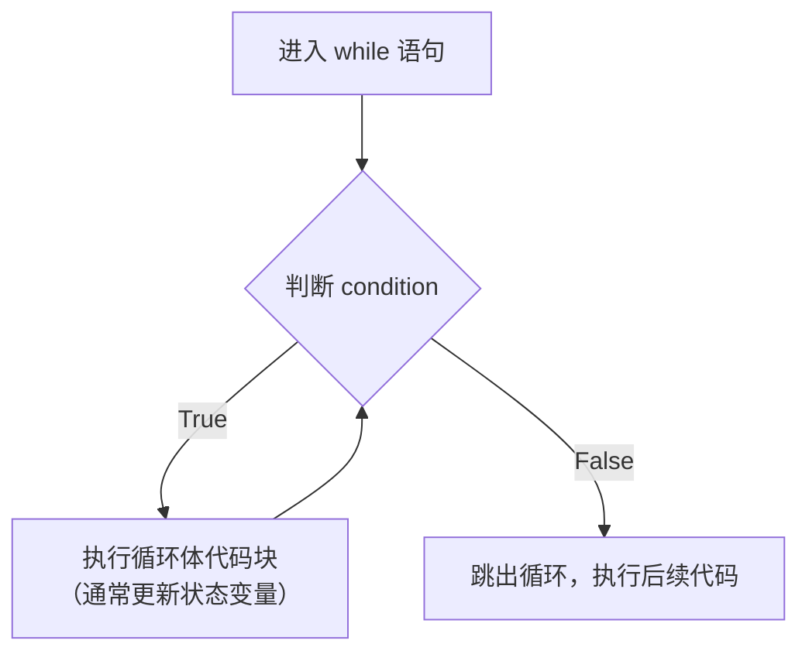

# L03 迭代与循环结构

%% learning-vault-navigation:v1 %%
> [!abstract]- 笔记导航
> 目录：[[CS Learning/Python MIT6.100L/MIT Python导航|MIT Python 导航]]
> 上一讲：[[CS Learning/Python MIT6.100L/Lecture 2 Strings, InputOutput, Branching/L02 字符串、输入输出与分支控制|L02 字符串、输入输出与分支控制]] · 下一讲：[[CS Learning/Python MIT6.100L/Lecture 4 Loops over Strings, Guess-and-Check, Binary/L04 字符串遍历、穷举猜想与二进制|L04 字符串遍历、穷举猜想与二进制]]

> [!abstract] 本讲定位与核心脉络
> 分支语句（`if/elif/else`）只能让程序「选路」，却无法表达**重复执行**（例如《塞尔达传说》迷雾森林中用户可能连续走错任意次）。本讲系统介绍 Python 的两大循环控制流：**条件驱动的 `while` 循环**与**序列驱动的 `for` 循环**，深入剖析 `range(start, stop, step)` 生成规则、累加/累乘经典范式以及循环终止保障，并结合 **Recitation 2** 完成字符串与循环的综合训练。

---

## 一、`while` 循环：条件驱动的重复执行

### 1. 语法结构与执行流程

```python
while <condition>:
    <code>
    ...
```



- 每次进入循环体前都会重新计算 `<condition>`（布尔值）；
- 为 `True` 则完整执行缩进块，再回到顶部重新判断；一旦为 `False` 立即退出；
- ==核心风险：若循环体内从未改变影响条件的变量，`<condition>` 恒为 `True`，程序将陷入**死循环（Infinite Loop）**==。在终端/IDE 中可按 `Ctrl+C`（macOS `Cmd+C`）或点击停止按钮强制终止。

### 2. 经典案例：Lost Forest 与计数阶乘

**不确定次数的交互循环（Lost Forest）**：
```python
where = input("You're in the Lost Forest. Go left or right? ")
while where == "right":
    where = input("You're in the Lost Forest. Go left or right? ")
print("You got out of the Lost Forest!")
```
> [!note] 大小写敏感细节
> 若用户输入 `"RIGHT"`，因为 `"RIGHT" == "right"` 为 `False`，循环一次都不会执行而直接走出森林。课堂进阶代码通过 `where.lower() == "right"` 规避大小写差异。

**累加/累乘模式——用 `while` 求阶乘 $x!$**：
```python
x = 4
i = 1
factorial = 1
while i <= x:
    factorial *= i   # 等价于 factorial = factorial * i
    i += 1           # 必须推进循环变量，否则死循环！
print(f'{x} factorial is {factorial}')  # 4 factorial is 24
```

---

## 二、`for` 循环与 `range()` 序列生成器

### 1. `for` 循环结构

```python
for <variable> in <sequence>:
    <code>
    ...
```

每次迭代中，`<variable>` 按顺序自动绑定到 `<sequence>` 的下一个元素，直到序列耗尽后自然结束。

==Big Idea：`for` 循环的重复次数完全由序列长度决定==（对应讲义类比：Netflix 连续自动播放 4 集后弹出 "Are you still watching?" 强行暂停，而不是像 `while` 那样无限连播）。

### 2. `range(start, stop, step)` 规则

`range()` 生成整数序列，参数含义与 L02 字符串切片 `[start:stop:step]` 高度一致——**左闭右开，不含 `stop`**：

| 调用形式 | 默认参数 | 生成序列 | 常见用途 |
| --- | --- | --- | --- |
| `range(5)` | `start=0, step=1` | `0, 1, 2, 3, 4` | 重复执行 $N$ 次 |
| `range(3, 6)` | `step=1` | `3, 4, 5` | 指定起止范围 |
| `range(1, 4, 2)` | — | `1, 3` | 按固定步长跳跃遍历 |
| `range(4, 0, -1)` | — | `4, 3, 2, 1` | 倒序遍历（打印 `$$$$` 到 `$`） |

**重要修正案例（区间闭端求和）**：求整数 `start` 到 `end`（**含两端**）的总和 $\sum_{i=\text{start}}^{\text{end}} i$，终点必须写 `end + 1`：

```python
mysum = 0
start = 3
end = 5
for i in range(start, end + 1):
    mysum += i
print(mysum)  # 3 + 4 + 5 = 12
```

### 3. `while` 与 `for` 的对比选型

| 对比维度 | `while` 循环 | `for` 循环 |
| --- | --- | --- |
| **适用场景** | 循环次数事先未知（依赖用户输入、收敛条件等） | 已知重复次数，或遍历有限序列（`range`、`str`、列表等） |
| **循环变量管理** | 需手动初始化并手动递增/更新 | 自动按序绑定下一个元素，代码更简洁 |
| **死循环风险** | 高（忘写更新语句或条件永真） | 极低（遍历有限序列必终止） |
| **互换能力** | 任何 `for` 循环都能改写成 `while` 循环 | 并非所有 `while` 循环都能直接改写成 `for` 循环 |

> [!tip] `break` 关键字预览（见 `lec03_code.py`）
> 在循环体内执行 `break` 会**立刻跳出当前所在的最内层循环**，跳过 `break` 之后的所有循环体语句。例如：
> ```python
> mysum = 0
> for i in range(5, 11, 2):
>     mysum += i
>     if mysum == 5:
>         break
>         mysum += 1  # 永远不会执行（死代码）
> print(mysum)        # 输出 5
> ```

---

## 三、个人练习与 Recitation 2 实践复盘

### 1. 课堂与课后练习（`learn.py`、`homework.py`、`mit6_100l_f22_ex03.py`）

- **`learn.py`（Lost Forest 计数器扩展）**：在循环内增加 `cnt += 1` 统计向右走错的次数。对比官方参考解：题目要求「进入循环**超过 2 次**（more than 2 times）时显示悲伤表情」，官方将 `counter += 1; if counter > 2: print(":(")` 写在再次 `input()` 之前；而 `learn.py` 中先 `input()` 再判断 `cnt >= 2`，语义上存在 1 次偏差（off-by-one），写交互循环时要特别留意**计数更新、条件判断与重新输入三者的顺序**。
- **`homework.py` Practice 1（打印 $[1, x]$ 内所有 5 的倍数）**：
  ```python
  for i in range(5, x + 1, 5):
      print(i)
  ```
  相比官方答案逐一枚举 `range(1, x + 1)` 再判断 `i % 5 == 0`，直接设步长为 `5` 减少 80% 无效迭代，非常简洁高效！
- **`homework.py` Practice 2（求正整数各位数字之和）**：
  ```python
  # 个人写法：利用 % 10 取末位、// 10 去末位
  total = 0   # 建议避免命名为 sum，以免覆盖内置函数 sum()
  while x > 0:
      total += x % 10
      x = x // 10
  ```
  以 `while x > 0` 作为守卫条件，比官方参考解的 `while True` + `if n == 0: break` 更直观（仅需注意若 `x == 0` 循环不执行，结果仍正确为 `0`）。
- **Finger Exercise 3（`mit6_100l_f22_ex03.py`）**：用 `for i in range(N): print('hello world')` 精确打印 $N$ 行。

### 2. Recitation 2 习题对比（`R02_problems.py` vs `R02_solutions.py`）

Recitation 2 综合复习了 L02（字符串、I/O、分支）与 L03（`for`/`while` 循环）：

| 题号 | 题目要求 | 个人实现思路 | 官方解亮点与启示 |
| --- | --- | --- | --- |
| **P1** | 输入姓名，输出长度减 5 | `str(input(...))` 后 `len(name) - 5` | `input()` 本身即返回 `str`，无需额外套 `str()` |
| **P2** | 删除字符串第 $n$ 个字符（1-indexed） | 用 `for i in range(len(old))` 跳过 `i == n - 1` 逐字符拼接 | 官方一行切片 `test_string[:n-1] + test_string[n:]` 更地道，避免循环内反复创建中间字符串 |
| **P3** | 判断字符串长度是否 $>10$ 或 $<5$ | `if ... or ...: print(True) else: print(False)` | 逻辑完全正确；可进一步精简为 `print(len(my_string) > 10 or len(my_string) < 5)` |
| **P4** | 用 `for` 统计字符串中 `'e'` 的次数 | `for i in my_string: if i == 'e': count += 1` | 直接遍历字符串元素（而非下标），为 L04 铺垫 |

---

## 四、常见陷阱与自检

> [!warning] 本讲高频易错点
> 1. **`range()` 的右边界 off-by-one**：要包含 `end`，必须写 `range(start, end + 1)`；要倒序包含 `0`，终点应写 `-1`（`range(4, -1, -1)`）。
> 2. **忘记在 `while` 循环内更新条件变量**：例如计算阶乘漏写 `i += 1`，会立即导致死循环。
> 3. **覆盖 Python 内置名称**：将累加变量命名为 `sum` 会遮蔽内置函数 `sum()`，推荐统一用 `total`、`mysum` 或 `digit_sum`。
> 4. **累加器初始化位置放错**：把 `mysum = 0` 或 `factorial = 1` 误写进循环体内部，会导致每轮迭代都被清零/重置。

> [!question]- 课后自检（点击展开）
> 1. `for me in range(4, 0, -1): print("$" * me)` 会输出什么？
>    - 依次输出 4 行：`$$$$`、`$$$`、`$$`、`$`。
> 2. 同样打印 `0, 1, 2, 3, 4`，为什么在已知次数时优先选用 `for` 而非 `while`？
>    - `for n in range(5)` 自动管理边界和步进，代码更短且不会因漏写 `n += 1` 而陷入死循环。
> 3. 给定正整数 `n = 1234`，写出每轮 `while n > 0` 执行 `n % 10` 和 `n //= 10` 时变量的变化轨迹。
>    - 第 1 轮：取 `4`，`n -> 123`；第 2 轮：取 `3`，`n -> 12`；第 3 轮：取 `2`，`n -> 1`；第 4 轮：取 `1`，`n -> 0`，循环终止，总和为 `10`。

---

## 五、配套资料

| 资料名称 | 类型 | 本地链接 |
| --- | --- | --- |
| Lecture 3 讲义 Slides | 讲义 PDF | [[CS Learning/Python MIT6.100L/Lecture 3 Iteration/mit6_100l_f22_lec03.pdf\|mit6_100l_f22_lec03.pdf]] |
| Lecture 3 课堂演示代码 | 源码 `.py` | [[CS Learning/Python MIT6.100L/Lecture 3 Iteration/mit6_100l_f22_lec03_code.py\|mit6_100l_f22_lec03_code.py]] |
| 课堂随练代码 `learn.py` | 个人练习 `.py` | [[CS Learning/Python MIT6.100L/Lecture 3 Iteration/learn.py\|learn.py]] |
| 课后编程作业 `homework.py` | 个人练习 `.py` | [[CS Learning/Python MIT6.100L/Lecture 3 Iteration/homework.py\|homework.py]] |
| Finger Exercise 3 个人代码 | 练习 `.py` | [[CS Learning/Python MIT6.100L/Lecture 3 Iteration/mit6_100l_f22_ex03.py\|mit6_100l_f22_ex03.py]] |
| Finger Exercise 3 官方参考解 | 题解 PDF | [[CS Learning/Python MIT6.100L/Lecture 3 Iteration/mit6_100l_f22_ex03_sol.pdf\|mit6_100l_f22_ex03_sol.pdf]] |
| Recitation 2 复习总结 | 习题课 `.docx` | [[CS Learning/Python MIT6.100L/Lecture 3 Iteration/mit6_100l_f22_rec02/1_rec2/R02_Summary.docx\|R02_Summary.docx]] |
| Recitation 2 个人练习代码 | 习题课 `.py` | [[CS Learning/Python MIT6.100L/Lecture 3 Iteration/mit6_100l_f22_rec02/1_rec2/R02_problems.py\|R02_problems.py]] |
| Recitation 2 官方参考解 | 习题课 `.py` | [[CS Learning/Python MIT6.100L/Lecture 3 Iteration/mit6_100l_f22_rec02/1_rec2/R02_solutions.py\|R02_solutions.py]] |
