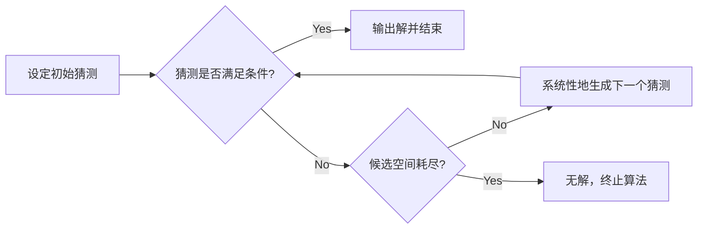

# L04 字符串遍历、穷举猜想与二进制

%% learning-vault-navigation:v1 %%
> [!abstract]- 笔记导航
> 目录：[[CS Learning/Python MIT6.100L/MIT Python导航|MIT Python 导航]]
> 上一讲：[[CS Learning/Python MIT6.100L/Lecture 3 Iteration/L03 迭代与循环结构|L03 迭代与循环结构]] · 下一讲：[[CS Learning/Python MIT6.100L/Lecture 5 Floats and Approximation Methods/L05 浮点数表示与近似求解|L05 浮点数表示与近似求解]]

> [!abstract] 本讲定位与核心脉络
> 本讲先补全循环控制流的最后两块拼图——`break` 跳转与**直接遍历字符串**，宣告「对象 + 表达式 + 分支 + 循环」已具备实现一切算法的能力；随即进入第一类核心数值与问题求解范式——**猜想与验证（Guess-and-Check / 穷举法）**与**布尔标志位（Boolean Flag）**；最后以 `0.1` 连加十次不等于 `1` 的反直觉现象为引子，剖析**二进制整数表示与十进制转二进制算法**，为 L05 浮点数机制埋下伏笔。

---

## 一、`break` 语句与字符串遍历

### 1. `break` 的作用域规则

`break` 会**立即终止当前所在的最内层循环**，并跳过该循环块内 `break` 之后的全部语句；若存在嵌套循环，外层循环不受影响继续运行：

```python
while <condition_1>:
    while <condition_2>:
        <expression_a>
        break            # 只退出内层 while <condition_2>
        <expression_b>   # 永远不会执行
    <expression_c>       # 内层 break 后立即跳转到此处继续执行
```

### 2. 三种遍历字符串写法的演进

讲义对比了检查字符串中是否包含 `'i'` 或 `'u'` 的三种等价写法，逐步向更 Pythonic 的风格演进：

```python
s = "demo loops - fruit loops"

# 写法 1：按索引下标遍历（C/Java 风格，较繁琐）
for index in range(len(s)):
    if s[index] == 'i' or s[index] == 'u':
        print("There is an i or u")

# 写法 2：直接遍历字符串中的每个字符
for char in s:
    if char == 'i' or char == 'u':
        print("There is an i or u")

# 写法 3：结合成员运算符 in（最简洁、可读性最佳）
for char in s:
    if char in 'iu':
        print("There is an i or u")
```

> [!tip] 经典「去重统计」模式（Seen Accumulator）
> 遍历字符串统计不同字符数量时，维护一个辅助字符串 `seen = ""` 记录已经出现过的字符：
> ```python
> seen = ""
> for char in s:
>     if char not in seen:
>         seen += char
> print(len(seen))
> ```

---

## 二、猜想与验证（Guess-and-Check / 穷举法）

### 1. 算法框架与三要素

**猜想与验证（Exhaustive Enumeration）**适用于候选解空间可枚举的问题，核心循环逻辑如下：



==Big Idea：穷举法无法测试无穷多个值，必须利用数学性质设定明确的终止边界！==

### 2. 布尔标志位（Boolean Flag）

布尔变量常用来充当「某事件是否发生过」的信号灯（Flag）：
- **负输入检测**：在求平方根前设置 `neg_flag = False`，若 `x < 0` 则置为 `True`，事后提示用户是否误输负号；
- **查找结果反馈**：在 `range(1, 11)` 中搜索 `secret` 时，先设 `found = False`，命中时置 `found = True`，循环结束后根据 `if not found:` 统一打印 `"not found"`（避免在循环内部每轮都错打 `"not found"`）。

### 3. 立方根穷举的三步迭代优化

```python
# 最终优化版：支持正负数 + 提前剪枝（break） + 非完全立方提示
cube = int(input("Enter an integer: "))
for guess in range(abs(cube) + 1):
    if guess ** 3 >= abs(cube):
        break
if guess ** 3 != abs(cube):
    print(f"{cube} is not a perfect cube")
else:
    if cube < 0:
        guess = -guess
    print(f"Cube root of {cube} is {guess}")
```

**三步演进意义**：
1. 用 `abs(cube)` 将正负数问题统一映射到非负整数空间，找到后再按原符号还原；
2. 利用 $g^3$ 单调递增的性质，一旦 `guess**3 >= abs(cube)` 立刻 `break`，避免多余迭代；
3. 循环结束后只需做一次等号判断，即可区分「找到精确立方根」与「非完全立方数」。

### 4. 应用题建模：从三重嵌套到单层循环

讲义中的售票问题（Alyssa、Ben、Cindy 共售出 $T$ 张票，Ben 比 Alyssa 少卖 $k$ 张，Cindy 卖的是 Alyssa 的 2 倍）：

| 实现方式 | 循环次数（当 $T = 10$） | 循环次数（当 $T = 1000$） | 复杂度量级 |
| --- | :---: | :---: | :---: |
| 三重嵌套循环分别枚举三人 | $11^3 = 1{,}331$ | $1001^3 \approx 10^9$（极慢） | $O(T^3)$ |
| 单层循环枚举 `alyssa`，代数推导另两人 | $11$ | $1{,}001$（瞬间完成） | $O(T)$ |

```python
# 利用约束条件消除冗余维度：仅需 1001 次迭代
for alyssa in range(1001):
    ben = max(alyssa - 20, 0)
    cindy = alyssa * 2
    if ben + cindy + alyssa == 1000:
        print(f"Alyssa: {alyssa}, Ben: {ben}, Cindy: {cindy}")
```

---

## 三、二进制数与十进制整数转二进制

### 1. 引子：为什么十个 `0.1` 相加不等于 `1`？

```python
x = 0
for i in range(10):
    x += 0.1
print(x == 1)          # False!
print(x, '==', 10*0.1) # 0.9999999999999999 == 1.0
```
对比之下，连加 10 次 `0.125`（即 $1/8 = 2^{-3}$）却精确满足 `x == 1.25` 为 `True`！根源在于计算机硬件（高低电平、磁极上下）天然采用**二进制（Base 2）**存储所有数字，而十进制有限小数 $0.1 = 1/10$ 在二进制中是无限循环小数（详见 [[CS Learning/Python MIT6.100L/Lecture 5 Floats and Approximation Methods/L05 浮点数表示与近似求解|L05 浮点数表示与近似求解]]）。

### 2. 二进制按权展开

与十进制按 $10$ 的幂展开同理，任意非负整数可唯一展开为 $2$ 的幂次之和：

$$
1507_{10} = 2^{10} + 2^8 + 2^7 + 2^6 + 2^5 + 2^1 + 2^0 = 1024 + 256 + 128 + 64 + 32 + 2 + 1 = 10111100011_2
$$

$$
19_{10} = 1 \cdot 2^4 + 0 \cdot 2^3 + 0 \cdot 2^2 + 1 \cdot 2^1 + 1 \cdot 2^0 = 10011_2
$$

### 3. 除 2 取余右移算法（十进制整数 $\to$ 二进制字符串）

**核心观察**：
- `num % 2` 恰好提取二进制表示的**最低位（最右侧一位）**；
- `num // 2` 等价于将所有二进制位**整体右移一位**（丢弃刚取出的最低位）；
- 因为是从低位到高位依次产生，必须把新位**拼接在结果字符串左侧**：`result = str(num % 2) + result`。

```python
# 支持正数、0 与负数的十进制整数转二进制实现
num = -15
if num < 0:
    is_neg = True
    num = abs(num)
else:
    is_neg = False

result = ''
if num == 0:
    result = '0'
while num > 0:
    result = str(num % 2) + result
    num = num // 2

if is_neg:
    result = '-' + result
```

以 `num = 19` 为例的手工追踪：

| 步骤 | `num` | `num % 2`（新位） | `result`（前插） | `num // 2` |
| :---: | :---: | :---: | :---: | :---: |
| 1 | 19 | `1` | `"1"` | 9 |
| 2 | 9 | `1` | `"11"` | 4 |
| 3 | 4 | `0` | `"011"` | 2 |
| 4 | 2 | `0` | `"0011"` | 1 |
| 5 | 1 | `1` | `"10011"` | 0（终止） |

---

## 四、个人练习实践复盘

### 1. 课堂练习（`learn.py`）
完整实操了全部核心片段：`char in 'iu'` 成员判断、Robot Cheerleaders 啦啦队字母播报（按发音规则区分 `an` / `a`）、字符串去重计数（`s = 'abca'` 输出 `3`）、带负号与提前 `break` 的立方根穷举，以及售票问题从三重循环优化到单层循环。

### 2. 课后练习（`homework.py`）：统计两字符串的唯一公共字符数
```python
answer = ""
count = 0
for i in text1:
    if i in text2 and i not in answer:
        count += 1
        answer += i
print(count)
```
测试 `"may the fourth be with you"` 与 `"revenge of the sixth"` 时输出 `8`（包含空格 `' '` 在内的 8 个不重复公共字符：`e, t, h, o, r, i, f, ' '`），实现与官方参考解完全一致。小技巧：其实连 `count` 变量也可省去，最后直接 `print(len(answer))`。

### 3. Finger Exercise 4（`mit6_100l_f22_ex04.py`）：正整数立方根检测
```python
i = 1
while i ** 3 < N:
    i += 1
if i ** 3 == N:
    print(i)
else:
    print('error')
```
利用 `i**3 < N` 作为循环条件，循环结束时必有 $i^3 \ge N$，只需一步 `if i**3 == N` 即可判断是否为完全立方数，代码精炼且与官方解一字不差。

---

## 五、常见陷阱与自检

> [!warning] 本讲高频易错点
> 1. **在循环内直接写 `else: print("not found")`**：搜索元素时若把「未找到」提示写在循环的 `else` 里，会导致每个不匹配的元素都打印一遍 `"not found"`；必须借助 `found = False` 布尔标志位在循环外统一判断。
> 2. **二进制转换顺序拼反**：把 `result = str(num % 2) + result` 误写成 `result += str(num % 2)`，会导致得到的二进制位完全倒置。
> 3. **漏处理 `num == 0` 边界**：若直接进 `while num > 0:`，输入 `0` 时结果会变成空字符串 `""` 而非 `"0"`。
> 4. **对浮点数直接使用 `==` 比较**：如 `0.1` 连加 10 次的结果与 `1.0` 存在极微小的二进制截断误差，切勿依赖精确相等。

> [!question]- 课后自检（点击展开）
> 1. 在嵌套循环中，内层执行 `break` 会退出哪一层循环？
>    - 仅退出 `break` 所在的**最内层**循环，外层循环继续执行。
> 2. 为什么售票问题中将三层循环改写为单层循环后，当总票数增至 1000 时速度提升近百万倍？
>    - 三层嵌套需要约 $1000^3 = 10^9$ 次迭代；利用代数关系消去两个自由变量后只需 $1001$ 次迭代，时间复杂度从 $O(N^3)$ 降至 $O(N)$。
> 3. 手算十进制数 `25` 的二进制表示，并验证 `25 % 2` 与 `25 // 2` 过程。
>    - `25 -> 余 1 (12) -> 余 0 (6) -> 余 0 (3) -> 余 1 (1) -> 余 1 (0)`，从低位前插得 `11001`（$16 + 8 + 1 = 25$）。

---

## 六、配套资料

| 资料名称 | 类型 | 本地链接 |
| --- | --- | --- |
| Lecture 4 讲义 Slides | 讲义 PDF | [[CS Learning/Python MIT6.100L/Lecture 4 Loops over Strings, Guess-and-Check, Binary/mit6_100l_f22_lec04.pdf\|mit6_100l_f22_lec04.pdf]] |
| Lecture 4 课堂演示代码 | 源码 `.py` | [[CS Learning/Python MIT6.100L/Lecture 4 Loops over Strings, Guess-and-Check, Binary/mit6_100l_f22_lec04_code.py\|mit6_100l_f22_lec04_code.py]] |
| 课堂随练代码 `learn.py` | 个人练习 `.py` | [[CS Learning/Python MIT6.100L/Lecture 4 Loops over Strings, Guess-and-Check, Binary/learn.py\|learn.py]] |
| 课后编程作业 `homework.py` | 个人练习 `.py` | [[CS Learning/Python MIT6.100L/Lecture 4 Loops over Strings, Guess-and-Check, Binary/homework.py\|homework.py]] |
| Finger Exercise 4 个人代码 | 练习 `.py` | [[CS Learning/Python MIT6.100L/Lecture 4 Loops over Strings, Guess-and-Check, Binary/mit6_100l_f22_ex04.py\|mit6_100l_f22_ex04.py]] |
| Finger Exercise 4 官方参考解 | 题解 PDF | [[CS Learning/Python MIT6.100L/Lecture 4 Loops over Strings, Guess-and-Check, Binary/mit6_100l_f22_ex04_sol.pdf\|mit6_100l_f22_ex04_sol.pdf]] |
