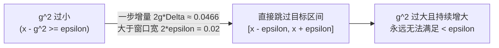

# L05 浮点数表示与近似求解

%% learning-vault-navigation:v1 %%
> [!abstract]- 笔记导航
> 目录：[[CS Learning/Python MIT6.100L/MIT Python导航|MIT Python 导航]]
> 上一讲：[[CS Learning/Python MIT6.100L/Lecture 4 Loops over Strings, Guess-and-Check, Binary/L04 字符串遍历、穷举猜想与二进制|L04 字符串遍历、穷举猜想与二进制]] · 下一讲：[[CS Learning/Python MIT6.100L/Lecture 6 Bisection Search/L06 二分查找（Bisection Search）|L06 二分查找（Bisection Search）]]

> [!abstract] 本讲定位与核心脉络
> 承接 L04 留下的悬念（为何十个 `0.1` 连加不等于 `1`），本讲先深入剖析**二进制小数与浮点数的内存表示机制**，解释有限位宽带来的舍入误差以及「切勿用 `==` 比较浮点数」的铁律；随后将离散的穷举法推广至连续实数空间，提出**近似求解法（Approximation Methods）**，并定量剖析步长 `increment`、容差 `epsilon` 之间的**效率–精度权衡**以及经典的**越界死循环（Overshoot）**问题。

---

## 一、二进制小数与浮点数表示

### 1. 小数的二进制按权展开

类比十进制小数 $0.abc_{10} = a \cdot 10^{-1} + b \cdot 10^{-2} + c \cdot 10^{-3}$，二进制小数按 $2$ 的负整数次幂展开：

$$
0.abc\ldots_2 = a \cdot 2^{-1} + b \cdot 2^{-2} + c \cdot 2^{-3} + \cdots = 0.5a + 0.25b + 0.125c + 0.0625d + \cdots
$$

**转换思路（乘 $2^p$ 化整 $\to$ 整数转二进制 $\to$ 小数点左移 $p$ 位）**：
对 $x \in (0, 1)$，寻找最小非负整数 $p$ 使 $x \cdot 2^p$ 为整数。以 $3/8 = 0.375$ 为例：
1. $0.375 \times 2^3 = 3_{10}$；
2. 整数 $3_{10}$ 转为二进制得 $11_2$；
3. 左补零至长度 $p=3$ 得 `011`，再向右除以 $2^3$（小数点左移 3 位）得 $0.011_2$。

### 2. 为何 $0.1$ 无法精确存储？

- 对于 $0.125 = 1/8 = 2^{-3}$，存在整数 $p = 3$ 使 $0.125 \times 2^3 = 1$，因此二进制表示**完全精确**，连加 10 次后 `x == 1.25` 为 `True`；
- 对于 $0.1 = 1/10$，由于分母含质因子 $5$，**不存在任何整数 $p$** 能让 $0.1 \times 2^p = 2^{p-1}/5$ 成为整数！其二进制展开为无限循环小数：

$$
0.1_{10} = 0.00011001100110011\ldots_2 = 0.0\overline{0011}_2
$$

### 3. 浮点数的内部存储模型

计算机用一对整数**有效数字（Significand / Mantissa）**与 **2 的指数（Exponent）**来存储浮点数（即 $m \times 2^e$）：

| `(有效数字, 指数)` | 数学值 | 二进制形式 | 十进制结果 |
| :---: | :---: | :---: | :---: |
| `(1, 1)` | $1 \times 2^1$ | $10_2$ | `2.0` |
| `(1, -1)` | $1 \times 2^{-1}$ | $0.1_2$ | `0.5` |
| `(125, -2)` | $125 \times 2^{-2}$ | $11111.01_2$ | `31.25` |

> [!important] 有限位宽与舍入误差（Rounding Error）
> 计算机只能用**有限个比特**去近似潜在无限长的二进制小数（讲义用 32 位有效位作直观示意；现代 Python `float` 底层遵循 IEEE 754 双精度标准 `float64`，有效位为 53 位，精度约 $10^{-16}$）。超出位宽的部分会被舍入，并在多次迭代运算中不断放大！
>
> **铁律（Moral of the Story）**：
> 1. ==永远不要用 `==` 判断两个浮点数是否相等==，而应检查 `abs(a - b) < epsilon`；
> 2. 屏幕打印出的十进制数值经过了格式化近似，**未必等于内存中实际存储的精确比特值**。

---

## 二、近似求解法（Approximation Methods）

### 1. 从「精确解」到「足够好（Good Enough）」

当求解非完全平方数（如 $\sqrt{2}$、$\sqrt{24}$）时，精确无理数既不存在于整数中，也无法用有限位浮点数表示。近似求解法的思想是：给定容差 $\varepsilon > 0$，只要求找到猜测值 $g$ 满足

$$
|g^2 - x| < \varepsilon
$$

它与 L04 穷举法的核心区别仅有两点：
1. 每次递增的步长 `increment` ($\Delta$) 是一个较小的**浮点数**（而非整数 `1`）；
2. 终止条件放宽为「落入 $\varepsilon$ 邻域内（足够接近）」而非严格相等 `==`。

### 2. 两个关键超参数与效率–精度权衡

```python
x = 36
epsilon = 0.01
num_guesses = 0
guess = 0.0
increment = 0.0001
while abs(guess ** 2 - x) >= epsilon:
    guess += increment
    num_guesses += 1
print(f"num_guesses = {num_guesses}")
print(f"{guess} is close to square root of {x}")
```

| 调整方向 | 运行速度 | 求解精度 / 成功率 |
| --- | --- | --- |
| 减小步长 `increment` ($\Delta \downarrow$) | 变慢（需检查更多点） | 更高，更不易跳过目标区间 |
| 增大容差 `epsilon` ($\varepsilon \uparrow$) | 变快（目标窗口更宽） | 精度降低（误差上限变宽） |

### 3. 越界死循环（Overshooting $\varepsilon$）的成因与修复

当上述基础版代码运行在 $x = 54321$、$\varepsilon = 0.01$、$\Delta = 0.0001$ 时，会陷入**死循环**！

**数学定量分析**：
在真值 $g^* = \sqrt{54321} \approx 233.0687$ 附近，猜测值每向前走一步 $\Delta = 0.0001$，平方值 $g^2$ 的增量约为：

$$
\Delta(g^2) \approx \frac{d(g^2)}{dg}\Delta = 2g\Delta \approx 2 \times 233.07 \times 0.0001 \approx 0.0466
$$

而整个允许的误差窗口宽度仅为 $2\varepsilon = 0.02$！因为单步跨度 $0.0466 > 0.02$，迭代直接**从左侧一步跨到了右侧**，此后 $|g^2 - x|$ 随 $g$ 增大而单调递增，再也不可能小于 $\varepsilon$。



**工程修复：增加安全停止边界 `and guess**2 <= x`**

```python
x = 54321
epsilon = 0.01
num_guesses = 0
guess = 0.0
increment = 0.0001  # 改为 0.00001 即可成功，但需约 2,330 万次迭代！

while abs(guess ** 2 - x) >= epsilon and guess ** 2 <= x:
    guess += increment
    num_guesses += 1

print(f"num_guesses = {num_guesses}")
if abs(guess ** 2 - x) >= epsilon:
    print(f"Failed on square root of {x}")
else:
    print(f"{guess} is close to square root of {x}")
```

> [!tip] 通向 L06 的伏笔
> 将 `increment` 缩小 10 倍至 `0.00001` 后，$2g\Delta \approx 0.00466 < 0.02$，终于能够求出 $\sqrt{54321}$，但代价是高达 **2300 多万次**循环！线性扫描在精度与速度之间的两难困境，直接引出了下一讲的指数级加速算法——[[CS Learning/Python MIT6.100L/Lecture 6 Bisection Search/L06 二分查找（Bisection Search）|L06 二分查找（Bisection Search）]]。

---

## 三、个人练习实践复盘

### 1. 课堂代码实操（`learn.py`）：十进制纯小数转二进制
完整实现了缩放转二进制算法（`while ((2**p)*x) % 1 != 0: p += 1` $\to$ 整数转二进制 $\to$ 前置补零 `p - len(result)` 位 $\to$ 切片插入小数点 `result[0:-p] + '.' + result[-p:]`）。该算法在输入 `0.375`、`0.625` 等分母为 $2^k$ 的小数时快速终止，而在输入 `0.1` 时会因 Python 底层 `float` 实际存的是近似分母 $2^{55}$ 的数而输出长达 50 多位的二进制序列（这本身正是浮点数近似的直接证据！）。

### 2. 课后作业（`homework.py`）：自动探测浮点累加误差阈值
题目要求给定步长 `step = 0.022`，自动找出连续累加多少次后首次与理论乘积 `step * count` 发生偏差：

```python
x = 0
count = 0
step = 0.022
while x == step * count:
    print(x)
    x += step
    count += 1
print(count - 1)
```

实测运行结果：前 **5 次**累加保持一致，到第 **6 次**时 `x` 为 `0.13199999999999998`，而 `0.022 * 6` 为 `0.132`，`==` 立即失效，程序准确输出 `5`（与官方解答逻辑完全一致，且从 `count = 0` 出发边界更清晰）。

### 3. Finger Exercise 5（`mit6_100l_f22_ex05.py`）：提取字符串偶数索引字符
```python
s = ''
for i in range(0, len(my_str), 2):
    s += my_str[i]
print(s)
```
与官方解完全一致；等价的一行切片写法为 `print(my_str[::2])`。

---

## 四、常见陷阱与自检

> [!warning] 本讲高频易错点
> 1. **在浮点收敛判断中使用 `==`**：如 `while guess**2 != x:` 几乎必然死循环，必须改用 `abs(guess**2 - x) >= epsilon`。
> 2. **忽略 Overshoot 风险**：近似求解循环缺少单调越界保护条件（如 `and guess**2 <= x`），当 $x$ 较大或步长相对 $\varepsilon$ 偏大时会跳过窗口陷入死循环。
> 3. **未区分循环正常收敛与越界失败**：加上 `and guess**2 <= x` 后，循环退出并不代表一定找到了解，必须在循环外再次检查 `abs(guess**2 - x) >= epsilon`。
> 4. **以为屏幕打印 `0.1` 就代表内存里存的是精确的 $1/10$**：Python 展示时会做最短往返十进制舍入，实际二进制值仍带微小尾数误差。

> [!question]- 课后自检（点击展开）
> 1. 为什么 $0.625$ 可以用有限位二进制精确表示，而 $0.2$ 不行？
>    - $0.625 = 5/8 = 5 \times 2^{-3} = 0.101_2$（分母仅含质因子 $2$）；$0.2 = 1/5$（分母含质因子 $5$），在二进制中为无限循环小数 $0.00110011\ldots_2$。
> 2. 近似求 $\sqrt{x}$ 时，如何估算不发生 Overshoot 所需的步长上界？
>    - 在 $\sqrt{x}$ 附近，单步平方增量约 $2\sqrt{x} \cdot \Delta$，要确保不越过宽为 $2\varepsilon$ 的区间，需满足 $2\sqrt{x} \cdot \Delta < 2\varepsilon$，即 $\Delta < \varepsilon / \sqrt{x}$。
> 3. 若 `x = 0.022` 累加 6 次出现 `0.13199999999999998 != 0.132`，工业代码中比较金额或精确小数应怎么做？
>    - 涉及财务金额应改用整数（以「分」为单位）或 Python 标准库 `decimal.Decimal`；科学计算中则统一使用容差比较（如 `math.isclose(a, b)` 或 `abs(a - b) < eps`）。

---

## 五、配套资料

| 资料名称 | 类型 | 本地链接 |
| --- | --- | --- |
| Lecture 5 讲义 Slides | 讲义 PDF | [[CS Learning/Python MIT6.100L/Lecture 5 Floats and Approximation Methods/mit6_100l_f22_lec05.pdf\|mit6_100l_f22_lec05.pdf]] |
| Lecture 5 课堂演示代码 | 源码 `.py` | [[CS Learning/Python MIT6.100L/Lecture 5 Floats and Approximation Methods/mit6_100l_f22_lec05_code.py\|mit6_100l_f22_lec05_code.py]] |
| 课堂随练代码 `learn.py` | 个人练习 `.py` | [[CS Learning/Python MIT6.100L/Lecture 5 Floats and Approximation Methods/learn.py\|learn.py]] |
| 课后编程作业 `homework.py` | 个人练习 `.py` | [[CS Learning/Python MIT6.100L/Lecture 5 Floats and Approximation Methods/homework.py\|homework.py]] |
| Finger Exercise 5 个人代码 | 练习 `.py` | [[CS Learning/Python MIT6.100L/Lecture 5 Floats and Approximation Methods/mit6_100l_f22_ex05.py\|mit6_100l_f22_ex05.py]] |
| Finger Exercise 5 官方参考解 | 题解 PDF | [[CS Learning/Python MIT6.100L/Lecture 5 Floats and Approximation Methods/mit6_100l_f22_ex05_sol.pdf\|mit6_100l_f22_ex05_sol.pdf]] |
