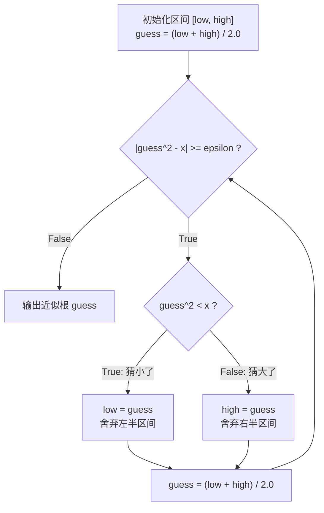

# L06 二分查找（Bisection Search）

%% learning-vault-navigation:v1 %%
> [!abstract]- 笔记导航
> 目录：[[CS Learning/Python MIT6.100L/MIT Python导航|MIT Python 导航]]
> 上一讲：[[CS Learning/Python MIT6.100L/Lecture 5 Floats and Approximation Methods/L05 浮点数表示与近似求解|L05 浮点数表示与近似求解]] · 下一讲：[[CS Learning/Python MIT6.100L/Lecture 7 Decomposition, Abstraction, Functions/L07 分解、抽象与函数|L07 分解、抽象与函数]]

> [!abstract] 本讲定位与核心脉络
> 针对 L05 线性步进近似求 $\sqrt{54321}$ 需耗费 2300 万次迭代的性能瓶颈，本讲引入利用问题**有序性**的对数级加速算法——**二分查找（Bisection Search）**，并推导其 $O(\log_2 N)$ 收敛步数、剖析 $0 < x < 1$ 区间反转等边界问题；随后进一步介绍收敛更快的**牛顿–拉弗森法（Newton–Raphson）**，完成四大迭代求解算法的全景梳理，并在讲末引出下一阶段软件工程的核心主题：**分解（Decomposition）与抽象（Abstraction）**。

---

## 一、二分查找的核心思想与适用前提

### 1. 直觉与前提条件

若把一张百元钞票夹在 448 页课本的某一页，每次猜页码后对方告知「偏高、偏低或猜中」，只需每次取区间中点即可把剩余页数**砍掉一半**。

==Big Idea：二分查找之所以极快，是因为充分利用了问题的三个结构前提：==
1. **有界区间（Two endpoints）**：确知真解位于 `[low, high]` 之内；
2. **有序性 / 单调性（Ordering）**：候选解空间具有天然偏序关系（例如 $g \ge 0$ 时 $g^2$ 单调递增）；
3. **方向性反馈（Directional feedback）**：每次猜测后能明确判断结果是**偏大**还是**偏小**。

> [!example] 课堂反例辨析（You Try It!）
> - **猜 4 位手机 PIN 码**（系统仅提示「正确 / 错误」）：**不可用二分查找**，因为缺乏「偏高 / 偏低」的方向性反馈，无法舍弃半数区间；
> - **精确猜出 `[0, 10]` 内的任意精度实数**（即使有高低反馈）：**无法保证有限步精确命中**，因为连续实数集合无限稠密，必须引入容差 $\varepsilon$ 转为近似求解。

### 2. 对数级收敛推导（$O(\log_2 N)$）

线性穷举每步把搜索空间从 $N$ 缩小到 $N - 1$，而二分查找每步将其减半：

$$
\text{第 } 1 \text{ 步: } \frac{N}{2} \;\longrightarrow\; \text{第 } 2 \text{ 步: } \frac{N}{4} \;\longrightarrow\; \cdots \;\longrightarrow\; \text{第 } k \text{ 步: } \frac{N}{2^k}
$$

当剩余搜索空间缩小到单个候选值（或宽度小于容差）时，令 $\dfrac{N}{2^k} = 1$：

$$
N = 2^k \implies k = \log_2 N
$$

以 $\sqrt{54321}$（$\varepsilon = 0.01$）为例：L05 步长近似法（$\Delta = 0.00001$）需要**超过 2300 万次**猜测，而二分查找仅需 **30 次**！

---

## 二、二分查找的 Python 实现与边界处理

### 1. 标准平方根二分流程



### 2. 关键边界：$0 < x < 1$ 的区间反转

当 $x \ge 1$ 时有 $1 \le \sqrt{x} \le x$，区间取 `[1.0, x]`（或 `[0.0, x]`）；
但当 $0 < x < 1$ 时（如 $x = 0.5$，$\sqrt{0.5} \approx 0.7071$），由于真小数开平方会**变大**，满足 $x < \sqrt{x} < 1$！若仍把上界设为 `high = x`，真解落在搜索区间之外，循环将无限逼近 `x` 而永不终止。

**兼容所有正实数 $x > 0$ 的通用实现**：
```python
x = 0.5
epsilon = 0.01
if x >= 1:
    low = 1.0
    high = x
else:
    low = x
    high = 1.0

guess = (high + low) / 2.0
while abs(guess ** 2 - x) >= epsilon:
    if guess ** 2 < x:
        low = guess
    else:
        high = guess
    guess = (high + low) / 2.0
print(f"{guess} is close to square root of {x}")
```

**扩展至任意正负实数的立方根**（见 `lec06_code.py`）：先用标志位记录 `neg = (cube < 0)` 并取 `cube = abs(cube)`（同时兼容 $0 < |x| < 1$ 时设为 `[cube, 1.0]`），二分求解后再按 `if neg: guess = -guess` 恢复符号。

---

## 三、牛顿–拉弗森法（Newton–Raphson Method）

### 1. 数学原理与迭代公式

牛顿–拉弗森法用于高效求解一元可微函数（讲义中聚焦多项式 $p(x) = a_n x^n + a_{n-1} x^{n-1} + \dots + a_0$）的零点 $p(r) = 0$。从当前猜测 $g$ 出发，沿曲线 $y = p(x)$ 在点 $(g, p(g))$ 处的切线走到与 $x$ 轴的交点，即可得到显著更优的下一轮估计：

$$
g_{\text{next}} = g - \frac{p(g)}{p'(g)}
$$

### 2. 求平方根特例（与 L01 海伦法首尾呼应）

求 $\sqrt{k}$ 等价于求多项式 $p(x) = x^2 - k$ 的正根，其导数 $p'(x) = 2x$，代入牛顿迭代公式得：

$$
g_{\text{next}} = g - \frac{g^2 - k}{2g} = \frac{g + k / g}{2}
$$

这正是 [[CS Learning/Python MIT6.100L/Lecture 1 Introduction/L01 课程导论与 Python 基础|L01]] 开篇介绍的**海伦平方根迭代法**！

```python
epsilon = 0.01
k = 24.0
guess = k / 2.0
num_guesses = 0
while abs(guess * guess - k) >= epsilon:
    num_guesses += 1
    guess = guess - ((guess ** 2 - k) / (2 * guess))
print(f"num_guesses = {num_guesses}")          # 仅需 4 步！
print(f"Square root of {k} is about {guess}")
```

### 3. 四大迭代数值求解算法全景对比

所有迭代求根算法共享同一骨架「**生成猜测 $\to$ 检验误差 $\to$ 更新迭代**」，决定效率天壤之别的正是**生成下一轮猜测的策略**：

| 算法 | 步进/猜测生成方式 | 典型收敛速度 | 适用条件 |
| --- | --- | --- | --- |
| **穷举猜想（L04）** | 整数步长 $+1$ 逐一枚举 | 线性 $O(N)$ | 有限离散整数解空间 |
| **步长近似（L05）** | 固定小数步长 $+\Delta$ 递增 | 线性 $O(N/\Delta)$ | 连续区间，易越界（Overshoot） |
| **二分查找（L06）** | 取区间中点 $(l+h)/2$ 折半 | 对数 $O(\log_2 N)$ | 有界、有序、有偏大/偏小反馈 |
| **牛顿–拉弗森（L06）** | 切线零点 $g - p(g)/p'(g)$ | 局部二次收敛（极快） | 函数连续可微且 $p'(g) \ne 0$ |

---

## 四、讲末引出：分解（Decomposition）与抽象（Abstraction）

讲义最后几页（Slides 37–42）为 [[CS Learning/Python MIT6.100L/Lecture 7 Decomposition, Abstraction, Functions/L07 分解、抽象与函数|L07]] 做了概念预热——编写复杂程序不仅需要语言原语，更需要组织代码的两大核心思想：
- **分解（Decomposition）**：将大程序拆分为独立、自包含、可复用的子模块；
- **抽象（Abstraction）**：分离「做什么（What）」与「怎么做（How）」，屏蔽不必要的实现细节，使代码易于创建、修改、维护与理解。

---

## 五、个人练习实践复盘

### 1. 课堂实操（`learn.py`）
- 先复现了 $x = 0.5$ 时误设 `low = 0.0, high = x` 导致无法收敛的现象，并主动加上 `if num_guesses >= 10: break` 安全阀观察每轮 `low`/`high`/`guess` 的演化；
- 随后修正为 `low = x, high = 1` 验证成功；
- 在立方根练习中主动补充了 `if cube <= 1: low = cube; high = 1` 分支，使代码同时兼容 $(0, 1]$ 与 $(1, +\infty)$！

### 2. Finger Exercise 6（`mit6_100l_f22_ex06.py`）：整数二分猜数边界隐患复盘

题目要求在整数范围 $0 \le N \le 1000$ 内用二分查找猜出 $N$（中点位于两整数正中间时向下取整）。对比个人代码与官方题解：

| 实现版本 | 初始上界 `high` | 更新逻辑 | 当 `N = 1000` 时的表现 |
| --- | :---: | --- | --- |
| 个人实现 `mit6_100l_f22_ex06.py` | `1000` | `low = guess` / `high = guess` | **死循环！** 当 `low=999, high=1000` 时 `(999+1000)//2 == 999` 恒原地踏步 |
| 官方参考解 `mit6_100l_f22_ex06_sol.pdf` | `1001` | `low = guess` / `high = guess` | **正常终止**：`(999+1001)//2 == 1000` 恰好命中 |

> [!warning] 整数二分死循环的根本原因与两种标准解法
> 因为 Python 整数除法 `// 2` 始终**向下取整**，当 `low = high - 1` 时中点永远等于 `low`，若再执行 `low = guess` 区间就不会再缩小！
> - **解法 1（半开区间，官方解做法）**：令搜索区间为 `[0, 1001)`，即设 `high = 1001`；
> - **解法 2（闭区间排除中点，算法竞赛最常用）**：设 `low = 0, high = 1000`，当 `guess < N` 时令 `low = guess + 1`，当 `guess > N` 时令 `high = guess - 1`。

---

## 六、常见陷阱与自检

> [!warning] 本讲高频易错点
> 1. **忽略 $0 < x < 1$ 导致真解落出 `[low, high]`**：开方前务必按 `x >= 1` 与 `0 < x < 1` 分类设定初始端点。
> 2. **整数二分因 `// 2` 向下取整卡死在 `high` 端点**：必须使用半开区间 `high = max_val + 1`，或在更新时用 `low = guess + 1`、`high = guess - 1`。
> 3. **忘记在循环末尾更新 `guess`**：若只更新了 `low` 或 `high` 却忘写 `guess = (high + low) / 2.0`，循环立即死锁。
> 4. **牛顿法除零风险**：若初始猜测或某轮迭代恰好落在 $p'(g) = 0$（如 $g = 0$），`p(g) / p'(g)` 会触发 `ZeroDivisionError`。

> [!question]- 课后自检（点击展开）
> 1. 在 1 到 $1{,}000{,}000$ 之间猜一个整数，二分查找在最坏情况下大约需要多少次？
>    - $\lceil \log_2(10^6) \rceil = 20$ 次（因为 $2^{20} = 1{,}048{,}576$）。
> 2. 为什么用二分法求 $\sqrt{0.25}$ 时不能设 `low = 0, high = 0.25`？
>    - 因为 $\sqrt{0.25} = 0.5 > 0.25$，答案不在 `[0, 0.25]` 区间内；应设 `low = 0.25, high = 1.0`。
> 3. 请写出用牛顿–拉弗森法求 $\sqrt[3]{k}$ 的迭代更新公式。
>    - 令 $p(g) = g^3 - k$，则 $p'(g) = 3g^2$，迭代公式为 $g_{\text{next}} = g - \dfrac{g^3 - k}{3g^2}$。

---

## 七、配套资料

| 资料名称 | 类型 | 本地链接 |
| --- | --- | --- |
| Lecture 6 讲义 Slides | 讲义 PDF | [[CS Learning/Python MIT6.100L/Lecture 6 Bisection Search/mit6_100l_f22_lec06.pdf\|mit6_100l_f22_lec06.pdf]] |
| Lecture 6 课堂演示代码 | 源码 `.py` | [[CS Learning/Python MIT6.100L/Lecture 6 Bisection Search/mit6_100l_f22_lec06_code.py\|mit6_100l_f22_lec06_code.py]] |
| 课堂随练代码 `learn.py` | 个人练习 `.py` | [[CS Learning/Python MIT6.100L/Lecture 6 Bisection Search/learn.py\|learn.py]] |
| Finger Exercise 6 个人代码 | 练习 `.py` | [[CS Learning/Python MIT6.100L/Lecture 6 Bisection Search/mit6_100l_f22_ex06.py\|mit6_100l_f22_ex06.py]] |
| Finger Exercise 6 官方参考解 | 题解 PDF | [[CS Learning/Python MIT6.100L/Lecture 6 Bisection Search/mit6_100l_f22_ex06_sol.pdf\|mit6_100l_f22_ex06_sol.pdf]] |
