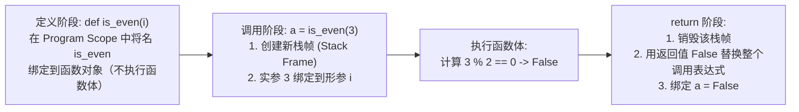

# L07 分解、抽象与函数

%% learning-vault-navigation:v1 %%
> [!abstract]- 笔记导航
> 目录：[[CS Learning/Python MIT6.100L/MIT Python导航|MIT Python 导航]]
> 上一讲：[[CS Learning/Python MIT6.100L/Lecture 6 Bisection Search/L06 二分查找（Bisection Search）|L06 二分查找（Bisection Search）]] · 下一讲：[[CS Learning/Python MIT6.100L/Lecture 8 Functions as Objects/L08 函数作为一等对象|L08 函数作为一等对象]]

> [!abstract] 本讲定位与核心脉络
> 此前六讲已涵盖编程语言的全部基础执行机制，但写出可维护的大型程序依赖两大软件工程支柱：**抽象（Abstraction）**与**分解（Decomposition）**。本讲以智能手机类比建立「黑盒契约」与「模块化拆解」思维，正式引入 **Python 函数（Functions）**的定义、文档字符串（Docstring）、调用替换机制、`print` 与 `return` 的本质区别，以及「先纸笔、后简化、再迭代测试」的工程化编码工作流，并结合 **Recitation 3** 巩固数值方法与函数实践。

---

## 一、抽象与分解：控制复杂度的两大支柱

讲义用**智能手机（Smartphone）**作绝妙类比：

| 工程思想 | 核心含义 | 智能手机类比 | Python 中的实现机制 |
| --- | --- | --- | --- |
| **抽象（Abstraction）** | **屏蔽细节（Black Box）**：分离「做什么（What）」与「怎么做（How）」，只需知道输入/输出接口契约 | 用户只需懂触屏与按键接口，不必懂基带芯片和电路原理 | **函数签名 + 文档字符串（Docstring）** |
| **分解（Decomposition）** | **模块化拆解**：将复杂系统拆为自包含、可独立开发、可复用的组件 | 屏幕、电池、传感器由不同厂商按接口规范各自制造再组装 | **函数（L07–L08）**、**类与对象（L17–L20）** |

==抽象赋能分解（Abstraction enables Decomposition）==：正因为每个模块内部细节被封装在黑盒之内、对外只暴露清晰接口，我们才能像搭积木一样用简单模块组合成复杂程序，彻底杜绝复制粘贴（Copy-Paste）。

---

## 二、Python 函数的解剖与执行机制

### 1. 函数的五个核心要素

```python
def is_even(i):
    """
    Input: i, a positive int
    Returns True if i is even, otherwise False
    """
    return i % 2 == 0
```

1. **函数名（Name）**：本质上是一个变量名，绑定到内存中的**函数对象（Function Object）**；
2. **形式参数（Formal Parameters）**：0 个或多个输入占位符（如 `i`）；
3. **文档字符串（Docstring）**：三引号 `"""..."""` 包裹的规格说明，相当于编写者与调用者之间的**契约（Contract）**——只要输入满足前置条件，函数就保证按契约返回结果（及声明的副作用）；
4. **函数体（Body）**：缩进的指令序列；
5. **返回值（`return`）**：将计算结果交回调用处。

> [!tip] 简洁布尔返回惯用法
> 当函数需要返回布尔值时，无需写冗长的 `if i % 2 == 0: return True else: return False`，直接写 `return i % 2 == 0` 即可，因为比较表达式本身就求值为 `True` 或 `False`。

### 2. 定义（Define）vs 调用（Call / Invoke）

==Big Idea：执行 `def` 仅仅是在内存中创建一个函数对象，函数体代码只有在被**调用（Call）**时才会真正运行！==



**替换视角（与 L01 表达式求值一脉相承）**：函数调用 `is_even(i)` 本身就是一个表达式，Python 执行完函数体后，会把整个 `is_even(i)` **原地替换为它的返回值**，因此可直接嵌入条件判断或算术表达式中（如 `if is_even(i): ...`）。

### 3. `print` vs `return` 与栈帧（Stack Frame）初探（结合 Recitation 3）

| 对比维度 | `return` | `print` |
| --- | --- | --- |
| **面向对象** | **面向计算机 / 上游代码**：把值传回调用处参与后续运算 | **面向人类用户**：仅向控制台输出文本，不传递数据给程序 |
| **执行控制** | **立即终止函数**，其后代码不再执行；函数内至多生效一次 | 只是普通语句，可在函数内执行任意多次 |
| **默认行为** | 若函数体未执行任何 `return`，Python **默认返回 `None`** | `print(...)` 自身返回值也是 `None` |

**栈帧模型（Recitation 3 总结）**：每次调用函数都会创建一个独立的符号表/栈帧（Stack Frame）保存局部变量；函数返回时该栈帧弹出并销毁（详见 [[CS Learning/Python MIT6.100L/Lecture 8 Functions as Objects/L08 函数作为一等对象|L08 函数作为一等对象]]）。

---

## 三、工程化解题工作流：`sum_odd(a, b)` 演进实录

讲义（Slides 32–50）用「求闭区间 $[a, b]$ 内所有奇数之和」示范了写函数时的标准思考顺序：

1. **先用纸笔推样例（Don't write code right away!）**：手算简单用例 `sum_odd(2, 4) -> 3` 与复杂用例 `sum_odd(2, 7) -> 3 + 5 + 7 = 15`；
2. **先解一个更简单的版本（Solve a simpler problem first）**：先写「求 $[a, b]$ 内所有整数之和」的循环框架；
3. **尽早测试并用 `print` / Python Tutor 排错**：对比 `for i in range(a, b)`（返回 `5`）与 `while i <= b`（返回 `9`）的差异，打印中间变量 `(i, sum_of_odds)` 立刻定位出 `range(a, b)` 漏掉了右端点 `b`，修正为 `range(a, b + 1)`；
4. **最后叠加完整需求**：加入奇数过滤条件 `if i % 2 == 1:` 并验证更多样例。

**两个经典字符串函数范式（课堂 & 课后）**：
```python
# 1. 回文串检测：双指针只需遍历前半段（也可一行 return s == s[::-1]）
def is_palindrome(s):
    for i in range(len(s) // 2):
        if s[i] != s[len(s) - i - 1]:
            return False
    return True

# 2. 字符首尾出现位置的索引差（正反扫描 + 提前 break）
def first_to_last_diff(s, c):
    if c not in s:
        return -1
    for i in range(len(s)):
        if s[i] == c:
            break
    for j in range(len(s) - 1, -1, -1):
        if s[j] == c:
            break
    return j - i
```

---

## 四、个人练习与 Recitation 3 实践复盘

### 1. 课堂代码修改（`mit6_100l_f22_lec07_code.py`）
- **实操完成良好**：`keep_consonants(word)` 与 `first_to_last_diff(s, c)` 均写得与官方解答高度一致，边界判断 `if c not in s: return -1` 准确无误。
- **隐藏 Bug 复盘（`div_by(n, d)`）**：在随堂修改的 `div_by` 中写成了 `return d % n == 0`——参数顺序写反了！规格要求判断「`d` 能否整除 `n`（$d \mid n$）」，正确应为 `return n % d == 0`。由于只运行了 `print(div_by(10, 3))`（两者都碰巧是 `False`），而注释掉了 `div_by(195, 13)`，导致该 Bug 被测试用例漏过——==再次印证「必须同时测试正例与反例」的重要性！==

### 2. Finger Exercise 7（`mit6_100l_f22_ex07.py` vs 官方题解）
- **Question 1（`eval_quadratic(a, b, c, x)`）**：正确返回 `a * x**2 + b * x + c`。
- **Question 2（`two_quadratics(...)`）**：个人实现重新展开了整条公式 `print(a1*x1**2 + b1*x1 + c1 + a2*x2**2 + b2*x2 + c2)`；而官方题解刻意呼应本讲**分解与复用**主题，直接调用刚写好的黑盒函数：
  ```python
  def two_quadratics(a1, b1, c1, x1, a2, b2, c2, x2):
      print(eval_quadratic(a1, b1, c1, x1) + eval_quadratic(a2, b2, c2, x2))
  ```
  此外，题目自带的两个调用测试直观展示了无 `return` 函数的行为差异：直接调用 `two_quadratics(...)` 仅打印 `6`，而 `print(two_quadratics(...))` 会先打印 `6`，再把默认返回值打印成第二行 `None`。

### 3. Recitation 3（`R03_problems.py` vs `R03_solutions.py`）
- **P1（四次方根二分查找）**：个人实现主动加了 `if x < 1: low = x; high = 1`，比官方解（未处理 $0 < x < 1$）更健壮！
- **P2（区间判断 `is_range`）**：直接 `return x >= low and x <= high`（还可写成 Python 链式比较 `return low <= x <= high`），返回布尔值比官方返回 `"Yes"/"No"` 更利于后续程序复用。
- **P3（完全数 `perfect_number(n)`）**：个人将枚举上界优化为 `range(1, n // 2 + 1)`，相比官方 `range(1, n)` 减少一半计算量（因为任何正整数的真因子都不超过 $n/2$）。
- **P4（四次方根步进近似）**：完整加上负数拦截 `if number < 0` 与防越界条件 `and ans**4 <= number`。

---

## 五、常见陷阱与自检

> [!warning] 本讲高频易错点
> 1. **混淆 `print` 与 `return`**：在需要返回结果的函数中误写了 `print(ans)` 却没写 `return ans`，导致调用者拿到的是 `None`，后续参与算术运算时报错 `TypeError: unsupported operand type(s) for +: 'NoneType' and ...`。
> 2. **只定义不调用，或调用时不接收/打印返回值**：脚本中仅写了 `is_even(3)` 而未 `print(is_even(3))` 或赋值给变量，运行时终端将毫无输出。
> 3. **参数顺序理解颠倒**：如 `div_by(n, d)` 英文描述 `"d divides n"` 指 $n \bmod d = 0$，动手写代码前务必先精读 Docstring。
> 4. **仅测单一反例掩盖逻辑错误**：如 `div_by(10, 3)` 对正反写都返回 `False`，测试函数必须覆盖**预期为 `True`、预期为 `False` 及边界输入**。

> [!question]- 课后自检（点击展开）
> 1. 下面代码运行后会打印出什么？
>    ```python
>    def add_print(x, y):
>        print(x + y)
>    res = add_print(2, 3)
>    print("res =", res)
>    ```
>    - 先打印 `5`，再打印 `res = None`（因为 `add_print` 没有 `return` 语句，默认返回 `None`）。
> 2. 为什么 Docstring 被称为「契约（Contract）」？
>    - 它明确约定了调用者需满足的输入前提条件，以及函数在满足前提下保证提供的返回值与副作用，使调用者无需阅读内部实现即可安全复用。
> 3. `two_quadratics` 调用 `eval_quadratic` 而不是重写公式，体现了本讲的哪两个核心理念？
>    - 体现了**分解**（复用已有独立子模块）与**抽象**（将二次多项式求值视作黑盒，减少重复代码与出错面）。

---

## 六、配套资料

| 资料名称 | 类型 | 本地链接 |
| --- | --- | --- |
| Lecture 7 讲义 Slides | 讲义 PDF | [[CS Learning/Python MIT6.100L/Lecture 7 Decomposition, Abstraction, Functions/mit6_100l_f22_lec07.pdf\|mit6_100l_f22_lec07.pdf]] |
| Lecture 7 课堂演示代码（含随练） | 源码 `.py` | [[CS Learning/Python MIT6.100L/Lecture 7 Decomposition, Abstraction, Functions/mit6_100l_f22_lec07_code.py\|mit6_100l_f22_lec07_code.py]] |
| Finger Exercise 7 个人代码 | 练习 `.py` | [[CS Learning/Python MIT6.100L/Lecture 7 Decomposition, Abstraction, Functions/mit6_100l_f22_ex07.py\|mit6_100l_f22_ex07.py]] |
| Finger Exercise 7 官方参考解 | 题解 PDF | [[CS Learning/Python MIT6.100L/Lecture 7 Decomposition, Abstraction, Functions/mit6_100l_f22_ex07_sol.pdf\|mit6_100l_f22_ex07_sol.pdf]] |
| Recitation 3 复习总结（含 L04–L07） | 习题课 PDF | [[CS Learning/Python MIT6.100L/Lecture 7 Decomposition, Abstraction, Functions/mit6_100l_f22_rec03/1_rec3/R03_summary.pdf\|R03_summary.pdf]] |
| Recitation 3 个人练习代码 | 习题课 `.py` | [[CS Learning/Python MIT6.100L/Lecture 7 Decomposition, Abstraction, Functions/mit6_100l_f22_rec03/1_rec3/R03_problems.py\|R03_problems.py]] |
| Recitation 3 官方参考解 | 习题课 `.py` | [[CS Learning/Python MIT6.100L/Lecture 7 Decomposition, Abstraction, Functions/mit6_100l_f22_rec03/1_rec3/R03_solutions.py\|R03_solutions.py]] |
