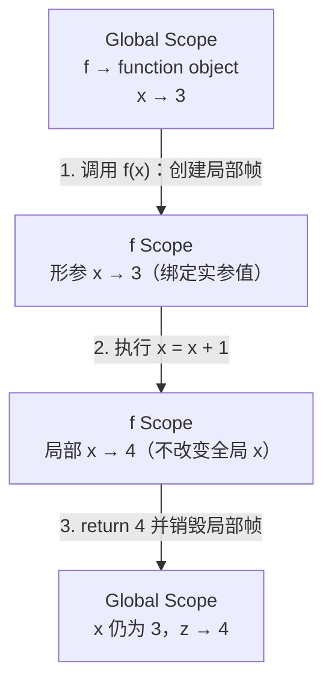
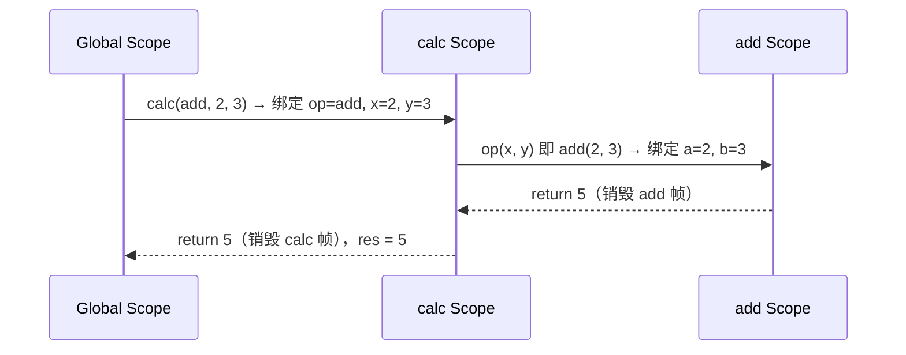

# L08 函数作为一等对象

%% learning-vault-navigation:v1 %%
> [!abstract]- 笔记导航
> 目录：[[CS Learning/Python MIT6.100L/MIT Python导航|MIT Python 导航]]
> 上一讲：[[CS Learning/Python MIT6.100L/Lecture 7 Decomposition, Abstraction, Functions/L07 分解、抽象与函数|L07 分解、抽象与函数]] · 下一讲：[[CS Learning/Python MIT6.100L/Lecture 9 Lambda Functions, Tuples, and Lists/L09 Lambda 表达式、元组与列表|L09 Lambda 表达式、元组与列表]]

> [!abstract] 本讲定位与核心脉络
> 本讲在 [[CS Learning/Python MIT6.100L/Lecture 7 Decomposition, Abstraction, Functions/L07 分解、抽象与函数|L07]] 引入函数语法之后，深入剖析 Python 函数调用的底层运行模型：明确 `return` 与 `print` 的语义边界及默认返回值 `None`；建立**全局环境（Global Scope）与函数调用栈帧（Function Frame / Scope）**的名称绑定视图；并揭示 Python 最核心的设计哲学之一——==一切皆对象，函数也是「一等对象（First-Class Objects）」==，从而支持将函数作为参数传入、作为返回值传出，迈出**高阶函数（Higher-Order Procedures）**的第一步。

---

## 一、`return` vs. `print` 与隐式返回值 `None`

Python 中**每个函数调用必定返回一个值**。若函数体未执行到 `return` 语句，解释器会在末尾隐式补上 `return None`（类型为 `NoneType`，表示“无值”）。

| 对比维度 | `return` | `print` |
| --- | --- | --- |
| **适用位置** | 只能在函数体内部使用 | 可在程序任意位置使用 |
| **执行次数** | 单次函数调用中**至多执行一次**，执行后立即退出当前函数 | 可执行任意多次，不终止函数执行 |
| **后续语句** | `return` 之后的同路径代码均不执行 | 后续语句继续顺序执行 |
| **作用对象** | 将结果值交给**调用者（程序本身）**继续参与运算 | 将文本输出到**控制台（人类用户）**，表达式本身返回 `None` |

```python
def add(x, y):
    return x + y

def mult(x, y):
    print(x * y)

add(1, 2)          # 返回 3，但未打印 → 控制台无输出
print(add(2, 3))   # 返回 5 → 打印 5
mult(3, 4)         # 函数内打印 12，返回 None
print(mult(4, 5))  # 先在函数内打印 20，再打印返回值 None
```

> [!warning] 常见逻辑陷阱：循环内过早 `return`（`is_triangular` 排错）
> 讲义与 `mit6_100l_f22_lec08_code.py` 中给出经典错题 `is_triangular(n)`：
> ```python
> # 错误写法：第一轮循环 i=0 时就会因为 total != n 而直接 return False
> for i in range(n + 1):
>     total += i
>     if total == n:
>         return True
>     return False
> ```
> 正确做法是将 `return False` 移到 `for` 循环外部——**只有穷尽所有候选累加和仍未命中时，才能断言不是三角数**。

---

## 二、函数作用域（Scope）与调用环境模型

每次调用函数时，Python 都会创建一个全新的**局部环境 / 栈帧（Scope / Frame）**，它本质上是一个「变量名 → 对象」的映射表：



### 外部变量的读取与修改规则

讲义通过三个经典函数对比局部变量与全局变量的交互（对应 `mit6_100l_f22_lec08_code.py`）：

```python
# 1. 同名局部变量遮蔽（Shadowing）：互不干扰
def f(y):
    x = 1
    x += 1
    print(x)     # 输出 2；全局 x 仍为 5

# 2. 只读访问外部变量：合法（查找链 Local → Global）
def g(y):
    print(x)     # 输出 5
    print(x + 1) # 输出 6

# 3. 试图直接重新绑定外部变量：报错 UnboundLocalError
def h(y):
    x += 1       # Python 编译期见赋值即视 x 为局部变量，读取时未绑定 → Error!
```

> [!important] 核心原则
> - 函数内部可以**读取**外部作用域的变量，但不能直接**重新绑定（赋值）**外部变量（虽然可用 `global x`，但会破坏黑盒封装，工程上强烈不推荐）。
> - ==必须先明确当前正在执行哪一行表达式，才能确定所处的作用域（Scope）==。复杂调用链可配合 [Python Tutor](https://pythontutor.com/) 单步可视化栈帧生灭。

---

## 三、函数作为一等对象与高阶函数

Python 中**一切皆对象（Everything in Python is an object）**，每种对象都有明确类型：`int`、`float`、`str`、`bool`、`NoneType` 以及 **`function`**。

所谓**一等对象（First-Class Object）**，意味着函数对象与普通数值/字符串享有完全同等的地位：
1. 可以出现在赋值号右侧，用新变量名指向同一函数对象（如 `my_func = is_even`，注意**不加括号**，加括号代表调用）；
2. 可以作为**实参**传递给另一个函数；
3. 可以作为**返回值**由另一个函数返回。

### 典型高阶函数模式

```python
def calc(op, x, y):
    return op(x, y)

def add(a, b):
    return a + b

def div(a, b):
    if b != 0:
        return a / b
    print("Denominator was 0.")

res1 = calc(add, 2, 3)  # calc 帧中 op→add, x→2, y→3 → 调 add(2,3) → 返回 5
res2 = calc(div, 2, 0)  # 打印 "Denominator was 0."，div 隐式返回 None → res2 为 None
```



> [!tip] 传函数名 vs. 传调用结果
> 写 `calc(add, 2, 3)` 传入的是 `add` **函数对象本身**；若误写为 `calc(add(2, 3), 2, 3)`，会先求值 `add(2, 3)` 得到整数 `5`，再在 `calc` 内试图执行 `5(2, 3)` 导致 `TypeError: 'int' object is not callable`。

---

## 四、个人练习与作业总结

本讲目录中包含课堂练习 `learn.py`、课后作业 `homework.py` 以及 Finger Exercise `mit6_100l_f22_ex08.py`：

| 练习题 / 函数 | 所在文件 | 核心考查点与实现思路 |
| --- | --- | --- |
| `count_nums_with_sqrt_close_to(n, epsilon)` | `learn.py` | 讲义原意复用 [[CS Learning/Python MIT6.100L/Lecture 6 Bisection Search/L06 二分查找（Bisection Search）\|L06]] 的 `bisection_root` 枚举检验；个人在 `learn.py` 中直接利用单调性写出闭式解 `int((n+epsilon)**2//1) - int((n-epsilon)**2//1)`，将迭代化为 $O(1)$ 数学计数 |
| `apply(criteria, n)` | `learn.py` | 典型高阶函数：接收谓词函数 `criteria` 与整数 `n`，统计 $0 \sim n$（含两端）满足 `criteria(i)` 为真的整数个数；如 `apply(is_even, 10)` 返回 `6` |
| `is_palindrome(s)` & `f_yields_palindrome(n, f)` | `homework.py` | 先实现双端对称比较 `s[i] != s[len(s)-i-1]` 判定回文，再通过高阶函数 `f_yields_palindrome(n, f)` 把 `f(n)` 转为字符串交给 `is_palindrome`，体现函数分解与复合 |
| `same_chars(s1, s2)` | `mit6_100l_f22_ex08.py` | Finger Exercise 8：双向遍历检查 `s1` 与 `s2` 所含字符集合是否完全一致（忽略出现频次与顺序），命中缺失立即提前 `return False` |

> [!note] 代码细节备忘
> 在 `count_nums_with_sqrt_close_to(n, epsilon)` 中，个人闭式解计算的是严格半开区间 $((n-\varepsilon)^2, (n+\varepsilon)^2]$ 内的整数个数，与使用 `bisection_root`（固定 $\text{epsilon}=0.01$ 近似误差）时在边界上可能存在微小差异；这也体现了「数学解析解」与「数值近似黑盒复用」各自的适用场景。

---

## 五、自测思考

> [!question]- 1. 执行 `print(func_c(func_b, 3))`（其中 `func_b` 打印后返回 `y`，`func_c` 打印后返回 `f(z)`）时，控制台输出顺序是什么？
> 依次输出：
> 1. `inside func_c`（进入 `func_c` 栈帧）
> 2. `inside func_b`（在 `func_c` 内执行 `f(z)` 即 `func_b(3)`）
> 3. `3`（`func_b` 返回 `3` 给 `func_c`，`func_c` 再返回 `3` 给外层 `print`）

> [!question]- 2. 为什么函数体中只写 `print(x)` 能读取全局变量 `x`，而写 `x += 1` 却在执行 `x` 读取前就报 `UnboundLocalError`？
> Python 在**编译函数体时**会扫描所有赋值目标。只要函数内存在对 `x` 的绑定操作（`x = ...` 或 `x += 1`）且未声明 `global x`，`x` 在整个函数作用域内都被判定为**局部变量**；执行到 `x += 1` 时试图读取尚未赋值的局部变量 `x`，于是抛出 `UnboundLocalError`。

---

## 六、配套资料

| 材料类型 | 文件入口 |
| --- | --- |
| 课堂讲义 | [[CS Learning/Python MIT6.100L/Lecture 8 Functions as Objects/mit6_100l_f22_lec08.pdf\|mit6_100l_f22_lec08.pdf]] |
| 课堂代码 | [[CS Learning/Python MIT6.100L/Lecture 8 Functions as Objects/mit6_100l_f22_lec08_code.py\|mit6_100l_f22_lec08_code.py]] |
| 个人课堂练习 | [[CS Learning/Python MIT6.100L/Lecture 8 Functions as Objects/learn.py\|learn.py]] |
| 个人课后作业 | [[CS Learning/Python MIT6.100L/Lecture 8 Functions as Objects/homework.py\|homework.py]] |
| Finger Exercise & 参考解答 | [[CS Learning/Python MIT6.100L/Lecture 8 Functions as Objects/mit6_100l_f22_ex08.py\|mit6_100l_f22_ex08.py]] · [[CS Learning/Python MIT6.100L/Lecture 8 Functions as Objects/mit6_100l_f22_ex08_sol.pdf\|mit6_100l_f22_ex08_sol.pdf]] |
