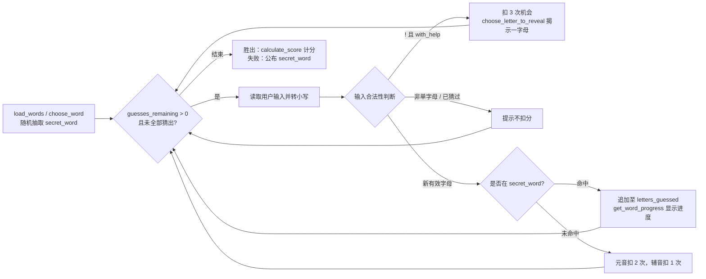

# L09 Lambda 表达式、元组与列表

%% learning-vault-navigation:v1 %%
> [!abstract]- 笔记导航
> 目录：[[CS Learning/Python MIT6.100L/MIT Python导航|MIT Python 导航]]
> 上一讲：[[CS Learning/Python MIT6.100L/Lecture 8 Functions as Objects/L08 函数作为一等对象|L08 函数作为一等对象]] · 下一讲：[[CS Learning/Python MIT6.100L/Lecture 10 Lists, Mutability/L10 列表与可变性（Mutability）|L10 列表与可变性（Mutability）]]

> [!abstract] 本讲定位与核心脉络
> 本讲承接 [[CS Learning/Python MIT6.100L/Lecture 8 Functions as Objects/L08 函数作为一等对象|L08]] 的高阶函数概念，引入一次性匿名函数 **`lambda`**；随后从标量类型（`int`/`float`/`bool`）和单一序列类型（`str`）跃迁到通用的**复合数据结构（Compound Data Types）**——不可变序列**元组（Tuple）**与可变序列**列表（List）**，涵盖索引、切片、解包、多返回值、可变参数 `*args` 及序列遍历模式；同时配套完成 **Problem Set 2（Hangman 猜词游戏）**与 **Recitation 4**。

---

## 一、匿名函数：`lambda` 表达式

当高阶函数只需要一个**简短、单行、仅使用一次**的函数对象时，不必用 `def` 专门命名，可直接使用 `lambda` 创建匿名函数对象：

```python
# 具名函数 vs. 匿名函数
def is_even(x):
    return x % 2 == 0

apply(is_even, 10)
apply(lambda x: x % 2 == 0, 10)

# 等价直接调用
(lambda x: x % 2 == 0)(8)  # -> True
```

- **语法**：`lambda <参数列表>: <单个表达式>`
- **特点**：
  - 不写 `return` 关键字，表达式的求值结果即返回值；
  - 没有绑定函数名（一次性使用，无法在别处按名复用，除非显式赋值给变量）；
  - 每次被调用时依然创建独立栈帧。例如 `do_twice(3, lambda x: x**2)` 执行 `fn(fn(3))`：内层栈帧 `x=3` 返回 `9`，外层栈帧 `x=9` 返回 `81`。

---

## 二、元组（Tuples）：不可变有序序列

元组是用圆括号 `()` 表示的**可索引、有序、不可变（Immutable）**对象序列，内部元素可为任意类型（甚至嵌套元组或列表）。

### 1. 语法要点与单元素逗号陷阱

```python
te = ()                      # 空元组
ts = (2,)                    # 单元素元组：必须保留尾部逗号！
not_a_tuple = ('cloudy')     # 实际是 str，不是 tuple！
t = (2, "mit", 3)
t[0]                         # -> 2
t[1:2]                       # -> ("mit",)  切片返回新元组
t + (5, 6)                   # -> (2, "mit", 3, 5, 6) 拼接返回新元组
# t[1] = 4                   # TypeError: 不支持原地修改
```

> [!warning] 高频易错点：`('cloudy')` vs. `('cold',)`
> 课后跟踪题 `always_sunny(('cloudy'), ('cold',))` 中：
> - 第一参数 `('cloudy')` 缺少逗号，本质是字符串 `'cloudy'`，因此 `t1[0]` 取出的是首字符 `'c'`；
> - 第二参数 `('cold',)` 是单元素元组，因此 `t2[0]` 取出的是完整字符串 `'cold'`；
> - 两者拼接得到 `'ccold'`，函数返回 `('sunny', 'ccold')`。

### 2. 元组的三大经典工程用途

1. **变量值优雅交换**（无需临时变量 `temp`）：
   ```python
   (x, y) = (y, x)
   ```
2. **函数返回多个值**：==返回一个复合对象（元组），即可逻辑上返回多个值==，并支持调用端直接解包（Unpacking）：
   ```python
   def quotient_and_remainder(x, y):
       return (x // y, x % y)

   quot, rem = quotient_and_remainder(5, 2)  # quot=2, rem=1
   ```
3. **可变数量位置参数 `*args`**：Python 自动把传入的任意多个实参打包为一个元组绑定到 `args`：
   ```python
   def mean(*args):
       tot = 0
       for a in args:
           tot += a
       return tot / len(args)

   mean(1, 2, 3, 4, 5, 6)   # *args 打包为 (1, 2, 3, 4, 5, 6)
   ```
   对比 `def mean(args):` 则要求调用者手动传入一个元组 `mean((1, 2, 3))`。

---

## 三、列表（Lists）：可变有序序列初探

列表是用方括号 `[]` 表示的**可索引、有序、可变（Mutable）**对象序列：
- 工程习惯上通常存放同构元素（如全是整数、全是字符串或全是子列表），但语法上允许混放任意对象（如 `[2, 'a', 4, [1, 2]]`）。
- 索引、负索引、切片、拼接（`+`）、`len()`、`max()`、`for` 遍历与字符串、元组高度一致；关于列表的可变性、别名与拷贝将在 [[CS Learning/Python MIT6.100L/Lecture 10 Lists, Mutability/L10 列表与可变性（Mutability）|L10]] 与 [[CS Learning/Python MIT6.100L/Lecture 11 Aliasing, Cloning/L11 别名与拷贝（Aliasing & Cloning）|L11]] 深入展开。

### 序列对比速查

| 特性 | `str`（字符串） | `tuple`（元组） | `list`（列表） |
| --- | --- | --- | --- |
| **字面量符号** | `'...'` / `"..."` | `(a, b)` / `(a,)` | `[a, b]` |
| **元素类型** | 仅字符 | 任意对象（常用于异构记录） | 任意对象（常用于同构集合） |
| **可变性** | 不可变（Immutable） | 不可变（Immutable） | **可变（Mutable）** |
| **索引/切片/遍历** | 支持 | 支持 | 支持 |

### 遍历列表的两种范式

```python
# 范式一：直接迭代元素（Pythonic，优先推荐）
def list_sum(L):
    total = 0
    for e in L:
        total += e
    return total

# 范式二：按索引迭代（当需要同步访问下标或成对遍历多个序列时使用）
def dot_product(tA, tB):
    total = 0
    for i in range(len(tA)):
        total += tA[i] * tB[i]
    return (len(tA), total)
```

---

## 四、个人练习、Recitation 4 与 PS2（Hangman）实战总结

### 1. 课堂练习与 Finger Exercise

- **`learn.py`**：实现 `char_counts(s)` 统计元音与辅音个数并以元组返回 `(vowels, len(s) - vowels)`；实现 `sum_and_prod(L)` 一次遍历同时返回列表元素的 `(和, 积)`。
- **`homework.py`**：手写追踪 `always_sunny` 陷阱；实现高阶函数 `max_of_both(n, f1, f2)` 结合 `lambda` 求区间最大值；实现嵌套列表求和 `sublist_sum(L)`（利用 `sum(sublist)` 简洁累加）。
- **`mit6_100l_f22_ex09.py`**（Finger Exercise 9）：实现两个等长数值元组的点积 `dot_product(tA, tB)`，返回 `(len(tA), sum_of_products)`。
- **`R04_problems.py`**（Recitation 4）：练习立方根/乘积 `lambda`、元组计数 `count_number_one`、元组交集 `common_elements`（用 `com += (i,)` 逐步构造新元组）以及二维列表区间过滤 `remove_list_range`（借 `min(i) >= low and max(i) <= high` 筛选子列表）。

### 2. Problem Set 2：Hangman 猜词游戏（`hangman.py`）

PS2 综合运用了函数分解、循环控制、字符串与列表操作，加载 `words.txt`（55,900 个英文单词）构建完整交互式猜词游戏：



核心辅助函数拆解（个人已完成实现并配套 `test_ps2_student.py` 单元测试）：
- `has_player_won(secret_word, letters_guessed)`：检查目标词每个字母是否都已在已猜列表中；
- `get_word_progress(secret_word, letters_guessed)`：已猜中显示原字母，未猜中以 `*` 掩码；
- `get_available_letters(letters_guessed)`：基于 `string.ascii_lowercase` 过滤返回按字母序排列的剩余候选字母；
- `choose_letter_to_reveal` & `calculate_score`：实现提示模式（扣 3 次机会随机揭示未猜中字母）以及得分公式 $\text{score} = \text{guesses\_remaining} + 4 \times |\text{unique\_letters}| + 3 \times \text{len}(\text{secret\_word})$。

> [!tip] PS2 工程细节提醒
> 1. 猜测错误时区分**元音（`aeiou`，扣 2 次机会）**与**辅音（扣 1 次机会）**；
> 2. 非法输入（长度非 1、非字母或重复猜测）不消耗剩余次数；
> 3. `hangman.py` 中对 `with_help` 与非 help 模式的提示语细节均需与单元测试 `test_ps2_student.py` 对齐。

---

## 五、配套资料

| 材料类型 | 文件入口 |
| --- | --- |
| 课堂讲义 | [[CS Learning/Python MIT6.100L/Lecture 9 Lambda Functions, Tuples, and Lists/mit6_100l_f22_lec09.pdf\|mit6_100l_f22_lec09.pdf]] |
| 课堂代码 | [[CS Learning/Python MIT6.100L/Lecture 9 Lambda Functions, Tuples, and Lists/mit6_100l_f22_lec09_code.py\|mit6_100l_f22_lec09_code.py]] |
| 个人练习与作业 | [[CS Learning/Python MIT6.100L/Lecture 9 Lambda Functions, Tuples, and Lists/learn.py\|learn.py]] · [[CS Learning/Python MIT6.100L/Lecture 9 Lambda Functions, Tuples, and Lists/homework.py\|homework.py]] |
| Finger Exercise & 参考解答 | [[CS Learning/Python MIT6.100L/Lecture 9 Lambda Functions, Tuples, and Lists/mit6_100l_f22_ex09.py\|mit6_100l_f22_ex09.py]] · [[CS Learning/Python MIT6.100L/Lecture 9 Lambda Functions, Tuples, and Lists/mit6_100l_f22_ex09_sol.pdf\|mit6_100l_f22_ex09_sol.pdf]] |
| Problem Set 2（Hangman） | [[CS Learning/Python MIT6.100L/Lecture 9 Lambda Functions, Tuples, and Lists/mit6_100l_f22_ps2/mit6_100l_f22_ps2.pdf\|题目说明 PDF]] · [[CS Learning/Python MIT6.100L/Lecture 9 Lambda Functions, Tuples, and Lists/mit6_100l_f22_ps2/mit6_100l_f22_ps2_code/1_ps2/hangman.py\|hangman.py]] · [[CS Learning/Python MIT6.100L/Lecture 9 Lambda Functions, Tuples, and Lists/mit6_100l_f22_ps2/mit6_100l_f22_ps2_code/1_ps2/test_ps2_student.py\|test_ps2_student.py]] |
| Recitation 4 | [[CS Learning/Python MIT6.100L/Lecture 9 Lambda Functions, Tuples, and Lists/mit6_100l_f22_rec04/1_rec4/R04_summary.docx\|R04_summary.docx]] · [[CS Learning/Python MIT6.100L/Lecture 9 Lambda Functions, Tuples, and Lists/mit6_100l_f22_rec04/1_rec4/R04_problems.py\|R04_problems.py]] · [[CS Learning/Python MIT6.100L/Lecture 9 Lambda Functions, Tuples, and Lists/mit6_100l_f22_rec04/1_rec4/R04_solutions.py\|R04_solutions.py]] |
