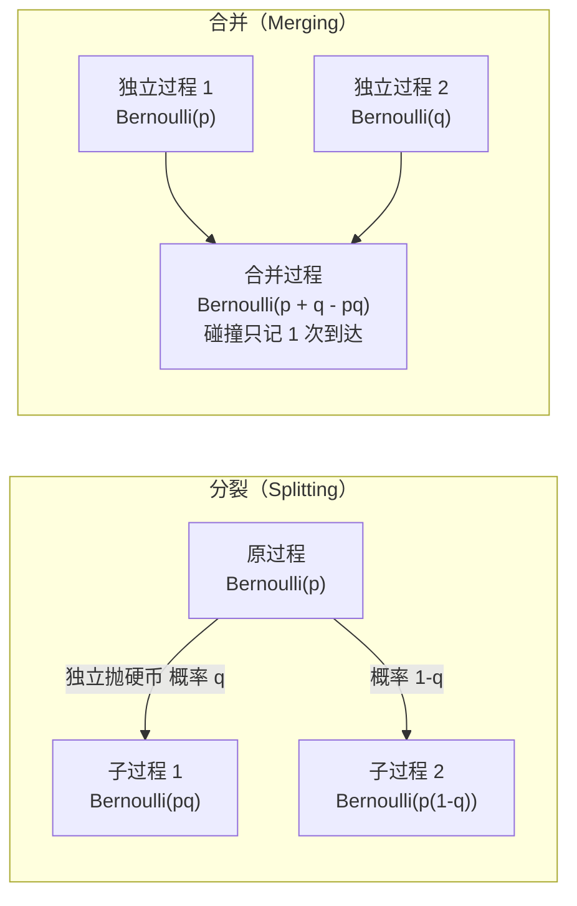

# L13 伯努利过程（Bernoulli Process）

%% learning-vault-navigation:v1 %%
> [!abstract]- 笔记导航
> 目录：[[Math Learning/Probability and Stochastic Processes/6.041SC/U3/U3随机过程导航|MIT 6.041SC U3 随机过程导航]]
> 下一讲：[[Math Learning/Probability and Stochastic Processes/6.041SC/U3/L14/L14 泊松过程（一）（Poisson Process I）|L14 泊松过程（一）（Poisson Process I）]]

> [!abstract] 本讲概览
> 本讲为 MIT 6.041SC Unit III（Random Processes）开篇，对应教材 Section 6.1 与 [[Math Learning/Probability and Stochastic Processes/6.041SC/U3/L13/Probabilistic Systems Analysis and Applied Probability, Lecture 13.pdf|Lecture 13 讲义 PDF]]。从静态随机变量跨入随时间演化的**随机过程（Random Processes）**，先建立离散时间、无记忆的最基础到达模型——==伯努利过程（Bernoulli Process）==，系统刻画其计数分布（二项）、到达间隔（几何）、第 $k$ 次到达时间（帕斯卡）、全新开始性质（Fresh-Start Property）、分裂与合并操作，以及向泊松过程的极限过渡。

---

## 一、随机过程的两种视角与 U3 路线图

现实世界并非“掷一次骰子就结束”，而是随时间持续产生随机结果。Prof. Tsitsiklis 在课堂上强调理解随机过程的两种等价视角：

1. **随机变量序列视角**：按时间索引排列的一族随机变量 $X_1, X_2, X_3, \dots$（离散时间）或 $\{N(t),\, t \ge 0\}$（连续时间）。
2. **样本路径视角（无限维样本空间）**：把整条无限长的演化轨迹 $(x_1, x_2, \dots) \in \{0, 1\}^{\mathbb{N}}$ 本身看作样本空间 $\Omega$ 中的单个样本点 $\omega$。
   - **重要直观**：对于 $0 < p < 1$ 的伯努利过程，任何一条特定的无限序列（例如全为 $1$ 的序列）发生的概率都是 $P(X_t = 1 \text{ for all } t) = \lim_{n \to \infty} p^n = 0$，这与连续均匀分布中任意单个实数点概率为 $0$ 完全类似！

Unit III 围绕**时间离散/连续**与**是否有记忆**构建三类核心过程：

| 随机过程 | 时间轴 | 记忆 / 依赖结构 | 对应讲次 |
| --- | --- | --- | --- |
| **伯努利过程（Bernoulli Process）** | 离散时间 $t=1,2,\dots$ | 无记忆（各时隙独立） | 本讲（L13） |
| **泊松过程（Poisson Process）** | 连续时间 $t \in [0, \infty)$ | 无记忆（不相交区间独立） | [[Math Learning/Probability and Stochastic Processes/6.041SC/U3/L14/L14 泊松过程（一）（Poisson Process I）\|L14]] · [[Math Learning/Probability and Stochastic Processes/6.041SC/U3/L15/L15 泊松过程（二）（Poisson Process II）\|L15]] |
| **马尔可夫链（Markov Chains）** | 离散时间 $t=0,1,2,\dots$ | 有限记忆（一步状态依赖） | [[Math Learning/Probability and Stochastic Processes/6.041SC/U3/L16/L16 马尔可夫链（一）（Markov Chains I）\|L16]] – [[Math Learning/Probability and Stochastic Processes/6.041SC/U3/L18/L18 马尔可夫链（三）（Markov Chains III）\|L18]] |

---

## 二、伯努利过程的定义与基本统计量

### 1. 定义与典型场景

**伯努利过程**是由一列**相互独立、同分布**的伯努利试验 $X_1, X_2, \dots$ 构成的离散时间随机过程，在每个时隙（time slot）$i = 1, 2, \dots$：
$$P(X_i = 1) = p \quad (\text{成功 / 到达}), \qquad P(X_i = 0) = 1 - p \quad (\text{失败 / 无到达})$$
- **典型应用**（讲义 P1）：每日彩票中奖/未中奖序列、道琼斯指数每日涨跌、每秒到达银行的顾客、每个时隙到达服务器的请求数据包。
- 单步数字特征：$E[X_t] = p$，$\operatorname{Var}(X_t) = p(1 - p)$。

### 2. 前 $n$ 个时隙内的到达总数 $S_n$（二项分布）

设 $S_n = X_1 + X_2 + \cdots + X_n$ 表示长度为 $n$ 的时间窗口内（或任意 $n$ 个固定时隙内）的成功次数，则 $S_n \sim \text{Binomial}(n, p)$：
$$P(S_n = k) = \binom{n}{k} p^k (1 - p)^{n-k}, \qquad k = 0, 1, \dots, n$$
由独立性与期望/方差的线性性质直接得：
$$E[S_n] = np, \qquad \operatorname{Var}(S_n) = np(1 - p)$$
（对比基础课程 [[Math Learning/Probability and Stochastic Processes/Probability Kira/第二章 随机变量及其分布|Kira 第二章]] 的二项分布推导。）

---

## 三、独立性、无记忆性与全新开始性质（Fresh-Start Property）

### 1. 首次到达时间 $T_1$（几何分布）

设 $T_1$ 表示从时间 $0$ 开始直到首次成功所需的时隙数（即 $X_1 = \cdots = X_{t-1} = 0,\, X_t = 1$），则 $T_1 \sim \text{Geometric}(p)$：
$$P(T_1 = t) = (1 - p)^{t-1} p \quad (t = 1, 2, \dots), \qquad P(T_1 > t) = (1 - p)^t$$
$$E[T_1] = \frac{1}{p}, \qquad \operatorname{Var}(T_1) = \frac{1 - p}{p^2}$$

### 2. 无记忆性与“全新开始”边界辨析

- **无记忆性（Memorylessness）**：对任意固定时刻 $n$，未来过程 $X_{n+1}, X_{n+2}, \dots$ 与过去 $X_1, \dots, X_n$ 完全独立，且仍构成参数为 $p$ 的伯努利过程。等价地：
  $$P(T_1 - n = t \mid T_1 > n) = (1 - p)^{t-1} p = P(T_1 = t)$$
- **强无记忆性 / 全新开始性质（Fresh-Start Property）**：不仅在确定性时刻 $n$，在任何**停时（Stopping Time）**——即仅依据过去和当前观测就能判断是否发生的随机时刻 $N$（例如“首次成功发生的时刻 $T_1$”或“首次失败发生的时刻”）——之后，剩余过程 $X_{N+1}, X_{N+2}, \dots$ 依然是与过去完全独立的伯努利过程 $(p)$！

> [!warning] 课堂经典陷阱：第一段连输天数 $L$ 的分布（Lecture 13 讲义 P2 & Transcript P7–8）
> **问题**：你每天买一张彩票，中奖概率为 $p$。求**第一段连续未中奖天数**（length of the first string of losing days）$L$ 的分布（注意：如果前几天连续中奖，要从第一次未中奖开始数，直到随后第一次中奖为止）。
>
> - **错误直觉**：“让妹妹盯着彩票，看到连输要开始时叫我进去，从此等第一次中奖，共需 $L + 1$ 天，所以 $L + 1 \sim \text{Geom}(p)$？”——**错！** 妹妹必须在“第一次失败**之前**”就预知明天会失败，这偷窥了未来（不是合法停时），破坏了未来的独立性！
> - **正确做法（合法停时）**：妹妹一直看，直到**亲眼看到第一天失败**后才叫你进场（这只依赖历史，是合法停时，此时已经计入 $1$ 天失败）。从此刻起，过程**全新开始**，等待下一次中奖需要的天数 $G \sim \text{Geom}(p)$，其中前 $G - 1$ 天都是继续失败、第 $G$ 天中奖。于是第一段连输总长度为：
>   $$L = 1 + (G - 1) = G \sim \text{Geometric}(p)$$
>   即 $P(L = k) = (1 - p)^{k-1} p$（$k = 1, 2, \dots$），均值 $E[L] = \frac{1}{p}$！

---

## 四、到达间隔与第 $k$ 次到达时间 $Y_k$（帕斯卡分布）

### 1. 到达间隔独立同分布

定义第 $1$ 次到达时间 $T_1$，以及第 $i-1$ 次到达后到第 $i$ 次到达的间隔 $T_i$（$i \ge 2$）。由于 $T_1, T_1 + T_2, \dots$ 都是合法停时，由全新开始性质立得：
- ==所有到达间隔 $T_1, T_2, T_3, \dots$ 相互独立，且同服从 $\text{Geometric}(p)$==。

### 2. 第 $k$ 次到达时间 $Y_k$（$k$ 阶帕斯卡分布 / 负二项分布）

第 $k$ 次成功的时刻可以分解为 $k$ 个独立同分布几何随机变量之和：
$$Y_k = T_1 + T_2 + \cdots + T_k$$
- **均值与方差**（由独立求和直接得到，无需复杂级数计算！）：
  $$E[Y_k] = \frac{k}{p}, \qquad \operatorname{Var}(Y_k) = \frac{k(1 - p)}{p^2}$$
- **分布律（Pascal PMF of order $k$）**：事件 $\{Y_k = t\}$（$t \ge k$）等价于两个独立事件的交集：
  1. 前 $t - 1$ 个时隙内**恰好有 $k - 1$ 次成功**（概率 $\binom{t-1}{k-1} p^{k-1}(1-p)^{t-k}$）；
  2. 第 $t$ 个时隙**恰好成功**（概率 $p$）。
  因此：
  $$P(Y_k = t) = \binom{t - 1}{k - 1} p^k (1 - p)^{t - k}, \qquad t = k,\, k+1,\, k+2, \dots$$

---

## 五、伯努利过程的分裂（Splitting）与合并（Merging）

### 1. 独立随机分裂（Splitting）

- **机制**：对参数为 $p$ 的伯努利过程，每当出现一次到达，独立抛一枚概率为 $q$ 的硬币，以概率 $q$ 分流到支路 1，以概率 $1 - q$ 分流到支路 2。
- **结论**：
  - 支路 1 是参数为 $pq$ 的伯努利过程；
  - 支路 2 是参数为 $p(1 - q)$ 的伯努利过程。
- **极易忽略的陷阱**：==两条分裂后的子过程在离散时间中**并不相互独立**！== 因为同一个时隙里最多只有一次原到达，支路 1 在时隙 $t$ 有到达 $\implies$ 支路 2 在时隙 $t$ 必然无到达（负相关）。这一性质到了连续时间的 [[Math Learning/Probability and Stochastic Processes/6.041SC/U3/L15/L15 泊松过程（二）（Poisson Process II）|L15 泊松过程（二）]] 中会发生戏剧性逆转——泊松过程分裂后的两条子过程**严格独立**！

### 2. 独立过程合并（Merging）

- **机制**：将两个**相互独立**的伯努利过程（参数分别为 $p$ 与 $q$）叠加，只要某一时隙内**至少有一个**过程有到达，合并过程即记作 $1$（碰撞/同时到达只记为 $1$ 次到达）。
- **结论**：由于各时隙间独立性得以保持，合并后的过程仍是伯努利过程，单时隙到达概率为：
  $$r = 1 - (1 - p)(1 - q) = p + q - pq$$

---

## 六、二项到泊松极限（衔接 L14 的桥梁）

在时间区间 $[0, t]$ 上，如果将时间细分为 $n$ 个极小时隙（每槽长度 $\delta = t/n$），并令单槽到达概率 $p = \lambda \delta = \frac{\lambda t}{n}$ 随 $\delta \to 0$（$n \to \infty$）趋于 $0$，而保持平均到达总数 $np = \lambda t$ 恒定：
$$\lim_{n \to \infty} \binom{n}{k} \left(\frac{\lambda t}{n}\right)^k \left(1 - \frac{\lambda t}{n}\right)^{n-k} = \frac{(\lambda t)^k}{k!} e^{-\lambda t}, \qquad k = 0, 1, 2, \dots$$
- **物理含义**：当离散时间网格趋于无限精细时，碰撞概率 $pq = O(\delta^2)$ 消失，离散的**伯努利过程**自然收敛为连续时间的**泊松过程**（详见 [[Math Learning/Probability and Stochastic Processes/6.041SC/U3/L14/L14 泊松过程（一）（Poisson Process I）|L14 泊松过程（一）]]）。

---

## 七、Recitation & Tutorial 经典题型精炼

> [!example] Recitation 14 精选（雨林蚊虫叮咬 & 三硬币实验 & 优惠券收集问题）
> 1. **Q1（雨林叮咬 = 分裂 + 合并）**：每秒蚊子落颈概率 $0.5$、落颈后叮咬概率 $0.2$ $\implies$ 蚊咬为分裂后的 $\text{Bernoulli}(p = 0.5 \times 0.2 = 0.1)$，间隔均值 $10\text{ s}$、方差 $90$。再叠加独立的蜱虫叮咬 $\text{Bernoulli}(q = 0.1 \times 0.7 = 0.07)$，合并虫咬参数 $r = 0.1 + 0.07 - 0.007 = 0.163$，间隔均值 $\frac{1}{0.163} \approx 6.135\text{ s}$。
> 2. **Q2（三硬币实验 + 随机项求和）**：每次抛 3 枚均匀硬币，三面相同记为成功（$p = \frac{1}{4}$）。
>    - 第 2 次成功前的试验次数 $K = Y_2 - 1$，为平移 2 阶帕斯卡：$p_K(k) = k (\frac{1}{4})^2 (\frac{3}{4})^{k-1}\;(k \ge 1)$；
>    - 首次成功前出现的反面总数 $M = \sum_{i=1}^N X_i$（其中失败次数 $N = T_1 - 1$，均值 $3$、方差 $12$；每次失败试验中反面数 $X_i \in \{1, 2\}$ 等可能，均值 $\frac{3}{2}$、方差 $\frac{1}{4}$），用随机和公式得 $E[M] = \frac{9}{2}$，$\operatorname{Var}(M) = \frac{111}{4}$。
> 3. **Q3（抽屉签文件 = 经典优惠券收集问题 Coupon Collector）**：$n$ 份文件每次有放回随机抽签，已签 $i$ 份后抽到下一份未签文件是参数 $p_i = \frac{n-i}{n}$ 的几何分布 $T_i$，总抽签期望为：
>    $$E[M] = \sum_{i=0}^{n-1} \frac{n}{n - i} = n \sum_{k=1}^n \frac{1}{k} \approx n \ln n$$

> [!example] Tutorial 7 精选（Alice & Bob 轮流博弈 & Problem 6.6）
> 1. **Q1（Alice 奇数步、Bob 偶数步，单步输的概率 $\frac{1}{3}$，赢的概率 $\frac{2}{3}$）**：
>    - (a) 首次出现“Alice 输紧接 Bob 输”所需回合数 $\sim \text{Geom}(p = \frac{1}{3} \cdot \frac{1}{3} = \frac{1}{9})$；
>    - (b) Bob 第 3 次输的时刻 $Z = 2 K_3$，其中 $K_3 \sim \text{Pascal}(3, \frac{1}{3})$，做变量替换 $k = z/2$ 即可（$z = 6, 8, 10, \dots$）；
>    - (c) 两人都至少赢一次的期望回合数 $E[N]$：用首步划分（全概率期望 + 全新开始性质）立得 $E[N] = \frac{15}{8}$。
> 2. **Q2（Textbook Problem 6.6：几何个独立几何随机变量之和）**：设 $X_i \stackrel{\text{i.i.d.}}{\sim} \text{Geom}(p)$，$N \sim \text{Geom}(q)$ 且全部独立，证明 $Y = X_1 + \cdots + X_N \sim \text{Geom}(pq)$。
>    - **伯努利分裂秒证**（无需算任何变换或卷积！）：把 $X_i$ 看作原 $\text{Bernoulli}(p)$ 过程的到达间隔；每个到达独立以概率 $q$ 被保留（分裂为 $\text{Bernoulli}(pq)$）；则保留的第一个到达恰好发生在第 $N$ 个原到达处，其总等待时间 $Y = X_1 + \cdots + X_N$ 自然就是分裂后 $\text{Bernoulli}(pq)$ 过程的首次到达时间，故 $Y \sim \text{Geom}(pq)$！

---

## 本讲原始资料

- 讲义与文字稿：[[Math Learning/Probability and Stochastic Processes/6.041SC/U3/L13/Probabilistic Systems Analysis and Applied Probability, Lecture 13.pdf|Lecture 13 讲义 PDF]] · [[Math Learning/Probability and Stochastic Processes/6.041SC/U3/L13/Tx/Lecture 13 - Bernoulli Process transcript.pdf|Lecture 13 课程文字稿]]
- 习题课与辅导：[[Math Learning/Probability and Stochastic Processes/6.041SC/U3/L13/Rec/6.041SC Probabilistic Systems Analysis, Recitation 14.pdf|Recitation 14 题目]] · [[Math Learning/Probability and Stochastic Processes/6.041SC/U3/L13/Rec/6.041SC Probabilistic Systems Analysis, Recitation 14 Solutions.pdf|Recitation 14 解答]] · [[Math Learning/Probability and Stochastic Processes/6.041SC/U3/L13/Tut/6.041SC Probabilistic Systems Analysis, Tutorial 7.pdf|Tutorial 7 题目]] · [[Math Learning/Probability and Stochastic Processes/6.041SC/U3/L13/Tut/6.041SC Probabilistic Systems Analysis, Tutorial 7 Solutions.pdf|Tutorial 7 解答]]
- 概念关联：[[Math Learning/Probability and Stochastic Processes/Probability Kira/第二章 随机变量及其分布|Kira 第二章：随机变量及其分布]] · [[Concepts/随机过程与生成路径|随机过程与生成路径]]
