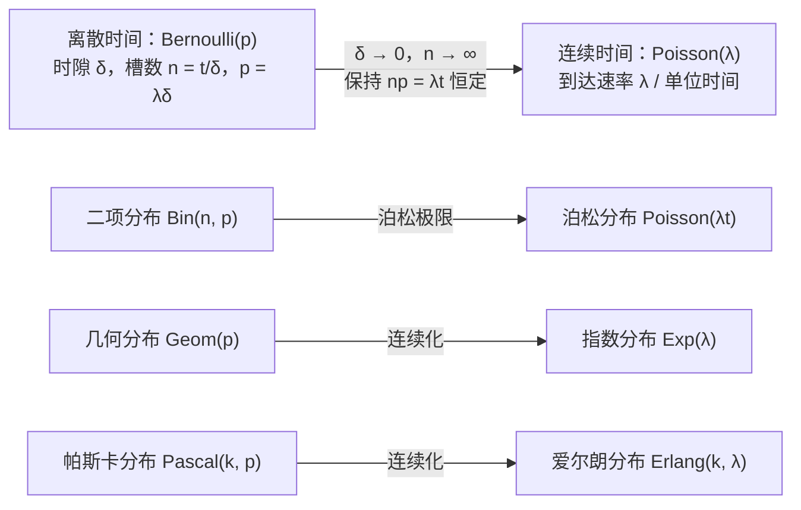

# L14 泊松过程（一）（Poisson Process I）

%% learning-vault-navigation:v1 %%
> [!abstract]- 笔记导航
> 目录：[[Math Learning/Probability and Stochastic Processes/6.041SC/U3/U3随机过程导航|MIT 6.041SC U3 随机过程导航]]
> 上一讲：[[Math Learning/Probability and Stochastic Processes/6.041SC/U3/L13/L13 伯努利过程（Bernoulli Process）|L13 伯努利过程（Bernoulli Process）]] · 下一讲：[[Math Learning/Probability and Stochastic Processes/6.041SC/U3/L15/L15 泊松过程（二）（Poisson Process II）|L15 泊松过程（二）（Poisson Process II）]]

> [!abstract] 本讲概览
> 本讲对应教材 Section 6.2 前半部分与 [[Math Learning/Probability and Stochastic Processes/6.041SC/U3/L14/Probabilistic Systems Analysis and Applied Probability, Lecture 14.pdf|Lecture 14 讲义 PDF]]。将上一讲的离散时间伯努利过程在时间网格 $\delta \to 0$ 的极限下推广到连续时间，建立==泊松过程（Poisson Process）==的三条核心公设，导出到达计数分布（泊松 PMF）、首次到达与到达间隔分布（指数 PDF）、第 $k$ 次到达时间分布（爱尔朗 Erlang PDF），并深入讨论无记忆性、合并以及**竞争指数随机变量（Competing Exponentials）**的无积分秒解技巧。

---

## 一、从伯努利过程到泊松过程：连续时间极限

在许多现实场景中（讲义与文字稿举例：电子邮件到达、微弱光源发射单个光子、放射性原子衰变、交通事故发生），到达时刻位于连续时间轴 $[0, \infty)$ 上，不存在天然的离散“时隙”。

构造思路：将任意长度的区间 $[0, t]$ 切分为 $n = t / \delta$ 个极短小区间，每个小区间长度 $\delta \to 0$，并在每个小区间内近似看作单次到达概率为 $p = \lambda \delta$ 的伯努利试验，保持单位时间平均到达速率 $\lambda$ 固定（于是 $np = \lambda t$ 保持不变）：

---

## 二、泊松过程的定义（三条核心假设）

称连续时间到达过程为速率（到达强度 / arrival rate）为 $\lambda > 0$ 的**泊松过程**，若满足以下三条假设：

1. **时间齐次性（Time Homogeneity）**：在任意长度为 $\tau$ 的时间区间内，出现 $k$ 次到达的概率 $P(k, \tau)$ ==只依赖于区间长度 $\tau$，而与区间的起始位置无关==。
2. **独立增量性（Independent Increments）**：在任意两两**不相交**的时间区间内，到达次数所对应的随机变量相互独立。
3. **小区间概率行为（Small-Interval Probabilities）**：对极短的时间区间 $\delta \to 0$，
   $$P(k, \delta) = \begin{cases} 1 - \lambda \delta + o(\delta), & k = 0 \\ \lambda \delta + o(\delta), & k = 1 \\ o(\delta), & k > 1 \end{cases}$$
   其中高阶无穷小 $o(\delta)$ 满足 $\lim_{\delta \to 0} \frac{o(\delta)}{\delta} = 0$。这表明在极短时间内，**几乎不可能同时发生两次及以上到达**（无碰撞 / 简单性）。

---

## 三、区间到达数 $N_\tau$ 的分布（泊松 PMF）

将长度为 $\tau$ 的区间划分为 $n = \tau / \delta$ 个独立微元，近似计数服从 $\text{Binomial}(n, \lambda \delta)$。令 $\delta \to 0$（$n \to \infty$，$np = \lambda \tau$ 固定），即得区间内到达数 $N_\tau$ 的精确分布律：
$$P(k, \tau) = P(N_\tau = k) = \frac{(\lambda \tau)^k}{k!} e^{-\lambda \tau}, \qquad k = 0, 1, 2, \dots$$
- **均值与方差**（也可从二项极限 $np \to \lambda\tau$ 与 $np(1-p) \to \lambda\tau$ 直接看出）：
  $$E[N_\tau] = \lambda \tau, \qquad \operatorname{Var}(N_\tau) = \lambda \tau$$
  由此印证参数 $\lambda = \dfrac{E[N_\tau]}{\tau}$ 确为单位时间内的期望到达数。

> [!example] 讲义 P2 实例：每小时 $\lambda = 5$ 封邮件
> 你每隔 $30$ 分钟（$\tau = 0.5\text{ h}$）检查一次邮箱，因此该半小时内到达邮件数的参数为 $\lambda\tau = 5 \times 0.5 = 2.5$：
> - 没有新邮件的概率：$P(0, 0.5) = e^{-2.5} \approx 0.0821$；
> - 恰有一封新邮件的概率：$P(1, 0.5) = 2.5\, e^{-2.5} \approx 0.2052$。

---

## 四、到达间隔与第 $k$ 次到达时间：指数分布与爱尔朗分布

### 1. 首次到达时间 $Y_1$（指数分布）

记 $Y_1$ 为首次到达发生的时刻。利用计数过程与到达时间的**对偶等价事件**（这是连续时间到达过程最核心的转换桥梁！）：
$$\{Y_1 > y\} \iff \{[0, y] \text{ 内没有到达}\} \iff \{N_y = 0\}$$
因此：
$$P(Y_1 > y) = P(0, y) = e^{-\lambda y} \implies F_{Y_1}(y) = 1 - e^{-\lambda y} \quad (y \ge 0)$$
对 $y$ 求导得**指数分布（Exponential Distribution）**的概率密度：
$$f_{Y_1}(y) = \lambda e^{-\lambda y}, \quad y \ge 0; \qquad E[Y_1] = \frac{1}{\lambda}, \qquad \operatorname{Var}(Y_1) = \frac{1}{\lambda^2}$$

### 2. 无记忆性与全新开始性质

- **无记忆性（Memorylessness）**：从任意确定时刻 $t$ 起（或任意合法停时，如第 $1$ 次到达时刻 $Y_1$ 起），未来的微小时间网格依然与过去完全独立且速率为 $\lambda$，因此**剩余过程是与过去独立的全新泊松过程$(\lambda)$**。
- **独立同分布到达间隔**：令 $T_1 = Y_1$，$T_i = Y_i - Y_{i-1}$ 为第 $i-1$ 次与第 $i$ 次到达的间隔，则 $T_1, T_2, \dots \stackrel{\text{i.i.d.}}{\sim} \text{Exp}(\lambda)$。
- **计算机仿真提示（Lecture 14 Transcript）**：若要在电脑上精确模拟泊松过程，无需切分极小时间槽做近似——只需不断生成独立 $\text{Exp}(\lambda)$ 随机数作为间隔 $T_i$ 并累加 $Y_k = \sum_{i=1}^k T_i$ 即可！

### 3. 第 $k$ 次到达时间 $Y_k$（$k$ 阶爱尔朗分布 / Erlang Distribution）

因为 $Y_k = T_1 + T_2 + \cdots + T_k$ 是 $k$ 个独立同分布 $\text{Exp}(\lambda)$ 随机变量之和，立得：
$$E[Y_k] = \frac{k}{\lambda}, \qquad \operatorname{Var}(Y_k) = \frac{k}{\lambda^2}$$

**PDF 的极简微元推导**（讲义核心思想，绕开 $k$ 重卷积！）：
对于极小 $\delta > 0$，事件 $\{y \le Y_k \le y + \delta\}$ 发生，当且仅当两个**不相交区间上的独立事件**同时发生：
1. 在 $[0, y]$ 内**恰好有 $k - 1$ 次到达**（概率 $\dfrac{(\lambda y)^{k-1}}{(k-1)!} e^{-\lambda y}$）；
2. 在 $(y, y + \delta]$ 内**恰好有 $1$ 次到达**（概率 $\lambda \delta + o(\delta)$）。

两式相乘并除以 $\delta$，令 $\delta \to 0$ 即得 **$k$ 阶爱尔朗分布（Erlang of order $k$）** 的概率密度：
$$f_{Y_k}(y) = \frac{\lambda^k y^{k-1} e^{-\lambda y}}{(k - 1)!}, \qquad y \ge 0$$

> [!tip] 计数与等待时间的万能对偶公式
> 在计算类似 Tutorial 7 Q3(d)“第 $5$ 辆火车到达耗时超过 $2$ 天的概率”时，**千万不要硬积分 $5$ 阶爱尔朗 PDF**！直接用对偶关系转为泊松求和：
> $$P(Y_k > y) = P(N_y \le k - 1) = \sum_{m=0}^{k-1} \frac{(\lambda y)^m}{m!} e^{-\lambda y}$$
> 例如 Tutorial 7 Q3（$\lambda = 3/\text{day}$）：$P(Y_5 > 2) = P(N_2 \le 4) = \sum_{m=0}^4 \frac{6^m}{m!} e^{-6}$。

---

## 五、合并泊松过程与竞争指数（Competing Exponentials）

### 1. 独立泊松过程的合并（红绿灯闪烁模型，讲义 P2）

设红灯按速率 $\lambda_1$ 的泊松过程闪烁，绿灯按**独立**的速率 $\lambda_2$ 的泊松过程闪烁。合并观测“任意颜色灯光闪烁”的过程：
- 在极小区间 $\delta$ 内，红灯或绿灯闪烁的概率为：
  $$1 - (1 - \lambda_1\delta)(1 - \lambda_2\delta) = (\lambda_1 + \lambda_2)\delta - \lambda_1\lambda_2 \delta^2 = (\lambda_1 + \lambda_2)\delta + o(\delta)$$
  注意连续时间极限下**两灯同时闪烁的碰撞项 $\lambda_1\lambda_2 \delta^2 = o(\delta)$ 消失**！
- **结论 1（速率直接相加）**：两个独立泊松过程 $\text{Poisson}(\lambda_1)$ 与 $\text{Poisson}(\lambda_2)$ 的合并，仍是速率为 $\lambda_1 + \lambda_2$ 的泊松过程。
- **结论 2（归属概率独立于到达时刻）**：合并过程中的每一次到达，独立地以概率
  $$p_1 = \frac{\lambda_1}{\lambda_1 + \lambda_2}, \qquad p_2 = \frac{\lambda_2}{\lambda_1 + \lambda_2}$$
  来自过程 1 或过程 2，且**与到达发生的具体时刻独立**！

### 2. 竞争指数随机变量（Competing Exponentials）

设 $X \sim \text{Exp}(\lambda)$，$Y \sim \text{Exp}(\mu)$ 相互独立。将它们看作两个独立泊松过程的首次到达时间，立刻得到两条极其强大的结论：
1. **最小值分布**：$\min(X, Y)$ 是合并泊松过程的首次到达时间，故
   $$\min(X, Y) \sim \text{Exp}(\lambda + \mu)$$
2. **谁先胜出的概率**：
   $$P(X < Y) = \frac{\lambda}{\lambda + \mu}$$
   且事件 $\{X < Y\}$ 与随机变量 $\min(X, Y)$ **相互独立**！

> [!example] Recitation 15 精选：无积分秒解三大经典题
> 1. **Q3（三路竞争指数：$X \sim \text{Exp}(\lambda),\, Y \sim \text{Exp}(\mu),\, Z \sim \text{Exp}(\nu)$ 独立，求 $P(X < Y < Z)$）**
>    - 拆解为两个事件之交：$\{X < Y < Z\} = \{X < \min(Y, Z)\} \cap \{Y < Z\}$。
>    - 由合并泊松过程视角及无记忆性（$X$ 率先到达后，$Y$ 与 $Z$ 全新开始独立竞赛），这两事件**相互独立**！因此无需任何三重积分，一步得出：
>      $$P(X < Y < Z) = P\bigl(X < \min(Y, Z)\bigr) \cdot P(Y < Z) = \frac{\lambda}{\lambda + \mu + \nu} \cdot \frac{\mu}{\mu + \nu}$$
>    - *对称性检验*：当 $\lambda = \mu = \nu$ 时结果为 $\frac{1}{3} \cdot \frac{1}{2} = \frac{1}{6} = \frac{1}{3!}$，与对称直觉严丝合缝！
> 2. **Q1（混合 A/B 灯泡替换，A 寿命 $\text{Exp}(1)$，B 寿命 $\text{Exp}(3)$，各以 $\frac{1}{2}$ 选中）**
>    - (c) **贝叶斯更新**：已知前 $t$ 时间未损坏（事件 $D$），第一个灯泡是长寿 A 型的后验概率随 $t$ 增大趋于 $1$：
>      $$P(A \mid D) = \frac{\frac{1}{2} e^{-t}}{\frac{1}{2} e^{-t} + \frac{1}{2} e^{-3t}} = \frac{1}{1 + e^{-2t}}$$
>    - (d) **2 个 B 型灯泡总寿命 $Y \sim \text{Erlang}(2, 3)$ 长于 1 个 A 型灯泡 $X_A \sim \text{Exp}(1)$ 的概率 $P(Y \ge X_A)$**：
>      - 笨办法：二重积分算得 $\frac{7}{16}$；
>      - **泊松合并秒解法**：视 A、B 为速率 $\lambda_A=1, \lambda_B=3$ 的合并过程，每次到达归属 A 的概率 $\frac{1}{4}$、归属 B 的概率 $\frac{3}{4}$。事件 $\{Y \ge X_A\}$ 等价于“A 在第 2 次 B 到达之前就先到达”，即序列以 `A` 或 `BA` 开头：
>        $$P(Y \ge X_A) = P(A) + P(BA) = \frac{1}{4} + \frac{3}{4} \cdot \frac{1}{4} = \frac{7}{16}$$
> 3. **Q2（双类型作业服务站，$\lambda_A = 3/\text{min},\, \lambda_B = 4/\text{min}$）**
>    - (a) $3$ 分钟总到达数 $\sim \text{Poisson}(3 \times (3 + 4) = 21)$；
>    - (b) 已知 $10$ 分钟内共到 $10$ 个任务，恰有 $3$ 个 A 类任务的概率：每个任务独立以 $\frac{3}{7}$ 为 A 类，故为二项概率 $\binom{10}{3}(\frac{3}{7})^3(\frac{4}{7})^7$；
>    - (c) 首个 A 类到达之前到达的 B 类任务数 $K$：为平移几何分布 $p_K(k) = (\frac{4}{7})^k (\frac{3}{7})\;(k = 0, 1, 2, \dots)$。

---

## 本讲原始资料

- 讲义与文字稿：[[Math Learning/Probability and Stochastic Processes/6.041SC/U3/L14/Probabilistic Systems Analysis and Applied Probability, Lecture 14.pdf|Lecture 14 讲义 PDF]] · [[Math Learning/Probability and Stochastic Processes/6.041SC/U3/L14/Tx/Lecture 14 - Poisson Process - I transcript.pdf|Lecture 14 课程文字稿]]
- 习题课与辅导：[[Math Learning/Probability and Stochastic Processes/6.041SC/U3/L14/Rec/6.041SC Probabilistic Systems Analysis, Recitation 15.pdf|Recitation 15 题目]] · [[Math Learning/Probability and Stochastic Processes/6.041SC/U3/L14/Rec/6.041SC Probabilistic Systems Analysis, Recitation 15 Solutions.pdf|Recitation 15 解答]] · [[Math Learning/Probability and Stochastic Processes/6.041SC/U3/L14/Rec/Tx/6.041SC Probabilistic Systems Analysis and Applied Probability, Fall 2013Transcript – Recitation - Competing Exponentials.pdf|Recitation 文字稿：Competing Exponentials]] · [[Math Learning/Probability and Stochastic Processes/6.041SC/U3/L14/Tut/6.041SC Probabilistic Systems Analysis, Tutorial 7.pdf|Tutorial 7 题目]] · [[Math Learning/Probability and Stochastic Processes/6.041SC/U3/L14/Tut/6.041SC Probabilistic Systems Analysis, Tutorial 7 Solutions.pdf|Tutorial 7 解答]]
- 概念关联：[[Math Learning/Probability and Stochastic Processes/Probability Kira/第二章 随机变量及其分布|Kira 第二章：随机变量及其分布]] · [[Concepts/随机过程与生成路径|随机过程与生成路径]]
