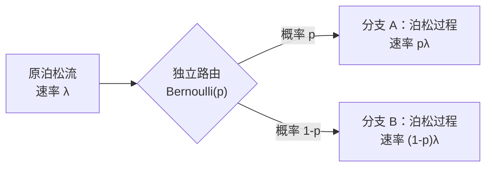

# L15 泊松过程（二）（Poisson Process II）

%% learning-vault-navigation:v1 %%
> [!abstract]- 笔记导航
> 目录：[[Math Learning/Probability and Stochastic Processes/6.041SC/U3/U3随机过程导航|MIT 6.041SC U3 随机过程导航]]
> 上一讲：[[Math Learning/Probability and Stochastic Processes/6.041SC/U3/L14/L14 泊松过程（一）（Poisson Process I）|L14 泊松过程（一）（Poisson Process I）]] · 下一讲：[[Math Learning/Probability and Stochastic Processes/6.041SC/U3/L16/L16 马尔可夫链（一）（Markov Chains I）|L16 马尔可夫链（一）（Markov Chains I）]]

> [!abstract] 本讲概览
> 本讲完成教材 Section 6.2（对应 [[Math Learning/Probability and Stochastic Processes/6.041SC/U3/L15/Probabilistic Systems Analysis and Applied Probability, Lecture 15.pdf|Lecture 15 讲义 PDF]]），重点研究泊松过程的三大核心主题：**合并与拆分（Merging & Splitting）**的独立性结论、利用无记忆性拆解多阶段随机时间的经典范例（钓鱼问题与三灯泡寿命问题），以及极易反直觉的==随机入射现象（Random Incidence / Inspection Paradox）==（对比泊松过程与一般更新过程中的长度偏置抽样）。

---

## 一、泊松过程的合并与拆分

### 1. 合并（Merging / Superposition）

设两个**相互独立**的泊松过程，到达率分别为 $\lambda_1$（红灯闪烁）和 $\lambda_2$（绿灯闪烁）：

1. **合并过程仍是泊松过程**，总到达率为：
   $$\lambda = \lambda_1 + \lambda_2$$
2. **下一次到达来自过程 1 的概率**与时间无关，且独立于到达时刻及历史：
   $$P(\text{下一次到达来自过程 } 1) = \frac{\lambda_1}{\lambda_1 + \lambda_2}$$
3. 对合并后的连续 $n$ 次到达，每一次来自过程 1 还是过程 2 构成参数为 $p = \frac{\lambda_1}{\lambda_1 + \lambda_2}$ 的独立伯努利试验序列（因此前 $n$ 次到达中来自过程 1 的次数服从 $\text{Binomial}(n, \frac{\lambda_1}{\lambda_1+\lambda_2})$）。

### 2. 拆分（Splitting / Thinning）

设速率为 $\lambda$ 的泊松过程（如 MIT 邮件服务器流量），每次到达**独立地**以概率 $p$ 路由至分支 A（美国境内）、以概率 $1-p$ 路由至分支 B（海外）：

- 分支 A 是速率为 $p\lambda$ 的泊松过程；
- 分支 B 是速率为 $(1-p)\lambda$ 的泊松过程；
- **关键结论**：==分支 A 与分支 B 相互独立！==（直觉陷阱：若固定总到达数 $N = n$，则 $N_A$ 与 $N_B = n - N_A$ 负相关；但在未固定总数的固定时间区间 $\tau$ 内，由于总数 $N_\tau \sim \text{Poisson}(\lambda \tau)$ 本身随机，微元时间槽上两分支几乎不可能碰撞，从而 $N_A(\tau)$ 与 $N_B(\tau)$ 严格独立！）

---

## 二、伯努利过程与泊松过程系统对照

| 性质 / 随机变量 | 离散时间：伯努利过程 $\text{Bernoulli}(p)$ | 连续时间：泊松过程 $\text{Poisson}(\lambda)$ |
| --- | --- | --- |
| **到达参数** | 每时隙到达概率 $p$ | 单位时间到达率 $\lambda$ |
| **固定长度内到达数** | $S_n \sim \text{Binomial}(n, p)$，$\mathbb{E}=np,\ \text{Var}=np(1-p)$ | $N_\tau \sim \text{Poisson}(\lambda\tau)$，$\mathbb{E}=\text{Var}=\lambda\tau$ |
| **首次到达 / 到达间隔 $T_i$** | 几何分布 $\text{Geom}(p)$，$\mathbb{E}[T]=1/p$ | 指数分布 $\text{Exp}(\lambda)$，$\mathbb{E}[T]=1/\lambda$ |
| **第 $k$ 次到达时间 $Y_k$** | 帕斯卡分布 $\text{Pascal}(k, p)$ | 爱尔朗分布 $\text{Erlang}(k, \lambda)$，$f_{Y_k}(y)=\frac{\lambda^k y^{k-1}e^{-\lambda y}}{(k-1)!}$ |
| **独立合并** | $p_{\text{merge}} = p_1 + p_2 - p_1 p_2$（允许碰撞） | $\lambda_{\text{merge}} = \lambda_1 + \lambda_2$（无碰撞） |
| **独立拆分（概率 $q$）** | 两分支皆伯努利但**不独立**（同一时隙互斥） | 两分支速率 $q\lambda, (1-q)\lambda$ 且**相互独立** |
| **条件到达位置（给定区间内恰好 $k$ 次）** | 等可能分布在 $\binom{n}{k}$ 个时隙子集 | $k$ 个到达时刻等价于 $k$ 个 i.i.d. $\text{Uniform}(0,\tau)$ 的次序统计量 |

---

## 三、经典例题精解（讲义核心）

### 例 1：泊松钓鱼问题（Poisson Fishing）

鱼上钩构成速率 $\lambda = 0.6\text{ 条/小时}$ 的泊松过程。策略：**先钓 2 小时；若 2 小时内一条未钓到，则继续钓直到钓上第一条鱼为止**。
- (a) 钓鱼超过 2 小时 $\iff$ 前 2 小时 0 条鱼：$P(N_2 = 0) = e^{-0.6 \times 2} = e^{-1.2}$。
- (b) 钓鱼时长在 $(2, 5)$ 小时内 $\iff$ 前 2 小时 0 条鱼且接下来 3 小时至少 1 条鱼：
  $$e^{-1.2}\left(1 - e^{-0.6 \times 3}\right) = e^{-1.2} - e^{-3.0}$$
- (c) 至少钓到 2 条鱼 $\iff$ 前 2 小时内至少钓到 2 条（若 0 条，后续钓到第 1 条即收竿）：
  $$1 - P(N_2 = 0) - P(N_2 = 1) = 1 - e^{-1.2} - 1.2 e^{-1.2}$$
- (d) 期望钓到鱼数：设 $K$ 为总数，前 2 小时平均钓 $\lambda \cdot 2 = 1.2$ 条；仅当 $N_2=0$（概率 $e^{-1.2}$）时额外多钓 1 条，故：
  $$\mathbb{E}[K] = 1.2 + 1 \cdot e^{-1.2}$$
- (e) 给定已钓 4 小时仍未收竿（说明前 4 小时 0 条），未来还需钓的期望时间：由指数分布无记忆性，等于 $\frac{1}{\lambda} = \frac{1}{0.6} = \frac{5}{3}\text{ 小时}$。
- (f) 期望总钓鱼时长：前 2 小时必然花费，若 $N_2=0$ 则额外期望花费 $1/\lambda$，故：
  $$\mathbb{E}[T_{\text{total}}] = 2 + e^{-1.2} \cdot \frac{1}{0.6}$$

### 例 2：三只独立灯泡同时点亮，求最后一盏熄灭的期望时间

3 只灯泡寿命 $X_1, X_2, X_3 \stackrel{\text{i.i.d.}}{\sim} \text{Exp}(\lambda)$。求 $\mathbb{E}[\max(X_1, X_2, X_3)]$。
**无积分秒解法**（合并 + 无记忆性）：
- 阶段 1（3 盏全亮 → 第 1 盏灭）：3 个独立指数竞争，等待时间 $Z_1 \sim \text{Exp}(3\lambda)$，$\mathbb{E}[Z_1] = \frac{1}{3\lambda}$；
- 阶段 2（剩余 2 盏 → 第 2 盏灭）：由无记忆性，剩余 2 盏残余寿命重新服从 $\text{Exp}(\lambda)$，等待时间 $Z_2 \sim \text{Exp}(2\lambda)$，$\mathbb{E}[Z_2] = \frac{1}{2\lambda}$；
- 阶段 3（最后 1 盏灭）：残余寿命 $Z_3 \sim \text{Exp}(\lambda)$，$\mathbb{E}[Z_3] = \frac{1}{\lambda}$。

因此：
$$\mathbb{E}[\max(X_1, X_2, X_3)] = \frac{1}{3\lambda} + \frac{1}{2\lambda} + \frac{1}{\lambda} = \frac{11}{6\lambda}$$

---

## 四、随机入射现象（Random Incidence / Inspection Paradox）

### 1. 泊松过程中的随机入射

设泊松过程（速率 $\lambda$）已运行足够长时间，观察者在任意给定时刻 $t^*$（“随机入射时刻”）到达车站，记其落入的相邻两次到达区间长度为 $L = U + V$（$U$ 为距上一班车已过时间，$V$ 为距下一班车剩余等待时间）：
- 向前看（未来）：由泊松过程的无记忆性，剩余等待时间 $V \sim \text{Exp}(\lambda)$，$\mathbb{E}[V] = \frac{1}{\lambda}$；
- 向后看（过去）：由于泊松过程具有时间反演对称性（微元槽独立同分布），距上一班车的时间 $U \sim \text{Exp}(\lambda)$，且与 $V$ **相互独立**！
- **惊人结论**：观察者所落入区间的总长度 $L = U + V$ 服从 **$\text{Erlang}(2, \lambda)$** 分布，其期望为：
  $$\mathbb{E}[L] = \mathbb{E}[U] + \mathbb{E}[V] = \frac{2}{\lambda}$$
  是普通到达间隔期望 $1/\lambda$ 的**两倍**！

> [!warning] 为什么不是 $1/\lambda$？——长度偏置抽样（Length-Biased Sampling）
> 并非车站“针对你”，而是**随机时刻 $t^*$ 落入较长间隔的概率正比于该间隔的长度**！你在时间轴上随机投针，长区间占用的时间轴面积更大，因此被击中的概率更高。

### 2. 一般更新过程（Renewal Process）中的随机入射

若公交发车间隔 $X_i$ i.i.d. 但**不一定服从指数分布**（例如讲义例题：每段间隔等概率 $1/2$ 为 $5$ 分钟或 $10$ 分钟，平均间隔 $7.5$ 分钟）：
- 10 分钟区间占总时间轴的比例为 $\frac{10}{5+10} = \frac{2}{3}$，5 分钟区间仅占 $\frac{5}{5+10} = \frac{1}{3}$；
- 给定落入某固定长度 $l$ 的区间，到达时刻在该区间内均匀分布，平均剩余等待时间为 $l/2$；
- 于是你的期望等待时间为：
  $$\mathbb{E}[V] = \frac{1}{3} \cdot \frac{5}{2} + \frac{2}{3} \cdot \frac{10}{2} = \frac{5}{6} + \frac{10}{3} = \frac{25}{6} \approx 4.17\text{ 分钟} > \frac{7.5}{2} = 3.75\text{ 分钟}$$

一般地，若区间长度 PDF 为 $f_X(x)$，均值 $\mathbb{E}[X]$，则随机入射选中的区间长度 $R$ 的 PDF 满足**长度偏置公式**（对应 PS7 第 4 题剪毛线问题与 Recitation 17 第 3 题 Erlang(2) 随机入射）：
$$f_R(r) = \frac{r \, f_X(r)}{\mathbb{E}[X]}, \qquad \mathbb{E}[R] = \frac{\mathbb{E}[X^2]}{\mathbb{E}[X]} = \mathbb{E}[X] + \frac{\text{Var}(X)}{\mathbb{E}[X]}$$
仅当间隔为确定性常数（$\text{Var}(X) = 0$）时，$\mathbb{E}[R] = \mathbb{E}[X]$；只要存在波动，随机入射期望区间长度必然严格大于 $\mathbb{E}[X]$。

---

## 五、习题与辅导重点（Rec 17 / PS 7 / Tut 8）

- **Recitation 17**：意识/潜意识双泊松答卷模型（合并+拆分）、警察巡逻与电台呼叫（几何+指数+随机入射）、教材 6.27 Erlang(2) 到达过程的随机入射 PDF 推导（结果化为 $\text{Erlang}(3, \lambda)$，期望 $3/\lambda$）。
- **Problem Set 7**：伯努利成功/失败竞速与帕斯卡-二项恒等式；毛线打点长度偏置（指数、Erlang(3)、$le^l$ 三种密度下的 $\mathbb{E}[R]$）；给定 $(0, t+s]$ 总到达数 $M=m$ 时，前段 $(0, t]$ 到达数 $N \mid M=m \sim \text{Binomial}(m, \frac{t}{t+s})$（利用条件均匀到达时刻一步导出）。
- **Tutorial 8**：A/B/C 三类泊松流汇聚缓冲区、潜在顾客拆分与商店关门时间、以及随机指数时间 $[0, T]$ 内泊松到达数服从几何分布（通过竞争指数证明）。

---

## 六、配套资料

| 材料类型 | 文件入口 |
| --- | --- |
| 课堂讲义与文字稿 | [[Math Learning/Probability and Stochastic Processes/6.041SC/U3/L15/Probabilistic Systems Analysis and Applied Probability, Lecture 15.pdf\|Lecture 15 讲义 PDF]] · [[Math Learning/Probability and Stochastic Processes/6.041SC/U3/L15/Tx/Lecture 15 - Poisson Process - II transcript.pdf\|Lecture 15 文字稿]] |
| Recitation 17 | [[Math Learning/Probability and Stochastic Processes/6.041SC/U3/L15/Rec/6.041SC Probabilistic Systems Analysis, Recitation 17.pdf\|题目 PDF]] · [[Math Learning/Probability and Stochastic Processes/6.041SC/U3/L15/Rec/6.041SC Probabilistic Systems Analysis, Recitation 17 Solutions.pdf\|参考解答]] |
| Problem Set 7 | [[Math Learning/Probability and Stochastic Processes/6.041SC/U3/L15/PS/6.041SC Probabilistic Systems Analysis, Problem Set 7.pdf\|题目 PDF]] · [[Math Learning/Probability and Stochastic Processes/6.041SC/U3/L15/PS/6.041SC Probabilistic Systems Analysis, Problem Set 7 Solutions.pdf\|参考解答]] |
| Tutorial 8 | [[Math Learning/Probability and Stochastic Processes/6.041SC/U3/L15/Tut/6.041SC Probabilistic Systems Analysis, Tutorial 8.pdf\|题目 PDF]] · [[Math Learning/Probability and Stochastic Processes/6.041SC/U3/L15/Tut/6.041SC Probabilistic Systems Analysis, Tutorial 8 Solutions.pdf\|参考解答]] |
