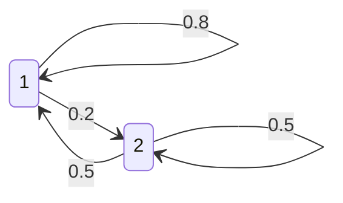
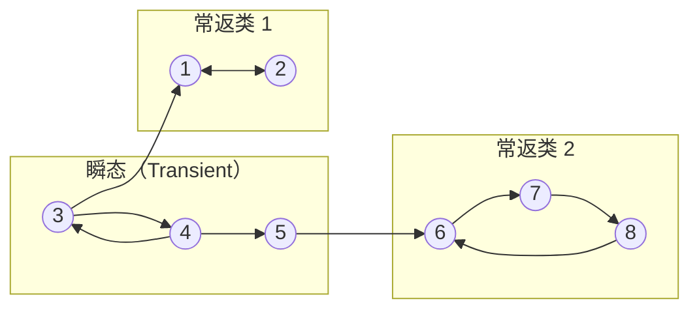

# L16 马尔可夫链（一）（Markov Chains I）

%% learning-vault-navigation:v1 %%
> [!abstract]- 笔记导航
> 目录：[[Math Learning/Probability and Stochastic Processes/6.041SC/U3/U3随机过程导航|MIT 6.041SC U3 随机过程导航]]
> 上一讲：[[Math Learning/Probability and Stochastic Processes/6.041SC/U3/L15/L15 泊松过程（二）（Poisson Process II）|L15 泊松过程（二）（Poisson Process II）]] · 下一讲：[[Math Learning/Probability and Stochastic Processes/6.041SC/U3/L17/L17 马尔可夫链（二）（Markov Chains II）|L17 马尔可夫链（二）（Markov Chains II）]]

> [!abstract] 本讲概览
> 本讲对应教材 Sections 7.1–7.2 与 [[Math Learning/Probability and Stochastic Processes/6.041SC/U3/L16/Probabilistic Systems Analysis and Applied Probability, Lecture 16.pdf|Lecture 16 讲义 PDF]]。从无记忆、时刻间独立的伯努利/泊松到达过程迈向**存在时间依赖性的随机动力系统**——==有限状态离散时间马尔可夫链（Finite-State Discrete-Time Markov Chains）==。内容包括超市收银台排队建模、马尔可夫性质与转移概率矩阵、$n$ 步转移概率递推（Chapman–Kolmogorov 方程），以及基于状态图的**状态分类（常返态 Recurrent、瞬态 Transient 与常返类 Recurrent Class）**。

---

## 一、核心动机：超市收银台排队模型

与伯努利/泊松过程不同，现实中的系统在相邻时刻之间往往强相关（例如 7:00 队列很长，则 7:01 队列大概率依然很长）。讲义以**超市收银台排队模型**切入：
- 离散时间 $n = 0, 1, 2, \dots$；
- 顾客到达服从 $\text{Bernoulli}(b)$（到达间隔为几何分布）；
- 顾客服务时间服从 $\text{Geom}(q)$（队列非空时每时隙以概率 $q$ 完成服务离开），到达与服务独立；
- 超市最多容纳 10 人，定义**状态（State）** $X_n \in \{0, 1, \dots, 10\}$ 为时刻 $n$ 队列中的顾客数。

只要选好“状态”使其囊括了预测未来所需的全部当前信息，几乎任何带噪声的演化系统都可以建模为马尔可夫过程。

---

## 二、有限状态马尔可夫链的定义与建模要素

设随机过程 $\{X_0, X_1, X_2, \dots\}$ 取值于有限状态空间 $S = \{1, 2, \dots, m\}$（初始状态 $X_0$ 可给定或服从某分布）：

### 1. 马尔可夫性质（Markov Property）与时间齐次性

==给定当前状态 $X_n = i$，未来状态 $X_{n+1}$ 与全部过去历史 $X_{n-1}, \dots, X_0$ 条件独立==，且一步转移概率不随时间步 $n$ 变化：
$$p_{ij} = P(X_{n+1} = j \mid X_n = i) = P(X_{n+1} = j \mid X_n = i, X_{n-1} = i_{n-1}, \dots, X_0 = i_0)$$

转移概率满足非负性与行归一化（从任意状态 $i$ 出发的所有出边概率之和必为 1）：
$$p_{ij} \ge 0, \qquad \sum_{j=1}^{m} p_{ij} = 1, \quad \forall i \in S$$

### 2. 建模三步骤

1. **确定状态空间（States）**：选择足以满足马尔可夫性的状态变量（有时需扩充状态以“记住”有限步历史，例如 Tutorial 9 第 1 题用 4 状态建模非几何到达间隔）；
2. **确定可能转移（Transitions）**：在状态转移图中画出所有 $p_{ij} > 0$ 的有向边（不画的边默认概率为 $0$）；
3. **标定转移概率（Transition Probabilities）**：确保每个节点的所有出边权重之和为 $1$（别遗漏自环 $p_{ii}$）。

---

## 三、$n$ 步转移概率与 Chapman–Kolmogorov 递推

定义从初始状态 $i$ 出发，经过 $n$ 步转移后处于状态 $j$ 的**状态占据概率（$n$-step Transition Probability）**：
$$r_{ij}(n) = P(X_n = j \mid X_0 = i)$$

初始条件：$r_{ij}(0) = \mathbb{I}(i = j)$，$r_{ij}(1) = p_{ij}$。

### 关键递推公式（全概率公式展开第 $n-1$ 步位置）

$$r_{ij}(n) = \sum_{k=1}^{m} r_{ik}(n-1) \, p_{kj}$$

等价地，若记一步转移矩阵为 $P = (p_{ij})$，则 $n$ 步转移矩阵就是矩阵幂 $R(n) = P^n$，更一般地满足 **Chapman–Kolmogorov 方程** $R(n+l) = R(n)R(l)$。

若初始状态 $X_0$ 为随机变量，则时刻 $n$ 的无条件状态分布为：
$$P(X_n = j) = \sum_{i=1}^{m} P(X_0 = i) \, r_{ij}(n)$$

### 讲义 2 状态链数值直觉

考虑两状态链：$p_{11} = 0.8,\ p_{12} = 0.2$；$p_{21} = 0.5,\ p_{22} = 0.5$：

- $n=1$：$r_{11}(1)=0.8,\ r_{12}(1)=0.2$；$r_{21}(1)=0.5,\ r_{22}(1)=0.5$
- $n=2$：$r_{11}(2)=0.8\times 0.8 + 0.2\times 0.5 = 0.74$；$r_{21}(2)=0.5\times 0.8 + 0.5\times 0.5 = 0.65$
- $n \to \infty$：无论从状态 1 还是状态 2 出发，$r_{i1}(n) \to \frac{5}{7} \approx 0.7143$，$r_{i2}(n) \to \frac{2}{7} \approx 0.2857$！（注：此处具体标号按图中 $p_{12}=0.2, p_{21}=0.5$ 得 $\pi_1 = 5/7, \pi_2 = 2/7$；L18 中 1、2 互换则对应 $2/7, 5/7$。）

> [!question] 两个根本性长期行为问题（引出状态分类与 L17）
> 1. **是否收敛？** 反例：三状态周期链 $1 \leftrightarrow 2 \leftrightarrow 3$（$p_{12}=1, p_{32}=1, p_{21}=p_{23}=0.5$）中，$r_{22}(n)$ 在奇数步恒为 $0$、偶数步恒为 $1$，**振荡不收敛**！
> 2. **极限是否依赖初值？** 反例：含两个隔离闭环（如 $\{1\}$ 与 $\{4\}$）时，最终停在哪个环完全取决于初始状态 $X_0$（甚至在瞬态出发时按吸收概率分裂）。

---

## 四、状态分类：可达、常返态、瞬态与常返类

仅凭转移图的**拓扑连通结构**（不依赖具体正概率数值大小）即可对所有状态完成结构分类：

- **可达（Accessible）**：若存在步数 $n \ge 0$ 使得 $r_{ij}(n) > 0$（图上存在从 $i$ 到 $j$ 的有向路径），称状态 $j$ 从 $i$ 可达（记 $i \to j$）。
- **互通（Communicate）**：若 $i \to j$ 且 $j \to i$，称 $i$ 与 $j$ 互通（记 $i \leftrightarrow j$）。

### 1. 常返态（Recurrent State）vs. 瞬态（Transient State）

> [!important] 精确判别定义
> - **常返态（Recurrent）**：从状态 $i$ 出发，对于**任意**从 $i$ 可达的状态 $j$，都存在路径从 $j$ **返回** $i$（即永不会陷入“有去无回”的分支）。
> - **瞬态（Transient）**：非常返态。即存在某个从 $i$ 可达的状态 $j$，使得从 $j$ 无法再回到 $i$。

**瞬态的长期行为**：若 $i$ 为瞬态，则以概率 1 状态 $i$ **只会被访问有限次**，且：
$$\lim_{n \to \infty} P(X_n = i) = 0$$

### 2. 常返类（Recurrent Class）

所有相互互通的常返态构成一个**常返类（Recurrent Class）**——它是一组既相互可达、又**没有任何出边指向类外其他状态**的封闭子图。

- 上图中状态 $\{1, 2\}$ 与 $\{6, 7, 8\}$ 各自构成封闭的**常返类**；状态 $\{3, 4, 5\}$ 一旦流出到任一常返类便永不能返回，因此均为**瞬态**。
- **结构分解定理**：任何有限状态马尔可夫链的状态空间都可唯一分解为一个或多个互不相交的常返类，以及可能存在的若干瞬态；经过足够多步后，链必以概率 1 落入某个常返类并在其中永久循环。

---

## 五、习题与辅导重点（Rec 18 / Tut 9）

- **Recitation 18**：
  - *湖中绿鱼涂蓝问题*：以剩余绿鱼数 $G_i$ 为状态，转移概率 $p_{i, i-1} = i/n,\ p_{i, i} = (n-i)/n$，$G_0$ 为唯一吸收/常返态，$G_1 \dots G_n$ 全为瞬态；
  - *6 状态链轨迹检验*：通过画树/观察有向路径直接计算首次进入 $s_2$、永不进入 $s_4$ 等事件概率。
- **Tutorial 9**：
  - 用 4 状态马尔可夫链表示到达间隔为 $p(1)=0.2, p(3)=0.3, p(4)=0.5$ 的非几何到达过程（经典**状态增广 / 剩余时间计数**建模技巧）；
  - 6 状态链常返/瞬态/周期态识别，以及利用马尔可夫性反推条件概率。

---

## 六、配套资料

| 材料类型 | 文件入口 |
| --- | --- |
| 课堂讲义与文字稿 | [[Math Learning/Probability and Stochastic Processes/6.041SC/U3/L16/Probabilistic Systems Analysis and Applied Probability, Lecture 16.pdf\|Lecture 16 讲义 PDF]] · [[Math Learning/Probability and Stochastic Processes/6.041SC/U3/L16/Tx/Lecture 16 - Markov Chains - I transcript.pdf\|Lecture 16 文字稿]] |
| Recitation 18 | [[Math Learning/Probability and Stochastic Processes/6.041SC/U3/L16/Rec/6.041SC Probabilistic Systems Analysis, Recitation 18.pdf\|题目 PDF]] · [[Math Learning/Probability and Stochastic Processes/6.041SC/U3/L16/Rec/6.041SC Probabilistic Systems Analysis, Recitation 18 Solutions.pdf\|参考解答]] |
| Tutorial 9 | [[Math Learning/Probability and Stochastic Processes/6.041SC/U3/L16/Tut/6.041SC Probabilistic Systems Analysis, Tutorial 9.pdf\|题目 PDF]] · [[Math Learning/Probability and Stochastic Processes/6.041SC/U3/L16/Tut/6.041SC Probabilistic Systems Analysis, Tutorial 9 Solutions.pdf\|参考解答]] |
