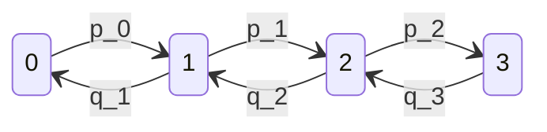

# L17 马尔可夫链（二）（Markov Chains II）

%% learning-vault-navigation:v1 %%
> [!abstract]- 笔记导航
> 目录：[[Math Learning/Probability and Stochastic Processes/6.041SC/U3/U3随机过程导航|MIT 6.041SC U3 随机过程导航]]
> 上一讲：[[Math Learning/Probability and Stochastic Processes/6.041SC/U3/L16/L16 马尔可夫链（一）（Markov Chains I）|L16 马尔可夫链（一）（Markov Chains I）]] · 下一讲：[[Math Learning/Probability and Stochastic Processes/6.041SC/U3/L18/L18 马尔可夫链（三）（Markov Chains III）|L18 马尔可夫链（三）（Markov Chains III）]]

> [!abstract] 本讲概览
> 本讲对应教材 Section 7.3 与 [[Math Learning/Probability and Stochastic Processes/6.041SC/U3/L17/Probabilistic Systems Analysis and Applied Probability, Lecture 17.pdf|Lecture 17 讲义 PDF]]，系统回答上一讲提出的长期行为问题：定义**周期性（Periodicity）**，给出有限状态马尔可夫链最核心的==稳态收敛定理（Steady-State Convergence Theorem）==，用**全局平衡方程（Global Balance Equations）**与“概率流守恒 / 长期访问频率”两种视角理解稳态分布 $\pi_j$，并重点推导**生灭过程（Birth-Death Processes）**的**局部平衡方程（Local Balance Equations）**及其在排队论中的闭式稳态解。

---

## 一、周期性（Periodicity）与非周期常返类

### 定义

若一个常返类中的状态可以划分为 $d > 1$ 个互不相交的子集 $S_1, S_2, \dots, S_d$，使得**所有从 $S_r$ 出发的转移都必定落入 $S_{r+1}$（且从 $S_d$ 出发必定落入 $S_1$）**，则称该常返类是**周期的（Periodic）**；否则称为**非周期的（Aperiodic）**。

> [!tip] 快速判定非周期性的充分条件
> 1. 只要常返类中**存在任意一个状态带有自环**（$p_{ii} > 0$），整个常返类必然是非周期的；
> 2. 只要从同一状态出发能沿长度互质的两条回路返回（如一条长 2、一条长 3），则必然非周期。

**热身回顾（多步路径乘法）**：在马尔可夫链中，沿特定轨迹的概率直接相乘，例如：
$$P(X_1 = 2, X_2 = 6, X_3 = 7 \mid X_0 = 1) = p_{12} p_{26} p_{67}$$
而求 $P(X_4 = 7 \mid X_0 = 2)$ 既可用递推 $r_{ij}(n)$，步数少时也可穷举所有长 4 的合法路径求和。

---

## 二、稳态收敛定理（Steady-State Convergence Theorem）

> [!important] 稳态收敛定理
> 对有限状态马尔可夫链，若同时满足以下**两个条件**：
> 1. **唯一常返类**：所有常返态属于同一个常返类（允许另含若干瞬态）；
> 2. **非周期性**：该唯一常返类是非周期的；
>
> 则对任意初始状态 $i$ 和任意目标状态 $j$，极限存在且**与初始状态 $i$ 无关**：
> $$\lim_{n \to \infty} r_{ij}(n) = \lim_{n \to \infty} P(X_n = j \mid X_0 = i) = \pi_j$$
> 其中稳态概率向量 $(\pi_1, \dots, \pi_m)$ 是下列**全局平衡方程**与**归一化方程**的**唯一解**：
> $$\pi_j = \sum_{k=1}^{m} \pi_k p_{kj} \quad (\forall j = 1, \dots, m), \qquad \sum_{j=1}^{m} \pi_j = 1$$
> 并且所有瞬态满足 $\pi_j = 0$，所有常返态满足 $\pi_j > 0$。

### 推导直觉与代数技巧
- 在递推式 $r_{ij}(n) = \sum_k r_{ik}(n-1) p_{kj}$ 两端令 $n \to \infty$（假设极限存在且与 $i$ 无关），立刻得到平衡方程 $\pi_j = \sum_k \pi_k p_{kj}$；
- 注意 $m$ 个平衡方程相加恒得 $\sum_j \pi_j = \sum_k \pi_k$，因此**必有一个方程是冗余的**——求解时删去任意一个平衡方程，换入归一化条件 $\sum_{j=1}^m \pi_j = 1$ 即可解出唯一解！

### 概率流守恒与长期访问频率解释

将平衡方程改写（利用 $\sum_k p_{jk} = 1$）：
$$\underbrace{\pi_j (1 - p_{jj})}_{\text{单位时间流出状态 } j \text{ 的总频率}} = \underbrace{\sum_{k \neq j} \pi_k p_{kj}}_{\text{单位时间流入状态 } j \text{ 的总频率}}$$

- **$\pi_j$**：系统长期运行中停留在状态 $j$ 的**时间占比 / 访问频率**（且在稳态下平均回归步数 $\mathbb{E}[\text{返回 } j \text{ 的步数}] = 1/\pi_j$）；
- **$\pi_k p_{kj}$**：长期运行中发生一次 $k \to j$ 转移的**频率**；
- ==全局平衡 = 每个节点的入流频率总和等于出流频率总和==。

### 两种稳态定理不直接适用的情形

| 失效条件 | 典型表现 | 处理方式 |
| --- | --- | --- |
| **存在周期性（$d > 1$）** | $r_{ij}(n)$ 随 $n \bmod d$ 周期振荡，极限不存在 | 平衡方程的唯一解 $\pi_j$ **依然有效**，但只能解释为**长期平均访问频率**，而非特定时刻 $n$ 的占据概率 |
| **存在多个常返类** | 极限分布**依赖初始状态** $X_0$，平衡方程存在无穷多组解 | 对每个常返类内部单独求稳态；若从瞬态出发，需结合 [[Math Learning/Probability and Stochastic Processes/6.041SC/U3/L18/L18 马尔可夫链（三）（Markov Chains III）\|L18 吸收概率]] 加权 |

---

## 三、生灭过程（Birth-Death Processes）与局部平衡

**生灭过程**是指状态排成一维链 $0, 1, 2, \dots, m$，每一步转移只能**加 1（生，概率 $p_i$）**、**减 1（灭，概率 $q_i$）**或**留在原地（自环 $1 - p_i - q_i$）**的马尔可夫链：

### 1. 局部平衡方程（Local Balance Equations）

在状态 $i$ 与 $i+1$ 之间切一刀将状态空间分为 $\{0,\dots,i\}$ 与 $\{i+1,\dots,m\}$ 两半：由于不存在跨步跳跃，长期中**向右穿过该切口的次数与向左穿过该切口的次数之差至多为 1**，因此跨越切口的双向概率流必须严格相等：
$$\pi_i p_i = \pi_{i+1} q_{i+1}, \qquad i = 0, 1, \dots, m-1$$

相较于解 $m$ 阶线性方程组，局部平衡可直接**递推连乘**一步写出所有 $\pi_i$：
$$\pi_i = \pi_0 \prod_{k=0}^{i-1} \frac{p_k}{q_{k+1}}$$
再由 $\sum_{i=0}^{m} \pi_i = 1$ 确定 $\pi_0$ 即可。

### 2. 齐次生灭过程与排队论经典公式

特例：设所有转移概率为常数 $p_i = p$（到达率）、$q_i = q$（服务率），定义**负载因子（Load Factor / Traffic Intensity）**：
$$\rho = \frac{p}{q}$$

则 $\pi_i = \pi_0 \rho^i$（$i = 0, 1, \dots, m$）。当系统稳定（$\rho < 1$，即 $p < q$）且容量足够大（$m \to \infty$）时，利用等比级数求和 $\sum_{i=0}^\infty \rho^i = \frac{1}{1-\rho}$：
$$\pi_0 = 1 - \rho, \qquad \pi_i = (1 - \rho)\rho^i \quad (i = 0, 1, 2, \dots)$$

此时稳态队长 $X_n$ 服从从 $0$ 开始的修正几何分布，期望队列长度为：
$$\mathbb{E}[X_n] = \sum_{i=0}^{\infty} i (1-\rho)\rho^i = \frac{\rho}{1 - \rho}$$

> [!warning] 排队论关键洞察：$\rho \to 1^-$ 的非线性拥堵爆炸
> 当到达率逼近服务率（$\rho \to 1^-$）时，稳态平均队长 $\frac{\rho}{1-\rho} \to \infty$ 呈双曲线急剧飙升——这就是为什么服务器或收银台不能设计在 99% 满载下运行！

---

## 四、习题与辅导重点（PS 8 / Tut 9）

- **Problem Set 8**：
  - *Oscar 跑步光脚问题*：5 双跑鞋放在前门与后门，建模前门鞋数 $X_n \in \{0,\dots,5\}$ 的生灭/对称链，求长期光脚跑步比例；
  - *带反射壁的对称随机游走*：论证 $|X_t|$ 与最大偏离 $Y_t = \max_{k \le t}|X_k|$ 为何满足马尔可夫性；
  - *流行病 SIS 与 SIR 模型*：在 $n=2$ 人群下比较 SIS（有正稳态循环）与 SIR（吸收态）的常返态差异；
  - *多常返类大步数行为（第 4 题）*：区分 $n=10^{10}$ 步稳态分布与给定“永不进入吸收/某类”后的条件稳态。
- **Tutorial 9 第 3 题**：在稳态 3 状态生灭链上练习**“下一次转移是生/灭”**与**“下一次状态改变（排除自环）是生/灭”**的条件概率及贝叶斯逆推。

---

## 五、配套资料

| 材料类型 | 文件入口 |
| --- | --- |
| 课堂讲义与文字稿 | [[Math Learning/Probability and Stochastic Processes/6.041SC/U3/L17/Probabilistic Systems Analysis and Applied Probability, Lecture 17.pdf\|Lecture 17 讲义 PDF]] · [[Math Learning/Probability and Stochastic Processes/6.041SC/U3/L17/Tx/Lecture 17 - Markov Chains - II transcript.pdf\|Lecture 17 文字稿]] |
| Problem Set 8 | [[Math Learning/Probability and Stochastic Processes/6.041SC/U3/L17/PS/6.041SC Probabilistic Systems Analysis, Problem Set 8.pdf\|题目 PDF]] · [[Math Learning/Probability and Stochastic Processes/6.041SC/U3/L17/PS/6.041SC Probabilistic Systems Analysis, Problem Set 8 Solutions.pdf\|参考解答]] |
| Tutorial 9 | [[Math Learning/Probability and Stochastic Processes/6.041SC/U3/L17/Tut/6.041SC Probabilistic Systems Analysis, Tutorial 9.pdf\|题目 PDF]] · [[Math Learning/Probability and Stochastic Processes/6.041SC/U3/L17/Tut/6.041SC Probabilistic Systems Analysis, Tutorial 9 Solutions.pdf\|参考解答]] |
