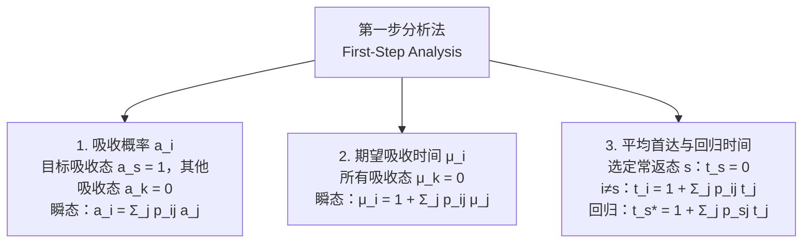

# L18 马尔可夫链（三）（Markov Chains III）

%% learning-vault-navigation:v1 %%
> [!abstract]- 笔记导航
> 目录：[[Math Learning/Probability and Stochastic Processes/6.041SC/U3/U3随机过程导航|MIT 6.041SC U3 随机过程导航]]
> 上一讲：[[Math Learning/Probability and Stochastic Processes/6.041SC/U3/L17/L17 马尔可夫链（二）（Markov Chains II）|L17 马尔可夫链（二）（Markov Chains II）]]

> [!abstract] 本讲概览
> 本讲为 Unit III（随机过程）收官之讲，对应教材 Section 7.4 与 [[Math Learning/Probability and Stochastic Processes/6.041SC/U3/L18/Probabilistic Systems Analysis and Applied Probability, Lecture 18.pdf|Lecture 18 讲义 PDF]]。前半部分运用稳态分布解决经典工程问题——**电话系统占线阻塞率（Erlang-B 公式）**与稳态多步联合概率；后半部分系统建立**第一步分析法（First-Step Analysis）**的三大线性方程组框架：==吸收概率（Absorption Probabilities）==、==期望吸收时间（Expected Time to Absorption）==，以及==平均首达时间（Mean First Passage Time）与平均回归时间（Mean Recurrence Time）==。

---

## 一、稳态条件下的联合事件与电话系统阻塞率

### 1. 稳态与条件独立性的辨析（讲义热身）

对两状态稳态链（$\pi_1 = 2/7,\ \pi_2 = 5/7$，$p_{11}=0.5, p_{12}=0.5, p_{21}=0.2, p_{22}=0.8$），假设从 $X_0 = 1$ 出发：
- **远隔时刻近似独立**：$P(X_1 = 1,\ X_{100} = 1 \mid X_0 = 1) = P(X_1=1 \mid X_0=1) \cdot P(X_{100}=1 \mid X_1=1) \approx p_{11} \pi_1 = 0.5 \times \frac{2}{7} = \frac{1}{7}$；
- **相邻稳态时刻强相关**：$P(X_{100} = 1,\ X_{101} = 2 \mid X_0 = 1) = P(X_{100}=1 \mid X_0=1) \cdot p_{12} \approx \pi_1 p_{12} = \frac{2}{7} \times 0.5 = \frac{1}{7}$。

> [!warning] 常见概念误区
> $n \to \infty$ 时 $X_n$ 与 $X_0$ 渐近独立，但**相邻的 $X_{100}$ 与 $X_{101}$ 绝不独立**，它们仍由一步转移概率 $p_{12}$ 紧密耦合！

### 2. 电话公司阻塞率问题（Erlang-B 排队模型）

设电话呼入构成速率为 $\lambda$ 的泊松过程，每通电话持续时间独立服从 $\text{Exp}(\mu)$，系统共有 $B$ 条线路（线路全满时新来电被直接阻塞丢弃）。

将连续时间离散化为极短时隙 $\delta \to 0$，以当前占用线路数 $i \in \{0, 1, \dots, B\}$ 为状态构成生灭过程：
- 向右转移（新呼入）：$p_{i, i+1} = \lambda \delta$；
- 向左转移（$i$ 通正在进行的电话中任一挂断，由 $i$ 个独立指数竞争）：$p_{i, i-1} = i\mu\delta$。

由局部平衡方程 $\pi_{i-1} (\lambda \delta) = \pi_i (i\mu\delta)$ 消去 $\delta$，得：
$$\lambda \pi_{i-1} = i\mu \pi_i \implies \pi_i = \pi_0 \frac{(\lambda/\mu)^i}{i!}, \qquad \pi_0 = \left(\sum_{k=0}^{B} \frac{(\lambda/\mu)^k}{k!}\right)^{-1}$$

由此直接给出著名的 **Erlang-B 阻塞公式**（来电遇全部 $B$ 条线路占满的概率）：
$$P(\text{阻塞}) = \pi_B = \frac{(\lambda/\mu)^B / B!}{\sum_{k=0}^{B} (\lambda/\mu)^k / k!}$$

> [!note] 与泊松分布的联系
> 上式本质是参数为 $\lambda/\mu$ 的**截断泊松分布（Truncated Poisson）**；当线路数 $B \to \infty$ 时，稳态在线通话数严格服从 $\text{Poisson}(\lambda/\mu)$。

---

## 二、第一步分析法（First-Step Analysis）统一框架

当关心“从任意状态 $i$ 出发，最终被某个特定吸收态吸收的概率”或“到达某目标状态前的期望步数”时，核心武器是**按第一步转移到的状态 $j$ 应用全概率 / 全期望公式**，建立线性方程组求解！

### 1. 吸收概率（Absorption Probabilities）

称满足 $p_{kk} = 1$ 的状态 $k$ 为**吸收态（Absorbing State）**。设有多个吸收态（如讲义中的状态 4 与状态 5），固定关注的目标吸收态 $s$（如状态 4），定义：
$$a_i = P(\text{最终进入状态 } s \mid X_0 = i)$$

则 $\{a_i\}$ 是以下线性方程组的**唯一解**：
$$\begin{cases} a_s = 1, & \text{目标吸收态} \\ a_k = 0, & \text{其他所有吸收态 } k \neq s \\ a_i = \displaystyle\sum_{j} p_{ij} a_j, & \text{所有瞬态 } i \end{cases}$$

> [!tip] 推广到一般多常返类链
> 若链包含多个非单点常返类 $R_1, R_2, \dots$，计算从瞬态最终落入常返类 $R_1$ 的概率时，只需**将整个 $R_1$ 视作一个吸收态（设 $a_j = 1,\ \forall j \in R_1$），其余常返类设 $a_j = 0$**，即可套用完全相同的方程组！

### 2. 期望吸收时间（Expected Time to Absorption）

定义从状态 $i$ 出发首次进入**任意吸收态**所需的期望步数：
$$\mu_i = \mathbb{E}[\min\{n \ge 0 : X_n \text{ 为吸收态}\} \mid X_0 = i]$$

利用全期望公式按第一步展开（每跨出一步消耗 1 个单位时间，加上到达 $j$ 后的剩余期望步数 $\mu_j$），$\{\mu_i\}$ 是以下方程组的**唯一解**：
$$\begin{cases} \mu_k = 0, & \text{所有吸收态 } k \\ \mu_i = 1 + \displaystyle\sum_{j} p_{ij} \mu_j, & \text{所有瞬态 } i \end{cases}$$

### 3. 平均首达时间（Mean First Passage Time）与平均回归时间（Mean Recurrence Time）

设链仅有**单一常返类**，选定其中一个常返态 $s$：

- **平均首达时间 $t_i$**（从 $i$ 首次抵达 $s$ 的期望步数）：
  $$t_i = \mathbb{E}[\min\{n \ge 0 : X_n = s\} \mid X_0 = i]$$
  把 $s$ 临时改造成“虚拟吸收态”即可求解：
  $$t_s = 0, \qquad t_i = 1 + \sum_{j} p_{ij} t_j \quad (\forall i \neq s)$$

- **平均回归时间 $t_s^*$**（从 $s$ 出发，**至少走 1 步**后首次返回 $s$ 的期望步数）：
  $$t_s^* = \mathbb{E}[\min\{n \ge 1 : X_n = s\} \mid X_0 = s] = 1 + \sum_{j} p_{sj} t_j$$
  （注意：若第一步走自环 $s \to s$，则消耗 1 步且 $t_s = 0$，贡献 $p_{ss} \cdot 0$，总计 1 步。）

> [!important] 深刻联结：平均回归时间与稳态概率互为倒数
> 对单一常返类中的任意常返态 $s$，恒有：
> $$t_s^* = \frac{1}{\pi_s}$$
> **例（Tutorial 10 第 2 题验证）**：学生进度两状态链——状态 1（跟上进度）$p_{11}=0.8, p_{12}=0.2$；状态 2（落后）$p_{21}=0.6, p_{22}=0.4$：
> - 平均首达时间：$t_1 = 0$，$t_2 = 1 + 0.6 t_1 + 0.4 t_2 \implies t_2 = \frac{1}{0.6} = \frac{5}{3}$ 周；
> - 平均回归时间：$t_1^* = 1 + 0.8 t_1 + 0.2 t_2 = 1 + 0.2 \times \frac{5}{3} = \frac{4}{3}$ 周；
> - 检验稳态概率：$\pi_1 = \frac{0.6}{0.2 + 0.6} = \frac{3}{4}$，恰好 $t_1^* = \frac{1}{\pi_1} = \frac{4}{3}$！

---

## 三、习题与辅导重点（Rec 19 / PS 9 / Tut 10）

- **Recitation 19（Josephina 转专业综合大题）**：一题串联吸收概率、期望离开时间、带上限收益（买冰淇淋次数，通过状态扩展追踪已吃数量）、条件吸收时间（已知最终转入 15 系时的期望天数——需重新条件化转移概率）、双态循环稳态以及平均回归时间全部 8 个小题！
- **Problem Set 9 第 3 题（经典硬币图案等待时间对比）**：
  - 首次抛得 **`HT`** 的期望步数：$t_S = 4$，回归时间 $t^*_{HT} = 4$；
  - 首次抛得 **`TT`** 的期望步数：**$t_S = 6$**（因为第 2 步若出 `H` 会前功尽弃回到起点，而 `HT` 在拿到 `H` 后再出 `H` 仍停留在 `H` 状态不退步！），但平均回归时间 $t^*_{TT}$ 依然为 $4$（因为刚出现 `TT` 后，只需再出 1 个 `T` 即可 1 步复现！）。
- **Problem Set 9 第 4 题（拉斯维加斯换牌赌局）**：通过多常返类吸收概率与各自稳态分布加权求长期胜率。

---

## 四、跨主题联系

- Unit III 所学的伯努利过程、泊松过程与离散时间马尔可夫链是理解现代生成模型（扩散模型前向/反向马尔可夫链、连续时间 SDE/流匹配）的核心数学基础，可进一步对照 [[Concepts/随机过程与生成路径|随机过程与生成路径]] 与 [[Concepts/概率与生成模型|概率与生成模型]]。

---

## 五、配套资料

| 材料类型 | 文件入口 |
| --- | --- |
| 课堂讲义与文字稿 | [[Math Learning/Probability and Stochastic Processes/6.041SC/U3/L18/Probabilistic Systems Analysis and Applied Probability, Lecture 18.pdf\|Lecture 18 讲义 PDF]] · [[Math Learning/Probability and Stochastic Processes/6.041SC/U3/L18/Tx/Lecture 18 - Markov Chains - III transcript.pdf\|Lecture 18 文字稿]] |
| Recitation 19 | [[Math Learning/Probability and Stochastic Processes/6.041SC/U3/L18/Rec/6.041SC Probabilistic Systems Analysis, Recitation 19.pdf\|题目 PDF]] · [[Math Learning/Probability and Stochastic Processes/6.041SC/U3/L18/Rec/6.041SC Probabilistic Systems Analysis, Recitation 19 Solutions.pdf\|参考解答]] |
| Problem Set 9 | [[Math Learning/Probability and Stochastic Processes/6.041SC/U3/L18/PS/6.041SC Probabilistic Systems Analysis, Problem Set 9.pdf\|题目 PDF]] · [[Math Learning/Probability and Stochastic Processes/6.041SC/U3/L18/PS/6.041SC Probabilistic Systems Analysis, Problem Set 9 Solutions.pdf\|参考解答]] |
| Tutorial 10 & 文字稿 | [[Math Learning/Probability and Stochastic Processes/6.041SC/U3/L18/Tut/6.041SC Probabilistic Systems Analysis, Tutorial 10.pdf\|题目 PDF]] · [[Math Learning/Probability and Stochastic Processes/6.041SC/U3/L18/Tut/6.041SC Probabilistic Systems Analysis, Tutorial 10 Solutions.pdf\|参考解答]] · [[Math Learning/Probability and Stochastic Processes/6.041SC/U3/L18/Tut/Tx/6.041SC Probabilistic Systems Analysis and Applied Probability, Fall 2013Transcript – Tutorial - Mean First Passage and Recurrence Times.pdf\|首达与回归时间辅导文字稿]] |
