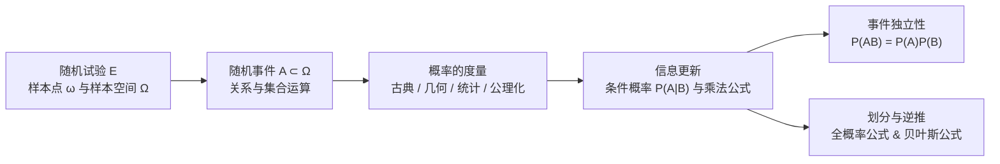
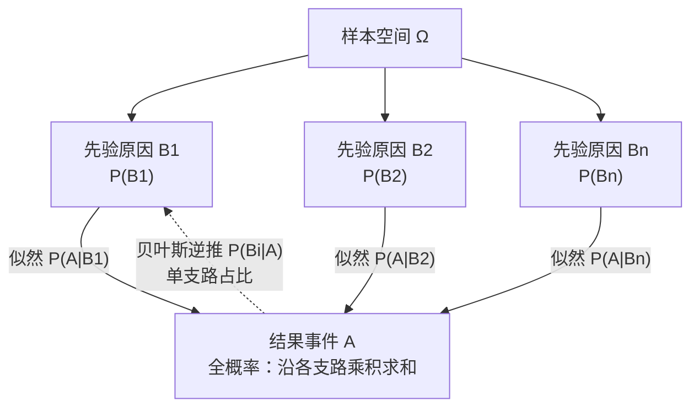

# 第一章 随机事件和概率

%% learning-vault-navigation:v1 %%
> [!abstract]- 笔记导航
> 目录：[[Math Learning/Probability and Stochastic Processes/Probability Kira/Kira概率论导航|Kira 概率论导航]]
> 下一章：[[Math Learning/Probability and Stochastic Processes/Probability Kira/第二章 随机变量及其分布|第二章 随机变量及其分布]]

> [!abstract] 本章概览
> 本章对应课件 [[Math Learning/Probability and Stochastic Processes/Probability Kira/第一章 随机事件和概率.pdf|第一章 课件 PDF]]（Kira 老师 B站 `@一高数`，共 17 页）。核心任务是用集合论语言刻画随机现象，建立概率的公理化体系，并掌握计算概率的四大基本工具：==古典/几何概型、概率运算法则、条件概率与独立性、全概率与贝叶斯公式==。这些概念同时构成后续学习随机变量、随机过程以及理解生成模型概率框架（见 [[Concepts/概率与生成模型|概率与生成模型]]）的基石。

---

## 一、随机事件与样本空间

### 1. 基本概念

1. **随机试验（Random Experiment）**：记作 $E$，需同时满足三个条件：
   - 可以在相同条件下**重复进行**；
   - 每次试验的可能结果**不止一个**，且事先能明确所有可能结果；
   - 进行一次试验前**不能确定**哪一个结果会出现。
   - *注*：仅满足后两条的称为随机现象；概率论与数理统计的主要研究对象是可大量重复的随机试验。
2. **样本点（Sample Point）**：试验 $E$ 的每个不可再分的可能结果，记作 $\omega$。
3. **样本空间（Sample Space）**：全体样本点组成的集合，记作 $\Omega$。
   - 样本空间至少包含两个样本点。
   - 按样本点个数分类：有限个或可列个 $\to$ **离散样本空间**；不可列无限个 $\to$ **连续样本空间**。

| 课件示例 | 试验 $E$ | 样本空间 $\Omega$ | 类型 |
| --- | --- | --- | --- |
| $E_1$ | 掷一枚骰子观察点数 | $\{1, 2, 3, 4, 5, 6\}$ | 有限离散 |
| $E_2$ | 观察某短视频一小时内的播放量 | $\{0, 1, 2, \dots\}$ | 可列离散 |
| $E_3$ | 某型号机械的寿命 | $(0, +\infty)$ 或 $[a, b]$ | 连续 |
| $E_4$ | 观察某班同学的身高与体重 | $\{(x, y) \mid x > 0,\, y > 0\}$ | 二维连续 |

4. **随机事件（Random Event）**：样本空间 $\Omega$ 的子集，常记作 $A, B, C$。
   - **基本事件**：由单个样本点组成的单点集 $\{\omega\}$；基本事件两两互不相容。
   - **不可能事件**：空集 $\varnothing$，不包含任何样本点，每次试验必不发生。
   - **必然事件**：全集 $\Omega$，包含全部样本点，每次试验必然发生。
5. **事件发生**：一次试验中，事件 $A$ 中**有且仅有一个**样本点出现（即试验结果 $\omega \in A$）。

---

## 二、事件的关系与运算

事件本质上是集合，因此事件间的关系与运算完全对应集合论运算。

### 1. 七大关系与运算

| 名称 | 记号 | 集合含义 | 概率语境 |
| --- | --- | --- | --- |
| 包含 | $A \subset B$ | $\omega \in A \Rightarrow \omega \in B$ | $A$ 发生必导致 $B$ 发生 |
| 相等 | $A = B$ | $A \subset B$ 且 $B \subset A$ | $A$ 与 $B$ 含相同样本点，同生同灭 |
| 和事件（并） | $A \cup B$ 或 $A + B$ | $\{\omega : \omega \in A \text{ 或 } \omega \in B\}$ | $A, B$ 至少发生一个；可推广至 $\bigcup_{k=1}^n A_k$、$\bigcup_{k=1}^\infty A_k$ |
| 积事件（交） | $A \cap B$ 或 $AB$ | $\{\omega : \omega \in A \text{ 且 } \omega \in B\}$ | $A, B$ 同时发生；可推广至 $\bigcap_{k=1}^n A_k$、$\bigcap_{k=1}^\infty A_k$ |
| 差事件 | $A - B = A\bar{B}$ | $\{\omega : \omega \in A \text{ 且 } \omega \notin B\}$ | $A$ 发生且 $B$ 不发生 |
| 互斥（互不相容） | $AB = \varnothing$ | 两集合无公共元素 | $A, B$ 不能同时发生（可同时不发生） |
| 互逆（对立） | $A \cup B = \Omega$ 且 $AB = \varnothing$ | $B = \bar{A}$ | 每次试验中必有且仅有一个发生 |

> [!important] 概念辨析：互斥（互不相容） vs. 互逆（对立）
> - **对立必互斥，互斥未必对立**：对立要求 $AB = \varnothing$ **且** $A \cup B = \Omega$，它是一个**两事件之间**的完整二划分；互斥仅要求 $AB = \varnothing$，可定义于多个事件之间。
> - **两个高频等价转换**：
>   $$AB = \varnothing \iff A \subset \bar{B}, \qquad A \subset B \iff A\bar{B} = \varnothing$$

### 2. 事件的运算律

1. **交换律**：$A \cup B = B \cup A$，$AB = BA$。
2. **结合律**：$A \cup (B \cup C) = (A \cup B) \cup C$，$(AB)C = A(BC)$。
3. **分配律**：$A \cup (BC) = (A \cup B)(A \cup C)$，$A(B \cup C) = AB \cup AC$。
4. **吸收律**：若 $A \subset B$，则 $AB = A$，$A \cup B = B$。
5. **对偶律（德摩根律，De Morgan's Laws）**：
   $$\overline{A \cup B} = \bar{A} \cap \bar{B}, \qquad \overline{A \cap B} = \bar{A} \cup \bar{B}$$
   推广至可列个事件：
   $$\overline{\bigcup_{i=1}^\infty A_i} = \bigcap_{i=1}^\infty \bar{A}_i, \qquad \overline{\bigcap_{i=1}^\infty A_i} = \bigcup_{i=1}^\infty \bar{A}_i$$

> [!warning] 易错提醒（课件 P5 注）
> 事件的并、交、差运算与初等代数的加、乘、减不同，**一般的“加括号 / 去括号”法则不成立**！例如 $(A - B) \cup B = A \cup B$ 而非 $A$；简化事件表达式时，优先将差事件统一改写为 $A - B = A\bar{B}$，再借助分配律与德摩根律化简。

> [!example] 课件精选例题（例 1.1 – 例 1.4）
> - **例 1.1（灯泡抽检）**：设 $A, B, C$ 分别表示第 1、2、3 次抽到正品。
>   - (1) 第三次抽到正品：$C$；
>   - (2) 只有第三次抽到次品：$AB\bar{C}$；
>   - (3) 恰有一次抽到次品：$\bar{A}BC \cup A\bar{B}C \cup AB\bar{C}$；
>   - (4) 至多抽到一件次品：$ABC \cup \bar{A}BC \cup A\bar{B}C \cup AB\bar{C} = AB \cup BC \cup AC$（等价于“至少两次正品”）。
> - **例 1.3（分配律化简）**：
>   $$(A \cup B)(A \cup \bar{B})(\bar{A} \cup B) = \bigl(A \cup (B\bar{B})\bigr)(\bar{A} \cup B) = A(\bar{A} \cup B) = A\bar{A} \cup AB = AB$$
> - **例 1.4（德摩根律翻译）**：设 $A$ 表示“甲产品畅销且乙产品滞销”，则对立事件 $\bar{A}$ 为“甲产品滞销**或**乙产品畅销”。

---

## 三、古典概型与几何概型

### 1. 古典概型（等可能概型）

- **适用条件**：(1) 样本空间 $\Omega = \{\omega_1, \dots, \omega_n\}$ **有限**；(2) 每个基本事件出现的可能性**相等**。
- **计算公式**：
  $$P(A) = \frac{k}{n} = \frac{A \text{ 包含的基本事件数}}{\Omega \text{ 中的基本事件总数}}$$

#### 排列组合核心复习

课件 P6 提出一个极好的理解抓手：**“当我们写 $C_3^1$ 的时候，我们想表达什么？”**——我们表达的是“从 3 个可区分的候选对象中**无序地**选出 1 个，有多少种等可能的选择方案”。做古典概型题时，**分子和分母必须采用同一口径**（同为有序排列，或同为无序组合）。

- **排列数**：从 $n$ 个不同元素中取 $m$ 个排成一列，
  $$A_n^m = P_n^m = n(n-1)\cdots(n-m+1) = \frac{n!}{(n-m)!}, \qquad A_n^n = n!$$
- **组合数**：从 $n$ 个不同元素中无序取 $m$ 个成组，
  $$C_n^m = \binom{n}{m} = \frac{A_n^m}{m!} = \frac{n!}{m!(n-m)!}$$
- **三条常用组合性质**（课件 P7）：
  1. 对称性：$C_n^m = C_n^{n-m}$；
  2. 帕斯卡递推（杨辉三角）：$C_{n+1}^m = C_n^m + C_n^{m-1}$；
  3. 曲棍球棒恒等式（Hockey-stick identity）：$C_{n+k+1}^k = \sum_{i=0}^k C_{n+i}^i$。

> [!example] 古典概型三大经典模型（课件例 1.5 – 例 1.7）
> 1. **例 1.5（置球入盒模型 & 生日问题）**：将 $n$ 只可区分的球随机放入 $N$（$n \le N$）个可区分的盒子，每盒容量不限，总样本点数为 $N^n$。
>    - 每盒至多一球：$p_1 = \dfrac{A_N^n}{N^n}$。
>    - **应用（生日悖论）**：60 人班至少 2 人生日相同（一年按 365 天计），用对立事件算：
>      $$P = 1 - \frac{A_{365}^{60}}{365^{60}} \approx 0.9941$$
>    - 恰有 $m$（$m \le n$）只球放入**某指定盒子**：先选 $m$ 球入该盒，其余 $n-m$ 球任意入其余 $N-1$ 盒，
>      $$p_2 = \frac{C_n^m (N-1)^{n-m}}{N^n}$$
>    - $n$ 只球全部放入**某一个盒子**（盒子未事先指定）：先选 1 盒有 $N$ 种，故 $p_3 = \dfrac{N}{N^n} = \dfrac{1}{N^{n-1}}$。
> 2. **例 1.6（分组分配）**：15 名新生含 3 名竞赛生，平均分配到 3 个班（每班 5 个席位）。聚焦 3 名竞赛生占据 15 个席位中的哪 3 个（无序口径，总数 $C_{15}^3 = 455$）：
>    - 每班各分到一名竞赛生：$\dfrac{C_5^1 C_5^1 C_5^1}{C_{15}^3} = \dfrac{125}{455} = \dfrac{25}{91}$；
>    - 3 名竞赛生分到同一班：$\dfrac{3 \cdot C_5^3}{C_{15}^3} = \dfrac{30}{455} = \dfrac{6}{91}$。
> 3. **例 1.7（含重复元素排列）**：将 `C, C, E, E, I, N, S` 排成一行，恰好排成 `SCIENCE`。将两个 `C` 与两个 `E` 临时编号视为可区分，总排列数为 $7!$，对应 `SCIENCE` 的排列数为 $2!\,2!$，故
>    $$P = \frac{2!\,2!}{7!} = \frac{4}{5040} = \frac{1}{1260}$$

### 2. 几何概型（从有限向连续无限的延伸）

- **定义**：样本空间 $\Omega$ 为直线、平面或空间中的有界区域，随机投点 $M$ 落在任意子区域 $G \subset \Omega$ 的概率==只与 $G$ 的度量（长度、面积、体积）成正比，而与 $G$ 的位置和形状无关==。
- **计算公式**：
  $$P(A) = \frac{m(G)}{m(\Omega)}$$

> [!example] 例 1.8（二维几何概型）
> 在区间 $(0, 1)$ 内独立任取两个数 $x, y$，求事件 $A = \{x + y < \frac{6}{5}\}$ 的概率。
> - 样本空间 $\Omega = (0,1) \times (0,1)$，面积 $m(\Omega) = 1$。
> - 对立区域 $\bar{A} = \{(x,y) \in \Omega \mid x + y \ge \frac{6}{5}\}$ 是右上角直角边长为 $2 - \frac{6}{5} = \frac{4}{5}$ 的等腰直角三角形，面积为 $\frac{1}{2} \times (\frac{4}{5})^2 = \frac{8}{25}$。
> - 故 $P(A) = 1 - \frac{8}{25} = \frac{17}{25} = 0.68$。

---

## 四、概率的概念与基本性质

### 1. 频率与统计定义

- **频率**：相同条件下 $n$ 次试验中事件 $A$ 发生 $n_A$ 次，记 $f_n(A) = \dfrac{n_A}{n}$。频率满足非负有界性 $0 \le f_n(A) \le 1$、规范性 $f_n(\Omega) = 1$ 以及有限可加性。
- **统计性定义**：当 $n \to \infty$ 时，若频率 $f_n(A)$ 稳定于某常数 $p$，称 $p$ 为事件 $A$ 的概率。这一直观将在第五章的大数定律中获得严格数学证明。

### 2. 柯尔莫哥洛夫公理化定义（Kolmogorov Axioms）

对样本空间 $\Omega$ 上的事件集函数 $P(\cdot)$，若满足以下三条公理，则称 $P(A)$ 为事件 $A$ 的概率：
1. **非负性**：对每个事件 $A$，$P(A) \ge 0$；
2. **规范性**：对必然事件 $\Omega$，$P(\Omega) = 1$；
3. **可列可加性**：对两两互斥的事件列 $A_1, A_2, \dots$（$A_i A_j = \varnothing,\, i \ne j$），
   $$P\!\left(\bigcup_{i=1}^\infty A_i\right) = \sum_{i=1}^\infty P(A_i)$$

古典概率和几何概率均满足公理化定义。

### 3. 六大基本性质及推导

由三条公理出发，可以严密推出全部基本运算法则：

1. **不可能事件概率为零**：$P(\varnothing) = 0$。
   - *证明*：$\Omega = \Omega \cup \varnothing \cup \varnothing \cup \cdots$ 且各项两两互斥，由可列可加性 $1 = P(\Omega) = P(\Omega) + \sum_{k=1}^\infty P(\varnothing)$，再由 $P(\varnothing) \ge 0$ 得 $P(\varnothing) = 0$。
2. **有限可加性**：若 $A_1, \dots, A_n$ 两两互斥，令 $A_{n+1} = A_{n+2} = \cdots = \varnothing$，由可列可加性与 $P(\varnothing)=0$ 得 $P(\bigcup_{i=1}^n A_i) = \sum_{i=1}^n P(A_i)$。
3. **对立事件公式**：$P(\bar{A}) = 1 - P(A)$（由 $A \cup \bar{A} = \Omega,\, A\bar{A} = \varnothing$ 直接推出），进而 $0 \le P(A) \le 1$。
4. **减法公式与单调性**：
   $$P(A - B) = P(A) - P(AB)$$
   - *证明*：将 $A$ 拆分为两个互斥事件 $A = (A - B) \cup AB$，故 $P(A) = P(A - B) + P(AB)$。
   - **推论（单调性）**：若 $B \subset A$，则 $AB = B$，于是 $P(A - B) = P(A) - P(B) \ge 0 \implies P(A) \ge P(B)$。
5. **加法公式（容斥原理）**：
   $$P(A \cup B) = P(A) + P(B) - P(AB)$$
   三事件情形：
   $$P(A \cup B \cup C) = P(A) + P(B) + P(C) - P(AB) - P(AC) - P(BC) + P(ABC)$$
   一般 $n$ 事件容斥公式：
   $$P\!\left(\bigcup_{i=1}^n A_i\right) = \sum_{i=1}^n P(A_i) - \sum_{1 \le i < j \le n} P(A_i A_j) + \sum_{1 \le i < j < k \le n} P(A_i A_j A_k) - \cdots + (-1)^{n-1} P(A_1 A_2 \cdots A_n)$$

> [!warning] 高频概念陷阱（课件例 1.9 – 例 1.12）
> - **零概率事件 $\neq$ 不可能事件（例 1.9）**：若 $P(AB) = 0$，**不能**推出 $A, B$ 互斥（$AB = \varnothing$），也**不能**推出 $P(A)=0$ 或 $P(B)=0$；$A$ 与 $B$ 仍可能同时发生（例如在几何概型中落在一个非空单点或一条线段上，其度量为 0）。同理，$P(A) = 1$ 也不能推出 $A = \Omega$。
> - **例 1.10**：已知 $P(A)=0.7,\, P(A-B)=0.3$，由减法公式 $P(AB) = 0.7 - 0.3 = 0.4$，故 $P(\overline{AB}) = 1 - 0.4 = 0.6$。
> - **例 1.11（经典放缩链）**：对任意事件 $A, B$，恒有
>   $$P(AB) \le P(A) \le P(A \cup B) \le P(A) + P(B)$$
> - **例 1.12**：若 $P(AB) = P(\bar{A}\bar{B})$ 且 $P(A) = p$，利用德摩根律与加法公式：
>   $$P(AB) = P(\overline{A \cup B}) = 1 - P(A) - P(B) + P(AB) \implies P(A) + P(B) = 1 \implies P(B) = 1 - p$$

---

## 五、条件概率与乘法公式

### 1. 定义与直观

设 $A, B$ 为两事件且 $P(B) > 0$，称
$$P(A \mid B) = \frac{P(AB)}{P(B)}$$
为在事件 $B$ 发生的条件下事件 $A$ 发生的**条件概率（Conditional Probability）**。

- **缩减样本空间视角**：已知 $B$ 发生后，样本空间从 $\Omega$ 缩小为 $B$，而 $A$ 在新空间中对应的部分就是 $AB$。因此条件概率 $P(\cdot \mid B)$ 本身就是一个定义在样本空间 $B$ 上的合法概率测度！

### 2. 条件概率的性质与乘法公式

因为 $P(\cdot \mid C)$（$P(C) > 0$）满足全部三条概率公理，所有概率性质在**固定同一条件 $C$** 下全部平行成立：
1. 非负有界：$0 \le P(A \mid C) \le 1$；
2. 规范性：$P(\Omega \mid C) = 1$；
3. 可列可加性：若 $A_1, A_2, \dots$ 两两互斥，则 $P(\bigcup_{i=1}^\infty A_i \mid C) = \sum_{i=1}^\infty P(A_i \mid C)$；
4. 对立事件：$P(\bar{A} \mid C) = 1 - P(A \mid C)$；
5. 加法与减法公式：$P(A \cup B \mid C) = P(A \mid C) + P(B \mid C) - P(AB \mid C)$，$P(A - B \mid C) = P(A \mid C) - P(AB \mid C)$；
6. **乘法公式（Chain Rule of Probability）**：当 $P(B) > 0$ 时，$P(AB) = P(B)P(A \mid B)$；推广至 $n$ 个事件（要求 $P(A_1 A_2 \cdots A_{n-1}) > 0$）：
   $$P(A_1 A_2 \cdots A_n) = P(A_1)\,P(A_2 \mid A_1)\,P(A_3 \mid A_1 A_2)\cdots P(A_n \mid A_1 A_2 \cdots A_{n-1})$$

> [!tip] 关联生成模型
> 多事件链式乘法公式正是自回归语言模型（Autoregressive LM）对序列联合概率建模的直接数学基础：$P(x_1, \dots, x_T) = \prod_{t=1}^T P(x_t \mid x_{<t})$。参见 [[Concepts/概率与生成模型|概率与生成模型]]。

> [!example] 课件精选例题（例 1.13 – 例 1.17）
> - **例 1.13**：若 $A \subset B$ 且 $P(B) > 0$，则 $P(A \mid B) = \dfrac{P(AB)}{P(B)} = \dfrac{P(A)}{P(B)} \ge P(A)$（注意取等号情形：$P(A)=0$ 或 $P(B)=1$）。
> - **例 1.14**：已知 $P(A)=a,\, P(B \mid A)=b$，则 $P(A\bar{B}) = P(A)P(\bar{B} \mid A) = a(1-b)$。
> - **例 1.15**：已知 $P(A)=0.4,\, P(B)=0.2,\, P(AB)=0.1$，则 $P(A \cup B) = 0.5$，因 $AB \subset A \cup B$，故 $P(AB \mid A \cup B) = \dfrac{P(AB)}{P(A \cup B)} = \dfrac{0.1}{0.5} = 0.2$。
> - **例 1.17（拨号问题）**：忘记电话号码末位数字，不重复随机拨号，求不超过三次打通的概率。
>   - 设 $A_i$ 为“第 $i$ 次恰好拨通”，则所求为 $P(A_1 \cup \bar{A}_1 A_2 \cup \bar{A}_1 \bar{A}_2 A_3)$：
>     - (I) 一般情形：$\frac{1}{10} + \frac{9}{10}\cdot\frac{1}{9} + \frac{9}{10}\cdot\frac{8}{9}\cdot\frac{1}{8} = \frac{3}{10}$；
>     - (II) 已知末位为奇数（样本空间缩减至 5 个奇数）：$\frac{1}{5} + \frac{4}{5}\cdot\frac{1}{4} + \frac{4}{5}\cdot\frac{3}{4}\cdot\frac{1}{3} = \frac{3}{5}$。
>   - 学完第七节“抽签原理”后（课件例 1.24“旧题新做”），可知每次试拨命中的边际概率恒为 $\frac{1}{10}$（或 $\frac{1}{5}$），三次互斥直接相加即可秒解！

---

## 六、事件的独立性

### 1. 两事件的独立性

- **定义**：若事件 $A, B$ 满足
  $$P(AB) = P(A)P(B)$$
  则称 $A$ 与 $B$ **相互独立（Independent）**。
- **充要条件**：当 $P(B) > 0$ 时，$A, B$ 独立 $\iff P(A \mid B) = P(A)$（$B$ 是否发生不改变 $A$ 发生的概率，即无信息增益）。
- **核心性质**：
  1. 若 $A, B$ 独立，则 $(A, \bar{B})$、$(\bar{A}, B)$、$(\bar{A}, \bar{B})$ 均相互独立。
  2. **任意事件都与概率为 $0$ 或 $1$ 的事件独立**（因 $P(AB)=0=P(A)\cdot 0$ 或 $P(AB)=P(A)=P(A)\cdot 1$）。
  3. ==独立性与互斥性的辩证关系==：
     - **当 $0 < P(A) < 1$ 且 $0 < P(B) < 1$ 时**：独立与互斥**水火不容**（独立 $\implies$ 不互斥；互斥 $\implies$ 不独立，因为 $P(AB)=0 \ne P(A)P(B) > 0$）。
     - **若未说明 $0 < P(A), P(B) < 1$**：独立与互斥之间**无必然联系**！（例如 $A = \varnothing$ 时 $A$ 与 $B$ 既互斥又独立）。这也是课件例 1.19 中排除“(C) $A$ 与 $B$ 不独立”的关键陷阱！

> [!example] 例 1.20（独立性与方程联立）
> 两个相互独立的事件 $A, B$ 都不发生的概率为 $\frac{1}{9}$，且 $A$ 发生 $B$ 不发生的概率与 $B$ 发生 $A$ 不发生的概率相等，求 $P(A)$。
> - 由 $P(A\bar{B}) = P(\bar{A}B)$ 及独立性得 $P(A)(1-P(B)) = P(B)(1-P(A)) \implies P(A) = P(B)$。
> - 再由 $P(\bar{A}\bar{B}) = (1-P(A))(1-P(B)) = (1-P(A))^2 = \frac{1}{9} \implies 1 - P(A) = \frac{1}{3} \implies P(A) = \frac{2}{3}$。

### 2. 多个事件的独立性：两两独立 vs. 相互独立

对于三个事件 $A, B, C$：
- **两两独立**仅要求 3 个二元等式：$P(AB)=P(A)P(B)$，$P(BC)=P(B)P(C)$，$P(AC)=P(A)P(C)$。
- **相互独立**除以上 3 式外，还必须同时满足三元等式：
  $$P(ABC) = P(A)P(B)P(C)$$
- **重要推论**：若 $A_1, A_2, \dots, A_n$ 相互独立，则将它们分成任意不相交的两组后，第一组事件的任意和、差、积、逆运算结果都与第二组事件的任意运算结果相互独立。
- **伯努利概型（$n$ 重独立重复试验）预告**：将仅有两个结果 $A, \bar{A}$、且每次 $P(A) = p$ 的试验独立重复 $n$ 次，即为 $n$ 重伯努利试验，其成功次数引出第二章的二项分布，无限次重复则构成 [[Math Learning/Probability and Stochastic Processes/6.041SC/U3/L13/L13 伯努利过程（Bernoulli Process）|L13 伯努利过程（Bernoulli Process）]]。

> [!example] 例 1.21（串联/并联可靠性思维——三人猜谜语）
> 三人独立猜一谜语，各自猜出的概率为 $\frac{1}{5}, \frac{1}{3}, \frac{1}{4}$。求谜语被猜出（至少一人猜出）的概率：
> $$P(A \cup B \cup C) = 1 - P(\bar{A}\bar{B}\bar{C}) = 1 - \frac{4}{5} \cdot \frac{2}{3} \cdot \frac{3}{4} = 1 - \frac{2}{5} = \frac{3}{5}$$
> **技巧**：遇到“至少有一个发生”且各事件相互独立时，==先取对立事件转化为“全都不发生”的积事件==，再直接连乘。

---

## 七、全概率公式与贝叶斯公式

课件 P14 一针见血地总结了口诀：**“全概率公式自己推，贝叶斯公式不用背。”** 掌握本节的关键在于先回答课件 P15 的两大核心问题：

> [!question] 课件 P15 两大关键问题解答
> 1. **具有什么特点的题目要想到用全概率 / 贝叶斯公式？**
>    - 试验呈现出明显的**两阶段因果结构**（先因后果）：第一阶段有若干互斥且穷尽的原因/来源/路径 $B_1, \dots, B_n$，第二阶段在不同原因下导致同一结果 $A$ 发生的条件概率 $P(A \mid B_i)$ 已知。
>    - **由因求果**（问结果 $A$ 的总概率）$\to$ 用**全概率公式**；
>    - **执果索因**（已知结果 $A$ 已发生，反推来自某原因 $B_i$ 的后验概率）$\to$ 用**贝叶斯公式**。
> 2. **如何从题目中设出事件 $A$ 与 $B_1, B_2, \dots, B_n$？**
>    - 把最终被观测的“结果事件”设为 $A$；
>    - 把导致 $A$ 的全部互不重叠、无遗漏的前置情形设为完备事件组 $B_1, \dots, B_n$。

### 1. 完备事件组（样本空间的划分）

若事件组 $B_1, B_2, \dots, B_n$ 满足：
1. 两两互斥：$B_i B_j = \varnothing$（$i \ne j$）；
2. 穷尽全空间：$\bigcup_{i=1}^n B_i = \Omega$；

则称 $B_1, \dots, B_n$ 为 $\Omega$ 的一个**完备事件组（划分）**，即每次试验中有且仅有一个 $B_i$ 发生。

### 2. 全概率公式与贝叶斯公式

设 $B_1, \dots, B_n$ 为 $\Omega$ 的完备事件组且 $P(B_i) > 0$：

- **全概率公式（Law of Total Probability）**：将 $A$ 拆解为 $A = \bigcup_{i=1}^n AB_i$（两两互斥），再用乘法公式展开：
  $$P(A) = \sum_{i=1}^n P(AB_i) = \sum_{i=1}^n P(B_i)\,P(A \mid B_i)$$
- **贝叶斯公式（Bayes' Theorem，逆概公式）**：对任意 $P(A) > 0$，无需死背，直接由条件概率定义 + 分子乘法公式 + 分母全概率公式一步写出：
  $$P(B_i \mid A) = \frac{P(AB_i)}{P(A)} = \frac{P(B_i)\,P(A \mid B_i)}{\displaystyle\sum_{j=1}^n P(B_j)\,P(A \mid B_j)}$$

- **先验与后验视角**：$P(B_i)$ 称为**先验概率（Prior）**（观测 $A$ 之前的初始信念），$P(A \mid B_i)$ 称为**似然（Likelihood）**，$P(B_i \mid A)$ 称为**后验概率（Posterior）**（观测到结果 $A$ 之后更新的信念）。在变分推断、扩散模型后验 $q(x_{t-1} \mid x_t, x_0)$ 等推导中，贝叶斯公式是最核心的代数桥梁。

### 3. 抽签原理（例 1.23 & 例 1.24）

- **结论**：$n$ 个人排队依次不放回抽签，第 $k$ 个人抽中某种签的**无条件概率**与抽签顺序无关，恒等于该种签占总签数的比例。
- **例 1.23 验证**：袋中 50 个乒乓球（20 黄 30 白），两人依次不放回各取一球，记 $B_1, B_2$ 为第一人取黄/白球，$A$ 为第二人取黄球，由全概率公式：
  $$P(A) = \frac{20}{50}\cdot\frac{19}{49} + \frac{30}{50}\cdot\frac{20}{49} = \frac{20 \times (19 + 30)}{50 \times 49} = \frac{20}{50} = \frac{2}{5}$$

> [!example] 课件经典综合练习（例 1.22、1.25、1.26）
> 1. **例 1.22（三工厂次品溯源）**：甲、乙、丙市场占有率 $\frac{1}{4}, \frac{1}{4}, \frac{1}{2}$，次品率 $2\%, 1\%, 3\%$。
>    - 买到次品总概率：$P(A) = \frac{1}{4}(0.02) + \frac{1}{4}(0.01) + \frac{1}{2}(0.03) = 0.005 + 0.0025 + 0.015 = 0.0225$。
>    - 已知为次品，出自甲厂的概率：$P(B_1 \mid A) = \dfrac{0.005}{0.0225} = \dfrac{2}{9}$。
> 2. **例 1.25（武汉开会迟到溯源）**：乘火车、轮船、汽车、飞机概率分别为 $0.2, 0.1, 0.3, 0.4$，对应迟到概率 $\frac{1}{3}, \frac{1}{12}, \frac{1}{4}, 0$。
>    - 迟到总概率：$P(A) = 0.2\cdot\frac{1}{3} + 0.1\cdot\frac{1}{12} + 0.3\cdot\frac{1}{4} + 0 = \frac{8+1+9}{120} = \frac{18}{120} = 0.15$。
>    - 已知迟到，系乘汽车前往的概率：$P(B_3 \mid A) = \dfrac{9/120}{18/120} = \dfrac{1}{2}$。
> 3. **例 1.26（二元非对称信道解码）**：发 $A$、$B$ 频率比为 $3:2$（即 $P(S_A)=0.6,\, P(S_B)=0.4$），误收率 $P(R_B \mid S_A) = 0.04 \implies P(R_A \mid S_A)=0.96$，$P(R_A \mid S_B) = 0.07$。
>    - 收到 $A$ 时原发也是 $A$ 的概率：
>      $$P(S_A \mid R_A) = \frac{0.6 \times 0.96}{0.6 \times 0.96 + 0.4 \times 0.07} = \frac{0.576}{0.576 + 0.028} = \frac{144}{151} \approx 0.9536$$

---

## 八、复习自测与易错清单

> [!question]- 本章核心自检清单（点击展开）
> 1. 能否在不翻笔记的情况下，用三条公理严密推出 $P(\varnothing)=0$、减法公式 $P(A-B)=P(A)-P(AB)$ 和加法公式？
> 2. 面对题目判断“互斥”与“独立”时，是否先核查条件 $0 < P(A) < 1$ 与 $0 < P(B) < 1$？能否举出“既互斥又独立”的反例？
> 3. 为什么三个事件“两两独立”推不出“相互独立”？（经典反例：抛两枚均匀硬币，$A=$ 第一次正面，$B=$ 第二次正面，$C=$ 两次相同，两两独立但 $P(ABC) = 0 \ne \frac{1}{8}$。）
> 4. 拿到全概率 / 贝叶斯大题时，能否先画出“先验原因 $\to$ 条件似然 $\to$ 观测结果”的树状图，再直接写出分子与分母？

## 本章原始资料与延伸入口

- 课件原件：[[Math Learning/Probability and Stochastic Processes/Probability Kira/第一章 随机事件和概率.pdf|第一章 课件 PDF]]
- 下一章衔接：[[Math Learning/Probability and Stochastic Processes/Probability Kira/第二章 随机变量及其分布|第二章 随机变量及其分布]]
- 跨课程概念链接：[[Concepts/概率与生成模型|概率与生成模型]] · [[Math Learning/Probability and Stochastic Processes/6.041SC/U3/L13/L13 伯努利过程（Bernoulli Process）|L13 伯努利过程（Bernoulli Process）]]
