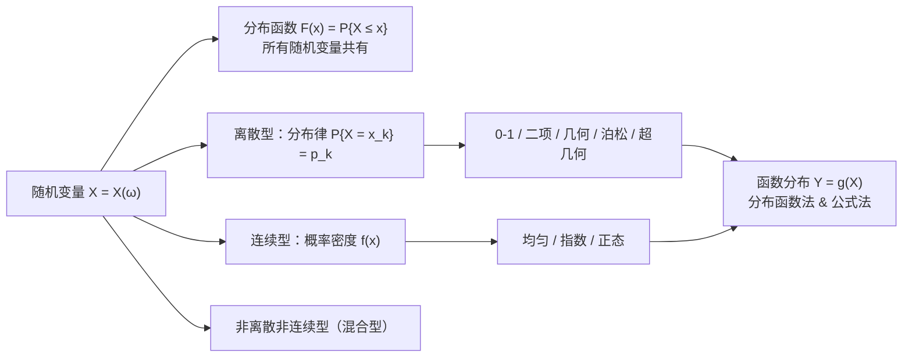

# 第二章 随机变量及其分布

%% learning-vault-navigation:v1 %%
> [!abstract]- 笔记导航
> 目录：[[Math Learning/Probability and Stochastic Processes/Probability Kira/Kira概率论导航|Kira 概率论导航]]
> 上一章：[[Math Learning/Probability and Stochastic Processes/Probability Kira/第一章 随机事件和概率|第一章 随机事件和概率]]

> [!abstract] 本章概览
> 本章对应课件 [[Math Learning/Probability and Stochastic Processes/Probability Kira/第二章 随机变量及其分布.pdf|第二章 课件 PDF]]（Kira 老师 B站 `@一高数`）。随机变量的引入把“孤立、静态的事件概率”转化为“统一、动态的实函数分析”，从而可以用微积分与级数工具研究概率分布。核心脉络围绕课件 P1 的知识图解展开：==随机变量与分布函数 $\to$ 离散型分布律与五大常见离散分布 $\to$ 连续型概率密度与三大常见连续分布 $\to$ 随机变量函数 $Y=g(X)$ 的分布==。

> [!warning] 本地归档课件完整性提示
> 本地归档的 `第二章 随机变量及其分布.pdf` 在第 7 页“几何分布例 2.6”处存在文件尾截断（原 PDF 仅保留前 7 页）。因此本笔记前半部分（第 1–4.3 节）严格对应课件第 1–7 页的原文例题与思考题，后半部分（泊松分布与泊松定理、超几何分布、连续型随机变量与常见连续分布、随机变量函数的分布）严格按照课件第 1 页的**知识图解**框架完整补全，便于系统复习。

---

## 一、随机变量的概念与分类

Kira 课件 P2 给出一句直观口号：**“只要有随机性，万物皆可随机变量。”**

- **定义**：设随机试验的样本空间为 $\Omega$，若 $X = X(\omega)$ 是定义在 $\Omega$ 上的**实值单值函数**，则称 $X$ 为**随机变量（Random Variable, RV）**。通常用大写字母 $X, Y, Z$ 表示随机变量，小写字母 $x, y, z$ 表示其具体实数取值。
- **三个本质特征**（课件 P2 备注）：
  1. 将事件表述数量化（如引例 1：50 件产品含 5 件废品抽 3 件的废品数 $X$；引例 2：笔记本电脑使用寿命 $X$；引例 3：抛硬币正面记 $X=1$、反面记 $X=0$），使概率论从静态事件走向函数分析；
  2. 因为 $X(\omega)$ 是单值函数，**随机变量的不同取值所对应的事件两两互斥**：$\{X = x_1\} \cap \{X = x_2\} = \varnothing$（$x_1 \ne x_2$）；
  3. 试验前可明确 $X$ 的取值范围，但不能预知具体取值。
- **分类**：**离散型**、**连续型**、**非离散非连续型（混合型）**。

---

## 二、随机变量的分布函数（CDF）

### 1. 定义与概率计算法则

- **定义**：对任意实数 $x \in (-\infty, +\infty)$，称
  $$F(x) = P\{X \le x\}$$
  为随机变量 $X$ 的**分布函数（Cumulative Distribution Function, CDF）**。
- **核心意义**：**所有随机变量**（无论离散、连续还是混合型）都存在分布函数 $F(x)$，且 $F(x)$ 完整包含了 $X$ 的全部概率信息；它本质上是一个普通的一元实函数。
- **左极限公式证明**（课件 P3）：
  $$P\{X < a\} = \lim_{\varepsilon \to 0^+} P\{X \le a - \varepsilon\} = \lim_{\varepsilon \to 0^+} F(a - \varepsilon) = F(a - 0)$$
- **七大区间与单点概率公式**（务必区分开闭端点，尤其对非连续点！）：

| 事件 | 分布函数表达式 | 连续型特例（$F(a-0)=F(a)$） |
| --- | --- | --- |
| $\{X \le a\}$ | $F(a)$ | $F(a)$ |
| $\{X < a\}$ | $F(a - 0)$ | $F(a)$ |
| $\{X > a\}$ | $1 - F(a)$ | $1 - F(a)$ |
| $\{X = a\}$ | $F(a) - F(a - 0)$ | $0$ |
| $\{a < X \le b\}$ | $F(b) - F(a)$ | $F(b) - F(a)$ |
| $\{a \le X \le b\}$ | $F(b) - F(a - 0)$ | $F(b) - F(a)$ |
| $\{a \le X < b\}$ | $F(b - 0) - F(a - 0)$ | $F(b) - F(a)$ |
| $\{a < X < b\}$ | $F(b - 0) - F(a)$ | $F(b) - F(a)$ |

### 2. 分布函数的四大充要性质

一个函数 $F(x)$ 能成为某随机变量的分布函数，**当且仅当**满足以下四条性质：
1. **有界非负性**：$0 \le F(x) \le 1$；
2. **单调不减性**：对任意 $x_1 < x_2$，有 $F(x_1) \le F(x_2)$；
3. **规范性**：$F(-\infty) = \lim_{x \to -\infty} F(x) = 0$，$F(+\infty) = \lim_{x \to +\infty} F(x) = 1$；
4. **右连续性**：对任意 $x_0 \in \mathbb{R}$，有 $F(x_0) = F(x_0 + 0) = \lim_{x \to x_0^+} F(x)$。

> [!example] 课件经典例题（P4 例 2.1 – 例 2.2）
> 1. **例 2.1（混合型分布函数）**：设
>    $$F(x) = \begin{cases} 0, & x < 0 \\ \frac{1}{2}, & 0 \le x < 1 \\ 1 - e^{-x}, & x \ge 1 \end{cases}$$
>    - 单点跳跃概率：$P\{X = 1\} = F(1) - F(1 - 0) = (1 - e^{-1}) - \frac{1}{2} = \frac{1}{2} - e^{-1}$；
>    - 常数段区间概率：$P\{\frac{1}{3} < X < \frac{1}{2}\} = F(\frac{1}{2} - 0) - F(\frac{1}{3}) = \frac{1}{2} - \frac{1}{2} = 0$。
>    - *课件注*：在 $F(x)$ 取常数的分段区间内部（除间断点外），$X$ 取值的概率为 $0$。注意本例在 $x=0$（跳跃 $\frac{1}{2}$）和 $x=1$（跳跃 $\frac{1}{2} - e^{-1}$）处有离散概率质量，而在 $(1, +\infty)$ 上有连续密度 $e^{-x}$，正是一个典型的**非离散非连续型（混合型）随机变量**！
> 2. **例 2.2（分布函数的构造判定）**：设 $F(x), G(x)$ 为分布函数，判断何时仍为分布函数：
>    - (1) $aF(x) + bG(x)$：当 $a \ge 0,\, b \ge 0,\, a + b = 1$ 时一定是分布函数（混合分布，凸组合保持全部四条性质）；
>    - (2) $F(ax + b)$：当 $a > 0$ 时一定是分布函数（对应随机变量 $\frac{X - b}{a}$；若 $a \le 0$，规范性或单调性被破坏）；
>    - (3) $1 - F(-x)$：**不一定**！因为若 $F$ 有跳跃点，则 $1 - F(-x)$ 在对应点处变为**左连续**而非右连续；当且仅当 $F(x)$ 处处连续（如连续型随机变量）时，$1 - F(-x)$ 一定是分布函数（即 $-X$ 的 CDF）；
>    - (4) $F(x)G(x)$：**恒为分布函数**！（它正好是相互独立的 $X, Y$ 的最大值 $\max(X, Y)$ 的分布函数）。

---

## 三、离散型随机变量与五大常见离散分布

### 1. 离散型随机变量与分布律（PMF）

- **定义**：全部可能取值为有限个或可列无限多个的随机变量称**离散型随机变量**。
- **分布律（Probability Mass Function, PMF）**：$P\{X = x_k\} = p_k$（$k = 1, 2, \dots$）。
- **充要条件**：(1) $p_k \ge 0$；(2) $\sum_{k=1}^\infty p_k = 1$。
- **与分布函数的关系**：
  $$F(x) = P\{X \le x\} = \sum_{x_k \le x} p_k$$
  其图像呈**右连续阶梯函数**，在每个可能取值 $x_k$ 处向上跳跃，跳跃高度恰为 $p_k = F(x_k) - F(x_k - 0)$。

> [!question] 课件 P5“加深理解”两大思考题解答
> 1. **只有离散型随机变量才有分布律吗？有分布律的一定是离散型吗？**
>    - 是的。只有离散型随机变量的全部概率质量都集中在可数个点上（$\sum p_k = 1$），可用分布律完整刻画；混合型虽在个别点有 $P\{X=x_k\}>0$，但这些点概率之和 $< 1$，不能构成完整分布律。
> 2. **离散型随机变量的分布函数有何特点？只有离散型分布函数才有跳跃点吗？**
>    - 离散型 CDF 是纯阶梯函数（分段常数 + 跳跃，所有跳跃高度之和等于 $1$）。
>    - **不是只有离散型才有跳跃点！** 混合型（如上文例 2.1）的分布函数同样存在跳跃点，但跳跃高度之和严格小于 $1$。

> [!example] 课件 P5 例 2.1（最大号码的分布律与分布函数）
> 袋中有编号 $1, 2, 3, 4, 5$ 的 5 球，同时任取 3 球，$X$ 表示取出的 3 球中的最大号码。
> - 可能取值 $X \in \{3, 4, 5\}$，总数 $C_5^3 = 10$：
>   $$P\{X=3\} = \frac{C_2^2}{C_5^3} = \frac{1}{10}, \quad P\{X=4\} = \frac{C_3^2}{C_5^3} = \frac{3}{10}, \quad P\{X=5\} = \frac{C_4^2}{C_5^3} = \frac{6}{10}$$
> - $F(4.5) = P\{X \le 4.5\} = \frac{1}{10} + \frac{3}{10} = 0.4$。
> - 分段分布函数：$F(x) = 0\;(x<3)$；$0.1\;(3 \le x < 4)$；$0.4\;(4 \le x < 5)$；$1\;(x \ge 5)$。

### 2. 五大常见离散型分布详解

#### （1）0-1 分布（两点分布 / 伯努利分布）
- **记号**：$X \sim B(1, p)$ 或 $\text{Bernoulli}(p)$，其中 $0 < p < 1$。
- **背景**：单次伯努利试验（仅有两个结果：成功记 $1$，失败记 $0$）。
- **分布律**：$P\{X = k\} = p^k (1-p)^{1-k}$，$k \in \{0, 1\}$。
- **数字特征**：$E(X) = p$，$D(X) = p(1-p)$。

#### （2）二项分布（Binomial Distribution）
- **记号**：$X \sim B(n, p)$（$n \in \mathbb{N}_+,\, 0 < p < 1$）。
- **背景**：$n$ 重独立伯努利试验中事件 $A$ 发生的次数（$n$ 个独立同分布 0-1 随机变量之和）。
- **分布律**：
  $$P\{X = k\} = C_n^k p^k (1 - p)^{n-k}, \qquad k = 0, 1, \dots, n$$
- **数字特征**：$E(X) = np$，$D(X) = np(1-p)$。
- **常见变形题（课件 P6 例 2.2 – 例 2.4）**：
  - **例 2.2**：3 名学生通过率均为 $\frac{2}{3}$（挂科率 $p=\frac{1}{3}$），至少两人挂科概率为 $C_3^2(\frac{1}{3})^2(\frac{2}{3}) + C_3^3(\frac{1}{3})^3 = \frac{7}{27}$。
  - **例 2.3**：单次成功率 $0.5$，需满足 $P\{X \ge 1\} = 1 - 0.5^n \ge 0.9 \iff 0.5^n \le 0.1 \implies n \ge \lceil \log_2 10 \rceil = 4$ 次。
  - **例 2.4（全概率 + 二项分布复合）**：每台仪器直接出厂概率 $0.7$，调试后再出厂概率 $0.3 \times 0.8 = 0.24$，故单台出厂概率 $p = 0.94$、报废概率 $q = 0.06$；$n$ 台独立生产时，全部出厂 $\alpha = 0.94^n$，恰有两台不能出厂 $\beta = C_n^2 (0.06)^2 (0.94)^{n-2}$。

#### （3）几何分布（Geometric Distribution）
- **记号**：$X \sim Ge(p)$（$0 < p < 1$）。
- **背景**：可列重独立伯努利试验中，事件 $A$ **首次发生**所需的试验次数（课件 P7 指出：几何分布是负二项分布 / 帕斯卡分布 $r=1$ 的特例）。
- **分布律与尾概率**：
  $$P\{X = k\} = (1 - p)^{k-1} p \quad (k = 1, 2, \dots), \qquad P\{X > k\} = (1 - p)^k$$
- **数字特征**：$E(X) = \dfrac{1}{p}$，$D(X) = \dfrac{1 - p}{p^2}$。
- **无记忆性（Memorylessness）**：对任意正整数 $m, n$，
  $$P\{X > m + n \mid X > m\} = \frac{(1-p)^{m+n}}{(1-p)^m} = (1-p)^n = P\{X > n\}$$
  已连续失败 $m$ 次后，还需再等超过 $n$ 次的概率与从零开始完全一致！它是**唯一**具有无记忆性的离散分布（详见 [[Math Learning/Probability and Stochastic Processes/6.041SC/U3/L13/L13 伯努利过程（Bernoulli Process）|L13 伯努利过程（Bernoulli Process）]]）。
- **课件 P7 例 2.5**：独立射击每次命中率 $\frac{1}{4}$，第 3 次首次命中：$P\{X = 3\} = (\frac{3}{4})^2 \cdot \frac{1}{4} = \frac{9}{64}$。

#### （4）泊松分布（Poisson Distribution）与泊松定理
- **记号**：$X \sim P(\lambda)$ 或 $\pi(\lambda)$（$\lambda > 0$）。
- **背景**：单位时间或单位空间内“稀有随机事件”发生的次数（如单位时间内总机接到的呼叫数、放射性衰变粒子数，详见 [[Math Learning/Probability and Stochastic Processes/6.041SC/U3/L14/L14 泊松过程（一）（Poisson Process I）|L14 泊松过程（一）（Poisson Process I）]]）。
- **分布律**：
  $$P\{X = k\} = \frac{\lambda^k}{k!} e^{-\lambda}, \qquad k = 0, 1, 2, \dots$$
  验证归一性：$\sum_{k=0}^\infty \frac{\lambda^k}{k!} e^{-\lambda} = e^\lambda \cdot e^{-\lambda} = 1$。
- **数字特征**：$E(X) = \lambda$，$D(X) = \lambda$（==均值与方差相等==是泊松分布的显著标志）。
- **泊松定理（Poisson Limit Theorem）**：设 $n$ 重伯努利试验的成功概率 $p_n$ 随 $n$ 变化，若当 $n \to \infty$ 时满足 $np_n \to \lambda > 0$（大 $n$、小 $p$、乘积稳定），则对任意固定非负整数 $k$：
  $$\lim_{n \to \infty} C_n^k p_n^k (1 - p_n)^{n-k} = \frac{\lambda^k}{k!} e^{-\lambda}$$
  **实用近似准则**：当 $n \ge 20$ 且 $p \le 0.05$（或 $n$ 很大、$p$ 很小）时，可用 $P(\lambda = np)$ 近似计算 $B(n, p)$。

#### （5）超几何分布（Hypergeometric Distribution）
- **记号**：$X \sim H(N, M, n)$（$N$ 件总体中含 $M$ 件次品，**不放回**随机抽取 $n$ 件，其中次品数 $X$；呼应课件 P2 引例 1：$N=50, M=5, n=3$）。
- **分布律**：
  $$P\{X = k\} = \frac{C_M^k C_{N-M}^{n-k}}{C_N^n}, \qquad \max(0,\, n - N + M) \le k \le \min(n, M)$$
- **数字特征**：记 $p = \frac{M}{N}$，则
  $$E(X) = np, \qquad D(X) = np(1-p)\cdot\frac{N - n}{N - 1}$$
- **与二项分布的对比**：二项分布对应**有放回抽样**，超几何分布对应**不放回抽样**；两者期望完全一致，而超几何方差多出有限总体修正因子 $\frac{N-n}{N-1} < 1$（不放回减少了波动）。当 $N \gg n$ 时，$\frac{N-n}{N-1} \to 1$，超几何分布趋近于二项分布 $B(n, M/N)$。

---

## 四、连续型随机变量与三大常见连续分布

### 1. 概率密度函数（PDF）与基本性质

- **定义**：对随机变量 $X$ 的分布函数 $F(x)$，若存在非负可积函数 $f(x)$，使对任意实数 $x$ 都有
  $$F(x) = \int_{-\infty}^x f(t)\,\mathrm{d}t$$
  则称 $X$ 为**连续型随机变量**，$f(x)$ 为 $X$ 的**概率密度函数（Probability Density Function, PDF）**。
- **充要条件**：(1) 非负性 $f(x) \ge 0$；(2) 规范性 $\int_{-\infty}^{+\infty} f(x)\,\mathrm{d}x = 1$。
- **核心性质**：
  1. 区间概率等于密度曲线下面积：$P\{a < X \le b\} = \int_a^b f(x)\,\mathrm{d}x = F(b) - F(a)$；
  2. **任意单点概率为零**：$P\{X = a\} = 0$（因此对连续型随机变量，区间的开闭端点**完全不影响概率值**，且 $F(x)$ 在 $\mathbb{R}$ 上处处连续）；
  3. **微积分互逆**：在 $f(x)$ 的连续点处有 $F'(x) = f(x)$；
  4. **局部概率含义**：$P\{x < X \le x + \Delta x\} \approx f(x)\,\Delta x$，故 **$f(x)$ 是概率密度而非概率值**，完全可能出现 $f(x) > 1$（只要总积分为 $1$）！

### 2. 三大常见连续型分布详解

#### （1）均匀分布（Uniform Distribution）
- **记号**：$X \sim U(a, b)$（$a < b$）。
- **概率密度与分布函数**：
  $$f(x) = \begin{cases} \dfrac{1}{b-a}, & a < x < b \\ 0, & \text{其他} \end{cases}, \qquad F(x) = \begin{cases} 0, & x < a \\ \dfrac{x-a}{b-a}, & a \le x < b \\ 1, & x \ge b \end{cases}$$
- **本质特征**：一维几何概型，落在 $(a, b)$ 内任意子区间的概率仅与区间长度成正比。
- **数字特征**：$E(X) = \dfrac{a+b}{2}$，$D(X) = \dfrac{(b-a)^2}{12}$。

#### （2）指数分布（Exponential Distribution）
- **记号**：$X \sim E(\lambda)$ 或 $\text{Exp}(\lambda)$（参数 $\lambda > 0$，考研与教材有时记参数为 $\theta = 1/\lambda$，做题时务必先看清密度表达式！）。
- **概率密度与分布函数**：
  $$f(x) = \begin{cases} \lambda e^{-\lambda x}, & x > 0 \\ 0, & x \le 0 \end{cases}, \qquad F(x) = \begin{cases} 1 - e^{-\lambda x}, & x \ge 0 \\ 0, & x < 0 \end{cases}$$
- **数字特征**：$E(X) = \dfrac{1}{\lambda}$，$D(X) = \dfrac{1}{\lambda^2}$（标准差等于均值）。
- **无记忆性**：对任意 $s > 0,\, t > 0$，由尾概率 $P\{X > x\} = e^{-\lambda x}$ 得
  $$P\{X > s + t \mid X > s\} = \frac{e^{-\lambda(s+t)}}{e^{-\lambda s}} = e^{-\lambda t} = P\{X > t\}$$
  指数分布是**唯一**具有无记忆性的连续型分布，刻画泊松过程中相邻两次到达的时间间隔，也常用于电子元件无老化阶段的寿命建模（详见 [[Math Learning/Probability and Stochastic Processes/6.041SC/U3/L14/L14 泊松过程（一）（Poisson Process I）|L14 泊松过程（一）（Poisson Process I）]]）。

#### （3）正态分布（Normal / Gaussian Distribution）
- **记号**：$X \sim N(\mu, \sigma^2)$（$\mu \in \mathbb{R},\, \sigma > 0$，注意第二个参数通常是**方差 $\sigma^2$** 而非标准差 $\sigma$）。
- **概率密度**：
  $$f(x) = \frac{1}{\sqrt{2\pi}\sigma} \exp\!\left(-\frac{(x - \mu)^2}{2\sigma^2}\right), \qquad -\infty < x < +\infty$$
- **几何特征与参数意义**：
  - 钟形曲线关于 $x = \mu$ 左右对称，在 $x = \mu$ 处取得最大值 $\dfrac{1}{\sqrt{2\pi}\sigma}$；
  - 在 $x = \mu \pm \sigma$ 处存在拐点；
  - $\mu$ 为**位置参数**（控制平移），$\sigma$ 为**尺度参数**（$\sigma$ 越小越“瘦高”，$\sigma$ 越大越“矮胖”）。
- **标准正态分布 $Z \sim N(0, 1)$**：密度记 $\varphi(x) = \frac{1}{\sqrt{2\pi}} e^{-x^2/2}$，分布函数记 $\Phi(x) = \int_{-\infty}^x \varphi(t)\,\mathrm{d}t$，满足对称公式：
  $$\Phi(-x) = 1 - \Phi(x), \qquad \Phi(0) = \frac{1}{2}$$
- **标准化定理（核心计算工具）**：若 $X \sim N(\mu, \sigma^2)$，则线性标准化后服从标准正态分布：
  $$Z = \frac{X - \mu}{\sigma} \sim N(0, 1) \implies P\{a < X \le b\} = \Phi\!\left(\frac{b - \mu}{\sigma}\right) - \Phi\!\left(\frac{a - \mu}{\sigma}\right)$$
  更一般地，对任意常数 $a \ne 0,\, b$，正态分布在线性变换下封闭：$aX + b \sim N(a\mu + b,\, a^2\sigma^2)$。
- **$3\sigma$ 经验原则与分位点**：
  - $P\{|X - \mu| \le \sigma\} \approx 0.6827$，$P\{|X - \mu| \le 2\sigma\} \approx 0.9545$，$P\{|X - \mu| \le 3\sigma\} \approx 0.9973$。
  - **上 $\alpha$ 分位点 $z_\alpha$**：满足 $P\{Z > z_\alpha\} = \alpha$（即 $\Phi(z_\alpha) = 1 - \alpha$），常用 $z_{0.05} \approx 1.645$，$z_{0.025} \approx 1.96$。

> [!tip] 与深度学习 / 生成模型的直接联系
> 正态分布是现代扩散模型（DDPM / Score-Based SDE）与 VAE 的核心先验及条件转移分布，其中的**重参数化技巧（Reparameterization Trick）** $x = \mu + \sigma \varepsilon\;(\varepsilon \sim N(0,1))$ 正是正态分布线性变换性质的逆向应用，使梯度能够穿过随机采样节点反向传播。参见 [[Concepts/概率与生成模型|概率与生成模型]]。

---

## 五、八大常见分布速查总表

| 类型 | 分布名称 | 记号 | 分布律 / 概率密度 | 期望 $E(X)$ | 方差 $D(X)$ | 核心特征 / 性质 |
| --- | --- | --- | --- | --- | --- | --- |
| 离散 | 0-1 分布 | $B(1, p)$ | $p^k(1-p)^{1-k}\;(k=0,1)$ | $p$ | $p(1-p)$ | 单次伯努利试验 |
| 离散 | 二项分布 | $B(n, p)$ | $C_n^k p^k(1-p)^{n-k}\;(0 \le k \le n)$ | $np$ | $np(1-p)$ | $n$ 次独立重复成功次数；可加性（同 $p$） |
| 离散 | 几何分布 | $Ge(p)$ | $(1-p)^{k-1}p\;(k=1,2,\dots)$ | $\frac{1}{p}$ | $\frac{1-p}{p^2}$ | 首次成功试验次数；==唯一离散无记忆== |
| 离散 | 泊松分布 | $P(\lambda)$ | $\frac{\lambda^k}{k!}e^{-\lambda}\;(k=0,1,\dots)$ | $\lambda$ | $\lambda$ | 均值=方差；二项的大 $n$ 小 $p$ 极限 |
| 离散 | 超几何分布 | $H(N,M,n)$ | $\frac{C_M^k C_{N-M}^{n-k}}{C_N^n}$ | $n\frac{M}{N}$ | $n\frac{M}{N}(1-\frac{M}{N})\frac{N-n}{N-1}$ | 不放回抽样；$N \gg n$ 趋近二项 |
| 连续 | 均匀分布 | $U(a, b)$ | $\frac{1}{b-a}\;(a < x < b)$ | $\frac{a+b}{2}$ | $\frac{(b-a)^2}{12}$ | 区间内等密度；一维几何概型 |
| 连续 | 指数分布 | $E(\lambda)$ | $\lambda e^{-\lambda x}\;(x > 0)$ | $\frac{1}{\lambda}$ | $\frac{1}{\lambda^2}$ | 到达间隔时间；==唯一连续无记忆== |
| 连续 | 正态分布 | $N(\mu, \sigma^2)$ | $\frac{1}{\sqrt{2\pi}\sigma}e^{-\frac{(x-\mu)^2}{2\sigma^2}}$ | $\mu$ | $\sigma^2$ | 对称钟形；线性变换封闭；中心极限定理极限 |

---

## 六、随机变量函数 $Y = g(X)$ 的分布

实际问题中常已知 $X$ 的分布，要求变换后新随机变量 $Y = g(X)$ 的分布。

### 1. 离散型 $X$ 的函数分布

- **步骤**：(1) 列出 $X$ 所有可能取值 $x_k$ 对应的 $y_k = g(x_k)$；(2) 若多个不同 $x_k$ 映射到同一个 $y$ 值，则将它们的概率**合并相加**：
  $$P\{Y = y\} = \sum_{k:\, g(x_k) = y} P\{X = x_k\}$$

### 2. 连续型 $X$ 的函数分布

#### 方法一：分布函数法（万能法，优先掌握！）

适用于**任何**连续型变换（单调、非单调、分段函数甚至输出退化为混合型随机变量的情形）：
1. **定范围**：根据 $X$ 的支撑集（$f_X(x) > 0$ 的区域）先确定 $Y = g(X)$ 的可能取值范围；
2. **求 CDF**：对 $y$ 落在取值范围内的情形，写出
   $$F_Y(y) = P\{Y \le y\} = P\{g(X) \le y\}$$
   将其等价解出关于 $X$ 的不等式（如 $x_1(y) \le X \le x_2(y)$），用 $F_X$ 或积分 $\int f_X(x)\,\mathrm{d}x$ 表示；
3. **求导得 PDF**：对 $F_Y(y)$ 求导得 $f_Y(y) = F_Y'(y)$（若 $F_Y(y)$ 存在跳跃点，则说明 $Y$ 为混合型或离散型，此时不能简单求导！）。

> [!example] 典型非单调变换：$Y = X^2$（设 $X$ 密度为 $f_X(x)$）
> - 当 $y \le 0$ 时，$F_Y(y) = P\{X^2 \le y\} = 0$。
> - 当 $y > 0$ 时，
>   $$F_Y(y) = P\{X^2 \le y\} = P\{-\sqrt{y} \le X \le \sqrt{y}\} = F_X(\sqrt{y}) - F_X(-\sqrt{y})$$
> - 两端对 $y$ 求导（链式法则）：
>   $$f_Y(y) = \frac{1}{2\sqrt{y}}\bigl[f_X(\sqrt{y}) + f_X(-\sqrt{y})\bigr], \qquad y > 0$$
> - **特例**：若 $X \sim N(0, 1)$，则 $f_Y(y) = \frac{1}{\sqrt{2\pi}} y^{-1/2} e^{-y/2}$（$y > 0$），即自由度为 $1$ 的卡方分布 $\chi^2(1)$！

#### 方法二：公式法（严格单调可微情形的捷径）

- **定理**：设 $X$ 具有连续密度 $f_X(x)$，函数 $y = g(x)$ 在 $X$ 的支撑区间上**严格单调**且具有连续非零导数，其反函数记为 $x = h(y)$，值域为 $(\alpha, \beta)$，则 $Y = g(X)$ 的概率密度为：
  $$f_Y(y) = \begin{cases} f_X\bigl(h(y)\bigr)\,\bigl|h'(y)\bigr|, & \alpha < y < \beta \\ 0, & \text{其他} \end{cases}$$
- **直观理解（雅可比微元守恒）**：$f_Y(y)\,|\mathrm{d}y| = f_X(x)\,|\mathrm{d}x| \implies f_Y(y) = f_X(x)\,\left|\dfrac{\mathrm{d}x}{\mathrm{d}y}\right|$。这一公式在高维情形直接推广为流模型（Normalizing Flows）的变量替换公式 $p_Y(y) = p_X(g^{-1}(y)) \left|\det \frac{\partial g^{-1}(y)}{\partial y}\right|$！
- **重要推论（概率积分变换 / 逆变换采样）**：若连续型 $X$ 具有严格递增的分布函数 $F_X(x)$，令 $Y = F_X(X)$，则对 $y \in (0, 1)$ 有
  $$F_Y(y) = P\{F_X(X) \le y\} = P\{X \le F_X^{-1}(y)\} = F_X\bigl(F_X^{-1}(y)\bigr) = y \implies Y \sim U(0, 1)$$
  反过来，若 $U \sim U(0, 1)$，则 $F_X^{-1}(U)$ 的分布恰为 $F_X$——这正是计算机从任意目标分布采样的**逆变换采样法（Inverse Transform Sampling）**。

> [!warning] 公式法常见陷阱
> 1. 千万不要漏掉绝对值 $|h'(y)|$（当 $g(x)$ 严格单调递减时 $h'(y) < 0$）；
> 2. 必须标明新变量 $y$ 的**有效区间** $(\alpha, \beta)$，超出范围密度为 $0$；
> 3. 若 $g(x)$ 非单调（如 $Y = X^2,\, Y = |X|,\, Y = \sin X$）或在某段为常数（如 $Y = \max(X, 0)$ 会产生 $y=0$ 处的点质量，成为混合型随机变量！），**严禁直接套用公式法**，必须回归分布函数法分段处理。

---

## 七、复习自测与延伸联系

> [!question]- 本章核心自检清单（点击展开）
> 1. 给定一个分段函数 $F(x)$，如何利用“四条充要性质”快速确定待定参数？为什么 $1 - F(-x)$ 对离散型随机变量不是分布函数？
> 2. 几何分布和指数分布为何分别被称为离散与连续世界中的“唯一无记忆分布”？如何用尾概率 $P\{X > s+t\} = P\{X > s\}P\{X > t\}$ 一眼验证？
> 3. 二项分布、超几何分布、泊松分布三者在抽样背景与极限近似上是什么关系？
> 4. 设 $X \sim U(-1, 2)$，尝试分别用分布函数法求 $Y = X^2$ 与 $Z = \max(X, 0)$ 的分布函数，体会非单调变换与混合型随机变量的产生机制。

## 本章原始资料与延伸入口

- 课件原件：[[Math Learning/Probability and Stochastic Processes/Probability Kira/第二章 随机变量及其分布.pdf|第二章 课件 PDF]]
- 上一章回顾：[[Math Learning/Probability and Stochastic Processes/Probability Kira/第一章 随机事件和概率|第一章 随机事件和概率]]
- 跨课程衔接：
  - 离散/连续随机过程视角下的二项、几何、泊松、指数分布：[[Math Learning/Probability and Stochastic Processes/6.041SC/U3/L13/L13 伯努利过程（Bernoulli Process）|L13 伯努利过程（Bernoulli Process）]] · [[Math Learning/Probability and Stochastic Processes/6.041SC/U3/L14/L14 泊松过程（一）（Poisson Process I）|L14 泊松过程（一）（Poisson Process I）]]
  - 与生成模型概率基础对照：[[Concepts/概率与生成模型|概率与生成模型]]
