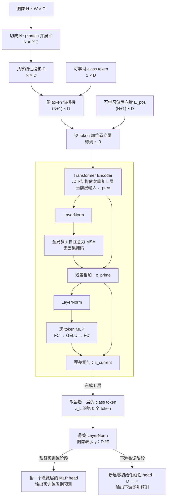

%% learning-vault-navigation:v1 %%
> [!abstract]- 笔记导航
> 目录：[[Paper/README|论文阅读 · 索引]]
> 相关：[[Paper/Deep Residual Learning for Image Recognition/ResNet|ResNet · 残差学习]] · [[Paper/Attention Is All You Need/Transformer|Transformer · 注意力机制]] · [[Paper/Masked Autoencoders Are Scalable Vision Learners/MAE|MAE · 掩码自编码器]]

# An Image is Worth 16x16 Words: Transformers for Image Recognition at Scale

# First Time

## 1.Abstract
- **问题：** 标准 Transformer 能否直接承担图像分类？
- **动机：** 视觉注意力常与 CNN 结合，或依赖特殊结构；作者检验减少图像先验后的扩展能力。
- **方法：** 图像切成 patch，经线性嵌入后交给标准 Transformer encoder；大规模监督预训练，再迁移到下游任务。
- **结果：** JFT 预训练的 ViT-H/14 达到 ImageNet 88.55%、VTAB 77.63%；报告的预训练成本低于所比较的 BiT-L。
- **意义：** 足够的数据与合适的训练规模，使较少视觉归纳偏置的模型也能学出有效图像表示。

## 2.Conclusion
原文位置或顺序说明：§5。
- **贡献：** 简单的 patch 序列加标准 encoder，在大规模预训练后具有很强的分类迁移能力。
- **已验证：** 数据规模影响 ViT 与 CNN 的比较；同一 JFT 的扩展实验支持 ViT 的性能与计算成本优势。
- **展望：** 检测、分割、更强自监督及继续扩大规模，均需进一步验证。

## 3.Figure & Table
原文位置或顺序说明：原文顺序。

#### Fig1:
- 左侧为 patch→embedding→encoder→分类；右侧为 Pre-LN、MSA/MLP 与两次残差。
#### Table1:
- Base/Large/Huge 分别为 12/24/32 层、86M/307M/632M 参数；型号中的 /16 表示 patch 边长。
#### Table2:
- H/14 的 ImageNet 88.55% 对比 BiT-L 87.54%，预训练 2.5k 对 9.9k TPUv3-core-days；均值±标准差来自三次微调。各行表现并非全面领先，训练设置也影响成本。
#### Fig2:
- VTAB 总体及 Natural/Specialized/Structured 三组：H/14 的优势主要在 Natural、Structured，Specialized 接近 BiT。
#### Fig3:
- （最重要）：小预训练集下大 ViT 较弱，扩大数据后反超；核心是数据规模与模型容量的共同作用。
#### Fig4:
- 同一 JFT 的随机子集越大，ViT 的冻结编码器线性 5-shot 表现提升越明显；CNN 在小子集更有优势。
#### Fig5:
- 五任务平均与 ImageNet 的精度—预训练计算曲线：前者相近性能下 ViT 约少用 2–4 倍计算；hybrid 在低预算更有利。
#### Fig6:
- 狗、飞机、昆虫三例的 attention rollout 常突出主体，也包含背景，不能据此认定因果解释成立。
#### Fig7:
- patch 投影的 PCA 基、位置向量相似度、各层注意距离，展示学到的局部纹理、二维关系及局部到全局的信息汇集。
#### Table3:
- 预训练分数据集设置；共同 batch=4096、分辨率 224、warmup 10k，正则强度并不一致。
#### Table4:
- 微调 SGD、batch=512，通常分辨率 384；学习率用训练集内的开发划分选择。
#### Table5:
- 各模型在三种预训练数据上的迁移精度；统一 384 微调，因此与 Table 2 的 ImageNet 设置有别。
#### Table6:
- Fig. 5 的 18 个配置与逐任务结果；hybrid 后缀表示 CNN 总下采样倍数。
#### Table7:
- 本文 7-epoch JFT 设置下，ResNet 用 Adam 预训练的平均迁移略优于 SGD，个别任务相反。
#### Fig8:
- ImageNet 与五任务平均的线性 5-shot：增深、缩小 patch、联合扩展有效；增深也呈边际收益递减。
#### Fig9:
- CLS 与全局平均池化调整各自学习率后表现相近；CLS 的必要性没有得到支持。
#### Table8:
- 有位置编码优于无编码；1D/2D/相对位置、不同加入层数的差别很小，未报告误差范围。
#### Fig10:
- 三种训练设置产生不同位置相似度图；首两组同时改变学习率和权重衰减，不能单独归因。
#### Fig11:
- 纯 ViT 与 hybrid 的注意距离：前者浅层更多局部头，后者较少；深层都偏全局。
#### Fig12:
- TPUv3 上的峰值吞吐量与最大可容纳 batch；结论受硬件、分辨率和 batch 搜索影响。
#### Fig13:
- 轴向注意力的精度与计算/吞吐量比较：Axial-ViT 更准但计算更多；右图横轴吞吐量从左到右递减。
#### Fig14:
- 128 对随机图像与 rollout，常关注主体或相关上下文；没有逐图分类正确性或定位指标。
#### Table9:
- VTAB 的 19 个任务明细：H/14 总体最高，但更大模型、更多预训练数据并非每个任务都更好。
# Second Time

## 1.Introduction / Related Work
原文位置或顺序说明：§1–2。
视觉归纳偏置有助于小数据学习，本文检验数据规模扩大后这种优势怎样变化。Transformer、BERT 的 encoder/CLS，以及 BiT 的预训练—迁移范式构成基础。Cordonnier 等已研究 patch 与全局注意力，本文新增重点是常用图像尺度上的大规模竞争力证据。

## 2.Vision Transformer
原文位置或顺序说明：§3.1。
图像为 $H\times W\times C$，patch 为 $P\times P$，数量 $N=HW/P^2$。每块展平为 $P^2C$，共享投影 $E$ 将其映射到 $D$ 维：
$$
z_0=[x_{\mathrm{class}};x_p^1E;\ldots;x_p^NE]+E_{\mathrm{pos}}.
$$
分号表示按 token 拼接；$E_{\mathrm{pos}}$ 为 $(N+1)\times D$ 的可学习位置向量。每层保持序列长度与隐藏维度：
$$
\begin{aligned}
z'_\ell&=\operatorname{MSA}(\operatorname{LN}(z_{\ell-1}))+z_{\ell-1},\\
z_\ell&=\operatorname{MLP}(\operatorname{LN}(z'_\ell))+z'_\ell,\quad \ell=1,\ldots,L.
\end{aligned}
$$
MSA 使用全局自注意力，无因果掩码；MLP 是逐 token 的两层全连接加 GELU。最终表示为 $y=\operatorname{LN}(z_L^0)$，上标 0 指 class token。

图中合并 Q/K/V 投影等 MSA 细节，省略 dropout、优化器、CNN 输入选项及冻结线性探测。两个 head 属于不同训练阶段；微调移除预训练 head，并训练整个模型。编码器重复的是深度层级。
**归纳偏置 / Hybrid：** patch 划分与位置插值仍使用二维结构；CNN 的局部性先验更强。hybrid 则先提取 CNN 特征，再将特征块投影成 tokens，后续结构相同。

## 3.Fine-tuning and Higher Resolution
原文位置或顺序说明：§3.2。
微调替换整个分类 head。提高分辨率时保留 $P,D$，仅对 patch 位置向量按二维网格插值，class 位置向量保留。例：$P=16,D=768$ 时，224 图像的序列为 $197\times768$；384 图像为 $577\times768$。这些形状是公式推算。

# Overall Review

- **贡献：** 提出易扩展的 ViT 架构，并用数据与计算规模实验建立其分类迁移竞争力。
- **优点：** 标准 encoder 简洁；同一 JFT 的预算比较、多任务迁移、位置/CLS 消融相互支持。
- **不足：** 小预训练集下较弱；最强结果资源门槛高。自监督 B/16 为 79.9%，仍落后监督预训练约 4 个百分点；检测/分割尚未验证。
- **定位：** 继承 Transformer 与既有 patch 注意力，将重点推进到大规模视觉表示学习；属于监督预训练—迁移研究。
- **延伸（待验证）：** 固定数据与预算后，局部先验的收益是否随数据规模减弱？另可研究能否用更好的自监督目标缩小监督差距。
- **适合：** 已了解自注意力、残差与迁移学习，想理解视觉 token 化、归纳偏置与规模实验的读者。
