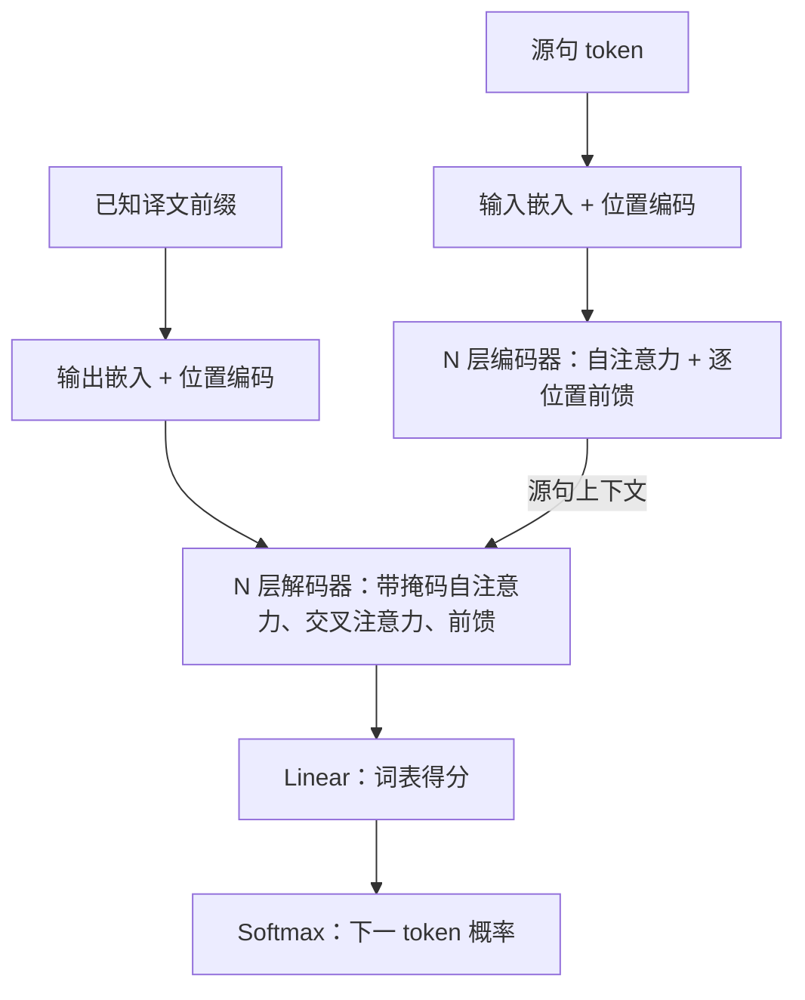

# Transformer · 注意力机制

%% learning-vault-navigation:v1 %%
> [!abstract]- 笔记导航
> 目录：[[Paper/README|论文阅读 · 索引]]
> 相关：[[Paper/AN IMAGE IS WORTH 16X16 WORDS/ViT|ViT · 视觉 Transformer]] · [[Paper/BERT Pre-training of Deep Bidirectional Transformers for/BERT|BERT · 语言表示预训练]] · [[ai-research-weekly|AI 研究与论文阅读周报]]

# First Time

## 1.Abstract
问题：当时占据主流的序列转换模型主要基于包含编码器和解码器的复制循环和卷积神经网络
动机：作者注意到表现最好的模型通过注意力机制将编码器和解码器连接起来
**方法**：**Transformer** 完全以注意力机制为基础，彻底取消了循环和卷积
结果：改善了翻译质量，并行计算能力更强，训练时间也减少

## 2.Conclusion
贡献：本文提出了 Transfomer，首个以注意力为基础的序列转换模型，以多头自注意力替代循环层
结果：对于翻译任务，与传统模型相比，Transformer 训练速度显著提升，并在两个翻译任务取得最佳
展望：扩展适用的数据类型，降低大规模输入的处理成本，生成过程中存在串行性

## 3.Figure & Table
#### Fig1:
箭头传递向量，沿着箭头向上走一层，不等于多生成一个词
**Left Panel：**
Inputs 放入源句
→ Input Embedding 每个词编号映射成向量
→ Positional Encoding 给各个位置提供不同位置信息，与词向量相加 ⊕
→ Multi-head Attention 让每个位置可以读取到其他位置的信息，词之间交流信息
→ Feed Forward 每个位置再加工自己的信息
⇒ 最后把源句各个位置的表示交给右边，此时还没有产生译文
**Right Panel：**
Outputs 放入已经知道的译文开头同一句原文，生成到不同位置时，要预测的内容不同
→ Output Embedding、Positional Encoding 和左边类似
→ 第一个 Masked Multi-Head Attention 整理当前允许看到的译文前缀
→ 第二个 Masked Multi-Head Attention 带着当前需求查源句注意左侧顶部有直达此处箭头 **交叉注意力**
→ Feed Forward 继续加工
→ Linear 给词表中的候选词打分，Softmax 把分数转成概率
Add & Norm：先相加再归一化，保留原信息，再整理数据
N 次重复： 整层重复堆叠
512：没份数字资料长度
#### Fig2:
Q（查询）、K（匹配线索）、V（内容）
**Left Panel：**
MatMul：矩阵乘法计算位置之间的匹配分数
Scale：除以 $\sqrt{ d_{k} }$ 控制尺度
Mask：掩码作用
SoftMax：汇总信息分配权重
MatMul：按权重
即
$$
 \boxed{ \operatorname{Attention}(Q,K,V) = \operatorname{softmax} \left(\frac{QK^\top}{\sqrt{d_k}}+M\right)V } 
$$
**Right Panel：**
底部的 Q、K、V 经过各头独立的 Linear 投影
然后每个头分别完成左图的计算，处理完完整的序列
使用自己的投影和注意力权重 Concat 沿特征维度拼接结果，最后经过一次 Linear
#### Table1:
结构与复杂度分析表，

| 列名                    | 比较内容                  |
| --------------------- | --------------------- |
| Complexity per Layer  | 这一层大约需要多少计算？          |
| Sequential Operations | 沿序列位置，有多少步骤必须先后进行？    |
| Maximum Path Length   | 最远的位置之间，信息传递要经过多长的路径？ |
#### Table2:
Transformer 的翻译质量和成本
两次翻译任务质量上都有提升，且成本大幅降低
#### Table3:
考察各项设计对结果的影响
PPL：开发集困惑度，通常越低越好
BLEU：开发集翻译成绩，通常越高越好
- A 头数：
	- 多头比单头好
	- 头数过多也没有持续收益
- B 匹配向量维度：
	- 随着 Q、K 的匹配空间变小，成绩下降
- C 
	- 层数：太浅会损失效果，但更深没有持续提升
	- 模型宽度：增加模型宽度有帮助
	- 前馈宽度：提升前馈网络的容量有帮助
- D
	- dropout：去掉、继续增大后 BLEU 降低 → 使用适度 dropout
	- 标签平滑：没有标签平滑时，PPL 更好，最终翻译的 BLEU 却更差
- E 正弦位置编码：
	- 问题：这组实验两者表现接近。对于 0.1 BLEU 这样的差异，表中没有多次训练结果和误差范围，不能据此断定一种方式稳定优于另一种
# Second Time

## 1.Introduction & Background
交代主流方法（[RNN](https://www.ibm.com/think/topics/recurrent-neural-networks)）；指出结构上的限制 $(h)_{t}=f(h_{t-1},x_{t})$；寻找已有突破口（注意力机制）；提出 **Transformer**
Bg 主要划定了 Transformer 的创新点

## 2.Model Architecture

图中合并各层的残差与归一化细节；N 表示深度堆叠次数，译文前缀的增长属于生成过程。

## 3.Encoder and Decoder
编码器每层有两类子层：自注意力 → 前馈网络
解码器每层有三类子层：带掩码的自注意力 → 查询编码器输出的注意力 → 前馈网络

## 4.Attention
计算匹配分数  → 转成权重  → 汇总内容
$$
 \boxed{ \operatorname{Attention}(Q,K,V) = \operatorname{softmax} \left(\frac{QK^\top}{\sqrt{d_k}}+M\right)V } 
$$
(+M 原文公式中并没有，但是其起到的是原文中 masked 的作用)

## 5.Position-wise Feed-Forward Networks
每个位置分别经过两次线性变换，中间使用 ReLU 加工各位置自身特征，并在同一层不同位置共享整套参数。类似于单隐藏层的 MLP

## 6.Embeddings and Softmax
入口把 token 编号变成向量；出口把解码器向量变成词表中的下一 token 概率
**token 编号 → 向量表示 → 经过多层加工的向量 → 词表概率**

## 7.Positional Encoding
把不同频率的正弦、余弦编码加到词嵌入上

## 8.Why Self-Attention

| 比较维度   | 关注问题                |
| ------ | ------------------- |
| 每层计算量  | 需要做多少运算？            |
| 串行操作量  | 有多少步骤须先后进行？         |
| 最大路径长度 | 两个远处位置交流信息，需要多长的路径？ |

全注意力核心计算量为 $O(n^2d)$。
**自注意力缩短了传播路径，也付出了计算大量位置关系的成本**

# Overall Review

- **贡献：** 用注意力组成序列转换模型，以多头自注意力取代循环和卷积主体。
- **优点：** 表示计算具有更强的并行性；自注意力缩短远距离位置之间的信息传播路径。
- **不足：** 全注意力计算成本随序列长度平方增长，生成过程仍有串行性；小幅 BLEU 差异缺少多次运行与误差范围支持。
- **定位：** 继承编码器—解码器与注意力思路，重新组织序列模型的主体结构。
- **延伸（待验证）：** 在固定数据与预算下比较不同注意力头数，检验容量、效率和翻译质量之间的关系。
- **适合：** 希望理解编码器、解码器、自注意力与交叉注意力信息流的读者。
