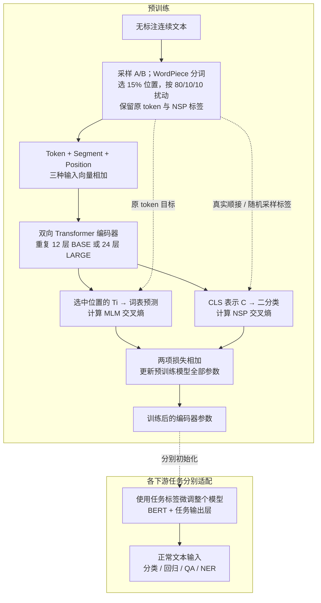

# BERT: Pre-training of Deep Bidirectional Transformers for Language Understanding

# First Time

## 1.Abstract
- **问题：** 如何学习能迁移到多种语言理解任务的深层双向表示？
- **动机：** 单向语言模型限制右侧上下文的使用；分别计算两个方向再组合，也未在各层联合融合两边的信息。
- **方法：** 用 MLM＋NSP 预训练 Transformer 编码器，再加任务输出层并微调整个模型。
- **结果：** 作者报告 11 个任务的当时最佳结果；GLUE 官方综合分数 80.5，MNLI-m Test 准确率 86.7%；问答结果需区分额外数据与集成设置。
- **意义：** 以共用的预训练起点适配句子级和位置级任务，减少复杂任务专用主体架构的需要。

## 2.Conclusion
- **贡献：** 将语言模型预训练的迁移收益扩展到深层双向编码器（§6）。
- **结果：** 多任务评测与消融支持这套方案；不同任务分别微调，所得参数并不相同。
- **展望：** 原结论未列具体未来工作；本笔记中的延伸均为待验证设想。

## 3.Figure & Table
#### Fig1:
- MLM 与 NSP 共用编码器；预训练参数分别初始化各任务，微调更新整网。
#### Fig2:
- Token、Segment、Position embedding 逐元素相加，隐藏维度不变。
#### Table1:
- GLUE 表内平均分 BASE 79.6、LARGE 82.1；排除 WNLI，口径不同于官方 80.5。CoLA 为 Matthews 相关系数，不是准确率。
#### Table2:
- SQuAD 1.1 Test F1 93.2，比 nlnet 集成高 1.5 分；包含 TriviaQA 微调与 7 模型集成。单模型＋TriviaQA 为 91.8。
#### Table3:
- SQuAD 2.0 单模型 Test F1 83.1，比此前最佳单模型高 5.1 分；未用 TriviaQA，人工为 89.5。
#### Table4:
- SWAG LARGE Test 准确率 86.3%，比 GPT 高 8.3 个百分点；人工结果只评估 100 个样本。
#### Table5:
- 去掉 NSP，QNLI Dev 准确率 88.4→84.9；同样无 NSP 时，双向 MLM 与 LTR 的 SQuAD Dev F1 为 87.9、77.8。此表 MRPC 用准确率。
#### Table6:
- 所列配置增加深度、宽度等后，下游准确率改善、同口径 MLM ppl 降低；下游分数平均 5 次随机微调重启。
#### Table7:
- 冻结 BASE、拼接最后四层的 NER Dev F1 96.1，整体微调为 96.4；差 0.3 分只在 Dev 上。LARGE Test 92.8 低于 CSE 93.1。
#### Fig3:
- BERT 各层联合利用左右信息；GPT 从左到右；ELMo 分别编码两方向再组合特征。
#### Fig4:
- 单句/句对任务使用 C，问答/序列标注使用各位置的 Ti；STS-B 是回归，SWAG 对候选句对分别打分。
#### Fig5:
- 预训练检查点先微调，再测 MNLI Dev；100 万步相对 50 万步增加接近 1 个百分点。
#### Table8:
- 默认 80/10/10 并非每列最佳；全部用 MASK 时，冻结特征 NER Dev F1 从 94.9 降到 94.0。比例只针对选中的预测位置。
# Second Time

## 1.Introduction / Related Work
原文位置或顺序说明：§1–2。
- 研究缺口是如何训练深层双向、可整体微调的表示。普通单向 LM 只利用一个方向；完整暴露目标词又会造成答案泄露。
- 继承 Transformer 编码器和预训练后微调范式；相对 ELMo 改变双向信息融合方式，相对早期 GPT 改变目标与注意力约束。

## 2.BERT Inputs and Outputs
原文位置或顺序说明：§3。
- BASE：L/H/A＝12/768/12，110M 参数；LARGE：24/1024/16，340M 参数。
- 输入为 `[CLS] A [SEP] B [SEP]`，采用约 3 万 token 的 WordPiece 词表；文中的 sentence 可指连续文本片段。
- 输入向量为 $E_i=E_i^{\mathrm{token}}+E_i^{\mathrm{segment}}+E_i^{\mathrm{position}}$
- 输入 ID 形状为 `[b,n]`，编码后为 `[b,n,H]`；$T_i$ 是位置表示，$C$ 是 `[CLS]` 的最终表示。

## 3.Pre-training BERT
原文位置或顺序说明：§3.1。
- **MLM：** 选 15% 的 WordPiece 位置；其中 80% 换成 MASK、10% 随机替换、10% 保持原样。均预测原 token，仅在选中位置计算预测损失。
$$
\mathcal L_{\mathrm{MLM}}=-\frac{1}{|M|}\sum_{i\in M}\log p_\theta(x_i\mid\widetilde x)
$$
$M$ 为选中位置，$x_i$ 为原 token，$\widetilde x$ 为扰动后的输入；这是将原文交叉熵描述写成便于理解的记号。
- **NSP：** 50% 为原文真实后续片段，50% 随机抽取；用 C 判断 IsNext/NotNext。原文脚注 6 提醒，未微调的 C 不能直接视为通用句向量。
- **数据：** BooksCorpus 8 亿 words＋英文 Wikipedia 25 亿 words，保留文档连续性。
- **预训练目标：** $\mathcal L_{\mathrm{pre}}=\mathcal L_{\mathrm{MLM}}+\mathcal L_{\mathrm{NSP}}$。NSP 使用二分类交叉熵；两项在批次中取平均后相加（A.2）。

图合并了输出头内部变换，省略残差连接、层归一化与冻结特征分支；虚线标注监督目标或参数初始化。层数表示网络深度，并非生成时间步骤。

## 4.Fine-tuning BERT
原文位置或顺序说明：§3.2。
- 两段文本联合编码，使编码过程同时包含片段间信息交互；分类/回归使用 $C$，问答起止位置与序列标签使用 $T_i$。
- 从预训练参数初始化，新增任务输出层，利用任务标签更新整网；下游预测通常使用正常文本。

# Overall Review

- **贡献：** 深层双向 MLM 预训练，以及用统一编码器和少量输出参数迁移到广泛任务。
- **优点：** 多任务结果和消融互相支撑；扩大充分预训练的模型也改善小数据任务，冻结特征仍有竞争力。
- **不足：** 原文承认 MASK 分布差异、小数据微调不稳定；LARGE 用 64 个 TPU 芯片训练 4 天（A.2），输入长度至多 512 token。本轮分析认为消融支持组合方案，不能把全部收益归因于单一变化；结论仍受英语任务范围限制。
- **定位：** 承接上下文表示、Transformer 和整体微调研究；本文新增价值在预训练设计及系统实证。
- **延伸（待验证）：** 固定语料、模型和训练 token 预算，比较 MLM 与 MLM＋NSP 在句对任务上的多随机种子均值和方差，检验收益是否稳定。
- **适合：** 已了解注意力、Transformer、交叉熵与基本训练流程，希望学习预训练目标设计和消融分析的读者。本轮完成阅读，未执行实验复现。
