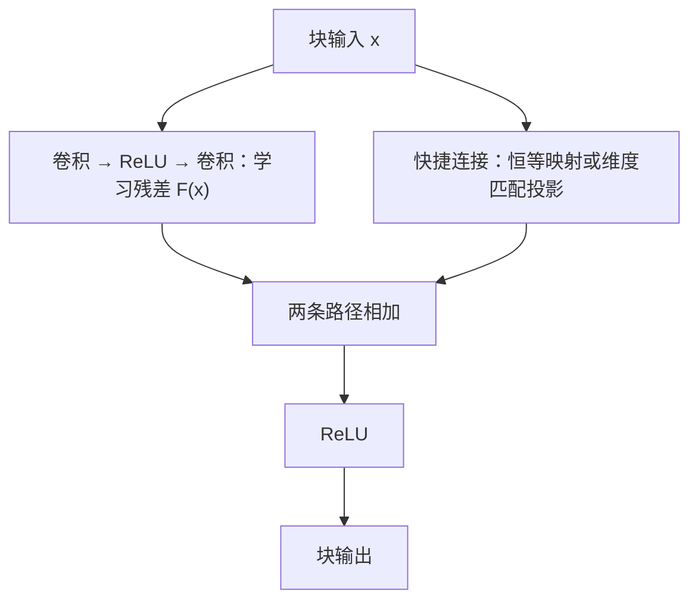

# First Time

## 1.Abstract
问题：如何让神经网络从不断的“加深“中获益
动机：需要改善深层神经网络可训练性
**方法：**残差学习框架**：以其输入为参照学习残差函数，而不是直接学习没有显式参照的函数
结果：这些残差网络组成的**集成模型**在 ImageNet 测试集上取得了 <u>3.57% </u>的错误率
意义：残差网络可以达到层数更多，但是计算复杂度反而更低的效果

## 2.Conclusion
无

## 3.Figure & Table
#### Fig1:
CIFAR-10 上的普通网络，未加入残差
明显两张图中红线所代表的 56 层网络反而识别效果更差
	结论：在这里采用的结构和训练条件下，更深模型更难优化。
#### Fig2:
残差块的计算流程图
$x$ 被分到两条途径：
- ReLU 学习特征变换 $F(x)$
- **传递输入**："shortcut connections
块输出 $\mathrm{ReLU(F(x)+x)}$
#### Fig3:
三个网络：VGG-19、34-layer plain、34-layer residual
主要比较后两者其中后者每隔两层卷积层增加一条"shortcut connections"

| 空间尺寸          |  通道数  |
| ------------- | :---: |
| 56× 56 | 64  |
| 28× 28 | 128 |
| 14× 14 | 256 |
| 7× 7   | 512 |

即空间尺寸减半时通道数加倍
	结果：VGG-19：19.6 b FLOPs/ 34-layer 3.6 b FLOPs
#### Table1:
ResNet 的装配清单
其中，可以注意到 18、34 是每块两层卷积，50、101、152 是每块三层卷积，两者输出通道数量有变化
#### Fig4:
在 fig 1 的基础上加入了残差网络进行对照

| 普通网络                | 残差网络                     |
| ------------------- | ------------------------ |
| 34 层错误率高于 18 层，出现退化 | 34 层错误率低于 18 层，增加深度产生了收益 |
| 验证错误率高于训练错误率        | 验证错误率低于训练错误率             |

	结论：残差网络明显优于普通网络，快捷连接帮助模型获得了更好的训练结果
#### Table2:
以数据形式确认了 fig 4 的结论
#### Table3:
比较 A、B、C 三种快捷连接

| 方案  | 匹配维度   | 剩余余快捷连接 | 结果              |
| --- | ------ | ------- | --------------- |
| A   | 下采样并补零 | 恒等连接    | 比 plain-34 明显改善 |
| B   | 使用投影   | 恒等连接    | 增益较小            |
| C   | 使用投影   | 使用投影    | 增益较小            |

结论：解决退化问题，不需要所有快捷连接都变成可学习投影
#### Fig5:
左侧是基础块，右侧是瓶颈块
瓶颈：通过通道压缩，让主要卷积在较少通道上工作
#### Table4:
比较单模型分类结果
注意：同一 ResNet 在 T3 和 T4 间的差别取决于测试方案的不同
#### Table5:
比较 ImageNet 测试集 Top-5 错误率
	边界条件：**模型集成、测试集、Top-5 错误率**
#### Table6:
CIFAR-10 测试结果
	结论：110 层之前，深度增加错误率下降；110 层之后，参数量大幅增加，错误率却上升
#### Fig6:
左图：普通网络，表现为更深网络的训练与测试表现整体变差
中图：残差网络，表现为深层残差网络降低训练错误率，并获得较好的测试结果
右图：两者训练错误率都很低，但 1202 层的测试错误率比 110 层的高
	结论：残差结构改善可训练性以后，模型仍然需要面对**泛化问题**
#### Fig7:
纵轴：每个卷积层输出响应的**标准差**（卷积之后、[BN](https://proceedings.mlr.press/v37/ioffe15) 之后、ReLU 或相加之前）
上图：按照网络中原来的层次顺序排列
下图：每条网络按自己标准差**从大到小**排序，其不再表示由浅入深的网络位置
	结论：残差网络的层响应标准差总体较小，更深的残差网络中，许多层的响应幅度更小
#### Table7:
ResNet 较 VGG 在检测框架为基线 Faster R-CNN 下都有提升
	结论：ResNet 学到的特征不仅能服务于整图分类，也可以帮助识别和定位图片中的物体
#### Table8:
COCO 提升 28%
- mAP@0.5：在 IoU 阈值 0.5 下计算。
- mAP@\[0.5,0.95\]：综合 0.50、0.55、……、0.95 这十个阈值，**不是只平均两个端点**。
# Second Time

## 1.Introduction
问题：即使信号和梯度能正常传播，深层网络仍可能训练不好
动机：网络加深后，训练错误率也升高
核心方法：假设某几层实现的变换为 $H(x)$。普通结构让这些层直接学习 $H(x)$。作者通过快捷连接实现 $H(x)=F(x)+x$。**卷积层学习 $F(x)$，输入 $x$ 则通过另一条路径直接传递**。

## 2.Related Work
两条线 残差表示和快捷连接

| 已有基础                       | 本文进一步做的事情         |
| -------------------------- | ----------------- |
| 残差表达有时更有效                  | 将残差定义为相对于模块输入的修正  |
| 快捷连接可以帮助信息传播与训练            | 用恒等快捷连接实现残差**相加** |
| 已有带门控的深层网络（HighwayNetwork） | 采用简单的无门控恒等路径      |

## 3.Deep Residual Learning
搭建残差神经网络的两种方案
- 下采样，增加的通道零填充
- 使用 $1\times 1$ 投影卷积
训练设置
1. 随机调整图片尺度
2. 随机裁出 $224\times 224$ 区域
3. 使用水平翻转和颜色增强
4. 减去像素均值

图示为基本残差块，省略 BN、具体通道数与步幅；瓶颈块的卷积结构不同。

## 4.Experiment
## 5.ImageNet Classification
1. 证明普通网络确实存在退化
2. 加入残差连接，检查情况是否改变
3. 不必使用可学习的投影连接
4. 瓶颈设计，网络持续加深，控制计算成本

## 6.CIFAR-10 and Analysis
进一步研究极深网络行为
重复基本实验，分析各层输出
进一步探索千层网络，出现过拟合

## 7.Object Detection
借此说明：残差网络学到的特征具有迁移价值，能够帮助需要识别类别和定位物体的任务

# Overall Review

- **贡献：** 以输入为参照学习残差，并用快捷连接改善深层网络的可训练性。
- **优点：** 普通网络与残差网络的对照、快捷连接比较和检测迁移结果共同支持该设计。
- **不足：** 改善优化不等于保证泛化；千层网络存在过拟合，分类结果还需区分单模型、集成和测试方案。
- **定位：** 延续残差表示与快捷连接研究，通过无门控的恒等路径实现残差相加。
- **延伸（待验证）：** 在相同预算下比较深度与宽度，检查优化收益是否能转化为稳定的测试收益。
- **适合：** 已了解卷积网络，想理解深度、优化与泛化之间区别的读者。
