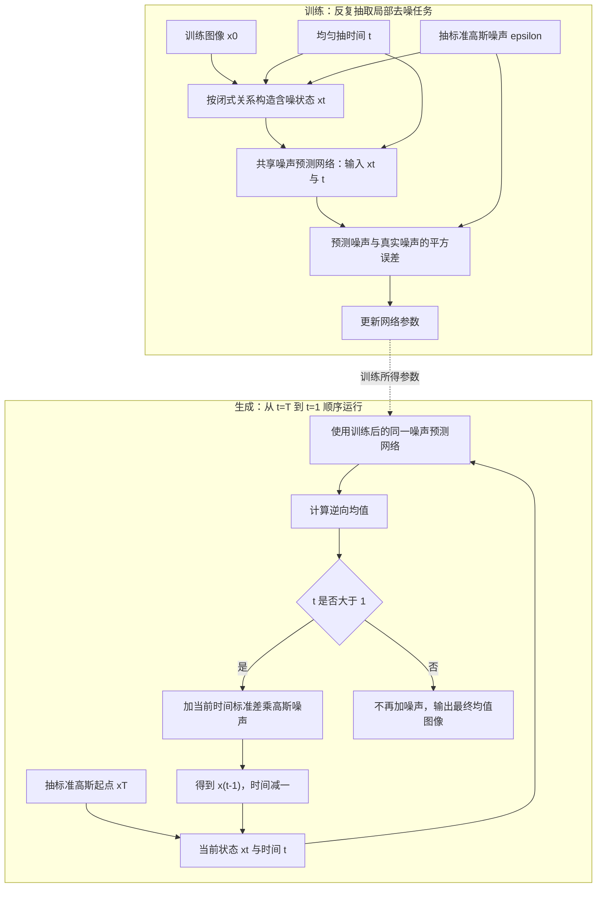

# Denoising Diffusion Probabilistic Models

# First Time

## 1.Title & Authors
原题为 Denoising Diffusion Probabilistic Models，自然中文译法是“去噪扩散概率模型”，通常简称 DDPM。标题指向一类生成模型及其训练方式，研究对象是数据的概率分布；本文主要以图像合成为验证任务。
“Denoising”是去噪：模型接收受到噪声污染的图像，学习如何向更低噪声的状态迈进一步。它既描述训练信号，也帮助理解生成过程，但本文的核心任务不是给定一张受损照片后恢复其唯一原图，而是从随机噪声出发合成新的图像。
“Diffusion”是扩散：正向过程逐步向数据加入小量高斯噪声，使图像中的信号逐渐消失。生成时沿相反方向，反复使用学到的转移规则。这里的扩散来自概率过程与非平衡热力学的启发，不应直接当作物理空间中物质扩散的数值模拟。
“Probabilistic Models”强调概率建模：模型定义由一串随机状态构成的联合分布，并通过对中间状态积分得到图像分布。中间状态是潜变量，具有与图像相同的维数，不一定是压缩后的低维语义向量。标题本身没有承诺生成过程是确定的，也没有声称提出第一个扩散模型。
标题表达的核心方法主张：通过学习逐步逆转加噪过程，构造能够生成高质量图像的概率模型。本文的关键推进还包括具体的参数化、训练目标，以及与已有概率建模思想的联系，而不只是“把噪声去掉”这一句话。Introduction 明确将工作放在已有扩散概率模型的基础上。
作者按原文署名顺序为 Jonathan Ho、Ajay Jain、Pieter Abbeel，论文中三人的机构均列为 UC Berkeley。题名处没有标注共同第一作者、等贡献或随机署名，本文也未提供可据此分配个人任务的作者贡献说明，因此不从署名顺序推断谁完成了某个模块。
与本文相关、可直接核实的研究背景是：Jonathan Ho 与 Pieter Abbeel 也是原文参考文献 [23] Flow++ 的共同作者，该工作研究基于流的生成模型；Pieter Abbeel 还是参考文献 [6] PixelSNAIL 的共同作者，该工作研究自回归生成模型。这些信息有助于理解本文为何比较不同生成建模路线，不能据此推断他们在 DDPM 中的个人分工。这里不补充未经核实的现任职位或个人经历。

## 2.Abstract
摘要的论证顺序是：先宣布扩散模型能够高质量合成图像，再说明带来最好结果的训练设计及其理论联系，接着用数据集与指标支撑主张，最后说明实现可用。以下按原文语义顺序展开，不把摘要缩成几个结论标签。
语义单元一：用扩散概率模型获得高质量图像合成结果。这是任务与主要结果的总述。“图像合成”在这里是生成新的图像样本；“高质量”随后由样本展示、Inception Score 和 FID 等证据具体化。作者把扩散模型称为受非平衡热力学启发的一类潜变量模型，说明方法的来源与数学类别。热力学提供了逐步破坏结构再学习逆过程的出发点，并不意味着模型直接求解了一个物理系统。
理解这一句时，可以先建立最少量的符号直觉：$x_0$ 是数据图像，$x_t$ 是某个噪声程度下的中间状态，$x_T$ 接近纯噪声。模型要学的是从高噪声状态返回低噪声状态的规则。摘要暂时没有展开其具体分布和推导，这些属于后续正文精读。
语义单元二：最好结果来自一个经过加权的变分界。这句话从“能生成”转向“怎样训练才生成得好”。变分方法用可计算的目标约束难以直接计算的概率量；在本文记号里，式 (3) 是负对数似然的上界，等价地也可以从对数似然下界的角度理解。两种说法的方向取决于是否带负号，不能混淆。
“加权”意味着不同噪声阶段的学习任务获得不同的相对权重。摘要没有声称任何加权都有效；它指的是本文依据特定联系设计、并由实验检验的目标。正文式 (14) 的简化噪声预测损失在实现上没有显式的时间权重，但相对于原始变分目标，它改变了各时间项的相对重视程度。因此“简单均方误差”和“重新加权变分目标”并不矛盾。
必须保留的区别：样本看起来更好、生成样本的统计指标更好，与给真实数据分配更高似然，是不同目标。Introduction 和 Section 4.1 明确指出，本文最好的样本质量不意味着获得最有竞争力的对数似然。摘要中的“最好结果”在这里主要指生成质量，不能读成所有评价标准都最好。
语义单元三：训练设计来自扩散模型与去噪得分匹配、Langevin dynamics 的新联系。这里的 score 不是图像质量评分，而是某个噪声水平下对数概率密度关于输入的梯度，即 $\nabla_{x_t}\log q_t(x_t)$。它给出局部提高该噪声分布密度的方向；去噪得分匹配则通过人为构造的含噪样本学习相关信息。
Langevin dynamics 可以先理解为“沿密度梯度调整，再加入随机扰动”的采样思想。本文通过特定的噪声预测参数化，把扩散模型的训练目标与去噪得分匹配联系起来，并让其逆向采样呈现类似 Langevin dynamics 的形式。原文在具体论证中使用“resembles”等限定，不能把 DDPM 的每个采样更新无条件视为任意标准 Langevin 算法，也不能把任意去噪网络都视为一个已经定义完整似然的扩散模型。相关定位是 Section 3.2 与式 (11)、式 (12)。
语义单元四：模型自然支持渐进式有损解压，并可被理解为自回归解码的一种推广。这仍是摘要第二句的内容，但承担另一项贡献：解释模型怎样组织信息。所谓“渐进”，是接收的信息逐步增加时，对图像的重建也逐步改善；“有损”允许遗漏一部分细节。本文观察到生成过程中大尺度结构先显现，细节随后补全，因此它可以从信息逐步恢复的角度理解。
自回归模型通常按某个坐标或符号顺序逐项生成。本文讨论了一种特殊的逐坐标掩蔽过程，说明它可以恢复自回归建模；高斯扩散则提供更一般的信息恢复顺序。这不是说 DDPM 实现中一定逐像素生成，而是从概率分解与解码顺序角度建立联系。论证定位为 Section 4.3 与式 (16)。
压缩主张的边界：论文提供了压缩解释和率失真分析；附录的 Extra information 也说明相关发送、接收算法尚不是面向高维数据的实用压缩系统。不能把摘要读成本文已经交付一个可直接替换现有图像编解码器的产品。此处只是核对摘要主张的适用范围，尚未展开附录阅读。
语义单元五：在无条件 CIFAR10 上，Inception Score 为 9.46，FID 为 3.17。这是摘要中最明确的量化证据。“无条件”表示采样时不输入目标类别标签；训练图像仍包含不同类别，只是模型生成时没有被指定“画某一类”。它不等于模型从未学习过图像的类别结构。
Inception Score 通常越高越好，它综合反映预训练分类器对单个样本的判断集中程度及样本集合的类别覆盖。FID 通常越低越好，它比较生成样本与真实样本在特征空间中的分布统计。两个指标都依赖特征提取器和计算协议，不是对所有视觉属性的直接测量，也不能单靠一个数证明没有记忆训练图像。Table 1 给出的本文简化目标对应 IS 为 $9.46\pm0.11$；摘要只保留中心值 9.46。
“state-of-the-art”应放回论文当时的比较范围理解。Table 1 区分有条件与无条件结果，不能据此宣称 FID 3.17 优于其中每一个有条件方法。Section 4.1 还说明，3.17 是相对训练集计算的 FID；改为相对测试集时得到 5.24。比较 FID 时必须保留参照数据集和协议。不能把不同参照集的数值直接当成同一条件下的优劣比较。
语义单元六：在 $256\times256$ 的 LSUN 上，获得与 ProgressiveGAN 相近的样本质量。这里补充了更高分辨率的图像证据。LSUN 是数据集名称，$256\times256$ 是图像空间分辨率，ProgressiveGAN 是作者选用的生成模型参照。原文用“similar”而非全面优于，不能将其扩写为“在全部 LSUN 场景、全部指标和全部分辨率上超过 GAN”。这句话也不涉及现代文本提示生成能力。
语义单元七：作者公开了实现。这是可复现性与可访问性的说明，而不是额外的性能证据。本轮阅读以用户提供的 PDF 为依据，没有运行代码或复现实验，因此不能据此声称指标已经由本次阅读复现。
四要素提炼如下。

| 要素 | 从摘要与必要正文核对中得到的内容 |
| --- | --- |
| 问题 | 扩散概率模型能否成为高质量图像生成方法，以及什么参数化与训练目标能够发挥它的能力。已有扩散模型并非本文首次提出。 |
| 方法 | 学习逆转逐步高斯加噪的概率过程；通过噪声预测建立与去噪得分匹配、类似 Langevin 的采样之间的联系；使用改变时间项相对权重的训练目标。 |
| 结果 | 无条件 CIFAR10 的 IS 为 9.46、相对训练集的 FID 为 3.17；在 $256\times256$ LSUN 上展示与 ProgressiveGAN 相近的样本质量。 |
| 意义 | 作者展示扩散模型在图像生成上的实用潜力，并用渐进解码把生成、概率推断和有损压缩联系起来；后两者的联系不等于已经完成实用编解码系统。 |

摘要读完后应抓住的主线是：本文不只展示“噪声能变成图像”，还解释了怎样通过噪声预测训练逆过程，以及为什么这种训练可以接上已有的概率建模思想。

## 3.Conclusion
原文有独立的 Section 6 Conclusion，正文为一个自然段，包含两句。第一句回顾已完成的结果与联系，第二句提出基于图像表现的研究展望。以下按该段内部的论点解释。
论点一：用扩散模型获得高质量图像。结论的第一部分回到摘要的首要实证主张。它由本文的样本展示、CIFAR10 指标以及相关消融支撑，说明这种模型在所研究的图像任务上能够产生有竞争力的样本。它没有证明对所有数据类型、所有分辨率和所有计算预算都成立，也没有将高样本质量转换成“似然最优”的结论。回看位置为 Section 4.1、Table 1 与 Table 2。
论点二：扩散模型与“用变分推断训练马尔可夫链”存在联系。马尔可夫链的下一状态只需依赖当前状态；这里学的是一系列从噪声向数据靠近的转移。变分推断提供一个训练这些转移的可计算目标。重要之处是训练目标和生成过程属于同一个概率模型，而不只是先训练一个独立图像处理器，再临时重复调用它。对应基础是 Section 2 与式 (3)、式 (5)。
论点三：与去噪得分匹配、退火 Langevin dynamics 相联系，并进一步关联能量模型。作者在结论中把这些概念串在一起，不是在声称本文首次提出了其中所有方法。去噪得分匹配提供从含噪数据学习分布梯度信息的角度；不同噪声程度的逆向更新提供类似退火采样的角度；得分与能量函数梯度的已知关系又把讨论延伸到能量模型。这条联系有特定参数化与目标形式作为前提，不应把若干模型名称之间的关联读成所有实现都完全相同。回看位置为 Section 3.2 与 Section 5。
论点四：与自回归模型、渐进式有损压缩相联系。这一部分解释的是生成过程中信息被恢复的次序，而不仅是一次最终采样的质量。高斯扩散让不同尺度的信息在一系列状态中逐渐恢复；作者又通过特殊的掩蔽扩散构造，说明自回归生成可以置于相关框架中。支持来自 Section 4.3 的概率论证、率失真分析和渐进生成观察。它不等于每个时间步天然对应一个固定、可命名且相互独立的语义属性；“先结构、后细节”是实验观察及相应解释，不应升级为严格的语义解耦定理。
论点五：图像结果提示了有利的归纳偏置。归纳偏置指模型结构、噪声过程、参数化和目标所带来的学习倾向：某些规律更容易被学到，某些细节则受到不同程度的重视。本文的图像质量与渐进恢复现象让作者认为这种偏置对图像有益。原文使用“seem”，表明这是一种基于结果的解释；并未在结论中证明高斯扩散在所有图像分布上都比其他过程更合适。
论点六：未来研究其他数据模态，以及将扩散模型作为其他生成模型或机器学习系统的组件。这是结论第二句的展望，不能读成本文已经验证语音、文本、音乐或任意多模态任务。本文的直接实验重心仍是图像。组件化使用同样是未来方向，结论没有提供任意下游系统都能受益的保证。
结论与摘要一致性：两者都强调高质量图像、得分匹配及 Langevin 联系、渐进解码等主线。结论把变分训练马尔可夫链和能量模型联系说得更集中，但没有报告新的指标或新增实验。它没有独立列出系统性的限制清单，因此不能把讲解者的批评伪装成作者在这一段明说的限制。
需要结合前文保留的实际边界：Introduction 明说对数似然尚不如一些其他似然型模型有竞争力；Section 4.1 区分了样本质量与码长方面的目标；压缩论证也不等于交付了实用压缩系统。这些限定使我们能够准确理解 Conclusion 的“高质量”与“联系”，而不把论文概括成所有方面都已占优。

## 4.Intuitive Analogy
可以把任务想象成培养一位“懂得画面规律的修复师”。训练时，给他看很多完整图片，再人为把图片污染成不同程度的噪声图；对每种污染程度，告诉他这次加入的噪声，让他学习从眼前的含噪画面中估计污染成分。这样，他学到的是跨许多图片和许多噪声水平共享的规律。
生成时，先交给他一张纯噪声画布，再反复让他做小幅调整，并按规则保留随机性。画面大体结构逐渐显现，之后细节更清晰。这对应本文用很多小的随机逆向转移，从先验噪声构造新的图像样本，而不是一次性从噪声中猜出完整图片。
训练目标的加权可以类比成安排练习时间：如果训练过分集中在轻微污染和极细小修补上，某些与最终视觉质量更相关的困难任务就可能没有获得合适的相对重视。本文通过特定目标重新安排不同噪声阶段的学习侧重，并用实验比较其效果。这个类比说明“重视哪些训练误差”会影响结果，不能据此推出任何手工加权都更好。
渐进解码则像先拿到画面的概貌，再逐渐取得更细的信息；不必把像素按从左到右的固定顺序逐个画完。这帮助理解本文与自回归解码之间的联系。最终得到更自然的图片，对应本文展示的生成质量；这不表示修复师可以找回每张噪声图背后唯一的真实照片。
类比的适用边界：网络没有人类修复师的知识或意图。高噪声状态通常对应许多可能的原图，模型学习的是概率规律，逆过程也具有随机性。生成并非把某张训练图的加噪轨迹逐步原样倒放；本文的标准生成设置也不需要文字提示或类别标签。关于目标函数、后验分布和采样更新的精确解释，仍须依赖正文数学。

# Second Time

## 1.Notation & Parameters
下面是理解主线所需的重点符号，而非全文符号索引。图像可展平为 $D$ 维向量；分布的条件参数与随机变量须区分，正向过程和逆向过程也不能互换。

| 符号/参数                                       | 含义与作用                | 关键设定/约束                                                                           |
| ------------------------------------------- | -------------------- | --------------------------------------------------------------------------------- |
| $x_0$、$q(x_0)$                              | 原始数据及其真实数据分布         | 图像整数像素由 $\{0,\ldots,255\}$ 线性缩放到 $[-1,1]$。                                        |
| $x_t$、$x_{1:T}$                             | 噪声程度为 $t$ 的状态及全部中间状态 | 与 $x_0$ 同维；正向 $t$ 增大，生成时 $t$ 减小。                                                  |
| $t$、$T$                                     | 时间索引、总扩散步数           | 本文实验 $T=1000$；训练均匀抽取 $t\in\{1,\ldots,T\}$。                                        |
| $\beta_t$                                   | 正向单步加噪方差             | $0<\beta_t<1$；实验线性递增，从 $10^{-4}$ 到 $0.02$，固定不学习。                                  |
| $\alpha_t$、$\bar\alpha_t$                   | 单步信号保留系数及其累计乘积       | $\alpha_t=1-\beta_t$，$\bar\alpha_t=\prod_{s=1}^t\alpha_s$；推导中约定 $\bar\alpha_0=1$。 |
| $q(x_t\mid x_{t-1})$、$q(x_t\mid x_0)$       | 正向单步转移与累计加噪分布        | 均为已知高斯分布；后者可直接采样，避免逐步模拟整条正向链。                                                     |
| $q(x_{t-1}\mid x_t,x_0)$                    | 给定原图后的正向后验           | 可解析计算，作为训练逆向转移的参照；生成时原图未知。                                                        |
| $\tilde\mu_t$、$\tilde\beta_t$               | 上述后验的均值与标量方差         | 由噪声日程与 $x_t,x_0$ 决定，不是另一个神经网络。                                                    |
| $p(x_T)$                                    | 逆向过程起点的先验            | 标准高斯 $\mathcal N(0,I)$；与正向终点分布近似而非严格相同。                                           |
| $p_\theta(x_{t-1}\mid x_t)$、$p_\theta(x_0)$ | 学习的逆向转移与最终生成分布       | 逆向转移对内部步骤取高斯形式；最终离散数据解码另作处理。                                                      |
| $\mu_\theta$、$\Sigma_\theta$                | 神经网络决定的逆向均值与逆向协方差    | 本文主要设置 $\Sigma_\theta=\sigma_t^2I$；并不让网络自由预测全部协方差。                                |
| $\sigma_t^2$                                | 逆向采样方差               | 比较固定的 $\beta_t$ 或 $\tilde\beta_t$；最终输出时不再加采样噪声。                                   |
| $\epsilon$、$z$                              | 标准高斯随机量              | $\epsilon$ 用于构造训练样本；$z$ 用于逆向随机采样，算法在 $t=1$ 设 $z=0$。                               |
| $\epsilon_\theta(x_t,t)$、$\theta$           | 噪声预测网络及其可训练参数        | 输入含噪状态和时间，输出与图像同维；同一网络跨时间共享参数。                                                    |
| $L$、$L_T$、$L_{t-1}$、$L_0$                   | 负对数似然变分上界及其分项        | 终点先验匹配、各中间后验匹配、最终离散重建；$L$ 不是精确负对数似然。                                              |
| $L_{\mathrm{simple}}$                       | 简化噪声预测均方误差目标         | 改变各时间项相对于原始变分界的权重；不是数值上等于原始 $L$。                                                  |
| $D_{\mathrm{KL}}(q\Vert p)$                 | KL 散度，测量两个分布的不匹配     | 有方向；式 (5) 的条件分布均需在相同给定条件下比较。                                                      |
| $D$、$i$                                     | 数据维数与坐标索引            | 对 RGB 图像包含全部空间位置和颜色通道；用于离散解码乘积和 RMSE。                                             |
| $\hat x_0$                                  | 从某个 $x_t$ 预测的干净图像估计  | 式 (15)；区别于完整运行逆向随机链得到的样本。                                                         |
| $\lambda$                                   | 两张含噪图像的插值系数          | 通常在 $[0,1]$ 之间；Section 4.4 的印刷记号需结合正文语义核对。                                        |

其中 $\epsilon$ 是从原图直接构造某个噪声水平时的累计等效噪声，不应总理解成正向链最后一步单独加入的那份噪声。$\tilde\mu_t$ 依赖已知原图，而 $\mu_\theta$ 只能从当前含噪图和时间预测；两者可比较，但可用信息不同。

## 2.Introduction
原文 Section 1 先把问题放在深度生成模型的共同目标中：GAN、自回归模型、流、VAE、能量模型和得分匹配已经展示了良好样本，扩散模型也应接受“能否生成高质量样本”的直接检验。这不是从零发明逐步加噪，而是在已有扩散概率模型基础上，使一套具体设计达到有竞争力的视觉质量。
第一条论证链是：规定一个不断破坏数据的正向马尔可夫链，学习反向转移，从一个容易采样的噪声分布出发，经过有限次转移生成数据。所谓马尔可夫，只要求当前一步转移的输入状态足够，不要求连续两张状态图像具有相同语义。各时刻也不是各自独立的模型：后文让同一网络共享参数，再以时间条件区分噪声水平。
“正向加很小的高斯噪声，因此逆向可以采用高斯转移”需要带上条件。给定原图的训练后验确实是精确高斯；不提供原图的真实逆条件一般是混合分布，不必严格高斯。小步扩散使高斯逆向参数化成为合理建模选择，不能据此证明任何有限大步长下的逆条件都精确属于高斯族。方法章节将用可解析的训练后验，把这个问题变成具体可优化的损失。
第二条论证链是：噪声预测参数化把变分训练和多噪声水平的去噪得分匹配联系起来，并使逆向采样类似退火 Langevin dynamics。作者把这项联系视为主要贡献之一，因为它既提供解释，又引导实际实现；但最后仍需要消融验证这种参数化与目标组合的效果，不能只凭形式相似断言生成质量一定提高。对应证据见 [Table2 精读](#table2)。
第三条论证链从一个看似矛盾的现象出发：样本好看，但对数似然不如一些其他似然模型。作者借助有损压缩视角解释，模型为视觉上细微的差异花费了相当一部分码长；最终像素概率和人眼感受到的结构质量因此可能分离。这里应保留“作者提出的解释”与“已经证明的一般规律”的区别。相关分析位于原文 Section 4.3，不能因为它在 Experiments 之内就漏掉其中的方法论证。
本章连接的图表是 [Fig1 精读](#fig1) 与 [Fig2 精读](#fig2)：前者展示生成样本，后者给出两条方向相反的过程。整体贡献要沿“模型定义—训练参数化—样本证据—信息解释”理解，而不能只记住一个生成图片的演示。

## 3.Background
本节对应原文 Section 2，建立完整概率模型。先区分三种对象：数据分布 $q(x_0)$、人为指定的加噪条件分布 $q(x_{1:T}\mid x_0)$、带可训练参数的生成分布 $p_\theta(x_{0:T})$。它们共享状态变量，但描述不同的随机实验。以下补充展开原文省略的代数，不改变原式的建模假设。
无编号关系：图像边缘分布定义为
$$
p_\theta(x_0)=\int p_\theta(x_{0:T})\,dx_1\cdots dx_T.
$$
这是潜变量模型的边缘化定义，而不是可直接执行的生成算法。积分消去全部中间噪声状态；即使每个局部转移很简单，整个积分通常仍不可直接解析计算。训练数据满足 $x_0\sim q(x_0)$，这个真实分布未知，只能通过样本取期望或作经验估计。
式 (1)：逆向联合分布与高斯转移。
$$
p_\theta(x_{0:T})=p(x_T)\prod_{t=1}^{T}p_\theta(x_{t-1}\mid x_t),\qquad
p_\theta(x_{t-1}\mid x_t)=
\mathcal N\!\left(x_{t-1};\mu_\theta(x_t,t),\Sigma_\theta(x_t,t)\right).
$$
先从 $p(x_T)=\mathcal N(0,I)$ 采样，再从 $T$ 向 $1$ 依次采样。乘积书写顺序不意味着运行时先计算 $t=1$；它只是标量密度的乘法。链式概率规则结合逆向马尔可夫假设得到上述分解，因此“只依赖当前状态”是模型设计，不是由图像数据自动推出的性质。
式中的分号左侧是密度的自变量，右侧是均值、协方差。均值是 $D$ 维向量，协方差是 $D\times D$ 矩阵；后文主要限制为各向同性的时间相关方差。原文此处先用连续高斯写通用逆过程，Section 3.3 再为整数像素设置最终离散解码器。不能直接把连续密度值当作某个整数图像的概率质量。
式 (2)：正向联合条件分布与单步加噪。
$$
q(x_{1:T}\mid x_0)=\prod_{t=1}^{T}q(x_t\mid x_{t-1}),\qquad
q(x_t\mid x_{t-1})=
\mathcal N\!\left(x_t;\sqrt{1-\beta_t}\,x_{t-1},\beta_t I\right).
$$
该式是人为规定的扩散过程。等价采样写法为 $x_t=\sqrt{1-\beta_t}\,x_{t-1}+\sqrt{\beta_t}\,z_t$，其中各步 $z_t\sim\mathcal N(0,I)$ 相互独立。两个系数的平方和为 1；若输入已经服从标准高斯，这样的变换仍保持标准高斯。对普通图像，原有信号逐渐减弱、随机成分逐渐增加，而不是在完全不缩小信号的情况下无限累积方差。
无编号定义：令 $\alpha_t=1-\beta_t$、$\bar\alpha_t=\prod_{s=1}^t\alpha_s$。前者描述单步信号的方差比例，后者描述累计比例；信号振幅系数是 $\sqrt{\bar\alpha_t}$，不能把累计乘积误读为求和，也不能把振幅和方差系数混用。
式 (3)：负对数似然的变分上界。
$$
\mathbb E_{q(x_0)}[-\log p_\theta(x_0)]
\le
\mathbb E_{q(x_0)q(x_{1:T}\mid x_0)}
\left[-\log\frac{p_\theta(x_{0:T})}{q(x_{1:T}\mid x_0)}\right]
=
\mathbb E_q\left[-\log p(x_T)
-\sum_{t=1}^{T}\log\frac{p_\theta(x_{t-1}\mid x_t)}
{q(x_t\mid x_{t-1})}\right]
=L.
$$
推导起点是在边缘化积分中乘除已知的 $q(x_{1:T}\mid x_0)$，于是 $p_\theta(x_0)=\mathbb E_{q(x_{1:T}\mid x_0)}[p_\theta(x_{0:T})/q(x_{1:T}\mid x_0)]$。对凸函数 $-\log$ 使用 Jensen 不等式，得到每个给定原图上的上界；再对数据取期望。最后将式 (1)、式 (2) 的乘积分解代入，并用对数将乘积改成和，就得到原文右侧。
界的松紧也可精确表达：对固定 $x_0$，上界减去 $-\log p_\theta(x_0)$，恰好是 $D_{\mathrm{KL}}(q(x_{1:T}\mid x_0)\Vert p_\theta(x_{1:T}\mid x_0))$。KL 非负，所以方向正确；只有两条条件路径分布匹配时才取等号。因此优化变分界不是直接得到每张图像的精确似然。这里假定相关密度、条件分布及期望存在，并满足使用密度比所需的支持条件。
式 (4)：任意时刻可直接加噪。
$$
q(x_t\mid x_0)=
\mathcal N\!\left(x_t;\sqrt{\bar\alpha_t}\,x_0,(1-\bar\alpha_t)I\right).
$$
证明可用归纳。$t=1$ 时由 $\bar\alpha_1=\alpha_1$ 直接成立。若 $x_{t-1}\mid x_0$ 的均值为 $\sqrt{\bar\alpha_{t-1}}x_0$、方差为 $(1-\bar\alpha_{t-1})I$，经过式 (2)，新均值为 $\sqrt{\alpha_t\bar\alpha_{t-1}}x_0$，新方差为
$$
\left[\alpha_t(1-\bar\alpha_{t-1})+\beta_t\right]I
=\left[1-\alpha_t\bar\alpha_{t-1}\right]I
=(1-\bar\alpha_t)I.
$$
独立高斯线性组合仍为高斯，因此归纳成立。等价重参数化是 $x_t=\sqrt{\bar\alpha_t}x_0+\sqrt{1-\bar\alpha_t}\epsilon$，其中 $\epsilon\sim\mathcal N(0,I)$。这是直接抽取一个时刻的累计噪声，训练不需要先模拟前面全部时间步。$\bar\alpha_T$ 很小只说明信号很弱，不说明任何有限日程都严格产生与原图独立的标准高斯。
式 (5)：把路径损失重写为可解析的局部匹配。
$$
L=\mathbb E_q\!\left[
\underbrace{D_{\mathrm{KL}}\!\left(q(x_T\mid x_0)\Vert p(x_T)\right)}_{L_T}
+\sum_{t=2}^{T}
\underbrace{D_{\mathrm{KL}}\!\left(q(x_{t-1}\mid x_t,x_0)
\Vert p_\theta(x_{t-1}\mid x_t)\right)}_{L_{t-1}}
+\underbrace{\left[-\log p_\theta(x_0\mid x_1)\right]}_{L_0}
\right].
$$
详细变形：在给定原图时，把正向路径改写成反向条件分解
$$
q(x_{1:T}\mid x_0)=q(x_T\mid x_0)
\prod_{t=2}^{T}q(x_{t-1}\mid x_t,x_0).
$$
它来自 Bayes 规则及正向马尔可夫性质，可逐项展开验证。将其代入式 (3)：终点处出现 $\log q(x_T\mid x_0)-\log p(x_T)$；每个 $t>1$ 出现 $\log q(x_{t-1}\mid x_t,x_0)-\log p_\theta(x_{t-1}\mid x_t)$；最后只剩 $-\log p_\theta(x_0\mid x_1)$。对相应条件随机量积分，前两类正好是 KL，得到式 (5)。原文分项的下标有一位偏移：第 $t$ 次逆转对应 $L_{t-1}$，中间项从 $L_1$ 到 $L_{T-1}$，不要漏掉终点 $L_T$ 或把最终解码写成同一个连续 KL。
作用是把训练目标改成“已知后验与网络转移比较”。计算高斯 KL 时可以解析积分，减少不必要的 Monte Carlo 方差；但训练仍需抽数据、时间及噪声，并不意味着训练完全没有随机估计。
式 (6)、式 (7)：给定原图后的高斯后验及其参数。
$$
q(x_{t-1}\mid x_t,x_0)
=\mathcal N\!\left(x_{t-1};\tilde\mu_t(x_t,x_0),\tilde\beta_t I\right),
$$
$$
\tilde\mu_t(x_t,x_0)
=\frac{\sqrt{\bar\alpha_{t-1}}\beta_t}{1-\bar\alpha_t}x_0
+\frac{\sqrt{\alpha_t}(1-\bar\alpha_{t-1})}{1-\bar\alpha_t}x_t,
\qquad
\tilde\beta_t
=\frac{1-\bar\alpha_{t-1}}{1-\bar\alpha_t}\beta_t.
$$
这是 $t>1$ 时的精确条件后验，不是拟合近似。令临时变量 $y=x_{t-1}$、$r=1-\bar\alpha_{t-1}$、$m=\sqrt{\bar\alpha_{t-1}}x_0$。由 Bayes 规则，后验正比于 $q(x_t\mid y)q(y\mid x_0)$；由式 (2)、式 (4)，其负对数中与 $y$ 有关的部分是
$$
\frac{\|x_t-\sqrt{\alpha_t}y\|^2}{2\beta_t}
+\frac{\|y-m\|^2}{2r}.
$$
展开平方并配方，后验精度为 $\alpha_t/\beta_t+1/r$，所以方差为
$$
\left(\frac{\alpha_t}{\beta_t}+\frac1r\right)^{-1}
=\frac{\beta_t r}{\alpha_t r+\beta_t}
=\frac{\beta_t(1-\bar\alpha_{t-1})}{1-\bar\alpha_t}.
$$
均值等于该方差乘以线性项系数 $\sqrt{\alpha_t}x_t/\beta_t+m/r$。分别相乘，就得到式 (7) 的两个向量系数。每项都是标量乘 $D$ 维图像，结果维度一致；方差不依赖图像内容，是当前固定线性高斯前向过程的性质。
这里条件中的 $x_0$ 至关重要：训练时有原图，所以后验可算；生成时没有原图，必须由网络预测逆转移。若约定 $\bar\alpha_0=1$，则 $t=1$ 的后验方差形式上为零，这是给定原图后直接回到原图的退化条件分布，不能拿它作为需要正方差的高斯 KL 继续套式 (8)。这正是单独处理 $L_0$ 的原因。图示对应 [Fig2 精读](#fig2)。

## 4.Diffusion models and denoising autoencoders
本节对应原文 Section 3 的总论。背景中的模型并没有唯一决定噪声日程、逆向协方差、网络架构以及网络究竟预测什么。本文把这些自由度逐一收紧：固定正向过程、主要固定逆向方差、用网络预测噪声，再调整时间项的训练权重。
“去噪自编码器”的联系在于从含噪输入学习恢复信息，并不表示这里存在一个把每张图压到低维向量再还原的传统瓶颈。当前潜状态和图像等维；时间条件和噪声水平是任务的一部分。作者用理论联系引导选择，但也明确说最终设计由简洁性和经验结果支持，不是每个工程选择都有唯一最优性定理。

## 5.Forward process and $L_T$
对应原文 Section 3.1。正文标题中的末项在这里写为 $L_T$。作者不学习 $\beta_t$，而把它们当超参数；因此正向近似后验没有可训练参数，式 (5) 的终点项对 $\theta$ 的梯度为零。这使训练可以忽略其梯度贡献，但评估原始变分界或码长时仍须把它计入，不能把“常量”说成“等于零”。
把式 (4) 与标准高斯先验代入高斯 KL，可补充得到
$$
L_T(x_0)=\frac12\left[
\bar\alpha_T\|x_0\|^2-D\bar\alpha_T-D\log(1-\bar\alpha_T)
\right].
$$
这是说明常量性的辅助展开，使用自然对数时单位为 nat；除以 $D\ln2$ 才成为 bits/dim。给定固定日程和数据，它不含网络参数。若另一个模型同时学习日程，这个论断不再自动成立。后文终点项很小的数值，是所用日程下的实测近似，不是本定义自带的性质。

## 6.Reverse process
对应原文 Section 3.2，原标题末尾为“and $L_{1:T-1}$”。本节从高斯后验匹配走到噪声预测，是论文的核心。先确定协方差，再讨论均值；不要误以为噪声预测网络直接输出了一个完整协方差矩阵。
无编号设计一：令 $\Sigma_\theta(x_t,t)=\sigma_t^2I$，其中 $\sigma_t^2$ 只随时间变化、不训练。原文比较 $\sigma_t^2=\beta_t$ 和 $\sigma_t^2=\tilde\beta_t$，报告两者效果相近。这是模型设计及实证比较，不是证明两者对任何数据分布都最优。
两个极端情形解释这些选择。若 $x_0\sim\mathcal N(0,I)$，式 (2) 保持每一步边缘标准高斯；相邻状态协方差为 $\sqrt{\alpha_t}I$，由联合高斯条件公式，逆条件方差为 $(1-\alpha_t)I=\beta_tI$。若数据退化为一个固定点，则 $x_0$ 没有不确定性，真实逆条件就是式 (6) 的条件后验，方差为 $\tilde\beta_tI$。这两个极端帮助解释候选值；原文还引用已有扩散工作中逐坐标单位方差条件下的逆过程熵界，不能把它扩写成任意分布、任意条件点上的完整协方差矩阵都被这两个矩阵夹住。
式 (8)：高斯 KL 变成均值平方误差。对 $t>1$，记两个高斯的均值分别为 $a,b$，协方差分别为 $\tilde\beta_tI,\sigma_t^2I$。标准高斯 KL 公式给出
$$
D_{\mathrm{KL}}\!\left(\mathcal N(a,\tilde\beta_tI)\Vert
\mathcal N(b,\sigma_t^2I)\right)
=\frac{\|a-b\|^2}{2\sigma_t^2}
+\frac D2\left[
\frac{\tilde\beta_t}{\sigma_t^2}-1
+\log\frac{\sigma_t^2}{\tilde\beta_t}
\right].
$$
将 $a=\tilde\mu_t(x_t,x_0)$、$b=\mu_\theta(x_t,t)$ 代入，再按式 (5) 取期望，第二项不依赖 $\theta$，于是
$$
L_{t-1}=
\mathbb E_q\left[
\frac1{2\sigma_t^2}
\|\tilde\mu_t(x_t,x_0)-\mu_\theta(x_t,t)\|^2
\right]+C.
$$
这里 $C$ 可依赖时间及固定方差，但不依赖网络参数。若学习方差，这些项就不能再一概丢弃。此式说明训练逆向均值可以视为监督回归：目标是已知原图条件下的后验均值。网络不一定能够逐样本精确输出这个目标，因为它没有收到 $x_0$；它学习的是含噪输入所允许的最佳预测。
无编号重参数化：由式 (4)，定义 $x_t(x_0,\epsilon)=\sqrt{\bar\alpha_t}x_0+\sqrt{1-\bar\alpha_t}\epsilon$，其中 $\epsilon\sim\mathcal N(0,I)$；因此可代数解出 $x_0=[x_t(x_0,\epsilon)-\sqrt{1-\bar\alpha_t}\epsilon]/\sqrt{\bar\alpha_t}$。这是训练构造中包含真实噪声的精确恒等式，只有把真实噪声替换成网络预测后才成为估计。
式 (9)：把上面的原图表达代入式 (8)，把期望改写为对数据和标准噪声的期望。
$$
L_{t-1}-C
=\mathbb E_{x_0,\epsilon}\!\left[
\frac1{2\sigma_t^2}
\left\|
\tilde\mu_t\!\left(
x_t(x_0,\epsilon),
\frac{x_t(x_0,\epsilon)-\sqrt{1-\bar\alpha_t}\epsilon}
{\sqrt{\bar\alpha_t}}
\right)
-\mu_\theta(x_t(x_0,\epsilon),t)
\right\|^2
\right].
$$
这里没有引入新的损失近似；只是重新表达同一个随机变量。重要的变化是让回归目标开始显式依赖那份训练时已知的噪声，为后面的参数化做准备。
式 (10)：化简后验均值。将式 (7) 写成临时形式 $\tilde\mu_t=A_tx_0+B_tx_t$，其中 $A_t=\sqrt{\bar\alpha_{t-1}}\beta_t/(1-\bar\alpha_t)$、$B_t=\sqrt{\alpha_t}(1-\bar\alpha_{t-1})/(1-\bar\alpha_t)$。代入原图表达后，$x_t$ 的系数满足
$$
\frac{A_t}{\sqrt{\bar\alpha_t}}+B_t
=\frac{\beta_t+\alpha_t(1-\bar\alpha_{t-1})}
{\sqrt{\alpha_t}(1-\bar\alpha_t)}
=\frac1{\sqrt{\alpha_t}},
$$
而噪声的系数为
$$
\frac{A_t\sqrt{1-\bar\alpha_t}}{\sqrt{\bar\alpha_t}}
=\frac{\beta_t}{\sqrt{\alpha_t}\sqrt{1-\bar\alpha_t}}.
$$
故式 (9) 精确化为
$$
L_{t-1}-C
=\mathbb E_{x_0,\epsilon}\!\left[
\frac1{2\sigma_t^2}
\left\|
\frac1{\sqrt{\alpha_t}}
\left(x_t(x_0,\epsilon)
-\frac{\beta_t}{\sqrt{1-\bar\alpha_t}}\epsilon\right)
-\mu_\theta(x_t(x_0,\epsilon),t)
\right\|^2
\right].
$$
请注意 $\beta_t$ 来自当前单步，而 $1-\bar\alpha_t$ 来自累计噪声，二者不可互换。该代数显示：给定当前输入，只要能估计累计等效噪声，就能构造一个逆向均值。
式 (11)：选择噪声预测参数化。
$$
\mu_\theta(x_t,t)
=\tilde\mu_t\!\left(
x_t,\frac{x_t-\sqrt{1-\bar\alpha_t}\epsilon_\theta(x_t,t)}
{\sqrt{\bar\alpha_t}}\right)
=\frac1{\sqrt{\alpha_t}}
\left(x_t-\frac{\beta_t}{\sqrt{1-\bar\alpha_t}}
\epsilon_\theta(x_t,t)\right).
$$
第一步用网络预测替换真实噪声来构造原图估计，第二步利用刚才的代数恒等式。原文第一种写法的网络有时省略时间实参，后面的显式写法和算法均使用时间条件；本解读统一写出 $t$。这是参数化的选择，不是从前面证明“网络必须预测噪声”。在系数非零的内部时刻，均值输出与噪声输出可以相互代数转换，但优化目标、权重和网络学习难度会受到参数化影响。
无编号采样式：从高斯分布采样就是均值加标准差乘标准高斯，因此
$$
x_{t-1}
=\frac1{\sqrt{\alpha_t}}
\left(x_t-\frac{\beta_t}{\sqrt{1-\bar\alpha_t}}\epsilon_\theta(x_t,t)\right)
+\sigma_tz,\qquad z\sim\mathcal N(0,I).
$$
其职责分为“估计向较低噪声移动的中心”和“保留条件分布的不确定性”。减去估计噪声后还要除以 $\sqrt{\alpha_t}$，所以这并不是简单执行 $x_t-\epsilon_\theta$。Algorithm 2 在 $t=1$ 令 $z=0$，最终无噪声地显示均值；这个输出约定应与 Section 3.3 的离散似然建模区别开来。
式 (12)：把均值误差变成噪声误差。式 (10) 的目标均值与式 (11) 的预测均值相减，公共 $x_t$ 项消掉，差为
$$
\frac{\beta_t}{\sqrt{\alpha_t}\sqrt{1-\bar\alpha_t}}
\left(\epsilon_\theta(x_t,t)-\epsilon\right).
$$
平方范数消除符号影响，标量系数平方后移到范数外，得到
$$
L_{t-1}-C
=\mathbb E_{x_0,\epsilon}\!\left[
\frac{\beta_t^2}{2\sigma_t^2\alpha_t(1-\bar\alpha_t)}
\left\|\epsilon-
\epsilon_\theta\!\left(\sqrt{\bar\alpha_t}x_0+
\sqrt{1-\bar\alpha_t}\epsilon,t\right)\right\|^2
\right].
$$
权重为正、只依赖时间，维度与目标一致。这个式子是原始变分界中一个中间项的等价表达，仍不是后面的无权重简化目标。
为解释它为何关联去噪得分匹配，可以补充以下推导。此处 $q_t$ 是加噪后边缘密度，$s_\theta$ 是讲解辅助记号，原文没有把它另设为第二个网络。由式 (4) 的高斯密度求导，
$$
\nabla_{x_t}\log q(x_t\mid x_0)
=-\frac{x_t-\sqrt{\bar\alpha_t}x_0}{1-\bar\alpha_t}
=-\frac{\epsilon}{\sqrt{1-\bar\alpha_t}}.
$$
在允许微分与积分交换的条件下，对边缘 $q_t(x_t)=\int q(x_0)q(x_t\mid x_0)\,dx_0$ 求导，可得
$$
\nabla_{x_t}\log q_t(x_t)
=\mathbb E\!\left[
\nabla_{x_t}\log q(x_t\mid x_0)\mid x_t\right]
=-\frac{\mathbb E[\epsilon\mid x_t]}{\sqrt{1-\bar\alpha_t}}.
$$
平方损失的总体最优预测是条件均值 $\epsilon_\theta^*(x_t,t)=\mathbb E[\epsilon\mid x_t]$，因此定义 $s_\theta(x_t,t)=-\epsilon_\theta(x_t,t)/\sqrt{1-\bar\alpha_t}$ 就建立了噪声预测与边缘得分的关系。这也解释了为什么网络不必精确找回某次训练中那一份噪声，仍能学到有用的分布信息。有限数据、有限模型和非最优训练时，不能把上述总体最优等式直接当成实际网络已经精确满足。
用该辅助记号，采样均值可写成 $(x_t+\beta_ts_\theta(x_t,t))/\sqrt{\alpha_t}$。它包含得分方向调整和随机扰动，又跨越不同噪声水平，因此与退火 Langevin 采样有关。但它还有信号缩放、指定方差和有限时间目标，不能省略这些后直接宣称完全等同于任意 Langevin 更新。
本节最后的比较应完整保留：直接预测后验均值可行，预测原图也是一种可能的参数化，但作者早期实验发现后者样本质量较差；这不是关于所有后续模型的普遍结论。本文最终验证的是噪声参数化与所选目标的组合，详见 [Table2 精读](#table2)。

## 7.Data scaling, reverse process decoder, and $L_0$
对应原文 Section 3.3。图像数据本身是整数，而内部状态是连续向量。本节解决两件事：统一网络输入的数值尺度，以及为离散数据定义有效概率质量。无编号缩放关系可明确写为 $x=2k/255-1$，其中整数像素 $k\in\{0,\ldots,255\}$；相邻缩放像素的间隔为 $\Delta=2/255$。这是原文线性缩放的等价展开。
式 (13)：用高斯在像素量化区间内的积分构造离散解码器。
$$
p_\theta(x_0\mid x_1)
=\prod_{i=1}^{D}
\int_{\delta_-(x_0^i)}^{\delta_+(x_0^i)}
\mathcal N\!\left(u;\mu_\theta^i(x_1,1),\sigma_1^2\right)\,du,
$$
$$
\delta_+(x)=
\begin{cases}
+\infty,&x=1,\\
x+\frac1{255},&x<1,
\end{cases}
\qquad
\delta_-(x)=
\begin{cases}
-\infty,&x=-1,\\
x-\frac1{255},&x>-1.
\end{cases}
$$
原式积分哑变量也写作 $x$，这里改为 $u$ 以免和观测像素混淆。$i$ 取一个颜色通道的一个像素坐标；均值的上标也只是在取该坐标。给定 $x_1$ 后将各坐标的概率质量相乘，是最终条件解码器的独立性设计，不代表最终图像分布中的像素相互独立，因为它们共享中间随机状态与网络计算。
为什么边界是 $\pm1/255$？量化间隔为 $2/255$，半个间隔为 $1/255$。内部像素取中心两侧半格的高斯概率，端点向无穷延伸，使高斯尾部质量归到边界像素，256 个区间覆盖实数轴。若使用标准高斯累计分布函数 $\Phi$，单个坐标的概率为
$$
\Phi\!\left(\frac{\delta_+(x_0^i)-\mu_\theta^i}{\sigma_1}\right)
-\Phi\!\left(\frac{\delta_-(x_0^i)-\mu_\theta^i}{\sigma_1}\right).
$$
这给出了计算方式与归一化理由；它不是直接取中心密度。需要正的解码标准差来解释上述非退化高斯积分；不能把 $\tilde\beta_1=0$ 不加处理地代入作为普通高斯密度。
对乘积取负对数，$L_0$ 成为各坐标量化区间概率的负对数之和，因此具有离散数据编码长度的含义。它不需要先对整数数据人为加去量化噪声，也不需要把连续密度变换的 Jacobian 当成离散概率质量修正项。作者提到可以换成更强的条件自回归解码器，但明确留待未来，没有在本文中验证该替换。
最后，原文选择在生成结束时显示 $\mu_\theta(x_1,1)$，不再加噪声。概率评估使用式 (13)，图片显示使用最后的均值；二者服务不同目的，不应把“最后显示均值”反推为整个模型的所有逆向步骤都是确定的。

## 8.Simplified training objective
对应原文 Section 3.4。原始变分目标已经可微，但作者追求更好的样本质量和更简单的实现，所以重新设计训练侧重。式 (14) 定义
$$
L_{\mathrm{simple}}(\theta)=
\mathbb E_{\substack{t\sim\mathrm{Uniform}\{1,\ldots,T\}\\
x_0\sim q(x_0),\,\epsilon\sim\mathcal N(0,I)}}
\left[
\left\|\epsilon-
\epsilon_\theta\!\left(\sqrt{\bar\alpha_t}x_0+
\sqrt{1-\bar\alpha_t}\epsilon,t\right)\right\|^2
\right].
$$
这是设计的目标，不是由最大似然唯一推出来的新等式。对 $t>1$，它去掉式 (12) 的权重 $w_t=\beta_t^2/[2\sigma_t^2\alpha_t(1-\bar\alpha_t)]$。严格说，简化目标是对原始变分分项重新加权；不能把数值上的 $L_{\mathrm{simple}}$ 当作仍与原始负对数似然具有同一上界保证。
对于 $t=1$，作者说明它可联系到离散解码概率的近似。忽略边界，把很窄的量化格积分近似为中心高斯密度乘格宽，则 $-\log p_\theta(x_0\mid x_1)$ 约等于 $\|x_0-\mu_\theta(x_1,1)\|^2/(2\sigma_1^2)$ 加常数。由 $\bar\alpha_1=\alpha_1$，
$$
x_0-\mu_\theta(x_1,1)
=\sqrt{\frac{\beta_1}{\alpha_1}}
\left(\epsilon_\theta(x_1,1)-\epsilon\right).
$$
因此也能转为带固定系数的噪声均方误差，再在简化训练中不保留这些尺度因子。这里用了“窄格内密度变化足够小”的近似并忽略端点效应，不能把它写成离散解码负对数概率与无权重 MSE 的精确恒等式。
为什么权重变化可能改善样本？在本文日程下，原始变分界对小 $t$ 的轻微去噪赋予较高相对重视；简化目标降低了这些项的相对侧重，让网络更多处理较高噪声下的困难任务。这是相对权重的陈述，不代表所有大 $t$ 单项权重在新目标中按时间单调增大。更好的视觉质量还需依赖消融证据；理论重写本身不能证明 FID 必然下降。
Algorithm 1 的完整训练流程：从训练集抽 $x_0$；独立抽均匀时间 $t$ 和标准高斯噪声 $\epsilon$；使用闭式关系直接构造 $x_t$；网络接收 $(x_t,t)$，输出与 $\epsilon$ 同形状的预测；对单次平方误差取参数梯度并更新，重复到训练结束。对一个样本的梯度可写成
$$
\nabla_\theta\|\epsilon-\epsilon_\theta(x_t,t)\|^2
=2J_\theta(x_t,t)^\top\left(\epsilon_\theta(x_t,t)-\epsilon\right),
$$
其中 $J_\theta$ 是输出关于参数的 Jacobian。这是平方范数的链式求导，实际由自动微分完成；原文伪代码只要求沿该梯度下降，没有把某一种优化器强写进算法定义。
Algorithm 2 的完整生成流程：从标准高斯抽 $x_T$；对 $t=T,\ldots,1$，输入当前状态和时间，按式 (11) 计算逆向均值，再对 $t>1$ 加入 $\sigma_tz$；当 $t=1$ 时令 $z=0$；返回最终图像。原文算法中系数写为 $1-\alpha_t$，它等于 $\beta_t$，与前式一致。训练只随机选一个时刻构造局部任务，生成则要顺序运行全部逆向步骤；不能将“训练无需展开整条链”误读为“生成也只要一次网络调用”。
模型与流程图：下面是可编辑的 Mermaid 源码。训练框和生成框中的网络共享训练得到的同一组参数；图中省略批处理、优化器细节、最终离散似然积分以及网络内部残差与注意力模块，保留时间条件和生成循环。

这张图展示的是概率计算与运行流程，不声称网络内部结构已在图中完整展开。训练时图像和噪声可用，生成时只有当前随机状态和时间；这项信息差正是模型需要学习的原因。

## 9.Experiments
本节取原文 Section 4 中理解模型运行和所选公式所必需的设置；实验结果与消融的完整图表分析集中在后面的 Figure & Table。正文图表、公式任务包含实验章，但这不等于本轮已经逐节速读全部附录和补充实验。
无编号设置：所有实验用 $T=1000$，理由之一是使生成所需网络评估次数与所引先行工作一致。前向方差从 $\beta_1=10^{-4}$ 线性增至 $\beta_T=0.02$；等价日程写法为 $\beta_t=10^{-4}+(t-1)(0.02-10^{-4})/(T-1)$。这只是把“线性递增”展开为计算式，不是新增的训练结果。数值相对于缩放到 $[-1,1]$ 的数据较小，以兼顾小步近似与终点的低信噪比。
由式 (4) 可写条件信号与噪声方差比例为 $\bar\alpha_t/(1-\bar\alpha_t)$，这是归一化信号尺度下的系数比；若讨论具体数据分布的实际信号能量，还需要数据方差，不能直接对所有像素使用同一个物理信噪比。原文报告终点 $L_T=D_{\mathrm{KL}}(q(x_T\mid x_0)\Vert\mathcal N(0,I))$ 约为 $10^{-5}$ bits/dim。它可通过前面给出的终点高斯 KL 按数据平均后计算；不是严格为零，也不是最终图像的全部码长。
实现使用 U-Net 主干、group normalization、跨时间共享参数、正弦时间嵌入，并在 $16\times16$ 特征分辨率使用自注意力。U-Net 在不同空间尺度处理信息并通过对应尺度连接传递特征；时间嵌入让同一网络识别当前噪声任务；这里的时间位置编码不表示网络按 Transformer 的自回归序列方式生成像素。正文未在这里给出所有通道数、层数和训练预算，不能凭常见 U-Net 实现补齐；那些细节属于后续附录 B 的范围。
正文结果对应导航：[Table1 精读](#table1)、[Table2 精读](#table2)、[Fig3 精读](#fig3)、[Fig4 精读](#fig4)。尤其需要联合读两张表：一张比较模型，一张隔离参数化、方差处理和目标函数的影响。

## 10.Progressive coding
对应原文 Section 4.3 的开头与后续理论分析。这里既含实验统计，也含理解贡献必需的概率与压缩论证，因此按其功能展开，不把它整体留作可选实验速读。
开头检查 train/test 码长差：本文两个目标对应的差约为 0.01 与 0.03 bits/dim。作者据此并结合附录最近邻可视化认为模型没有明显过拟合。这个证据能够支持“没有观察到大的训练测试码长差”，但不能单凭它严格排除所有形式的记忆或数据泄漏。本文码长仍不如表中的一些自回归模型；高样本质量与高似然没有在这里合并成同一个指标。
无编号的率失真分解：把 $L_1+\cdots+L_T$ 视作 rate，把 $L_0$ 视作 distortion。更严谨地说，数据平均并统一为 bits/dim 后，
$$
R=\frac{\mathbb E[L_T]+\sum_{t=2}^{T}\mathbb E[L_{t-1}]}{D\ln2},
\qquad
\mathcal D_{\mathrm{code}}=\frac{\mathbb E[L_0]}{D\ln2},
\qquad
\frac{L}{D\ln2}=R+\mathcal D_{\mathrm{code}},
$$
其中最后一个式子的 $L$ 已按式 (3) 取过总期望。这里假定前面的损失用自然对数；若直接用 $\log_2$，不再除以 $\ln2$。$\mathcal D_{\mathrm{code}}$ 是讲解辅助记号，专门区别“重建负对数概率意义的失真”和后面的像素 RMSE。
最好样本质量的 CIFAR10 模型给出 rate 1.78 bits/dim、distortion 1.97 bits/dim，总和为 3.75 bits/dim，对应 Table 1 的变分码长。作者还报告该最终重建对应 $[0,255]$ 像素尺度下 RMSE 约为 0.95。1.97 bits/dim 和 0.95 像素不是同一个量，也不存在脱离解码器与数据的通用单位换算。前者来自离散概率，后者直接测量图像误差；作者用它们说明相当多的无损码长用于极细小的像素变化。
“超过一半码长描述不易察觉的差异”在这个模型与此种分解下有数据依据，因为 $1.97/3.75$ 超过一半，且对应的像素误差小。但“不可察觉”仍涉及感知判断，不是对所有图像和观察条件都成立的数学阈值。相关导航：[Table1 精读](#table1)、[Fig5 精读](#fig5)。

## 11.Progressive lossy compression
这是原文 Section 4.3 的未编号重要小节。作者引入一类理想化通信原语：发送方想把一个按 $q(x)$ 抽出的样本传给只预知 $p(x)$ 的接收方，假定能用平均约 $D_{\mathrm{KL}}(q\Vert p)$ 比特的协议完成。这里 KL 必须按底为 2 的对数计量，并依赖相应随机编码协议的条件与开销；不是说普通熵编码可以不附带条件就达到任何 KL 长度。
Algorithm 3 先抽取并发送 $x_T\sim q(x_T\mid x_0)$，接收方用已知的 $p(x_T)$ 参与协议；再依次在 $t=T-1,\ldots,1$ 发送 $x_t\sim q(x_t\mid x_{t+1},x_0)$，接收方预知的是 $p_\theta(x_t\mid x_{t+1})$；最后用离散解码分布发送原图 $x_0$。Algorithm 4 按同样的顺序接收状态，最终得到原图。
“用某个分布接收”不是接收方自己独立抽一张新样本。接收方借助通信协议和共享的分布信息恢复发送方所指定的样本。若把它误解为直接调用逆向采样，接收方就不能保证恢复发送方的图像。
各部分期望通信代价为终点 KL、每个条件后验 KL、最终离散重建负对数概率；相加恰为式 (5) 的分解。因此这套算法解释了为什么训练损失可以对应一种渐进通信/解码过程。原文以近似达到 KL 代价的原语为前提，不应把理论相加结果写成已经测得的实际文件字节数。
收到某个 $x_t$ 后，接收方已有部分信息，可以不等到精确收完原图就产生一个估计。这为下一条式 (15) 铺路。该方案尚不是论文已经实现的通用高维图像编码器；需要核对的条件是通信原语的可实现性与开销，而不是只检查生成图片是否清晰。

## 12.Progressive generation
对应原文 Section 4.3 中式 (15) 及同名未编号小节。式 (15) 用当前状态直接预测最终干净图像：
$$
x_0\approx\hat x_0(x_t,t)
=\frac{x_t-\sqrt{1-\bar\alpha_t}\epsilon_\theta(x_t,t)}
{\sqrt{\bar\alpha_t}}.
$$
推导起点为式 (4) 的重参数化。若知道真实累计噪声 $\epsilon$，右侧替换为它之后精确等于 $x_0$；把它换成网络预测，只能得到估计，所以原文左侧保留近似号。网络的时间实参有时省略，这里补明。前面式 (11) 的第一种写法已经使用了这个估计，因此同一个噪声网络既可给出一步逆向均值，也可给出原图估计。
补充误差公式可说明边界：
$$
\hat x_0-x_0=
\sqrt{\frac{1-\bar\alpha_t}{\bar\alpha_t}}
\left(\epsilon-\epsilon_\theta(x_t,t)\right).
$$
高噪声时 $\bar\alpha_t$ 小，同样大小的噪声预测误差会被较大地放大。因此早期原图预测不稳定并不矛盾，也不能要求生成刚开始时的 $\hat x_0$ 已经和最终样本同样清楚。若网络达到总体 MSE 最优，这个确定性预测对应 $\mathbb E[x_0\mid x_t]$；条件均值可能模糊，而完整随机逆链采样仍可产生清晰的不同结果。
无编号替代关系：也可从完整剩余逆链诱导的 $p_\theta(x_0\mid x_t)$ 抽一个随机重建。它不是式 (15) 的另一种完全等价输出，而是条件采样；作者为了更稳定地评价失真，使用确定性估计。生成实验从随机先验运行 Algorithm 2，而通信实验的状态由给定真实图像的编码路径提供，二者不能混为同一次“恢复原图”的任务。
无编号像素失真定义：$\mathrm{RMSE}(x_0,\hat x_0)=\sqrt{\|x_0-\hat x_0\|^2/D}$。先逐坐标平方、求和、除以全部坐标数，再开根号；若图像仍在 $[-1,1]$，需乘 $255/2$ 才得到原像素尺度的 RMSE。$D$ 包含所有通道，不是只除以空间像素数。它度量像素距离，不等于 FID，也不直接等于主观感知质量。
无编号累计 rate：已收到 $x_t$ 时，理论上已使用终点代价和从 $T$ 到 $t$ 的状态传输代价。用 bits/dim 表达可写
$$
R_t=\frac{\mathbb E[L_T]+\sum_{s=t+1}^{T}\mathbb E[L_{s-1}]}
{D\ln2},\qquad 1\le t\le T.
$$
当 $t=T$ 时求和为空；当 $t=1$ 时已经收到所有中间状态，但还没有付出最终精确图像的 $L_0$。所以此时 rate 约为 1.78，而全部无损码长约为 3.75，二者没有矛盾。最终无损传输还要发送精确离散原图；Figure 5 分析的是中途确定性估计的率失真关系，不能把其横轴自动延长为总无损码长。
原文观察到生成时大尺度特征先出现，细节后出现；固定某个中间状态再多次运行剩余逆链，会在不同程度上保留相同内容。这是概念压缩的线索，而非对任意语义因素严格解耦的证明。对应 [Fig5 精读](#fig5)、[Fig6 精读](#fig6)、[Fig7 精读](#fig7)。

## 13.Connection to autoregressive decoding
对应原文 Section 4.3 的最后一个未编号小节。式 (16) 把同一个变分目标改写成对真实边缘逆条件的匹配：
$$
L=
D_{\mathrm{KL}}(q(x_T)\Vert p(x_T))
+\mathbb E_q\left[
\sum_{t=1}^{T}
D_{\mathrm{KL}}(q(x_{t-1}\mid x_t)\Vert p_\theta(x_{t-1}\mid x_t))
\right]+H_q(x_0).
$$
这里 $q(x_T)$ 是对数据平均后的终点边缘，$q(x_{t-1}\mid x_t)$ 也对原图未知性做了边缘化；它与式 (5) 给定原图的后验是不同对象，一般不可直接解析成单高斯。$H_q(x_0)$ 是数据熵，与网络参数无关；本文整数图像用离散熵解释。
推导不必逐项操作复杂后验，而可从路径 KL 入手。定义真实正向联合 $q(x_{0:T})=q(x_0)q(x_{1:T}\mid x_0)$。式 (3) 可写为
$$
L=\mathbb E_q\!\left[\log q(x_{1:T}\mid x_0)
-\log p_\theta(x_{0:T})\right]
=D_{\mathrm{KL}}(q(x_{0:T})\Vert p_\theta(x_{0:T}))+H_q(x_0).
$$
完整正向链作为联合分布也有反向马尔可夫分解 $q(x_{0:T})=q(x_T)\prod_{t=1}^{T}q(x_{t-1}\mid x_t)$。把它与式 (1) 的生成分解一起代入路径 KL，对数比变成终点比与各步条件比之和；按 $q(x_T)$ 或各 $q(x_t)$ 积分，就得到式 (16)。这说明它是同一目标的另一种精确表达，而不是可以用边缘逆条件直接构造的新训练捷径。该推导在离散图像、连续潜状态的相容参考测度下也成立。
随后作者给出一个不同于本文高斯扩散实现的思想实验。无编号构造：令 $T=D$，规定第 $t$ 步将第 $t$ 个坐标掩蔽，因此 $x_t$ 的前 $t$ 个坐标被掩蔽，后面坐标保留；先验和终点都集中在同一个空白状态。于是 $q(x_T)=p(x_T)$，终点 KL 为零。
再假设 $p_\theta(x_{t-1}\mid x_t)$ 足够灵活。最小化式 (16) 的每一步条件 KL，会让模型复制坐标 $t+1,\ldots,T$，并根据这些已知坐标预测第 $t$ 个坐标；更早的坐标仍保持掩蔽。因此它恰好具有逆序自回归生成的任务结构。这里的“足够灵活”和掩蔽状态的定义是构造前提，不是本文实际 U-Net 已被证明具备无限表达能力。
无编号比较：真正的高斯扩散无需 $T=D$；本文 $T=1000$，而 $32\times32\times3$ 图像的维数为 3072，$256\times256\times3$ 的维数为 196608。每个高斯去噪步骤可同时改变全部坐标，所以“信息恢复顺序”不再等同于简单重排像素顺序。
这一构造支持“自回归解码可以是广义扩散/破坏过程中的一个特殊例子”，并解释高斯扩散为何可具有不同归纳偏置。它没有证明高斯噪声比掩蔽噪声对所有任务都好；作者关于其对图像可能更自然、步数可权衡速度与表达能力的说法仍需要具体设置验证。

## 14.Interpolation
本节只展开原文 Section 4.4 中全部公式及 Figure 8 所需的实验语境。目标是把两张图像先送入同一噪声水平，再混合中间状态，最后通过逆过程解码；不是直接把两张原图像素平均后就宣称得到自然图像。
原文无编号地写出 $x_0,x_0'\sim q(x_0)$，意为两张来自数据的源图像。相应加噪过程应分别理解为 $x_t\sim q(x_t\mid x_0)$、$x_t'\sim q(x_t'\mid x_0')$。印刷文本将两者合写成同一个条件式，省掉了第二张原图的撇号；按句意和图示，第二个状态必须来自第二张源图。
原文记号核对：这一版本接着把混合状态印成 $\bar x_t=(1-\lambda)x_0+\lambda x_0'$，但同段明确说在含噪潜空间混合，图示也把加噪状态连到插值路径。因此原式的右侧时间下标与上下文不一致。按其叙述展开的操作应是
$$
\bar x_t=(1-\lambda)x_t+\lambda x_t',\qquad
\bar x_0\sim p_\theta(x_0\mid\bar x_t),\qquad 0\le\lambda\le1.
$$
这是明确注明的语义修正，不把它伪装成印刷原式本来就如此。第二步表示从该中间状态运行剩余逆链；原文也省略了部分模型参数下标，不应理解为另有一个未经说明的解码器。
线性插值是设计，不是证明：$\lambda=0$ 对应第一个含噪端点，$\lambda=1$ 对应第二个端点，中间值位于两者线段上。加噪关系代入后，混合信号是两张原图的线性组合，混合噪声也是两份噪声的线性组合。若两份标准噪声相互独立，组合方差会乘以 $(1-\lambda)^2+\lambda^2$，并不自动等于原来的标准噪声方差；论文没有在这里给出“插值状态严格服从同一个训练边缘”的证明。逆链能在展示样例上给出合理图像，是实验结果。
作者对不同 $\lambda$ 固定加噪随机性，使同一对 $x_t,x_t'$ 在整行插值中保持不变；这不等于原文明确要求两端使用完全相同的一份噪声。Figure 8 在 $t=500$ 展示重建与插值，能观察到姿态、肤色、头发、表情、背景等平滑变化，但眼镜并非稳定保留或平滑变化的因素。加噪更深会降低端点信息、增加变化空间；关于其他 $t$ 的补充图仍留给附录阅读。详见 [Fig8 精读](#fig8)。

## 15.Related Work
对应原文 Section 5，位于实验之后，属于必须精读的正文非实验部分。第一组比较是与流、VAE 的关系：都可以从潜变量角度理解，但本文的正向过程固定不学习，顶层噪声尽量不保留原图信息。流通常依靠可逆变换及密度变换规则，VAE 常学习近似后验；不能因为 DDPM 也有潜变量和变分目标，就把其架构与计算方式全都等同于其中任何一种。
这里的“顶层潜变量与数据几乎没有互信息”指所用强加噪设计下的近似性质，正文没有给出一个适用于所有日程的统一互信息数值。已有式 (4) 可解释信号为什么衰减，但有限步、非零累计信号下不能自动将互信息写成严格为零。
第二组比较是与多噪声水平去噪得分匹配和退火 Langevin 采样的关系。前面已推导噪声回归如何提供得分信息；本文进一步把有限步的生成链放进可定义联合概率和可计算变分界的框架。作者说能直接评估 log likelihood，应结合前面界的语境阅读：通常计算的是可解析构成的变分界或概率估计，不能凭这句话把图像边缘积分说成严格精确且可直接求值。
第三组比较涉及学习马尔可夫转移算子的已有方法，如 infusion training、variational walkback、generative stochastic networks。作者承认逐步随机转移的学习已有研究脉络；本文的新增价值在于特定高斯扩散结构、噪声预测与目标连接，以及相应图像结果，而不是“首次让神经网络重复运行多步”。
最后一组讨论把得分模型联系到能量模型，把随时间的率失真曲线联系到退火重要性采样的分析，并把渐进解码联系到 convolutional DRAW、子尺度生成顺序等。这里很多句子是“可能有启发”或“可看成相关思想”，不是本文已复现全部比较工作，也不是已经证明这些方法共享完全相同的目标。历史贡献判断以本论文引用和论证为范围，不额外补写后续研究史。

## 16.Conclusion
原文 Section 6 已在 First Time 的 Conclusion 逐论点解释；本轮用完整方法和正文证据核对后，与前述解释一致，不重复抄写。现在应把结论中的“联系”具体落到式 (12) 的得分匹配关系、式 (16) 的自回归构造、以及式 (15) 与 Figure 5 的渐进信息恢复，而不是只记住若干模型名称。

## 17.Broader Impact
这是 Conclusion 之后的独立正文讨论，因此仍在第二次阅读范围。第一段把扩散模型定位为深度生成工具的一种进步：当生成质量和可用性提升时，生成技术已有的正负影响也可能被放大。这是影响分析，不是新增的图像质量实验。
第二段指出伪造图像/视频和训练数据偏差的问题。作者讨论技术可能降低制作误导性内容的门槛，也认为互联网收集数据的偏差可经生成样本进一步传播。原文有关当时 CNN 图像检测能力的措辞有历史背景，不能当成关于今天检测器可靠性的事实，也不能据此声称本文完成了偏差消除或伪造检测实验。
第三段提出潜在正向用途：数据压缩、从无标签数据中学表示、下游分类或强化学习，以及艺术、摄影、音乐等创造性使用。原文使用“may”“might”等措辞，表示可能性与未来方向；本文直接证据并未覆盖所有这些应用。尤其数据压缩的理论解释，不应升级为一个已经测量实际压缩吞吐与文件开销的完整系统。
致谢与经费声明不承担模型或结果论证，参考文献是核对引用的材料，因此不将它们扩写成方法章节。附录 A–D 仍属于后续可选阅读，当前没有逐节宣称已读。

## 18.Figure & Table
以下按正文版面出现顺序混合排列图与表；同一版面上的 Table 1 先于 Table 2，Figure 3 先于 Figure 4。算法框已在对应方法和编码分析中解释，不冒充原文图表编号。每个条目覆盖全部面板或有实质含义的比较组；不嵌入原图，也不复刻完整实验表。

#### Fig1:
位置与目的：位于 Introduction 的开篇，是全文最直观的效果展示，说明扩散模型不只是一种可写出目标函数的概率构造，也能生成可辨认且具有细节的图像。
怎么读：左侧是四张较大的 CelebA-HQ 人脸生成样本，分辨率为 $256\times256$；右侧是无条件 CIFAR10 的密集样本格。两边的数据分布、分辨率和展示大小不同，不能直接按肉眼清晰度作同一任务的横向排名。没有坐标轴、误差条或训练图像配对关系。
左侧面板：观察脸部布局、头发、背景和局部纹理可见相当自然的人像外观，不是纯噪声的轻微变形。它支持模型能建模复杂图像结构；但四个样例不足以判断所有样本的失败率、身份覆盖或是否记忆训练图像。
右侧面板：样本格展示不同物体外观、颜色和背景，为无条件生成提供多样性的直观印象。无条件表示不要求采样者提供类别标签，不能从格子的排列推断这些样本是按类别生成或每类数量相等。原始分辨率很低，单个小图有辨认限制。
与正文对应：这张图服务于 Abstract 和 Introduction 的高质量生成主张；定量比较必须接着看 Table 1，训练设计的因果辨别则依赖 Table 2。不能用一组视觉展示替代整体分布质量指标。
结论与边界：可确认模型展示了复杂人像与小图像生成能力；不能仅由样本格证明逼近真实数据分布到任意精度、没有偏差、没有记忆或优于所有其他模型。

#### Fig2:
位置与目的：位于 Introduction 延续部分与 Background 相邻处，是模型的有向图。它把全文最容易混淆的两个方向放在同一张图中，因此选为本轮最重要的正文图。回看时先确认“索引方向、箭头方向、训练可用信息”三件事，再读式 (1)–式 (7)。
怎么读：从左到右画出 $x_T,\ldots,x_t,x_{t-1},\ldots,x_0$，灰色节点表示潜状态，右端白色节点表示观测数据。左侧图像接近噪声，右端配有清晰人脸；这些小图帮助理解状态含义，不是网络内部特征图或不同分辨率的 U-Net 层。
实线箭头：从较大的时间索引指向较小的索引，标记 $p_\theta(x_{t-1}\mid x_t)$，对应生成。整条链从标准高斯先验出发，沿图中左到右到达图像。图中省略号表示许多连续状态，不是直接跳过中间步骤的快速采样算法。
虚线箭头：从 $x_{t-1}$ 返回 $x_t$，标记 $q(x_t\mid x_{t-1})$，对应人为规定的加噪。它与实线方向相反。图中位置向右并不意味着时间索引增大：时间 $t$ 的编号沿生成方向递减。
模块与参数：节点是随机变量，箭头是概率条件关系；这里没有画出网络结构。本文主要训练的是实线转移中的均值参数化，虚线过程的日程固定。各状态与图像同维，不能把左侧节点想成通常意义的低维编码瓶颈。
与正文对应：式 (1) 给实线联合分解，式 (2) 给虚线联合条件分解，式 (4) 允许训练时直接从 $x_0$ 抽某个 $x_t$，无需沿图逐步走完前缀。训练还可借助原图计算式 (6) 的后验，而实线生成时没有原图作为条件。
结论与边界：这张图最能串起模型定义、训练和推理，但不会单独证明逆条件为高斯、网络训练收敛或最终样本质量。高斯参数化与相应条件必须从正文公式补齐。

#### Table1:
位置与目的：位于 Section 3.4 与实验说明相邻的版面，汇总 CIFAR10 的跨模型结果。先读有条件/无条件分组，再读各指标，不能把整张表视为完全相同训练条件下的统一排行。
列与单位：IS 通常越大越好，FID 通常越小越好，NLL 越小表示报告的负对数似然或界更好，单位是 bits/dim。NLL 的括号外是测试值，括号内是训练值；空白表示未在表中报告，不能解释为零。带 $\le$ 的数是对 NLL 的上界，和直接报告精确似然的数在逻辑强度上不同。
有条件组：包含 EBM、JEM、BigGAN、StyleGAN2 + ADA (v1)，它们在表中使用类别条件。DDPM 的最佳无条件 FID 3.17 好于其中多项结果，但有条件 StyleGAN2 + ADA 的 FID 2.67 更低，其 IS 10.06 也更高。因此摘要的最佳结果不能读成对全表所有方法和所有指标的全面胜出。
无条件组中的早期扩散与似然模型：原始 Diffusion 给出 NLL 上界 5.40，用来说明早期概率结果的参照；Gated PixelCNN、Sparse Transformer、PixelIQN 等代表自回归或其他相关生成路线。Sparse Transformer 报告 NLL 2.80，Gated PixelCNN 报告测试/训练 NLL 3.03/2.90，体现出似然表现与样本指标可分离。不是每一行都同时报告三种指标，因此不能补造缺失的比较。
无条件组中的能量/得分模型：包括 EBM、NCSNv2、NCSN。这里原表给 NCSNv2 的 FID 31.75、NCSN 的 FID 25.32，是作者采用的特定报告值；不能仅凭模型名称里的版本号推断所有设置中的排名，也不能忽略其采样和训练协议的潜在差别。
无条件 GAN 组：SNGAN、SNGAN-DDLS、StyleGAN2 + ADA (v1) 构成另外的质量参照。StyleGAN2 + ADA 的 FID 3.26 与 DDPM 的 3.17 很接近，绝对分差为 0.09；其 IS $9.74\pm0.05$ 高于 DDPM 的 $9.46\pm0.11$。表中没有给这两个 FID 的多次运行误差或统计检验，因此不能把 0.09 的差距称为已经证明显著。
本文两行比较：真实变分界、固定各向同性方差的设置给出 IS $7.67\pm0.13$、FID 13.51、NLL 上界测试/训练 3.70/3.69；简化目标给出 IS $9.46\pm0.11$、FID 3.17、NLL 上界 3.75/3.72。这个组内结果清楚展示目标权衡：后者在样本指标上改善，但报告的变分码长上界更差。严格来说，上界较大本身不能证明真实 NLL 必然较大；论文这里能直接比较的是所报告界。
协议核对：Section 4.1 明确 3.17 相对训练集计算，改为相对测试集是 5.24。这不是模型参数突然改变，而是 FID 的参照集合改变。IS 的 $\pm$ 数字按原文保留；本表没有在这里交代每个来源的误差含义与重复次数，不能统一解释为训练运行间的置信区间。
结论与边界：Table 1 支持本文在当时报告的无条件图像生成比较中获得很强的样本结果，也说明视觉质量、IS、FID、NLL 不同向。跨论文各行不保证训练算力、架构和全部评估细节完全一致，不能当成受控的唯一变量实验。

#### Table2:
位置与目的：这是 Section 4.2 的消融，回答“是扩散链本身、均值参数化、方差学习，还是简化目标带来质量改善”。比 Table 1 更接近检验具体设计选择。
怎么读：两大行组分别是直接预测后验均值的 baseline 和预测噪声的本文参数化；组内比较真实变分界 $L$、是否学习对角协方差、固定各向同性协方差，以及不带原变分权重的平方误差。两列结果为 IS 和 FID；横杠按照表题表示训练不稳定、样本很差且评分超出范围，不能理解成“作者没有试验”或零分。
均值预测组：学习对角协方差并用 $L$，IS 为 $7.28\pm0.10$、FID 为 23.69；固定各向同性协方差并用 $L$，IS 为 $8.06\pm0.09$、FID 为 13.22；直接去掉相应权重做均值 MSE 的一项出现横杠。这说明“把均值误差都简单看成同权重”在这套设置下不可靠，也显示方差更灵活不自动带来更好的训练结果。
噪声预测组：学习对角协方差并用 $L$ 的条目不稳定；固定方差并用 $L$ 的 FID 为 13.51，与均值预测加固定方差的 13.22 接近，说明仅改输出参数化、仍保留对应变分目标，并没有立刻带来 FID 3.17。改用 $L_{\mathrm{simple}}$ 后，IS 为 $9.46\pm0.11$、FID 为 3.17，才出现主要改善。
为什么两种“无权重 MSE”不等价：由式 (10)–式 (12)，同一噪声残差转成均值残差时要乘时间相关系数 $\beta_t/[\sqrt{\alpha_t}\sqrt{1-\bar\alpha_t}]$。直接对均值残差同权与直接对噪声残差同权，实际给时间任务分配不同权重。这是理解消融的关键，不是单纯更换输出变量名称。
结论与边界：本表支持“噪声预测加简化目标”这个组合在本文实验中更好，支持作者采用固定方差的实际选择；它没有证明学习方差在所有未来架构、损失和训练策略中必然失败，也没有隔离所有可能的训练超参数。没有 FID 误差条，不能对 13.22 与 13.51 的小差距作显著性断言。

#### Fig3:
位置与目的：Section 4.1 的 LSUN Church 生成样本，扩展小图像数据集之外的视觉证据。图注给 FID 7.89，分辨率语境为 $256\times256$。
怎么读：大图与小图网格都是生成样例，尺寸不同主要用于展示局部细节与更多外观；没有表示时间变化的轴，也没有原图—重建配对。展示对象涵盖不同建筑形状、视点、光照和植被环境。
逐组观察：较大样例可检查建筑轮廓、塔顶、窗户、立面和天空的全局组织；较小样例强调外观变化范围。部分细小结构、文字或类似水印的纹理并不保证语义正确，局部建筑几何也不能仅凭低分辨率展示判断完全一致。
与正文对应：它支撑“高分辨率场景图像也可生成”的主张。不能把 7.89 与 Figure 4 的卧室 FID 4.90 直接当作同一数据分布上的模型优劣，因为真实参照分布不同。
结论与边界：展示了这一场景域的视觉能力，但没有在图中给运行间波动、样本筛选规则或与 ProgressiveGAN 的逐图受控对比。与其他模型的定量关系还需相应表格与评估协议，图本身不能证明全体样本都具有正确建筑结构。

#### Fig4:
位置与目的：Section 4.1 的 LSUN Bedroom 生成样本，图注 FID 4.90，提供另一种高分辨率场景分布的证据。
怎么读：较大样例展示床、窗户、墙面、灯具、家具和室内透视，旁边小图网格展示更多布局与颜色变化。它们不是同一房间在不同时间的去噪快照，也不是把条件输入恢复出来的重建。
逐组观察：较大图适合检查床与墙面的空间关系、光照和物体边界；小图适合观察房间风格、视角、窗帘与床品的变化。看起来合理的整体布局不保证每条家具边缘、反射或物体连接都正确；这类局部瑕疵是视觉展示需要保留的判断边界。
模型规模与比较条件：附录结果中 4.90 对应较大的卧室模型，另一个较小设置报告不同 FID；本图不能把 4.90 无条件归给所有卧室模型配置。这里仅核对本图数字所代表的设置，不展开附录逐节阅读，也不把大图和小图展示尺寸当成训练模型规模。
结论与边界：可支持扩散方法在卧室场景上合成自然外观，不能据它推断具备严格三维一致性、任意文本控制或跨域泛化。它与 Figure 3 的 FID 使用不同数据域，单个绝对值不适合直接解释为哪个场景“更容易”。

#### Fig5:
位置与目的：Section 4.3 的无条件 CIFAR10 测试集率失真分析。三幅面板共同回答“反向过程进行到哪一步，已花多少信息，重建还差多少”，对应式 (15) 的确定性原图估计。
共同口径：失真是 $[0,255]$ 像素尺度的 RMSE，不是 $L_0$ 的 bits/dim；rate 是理论累计编码代价的 bits/dim，不是图像文件大小。图中蓝色曲线/点对应本文模型，没有展示多模型图例、误差条或重复运行置信区间。
左面板：横轴为逆过程步数 $T-t$，从接近 0 增至接近 1000；纵轴为 RMSE，越低越好。最初误差高，随后逐步下降，最终接近很小的像素误差。这个过程针对给定真实图像的编码/重建分析，不能等同为无条件生成样本每一步都在逼近某张唯一真图。
中面板：同样的横轴，纵轴改为 rate。大部分早期逆步骤只带来很小的累计代价，接近末端时 rate 明显增加。不能只数去噪步数推断比特数：不同时间步的 KL 代价差异很大。终点靠近前文约 1.78 bits/dim 的中间信息总量，而不是已经付完最终 $L_0$ 后的 3.75。
右面板：横轴为 rate，纵轴为 RMSE，将前两幅的信息重新组合。曲线在低 rate 区域陡降，随后增加信息换来的像素误差下降较小；说明恢复粗结构只需较少理论信息，精细像素差异消耗更多后续代价。这是本文关于有损压缩归纳偏置的直接证据之一。
与正文对应：应把这张图与式 (5) 的分项、式 (15) 的估计以及累计 $R_t$ 一起读。横轴不是实际网络运行时间，也没有统计真实编码器的壁钟耗时；RMSE 低也不自动表示对所有感知因素更好。
结论与边界：图支持所用模型在测试图像上的特定率失真形状；未证明超过 JPEG 等实用编解码器，也未计入完整随机编码实现的工程开销。不同曲线变量的单位不能相互替换。

#### Fig6:
位置与目的：Section 4.3 的无条件 CIFAR10 渐进生成展示，直接观察“先整体、后细节”的现象。
怎么读：每一行是一条独立生成轨迹，从左向右逆过程不断推进；列中的图像是式 (15) 的 $\hat x_0$，不是直接把仍带大量噪声的当前 $x_t$ 画出来。即使中间估计较模糊，也不能据此断言实际逆状态就是一张同样模糊的干净图。
四行分别观察：第一行逐渐形成飞机与背景结构；第二行形成草地上的深色四足动物；第三行形成浅背景上的黄色飞机；第四行逐步显出蛙类外观。这里是对可见画面的描述，并不是原图给出的强制分类标注。四行都先从难辨的估计进入大体色块与轮廓，再出现更明确的物体结构和局部纹理。
变化与例外：中间的形状与类别感受可以发生调整，并不保证某一步之后所有语义完全冻结；后期也可能继续改变轮廓，而不是只在一张固定底图上增加高频纹理。不要把几条轨迹提升成“每个时间步对应一个固定语义层”的精确机制。
与正文对应：Figure 5 是有原图参照的率失真，Figure 6 是无条件生成中的视觉进程，二者任务不同但支持相容的粗细层次解释。原图没有为每列标明精确 $t$，因此不编造列间间隔或某一语义出现的精确时刻。
结论与边界：它支持所展示轨迹具有渐进结构形成的现象，不能单独证明全部生成轨迹都单调提升 FID，或模型已经学到可独立操控的语义变量。

#### Fig7:
位置与目的：Section 4.3 通过“固定一个中间状态，多次完成剩余生成”检验共享多少高层属性。相对于 Figure 6 只观察一次路径，它利用重复随机延续来考察条件不确定性。
怎么读：从左到右五组分别标记共享 $x_{1000}$、$x_{750}$、$x_{500}$、$x_{250}$、$x_0$。每组是四象限拼图：右下是被共享的状态，其余三个是从同一状态随机运行剩余逆链得到的图像。各组的右下角不是第四个独立生成结果。特别注意最后标记是 $x_0$，不是 $x_{100}$。
共享 $x_{1000}$：右下几乎是纯噪声，其他三个样本的外观差别很大，表明该噪声状态没有固定大部分图像内容。共享同一个起点也不意味着其他逆向随机量相同。
共享 $x_{750}$：三个结果开始分享部分粗属性，例如图中可见的墨镜和相近的脸部布局，但外观仍有明显变化。这里可观察到共享属性，不能据小样本估计某个语义的条件概率。
共享 $x_{500}$：样本呈现更相近的发型、脸部方向与墨镜外观，身份感和局部细节仍可变化。它表明中等噪声状态保留的信息比高噪声状态更多。
共享 $x_{250}$：右下已能看出较清楚的人脸，其余样本非常接近，变化主要收缩到细节。它并未证明剩余随机性严格只存在于某一频带。
共享 $x_0$：右下已经是干净图像，其余象限也相同或近乎相同。此时没有剩余逆向步骤，不能把最后一组当成在固定纯噪声下生成三张新图。这个端点帮助验证读图方向。
结论与边界：噪声越低，固定状态通常约束越多图像信息，支持“从粗到细的信息组织”。图中比较不等于对独立可控语义的因果干预实验，三次延续也不足以证明某个属性对所有图像都稳定。

#### Fig8:
位置与目的：Section 4.4 的 CelebA-HQ 插值，采用 $t=500$ 的中间噪声状态，考察学到的逆过程能否把混合状态解码成合理图像。应结合前面已指出的印刷下标问题阅读。
左面板：黑色弯曲结构标示概念上的图像流形，两个源图先加噪到中间空间；红色路径/图像示意直接像素混合可能偏离自然图像集合，绿色部分示意通过去噪得到更自然的插值。它是几何直觉图，不是实测的二维数据嵌入，也没有证明真实图像流形就是这条曲线或某次解码必然落在严格定义的流形上。
右面板的列：每行左端先显示 Source 和 Rec.，接着为 $\lambda=0.1,\ldots,0.9$ 的九个插值结果，右端再显示 Rec. 和 Source。Source 是源图，Rec. 是源图加噪后经逆过程得到的端点重建；不能把重建列与原图列看成同一张图，也不能把这些列都解释为不同时间步。此处改变的是混合系数，扩散深度固定。
第一行：可观察到脸部朝向、肤色、光照、头发和背景的连续变化。输出不是两张脸简单重影叠加，但仍不保证每个语义属性随 $\lambda$ 严格线性。
第二行：两个端点外观相近，插值主要在发型、面部轮廓、表情及背景上平滑改变，说明模型也能在较接近的源图之间给出变化，而不只是跨很不同外观的视觉拼接。
第三行：从带墨镜的端点过渡到灰发端点时，部分外观连续变化，但眼镜的消失/变化并不平滑可控；这与原文明确指出的 eyewear 例外一致。不能只选前两行就总结“所有语义都平滑插值”。
实验条件：不同 $\lambda$ 使用固定的端点加噪状态，避免把每列变化都归因于重新抽取了源噪声；这并不自动消除剩余逆链所有随机性。原文没有在图中给每个属性的定量单调性指标或插值失败率。
结论与边界：展示样例支持“含噪潜空间混合再解码可以得到合理插值”的实证主张，不证明混合分布与训练分布完全一致，也不证明可任意解耦操控身份、年龄、眼镜等属性。

## 19.Coverage Check
正文非实验部分已按真实结构覆盖：Introduction、Background、Section 3 及其四个小节、Section 4.3 中的编码与自回归理论分析、Related Work、Broader Impact；Conclusion 核对并回指第一次阅读。训练和采样算法、正文实验中的所选图表与公式也已完成，未把附录 A–D 宣称为已逐节阅读。
图表覆盖为 10/10：Figure 1–Figure 8、Table 1–Table 2，依原文出现顺序解读了全部面板和有实质含义的比较组。选定最重要图为 Figure 2；所有同文件跳转均指向实际存在的唯一锚点。Algorithm 1–Algorithm 4 分别在训练/生成和编码/接收部分解释，不计为新增图号。
编号公式覆盖为 16/16 组；若把式 (1)、式 (2)、式 (7)、式 (13) 中相互独立的分布/参数定义拆开，则为 21/21 项。每个连贯多行推导仍作为同一条关系处理。定义、设计与实验数值分别解释，没有把设计选择伪装成定理。

| 原文公式组 | 核对结果与讲解位置 |
| --- | --- |
| 式 (1)、式 (2) | Background：两条联合分解和各自转移的定义、维度、运行方向。 |
| 式 (3) | Background：重要性比值、Jensen 不等式、上界间隙 KL。 |
| 式 (4) | Background：线性高斯归纳、闭式均值与方差。 |
| 式 (5) | Background：给定原图后的反向路径分解与三类损失。 |
| 式 (6)、式 (7) | Background：Bayes 规则、平方展开、精度相加、均值和方差、退化边界。 |
| 式 (8) | Reverse process：固定方差高斯 KL 到均值 MSE，常数项的条件。 |
| 式 (9)、式 (10) | Reverse process：原图重参数化代入，以及两个标量系数逐项化简。 |
| 式 (11) | Reverse process：噪声预测参数化的设计及等价均值。 |
| 式 (12) | Reverse process：均值差抵消、平方系数与噪声 MSE 权重。 |
| 式 (13) | Data scaling：离散量化积分、两个端点函数、CDF 写法及概率归一化。 |
| 式 (14) | Simplified training objective：目标设计、相对重权、首步近似与梯度。 |
| 式 (15) | Progressive generation：解出原图、噪声替换误差、估计与随机样本的区别。 |
| 式 (16) | Connection to autoregressive decoding：路径 KL、数据熵与边缘逆条件分解。 |

未编号关系也单独核对，而不是只读编号公式。下表按语义位置归成 24 个核对组，24/24 组已解释；一个组可包含多个独立定义，故这里的组数不冒充独立公式总数。正文同一关系的再次出现回指已有解释，不另行伪造式号。

| 核对组 | 未编号内容 | 完成位置与性质 |
| --- | --- | --- |
| 1 | 图像边缘化积分及 $x_0\sim q(x_0)$ | Background：概率定义与训练数据来源。 |
| 2 | 标准高斯先验 $p(x_T)$ | Background：模型起点；与正向终点仅近似匹配。 |
| 3 | $\alpha_t$ 与 $\bar\alpha_t$ | Background：两个独立定义、振幅与方差区别。 |
| 4 | 固定各向同性协方差 $\Sigma_\theta=\sigma_t^2I$ | Reverse process：设计选择。 |
| 5 | $\sigma_t^2=\beta_t$、$\sigma_t^2=\tilde\beta_t$ | Reverse process：两种候选设计。 |
| 6 | 标准高斯数据与单点数据两个极端 | Reverse process：分别说明候选方差的条件来源。 |
| 7 | $x_t(x_0,\epsilon)$ 的重参数化与高斯噪声 | Background、Reverse process：闭式分布的采样表达。 |
| 8 | 逆向高斯采样更新 | Reverse process、Algorithm 2：均值加随机量，末步 $z=0$。 |
| 9 | 整数数据、线性缩放与解码高斯 | Data scaling：范围、格宽和离散概率质量。 |
| 10 | 均匀时间抽样与参数梯度 | Simplified training objective、Algorithm 1：训练分布与更新。 |
| 11 | 均值 MSE 与噪声 MSE 的消融目标 | Reverse process、Table 2：时间系数不同，不能互换。 |
| 12 | $T=1000$ 与线性方差端点 | Experiments：原文超参数，非推导所得最优值。 |
| 13 | 终点 KL 约 $10^{-5}$ bits/dim | Experiments、Forward process：实验近似与解析计算路径。 |
| 14 | rate 与 distortion 的损失分项 | Progressive coding：单位、和式与最终重建项。 |
| 15 | rate 1.78、distortion 1.97、RMSE 0.95 | Progressive coding：报告数值及不可直接通用换算的边界。 |
| 16 | 抽样传输的 KL 代价假设 | Progressive lossy compression：通信原语的条件。 |
| 17 | 发送/接收的条件采样与次序 | Algorithm 3、Algorithm 4：各分布职责和总期望代价。 |
| 18 | 从 $p_\theta(x_0\mid x_t)$ 随机重建 | Progressive generation：与确定性 $\hat x_0$ 区别。 |
| 19 | RMSE 与累计收到比特数 | Progressive generation：平方平均开根号、缩放和累计区间。 |
| 20 | $T=D$ 的掩蔽过程与终点 KL 为零 | Connection to autoregressive decoding：思想实验前提。 |
| 21 | 最小化条件 KL 导致复制后续坐标、预测当前坐标 | Connection to autoregressive decoding：自回归构造。 |
| 22 | 实际 $T$ 小于图像维数的比较 | Connection to autoregressive decoding：时间索引不等于像素序列。 |
| 23 | 两张源图与各自加噪分布 | Interpolation：撇号对应关系与印刷简写。 |
| 24 | 混合状态、解码分布与固定端点噪声 | Interpolation：原式下标问题、线性设计、条件和实验边界。 |

必要的讲解补充推导包括终点 KL 的解析展开、噪声预测与边缘得分的条件期望关系、原图估计误差及量化解码的 CDF 形式；它们已明确作为辅助解释，没有冒充正文新增编号定理。Mermaid 保留可编辑源码；本文件的数学定界符、标题、重点标记与链接结构已核对，实际显示效果仍取决于阅读器对 LaTeX、HTML 颜色及 Mermaid 的支持。

## 20.Sample quality
Section 4.1 要验证的是：扩散模型在保留概率建模解释的同时，能否生成视觉质量足够高的图像。CIFAR10 同时给出 IS、FID 和负对数似然上界，CelebA-HQ 与 LSUN 则补充较高分辨率的样例与相应评估。IS 越高、FID 越低通常越好；似然上界用 bits/dim 衡量，越低意味着相应的理论无损码长上界越小。这些指标回答的问题不同，不能由其中一个直接推出另一个。
最有代表性的观察是：采用简化噪声预测目标时，CIFAR10 FID 为 3.17，而直接优化变分目标时为 13.51；另一方面，两者测试集码长上界分别为 3.75 和 3.70 bits/dim。这里的证据支持“训练目标的重权会改变样本质量与码长表现”，没有证明样本质量越好就一定有更好的似然，也没有把上界当作精确似然。[Table1 精读](#table1) 已保留不同模型组、条件信息和指标口径。
FID 的参考数据必须保留：正文报告的 3.17 以训练集为参考；换成测试集参考时为 5.24。比较不同文献时，参考集、采样数量和实现方式都可能影响数值。Table 1 中条件 StyleGAN2 + ADA 的 FID 为 2.67，因此不能把正文的“优于许多模型”扩大为“优于所有模型”。
较大图像的意义是检验方法能否从小图推广到更复杂的空间结构，而不是仅靠 CIFAR10 的低维规模成立。[Fig3 精读](#fig3)、[Fig4 精读](#fig4) 展示了教堂和卧室；补充信息中的 [Table3 速读](#table3) 则把视觉样例放回更完整的基线比较中。

## 21.Reverse process parameterization and training objective ablation
Section 4.2 将两个因素拆开比较：网络预测什么，以及用什么损失训练。预测后验均值和预测噪声在固定方差、原始变分目标下的 FID 分别为 13.22 与 13.51，相近；因此，仅仅把输出改名为噪声，并不足以解释最终大幅提高的图像质量。
关键组合是噪声参数化加简化目标：其 FID 达到 3.17。直接对均值使用无权重 MSE 则出现不稳定训练；这与噪声 MSE 对均值误差具有不同的时间依赖系数相吻合。原文的实证结论应限定为这组架构、目标与训练设置，而不是任何预测参数化都存在同样排序。完整数字与缺项含义见 [Table2 精读](#table2)。
学习对角逆过程方差在本文设置下不如固定方差稳定，部分项未能产生有效指标。这可以支持作者在本研究中采用固定方差的选择，不能证明“方差永远不应学习”。还应区分训练不稳定与“根本不存在可用的学习方差方案”：原文只提供前者的局部实验。

## 22.Progressive coding
Section 4.3 的理论与算法已在前文精读，这里补齐实验论证的作用。首先，Table 1 中训练集与测试集码长上界相差最多 0.03 bits/dim；作者把这一点与附录的最近邻样例结合，用作没有明显过拟合的证据。更谨慎的解读是：这些检查没有显示严重的泛化差距或展示样本的直接复制；它们不能排除所有形式的记忆、局部泄漏或分布覆盖不足。
其次，作者不掩盖其无损码长不及一些专门的似然模型，却试图解释“为什么视觉质量仍然很好”：对其模型，低码率区域已经能恢复许多可见结构，剩余码长大量用于细微失真。这个解释由 [Fig5 精读](#fig5) 的率失真关系、[Fig6 精读](#fig6) 的逐渐生成和 [Fig7 精读](#fig7) 的共享潜变量实验相互支撑。所谓“概念压缩”在原文中仍带有探索意味，不是已定义并验证的语义编码定理。
最后，Section 4.4 的插值把含噪状态作为可操作的中间表示，考察模型能否从混合状态恢复自然图像。设置和眼镜属性的例外见 [Fig8 精读](#fig8)。正文已经完整解释了混合下标的印刷问题；补充阅读不重复推导，只通过附录的 [Fig9 速读](#fig9) 补充“加噪深度改变插值粒度”的观察。

## 23.Extra information
这一部分补足两个容易被正文示例掩盖的问题：LSUN 的相对竞争力，以及压缩解释距离实际编码系统还有多远。相关表格分别见 [Table3 速读](#table3)、[Table4 速读](#table4)。
作者明确说渐进压缩只是概念验证。Algorithm 3 和 Algorithm 4 假设能够通过 minimal random coding 一类过程，以接近 KL 的期望代价传输特定分布的样本；这种操作对高维数据并不实际可行。因此，式 (5) 的信息论解释成立，不等于论文已经实现了一个能与现有图像编码器比较速度、实际文件大小和解码开销的系统。

#### Table3:
补充 LSUN 的 FID 比较，三个数据域都是 $256\times256$ 图像，FID 越低越好。DDPM 普通模型在 Bedroom、Church、Cat 上分别为 6.36、7.89、19.75；加大的 Bedroom 模型为 4.90。这里不能把不同列的 FID 当成同一个难度标尺。
比较对象提供了必要边界：ProgressiveGAN 的相应 FID 为 8.34、6.42、37.52，因此 DDPM 在 Bedroom 与 Cat 更低，而 Church 更高；StyleGAN 的 Bedroom 为 2.65，StyleGAN2 的 Church 与 Cat 分别为 3.86、6.93，都低于相应 DDPM 数值。正确结论是具有竞争力的生成结果和明确的领域差异，而不是全面超越 GAN。
星号表示部分 StyleGAN 基线数值由 StyleGAN2 论文转引，其他值由各自作者报告；破折号表示未提供该项结果，不代表零、失败或优于其他模型。大模型只给出 Bedroom 的比较，不能据此推断 Church 和 Cat 放大后也会得到相同改善。

#### Table4:
给出 CIFAR10 测试集的渐进率失真数值，配套 Figure 5。时间列采用 $T-t+1$，而正文曲线横轴写 $T-t$，存在一步的索引口径差异；读趋势时应保留原标注，不把它当成两种不同采样算法。
随逆过程推进，接收的累计码率增加、重建 RMSE 降低。例如，表中时间 500 时为 0.00716 bits/dim 与 38.03236；时间 900 时为 0.11994 bits/dim 与 12.02277；时间 1000 时为 1.77581 bits/dim 与 0.95136。RMSE 使用 $[0,255]$ 像素尺度。只列这些代表点，不复制整张原表。
末端约 1.78 bits/dim 对应潜变量传输的 rate，并不包括最后无损发送原始像素的完整代价；不能拿它冒充 Table 1 的 3.75 bits/dim。低码率数值显示为 0.00000 还可能来自显示精度，不意味着有关随机变量在严格数学意义上完全免费或没有信息。

## 24.Extended derivations
Appendix A 的作用是补齐正文式 (5) 和式 (16) 的代数依据，不新增实验。作者明确说明第一组推导沿用 Sohl-Dickstein 等人的材料，收录目的是完整性，不能把整个变分分解归为本文新创。
式 (17)–式 (22) 从路径概率比开始，先分离重建项，再对所有 $t>1$ 使用 Bayes 恒等式：
$$
q(x_t\mid x_{t-1})
=q(x_{t-1}\mid x_t,x_0)
\frac{q(x_t\mid x_0)}{q(x_{t-1}\mid x_0)}.
$$
这里的乘积形式使相邻时刻的边缘密度比在路径上相消，留下终点先验匹配项、每一步条件高斯 KL 与首步重建项。条件在 $x_0$ 上非常重要：它使高斯正向过程的后验具有闭式表达，从而获得可计算且方差更低的目标。完整推导与各项含义已在 Background 中给出，附录这里主要确认其来源与结构。
式 (23)–式 (26) 使用的则是没有给定原图的边缘逆向条件：
$$
q(x_t\mid x_{t-1})
=q(x_{t-1}\mid x_t)
\frac{q(x_t)}{q(x_{t-1})}.
$$
同样的相消会保留数据熵，得到正文式 (16)。两个恒等式中的 $q(x_{t-1}\mid x_t,x_0)$ 与 $q(x_{t-1}\mid x_t)$ 不能混用：后者依赖未知的数据分布，一般不能像前者那样直接求闭式高斯。
附录明确把第二种表达称为难以实际估计、但有助于讨论的形式。它用来解释扩散与自回归解码之间的关系，不是要求训练时先求出真实数据的边缘逆核。这里的两条恒等式是速读时重述的代数关系，不另给原论文公式号。

## 25.Experimental details
Appendix B 的用途是让正文的简短训练说明成为较具体的实现方案，同时披露哪些超参数经过选择、哪些只是固定使用。
架构：网络沿用 PixelCNN++ 所用的、以 Wide ResNet 为基础的 U-Net 骨架，将 weight normalization 换为 group normalization。$32\times32$ 模型使用四个分辨率层级，从 $32\times32$ 到 $4\times4$；$256\times256$ 模型使用六个层级。每个分辨率层级有两个卷积残差块，$16\times16$ 层级在卷积块之间加入自注意力。时间的正弦位置嵌入加到各残差块中，使共享网络能辨认当前去噪难度。CIFAR10 模型有 35.7M 参数，LSUN/CelebA-HQ 模型为 114M，大 Bedroom 模型约 256M。
计算设置：原文所有实验使用 TPU v3-8。CIFAR10 在 batch size 128 下每秒约 21 个训练步，800k 步约用 10.6 小时；采样一个含 256 张图像的 batch 约需 17 秒。$256\times256$ 模型在 batch size 64 下每秒约 2.2 个训练步，采样 128 张图像的 batch 约需 300 秒。这些是原文设备与实现上的批处理结果，不能直接当作单张交互延迟，或换算为任意当前设备的速度。
训练长度：CelebA-HQ 使用 0.5M 步，LSUN Bedroom、Cat、Church 分别为 2.4M、1.8M、1.2M 步，大 Bedroom 为 1.15M 步。因此，大、小模型结果并非在相同参数量、相同训练步数的单因素条件下比较；可以观察到最终结果改善，却不能把全部增益严格归因于参数量一个因素。
超参数选择主要围绕 CIFAR10 样本质量，再迁移到其他数据。噪声日程比较了常数、线性和二次候选，并要求终点损失接近零；最终选线性日程。$T=1000$ 没有经过步数搜索。CIFAR10 dropout 在 0.1、0.2、0.3、0.4 中选了 0.1；不使用 dropout 时，作者观察到类似过拟合的伪影。其他数据集 dropout 直接设为零，没有对应搜索。
数据增强方面，CIFAR10 尝试了随机水平翻转，观察到轻微改善；其他数据除 Bedroom 外也使用翻转。优化器早期尝试 Adam 和 RMSProp 后选择 Adam。CIFAR10 学习率为 $2\times10^{-4}$，较大图像使用 $2\times10^{-5}$，原因是更大学习率下训练不稳；学习率没有系统搜索。batch size 和 EMA 衰减 0.9999 也没有搜索。这样的披露说明“论文可用的设定”，不构成“这些超参数已最优”的证据。
最终实验各训练一次，并在训练过程中多次评估，报告最低 FID 对应检查点的样本指标与似然。因此，Table 1 中 IS 的正负项不能被解释为多次独立训练的稳定性区间。最低 FID 选择还意味着比较应尽量控制评估频次与检查点选择规则；原文没有提供多随机种子的训练均值和方差。
评估协议：CIFAR10 的 IS 与 FID 基于 50,000 个生成样本，分别使用 OpenAI 与 TTUR 的原始实现；LSUN FID 也基于 50,000 个样本，使用 StyleGAN2 的实现。CIFAR10 和 CelebA-HQ 来自 TensorFlow Datasets，LSUN 用 StyleGAN 的代码准备，划分遵从相应生成建模文献中的标准。附录把更细的内容交给代码发布；本次阅读核对的是论文给出的设置，没有实际运行代码或完成复现。

## 26.Discussion on related work
Appendix C 专门解释 DDPM 与 NCSN 的差别，目的不是否认二者的联系，而是指出“噪声预测能关联到得分”并不意味着架构、正向扰动、先验和采样训练协议都相同。
第一，本文使用带自注意力的 U-Net，并将时间嵌入送入各残差块；NCSN 使用带扩张卷积的 RefineNet，时间或噪声条件进入网络的位置也不同。它们是成组变化，本文没有给出逐项隔离这些差异的完整因果消融，因此不能把全部质量提升单独归给 U-Net、注意力或时间嵌入中的任意一项。
第二，DDPM 每次加噪同时以 $\sqrt{1-\beta_t}$ 缩小信号，使输入总体尺度受控；附录所比较的 NCSN 没有这一缩放因子。前者常被理解为保持方差尺度的扰动设计，但这不表示任意非标准化数据经过每一步后方差都严格等于一。
第三，本文把终点信号破坏得足够充分，使 $q(x_T\mid x_0)$ 接近标准高斯，同时采用小噪声增量，以便用高斯逆转移近似真实逆过程。这缓解起始先验和训练终点之间的失配，也使局部去噪任务更平缓。附录的强表述应结合有限步数、非零终点 KL 与有限模型容量理解，不能升级为绝对没有采样分布偏差。
第四，DDPM 采样器的均值和噪声系数由正向日程与潜变量模型推导出来，训练目标直接作用于这条有限步逆链。作者据此强调它与训练后再配置退火 Langevin 采样器的做法不同。联系在于去噪得分学习，区别在于本文把学习目标与指定的概率逆链连起来。这仍不是对任何未来得分模型或所有 Langevin 方法的普遍优劣判定。

## 27.Samples
Appendix D 给出四类补充证据：未经人工筛选的生成样例、共享中间潜变量后的随机分支、不同加噪深度下的插值，以及生成样本对训练集的最近邻比较。它补充展示范围与机制直觉，没有提供覆盖所有失败模式的统计检验。
Additional samples：Figure 11、Figure 13、Figure 16–Figure 19 展示 CelebA-HQ、CIFAR10 和 LSUN 的生成网格，不能只凭若干漂亮的单张样本概括整体质量。Latent structure and reverse process stochasticity：正文 Figure 7 的构造是在同一条逆链的指定时刻分支，固定同一个 $x_t$ 再独立继续采样；不是为每个分支重新抽取一个无关的中间状态，解释可回看 [Fig7 精读](#fig7)。
Coarse-to-fine interpolation：改变源图加噪的深度，再在该噪声层混合，检验“保留多少源结构”如何影响插值自由度。相应观察见 [Fig9 速读](#fig9)。渐进生成指标和较大样例分别见 [Fig10 速读](#fig10)、[Fig14 速读](#fig14)；最近邻协议见 [Fig12 速读](#fig12)、[Fig15 速读](#fig15)。

#### Fig9:
同一对 CelebA 源图在不同加噪深度下插值，每行改变扩散步数，每列改变混合系数。零步时就是像素混合，容易出现两张图的叠影；较浅加噪保留更多源图结构；较深加噪给逆过程更多重构整体外观的自由。
到 1000 步时，源图信息在该设置下近乎丢失，重建端点也可以明显偏离源图，插值更接近新的生成样本。这个端点现象说明自由度与忠实度存在取舍，不应把更深加噪一律当作“更好的插值”。样例支持粗细粒度可变化，没有证明每一个语义属性都可单独控制。

#### Fig10:
两个面板分别给出随逆过程步数 $T-t$ 改变的 IS 和 FID，评估的是中途估计的 $\hat x_0$。左侧 IS 总体提高，右侧 FID 总体降低；中段改善较快，后段仍继续改善，早期点并非严格单调。
它从群体指标上补充 Figure 6 的视觉轨迹，表明早期大致结构不足以达到最终样本分布的质量。坐标不表示训练步数，不能解释成训练越久越好，也不能直接据图宣布把逆链截断就获得同等质量的快速采样器。

#### Fig11:
CelebA-HQ $256\times256$ 的未筛选生成网格，展示发型、面部朝向、肤色、表情和背景的变化。其作用是扩大正文人脸样例的展示范围，而不是验证身份独立性、人口属性平衡或对所有面部细节的正确建模。

#### Fig12:
CelebA-HQ 的训练集最近邻对照，最左列是生成样本，其余列是训练集邻居。上、下两个面板分别按像素空间和 Inception 特征空间找近邻，比较基于人脸周围的 $100\times100$ 裁剪。
展示样本与邻居具有部分相似外观，但并不都呈现逐像素复制的关系。这是有用的局部检查；裁剪区域、距离度量和有限样本限制了结论，不能据此保证模型完全不记忆训练数据，更不能推出隐私保护。

#### Fig13:
无条件 CIFAR10 的未筛选样例网格，可看到多种物体类别、背景和颜色布局。它补充多样性的视觉直觉，没有类别均衡统计，也没有为每一张图提供真实性或语义正确性的人工评分。

#### Fig14:
扩展的 CIFAR10 渐进生成样例，各行沿逆过程展示 $\hat x_0$ 的变化，延续正文 Figure 6。较早状态以模糊的整体色块与布局为主，后续逐渐形成可辨识对象和纹理。
这是同一路径中中途估计的视觉变化，不是每个时刻都由另一模型独立生成，也不是正向加噪图 $x_t$ 的直接陈列。“由粗到细”是这些轨迹呈现的现象，仍可能存在对象外观的中途调整。

#### Fig15:
无条件 CIFAR10 的最近邻比较，最左列仍是生成样本，后续列为训练集近邻；两个面板使用像素距离与 Inception 特征距离。两种度量会强调不同相似性，例如像素布局或对象外观，因此找到的邻居并不相同。
有限展示没有给出全训练集复制率或罕见样本记忆率。它与较小的训练/测试码长差距相互补充，支持较谨慎的泛化判断，不等同于完整的记忆审计。

#### Fig16:
LSUN Church 的未筛选样例，FID 为 7.89，补充了建筑轮廓、视角、色彩与背景的变化。网格可见总体结构的多样性，但细节真实性与分布质量仍需结合 Table 3，不能由清晰的若干建筑推断其优于全部基线。

#### Fig17:
LSUN Bedroom 大模型的未筛选样例，FID 为 4.90。多种房间布局、床铺、照明和装饰使“模型能形成场景结构”更有直观依据，但不能据一组网格证明所有几何关系正确。

#### Fig18:
LSUN Bedroom 小模型的未筛选样例，FID 为 6.36。与大模型并置有助于观察最终结果差异，但两组并非同一随机种子、同一训练步数的严格配对实验；关于规模效应的因果判断仍需额外控制。

#### Fig19:
LSUN Cat 的未筛选样例，FID 为 19.75，展示不同毛色、姿态与背景，同时可见部分轮廓和细节不够自然。它提醒读者质量随数据域变化；结合 Table 3，这一任务上与 StyleGAN2 的差距也比正文最好的 CIFAR10 数字更明显。

# Overall Review

## 1.Main Contributions
第一项主要贡献是把已有扩散概率模型发展成具有很强图像生成质量的具体方案：固定正向高斯日程，采用共享的时间条件 U-Net，以噪声预测表示逆过程均值，并使用简化的去噪 MSE 目标训练。重要性不只是“能够从噪声生成图像”这一概念，而是这套参数化、目标与实现组合获得了显著更好的实证结果。CIFAR10 无条件 FID 为 3.17，相比本文固定方差、直接优化变分目标的 13.51 有大幅改善；CelebA-HQ 与多个 LSUN 域又提供了较高分辨率的生成证据。扩散框架、U-Net、正弦时间嵌入和自注意力各有先行来源，不能统统归为本文首次提出。
第二项主要贡献是建立并利用一条清楚的解释链：变分逆链学习、去噪噪声预测、得分估计和渐进信息恢复可以放在同一个框架中理解。式 (11)–式 (14) 说明简单的噪声预测如何对应逆过程训练；式 (15)、Figure 5–Figure 8 展示中间表示如何支持渐进重建、随机分支和插值；式 (16) 则把解码顺序与自回归模型联系起来。这些解释增强了模型的可理解性，但“概念压缩”仍属探索性观点，实际高维压缩器没有实现。
整条论证可以归纳为：高质量图像生成是问题；把复杂生成分解为大量受时间条件控制的去噪任务是方法；指标、消融和中间状态实验是证据；有限步逆核近似、计算代价与任务范围构成适用边界。

## 2.Technical Strengths
训练目标简单，却与概率模型之间有可追溯的推导。给定原图的正向边缘与后验都能解析计算，训练时可直接构造随机时间点的含噪样本，不必逐步执行整条正向链。固定逆方差后，高斯 KL 化成均值误差，再通过参数化变成带时间权重的噪声误差。由此能够清楚区分概率建模假设、代数等价关系与主动改变权重的设计，而不只是给出一个经验损失。
网络学习的是共享的去噪规律，时间条件告诉它当前噪声级别。这把不同难度的任务汇入一个网络，并使训练单步可抽样、推理则沿同一日程反复调用。闭式扰动与共享参数让实现较直接；与此同时，采样需要多次调用网络这一成本也从结构中直接显现。
Table 2 是技术论证中最有价值的对照之一：在原始变分目标下，均值预测和噪声预测的 FID 接近；噪声预测配合简化目标后才达到最好的结果。因此，论文有证据支持组合设计，而没有仅凭最终漂亮样本就宣称输出参数化单独解决了问题。回看主线时，[Fig2 精读](#fig2) 最适合建立链式结构直觉，再结合 [Table2 精读](#table2) 判断性能来源。
模型还提供了可检查的中间状态。率失真、渐进生成、共享潜变量后分支和含噪空间插值共同表明：信息恢复往往先形成较大的结构，随后补充细节。这些角度比单一最终 FID 更丰富，但它们主要是机制直觉和有限实证，没有自动构成语义解耦或因果控制的证明。

## 3.Limitations
采样成本是直接的结构限制。本文固定使用 $T=1000$，一次生成通常需要沿逆链执行约千次网络评估；Appendix B 报告在其 TPU v3-8 实现上，生成一批 128 张 $256\times256$ 图像约需 300 秒。该数字不能直接移植到其他硬件，但足以说明本文没有解决低延迟生成。训练只抽取一个随机时间点，不意味着生成也能只做一步。原文也没有系统搜索步数，因此不能说 1000 步已是最优效率选择。
感知质量与似然没有同时达到最优。简化目标的 CIFAR10 测试码长上界为 3.75 bits/dim，略差于直接变分训练的 3.70；表中 Sparse Transformer 的 NLL 为 2.80。不同报告中精确似然与变分上界应保持区别，但至少可以确认本文没有给出优于这些似然模型的码长结果。另一方面，不能仅因上界较差就判定图像质量不佳。
优势依赖数据域与比较协议。无条件 CIFAR10 的 FID 3.17 很强，但与无条件 StyleGAN2 + ADA 的 3.26 只有较小数值差距，原文未给出足以判定这一差距显著的多次训练统计；条件版本 FID 2.67 更低。LSUN 的 Bedroom、Church、Cat 中，StyleGAN 或 StyleGAN2 的相关结果也优于本文。正确评价应保留无条件设置、参考集和域，不能写成所有图像任务上的统一领先。
实验稳定性证据有限。最终实验各训练一次，使用训练期间最低 FID 的检查点报告结果；若干超参数未搜索，也没有全套多随机种子均值与方差。它们限制了对微小指标差异与普遍稳健性的判断，但不意味着已经观察到的方法增益无效。学习方差不稳定等结论也应限制在本文测试的形式内。
压缩和语义解释仍有边界。Algorithms 3–4 依赖高维下不实用的抽样通信过程，率失真图不能代替真实编码器的速度与码长测试。插值和共享潜变量实验显示部分高层属性的规律，却没有证明身份、姿态、眼镜等因素独立可控；正文还明确给出眼镜变化的例外。最近邻网格和小训练/测试差距也不能充当彻底排除记忆或隐私风险的证明。
任务覆盖主要是无条件图像生成和探索性插值；本文没有验证文本指令遵循、复杂多对象关系或其他模态。对这些能力应写成未验证的扩展问题，而不是已经具备或已经失败。

## 4.Relation to Prior Work
与 Sohl-Dickstein 等人的扩散模型相比，本文继承逐步扰动、学习逆链与变分建模的基本框架。Appendix A 还明确注明式 (5) 的推导沿用先行材料。本文的价值主要在具体逆参数化、与去噪得分学习的联系、训练重权和显著改善的图像生成表现；把它描述为“首次提出扩散生成”会掩盖真实贡献。
与 NCSN 相比，共同点是学习不同噪声级别的去噪或得分信息。区别包括正向信号缩放、终点先验接近程度、网络架构、时间条件进入方式，以及采样器系数是否由指定的有限步概率逆链给出。Appendix C 支持这些结构层面的对比，但没有逐一隔离全部因素；因此，不能从两套系统的最终分数推断某一个组件的独立因果效果。
与自回归模型相比，本文把“逐步恢复信息”的顺序从坐标顺序扩展到噪声层级。正文的掩蔽构造说明自回归解码可以放进更一般的逆过程解释中，不表示实际高斯 DDPM 就是按某一固定像素顺序生成。它仍需多步，但每一步在图像空间中整体更新。
与 GAN 相比，本文提供显式的潜变量概率链和可计算的变分目标，并在部分样本质量指标上取得很强结果。二者在训练方式、采样开销和评估优势上不同；本论文的基线比较不足以证明其中一类在所有任务上全面优越。

## 5.Insights and Extensions
以下是由本文证据引出的待验证方向，不是本文已经完成的实验结果。
第一，能否减少逆过程网络调用，同时保持样本分布质量？这一问题直接来自千步采样的成本。合理验证应同时报告不同调用次数下的 FID、实际生成时间与失败情况，而不是只展示少数清晰图像；Figure 10 中途估计逐渐变好，并不自动证明任意截断都可获得高质量样本。
第二，能否更有原则地选择时间权重，使感知质量和似然之间取得更好的折中？Table 1 与 Table 2 已表明目标重权有影响。值得区分权重、时间抽样分布、预测参数化和方差处理，采用控制变量比较，避免把多项改变后的增益归给单一因素。
第三，能否把粗到细的信息恢复变成更明确的条件控制？共享潜变量和插值提供了动机，但下一步需要可重复的属性保留与编辑评估，检查不同噪声深度下身份、姿态和细节之间的取舍，也需要计入失败样本。自然的插值路径不等于可精确控制的语义坐标。
第四，若要推进渐进压缩，就必须跨过通信原语的实现障碍，报告真实文件码率、编码与解码时间、感知质量以及与实际压缩方法的比较。信息论解释能指导设计，却不能替代可运行编码系统。
第五，更稳健的证据可以来自统一检查点选择规则、多随机种子、对较弱数据域的系统分析，以及覆盖率与记忆检查。它们有助于回答改进是否稳定、是否只集中在某些图像类型；这些是尚待补充的验证，不是对现有方法有效性的否定。

## 6.Intended Readers
这篇论文适合希望理解扩散模型如何从概率链落到可训练算法的读者，尤其适合已接触监督学习与神经网络、希望进入生成建模的人。主要数学门槛是条件概率、线性高斯分布、KL、期望、Jensen 不等式与变分推断；理解网络实现还需要残差块、U-Net、归一化和注意力的基本知识。
如果目标是先把训练和生成分清楚，建议从 Notation & Parameters、[Fig2 精读](#fig2)、Simplified training objective 与其中的 Mermaid 流程图开始；随后回到 Background 理解闭式加噪与后验，再读 Reverse process 的噪声参数化。
如果目标是理解论文为何有效，应把式 (12) 与式 (14) 的权重差别、[Table2 精读](#table2) 和 Appendix B 的训练协议连起来。若目标是概率或信息论理解，则重点连接式 (3)、式 (5)、式 (16)、Appendix A 与渐进压缩的可实现性限制。
如果目标是判断研究价值，应同时阅读正文最强的 CIFAR10 结果、补充 LSUN 对比和计算成本。这样得到的是同一方法在质量、概率解释、效率与证据强度之间的完整位置，而不只是记住“预测噪声”这一个操作。
