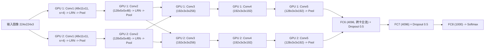

# ImageNet Classification with Deep Convolutional Neural Networks

# First Time

## 1.Title & Authors
论文原标题：ImageNet Classification with Deep Convolutional Neural Networks。
自然中文译法：基于深度卷积神经网络的 ImageNet 图像分类（学界通称 AlexNet）。
标题直接亮明这项开启现代深度学习浪潮的里程碑工作的两大主角：
- ImageNet Classification（ImageNet 分类）：面向 120 万张高分辨率真实自然图像、1000 个细粒度类别的大规模视觉识别挑战（ILSVRC）。此前视觉界普遍使用几万张小图（如 MNIST、CIFAR-10）和手工特征（SIFT + Fisher Vector），在百万级真实世界图像上一直卡在 25% 以上 Top-5 错误率。
- Deep Convolutional Neural Networks（深度卷积神经网络）：标题的核心主张是“直接把大容量深层 CNN 端到端搬上 GPU 算力与百万级数据”，不依赖手工特征工程，纯靠监督学习就能彻底甩开传统视觉流水线。
作者按原文顺序列出：Alex Krizhevsky、Ilya Sutskever、Geoffrey E. Hinton，三人均来自多伦多大学（University of Toronto）。原文未标注等贡献脚注。对照本文参考文献 [10][12][13][14][20] 可核实，该团队此前已提出 CIFAR-10/100 数据集（Krizhevsky, 2009）、将 ReLU 引入受限玻尔兹曼机（Nair & Hinton, 2010）、深度自编码器图像检索（Krizhevsky & Hinton, 2011）以及 Dropout 正则化（Hinton, Srivastava, Krizhevsky, Sutskever, Salakhutdinov, 2012），AlexNet 正是把这些关键拼图与高效双 GPU 卷积实现融于一体的爆发之作。

## 2.Abstract
摘要风格极其干脆务实，按“任务与 ILSVRC-2010 成绩 → 网络规模与骨架 → 加速训练技巧 → 防过拟合技巧 → ILSVRC-2012 夺冠战绩”五步铺开。
1. 任务规模与 ILSVRC-2010 突破：作者训练了一个大型深层 CNN，将 ImageNet LSVRC-2010 的 120 万张高分辨率图像分到 1000 个类别中；测试集 Top-1 错误率 37.5%、Top-5 错误率 17.0%，大幅刷新此前最佳纪录（此前 SIFT+Fisher Vector 为 45.7% / 25.7%）。
2. 网络规模与八层骨架：整网拥有约 6000 万参数、65 万神经元，由 5 个卷积层（部分后接最大池化层）和 3 个全连接层组成，末端接 1000 维 Softmax 分类头。
3. 训练加速的功臣：为了把这么大的网络训得动，作者用非饱和激活函数（ReLU）替代传统的饱和激活函数（tanh / sigmoid），并手写了高度优化的 GPU 2D 卷积库（`cuda-convnet`）。
4. 抑制过拟合的核心武器：6000 万参数即便面对 120 万张图也极易在庞大的全连接层上过拟合，作者在前两层全连接中引入刚提出的 Dropout 正则化，效果拔群。
5. ILSVRC-2012 压倒性夺冠：该模型的变体在 ILSVRC-2012 竞赛中取得 15.3% 的 Top-5 测试错误率夺得第一，把第二名传统方法（26.2%）甩开整整 10.9 个百分点！注意 15.3% 是 7 个 CNN 集成（含 2 个在 1500 万张/2.2 万类全量 ImageNet 上预训练再微调的模型）的成绩，单模型验证集 Top-5 错误率为 18.2%。
摘要四要素如下：

| 要素 | 本文核心内容 |
|---|---|
| 问题 | 如何在百万级高分辨率、1000 类自然图像（ImageNet）上训练足够大容量的视觉模型，同时解决训练过慢、显存受限与严重过拟合三大难题。 |
| 方法 | 构建 8 层深度 CNN（5 卷积 + 3 全连接），组合 ReLU 非饱和激活、双 GPU 稀疏跨卡并行、局部响应归一化（LRN）、重叠池化、在线数据增强（裁剪翻转 + PCA 色彩扰动）与 Dropout。 |
| 结果 | ILSVRC-2010 测试集达 37.5% Top-1 / 17.0% Top-5；ILSVRC-2012 夺冠 Top-5 错误率 15.3%（第二名 26.2%）；在 10,184 类 ImageNet Fall 2009 上亦从 60.9% 降至 40.9% Top-5。 |
| 意义 | 首次在百万级真实世界视觉识别上证明端到端纯监督深度学习大幅碾压手工特征体系，确立了“大数据 + 大算力 GPU + 深层神经网络”的现代 AI 范式。 |

## 3.Discussion
原文没有单独命名为 `Conclusion` 的章节，第 7 节 `Discussion` 承担全篇总结与展望，共两段：
1. 第一段——纯监督深度 CNN 的核心验证与深度必要性：
   - 证明了一个大型深层 CNN 完全可以只靠纯监督学习，就在极高难度的视觉基准上打破纪录。
   - 给出一条极具说服力的消融结论：删掉网络里的任意一个中间卷积层（尽管每层仅占全网不到 1% 的参数），Top-1 精度就会直接掉大约 2%！这说明“深度”绝非摆设，是决定表征能力的关键。
2. 第二段——对无监督预训练、算力缩放与视频的展望：
   - 作者指出为了简化实验，本文完全没用无监督预训练；但他们预期，当算力增长速度超过标注数据规模时，无监督预训练会派上大用场（这一预言在十年后的 MAE、CLIP、大模型时代完美应验）。
   - 只要把模型做大、训练更久，效果就一直在涨，但与人类大脑下颞叶视觉通路的规模相比仍差好几个数量级。
   - 最终愿景是把超大规模深度 CNN 推广到视频序列，利用静态图像里缺失的时间结构信息。

## 4.Analogy
可以把 AlexNet 的成功想象成“从手工作坊迈向现代化重型流水线工厂”。
- 过去的视觉识别像是手艺精湛的老匠人（SIFT + Fisher Vector）：靠人类专家精心设计规则去提取图像边缘和角点，再用分类器拼凑结果。在小作坊（几万张小图）里游刃有余，一遇上百万张千奇百怪的真实照片就力不从心。
- AlexNet 直接建起了一座 8 层高的全自动工厂（5 层卷积车间逐级提炼“边缘 → 纹理 → 部件 → 物体”，3 层全连接总控室做最终决策），而且连夜攻克了四个工程生死关：
  - 换掉慢吞吞的旧引擎（`tanh` 饱和梯度慢），装上全速直喷引擎（ReLU 提速 6 倍）；
  - 单车间装不下（GTX 580 仅 3GB 显存），把产线拆成上下两栋厂房（双 GPU 并行），只在中途关键关卡互通物料；
  - 怕质检员死记硬背（6000 万参数过拟合），一边在流水线门口实时随机旋转调光造出两千倍模拟样本（CPU 免费在线数据增强），一边每天随机抽一半员工放假（Dropout 逼迫每个神经元都能独当一面）。
- 类比边界：工厂里双 GPU 拆线当年主要是被 3GB 显存逼出来的权宜之计，现代大显存 GPU 早已不必按核硬拆；同样，局部响应归一化（LRN）后来也被 Batch Normalization 全面取代。

# Second Time

## 1.Notation & Parameters
AlexNet 偏重架构创新与工程细节，核心公式集中在激活函数、局部响应归一化（LRN）、重叠池化、PCA 色彩增强与动量 SGD 更新五处，重点记号如下表所示（完全保留原文记号）。

| 符号/参数 | 含义与作用 | 关键设定/约束 |
|---|---|---|
| $f(x)$ | 神经元激活函数 | 对比饱和型 $\tanh(x)$、$(1+e^{-x})^{-1}$ 与非饱和 ReLU $\max(0,x)$ |
| $a_{x,y}^i$、$b_{x,y}^i$ | 位置 $(x,y)$ 处第 $i$ 个卷积核经 ReLU 后的原始激活与 LRN 归一化后激活 | LRN 施加在 Conv1 和 Conv2 的 ReLU 之后、池化之前 |
| $N$、$n$、$k$、$\alpha$、$\beta$ | LRN 的总卷积核数、相邻核窗口数及归一化超参数 | 验证集选定 $k=2, n=5, \alpha=10^{-4}, \beta=0.75$ |
| $s$、$z$ | 池化层的步长（相邻池化单元间距）与池化窗口边长 | 重叠池化满足 $s<z$，本文统一取 $s=2, z=3$ |
| $I_{xy}=[I_{xy}^R,I_{xy}^G,I_{xy}^B]^T$ | 图像坐标 $(x,y)$ 处的 RGB 三通道像素向量 | 训练前已减去全训练集逐像素均值 |
| $\mathbf{p}_i$、$\lambda_i$、$\alpha_i$ | 训练集 RGB $3\times 3$ 协方差矩阵的第 $i$ 个特征向量、特征值及随机扰动系数 | $\alpha_i\sim\mathcal{N}(0,0.1^2)$，每张训练图每次读取时抽一次并共享给全图所有像素 |
| $w_i$、$v_i$、$\epsilon$ | 第 $i$ 次迭代的权重、动量变量与学习率 | batch size $=128$，动量 $0.9$，权重衰减 $0.0005$，初始 $\epsilon=0.01$ |
| $\left\langle\left.\frac{\partial L}{\partial w}\right\rvert_{w_i}\right\rangle_{D_i}$ | 目标函数 $L$ 在第 $i$ 个小批量 $D_i$ 上对权重 $w$ 的平均梯度 | 目标为最大化多项逻辑回归（交叉熵）对数似然 |

## 2.Introduction
对应原文 Section 1。引言清晰拆解了大规模物体识别的“铁三角”——大数据、大容量模型与防过拟合：
1. 为什么以前的小数据集不够用？NORB、Caltech-101/256、CIFAR-10/100 只有几万张图，物体姿态和场景单一，靠简单模型加增强就能逼近人类（如 MNIST 错误率 $<0.3\%$）。但真实世界物体千变万化，必须依赖 ImageNet（超过 1500 万张图、2.2 万类）这样的百万级数据集。
2. 为什么必须用 CNN 而不是普通全连接网络？哪怕有百万张图，真实视觉空间依然大得离谱，模型必须自带靠谱的图像先验——CNN 天然编码了“统计平稳性（平移共享卷积核）”和“像素局部相关性”两大强假设，参数和连接比同等大小的全连接网少得多，好训得多，而理论最优性能几乎不打折。
3. 硬件与数据终于撞出火花：高分辨率大 CNN 过去一直贵得算不动，但此时 GPU + 高效 2D 卷积实现已经能撑起超大规模网络，ImageNet 也恰好大到足够把 6000 万参数喂饱。
4. 引言收尾给出极具前瞻性的预言：最终卡住模型上限的其实就是两块 GTX 580 3GB 显存和五六天训练时间，“只需等待更快的 GPU 和更大的数据集，结果就能继续变好”——这几乎成了此后十余年 Scaling Law 的最早宣言。

## 3.The Dataset
对应原文 Section 2。交代 ImageNet 与 ILSVRC 评测协议以及极简的数据预处理：
- 数据划分：ILSVRC 从 ImageNet 中选取 1000 类（每类约 1000 张），总计约 120 万训练图、5 万验证图、15 万测试图。由于只有 ILSVRC-2010 公开了测试集标签，大部分消融实验跑在 2010 版上，竞赛成绩同时报告 2012 版。
- 评价指标：Top-1 错误率（预测概率最高类错了）和 Top-5 错误率（真实标签没进预测前五名）。
- 极简预处理：原图长宽不一，先将短边缩放到 256，再从正中央裁出 $256\times 256$；随后不做任何花哨预处理，仅减去全训练集逐像素均值，直接把中心化的原始 RGB 像素喂给网络。

## 4.The Architecture
对应原文 Section 3。整网包含 8 个带权重层（5 卷积 + 3 全连接）。作者非常贴心地把 3.1 至 3.4 四个创新点严格按重要性从高到低排序，读起来重点分明。

## 5.ReLU Nonlinearity
对应原文 Section 3.1，排名第一的核心加速设计。
1. 为什么抛弃传统激活函数？过去神经网络默认使用饱和型激活函数：
$$
f(x)=\tanh(x)
\qquad \text{或} \qquad
f(x)=(1+e^{-x})^{-1}.
$$
当输入 $|x|$ 稍大时，这两条 S 形曲线几乎完全拉平，导数趋近于 0（饱和区），梯度下降更新慢如蜗牛。
2. 改用非饱和的 ReLU（Rectified Linear Unit）：
$$
f(x)=\max(0,x).
$$
只要输入 $x>0$，导数恒等于 1，梯度畅通无阻、永不饱和，计算也只需一次比较取最大值。在 CIFAR-10 四层 CNN 对照中（[Fig1 精读](#fig1)），ReLU 网络达到 25% 训练误差的速度足足比 `tanh` 快了 6 倍！作者直言：如果还用传统饱和神经元，根本不可能在合理时间内试出 AlexNet 这么大的网络。
3. 与前人 $f(x)=|\tanh(x)|$ 的区别：Jarrett 等人在小数据集 Caltech-101 上用 $|\tanh(x)|$ 主要为了防过拟合；而 AlexNet 在百万级 ImageNet 上的首要难题是“把超大模型快速拟合好”，ReLU 带来的是纯粹的训练速度革命。

## 6.Training on Multiple GPUs
对应原文 Section 3.2，排名第二的硬件并行突破。
一块 NVIDIA GTX 580 只有 3GB 显存，根本装不下整个 6000 万参数的大网。作者利用两块 GPU 可直接互相读写显存、绕过主机内存的特性，设计了“分组跨卡并行（model parallelism）”：
- 把每一层的卷积核/神经元对半劈开放到 GPU 1 和 GPU 2 上；
- 最巧妙的是稀疏跨卡通信：不是每层都全连接通信，而是只在特定层互通——Conv2、Conv4、Conv5 只读同一块 GPU 上一层输出，而 Conv3 和三个全连接层则汇聚两块 GPU 的全部特征图。
- 实测收益：相比在单 GPU 上把每层卷积核减半（注：为保持总参数接近，脚注 2 说明单卡对比模型没有缩减最后一层卷积和全连接层），这套双 GPU 架构把 Top-1 和 Top-5 错误率分别压低了 1.7% 和 1.2%，训练时间反而还比单卡略快一点！而且这个“分卡少通信”的限制还意外催生了有趣的自动分工现象（见 [Fig3 精读](#fig3)）。

## 7.Local Response Normalization
对应原文 Section 3.3，排名第三的泛化增强模块。
虽然 ReLU 不靠输入归一化也能防饱和，但作者借鉴真实生物神经元的“侧抑制（lateral inhibition）”机制——让同一空间位置上相邻通道的强激活互相竞争，放大响应突出的特征、压制平庸的响应。
记第 $i$ 个卷积核在空间位置 $(x,y)$ 经过 ReLU 后的激活值为 $a_{x,y}^i$，则局部响应归一化（LRN）后的输出 $b_{x,y}^i$ 定义为：
$$
b_{x,y}^i
=\frac{a_{x,y}^i}{\left(k+\alpha\sum_{j=\max(0,i-n/2)}^{\min(N-1,i+n/2)}(a_{x,y}^j)^2\right)^{\beta}}.
$$
逐项拆解这个公式：
- 求和窗口：在同一个像素坐标 $(x,y)$ 上，跨通道扫描当前核 $i$ 左右相邻的 $n$ 个卷积核（边界用 $\max(0,i-n/2)$ 和 $\min(N-1,i+n/2)$ 截断，通道顺序在训练前随机固定，$N$ 为该层总核数）。
- 分母机制：如果周围相邻通道激活平方和很大，分母就变大，把 $a_{x,y}^i$ 压下去；只有自己足够突出才能胜出。常数 $k$ 防止分母过小或除零，$\alpha$ 控缩放，$\beta$ 控抑制指数。验证集调优后取 $k=2, n=5, \alpha=10^{-4}, \beta=0.75$，仅放在 Conv1 和 Conv2 的 ReLU 之后。
- 因为没有减去局部均值，作者指出更贴切的叫法其实是“亮度归一化（brightness normalization）”。在 ImageNet 上将 Top-1 和 Top-5 错误率分别降低 1.4% 和 1.2%（CIFAR-10 四层 CNN 测试误差从 13% 降至 11%）。

## 8.Overlapping Pooling
对应原文 Section 3.4，排名第四的防过拟合细节。
把池化层看成间隔为 $s$ 像素的网格，每个池化单元汇总周围 $z\times z$ 窗口内的最大值：
- 传统不重叠池化：$s=z$（如 $s=2, z=2$），相邻窗口严丝合缝互不交叉。
- 重叠池化（Overlapping Pooling）：设 $s<z$，本文全网统一取 $s=2, z=3$。输出特征图尺寸几乎不变，但相邻池化窗口互相重叠一圈，在 ImageNet 上使 Top-1 和 Top-5 错误率分别再降 0.4% 和 0.3%，且训练中略更难过拟合。

## 9.Overall Architecture
对应原文 Section 3.5。把上面全部模块拼装成 8 层完整网络（原图见 [Fig2 精读](#fig2)）：
- 损失目标：最后一层 1000 维 Softmax 输出类别分布，最大化训练样本正确类别的平均对数概率（即多分类交叉熵损失）。
- 逐层精确规格（每层卷积与全连接后均接 ReLU）：
  1. Conv1：输入 $224\times 224\times 3$，96 个 $11\times 11\times 3$ 卷积核（每卡 48 个），步长 4 $\to$ LRN $\to$ $3\times 3$ 重叠最大池化（步长 2）。
  2. Conv2：仅连同卡输入，256 个 $5\times 5\times 48$ 卷积核（每卡 128 个）$\to$ LRN $\to$ $3\times 3$ 重叠最大池化（步长 2）。
  3. Conv3：跨卡全连接，384 个 $3\times 3\times 256$ 卷积核（每卡 192 个），之后无池化无 LRN。
  4. Conv4：仅连同卡输入，384 个 $3\times 3\times 192$ 卷积核（每卡 192 个），无池化无 LRN。
  5. Conv5：仅连同卡输入，256 个 $3\times 3\times 192$ 卷积核（每卡 128 个）$\to$ $3\times 3$ 重叠最大池化（步长 2）。
  6. FC6（4096 维）$\to$ Dropout(0.5) $\to$ FC7（4096 维）$\to$ Dropout(0.5) $\to$ FC8（1000 维 Softmax），三层全连接均跨卡全连。
下面用 Mermaid 图清晰呈现双 GPU 分工与跨卡通信节点（省略每层后紧跟的 ReLU 激活与具体空间 padding 细节）：

## 10.Reducing Overfitting
对应原文 Section 4。作者算了一笔信息论账：1000 分类意味着每张训练图只提供约 $\log_2 1000 \approx 10$ 比特的标签约束，远远锁不住 6000 万个参数。因此必须双管齐下压制过拟合。
1. 数据增强（Section 4.1）——两招全在 CPU 上趁 GPU 算上一批时实时生成，计算几乎免费：
   - 第一招（随机平移与水平翻转）：从 $256\times 256$ 图里随机裁 $224\times 224$ 子块加水平翻转。因为 $(256-224)^2\times 2 = 32\times 32\times 2 = 2048$，直接把训练样本量等效扩增 2048 倍！测试时取四角 + 中心共 5 个 $224\times 224$ 块及其水平翻转（合计 10-crop），平均 Softmax 概率输出（脚注 5 证实 10-crop 让 ILSVRC-2010 Top-1 从 39.0% 降到 37.5%，Top-5 从 18.3% 降到 17.0%）。
   - 第二招（PCA 色彩与光照扰动）：对整个 ImageNet 训练集的 RGB 像素做主成分分析，求得 $3\times 3$ 协方差矩阵的特征向量 $\mathbf{p}_1,\mathbf{p}_2,\mathbf{p}_3$ 与特征值 $\lambda_1,\lambda_2,\lambda_3$。每次训练读入一张图时，抽取三个独立随机系数 $\alpha_i\sim\mathcal{N}(0,0.1^2)$，给全图每个像素 $I_{xy}=[I_{xy}^R,I_{xy}^G,I_{xy}^B]^T$ 加上同一个主成分扰动向量：
$$
[\mathbf{p}_1,\mathbf{p}_2,\mathbf{p}_3][\alpha_1\lambda_1,\alpha_2\lambda_2,\alpha_3\lambda_3]^T.
$$
   直觉非常巧妙：自然光照的颜色和明暗变化主要沿着 RGB 主轴方向整体漂移，这样加噪既不破坏物体身份，又让模型对光照色偏免疫，直接把 Top-1 错误率压低超过 1%！
2. Dropout（Section 4.2）：
   - 机制：训练时以 0.5 概率把前两层全连接（FC6、FC7）中每个隐藏神经元的输出置零（前向不参与、反向不更新）。每次喂入样本相当于随机抽一个共享权重的不同子网络。
   - 为什么神效？它彻底打破了神经元之间“抱团偷懒”的复杂协同适应（co-adaptation）——谁也不能指望某个特定搭档永远在场，逼着每个神经元都学出独立强健的特征。测试时启用全部神经元并将输出乘以 0.5，近似对指数级多个子网络预测分布取几何平均。代价是收敛所需迭代次数大约翻倍，但没有 Dropout 网络会严重过拟合。

## 11.Details of learning
对应原文 Section 5。给出整套优化超参数与初始化配方：
1. 带动量和权重衰减的 SGD 更新式：batch size $=128$，动量 0.9，权重衰减 0.0005：
$$
v_{i+1} := 0.9 \cdot v_i - 0.0005 \cdot \epsilon \cdot w_i - \epsilon \cdot \left\langle \left.\frac{\partial L}{\partial w}\right|_{w_i} \right\rangle_{D_i},
\qquad
w_{i+1} := w_i + v_{i+1}.
$$
   一个很反直觉的观察：作者发现这个小小的 0.0005 权重衰减不只是防过拟合的正则项，它连训练误差都能压低——对帮助大模型顺利启动优化起到了实质作用。
2. 权重与偏置初始化：所有层权重从均值为 0、标准差 0.01 的高斯分布采样；特别地，Conv2、Conv4、Conv5 以及全连接隐藏层的偏置初始化为常数 1（其余层初始化为 0），专门为了让 ReLU 在训练初期先落进正半轴、避免一上来就大面积“死神经元”而加速早期收敛。
3. 学习率调度与训练时长：全网统一学习率，从 $\epsilon=0.01$ 起步，每当验证误差停滞就手动除以 10，结束前共降了 3 次；在 120 万张图上训练约 90 个 epoch，在两块 GTX 580 3GB 上耗时 5 至 6 天。

## 12.Figure & Table
正文共有 4 张图、2 张表，合计 6 项，按原文出现顺序精读如下。

#### Fig1:
位置与目的：位于第 3.1 节，直观展示 ReLU 比传统饱和激活 `tanh` 训练到底快多少。
怎么读与核心数据：横轴为训练轮数 Epochs（0 到 40），纵轴为 CIFAR-10 四层 CNN 的训练错误率（0 到 0.75，无任何正则化，两者各自调到最快学习率）。实线（ReLU）在第 5–6 个 epoch 就冲破 0.25（25%）训练错误率；虚线（tanh）慢吞吞磨到约 35 个 epoch 才勉强够到 0.25——ReLU 提速足足 6 倍！直观证明没有 ReLU 就很难在百万级 ImageNet 上迭代实验这么大的模型。

#### Fig2:
这是全篇最重要的一张正文图，完整画出 AlexNet 的 8 层骨架、特征图尺寸逐级演进以及双 GPU 上下并行的通信拓扑。
怎么读与逐层核对：整图分成上下两条并行流水线，上路跑在 GPU 1，下路跑在 GPU 2；图中最左端标注输入 `224 x 224 x 3`，经 `11 x 11` 步长 4 卷积后变为上下各 `55 x 55 x 48`（合 96 通道），池化后进 Conv2 为上下各 `27 x 27 x 128`（合 256 通道）；进入 Conv3 时出现交叉虚线箭头——两块 GPU 在此处首次全互通，输出上下各 `13 x 13 x 192`（合 384 通道）；随后 Conv4（各 192）与 Conv5（各 128）均只在各自 GPU 内部直连；池化后进入 `2048+2048=4096` 的 FC6、FC7（再次全互通）以及最终 1000 类输出。
两处有趣的原版印刷小细节：第一，按无填充卷积公式，$(224-11)/4+1=54.25$ 并非整数，实际生成 $55\times 55$ 特征图需配合隐式边界填充（或等价 $227\times 227$ 输入，图题同时写明输入维数为 $224\times 224\times 3=150,528$）；第二，图题给的各层神经元数为 `253,440–186,624–64,896–64,896–43,264–4096–4096–1000`，后几层严丝合缝对应 $27^2\times 256$、$13^2\times 384$、$13^2\times 256$，仅首层 $55^2\times 96=290,400$ 与图题 `253,440` 存在小出入，阅读时以结构拓扑与各层核规格为准即可。

#### Fig3:
位置与目的：位于第 5 节（在 6.1 节详细讨论），可视化 Conv1 学出来的全部 96 个 $11\times 11\times 3$ 彩色卷积核，上半部 48 个来自 GPU 1，下半部 48 个来自 GPU 2。
惊人的视觉发现：第一层自己学会了类似人类初级视觉皮层（V1）的各类方向、频率选择性 Gabor 边缘滤波器以及色彩斑块。更神奇的是，因为双 GPU 之间限制了通信，两张卡竟然每次训练都自发演化出截然不同的专业分工：GPU 1（上半部）几乎清一色学成了黑白、色盲式的边缘与频率纹理检测器；GPU 2（下半部）几乎清一色学成了色彩敏感的颜色块检测器！且无论随机初始化怎么换，这种分工每次都会稳定复现。

#### Table1:
位置与目的：位于第 6 节，汇总 ILSVRC-2010 官方测试集错误率对比（斜体为前人最佳）。
关键数据：2010 竞赛冠军（6 个稀疏编码模型平均）为 Top-1 47.1%、Top-5 28.2%；此后已发表最强方法（双密集特征 SIFT + Fisher Vector 集成）为 45.7% / 25.7%；本文单个 CNN 直接压到 37.5% / 17.0%，Top-1 暴降 8.2 个百分点、Top-5 暴降 8.7 个百分点。

#### Table2:
位置与目的：位于第 6 节，汇报 ILSVRC-2012 验证集与官方测试集上的竞赛成绩（带 `*` 表示在 1500 万图、2.2 万类的 ImageNet Fall 2011 全集上先预训练再微调的模型）。
逐行拆解成绩跃升：
- 亚军传统方法（SIFT + FVs 集成）：测试集 Top-5 为 26.2%。
- 1 个标准 CNN：验证集 Top-1 40.7%、Top-5 18.2%。
- 5 个相似 CNN 集成：验证集 38.1% / 16.4%，测试集 16.4%（作者指出验证集与测试集相差不超过 0.1%）。
- 1 个预训练微调 CNN*（末尾多加第 6 层卷积）：单模型验证集就降到 39.0% / 16.6%，证明更大规模预训练迁移有效。
- 7 个 CNN 集成（5 个标准 CNN + 2 个预训练 CNN*）：验证集 36.7% / 15.4%，官方测试集 15.3% 强势夺冠！

#### Fig4:
位置与目的：位于第 6.1 节，从“分类直觉”和“语义特征空间几何”两个侧面检验网络到底学懂了什么。
左右两面板解读：
- 左面板（8 张测试图与 Top-5 预测条形图，红条为真实标签）：哪怕目标偏在角落（如左上角的螨虫 `mite`）也能准确认出；遇到 `leopard`（豹子）时，前五名全都是其他猫科动物；而在 `grille`（汽车格栅，模型首要猜了敞篷车 `convertible`）和 `cherry`（樱桃前面有只斑点狗，模型猜了 `dalmatian`）上，模型犯的“错”其实非常合情合理——图像本身就有多个显著主体。
- 右面板（高维语义检索）：第一列是 5 张查询测试图（紫花、大象、战舰、南瓜灯、小狗），右边 6 列是最后一层 4096 维隐藏特征欧氏距离最近的 6 张训练图。可以看到检索出的大象朝向各异、小狗姿势完全不同——像素级 L2 距离天差地别，但网络把它们映射到了同一个语义邻域里！作者同时提示，用自编码器把这 4096 维特征压成短二进制码，会远胜直接对原始像素做自编码检索。
## 13.Results
对应原文 Section 6。定量结果涵盖三个递进基准：ILSVRC-2010 单模型大胜前人（[Table1 精读](#table1)）；ILSVRC-2012 单模型与 5/7 模型集成以 15.3% 碾压 26.2% 亚军夺冠（[Table2 精读](#table2)）；在更大更难的 ImageNet Fall 2009（890 万张图、10,184 类，对半划分训练/测试）上，加一层额外卷积后的网络把 Top-1/Top-5 错误率从此前最佳的 78.1% / 60.9% 一举拉低至 67.4% / 40.9%。定性评估（Section 6.1）通过首层滤波器的双卡自动分工（[Fig3 精读](#fig3)）和末层 4096 维特征的语义近邻检索（[Fig4 精读](#fig4)），证实网络确实学到了从低级边缘/颜色到高级物体语义的层次表征。全文没有独立附录。

# Overall Review

- 主要贡献： AlexNet 在深度学习历史上是一道分水岭。它首次把大容量深层卷积网络、高效 GPU 并行计算与百万级真实图像数据结合起来，在 ILSVRC-2012 上以超过 10 个百分点的巨大优势终结了手工特征时代；同时系统沉淀出一套切实可行的深度 CNN 训练组合拳（ReLU、Dropout、在线裁剪翻转与 PCA 色彩增强、重叠池化、带动量与权重衰减的 SGD）。
- 技术优点： 每一项工程与算法选择都直击痛点且有清晰消融数字支撑——ReLU 提速 6 倍打开深网迭代之门，Dropout 与免费 CPU 在线增强成功驯服 6000 万参数过拟合，双 GPU 稀疏跨卡通信巧妙突破 3GB 显存瓶颈，且端到端学出的 4096 维末层特征天然具备跨姿态语义泛化与检索价值（[Fig4 精读](#fig4)），用全量 ImageNet-22K 预训练再微调的范式更是直接预告了现代视觉迁移学习。
- 潜在不足： 第一，受限于 2012 年的架构探索，整网约 6000 万参数里绝大部分堆积在 FC6 和 FC7 两个 4096 维全连接层中（每层中间卷积仅占不足 1% 参数），参数效率偏低且极易过拟合（后续 VGG 到 ResNet 逐步用全局平均池化取代）。第二，双 GPU 手工分组通信与 LRN 归一化都是特定历史阶段的设计，很快被单卡大显存与 Batch Normalization 取代。第三，首层 $11\times 11$ 大核步长 4 在空间上降采样过猛，丢掉了部分精细局部纹理（后续 VGG 证明堆叠小 $3\times 3$ 核更优）。第四，超参数（如学习率手动降 3 次、权重衰减 0.0005、分卡位置）高度依赖经验试错。
- 相关工作定位： AlexNet 上承 LeCun 1990 年代的 LeNet 卷积范式，直接把 ReLU、Dropout 等刚诞生的组件大规模实战化，为随后的 ZFNet、VGG、GoogLeNet 和 ResNet 铺平了整条现代深度视觉之路；其中“22K 预训练 + 1K 微调”和“更大算力与数据持续提分”的思想，至今仍是 ViT 与基础大模型的底层共识。
- 启发与延伸： 读 AlexNet 最大的启发是不要轻视系统工程与基础组件协同的力量——高效 CUDA 卷积实现、CPU 异步零开销数据增强、ReLU 和初始化偏置为 1 这些看似朴素的工程细节，合在一起撬动了整个领域的范式转移。后续自然延伸到更小卷积核与更深架构（VGG/ResNet）、Batch Normalization 替代 LRN、以及作者在 Discussion 中预言的大规模无监督预训练（MAE/对比学习）与视频时空网络。
- 适合谁读： 所有深度学习入门者与计算机视觉研究者的必读历史经典，数学公式极其友好。入门同学可重点看第 4–10 节配合 [Fig2 精读](#fig2) 理解 CNN 卷积、池化、ReLU、Dropout 与数据增强的由来；工程向读者值得细读第 6、10、11 节，体会作者在极度受限的 3GB 显存下如何靠模型并行、异步增强和初始化技巧榨干硬件极限。
