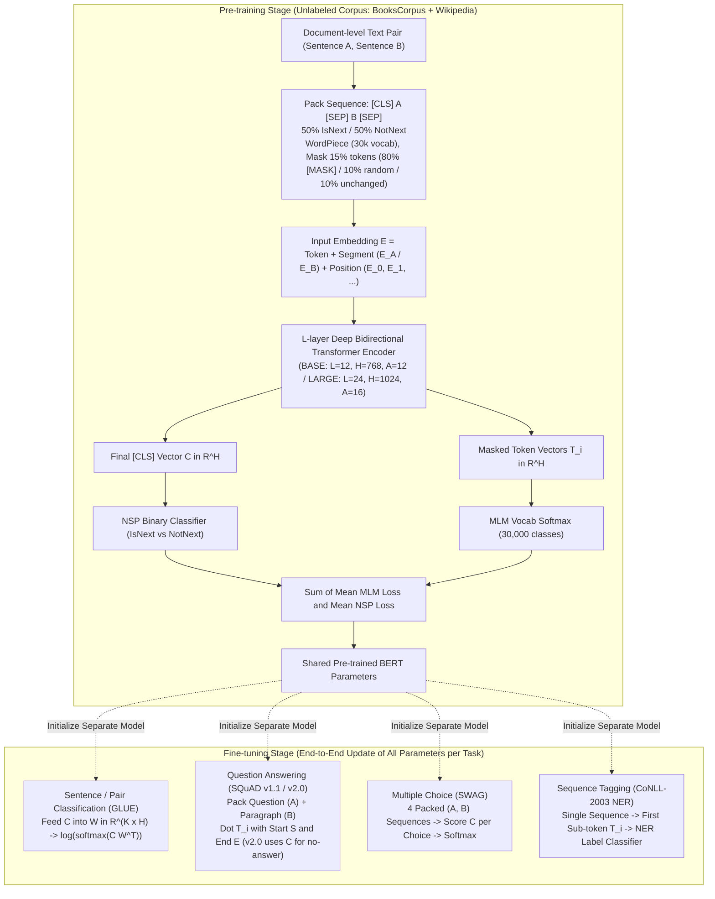

# BERT: Pre-training of Deep Bidirectional Transformers for Language Understanding

# First Time

## 1.Title & Authors
论文原标题：BERT: Pre-training of Deep Bidirectional Transformers for Language Understanding。
自然中文译法：BERT：用于语言理解的深度双向 Transformer 预训练。
先把标题里最关键的四个词掰开，整篇论文要解决的问题与拿出的解法立刻一目了然：
- BERT（Bidirectional Encoder Representations from Transformers）：论文提出的语言表示模型，把“双向”“编码器”“Transformer 表示”三个核心特征直接嵌进了名字里。
- Pre-training（预训练）：先在海量无标注纯文本上学会通用的语言理解能力，再把学好的整套网络参数搬到各种下游有标注任务上微调，避免每个任务从零训练。
- Deep Bidirectional Transformers（深度双向 Transformer）：标题的核心主张就在“深度双向”四个字上——模型在每一层自注意力里都同时看左侧和右侧的完整上下文，而不是像传统语言模型那样只能从左往右看，也不是把两个独立单向模型在顶层浅浅拼在一起。
- Language Understanding（语言理解）：聚焦判别式和抽取式自然语言理解任务，横跨句子级推理分类（如自然语言推理、情感分析、语义相似度）与词元级细粒度预测（如抽取式问答、命名实体识别）。
作者按原文顺序列出：Jacob Devlin、Ming-Wei Chang、Kenton Lee、Kristina Toutanova，四人全部来自 Google AI Language，原文未标注共同第一作者脚注。从论文自身参考文献与公开学术脉络可核实：Jacob Devlin 是 BERT 的第一作者及核心设计者；Kenton Lee 此前也共同撰写了上下文词表示代表作 ELMo（Peters et al., 2018a，本文多处直接与之对照）；Ming-Wei Chang 与 Kristina Toutanova 长期深耕结构化语言理解与预训练表示学习。

## 2.Abstract
这篇摘要非常凝练，两段话按“亮出新模型 → 点出与前人根本差异 → 展示极简微调红利 → 报出硬核成绩单”四步推进。下面按语义单元逐句讲透。
1. 提出模型名称与全称：作者提出新的语言表示模型 BERT，全称 Bidirectional Encoder Representations from Transformers（基于 Transformer 的双向编码器表示）。
   从名称就能看出它的骨架：直接沿用 Transformer 的编码器部分，核心产物是带有上下文语义的词元与序列表示向量。
2. 点明与代表性前作的根本分水岭：与近期代表性的语言表示模型（ELMo，Peters et al., 2018a；OpenAI GPT，Radford et al., 2018）不同，BERT 从无标注文本中预训练“深度双向表示”，核心机制是在所有层中联合以左右两侧上下文为条件。
   这句话浓缩了全篇最核心的技术突破。OpenAI GPT 受限于标准从左到右语言模型，每个词只能看左边；ELMo 虽然同时训了从左到右和从右到左两个 LSTM，但两者各自独立训练，只在输出端把两个方向的隐状态拼接起来，层与层之间左右信息从未真正交融。BERT 则在每一层 Transformer 里让所有位置两两互相看见，实现真正的深度双向融合。
3. 引出极简统一微调范式：正因为预训练已经把深层双向语义学透了，下游任务适配时只需在预训练 BERT 之上额外加一个输出层并微调全网参数，就能在问答、语言推理等广泛任务上做出当时的顶尖模型，无需为每个任务大动干戈设计专用主体架构。
   在 BERT 之前，NLP 界做问答要设计复杂的双向注意力流网络（如 BiDAF），做推理要设计专门的句对交互对齐模块；BERT 把“理解语言”和“句间交互”全收编进统一的预训练编码器里，把下游架构改动压缩到了极致。
4. 总体评价与 11 项 NLP 任务成绩单：作者用“概念简单、实证强大”概括 BERT，报告它在 11 个自然语言处理任务上刷新了当时的最高纪录，并列出四个标志性数字：
   - GLUE 综合得分推高至 80.5%（绝对提升 7.7 个百分点，对照同期 OpenAI GPT 的 72.8%）。结合正文第 4.1 节与 [Table1 精读](#table1) 看，80.5% 是 GLUE 官方排行榜包含 WNLI 后的综合分，而 Table 1 排除存在构造问题的 WNLI 后表内平均分为 82.1%。
   - MultiNLI（MNLI）测试集准确率达到 86.7%（绝对提升 4.6 个百分点，对照 OpenAI GPT 的 82.1%，具体对应 MNLI-m 匹配测试集）。
   - SQuAD v1.1 问答测试集 F1 达到 93.2（绝对提升 1.5 分，对照当时榜首集成系统 nlnet 的 91.7）。对照 [Table2 精读](#table2) 可知，93.2 对应“先在 TriviaQA 增广微调 + 7 模型集成”的设置；单模型加 TriviaQA 为 91.8，已经反超前榜首集成系统。
   - SQuAD v2.0 问答测试集 F1 达到 83.1（绝对提升 5.1 分，对照此前单模型榜首 MIR-MRC 的 78.0）。对照 [Table3 精读](#table3)，该结果由单模型直接微调获得，未使用 TriviaQA 额外数据。
把摘要提炼成四个核心要素：

| 要素 | 本文核心内容 |
|---|---|
| 问题 | 现有预训练语言模型受限于单向建模（或独立双向浅拼接），削弱了预训练表示的表达力，尤其限制了微调范式在需要左右完整上下文的问答等词元级任务上的发挥。 |
| 方法 | 提出深度双向 Transformer 编码器 BERT：预训练阶段在所有层联合利用左右上下文，下游微调只需在顶部接入单个任务输出层即可端到端微调全部参数。 |
| 结果 | 在 11 项 NLP 任务上刷新当时最优水平，GLUE 官方综合分达 80.5%（+7.7）、MNLI 准确率达 86.7%（+4.6）、SQuAD v1.1 Test F1 达 93.2（+1.5）、SQuAD v2.0 Test F1 达 83.1（+5.1）。 |
| 意义 | 确立了“深度双向无监督预训练 + 极简统一输出头全参数微调”的通用 NLP 范式，大幅降低了各类语言理解任务对重型专用架构的依赖。 |

## 3.Conclusion
原文第 6 节为独立的 Conclusion，篇幅极短，仅有一段，直接为整篇工作的历史定位收口：
1. 承接语言模型迁移学习的背景：作者先肯定近期语言模型迁移学习的实证进展——丰富的无监督预训练已经成为许多语言理解系统不可或缺的核心组件，尤其让数据稀缺的低资源任务也能从深层单向预训练架构中受益。
2. 明确本文的唯一核心贡献：将这种无监督预训练迁移收益从“深层单向架构”推广到“深层双向架构”，使得同一个预训练模型只需微调就能攻克范围广泛的 NLP 任务（包括句子级和词元级任务，以及低资源数据集）。
3. 结论边界与未写项：原结论非常克制，没有列出具体的未来工作方向，也没有在结论里重复局限性；关于预训练/微调 `[MASK]` 分布差异、小数据集微调不稳定性、模型算力门槛和输入长度限制等细节，分别散布在正文第 3.1 节、第 4.1 节与附录 A.2、C.2 中。

## 4.Analogy
可以把 BERT、OpenAI GPT 和 ELMo 想象成三位备考语文综合卷（包含阅读理解、病句判断、找关键信息）的学生，用三种完全不同的自学方式“刷海量课外书（无标注语料）”：
- OpenAI GPT 像一位“遮住后半页的逐字跟读生”：读书时拿一张卡片挡住右边所有还没读到的字，每读一个字就猜下一个字是什么。这种方式很适合续写作文，但到了考场上做阅读理解、需要把文章后面的结论和前面的提问反复对照着找答案时，前面每个词在读的时候都不知道后面写了什么，非常吃亏。
- ELMo 像一对“背靠背读书的双胞胎”：哥哥只从左往右读一遍做笔记，弟弟只从右往左读一遍做笔记，读书全程两人互不交谈，直到整本书读完，才在最后把哥哥的笔记和弟弟的笔记钉在同一张纸上交给考场上的专用答题机器。两边信息确实都有了，但思考过程中从未深度融合。
- BERT 像一位“边做完形填空、边练段落衔接的全景阅读大师”：他在刷课外书时，故意随机涂黑 15% 的字词，然后放开视野同时扫视空缺左边和右边的整篇上下文，经过 12 层或 24 层反复咀嚼把涂黑的词猜出来（MLM）；同时他还把两段话拼在一起，训练自己判断后一段到底是不是前一段的顺接下文（NSP）。为了让考场上看到没有黑块的正常试卷时不发懵，他在平时练习的 15% 目标词里，只在 80% 的时候真涂黑，另外 10% 故意写错字逼自己随时核查上下文，10% 保留原字稳住字面信息。刷完 33 亿词的书之后，进考场不管遇到情感分类、句意匹配、问答划重点还是找人名地名，只需在脑子顶上换一支对应的答题笔（单个任务输出层），稍微练几套真题（微调 2–4 个 epoch），就能通杀 11 项考试。
这个类比的边界也要看清：真实 BERT 预训练和微调虽然共享同一套初始参数，但每个下游任务微调后会各自独立更新整网权重，得到的是多个任务专用的微调副本，而不是一套权重不改参数通吃全部任务；同时因为 MLM 是靠遮挡而非从左到右自回归条件分解训练的，BERT 并不直接具备 GPT 那种逐词流畅生成长文本的原生解码能力。

# Second Time

## 1.Notation & Parameters
BERT 正文刻意保持数学记号极度精简，整篇论文的架构、输入输出与下游任务公式只围绕十几个核心符号展开。下表严格沿用原文记号整理全文主线必需的重点符号与参数。

| 符号/参数 | 含义与作用 | 关键设定/约束 |
|---|---|---|
| $L$ | Transformer 编码器层数（块数） | $\text{BERT}_{\text{BASE}}$ 取 $L=12$，$\text{BERT}_{\text{LARGE}}$ 取 $L=24$；Table 6 消融涵盖 $3, 6, 12, 24$ |
| $H$ | 隐藏层维度（隐状态向量长度） | $\text{BERT}_{\text{BASE}}$ 取 $H=768$，$\text{BERT}_{\text{LARGE}}$ 取 $H=1024$；前馈中间层维度固定为 $4H$（$3072$ 与 $4096$） |
| $A$ | 每层多头自注意力的头数 | $\text{BERT}_{\text{BASE}}$ 取 $A=12$，$\text{BERT}_{\text{LARGE}}$ 取 $A=16$；Table 6 消融还测试了 $A=3$ |
| `[CLS]` | 序列首部的特殊分类词元 | 固定放在每条输入序列的第 0 位，其最终隐状态 $C$ 聚合整段序列信息供分类与 NSP 使用 |
| `[SEP]` | 特殊分隔词元 | 用于切分句对中的句子 $\text{A}$ 与句子 $\text{B}$，也标记句子结束 |
| `[MASK]` | 掩码语言模型使用的特殊遮挡词元 | 仅在预训练 MLM 中出现，替换被选中 15% 位置中的 80%；微调阶段不再出现 |
| $\text{A}$、$\text{B}$ | 打包进单条序列的两个连续文本片段（“句子”） | 原文中的“sentence”泛指任意连续文本跨度；单文本任务对应退化的 $\text{text}$–$\varnothing$ 对 |
| $E$（输入嵌入） | 输入词元的综合嵌入向量（第 3 节与 Fig 1、Fig 2） | 由词元嵌入（如 $E_{[\mathrm{CLS}]}, E_{\mathrm{my}}$）、段嵌入（$E_A, E_B$）与位置嵌入（$E_0, E_1, \dots$）逐元素相加得到；与第 4.2 节问答终点向量 $E$ 同形不同义 |
| $C$ | 特殊词元 `[CLS]` 对应的最终隐藏向量 | $C\in\mathbb{R}^H$；预训练用于 NSP，微调用于句级/句对级分类及 SQuAD v2.0 无答案打分；未微调前不能直接当作通用句向量 |
| $T_i$ | 第 $i$ 个输入词元对应的最终隐藏向量 | $T_i\in\mathbb{R}^H$；预训练用于被选中位置的 MLM 词表预测，微调用于问答起止定位与 NER 序列标注（Fig 1 中句 B 记作 $T'_1,\dots,T'_M$） |
| $W$、$K$ | GLUE 分类层权重矩阵与类别数 | $W\in\mathbb{R}^{K\times H}$；第 4.1 节中是 GLUE 微调唯一新增参数 |
| $S$、$E$（问答向量） | SQuAD 微调新增的答案起点向量与终点向量 | $S\in\mathbb{R}^H$、$E\in\mathbb{R}^H$；与段落词元表示 $T_i$ 做内积得到起止位置打分 |
| $P_i$ | SQuAD 中第 $i$ 个词作为答案起点的 softmax 概率 | $P_i=\frac{e^{S\cdot T_i}}{\sum_j e^{S\cdot T_j}}$，终点概率采用将 $S$ 换为 $E$ 的同类公式 |
| $s_{\mathrm{null}}$、$\hat{s}_{i,j}$、$\tau$ | SQuAD v2.0 的无答案得分、最优非空跨度得分、判定阈值 | $s_{\mathrm{null}}=S\cdot C+E\cdot C$，$\hat{s}_{i,j}=\max_{j\ge i} S\cdot T_i+E\cdot T_j$；当 $\hat{s}_{i,j}>s_{\mathrm{null}}+\tau$ 时预测非空答案，$\tau$ 在 Dev 集上选定以最大化 F1 |
| $\beta_1, \beta_2$ | Adam 优化器的一阶与二阶动量衰减系数 | Appendix A.2 设定 $\beta_1=0.9, \beta_2=0.999$，配学习率 $1\text{e-}4$、L2 权重衰减 $0.01$、dropout $0.1$ |
| $k$ | 预训练迭代步数（Appendix C.1 与 Fig 5） | 完整预训练共 $1{,}000{,}000$ 步（前 90% 步序列长度 128，后 10% 步序列长度 512） |

唯一需要特别留心的同名符号是 $E$：在第 3 节与 [Fig1 精读](#fig1)、[Fig2 精读](#fig2) 中，$E$（及带下标的 $E_1, E_A, E_0$ 等）表示输入嵌入向量；到了第 4.2–4.3 节的 SQuAD 问答公式中，$E\in\mathbb{R}^H$ 则专指与起点向量 $S$ 配对的答案终点向量（End vector），按章节语境即可一眼分清。

## 2.Introduction
对应原文 Section 1。引言直奔主题，用四段话讲清一个问题：既然语言模型预训练已经被证明非常有效，为什么现有路线还没发挥出全部潜力？
1. 下游 NLP 任务的两大阵营：
   - 句子级任务（sentence-level tasks）：例如自然语言推理（NLI）和语义复述判断（paraphrasing），需要通盘理解整句话或两个句子之间的整体逻辑关系。
   - 词元级任务（token-level tasks）：例如命名实体识别（NER）和抽取式问答（QA），要求模型在每个词元位置上给出精细的局部决策（这个词是不是人名开头、是不是答案起点）。
2. 将预训练表示迁移到下游任务的两条现有路线：
   - 基于特征（feature-based），以 ELMo 为代表：把预训练模型当成固定或附带的特征提取器，将提取出的上下文词向量塞进专门为各任务设计的神经网络架构（如 BiDAF、BiLSTM-CRF）里。
   - 基于微调（fine-tuning），以 OpenAI GPT 为代表：几乎不增加任务专用参数，直接拿预训练模型当主体，在下游任务上端到端微调全部预训练参数。
3. 点破两条路线共同的“单向枷锁”：不管是 feature-based 还是 fine-tuning，当时主流预训练目标用的都是单向语言模型（例如 OpenAI GPT 使用从左到右 Transformer，每个词在自注意力层里只能关注它左边的历史词）。作者一针见血地指出，单向约束会严重束缚预训练表示的威力，尤其会伤害微调路线：
   - 对句子级任务而言，信息不对称会让表示次优；
   - 对问答这类词元级任务而言更是致命——当你判断段落里某个词是不是答案起点时，必须同时结合它左边的问题、它前面的铺垫，以及它右边紧跟着的完整短语和后文语境，只看左边根本做不好精确定位。
4. 亮出破局方案 BERT 与两大预训练任务：
   - 为打破单向枷锁，BERT 引入受 Cloze 完形填空任务（Taylor, 1953）启发的掩码语言模型（Masked Language Model, MLM）：随机遮住输入中的一部分词元，仅凭上下文预测被遮词元的原始词表 ID。这使得每一层的表示都能自然融合左侧和右侧上下文，从而训出真正的深度双向 Transformer。
   - 仅仅靠单个词元级别的 MLM 还不足以直接捕获句子与句子之间的跨句关系，因此 BERT 联合引入“下一句预测”（Next Sentence Prediction, NSP）任务，在预训练阶段直接锤炼句对表示能力。
5. 引言收尾凝练出全篇三项核心贡献：第一，通过 MLM 证明深度双向预训练的重要性（区别于单向的 OpenAI GPT，也区别于把独立左向/右向 LM 浅拼接的 ELMo）；第二，证明预训练深度双向表示能大幅削减繁重的任务专用架构，BERT 是首个靠统一微调框架在大量句子级和词元级任务上同时拿下顶尖性能的表示模型；第三，在 11 项 NLP 任务上刷新当时最高水平并开源代码与预训练权重。

## 3.Related Work
对应原文 Section 2。作者将通用语言表示预训练的历史拆成三条脉络，读完就能把 BERT 的坐标定得非常准：第一条是无监督特征提取派，第二条是无监督整体微调派，第三条是有监督大数据迁移派。

## 4.Unsupervised Feature-based Approaches
对应原文 Section 2.1。这一派的共同特点是“先从无标注文本训出表示向量，再把向量当输入特征喂给下游专用模型”：
1. 静态词向量时代：从早期非神经方法（基于类别的 $n$-gram、结构对应学习等）发展到 Word2Vec（Mikolov et al., 2013）与 GloVe（Pennington et al., 2014），通过从左到右预测或利用左右上下文判别正负词，学到远强于随机初始化的预训练词嵌入。
2. 粗粒度句/段向量时代：将思想扩展到句子与段落表示（Skip-Thought、Quick-Thought、Paragraph Vector、去噪自编码器等），用排序候选下一句、根据上句逐词生成下句等方式学习句向量。
3. 上下文动态词向量时代（ELMo 与 context2vec）：ELMo（Peters et al., 2018a）把静态词向量升级为随语境变化的动态表示——它分别训练一个从左到右语言模型和一个从右到左语言模型，对每个词元把两个方向的隐藏特征拼接起来，再接入原有任务专用架构，在 QA、情感分析、NER 上大幅提分。Melamud et al. (2016) 的 context2vec 用双向 LSTM 根据左右上下文预测单个词，同样属于 feature-based 且并非深度双向融合。此外，Fedus et al. (2018) 展示了完形填空目标可增强文本生成模型的稳健性。

## 5.Unsupervised Fine-tuning Approaches
对应原文 Section 2.2。这一派不再满足于只当外部特征，而是把整个预训练编码器直接搬到下游去微调：
- 早期探索（Collobert and Weston, 2008）只预训练词嵌入参数；
- 近期工作（Dai and Le, 2015；ULMFiT，Howard and Ruder, 2018；OpenAI GPT，Radford et al., 2018）直接从无标注文本预训练整套句子/文档上下文编码器，下游任务只需新增极少随机初始化参数并端到端微调全网。
- 正是凭借“极少参数需从零学习”的红利，OpenAI GPT 在 GLUE 多项句子级任务上刷新了纪录。但这一派此前几乎全部依赖从左到右语言模型或自编码器目标，留下了“深层双向微调编码器”这一块空白，恰好由 BERT 补齐。

## 6.Transfer Learning from Supervised Data
对应原文 Section 2.3。除了无监督预训练，也有工作从大规模有标注 NLP 任务迁移（例如从 NLI 迁移的 InferSent，以及从机器翻译迁移的 CoVe）；计算机视觉领域更早已验证了 ImageNet 预训练再微调的巨大威力（Deng et al., 2009；Yosinski et al., 2014）。BERT 则把这种“大规模预训练 + 通用微调底座”的成功，用纯无标注文本真正带入了 NLP 全领域。

## 7.BERT
对应原文 Section 3（含开篇概览、Model Architecture 与 Input/Output Representations）。这一节先把 BERT 的“身体结构”和“吃进去、吐出来的格式”讲清楚。
1. 两阶段框架与统一架构哲学（对照 [Fig1 精读](#fig1)）：
   - 第一阶段 Pre-training（预训练）：在无标注语料上用 MLM 和 NSP 联合训练全网参数。
   - 第二阶段 Fine-tuning（微调）：拿同一份预训练权重作为初始化起点，用下游有标注数据端到端微调全部参数。注意每个下游任务微调完都会产出一个独立的参数副本，彼此权重不同，只是共享同一个预训练起点和几乎完全一致的网络结构（仅顶部输出层不同）。
2. Model Architecture（模型骨架）：
   - 主体就是标准的原始多层双向 Transformer 编码器（Vaswani et al., 2017，基于 `tensor2tensor` 实现）。因为结构几乎原封不动沿用标准 Transformer 编码器，原文直接约定三个核心尺寸符号：层数 $L$、隐藏维度 $H$、自注意力头数 $A$，并统一设定前馈网络/滤波层中间维度为 $4H$（脚注 3：$H=768$ 时为 $3072$，$H=1024$ 时为 $4096$）。
   - 论文主打两个规格：
     - $\text{BERT}_{\text{BASE}}$：$L=12, H=768, A=12$，总参数量 $110\text{M}$。特意把尺寸对齐 OpenAI GPT，方便做公平对照。
     - $\text{BERT}_{\text{LARGE}}$：$L=24, H=1024, A=16$，总参数量 $340\text{M}$。
   - 与 OpenAI GPT 的关键结构差异只有一处：BERT 使用无遮挡的双向自注意力（文献中常称“Transformer 编码器”），每个词元都能关注序列里任意位置；GPT 使用受限的因果自注意力（常称“Transformer 解码器”，因可直接用于自回归文本生成），每个词元只能关注左侧历史词元。
3. Input/Output Representations（如何把单句和句对统统塞进一条序列，对照 [Fig2 精读](#fig2)）：
   为了让同一个模型无需改架构就能通吃单句分类、句对推理、问答和序列标注，BERT 制定了一套极其巧妙的“万能打包协议”：
   - 术语澄清：原文里的“sentence（句子）”并不是语言学上以句号结尾的一句话，而是指任意一段连续文本跨度（在问答里可以是一整段维基百科正文）；“sequence（序列）”则指喂给 BERT 的整条词元输入流，它既可以装一条单句，也可以把两条句子打包在一起。
   - 词表与分词：采用包含 $30{,}000$ 个词元的 WordPiece 子词嵌入（Wu et al., 2016），能把生僻词或词形变化拆成常见词根加 `##` 后缀（例如 `playing` 拆成 `play` 和 `##ing`），大幅缓解未登录词问题。
   - 两条句子的区分机制：
     1. 序列第 0 位永远放置特殊分类词元 `[CLS]`，它经过 $L$ 层双向自注意力后得到的最终隐藏向量记为 $C\in\mathbb{R}^H$，专门充当整条序列的聚合表示供分类任务使用；
     2. 句子 $\text{A}$ 与句子 $\text{B}$ 之间插入特殊分隔词元 `[SEP]`（并在末尾附上 `[SEP]`，如 [Fig2 精读](#fig2) 所示）；
     3. 同时为每个词元叠加一个可学习的段嵌入（Segment Embedding），明确告诉模型这个词元属于句子 $\text{A}$（加 $E_A$）还是句子 $\text{B}$（加 $E_B$）。
   - 输入向量的三合一构造：对序列中的每一个词元，它的初始输入嵌入 $E$ 并非拼接，而是由三张查表向量逐元素相加得到（维度始终保持 $H$）：
     - Token Embeddings（词元嵌入）：查 $30{,}000$ 词表得到该子词本身的基础向量（如 $E_{[\mathrm{CLS}]}, E_{\mathrm{my}}, \dots, E_{\mathrm{\#\#ing}}, E_{[\mathrm{SEP}]}$）；
     - Segment Embeddings（段嵌入）：查只有两行的表，前半段（含 `[CLS]` 与第一个 `[SEP]`）统一加 $E_A$，后半段（含第二个 `[SEP]`）统一加 $E_B$；
     - Position Embeddings（位置嵌入）：查可学习的位置表 $E_0, E_1, \dots$（最大支持长度 $512$），弥补自注意力本身没有先后次序感知的缺陷。
   - 输出端记号：经过 $L$ 层双向 Transformer 编码器后，首部 `[CLS]` 输出 $C\in\mathbb{R}^H$，第 $i$ 个输入词元输出上下文相关的最终隐藏向量 $T_i\in\mathbb{R}^H$。整套输入输出接口在预训练和所有下游微调任务中完全统一。

## 8.Pre-training BERT
对应原文 Section 3.1。这一节是整篇论文的思想核心：如何不靠从左到右语言模型，在无标注纯文本上真正把深度双向 Transformer 训出来？BERT 设计了两大无监督任务（图示见 [Fig1 精读](#fig1) 左半部分），并联合最小化两项任务的平均交叉熵损失（原文第 3.1 节与附录 A.2 均用自然语言表述 MLM 与 NSP 损失，未为这两项损失单独设立公式记号）。
1. Task #1：Masked LM（掩码语言模型，MLM）——为什么不能直接做双向语言模型，完形填空又怎么补洞？
   - 先讲清深层双向语言模型的“自己看见自己”死穴：直觉上，深度双向模型一定强于单向模型或浅拼接双向模型。但如果直接在多层双向网络上做标准条件语言建模（用其余词预测当前词），就会彻底失效。画一幅两层自注意力的信息流画面就秒懂了：在第 1 层里，第 $i$ 个词的信息会传给它的左邻 $i-1$ 和右邻 $i+1$；到了第 2 层，哪怕规定第 $i$ 个词不能直接看自己，只要它看一眼 $i-1$ 或 $i+1$，就能把“自己是谁”原封不动地顺着邻居抄回来！多层网络一叠加，每个词都会间接“看见自己（see itself）”，预测自己变成毫无意义的恒等复制，什么语言规律也学不到。
   - MLM 的破局解法：既然问题出在“原词站在输入里会泄露答案”，那就干脆在进网络之前随机把一部分词元遮住！BERT 在每条序列中随机抽取 15% 的 WordPiece 词元作为预测目标，让这些被选中位置的最终隐藏向量 $T_i$ 接一个覆盖 $30{,}000$ 词表的线性投影加 softmax 层，用交叉熵损失还原原始词表 ID。与传统去噪自编码器（DAE）重建整条输入序列不同，BERT 只在被选中的 15% 位置上计算预测损失，其余 85% 的位置只负责提供上下文，不计入 MLM 损失。
   - 最精妙的工程巧思——“80% `[MASK]` / 10% 随机词 / 10% 原词不变”如何化解预训练与微调失配？
     如果把选中的 15% 词元 100% 全换成 `[MASK]`，会埋下一个隐患：预训练时模型天天见 `[MASK]`，但到了下游微调或冻结特征提取时，`[MASK]` 从来不会出现！更糟的是，编码器会偷懒——只对 `[MASK]` 位置拼命调动上下文推理，而对正常露出来的普通词元敷衍了事，因为它们从没被考过。
     为了逼编码器对每一个普通词元都维持高质量的分布式上下文表示，数据生成器在随机挑出 15% 的待预测位置后，按如下三档概率改写第 $i$ 个词元，但三种情况下目标监督永远是原始词元，均用 $T_i$ 做交叉熵预测：
     1. 80% 的概率：替换为 `[MASK]`（如 `my dog is hairy` $\to$ `my dog is [MASK]`）。主力训练模型纯靠左右上下文做完形推理。
     2. 10% 的概率：替换为词表里的随机词（如 `my dog is hairy` $\to$ `my dog is apple`）。由于随机替换只占全部词元的 $15\%\times 10\%=1.5\%$，不会破坏整体语言理解，却制造了一种“任何可见词都可能是假冒伪劣”的紧迫感——编码器不知道眼前这个正常词有没有被调包，被迫时刻结合左右语境去检验并编码每一个位置。
     3. 10% 的概率：保持原始词元不变（如 `my dog is hairy` $\to$ `my dog is hairy`）。把表示拉向真实观测词本身，防止模型过度怀疑可见词而把词元自身信息丢掉。
     这一机制的效果在 Appendix C.2（Table 8）得到了精准验证：端到端微调对不同掩码比例相当稳健，但在冻结权重做特征提取（NER Feature-based）时，100% 全用 `[MASK]` 会导致 F1 从 94.9 明显滑落到 94.0。
   - MLM 的代价：因为每批只有 15% 的词元产生梯度信号，MLM 的收敛速度比预测每个词的从左到右语言模型略慢一些，但在 Appendix C.1（Figure 5）的实测中，MLM 几乎一开始就在 MNLI 绝对准确率上反超左到右模型，且随着训练步数增加优势越拉越大。
2. Task #2：Next Sentence Prediction（下一句预测，NSP）——为什么 MLM 之外还要多加一个句对任务？
   - 动机：问答（QA）和自然语言推理（NLI）的核心是理解两段文本之间的逻辑关系，单靠词元级的 MLM 无法直接显式监督这种跨句关联。
   - 构造方式：直接从任意单语连续文档语料中零成本自动生成二分类样本——每次取一对文本片段 $\text{A}$ 和 $\text{B}$，50% 的概率 $\text{B}$ 是原文里紧跟在 $\text{A}$ 后面的真实下一段（标注为 `IsNext`），另外 50% 的概率 $\text{B}$ 是从语料库随机抽取的无关片段（标注为 `NotNext`）。
   - 预测方式与重要边界：使用 `[CLS]` 的最终隐藏向量 $C\in\mathbb{R}^H$ 接二分类头做交叉熵预测（[Fig1 精读](#fig1) 左上角），预训练完成的模型在 NSP 上达到 97%–98% 准确率（脚注 5）。原论文同时在脚注 6 提醒：未经过下游微调时，向量 $C$ 本身并不是一个通用的句子语义向量，因为它在预训练时是专门为 NSP 二分类优化的。与先前只迁移固定句向量的工作（Jernite et al., 2017；Logeswaran and Lee, 2018）不同，BERT 在微调时迁移的是整套预训练模型参数。NSP 对 QNLI、MNLI 和 SQuAD 的实际贡献在 [Table5 精读](#table5) 中得到消融验证。
3. Pre-training data（预训练语料与文档连续性要求）：
   - 语料组成：BooksCorpus（$800\text{M}$ 词）加上英文 Wikipedia（$2{,}500\text{M}$ 词，只抽取正文段落，丢弃列表、表格和标题），合计约 $3.3\text{B}$ 词。
   - 为什么必须选文档级语料？作者特别强调不能用像 Billion Word Benchmark 那种把句子全打乱的句子级语料库，必须使用保留自然段落衔接的文档级语料，才能抽取长连续文本跨度并构造真实的 `IsNext` 句对。

## 9.Fine-tuning BERT
对应原文 Section 3.2。这一节展示 BERT 最让工程界与学术界震撼的特性——“一招鲜，吃遍天”的统一微调范式。
1. 为什么自注意力让句对任务不再需要复杂的交叉注意力架构？
   在 BERT 之前，处理“前提—假设”或“问题—段落”这类文本对的经典套路是两段式流水线：先用两个编码器分别把 $\text{A}$ 和 $\text{B}$ 各自编完，再在上面硬接一层精心设计的双向交叉注意力（如 Decomposable Attention、BiDAF）。
   BERT 把两步直接合一：把文本对打包成单条序列放进双向 Transformer，自注意力天然就等价于“句内编码 + 深层逐层双向交叉注意力”！只要把 $L$ 层里的注意力矩阵画出来，马上能看到四个象限同时工作：$\text{A}$ 看 $\text{A}$、$\text{B}$ 看 $\text{B}$ 完成各自句内理解，$\text{A}$ 看 $\text{B}$、$\text{B}$ 看 $\text{A}$ 在从第 1 层到第 $L$ 层的每一层里完成深层双向交互。
2. 统一输入映射与统一输出分工：
   对任意下游任务，只需替换最底部的输入打包方式和最顶部的单个输出层，然后用任务标注数据端到端微调全部参数：
   - 输入侧（复用预训练的句子 $\text{A}$ 与句子 $\text{B}$ 槽位）：
     1. 语义复述（paraphrasing）$\to$ 两个待比较句子分别填 $\text{A}$ 与 $\text{B}$；
     2. 自然语言推理（entailment）$\to$ 前提与假设分别填 $\text{A}$ 与 $\text{B}$；
     3. 抽取式问答（QA）$\to$ 问题填 $\text{A}$，段落填 $\text{B}$；
     4. 单句分类或序列标注 $\to$ 退化为“文本—$\varnothing$”单段输入（只填 $\text{A}$，无 $\text{B}$）。
   - 输出侧（两条清晰出口）：
     1. 句子级/句对级分类（情感分析、语义推理等）$\to$ 取出首部 `[CLS]` 的最终隐藏向量 $C\in\mathbb{R}^H$，送入分类输出层；
     2. 词元级任务（序列标注、抽取式问答）$\to$ 取出各个位置的词元最终隐藏向量 $T_i\in\mathbb{R}^H$，送入词元级输出层（NER 预测每个词首子词的实体标签，问答预测起止位置）。
3. 极低的微调成本：
   与需要 16 或 64 颗 TPU 芯片跑 4 天的预训练相比，下游微调非常便宜——论文里全部结果都可以从同一个预训练权重出发，在单颗 Cloud TPU 上最多 1 小时（或在单张 GPU 上几小时）内复现（脚注 7 给出具体案例：SQuAD 在单颗 Cloud TPU 上约 30 分钟就能训到 91.0% Dev F1）。
下面用一张 Mermaid 流程图把 BERT 从预训练到四大类下游微调的统一数据流与权重复用关系完整串联起来（图中合并了 Transformer 编码器内部的残差连接、层归一化、$A$ 头注意力切分、$4H$ 宽度的 `gelu` 前馈层与 $0.1$ dropout，且未另绘第 5.3 节的冻结权重特征提取支路；虚线表示监督信号或预训练权重初始化，各下游任务微调后各自保存独立参数副本）：

全流程与原图对应见 [Fig1 精读](#fig1) 与 [Fig2 精读](#fig2)，具体到每一类下游任务的数学公式紧接在下节逐一推导。

## 10.Main-Body Task Formulas
原文第 3 节以文字和图示介绍通用架构，而全部显式数学公式集中出现在第 4.1–4.3 节的任务输出层定义中。这里按正文出现顺序，把全部正文公式一次讲透并完整推导，严格沿用原文符号。
1. GLUE 序列分类损失（对应原文 Section 4.1）：
   对于单句或句对分类任务，取出首部 `[CLS]` 的最终隐藏向量 $C\in\mathbb{R}^H$，微调阶段唯一新增的参数是分类层权重矩阵 $W\in\mathbb{R}^{K\times H}$（其中 $K$ 为类别数）。原文直接给出标准分类损失表达式：
$$
\log(\mathrm{softmax}(CW^T))
$$
   拆解这里的维度与计算含义：
   - 维度约定：原文先写 $C\in\mathbb{R}^H$，写矩阵乘法 $CW^T$ 时把 $C$ 视作 $1\times H$ 的行向量；由于 $W^T\in\mathbb{R}^{H\times K}$，乘积 $CW^T\in\mathbb{R}^{1\times K}$ 恰好给出 $K$ 个类别的原始打分（logits），其中第 $c$ 个分量就是 $C$ 与权重矩阵 $W$ 第 $c$ 行的内积（若把 $C$ 写成列向量，等价写法为 $WC$）。
   - 概率与损失：对 $CW^T$ 做 $\mathrm{softmax}$ 把 $K$ 个打分归一化为和为 1 的类别概率分布，再取对数 $\log$ 得到 $K$ 维对数概率向量；标准多分类交叉熵损失即取出真实标签对应维度的负对数概率（最大化正确类别的对数似然）。另外，GLUE 中的 STS-B 是 1 至 5 分的连续语义相似度打分任务（见 Appendix B.1），评估用 Spearman 相关系数，实际实现对应标量回归头而非离散多分类 softmax，原文未为回归任务单独列式。
2. SQuAD v1.1 答案起止跨度概率、推理打分与训练目标（对应原文 Section 4.2）：
   把问题（段 $\text{A}$）和包含答案的维基百科段落（段 $\text{B}$）打包成一条序列输入 BERT，微调时只需新增两个 $H$ 维向量——起点向量 $S\in\mathbb{R}^H$ 和终点向量 $E\in\mathbb{R}^H$。
   - 起点概率公式（原文 Section 4.2）：第 $i$ 个词元作为答案跨度起点的概率，由该词元的最终隐藏向量 $T_i$ 与起点向量 $S$ 做点积，再在段落所有词元上做 softmax 归一化：
$$
P_i = \frac{e^{S \cdot T_i}}{\sum_j e^{S \cdot T_j}}
$$
   - 终点概率公式（原文描述为“采用同类公式”）：把起点向量 $S$ 替换为终点向量 $E$，即第 $j$ 个词元作为答案终点的概率为：
$$
\frac{e^{E \cdot T_j}}{\sum_i e^{E \cdot T_i}}
$$
   - 候选跨度推理打分公式（原文 Section 4.2）：从位置 $i$ 到位置 $j$ 的候选答案跨度得分定义为：
$$
S \cdot T_i + E \cdot T_j
$$
     推理时在所有合法区间 $j\ge i$ 中选出该得分最大的跨度作为预测答案。
   - 一步推导看懂“为什么推理时直接最大化 $S\cdot T_i + E\cdot T_j$ ，根本不用算 softmax”：
     在给定输入序列的条件下，模型把起点位置和终点位置建模为两个条件独立的分布，因此区间 $(i, j)$ 的联合对数似然等于起点对数概率与终点对数概率之和：
$$
\log\!\left(\frac{e^{S\cdot T_i}}{\sum_j e^{S\cdot T_j}}\right) + \log\!\left(\frac{e^{E\cdot T_j}}{\sum_i e^{E\cdot T_i}}\right)
= S\cdot T_i + E\cdot T_j - \log\!\left(\sum_j e^{S\cdot T_j}\right) - \log\!\left(\sum_i e^{E\cdot T_i}\right)
$$
     （上式两项求和的分母哑指标均遍历段落所有候选位置，与当前具体考察的起点 $i$ 或终点 $j$ 无关。）可见后两项对数配分函数对同一条样本里的所有候选跨度 $(i, j)$ 都是完全相同的常数！因此，在合法约束 $j\ge i$ 下最大化联合对数概率，数学上严格等价于直接最大化线性打分和 $S\cdot T_i + E\cdot T_j$。
   - 训练目标：原文规定训练目标为正确起点位置与正确终点位置的对数似然之和——也就是把上式代入真实标注起点和真实标注终点，在梯度下降中最小化其相反数（即起点交叉熵与终点交叉熵之和）。
3. SQuAD v2.0 兼容“无答案”问题的扩展打分与阈值判定（对应原文 Section 4.3）：
   SQuAD v2.0 允许给定段落中根本不存在答案。BERT 并没有外挂一个独立的二分类器，而是用了一个极为优雅的统一技巧：把“没有答案”直接视作起点和终点都落在首部 `[CLS]` 词元上的特殊跨度！
   具体做法是把起点和终点 softmax 的候选位置空间都扩展一步，把 `[CLS]` 位置包含进去（其最终隐藏向量为 $C$）。于是立刻得到三条公式：
   - 无答案跨度得分：
$$
s_{\mathrm{null}} = S \cdot C + E \cdot C
$$
   - 最优非空跨度得分（在所有合法段落位置 $j\ge i$ 中取最大）：
$$
\hat{s}_{i,j} = \max_{j \ge i} S \cdot T_i + E \cdot T_j
$$
   - 非空答案判定准则：仅当满足下式时输出最优非空跨度，否则判定为无答案：
$$
\hat{s}_{i,j} > s_{\mathrm{null}} + \tau
$$
     其中标量阈值 $\tau$ 在验证集（Dev set）上搜索选定，以最大化 F1 分数。
   - 推导该不等式的概率本质：因为 `[CLS]` 与段落词元共享同一个起点 softmax 分母和同一个终点 softmax 分母，把最优非空跨度的联合对数概率减去无答案跨度的联合对数概率时，两个对数配分函数再次精确抵消：
$$
\hat{s}_{i,j} - s_{\mathrm{null}}
= \log\!\left(\frac{e^{S\cdot T_i}}{\sum e^{S\cdot T}}\cdot \frac{e^{E\cdot T_j}}{\sum e^{E\cdot T}}\right)
- \log\!\left(\frac{e^{S\cdot C}}{\sum e^{S\cdot T}}\cdot \frac{e^{E\cdot C}}{\sum e^{E\cdot T}}\right)
$$
     也就是说，$\hat{s}_{i,j} - s_{\mathrm{null}}$ 正是“最优非空跨度概率”与“无答案概率”之比的对数（对数几率比）。当 $\tau=0$ 时，只要非空跨度概率高于无答案概率就作答；把 $\tau$ 作为可调阈值在 Dev 集上校准，相当于直接调节模型“宁缺毋滥（拒答）”与“积极作答”之间的精确率—召回率平衡点，从而把 F1 推到最高。
4. SWAG 四选一打分机制（对应原文 Section 4.4，纯文字表述未单列符号）：
   给定上文（句子 $\text{A}$）和四个候选下文（分别作为句子 $\text{B}$），构造四条独立的打包输入序列分别送入 BERT，得到四个 `[CLS]` 向量 $C$。任务仅新增单个 $H$ 维参数向量，分别与四个候选对应的 $C$ 做内积得到四个标量分值，再经四类 softmax 归一化并用交叉熵训练。

## 11.Figure & Table
严格核对论文版面后确认：正文（第 1–6 节）共有 2 张图、7 张表，合计 9 项（Figure 3、Figure 4、Figure 5 与 Table 8 均位于附录 A 与附录 C，将在后文附录速读中完整解读）。下面按正文实际出现顺序逐项精读这 9 项正文图表。

#### Fig1:
这是全篇最重要的一张正文图，位于第 3 节开篇，把 BERT“统一骨架、双任务预训练、单输出头多任务微调”的整套范式浓缩进一幅左右对照图里。
画面结构与逐层读法：
- 左侧面板（Pre-training）：底部输入一条无标注句对（Unlabeled Sentence A and B Pair），经过随机掩码得到 Masked Sentence A 与 Masked Sentence B，按序列打包为 `[CLS]`, `Tok 1`, ..., `Tok N`, `[SEP]`, `Tok 1`, ..., `TokM`（注意示意图中末尾未画出第二个 `[SEP]`，而实际带末尾 `[SEP]` 的完整打包细节由 Fig 2 补充）。往上经嵌入层得到 $E_{[\mathrm{CLS}]}, E_1, \dots, E_N, E_{[\mathrm{SEP}]}, E'_1, \dots, E'_M$；中间蓝色大块标为 `BERT`，内部交叉密布的连线直观表示深层双向自注意力；顶部输出最终隐藏向量 $C, T_1, \dots, T_N, T_{[\mathrm{SEP}]}, T'_1, \dots, T'_M$。最上方红色箭头精准标出两条监督流：$C$ 向上连到 `NSP`，而两个示例被掩码位置（句子 A 中一处与句子 B 中 $T'_1$ 处）向上连到 `Mask LM`。
- 中间三条水平虚线箭头：从左侧预训练 `BERT` 主体射向右侧三个叠放的任务卡片（`MNLI`、`NER`、`SQuAD`），传达两个核心事实——所有下游任务用同一份预训练参数初始化，且微调时会各自更新全部参数形成独立任务模型。
- 右侧面板（Fine-Tuning，以 SQuAD 为前景示例）：底部输入 Question Answer Pair，分成 Question（段 A）和 Paragraph（段 B）打包输入与左侧完全相同的 `BERT` 骨架，顶部在段落区间的隐藏向量 $T'_1$ 至 $T'_M$ 上用红色箭头标出 `Start/End Span` 预测。
回看重点：对照左右两侧的蓝色 `BERT` 主体与顶部红色箭头，立刻就能抓住 BERT 的本质——预训练和微调几乎零架构差异，变化只发生在顶部的薄输出头。

#### Fig2:
位置与目的：位于第 3 节 `Input/Output Representations`，用一条具体英文例句把 BERT 的“三合一输入嵌入加法”画得清清楚楚。
逐行拆解画面细节（自上而下四行，每行 11 列）：
- 第 1 行 Input（词元序列）：`[CLS]`, `my`, `dog`, `is`, `cute`, `[SEP]`, `he`, `likes`, `play`, `##ing`, `[SEP]`。这里藏着三个极重要的工程细节：第一，首尾都有特殊词元（开头 `[CLS]`，两句中间与序列末尾各一个 `[SEP]`）；第二，`playing` 被 WordPiece 切分成词干 `play` 和带双井号前缀的子词 `##ing`，用来标识它不是新词开头；第三，两句话总长度 11 个词元。
- 第 2 行 Token Embeddings（淡黄色）：查词表得到 $E_{[\mathrm{CLS}]}, E_{\mathrm{my}}, E_{\mathrm{dog}}, E_{\mathrm{is}}, E_{\mathrm{cute}}, E_{[\mathrm{SEP}]}, E_{\mathrm{he}}, E_{\mathrm{likes}}, E_{\mathrm{play}}, E_{\mathrm{\#\#ing}}, E_{[\mathrm{SEP}]}$。
- 第 3 行 Segment Embeddings（浅绿色）：前 6 个位置（从 `[CLS]` 一直到第一个 `[SEP]`，包括这两个特殊词元）全部加 $E_A$；后 5 个位置（从 `he` 到末尾 `[SEP]`）全部加 $E_B$。
- 第 4 行 Position Embeddings（灰白色）：从左到右依次加可学习位置向量 $E_0, E_1, E_2, E_3, E_4, E_5, E_6, E_7, E_8, E_9, E_{10}$。
- 行间粗体加号 `+`：明确三组向量是逐元素相加而非维度拼接，相加后每个位置的输入向量依然保持隐藏维度 $H$。

#### Table1:
位置与评测协议：位于第 4.1 节，呈现 GLUE 评测服务器打分的测试集主成绩单。表格横向列出 8 项任务（题下注明训练集样本量：MNLI 392k、QQP 363k、QNLI 108k、SST-2 67k、CoLA 8.5k、STS-B 5.7k、MRPC 3.5k、RTE 2.5k）和 `Average` 列；纵向对比 Pre-OpenAI SOTA、BiLSTM+ELMo+Attn、OpenAI GPT、$\text{BERT}_{\text{BASE}}$ 与 $\text{BERT}_{\text{LARGE}}$（BERT 与 GPT 均为单模型、单任务微调；排行榜上其他调用 BERT 作组件的系统被排除）。
读懂关键数字与口径细节：
- 全面碾压的增益：$\text{BERT}_{\text{BASE}}$（平均 79.6）和 $\text{BERT}_{\text{LARGE}}$（平均 82.1）在全部 8 项任务上同时超越所有前人系统，相对此前最佳 OpenAI GPT（平均 75.1）分别提高 4.5 和 7.0 个百分点。在最大且最具代表性的 MNLI 上，$\text{BERT}_{\text{LARGE}}$ 匹配/不匹配测试准确率达 86.7/85.9（相对 GPT 82.1/81.4 提升 +4.6/+4.5）。
- 大模型在小数据集上的爆发力：对比 $\text{BERT}_{\text{LARGE}}$ 与 $\text{BERT}_{\text{BASE}}$，越是标注极少的小数据集增幅越猛——CoLA（8.5k）从 52.1 跃升至 60.5（+8.4），RTE（2.5k）从 66.4 跃升至 70.1（+3.7），打破了“大模型在小数据上容易过拟合”的传统担忧。
- 必须核清的两处口径差异：第一，Table 1 的 `Average`（82.1）排除了存在构造缺陷的 WNLI 数据集（见脚注 8 与 Appendix B.1），而摘要里提到的 GLUE 官方综合分 80.5（对比 GPT 72.8，+7.7）是在官方提交中对 WNLI 预测多数类 65.1 后算出的 9 任务总分；第二，表注说明 QQP 与 MRPC 报 F1、STS-B 报 Spearman 相关系数，其余列写“准确率”，实际上按 GLUE 官方标准 CoLA 的指标是 Matthews 相关系数（MCC），读数时按 MCC 理解才与 35.0–60.5 的数值区间吻合。

#### Table2:
位置与评测协议：位于第 4.2 节，展示 SQuAD v1.1 的开发集与测试集 EM（精确匹配）与 F1 成绩，分三块呈现：Top Leaderboard Systems（2018 年 12 月 10 日榜单含人类基线、#1 集成 nlnet、#2 集成 QANet）、Published（BiDAF+ELMo 单模型、R.M. Reader 集成）与 Ours（5 种 BERT 配置）。
看清单模型、集成与数据增广三层对比：
- 不加 TriviaQA 额外数据：单模型 $\text{BERT}_{\text{BASE}}$ Dev EM/F1 为 80.8/88.5；单模型 $\text{BERT}_{\text{LARGE}}$ 达 84.1/90.9，7 模型集成（不同预训练检查点与微调随机种子）达 85.8/91.8，说明纯靠 BERT 本身就远超已发表最佳集成 R.M. Reader（Dev 81.2/87.9）。
- 加入 TriviaQA-Wiki 预微调增广后：单模型 $\text{BERT}_{\text{LARGE}}$（Sgl.+TriviaQA）Dev 达 84.2/91.1、Test 达 85.1/91.8，单模型 F1 就已经超过人类（91.2）和原榜首集成 nlnet（91.7）；7 模型集成 $\text{BERT}_{\text{LARGE}}$（Ens.+TriviaQA）更将 Test EM/F1 推至 87.4/93.2（比 nlnet 高 +1.5 F1，比人类高 +2.0 F1）。
- 增广边际拆解：比较 Dev F1 可看出，去掉 TriviaQA 单模型仅从 91.1 降到 90.9（-0.2），集成仅从 92.2 降到 91.8（-0.4），印证核心优势来自 BERT 自身而非外部问答数据。

#### Table3:
位置与评测协议：位于第 4.3 节，展示包含“无答案问题”的 SQuAD v2.0 成绩（排除使用 BERT 作为组件的榜单条目），同样分榜单前列、已发表工作与 Ours 三块。
核心发现：
- 单模型 $\text{BERT}_{\text{LARGE}}$（未使用 TriviaQA）拿到 Dev EM/F1 = 78.7/81.9、Test EM/F1 = 80.0/83.1，比当时榜首单模型 MIR-MRC (F-Net) 的 Test 74.8/78.0 高出整整 +5.2 EM 和 +5.1 F1，也大幅领先已发表的 unet 集成（71.4/74.9）与 SLQA+ 单模型（71.4/74.4）。
- 与人类的差距：人类测试集 EM/F1 为 86.9/89.5，表明在识别“看似相关实则答非所问”的无答案陷阱上，BERT 虽取得飞跃但仍落后人类 6.4 F1。

#### Table4:
位置与评测协议：位于第 4.4 节，展示常识句子补全数据集 SWAG 的 Dev 与 Test 准确率。
核心发现：
- 此前基于 ELMo 的强基线 ESIM+ELMo 测试集仅 59.2%（ESIM+GloVe 52.7%），OpenAI GPT 靠单向 Transformer 微调跃升至 78.0%；
- $\text{BERT}_{\text{BASE}}$ 在 Dev 上即达 81.6%，$\text{BERT}_{\text{LARGE}}$ 更冲到 Dev 86.6% / Test 86.3%，相对 ESIM+ELMo 暴涨 +27.1 个百分点，相对 OpenAI GPT 再提 +8.3 个百分点。
- 与人类对比的评测边界：$\text{BERT}_{\text{LARGE}}$ 测试集 86.3% 超过了单名人类专家（85.0%），逼近 5 人投票（88.0%），表注 $\dagger$ 同时交代这两项人类指标在 SWAG 原论文中仅基于 100 条样本测得。

#### Table5:
位置与评测协议：位于第 5.1 节，是全篇最核心的机制归因消融表。固定完全相同的 $\text{BERT}_{\text{BASE}}$ 架构、预训练语料（3.3B 词）、输入格式与微调流程，在 5 项代表任务的 Dev 集上逐项剥离两大核心设计（注意此表 MRPC 报 Accuracy 而非 Table 1 的 F1）：MNLI-m (Acc)、QNLI (Acc)、MRPC (Acc)、SST-2 (Acc)、SQuAD v1.1 (F1)。
四行对照直接锁定两大增益来源：
- 第 1 行 vs 第 2 行（`BERT_BASE` vs `No NSP`——验证 NSP 作用）：去掉 NSP 后，依赖跨句关系推理的任务明显受损——QNLI 骤降 3.5 个百分点（88.4 $\to$ 84.9），MNLI-m 降 0.5（84.4 $\to$ 83.9），SQuAD 降 0.6（88.5 $\to$ 87.9）；而单句情感 SST-2（92.7 $\to$ 92.6）与 MRPC（86.7 $\to$ 86.5）几乎不受影响。
- 第 2 行 vs 第 3 行（`No NSP` vs `LTR & No NSP`——验证深度双向 MLM 作用）：在同样没有 NSP、相同大数据与相同微调方案下，把双向 MLM 换成标准从左到右语言模型（微调时同样保留左向掩码以避免预训练/微调失配），全部任务一致下滑，其中 SQuAD 暴跌 10.1 F1（87.9 $\to$ 77.8），MRPC 暴跌 9.0 个百分点（86.5 $\to$ 77.5），MNLI-m 再降 1.8（83.9 $\to$ 82.1）！这干净地排除了“BERT 只是靠更大语料或更大 batch 赢过 GPT”的替代解释。
- 第 3 行 vs 第 4 行（`+ BiLSTM`——验证“事后补救双向”够不够）：在单向 `LTR & No NSP` 顶上加一个微调期随机初始化的 BiLSTM，SQuAD 确实从 77.8 回血到 84.9，但仍比预训练双向 `No NSP` 低 3.0 F1、比完整 $\text{BERT}_{\text{BASE}}$ 低 3.6 F1，而且把 GLUE 四项任务全都拉低了（MRPC 从 77.5 跌至 75.7，SST-2 从 92.1 跌至 91.6）。结论非常硬核：深层双向必须从预训练阶段就刻进模型，靠下游临时加双向头补不回来。

#### Table6:
位置与评测协议：位于第 5.2 节，检验模型规模缩放规律。固定其余全部超参数与训练流程，改变层数 `#L`、隐藏维度 `#H` 与注意力头数 `#A` 共 6 档配置，报告留出预训练数据上的掩码语言模型困惑度 `LM (ppl)`，以及 MNLI-m、MRPC、SST-2 三个任务上 5 次微调随机重启的平均 Dev 准确率。
从上到下六行呈现完美的单调缩放趋势：
- `(L=3, H=768, A=12)` $\to$ `LM ppl 5.84` | MNLI-m 77.9, MRPC 79.8, SST-2 88.4；
- `(L=6, H=768, A=3)` $\to$ `5.24` | 80.6, 82.2, 90.7；
- `(L=6, H=768, A=12)` $\to$ `4.68` | 81.9, 84.8, 91.3（同深同宽下，头数从 3 增至 12 也能带来全面增益）；
- `(L=12, H=768, A=12)`（即 $\text{BERT}_{\text{BASE}}$）$\to$ `3.99` | 84.4, 86.7, 92.9；
- `(L=12, H=1024, A=16)` $\to$ `3.54` | 85.7, 86.9, 93.3；
- `(L=24, H=1024, A=16)`（即 $\text{BERT}_{\text{LARGE}}$）$\to$ `3.23` | 86.6, 87.8, 93.7。
核心洞察：只要预训练足够充分，继续把模型推到 $340\text{M}$ 参数量，不仅降低语言模型困惑度，连仅有 3,600 条标注的 MRPC 小任务也能获得从 79.8 一路涨到 87.8 的严格单调收益。（顺带核对一处原文笔误：第 5.2 节正文写了“across all four datasets”，但 Table 6 实际列出的是 3 个下游数据集外加 `LM (ppl)` 一列。）

#### Table7:
位置与评测协议：位于第 5.3 节，在 CoNLL-2003 命名实体识别（NER）任务上对照“全参数微调”与“冻结 BERT 提取特征（后接随机初始化 2 层 768 维 BiLSTM + 分类层）”两种范式。输入使用保留大小写（cased）的 WordPiece 词表并包含数据提供的最大文档上下文，输出不加 CRF，取每个词的第一个子词表示分类；Dev 与 Test F1 均为 5 次随机重启均值。
逐块读出三条极具实用价值的结论：
- 全参数微调的竞争力：$\text{BERT}_{\text{LARGE}}$ 取得 Dev F1 96.6 / Test F1 92.8，$\text{BERT}_{\text{BASE}}$ 为 96.4 / 92.4，均优于 ELMo（95.7 / 92.2）与 CVT（Test 92.6），仅在 Test 上略低于专攻序列标注的字符级模型 CSE（93.1，差 0.3 F1）。
- 冻结特征提取的惊人实力（$\text{BERT}_{\text{BASE}}$，Dev F1）：仅用输入 `Embeddings` 为 91.0；单取倒数第二层 `Second-to-Last Hidden` 高达 95.6，反而明显好于单取最后一层 `Last Hidden` 的 94.9（因为最顶层更贴合 MLM/NSP 预训练目标）；`Weighted Sum All 12 Layers` 为 95.5，`Weighted Sum Last Four Hidden` 为 95.9；表现最好的是直接拼接最后四层 `Concat Last Four Hidden`，达到 96.1，与全参数微调 $\text{BERT}_{\text{BASE}}$（96.4）仅差 0.3 F1！
- 工程意义与边界：说明 BERT 同时胜任微调和特征提取两条路线；同时注意冻结特征分支只在 Dev 集上给出了 F1，未报 Test 集分数。
## 12.Experiments
对应原文 Section 4。从本节起到第 31 节，按原文顺序对正文实验（Section 4）、消融分析（Section 5）及全部附录（Appendix A–C）进行结构化速读，厘清每部分的实验目的、具体配置、核心结论与适用边界；已在上文详推的任务公式与已精读的正文图表直接通过链接关联。

## 13.GLUE
对应原文 Section 4.1。GLUE 涵盖 8 项常规评测的多样化语言理解任务（数据集定义见 Appendix B.1），用于检验 BERT 在单句与句对分类/回归上的通用泛化能力。微调采用第 10 节的 $C$ 与 $W\in\mathbb{R}^{K\times H}$ 输出头，统一设置 batch size $=32$、微调 3 个 epoch，在 Dev 集上从 $\{5\text{e-}5, 4\text{e-}5, 3\text{e-}5, 2\text{e-}5\}$ 中挑选最优学习率。作者明确提到 $\text{BERT}_{\text{LARGE}}$ 在小数据集上偶发微调不稳定，因此从同一预训练检查点出发执行多次随机重启（改变数据打乱顺序与分类头初始化）并在 Dev 集选优，测试集仅向 GLUE 服务器提交一次（脚注 9）。完整战绩见 [Table1 精读](#table1)：$\text{BERT}_{\text{BASE}}$ 与 $\text{BERT}_{\text{LARGE}}$ 在全部任务上领先，官方 GLUE 综合分达 80.5（对比 GPT 72.8），大尺寸模型在小数据任务上的增益尤为突出。

## 14.SQuAD v1.1
对应原文 Section 4.2。在包含 $100\text{k}$ 众包问答对的 SQuAD v1.1 抽取式问答任务上，验证深层双向表示对精细词元级定位的威力。模型打包问题（段 $\text{A}$）和段落（段 $\text{B}$），按第 10 节引入起点向量 $S$ 和终点向量 $E$，以学习率 $5\text{e-}5$、batch size $=32$ 微调 3 个 epoch。为与允许使用公开数据的榜单系统对齐，主榜单提交前先在 TriviaQA-Wiki（文档前 400 个词元中至少含一个候选答案的段落，脚注 12）上做温和的数据增广预微调，再微调 SQuAD。详细结果见 [Table2 精读](#table2)：7 模型集成加 TriviaQA 达到 Test F1 93.2（+1.5），单模型加 TriviaQA 达 91.8 亦超原榜首集成，去掉 TriviaQA 在 Dev 上仅微降 0.2–0.4 F1。

## 15.SQuAD v2.0
对应原文 Section 4.3。在引入“可能无短答案”的更真实问答评测 SQuAD v2.0 上，检验极简扩展机制的有效性。模型直接把无答案视作起止均在 `[CLS]` 的空跨度，按第 10 节比较 $\hat{s}_{i,j}$ 与 $s_{\mathrm{null}}+\tau$（阈值 $\tau$ 在 Dev 集上选定以最大化 F1），不使用 TriviaQA，以学习率 $5\text{e-}5$、batch size $=48$ 微调 2 个 epoch。详细结果见 [Table3 精读](#table3)：单模型 $\text{BERT}_{\text{LARGE}}$ 拿到 Test F1 83.1（相对原榜首单模型暴涨 +5.1 F1），不过仍低于人类 89.5 的上限。

## 16.SWAG
对应原文 Section 4.4。在包含 $113\text{k}$ 样本的接地常识句子补全任务 SWAG 上，检验 BERT 对现实场景常识推理的建模能力。每道题把给定前句（段 $\text{A}$）与四个候选续写（段 $\text{B}$）分别拼成四条序列输入模型，用单个任务向量与四个 `[CLS]` 向量 $C$ 做点积并经 softmax 归一化，以学习率 $2\text{e-}5$、batch size $=16$ 微调 3 个 epoch。详细结果见 [Table4 精读](#table4)：$\text{BERT}_{\text{LARGE}}$ 测试准确率达 86.3%，大幅超越 ESIM+ELMo（+27.1%）与 OpenAI GPT（+8.3%）。

## 17.Ablation Studies
对应原文 Section 5。主实验虽全面领先，但 BERT 相对 OpenAI GPT 同时改变了预训练任务、语料规模、batch size 与超参搜索策略。本章通过三组受控消融，精准回答三个关键追问：收益到底来自双向 MLM 和 NSP 吗？把模型做大到 $340\text{M}$ 对小任务真的有用吗？不微调整网只抽冻结特征行不行？

## 18.Effect of Pre-training Tasks
对应原文 Section 5.1。固定 $\text{BERT}_{\text{BASE}}$ 架构、3.3B 词预训练语料、输入表示与微调流程完全一致，逐层对比完整模型、`No NSP`、`LTR & No NSP` 以及 `+ BiLSTM`，结果详见 [Table5 精读](#table5)。实验清晰拆分出两层因果：去掉 NSP 主要打击 QNLI（-3.5）、MNLI 与 SQuAD 等依赖跨句关系的任务；把双向 MLM 换回从左到右单向语言模型后全线崩塌（SQuAD 骤降 10.1 F1、MRPC 骤降 9.0 Acc），微调期外挂随机初始化 BiLSTM 只能部分止血 SQuAD 且反伤 GLUE。作者同时给出不采用“独立 LTR + RTL 拼接（ELMo 式）”的三条理由：计算成本翻倍；对问答等任务极不自然（右向模型无法把答案条件化在前面的问题上）；且每层未能融合双向信息，表达力严格弱于深层双向模型。

## 19.Effect of Model Size
对应原文 Section 5.2。在同一套训练配方下系统扫描 6 组 $(L, H, A)$ 模型尺寸（从 3 层到 24 层 $\text{BERT}_{\text{LARGE}}$），详细曲线数字见 [Table6 精读](#table6)。核心科学发现是：过去只知道扩大模型对机器翻译和语言建模等大数据任务有效，而 ELMo 和 context2vec 等 feature-based 路线扩大模型在下游效果好坏参半；BERT 首次令人信服地证明，只要预训练充分且下游采用仅增极少随机参数的全量微调，把模型扩展到远超前人的 $340\text{M}$ 规模（对照 Vaswani et al. 最大编码器 $100\text{M}$、Al-Rfou et al. $235\text{M}$），连只有 3,600 条标注的 MRPC 小任务也能收获严格单调的大幅提分。

## 20.Feature-based Approach with BERT
对应原文 Section 5.3。作者理性指出冻结特征提取路线仍有两大现实优势：有些任务结构难以直接塞进标准 Transformer 编码器，需要外接专用架构；另外提前离线算好一遍昂贵的表示后，可以在上面极低成本地反复试验轻量模型。在 CoNLL-2003 NER 上（cased WordPiece、最大文档上下文、无 CRF、首子词分类，冻结特征接 2 层 768 维 BiLSTM），[Table7 精读](#table7) 证实拼接最后四层隐状态（Dev F1 96.1）与全参数微调 $\text{BERT}_{\text{BASE}}$（96.4）仅差 0.3 F1，证明 BERT 在微调与特征提取两条路线上都同样能打。

## 21.Additional Details for BERT
对应原文 Appendix A。这一附录补齐了正文为省篇幅略去的所有预训练和微调实现细节、具体样例、与 GPT/ELMo 的逐项差异清单，以及 Appendix Figure 3 与 Figure 4 两张极有教学价值的架构与任务示意图。

## 22.Illustration of the Pre-training Tasks
对应原文 Appendix A.1。用直观英文实例具象化 MLM 与 NSP 的数据生成方式：
- MLM 样例：给定 `my dog is hairy` 并选中第 4 个词 `hairy`，80% 变为 `my dog is [MASK]`，10% 变为 `my dog is apple`，10% 保持 `my dog is hairy`。作者再次点明：由于随机词只占全部词元的 $1.5\%$（$15\%\times 10\%$），既不损害语义理解，又迫使编码器对每一个输入词元保持分布式上下文表示。
- NSP 样例：正例（`IsNext`）为 `[CLS] the man went to [MASK] store [SEP] he bought a gallon [MASK] milk [SEP]`；负例（`NotNext`）为 `[CLS] the man [MASK] to the store [SEP] penguin [MASK] are flight ##less birds [SEP]`。可以看到 MLM 掩码与 NSP 句对采样是在同一条序列里同时叠加执行的。

## 23.Pre-training Procedure
对应原文 Appendix A.2。这里提供了复现 BERT 预训练所需的完整工程配方：
- 序列采样与掩码：从语料抽两段文本（合长 $\le 512$ 词元），分授 $\text{A}$、$\text{B}$ 段嵌入，50% `IsNext`、50% `NotNext`；在 WordPiece 分词后均匀随机掩码 15%，不对残缺子词做特殊整词保护（后续 Whole Word Masking 才改进此点）。
- 批次、步数与优化器：batch size $=256$ 条序列（按 512 长度计 $128{,}000$ 词元/批），共训 $1{,}000{,}000$ 步（约遍历 33 亿词预料 40 个 epoch）；Adam 学习率 $1\text{e-}4$，$\beta_1=0.9, \beta_2=0.999$，L2 权重衰减 $0.01$，前 $10{,}000$ 步线性预热随后线性衰减；全层 dropout $=0.1$；激活函数沿用 OpenAI GPT 的 `gelu` 而非 `relu`；训练损失为平均 MLM 似然与平均 NSP 似然之和。
- 加速预训练的两阶段长度策略：由于自注意力复杂度随序列长度呈平方级增长，前 90% 的训练步数统一用长度 128 跑完主体语义学习，最后 10% 的步数才切到长度 512，专门把位置嵌入和长距离依赖训到位。
- 算力开销：$\text{BERT}_{\text{BASE}}$ 用 4 块 Cloud TPU（Pod 配置共 16 颗 TPU 芯片），$\text{BERT}_{\text{LARGE}}$ 用 16 块 Cloud TPU（共 64 颗 TPU 芯片），各自完整预训练耗时 4 天。

## 24.Fine-tuning Procedure
对应原文 Appendix A.3。除 batch size、学习率与 epoch 数外，微调沿用预训练的大多数超参数（dropout 始终保持 $0.1$）。作者给出跨所有任务通用的超参数搜索网格：batch size $\in\{16, 32\}$，Adam 学习率 $\in\{5\text{e-}5, 3\text{e-}5, 2\text{e-}5\}$（正文 GLUE 还额外包含 $4\text{e-}5$），epoch $\in\{2, 3, 4\}$。作者指出：大数据集（$100\text{k}+$ 标注）对超参极不敏感，而小数据集较敏感；因微调极快，直接穷举上述网格并在 Dev 集挑最优模型即可。

## 25.Comparison of BERT, ELMo, and OpenAI GPT
对应原文 Appendix A.4，核心配图为附录 Figure 3。
- 附录 Figure 3 解读：三栏并排对比架构连接拓扑。左栏 `BERT (Ours)` 的两层 `Trm` 块之间双向全连接，每个输出 $T_i$ 逐层汇集所有位置信息；中栏 `OpenAI GPT` 的 `Trm` 块之间仅有向右上方倾斜的因果连线，第 $i$ 个位置完全看不到右侧输入；右栏 `ELMo` 画出了两条彼此独立、互不交叉的双层 `Lstm` 链（一条从左向右推进，一条从右向左推进），直到最顶层生成 $T_1,\dots,T_N$ 时才将两路特征拼接输出。文字同步强调：除结构外，BERT 与 GPT 属微调范式，ELMo 属特征提取范式。
- 坦承 BERT 与 OpenAI GPT 的四项非架构训练差异：语料规模不同（GPT 仅 BooksCorpus $800\text{M}$，BERT 另加 Wikipedia $2{,}500\text{M}$）；特殊词元出现时机不同（GPT 的 `[SEP]` 与 `[CLS]` 只在微调时才引入，BERT 在预训练期即已学好 `[SEP]`、`[CLS]` 与 $\text{A}/\text{B}$ 段嵌入）；批次吞吐不同（GPT 1M 步 × $32{,}000$ 词/批，BERT 1M 步 × $128{,}000$ 词/批）；微调学习率策略不同（GPT 全任务固定 $5\text{e-}5$，BERT 按任务在 Dev 集择优）。作者指出，正是为了隔离这四项混杂因素，正文第 5.1 节才做了严格控制变量的 [Table5 精读](#table5) 消融实验，证实主要收益确实源自双向 MLM 与 NSP。

## 26.Illustrations of Fine-tuning on Different Tasks
对应原文 Appendix A.5，核心配图为附录 Figure 4。四格面板直观展示同一套 `BERT` 主体如何仅靠换输出头适配四大家族任务：
- 面板（a）句对分类任务（MNLI、QQP、QNLI、STS-B、MRPC、RTE、SWAG）：输入 `[CLS]` + Sentence 1 + `[SEP]` + Sentence 2，仅从首部 $C$ 输出 `Class Label`（注：STS-B 实际输出连续相似度分值，SWAG 对四个候选句对的 $C$ 分别打分后 softmax）。
- 面板（b）单句分类任务（SST-2、CoLA）：输入 `[CLS]` + Single Sentence，同样仅从首部 $C$ 输出 `Class Label`。
- 面板（c）问答任务（SQuAD v1.1）：输入 `[CLS]` + Question + `[SEP]` + Paragraph，在段落对应的词元表示 $T'_1,\dots,T'_M$ 上预测 `Start/End Span`。
- 面板（d）单句序列标注任务（CoNLL-2003 NER）：输入 `[CLS]` + Single Sentence，在每个词元输出 $T_1, T_2, \dots, T_N$ 上直接预测对应的实体标签（如图中示例 `O`、`B-PER`、...、`O`）。

## 27.Detailed Experimental Setup
对应原文 Appendix B，专门补充 GLUE 基准测试各子数据集的出处、任务形式与 WNLI 剔除说明。

## 28.Detailed Descriptions for the GLUE Benchmark Experiments
对应原文 Appendix B.1。依次列出 Table 1 成绩来源（GLUE 官网排行榜与 OpenAI 博客）及全部 9 个 GLUE 子任务定义：
- MNLI（多领域自然语言推理，三分类：蕴含/矛盾/中立）；
- QQP（Quora 问句等价二分类）；
- QNLI（由 SQuAD 改制的“问题—句子是否含答案”二分类）；
- SST-2（影评单句情感二分类）；
- CoLA（英语句子语言学可接受性单句二分类）；
- STS-B（新闻标题等句对 1–5 连续语义相似度评分）；
- MRPC（新闻句对语义等价二分类）；
- RTE（小规模文本蕴含二分类；脚注 14 透露本文只报单任务微调，实际上将 RTE 与 MNLI 多任务联合微调还能带来大幅提升）；
- WNLI（Winograd 模式推理小数据集；因数据构造问题，当时所有提交系统的准确率都低于直接猜多数类的 65.1% 基线，故 Table 1 排除它以公平对照 GPT，而在官方提交中直接预测多数类）。

## 29.Additional Ablation Studies
对应原文 Appendix C，通过两组补充实验回答读完正文后最容易冒出来的两个疑问：真的需要花大算力预训练整整 100 万步吗？“80/10/10”的掩码比例到底有多关键？

## 30.Effect of Number of Training Steps
对应原文 Appendix C.1，核心配图为附录 Figure 5。
- 附录 Figure 5 解读：横轴为预训练步数 $k$（单位千步，从起步到 $1{,}000$k），纵轴为从第 $k$ 步检查点微调后的 MNLI Dev 准确率，对比两条折线——蓝色三角线为 $\text{BERT}_{\text{BASE}}$ (Masked LM)，红色叉号线为 $\text{BERT}_{\text{BASE}}$ (Left-to-Right)。
- 直接回答两个关键问题：
  1. 真的需要 100 万步大算力预训练吗？需要！$\text{BERT}_{\text{BASE}}$ 从 500k 步继续预训练到 1,000k 步，MNLI Dev 准确率还能再涨将近 1.0 个百分点（约从 83.4% 攀升至 84.4%），且在 1M 步时尚未完全掉平。
  2. 只预测 15% 词元的 MLM 会不会收敛很慢？从曲线斜率看，MLM 确实比预测每个词的 LTR 收敛略慢一点（在极早期的约 20k 步处短暂略低于 LTR），但几乎立刻就在不到 100k 步时实现绝对准确率反超，并在后续全程把 LTR 甩开超过 2 个百分点（1,000k 步时约 84.4% 对比 82.2%）。

## 31.Ablation for Different Masking Procedures
对应原文 Appendix C.2，核心数据为附录 Table 8。
- 附录 Table 8 解读：固定选出 15% 目标位置，测试 6 种 `MASK / SAME / RND` 替换比例组合在三个 Dev 指标上的表现——MNLI 微调、NER 微调，以及更能放大预训练/微调失配的 NER 冻结特征提取（拼接最后四层）：
  - 默认 `80% / 10% / 10%`：MNLI 84.2，NER 微调 95.4（全表最高），NER 冻结特征 94.9（全表最高）；
  - 纯掩码 `100% / 0% / 0%`：MNLI 84.3，NER 微调 94.9，NER 冻结特征骤降至 94.0（全表最低，下降 0.9 F1）；
  - `80% / 0% / 20%`：84.1 / 95.2 / 94.6；
  - `80% / 20% / 0%`：84.4（MNLI 最高）/ 95.2 / 94.7；
  - `0% / 20% / 80%`：83.7 / 94.8 / 94.6；
  - 纯随机替换 `0% / 0% / 100%`：83.6（MNLI 最低）/ 94.9 / 94.6。
- 结论精炼：端到端微调对掩码比例有惊人的韧性，因为全网权重可在下游适应 `[MASK]` 的消失；但一旦冻结权重做特征提取，100% 全用 `[MASK]` 的失配短板立刻暴露（-0.9 F1），而完全不用 `[MASK]` 只靠随机词替换则会明显拉低 MNLI 语义推理能力。默认 `80% / 10% / 10%` 在微调与特征提取双场景下取得了最稳健的综合平衡。

# Overall Review

- 主要贡献： 全篇最核心的突破可以归结为“一个核心机制 + 一个通用范式”。第一，以掩码语言模型（MLM）打破多层双向建模必然“自己看见自己”的死锁，并搭配下一句预测（NSP），首次将无监督预训练的迁移红利从单向模型和浅层双向拼接真正推进到深度双向 Transformer 编码器（所有层联合以左右上下文为条件）。第二，建立起“统一打包输入 + 单个薄任务输出头 + 全参数微调”的通用 NLP 架构范式（[Fig1 精读](#fig1)、[Fig2 精读](#fig2)），用一个预训练模型底座通吃句子级与词元级 11 项核心语言理解任务，大幅消解了繁重任务专用架构的必要性。
- 技术优点： 设计极度简洁且处处击中要害。第一，MLM 的 80% `[MASK]` / 10% 随机词 / 10% 原词混合策略以极小代价（仅 1.5% 全局噪声）化解了预训练与微调之间的 `[MASK]` 分布失配，尤其保护了冻结特征提取质量（Appendix C.2 Table 8）。第二，把句对打包成单条序列送入多层双向自注意力，用极简方式一次性囊括了句内编码与逐层双向交叉注意力；在 SQuAD v2.0 中将无答案问题统一映射为 `[CLS]` 跨度（第 10 节），优雅地避免了额外分类头设计。第三，实证与消融体系扎实且诚实：不仅用 [Table1 精读](#table1)–[Table4 精读](#table4) 拿下 11 项 SOTA，更用严格同语料、同架构的 [Table5 精读](#table5) 隔离出双向 MLM 与 NSP 的独立贡献，用 [Table6 精读](#table6) 首次证实充分预训练的大模型对 3,600 样本级小任务同样有效，并用 [Table7 精读](#table7) 证明拼接最后四层冻结特征也能逼近全量微调。
- 潜在不足： 既有论文自身坦承的工程局限，也有后续研究与细读揭示的结构边界。第一，预训练成本高昂（$\text{BERT}_{\text{LARGE}}$ 需 64 颗 TPU 芯片连续训练 4 天，且 Appendix C.1 表明 100 万步仍未完全饱和），序列长度受绝对位置嵌入和平方注意力限制在 512 词元以内。第二，MLM 仅在 15% 词元上计算损失导致样本利用率和收敛速度偏低，且子词级随机独立掩码未考虑多词元完整词的边界；`[MASK]` 失配虽被 80/10/10 缓解但未从根本消除。第三，$\text{BERT}_{\text{LARGE}}$ 在小数据集（如 RTE、MRPC）微调时偶发不稳定，需依赖多次随机重启选优；同时论文中的对比存在少量需区分的口径细节（如 SQuAD v1.1 93.2 含 TriviaQA 与 7 模型集成，GLUE 80.5 含 WNLI 多数类策略而表内均值为 82.1，NER Test 上 $\text{BERT}_{\text{LARGE}}$ 92.8 略低于 CSE 93.1，以及全部主实验局限于英文理解任务）。第四，由于采用非自回归遮挡目标，BERT 无法原生逐词生成文本，且未微调的 `[CLS]` 向量 $C$ 不能直接当作通用句向量使用（脚注 6）。
- 相关工作定位： BERT 是 NLP 从“任务专用精巧架构时代”迈向“大规模无监督预训练底座时代”的里程碑分水岭。纵向看，它同时吸纳了 ELMo 的双向上下文思想与 OpenAI GPT 的 Transformer 全参数微调范式，用深度双向 MLM 把两者的长板合二为一（详见 Appendix A.4 Figure 3）；横向看，它直接催生了整个 Encoder-only 预训练家族的演进——RoBERTa（更充分动态掩码训练并重新审视 NSP 必要性）、ALBERT（参数共享与句序预测）、ELECTRA（用全词元替换检测取代 15% `[MASK]` 以提升样本效率）以及 Sentence-BERT（解决原生 $C$ 向量不适合直接算句子相似度的问题），也与 GPT 系列 Decoder-only 生成范式共同奠定了现代大语言模型的双轨基础。
- 启发与延伸： 对今天做预训练模型与多模态表征研究，这篇论文依然有三点历久弥新的方法论启发：第一，当某个任务的核心瓶颈是“信息流方向受限”时，设计一个巧妙的自监督破坏—重建目标（如 MLM 启发了视觉领域的 MAE、语音领域的 HuBERT）往往比在下游堆砌复杂模块事半功倍；第二，设计自监督任务时务必审视“预训练输入分布”与“下游真实输入分布”之间的缝隙（80/10/10 策略与 Table 8 的冻结特征测试堪称典范）；第三，做大基座对比时，像 [Table5 精读](#table5) 和 Appendix A.4 那样主动把语料、batch size 和超参混杂因素拎出来做严格控制变量消融，才能让方法贡献经得起检验。
- 适合谁读： 适合已经掌握基本 Transformer 自注意力机制、词嵌入与交叉熵损失，希望系统打通现代预训练语言模型底层逻辑的每一位 AI 研究者与工程师。入门或工程落地的读者重点吃透第 7–10 节配合 [Fig1 精读](#fig1)、[Fig2 精读](#fig2) 与 Mermaid 流程图，就能立刻上手搭建分类、问答和序列标注微调流水线；准备做模型改进、预训练目标设计或论文复现对比的读者，强烈建议细读第 8 节的 80/10/10 动机、[Table5 精读](#table5)–[Table7 精读](#table7) 的消融设计以及 Appendix A.2 与 C.1–C.2 的训练配方与步数/掩码敏感性分析。
