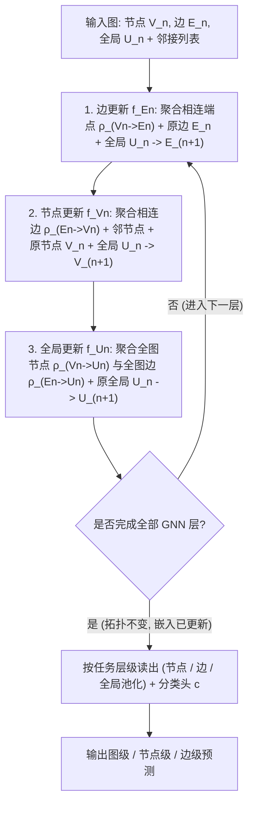

# A Gentle Introduction to Graph Neural Networks

# First Time

## 1.Title & Authors
论文原标题：A Gentle Introduction to Graph Neural Networks。
自然中文译法：图神经网络温和入门。
这篇文章发表于以交互式可视化和极佳可读性著称的期刊 Distill（2021 年 9 月），是一篇自底向上讲透现代图神经网络（GNN）核心组件的教学型综述：
- Graph Neural Networks（图神经网络）：专门处理“实体（节点）+ 关系（边）”这一非网格、可变规模、无固定排序数据结构的神经网络家族。
- A Gentle Introduction（温和入门）：作者不从晦涩的谱图理论（拉普拉斯特征分解）切入，而是从最直观的图数据结构出发，像搭乐高积木一样一层层加上独立 MLP、池化（Pooling）、消息传递（Message Passing）、边表示更新和全局上下文（Global Context），最终拼出完整的 Graph Nets 架构，再配一个真实分子气味分类的交互实验场。标题的核心主张是：把 GNN 拆解成职责清晰的可组合积木块，从动机到实证讲清“为什么需要每个组件、以及不同设计如何改变模型表现”。
作者按原文顺序列出：Benjamin Sanchez-Lengeling、Emily Reif、Adam Pearce、Alexander B. Wiltschko，四人均为 Google Research 研究员。文末 `Author Contributions` 明确记录了真实分工：四位作者均参与正文撰写；Adam Pearce 与 Emily Reif 负责制作全部交互式图解与视觉设计；Benjamin Sanchez-Lengeling 与 Emily Reif 负责早期草图构思；Alexander B. Wiltschko 负责编辑与写作指导。从参考文献 [23][24][59] 可核实，Benjamin Sanchez-Lengeling 与 Alexander B. Wiltschko 长期研究分子气味预测（Leffingwell Odor Dataset）与 GNN 可解释性归因基准，因此全文实验场直接以分子气味图分类为载体。

## 2.Abstract
原文作为 Distill 互动长文，没有标注 “Abstract” 标题，但由标题下方的导语摘要句与开篇两段总览共同承担摘要功能。按原文逻辑拆成四个语义单元精读：
1. 核心问题与定位：神经网络已被改造用来利用图的结构与对称性质；本文逐步拆解搭建图神经网络所需的各个组件，并解释每一项设计选择背后的动机。
2. 现实驱动力与典型应用：现实世界到处都是由连接关系定义的对象，GNN 历经十余年发展，近期表达能力大幅跃升，已在抗菌药物发现、物理仿真、假新闻检测、交通预测与推荐系统等领域落地。
3. 全文四步路线图：
   - 第一步（认识图）：哪些常见与非典型数据可以自然表示为图（从图像、文本到分子、社交与引用网络）；
   - 第二步（图为何难训）：图数据与图像/文本的根本区别，以及面向图结构的专门表示选择；
   - 第三步（逐块搭起现代 GNN）：从最简独立 MLP 基线起步，依次叠加池化、消息传递、边表示与全局表示，搭出完整的现代 Graph Nets 模型；
   - 第四步（交互实战检验）：借助分子气味分类实验场（GNN Playground），直观对比层数、嵌入维度、聚合方式与消息传递路径对预测结果的影响。
4. 与姊妹篇的关系：本文是 Distill 同期两篇 GNN 专题之一，姊妹篇《Understanding Convolutions on Graphs》侧重讲图卷积如何从图像卷积推广而来，本文则聚焦“图数据结构 → 消息传递 / Graph Nets 组件设计 → 实证取舍与进阶专题”的全景入门。
摘要四要素如下：

| 要素 | 本文核心内容 |
|---|---|
| 问题 | 神经网络习惯处理规则网格或定长序列，如何面向大小可变、邻居数不固定、节点重排等价的图结构设计模型，并完成图级、节点级与边级预测？ |
| 方法 | 沿 MPNN 与 Graph Nets 框架由简入繁：用邻接列表存储稀疏连接，从仅更新节点/边/全局的独立 MLP 出发，依次引入跨属性池化、邻居消息传递、边特征更新与全局上下文桥梁。 |
| 结果 | 在 Leffingwell 分子气味数据集（预测是否具有刺激性气味 `pungent`）上系统评测大量架构组合，发现让更多图属性（节点、边、全局）彼此通信是最稳定的提分规律，而最优层数、维度与聚合方式依任务而定。 |
| 意义 | 帮助学习者打通“构图方式 → 对称性约束 → 消息传递组件 → 设计权衡”的完整直觉，作为进入具体 GNN 论文与工程实践的清晰地图。 |

## 3.Final thoughts
原文末尾以 `Final thoughts` 一段作为全文结语，收束全篇三层要义：
1. 图数据的独特性：图是一类表现力极强的结构化数据，它的优势（显式建模复杂实体关系）与挑战（变长、稀疏、置换对称性）都与图像、文本截然不同。
2. 全文工作总结：文章按演进脉络梳理了面向图数据的神经网络里程碑组件，拆解了搭建 GNN 时必须面对的关键设计选择，并通过 GNN Playground 展示这些选择在真实任务里的经验表现。
3. 领域展望：近年来 GNN 的成功为大量新问题打开了大门，作者对图构造、新型信息传播机制、采样与图生成等前沿方向的持续演进表示期待。

## 4.Analogy
可以把 GNN 的工作方式想象成“一栋大型科研楼里的多轮跨部门会议”。
- 每个研究员是一个节点（$V$），两人之间的合作通道是一条边（$E$），大厅里挂着一块全楼共享的公告白板代表全局状态（$U$）。大楼里没有固定的座位编号顺序——就算把工牌号全打乱重排，只要合作关系不变，这就是同一个科研团队（置换不变性）。
- 最简 GNN（独立更新）像是大家关起门来各自整理自己的笔记，彼此不说话；只有最后向院长交总结报告时才把笔记汇总到一起（末端 Pooling）。
- 消息传递（Message Passing）就像开启例会：第 1 轮，每位研究员收集所有直接合作者的最新进展（Gather）、汇总成一份摘要（Aggregate，如求和或取平均），再结合自己的笔记更新认知（Update）。连开 $k$ 轮会，消息就能传到 $k$ 跳之外的同事耳朵里。
- 加入全局白板（Global Representation $U$）就像每轮开完小组会后，大家把核心发现写上大厅白板，再让所有研究员和合作通道同时瞄一眼白板——哪怕大楼两头相隔十万八千里的同事，也能一轮之内隔空互通有无！
- 类比边界：开会轮数不能无止境加下去——如果连开太多次会（层数过深），每个人的笔记都会把全楼人的意见反复混匀，失去各自特色（原文提到的节点表征被“稀释”/过平滑风险）；此外，简单的汇总方式（如只取最大值或平均值）有时会把不同的人数和组合压成完全一样的数字，丢失局部结构细节。

# Second Time

## 1.Notation & Parameters
原文作为直觉优先的教学长文，刻意避免了繁琐公式，仅在图定义、Graph Nets 架构框图与“矩阵乘法即图游走”一节使用了干净清晰的数学记号。下表完整保留原文记号（无任何新增辅助符号）。

| 符号/参数 | 含义与作用 | 关键设定/约束 |
|---|---|---|
| $V$、$E$、$U$ | 图的三类核心属性：节点（Vertex）、边（Edge）与全局（Global/主节点）表示 | 实际存储为向量/嵌入而非单个标量；第 $n$ 层记为 $V_n, E_n, U_n$ |
| $e$、$v_{\mathrm{src}}$、$v_{\mathrm{dst}}$ | 有向边及其源节点与目标节点 | 信息沿 $v_{\mathrm{src}}\to v_{\mathrm{dst}}$ 流动；一条无向边等价于两条方向相反的有向边 |
| $n_{\mathrm{nodes}}$、$n_{\mathrm{edges}}$、$\mathrm{node}_{\mathrm{dim}}$ | 图的节点数、边数与每个节点的特征向量维度 | 节点特征张量形状为 $[n_{\mathrm{nodes}}, \mathrm{node}_{\mathrm{dim}}]$；文末图生成处节点数平方也写作 $N_{\mathrm{nodes}}^2$ |
| $N$、$e_k$、$n_i$、$n_j$ | 节点特征矩阵 $N$；邻接列表中连接节点 $n_i$ 与 $n_j$ 的第 $k$ 条边 $e_k$ | 邻接列表存储复杂度 $O(n_{\mathrm{edges}})$，远省于稠密邻接矩阵的 $O(n_{\mathrm{nodes}}^2)$ |
| $f_{V_n}$、$f_{E_n}$、$f_{U_n}$ | 第 $n$ 个 GNN 层中分别更新节点、边、全局属性的可学习函数（如 MLP） | 同类属性在全图所有节点/边之间共享参数，从而保持置换对称性 |
| $c$ | 末端用于最终任务预测的分类头（如线性分类器 + Sigmoid） | 节点分类图中记为 $c_{V_{L,n}}$，可替换为多分类或回归头 |
| $\rho$、$\rho_{E_n\to V_n}$、$\rho_{V_n\to V_n}$、$\rho_{V_n\to E_n}$ | 池化/聚合算子，下标标明信息流向（如从相连边汇聚到节点） | 需满足置换不变性并支持可变输入数量，常用 `sum`、`mean`、`max` |
| $g$ | 消息传递第一步的邻域收集（gather）函数 | 将目标节点的所有相邻节点嵌入收集到一起，供后续聚合 |
| $\mathrm{cond}(x\mid z)$ | 节点/属性多源条件融合示意记号 | 将节点自身与邻节点、相邻边、全局嵌入整合（拼接、线性映射相加或 FiLM 调制） |
| $G$ | 图对象及其对偶图（dual）讨论中的原图记号 | $G$ 上的边分类可转化为其对偶图（边变节点、节点变边）上的节点分类 |
| $A$、$X$、$B$ | 二值邻接矩阵 $A$（$n_{\mathrm{nodes}}\times n_{\mathrm{nodes}}$）、节点特征矩阵 $X$（$n_{\mathrm{nodes}}\times \mathrm{node}_{\mathrm{dim}}$）及乘积 $B=AX$ | $B=AX$ 实现一跳邻居特征求和聚合；$A^k$ 计数长度为 $k$ 的图游走 |
| $f(\mathrm{node}_i,\mathrm{node}_j)$、$w_1,\dots,w_4$ | 图注意力（GAT）中的节点对打分函数及经 Softmax 归一化后的邻居权重 | 按节点对打分再加权汇聚，天然保持置换不变性 |

## 2.Graphs and where to find them
对应原文开篇至 `Graphs and where to find them`。先建立图的最基本定义：图由实体集合（节点 $V$）、实体间关系（边 $E$）以及描述整张图的全局属性（$U$）构成（逐层感受野导览见 [Fig1 精读](#fig1)，三类属性定义与向量嵌入表示见 [Fig2 精读](#fig2)、[Fig3 精读](#fig3)）。边可以是有向的（信息单向从 $v_{\mathrm{src}}$ 流向 $v_{\mathrm{dst}}$）或无向的（等价于两条反向有向边，见 [Fig4 精读](#fig4)）。随后作者用“由熟到生”的对比帮读者打通直觉：
1. 图像其实就是规则网格图（`Images as graphs`）：把每个像素当节点（特征是 3 维 RGB 向量），相邻像素连边（非边界像素恰好 8 个邻居），于是图像瞬间对应一张带状稀疏邻接矩阵和网格图（[Fig5 精读](#fig5)）。
2. 文本其实就是有向链图（`Text as graphs`）：每个词元当节点，按先后顺序连有向边，邻接矩阵是一条紧贴对角线的斜线（[Fig6 精读](#fig6)）。当然实战中不会傻傻用巨大邻接矩阵存图像和文本，因为它们的连接结构千篇一律；有趣的是，正如文中旁注点出的，Transformer 可以直接视作在“全连接图”上学习词元间动态边权的特殊图注意力网络！
3. 野生异构图数据（`Graph-valued data in the wild`）：真正非用图不可的，是每个节点邻居数量五花八门、拓扑各不相同的真实世界数据——
   - 分子图：原子是节点，共价键（单键、双键等）是边（香茅醛与咖啡因示例见 [Fig7 精读](#fig7)、[Fig8 精读](#fig8)）；
   - 社交网络：人是节点，互动是边（莎士比亚戏剧《奥赛罗》人物关系与经典空手道俱乐部见 [Fig9 精读](#fig9)、[Fig10 精读](#fig10)）；
   - 引用网络与数据流图：论文是节点、引用是有向边（节点可装摘要词向量）；视觉场景物体关系、代码语法树、数学公式计算图皆可表达为图。
   真实图数据集的规模和稀疏程度天差地别（[Table1 精读](#table1)）：从 34 节点的小社交网，到 13.4 万张 $\le 9$ 节点的小分子集合 QM9，再到 1200 万节点、3.78 亿条边的英文维基百科知识图谱。

## 3.What types of problems have graph structured data?
对应原文 `What types of problems have graph structured data?`。所有图预测任务按输出挂在图的哪个层级，干净地分为三大类，且都能用同一套 GNN 框架通吃：
1. 图级任务（Graph-level task）：整张图只输出一个标签或数值（例如判断一个分子有没有刺激性气味、是否含两个环，见 [Fig11 精读](#fig11)），类比图像分类与句子情感分析。
2. 节点级任务（Node-level task）：给图里每个节点分别预测角色或类别（经典案例是 Zachary 空手道俱乐部因教练 Mr. Hi 与管理员 John H 决裂后，预测每位成员站队哪一派，见 [Fig12 精读](#fig12)），类比图像像素级语义分割与文本词性标注。
3. 边级任务（Edge-level task）：预测实体之间是否存在边或关系属于哪一类（例如在视觉场景图里先分割出拳手、裁判、观众和拳台五个物体节点，再预测它们之间谁在打谁、谁在看谁，并将全连接候选边剪枝为稀疏关系图，见 [Fig13 精读](#fig13)、[Fig14 精读](#fig14)）。

## 4.The challenges of using graphs in machine learning
对应原文 `The challenges of using graphs in machine learning`。节点、边和全局属性本身很好存成特征矩阵（如节点特征矩阵 $N$ 第 $i$ 行存 $\mathrm{node}_i$ 特征），真正棘手的是如何把“连接拓扑”喂进神经网络，核心卡在两大痛点：
1. 稀疏爆炸与存储浪费：若用 $n_{\mathrm{nodes}}\times n_{\mathrm{nodes}}$ 稠密邻接矩阵存百万节点的稀疏图，绝大部分格子全是 0，内存和算力白白浪费在 $O(n_{\mathrm{nodes}}^2)$ 上。
2. 置换对称性难题（Permutation Invariance）：图里的节点没有天然的“第 1 个、第 2 个”顺序。把同一张图的节点编号随便调换，邻接矩阵的行列跟着彻底大变样（《奥赛罗》的双矩阵对照见 [Fig15 精读](#fig15)，连区区 4 个节点的小图就有 $4!=24$ 种等价重排矩阵，见 [Fig16 精读](#fig16)）。如果直接把邻接矩阵拍扁塞进普通神经网络，换个节点编号预测结果就乱跳！
工程破局方案是改用邻接列表（Adjacency List）：只把实际存在的每条边 $e_k$ 记成一个端点索引二元组 $(i,j)$，空间与计算复杂度直接从 $O(n_{\mathrm{nodes}}^2)$ 降到 $O(n_{\mathrm{edges}})$，再搭配节点特征、边特征与全局向量组成完整的图数值表示（[Fig17 精读](#fig17)）。

## 5.Graph Neural Networks
对应原文 `Graph Neural Networks` 至 `Adding global representations`。这一大章是全文精华：沿 Gilmer 等人的消息传递框架（MPNN）与 Battaglia 等人的 Graph Nets 蓝图，坚持“图输入、图输出（graph-in, graph-out）——逐层更新节点、边、全局向量，但保持连接拓扑不变”的统一范式，从零搭起四代递进结构。
1. 第一步：最简独立 GNN（`The simplest GNN`）：
   给节点 $V_n$、边 $E_n$ 和全局 $U_n$ 各自配一个共享参数的 MLP（$f_{V_n}, f_{E_n}, f_{U_n}$），独立变换每个实体自己的嵌入，层内完全不看邻接拓扑（[Fig18 精读](#fig18)）。它的唯一作用是搭起“逐属性共享变换 + 图进图出”的基础骨架。
2. 第二步：用末端池化做跨属性预测（`GNN Predictions by Pooling Information`）：
   如果目标位置本身就有特征（比如有节点特征、预测节点标签），直接接分类器 $c$ 即可（[Fig19 精读](#fig19)）。但如果特征存错地方了——比如只有边特征却要预测节点（$\rho_{E_n\to V_n}$，见 [Fig20 精读](#fig20)、[Fig21 精读](#fig21)）、只有节点特征却要预测边（$\rho_{V_n\to E_n}$，见 [Fig22 精读](#fig22)）、或只有节点特征却要预测整张图的全局属性（$\rho_{V_n\to U_n}$，见 [Fig23 精读](#fig23)）——就用池化算子 $\rho$ 做信息路由，分两步走：（1）收集（gather）所有相连项的嵌入；（2）用求和（sum）等置换不变操作聚合成定长向量，最终与多层 GNN 串成完整端到端预测流程（[Fig24 精读](#fig24)）。注意此时连接拓扑仍然只在最后预测读出时才用了一次。
3. 第三步：把池化塞进每一层——消息传递（`Passing messages between parts of the graph`）：
   这是 GNN 真正活起来的关键一跃！在每一个 GNN 层内部就执行三步消息传递（[Fig25 精读](#fig25)）：
   - 收集（Gather）：对每个节点，用 $g$ 收集其全部一跳邻居的嵌入；
   - 聚合（Aggregate）：用置换不变函数 $\rho$（如求和）把变长邻居集合压成单个向量；
   - 更新（Update）：送进可学习神经网络 $f$ 算出下一层的新节点嵌入。
   这与图像卷积异曲同工，唯一区别是图像像素邻居数恒定，而图节点邻居数处处可变。叠上 1 层看 1 跳邻域，叠上 3 层就能把 3 跳之外的信息传进来！只聚合邻居节点嵌入更新节点，就是经典的图卷积层（GCN，见 [Fig26 精读](#fig26)）。
4. 第四步：联合学习边表示与更新顺序（`Learning edge representations`）：
   如果化学键类型等边特征也很重要，就让节点和边在层内双向互传消息（MPNN 层，见 [Fig27 精读](#fig27)）：先拿边和两个端点拼成“消息”，再沿边传给节点。节点与边维度不同时，可先做线性投影对齐空间再相加，或直接拼接后过 MLP。至于“先更新节点再更新边”、“先更新边再更新节点”还是四路并行交织更新（Weave 层：点→点、边→边、点→边、边→点，见 [Fig28 精读](#fig28)），本身就是灵活的架构设计维度。
5. 第五步：加入全局表示打通远距离瓶颈（`Adding global representations`）：
   局部消息传递有个天生短板：跑 $k$ 层最多只能传 $k$ 跳远，大图上相隔很远的两个节点根本搭不上话（加全连接“虚拟边”在大图上又算不动）。解法极其聪明——激活全局向量 $U$（也叫主节点 master node 或上下文向量），让它像中枢枢纽一样同时连接全图所有节点与所有边，构成完整的 Graph Nets 层（[Fig29 精读](#fig29)）！此时更新任意一个节点，都可以同时条件化融合“自身 + 相邻节点 + 相连边 + 全局上下文”（$\mathrm{cond}(x\mid z)$，通过拼接、线性映射相加或 FiLM 特征调制实现，见 [Fig30 精读](#fig30)）。
下面用 Mermaid 流程图直观展示完整 Graph Nets 层的单层信息流动与端到端预测链路（采用典型“边 → 节点 → 全局”条件更新次序，省略张量维度、LayerNorm 与其他可选更新顺序变体）：

## 6.Into the Weeds
对应原文 `Into the Weeds`（共 10 个干货进阶专题，全部属于正文非实验核心技术剖析，逐项讲透）：
1. 更复杂的图类型（`Other types of graphs`）：标准消息传递框架极易推广——多重图（multigraph）允许两节点间存在多类边（如朋友、家人），按边类型分别消息传递即可；嵌套/层级图（hypernode graph）允许每个节点内部本身是一张子图（如化学反应网络里的节点是完整分子），交替跑两级 GNN 即可；超图（hypergraph）允许一条超边同时连住整个社区的多个节点（[Fig37 精读](#fig37)）。
2. 大图采样与分批训练（`Sampling Graphs and Batching in GNNs`）：常规深度学习靠等长 mini-batch 训，但单张巨图塞不进显存，必须采出保留关键性质的子图来分批训练（如随机抽种子节点再扩 $k$ 跳邻域，并只对邻域完整的种子节点算损失；或用随机游走、Metropolis 采样、Cluster-GCN、GraphSAINT，[Fig38 精读](#fig38)）。采样策略高度依赖领域语义——在引用网里抽局部子图很合理，但把一个分子劈成一半就彻底变成了另一种化学物质！
3. 关系归纳偏置（`Inductive biases`）：CNN 借卷积利用图像的平移不变性，RNN/Transformer 利用文本的顺序与全局依赖；GNN 的核心则是“关系归纳偏置”——显式尊重实体间的图连接结构，并对任意节点重排保持置换对称性（本质是在可变长集合上做对称变换）。
4. 比较聚合操作（`Comparing aggregation operations`）：为什么 `sum`、`mean`、`max` 没有谁能一招鲜吃遍天？[Fig39 精读](#fig39) 用两组极简反例一秒讲清：
   - 左侧一对图邻居值分别为 $\{2,4\}$ 和 $\{4,4\}$：`max` 都算出 4（彻底分不开！），但 `mean`（3 vs 4）和 `sum`（6 vs 8）分得清；
   - 右侧一对图邻居值分别为 $\{3,3\}$ 和单个 $\{3\}$：`max`（都是 3）和 `mean`（都是 3）全分不开，只有 `sum`（6 vs 3）分得清！
   直觉总结：`mean` 适合度数变化剧烈、需要归一化特征分布的场景；`max` 擅长拎出邻域里最显著的单一特征；`sum` 同时兼顾特征值与邻居数量（实践中最常用，但对离群大值敏感）。前沿做法如 PNA 会把多种聚合与节点度缩放拼在一起用，分子领域甚至会定制四面体手性聚合算子。
5. GCN 作为子图函数逼近器（`GCN as subgraph function approximators`）：换个视角看，$k$ 层一跳邻居聚合的 GCN/MPNN，在每个节点处看到的正是以它为中心、半径为 $k$ 跳的局部子图。直接枚举所有组合爆炸的子图根本算不动，GCN 相当于动态高效地学习局部 $k$ 跳子图嵌入（[Fig40 精读](#fig40)）。
6. 边与图对偶（`Edges and the Graph Dual`）：把原图 $G$ 的边变成新节点、原节点变成新边，就得到 $G$ 的对偶图（dual）。原图上的边分类任务瞬间等价于对偶图上的节点分类任务（如 Dual-Primal GCN），正如傅里叶变换换个视角让问题变简单一样。
7. 图卷积即矩阵乘法，矩阵幂即图上随机游走（`Graph convolutions as matrix multiplications`）：
   这一节给出全文最核心的精确矩阵推导：设二值邻接矩阵 $A$ 大小为 $n_{\mathrm{nodes}}\times n_{\mathrm{nodes}}$，节点特征矩阵 $X$ 大小为 $n_{\mathrm{nodes}}\times \mathrm{node}_{\mathrm{dim}}$，计算矩阵乘积 $B=AX$，其第 $(i,j)$ 个元素为：
$$
B_{ij}
=\langle A_{\mathrm{row}_i}, X_{\mathrm{column}_j}\rangle
=A_{i,1}X_{1,j}+A_{i,2}X_{2,j}+\dots+A_{i,n}X_{n,j}
=\sum_{A_{i,k}>0}X_{k,j}.
$$
   推导直觉无比清澈：因为 $A_{i,k}$ 只有在 $\mathrm{node}_i$ 与 $\mathrm{node}_k$ 有边相连时才为 1（其余全为 0），这记内积恰好把 $\mathrm{node}_i$ 所有邻居的第 $j$ 维特征求和收集起来！注意 $AX$ 只做了“求和聚合”，在其前后乘上可学习权重矩阵或 MLP 就构成完整图卷积更新。同时也能反过来看出邻接列表的妙处：免去大量乘零运算，且不受限于只能用求和聚合。
   进一步把邻接矩阵自己乘自己得到 $A^2$，其第 $(i,j)$ 项为：
$$
A^2_{ij}
=\langle A_{\mathrm{row}_i}, A_{\mathrm{column}_j}\rangle
=A_{i,1}A_{1,j}+A_{i,2}A_{2,j}+\dots+A_{i,n}A_{n,j}.
$$
   看第一项 $a_{i,1}a_{1,j}$：当且仅当存在边 $\mathrm{node}_i\to\mathrm{node}_1$ 且存在边 $\mathrm{node}_1\to\mathrm{node}_j$ 时它才为 1，也就是数出经过中间点 $\mathrm{node}_1$ 长度为 2 的通路！对全部中间点求和，$A^2_{ij}$ 精确数出从 $\mathrm{node}_i$ 到 $\mathrm{node}_j$ 的所有长度为 2 的游走（walks）条数；以此类推，$A^3=AA^2$ 计数长度 3 的游走，$A^k$ 计数长度 $k$ 的游走——多次乘以 $A$ 在几何上就是在图上不断向外多走几步！
8. 图注意力网络（`Graph Attention Networks`）：不想把所有邻居一视同仁地等权求和，那就给节点对算一个相关性标量打分 $f(\mathrm{node}_i,\mathrm{node}_j)$（常用线性投影出的 Query 和 Key 做内积），再用 Softmax 归一化成权重 $w_1,\dots,w_4$ 对邻居特征加权汇聚（GAT 与 Set Transformer 的核心，[Fig41 精读](#fig41)）。因为打分只依赖节点对，置换不变性丝毫不破，而且权重天然提供边重要性解释。由此还能一眼看穿大一统视角：Transformer 本质上就是在全连接图上跑注意力机制的 GNN，差异只在稀疏连接先验与全连接先验。
9. 图解释与归因（`Graph explanations and attributions`）：为了调试模型或辅助科学发现（比如找到决定分子毒性的关键官能团子图），归因方法给节点和边打出重要性排序，GNNExplainer 则进一步抽取出最影响预测的连通子图（[Fig42 精读](#fig42)）。
10. 图生成建模（`Generative modelling`）：不同于“拓扑不变、只改嵌入”的预测任务，图生成（如新药分子设计）要连拓扑本身一起凭空造出来，面临尺寸可变与 $N_{\mathrm{nodes}}^2$ 边组合的巨大空间。文中概括了三类主流路线：用自编码器像画图一样预测邻接矩阵（GraphVAE，通过只采样已知边与部分非边避开完整 $N_{\mathrm{nodes}}^2$ 开销）；用 RNN 或强化学习策略梯度一步步离散增删节点与边（GraphRNN 等）；以及把分子图转成带严格化学语法的序列字符串（如 SELFIES）来生成。

## 7.Figure & Table
原文作为 Distill 互动长文，所有 42 幅图解与 1 张统计表均无原编号；以下按原文实际出现顺序分别从 1 连续补号（`Fig1`–`Fig42`、`Table1`，均属导读按出现顺序补号），逐项给出清晰精读。

#### Fig1:
位置与目的：导读补号，位于文章标题下方开篇处，用四层递进交互图（Layer 0 到 Layer 3）让人第一眼就直观感受 GNN 如何逐层向外收集邻域信息。
读图要点：随着网络层数从 0 走到 3，高亮的中心节点逐跳吸收 1 跳、2 跳、3 跳邻居的颜色信号，清晰呈现“层数 = 信息传播跳数”的感受野扩张规律。

#### Fig2:
位置与目的：导读补号，位于开篇图定义处，标出图的三类核心属性：节点属性 $V$（实体身份、度数）、边属性与方向 $E$（边类型、权重）与全局属性 $U$（节点总数、最长路径）。
读图要点：提醒读者图不仅有拓扑连线，还可以同时在点、边、全局三个位置携带数值信息。

#### Fig3:
位置与目的：导读补号，紧接 Fig2 展示三类属性的向量嵌入存储形态：黄色柱状向量代表节点嵌入、蓝色代表边嵌入、红色代表全局嵌入。
读图要点：将抽象概念落到神经网络可计算的实数向量形式。

#### Fig4:
位置与目的：导读补号，位于开篇末尾，用箭头对比有向边（单向从 $v_{\mathrm{src}}$ 指向 $v_{\mathrm{dst}}$）与无向边（等价于一对方向相反的有向边）。
读图要点：决定后续消息传递的流向规则。

#### Fig5:
位置与目的：导读补号，位于 `Images as graphs`，并排展示一张 $5\times 5$ 笑脸图像的三种等价视角：左为像素网格、中为 $25\times 25$ 带状邻接矩阵、右为 8 邻域像素图。
读图要点：直观打通“图像只是规则网格图”的认知，看清带状稀疏矩阵特征。

#### Fig6:
位置与目的：导读补号，位于 `Text as graphs`，将短句拆成词元节点依次串联成有向链，并配出紧贴次对角线的邻接矩阵。
读图要点：说明序列只是极简的一维有向图，而连接方式可按模型假设自由切换（如链式 RNN vs 全连接 Transformer）。

#### Fig7:
位置与目的：导读补号，位于 `Molecules as graphs`，并排呈现香茅醛（Citronellal）的 3D 球棍模型、11 原子化学键邻接矩阵和 2D 拓扑图。
读图要点：展示如何把真实 3D 分子抽象为原子—化学键图（同时也提醒纯 2D 拓扑默认不含完整 3D 空间距离）。

#### Fig8:
位置与目的：导读补号，与 Fig7 并列呈现咖啡因（Caffeine）分子的 3D 结构、14 原子邻接矩阵和双环图结构。
读图要点：对比不同分子截然不同的环状连接与节点度数，凸显异构图与规则网格的本质差异。

#### Fig9:
位置与目的：导读补号，位于 `Social networks as graphs`，并排展示莎士比亚剧作《奥赛罗》的舞台剧照、人物互动邻接矩阵及人物关系网络图。
读图要点：演示如何把角色抽象为节点、同场互动抽象为边；注意画布上节点摆放距离只为美观，不代表关系强弱。

#### Fig10:
位置与目的：导读补号，紧接 Fig9 展示空手道比赛照片、Zachary 空手道俱乐部 34 位成员的互动邻接矩阵与社团拓扑图。
读图要点：为后文经典的节点站队分类任务埋下数据伏笔。

#### Table1:
位置与目的：导读补号，位于 `Graph-valued data in the wild` 结尾，列出四个真实世界图数据集的统计特征（领域、图数量、节点数、边数及节点度的最小/平均/最大值）。
关键数字对比：空手道俱乐部仅 1 张图、34 节点、78 边（平均度 4.5，最大 17）；QM9 含 13.4 万张小分子图，每张 $\le 9$ 节点、$\le 26$ 边（度 1–5）；Cora 引用网 1 张图含 23,166 节点、91,500 边（平均度 7.8，最大 379）；英文维基百科链接图 1 张巨图高达 1200 万节点、3.78 亿边（平均度 62.24，最大度竟达 100 万！）。表注特别说明统计值依赖特征化方式，空白格为原表未填而非零。

#### Fig11:
位置与目的：导读补号，位于 `Graph-level task`，展示多张输入分子图各自输出一个整图二分类标签（例如“是否包含两个环”）。
读图要点：确立“一图一标签”的图级任务输入输出形态。

#### Fig12:
位置与目的：导读补号，位于 `Node-level task`，左右对照展示空手道俱乐部图输入（未着色节点）与节点分类输出（按站队 Mr. Hi 或 John A 分别染成不同颜色）。
读图要点：输入输出拓扑丝毫不变，预测值挂在每一个节点上。

#### Fig13:
位置与目的：导读补号，位于 `Edge-level task`，分（a）摔跤比赛原图、（b）分割出的 5 类物体实体、（c）实体间语义关系图（如 fighting、watching、standing on）三步展示视觉场景图构造。
读图要点：厘清“检测物体节点”与“推理物体间边关系”两步分工。

#### Fig14:
位置与目的：导读补号，紧接 Fig13，左侧是从场景物体构造的全连接候选图，右侧是经边级预测后剪除多余连线、保留有效关系标签的稀疏场景图。
读图要点：直观展示“全连接初始化 → 边分类打分 → 剪枝”的通用边推理范式。

#### Fig15:
位置与目的：导读补号，位于 `The challenges of using graphs in machine learning`，并排画出代表同一张《奥赛罗》人物关系图、仅因角色排序不同而截然迥异的两张邻接矩阵。
读图要点：一图讲透“普通矩阵输入对节点编号顺序敏感”的核心痛点。

#### Fig16:
位置与目的：导读补号，展示一张 4 节点（A/B/C/D）小图的全部 $4!=24$ 种节点排列对应的邻接矩阵。
读图要点：直观感受组合重排爆炸（大图 $n!$ 彻底不可枚举），强化置换不变设计的必要性。

#### Fig17:
位置与目的：导读补号，展示如何把一张 8 节点小图无损编码成四大数值张量：`Nodes` 特征列表、`Edges` 特征列表、`Adjacency List` 边端点索引对列表（如 `[1,0], [2,0], ...`）和 `Global` 属性值。
读图要点：清晰呈现现代图神经网络库（如 PyG、DGL）的底层数据结构原型。

#### Fig18:
位置与目的：导读补号，位于 `The simplest GNN`，画出最简“图独立层（Graph Independent Layer）”结构图：$U_n, V_n, E_n$ 分别通过各自独立的更新函数 $f_{U_n}, f_{V_n}, f_{E_n}$ 变成 $U_{n+1}, V_{n+1}, E_{n+1}$，三条虚线平行互不交叉。
读图要点：记住这套图例语言（左入右出、拓扑不变、三条并行属性轨），后面所有进阶架构都在这张底图上加连线！

#### Fig19:
位置与目的：导读补号，位于 `GNN Predictions by Pooling Information`，展示节点已有嵌入时直接接末端分类器 $c_{V_{L,n}}$ 输出各节点颜色标签。
读图要点：信息与预测同层时的最简读出方式。

#### Fig20:
位置与目的：导读补号，用交互图演示“从相邻边到目标节点的池化”：高亮黑色目标节点相连的三条蓝色边，将三条边向量按位相加（`+`）汇聚成该节点的定长特征向量。
读图要点：形象展现“输入条数可变、聚合输出定长”的核心机制。

#### Fig21:
位置与目的：导读补号，画出“仅有边特征、需预测节点标签”的末端架构：先把边嵌入经 $\rho_{E_n\to V_n}$ 汇聚到节点轨，再接节点分类器 $c$。
读图要点：池化扮演跨属性路由桥梁的第一个案例。

#### Fig22:
位置与目的：导读补号，画出“仅有节点特征、需预测边标签”的末端架构：用 $\rho_{V_n\to E_n}$ 把每条边两端点的节点嵌入汇聚到边轨，再接边分类器 $c$。
读图要点：与 Fig21 互为镜像，展现统一路由语法。

#### Fig23:
位置与目的：导读补号，画出“仅有节点特征、需预测整图全局属性”的末端架构：经全局池化 $\rho_{V_n\to U_n}$ 汇总全图所有节点，再接图级分类器 $c$（类比 CNN 全局平均池化）。
读图要点：分子气味分类等图级任务的标准读出方式。

#### Fig24:
位置与目的：导读补号，把多层 GNN 模块与末端池化分类头串成完整端到端流程：输入图依次经过多层表示更新（连线不变、颜色变深）$\to$ 末端读出预测。
读图要点：建立“多层表征学习 + 末端任务读出”的整体宏观视角。

#### Fig25:
位置与目的：导读补号，位于 `Passing messages between parts of the graph`，清晰拆解单步节点消息传递三动作：收集高亮节点的所有邻居黄色向量并求和聚合（`+`）$\to$ 过可学习变换 $f$ $\to$ 写回 Layer $N+1$ 的更新后节点嵌入。
读图要点：最核心的局部消息传递动态直观图。

#### Fig26:
位置与目的：导读补号，紧接 Fig25，把消息传递画回三轨框架里得到经典的 Graph Convolutional Layer（GCN）：在节点轨 $f_{V_n}$ 前方插入一跳邻节点聚合 $\rho_{V_n\to V_n}$。
读图要点：对比 Fig18，多出这一个小黑点聚合步骤，节点间就真正开始交换拓扑信息了！

#### Fig27:
位置与目的：导读补号，位于 `Learning edge representations`，画出完整的 Message Passing Layer（MPNN）架构图：先经 $\rho_{V_n\to E_n}$ 把端点信息汇入边轨、由 $f_{E_n}$ 更新边消息，再经 $\rho_{E_n\to V_n}$ 把边消息汇聚回节点轨、由 $f_{V_n}$ 更新节点。
读图要点：化学键等边信息由此深度参与每一步原子特征演化。

#### Fig28:
位置与目的：导读补号，位于 `Learning edge representations` 末尾，上方对比“先点后边（Node Then Edge）”与“先边后点（Edge Then Node）”两种串行顺序，下方画出四路交叉更新的 Weave Layer。
读图要点：强调不同属性之间的更新顺序与耦合路径是重要的 GNN 设计自由度。

#### Fig29:
这是全篇最重要的一张图（导读补号，位于 `Adding global representations`），完整画出集大成的 Graph Nets Layer 架构，把全文从独立 MLP、池化、消息传递、边更新到全局主节点的所有拼图一网打尽。
读图要点：紧盯三条平行轨道 $U_n, V_n, E_n$ 之间密织的灰色汇聚箭头——边更新融合端点与全局，节点更新融合相连边、自身与全局，全局更新汇聚全图所有节点与所有边并反哺下一层。回看整篇文章时，只要盯着这张图，所有先前的简易模型（独立层、GCN、MPNN）一眼就能看出是把这张图里某些连线关掉后的特例！

#### Fig30:
位置与目的：导读补号，放大特写 Graph Nets 层里单个节点的条件化更新细节：把节点自身嵌入、相邻节点嵌入、相连边嵌入和全局嵌入一起送入条件融合框 $\mathrm{cond}(x\mid z)$（可用拼接、线性投影相加或 FiLM 层），再经 $f_{V_n}$ 输出更新后的节点向量。
读图要点：把抽象的箭头汇合落到了三种具体可写代码的张量融合操作上。

#### Fig31:
位置与目的：导读补号，位于 `GNN playground`，展示分子气味二分类交互界面的静态截屏：左侧是可编辑原子/化学键的分子结构（界面快照显示预测 `14% pungent`、真值 `not pungent`），右侧是全数据集分子倒数第二层图嵌入的 2D PCA 散点分布。
读图要点：区分单个分子的概率预测与全数据集的表示空间分布，直观观察“增删一个原子或改一根双键如何牵动预测概率”。

#### Fig32:
位置与目的：导读补号，位于 `Some empirical GNN design lessons`，横轴为对数坐标的可训练参数量（100 至 1,000,000），纵轴为刺激性气味预测测试集 AUC（0.50–0.90，越高越好），右侧附汇总箱线图。
趋势与反例：整体上参数越多平均 AUC 越高，但 GNN 参数效率极高——仅约 3,000 参数的小模型就已经冲上高分段，而近 10 万参数的某些配置表现反倒平平。

#### Fig33:
位置与目的：导读补号，三联箱线图分别比较节点嵌入维度（12/25/50）、边嵌入维度（5/10/20）和全局嵌入维度（25/50/100）对测试 AUC 的分布影响。
趋势要点：提高维度普遍拉高均值与下界（容错更好），但最高点并不垄断在最大维度里，较小维度里同样藏着顶尖模型。

#### Fig34:
位置与目的：导读补号，按 GNN 层数（1、2、3、4 层，红/蓝/绿/紫着色）拆解参数量—AUC 散点与右侧分组箱线图。
关键反直觉发现：虽然均值随层数略升，但全盘测试 AUC 最高的尖子生竟然出现在 2 层模型中，而且 4 层模型的性能下界反而往下掉！作者点出经典原因：层数过多导致信息在多轮迭代中被反复“稀释”（过度混合/过平滑）。

#### Fig35:
位置与目的：导读补号，按聚合算子类型（`max`、`mean`、`sum`）着色的散点与右侧三组箱线图。
关键发现：三组箱线图高度重叠——`sum` 的均值略占微弱上风，但 `max` 和 `mean` 都能训出同样顶尖的模型，说明该任务上聚合方式并非拉开差距的唯一胜负手。

#### Fig36:
位置与目的：导读补号，按消息传递通信组合（8 种开关组合，从完全不通信 `none` 到节点/边/全局全互通）着色的散点与箱线图，这是全文实验里规律最清晰的一张图！
核心发现：左侧完全关闭消息传递（`none`）或只传边信息的组 AUC 整体垫底（约 0.62–0.65）；随着参与通信的图属性越多，箱线图稳步节节攀升，最右侧“点 + 边 + 全局”全通信组（Graph Nets）整体均值与峰值遥遥领先（最高近 0.84）。

#### Fig37:
位置与目的：导读补号，位于 `Other types of graphs`，左侧画出一张含三种边类型（含双向与有向边）的多重图，右侧画出一张含底层普通节点、中间层超节点（内部嵌子图）与顶层全局节点的三级层级图。
读图要点：直观扩展标准单边平面图的概念边界。

#### Fig38:
位置与目的：导读补号，位于 `Sampling Graphs and Batching in GNNs`，四宫格对比在同一张大图上运行四种采样子图策略的结果（不同颜色标出种子/游走节点与拓展邻居）。
读图要点：不同采样策略抽出来的子图节点数、边数和连通度分布截然不同，必须按业务场景慎选。

#### Fig39:
位置与目的：导读补号，位于 `Comparing aggregation operations`，用两组极简标量邻居反例（左 `{2,4}` vs `{4,4}`；右 `{3,3}` vs `{3}`）分别列出 `Max`、`Mean`、`Sum` 的输出数字，标红“失效分不开”的行。
读图要点：左组 `Max` 全得 4（标红失效），右组 `Max` 与 `Mean` 全得 3（标红失效），一秒讲清为何没有哪种单一简单聚合永远最强。

#### Fig40:
位置与目的：导读补号，位于 `GCN as subgraph function approximators`，示意从不同节点视角抽取出的局部 $k$ 跳子图各自映射为嵌入后再汇聚用于整图预测。
读图要点：帮助建立“多层局部消息传递 = 动态子图特征提取”的对偶直觉。

#### Fig41:
位置与目的：导读补号，位于 `Graph Attention Networks`，拆解单节点图注意力计算：右侧节点对的 Query 与 Keys 算出交互打分矩阵，经 Softmax 归一化为边权重 $w_1,w_2,w_3,w_4$，再对左侧对应邻居的 Values 向量加权求和得到更新后节点嵌入。
读图要点：一目了然地串起 GAT 与 Transformer 自注意力的共同内核。

#### Fig42:
位置与目的：导读补号，位于 `Graph explanations and attributions`，上方左右分别演示节点归因（高亮重要原子）和边归因（高亮重要化学键），下方演示基于归因排序抽取出与预测最相关的六元环关键子图。
读图要点：直观展示“归因打分 → 关键子图提取”的可解释工作流。
## 8.GNN playground & Some empirical GNN design lessons
对应原文 `GNN playground` 与 `Some empirical GNN design lessons`。这一实证部分把前面搭好的积木放到真实的 Leffingwell 分子气味数据集上真刀真枪比拼：
- 任务与建模模板：将分子表为图（节点 one-hot 编码原子身份 C/N/O/F 等，交互界面另含 S 硫；边 one-hot 编码单/双/三/芳香键），执行二分类判断气味是否刺鼻（`pungent`，如大蒜里的烯丙醇或薄荷里的胡椒酮）。每层更新函数为 1 层 MLP + ReLU + LayerNorm，末端接线性层 + Sigmoid 输出概率，并用 PCA 将倒数第二层图嵌入压到 2D 方便肉眼观察（[Fig31 精读](#fig31)）。
- 四大架构旋钮的系统扫描结果：
  1. 参数量与维度（[Fig32 精读](#fig32)、[Fig33 精读](#fig33)）：越大平均分越高、下界越稳，但小模型（约 3k 参数）和窄维度同样能出高分，GNN 极具参数效率。
  2. 层数深度（[Fig34 精读](#fig34)）：最优尖子生落在 2 层，堆到 4 层反而拉低性能下界，呼应“深层消息传递容易稀释节点表征”的经典现象。
  3. 聚合算子（[Fig35 精读](#fig35)）：`sum` 均值略优，但 `max`/`mean`/`sum` 高度重叠，选错不致命、选对也非万能。
  4. 最决定性的提分规律——多属性通信与构图质量：在全部旋钮中，让节点、边和全局表示彼此充分通信的提分趋势最清晰稳定（[Fig36 精读](#fig36)）。作者据此点出两条最值得发力的前进方向：一是超越局部邻域池化、设计能表达长路径等复杂图概念的新算法；二是跳出“只卷模型架构”的定式，花精力打磨如何构图（如给分子图补充 3D 空间距离边、非键相互作用或子图显式关联）。

# Overall Review

- 主要贡献： 本文是图神经网络领域公认的教科书级入门佳作。第一，它把长期以来显得晦涩零散的图学习概念（数据结构、对称性、任务层级、Pooling、GCN、MPNN、Graph Nets）拧成了一条极其顺滑的递进主线——每一步只加一个直观积木、讲清它解决什么具体痛点（[Fig18 精读](#fig18) $\to$ [Fig26 精读](#fig26) $\to$ [Fig27 精读](#fig27) $\to$ [Fig29 精读](#fig29)）。第二，通过真实的分子气味实验场与大规模架构扫描（[Fig31 精读](#fig31)–[Fig36 精读](#fig36)），用实证数据破除了“越深越好 / 某种聚合通吃”的迷思，把读者的注意力引向“属性通信路径”与“构图本身”。
- 技术优点： 视觉化叙事登峰造极——用统一的三轨图示（$U_n, V_n, E_n$）让读者一眼看出独立 MLP、GCN、MPNN、Weave 和完整 Graph Nets 之间的包含关系；把抽象概念和熟悉事物无缝对接（图像即网格图、文本即有向链、Transformer 即全连接图上的 GAT、$B=AX$ 与 $A^k$ 即一跳聚合与 $k$ 步游走），读完立刻建立扎实直觉。
- 潜在不足： 作为面向入门者的 Distill 综述，它在数学深度上有意做了取舍：没有展开谱图卷积与拉普拉斯矩阵推导，也没有严格区分图级“置换不变性”与节点级“置换等变性”的形式化定义，对 1-WL 图同构测试与 GNN 表达能力上限、以及深层过平滑/过挤压（over-smoothing / over-squashing）的定量机理仅点到为止；此外，气味分类实验未列出完整的数据划分、随机种子和置信区间，其经验规律不能机械套用到引文网或超大规模社交图上。
- 相关工作定位： 文章在体系上直接承接 Gilmer et al.（2017, MPNN）与 Battaglia et al.（2018, Graph Nets）两大经典统一框架，与同期 Distill 姊妹篇《Understanding Convolutions on Graphs》（偏谱域与图卷积推广）形成绝佳互补，是衔接直觉入门与具体前沿方法论文（GCN、GraphSAGE、GAT、GIN、Graphormer、Equivariant GNN）的理想桥梁。
- 启发与延伸： 最有实战价值的启发是“先想清楚怎么构图、哪些实体与关系需要通信，再挑模型架构”——很多时候在分子图里补上 3D 几何边或虚拟全局节点，收益远胜盲目加深层数。读完本文后，最顺畅的进阶路线是继续研读 GIN（从 1-WL 视角理解聚合表达力）、GAT / Graph Transformer（全局注意力化解过挤压）、以及 $E(3)$ 等变图网络（把 3D 空间旋转平移对称性写进分子与物理仿真模型）。
- 适合谁读： 只要了解基础 MLP、向量矩阵乘法和基本分类训练，就能零障碍通读全文。非常适合刚接触图深度学习的新手建立全局地图；对已经熟悉 Transformer 或 CNN 的研究者，重点读第 2、5、6 节（尤其是 [Fig29 精读](#fig29) 和矩阵游走/图注意力两小节），半小时就能把 GNN 纳入自己已有的深度学习知识框架中。
