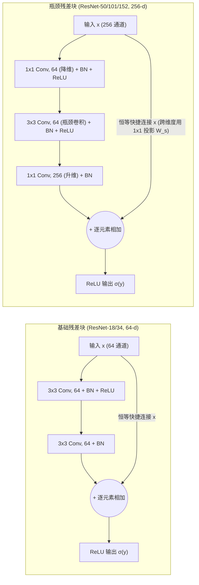

# Deep Residual Learning for Image Recognition

# First Time

## 1.Title & Authors
论文原标题：Deep Residual Learning for Image Recognition。
自然中文译法：面向图像识别的深度残差学习。
标题只有六个英文词，却定义了此后十年深度学习最核心的架构范式：
- Image Recognition（图像识别）：本文覆盖的核心任务，从 ImageNet 1000 类图像分类一路打穿到 PASCAL VOC / MS COCO 目标检测、目标定位与实例分割。
- Deep（深度）：表达能力的关键引擎。此前 VGG（16–19 层）与 GoogLeNet（22 层）已证明“网络越深，特征层次越丰富”，但直接把普通网络堆到几十上百层时，训练误差竟然反升不降（退化问题）。
- Residual Learning（残差学习）：标题的核心主张是换一种让网络拟合目标函数的方式——别让堆叠的卷积层凭空去学完整映射，而是让它以当前输入为参照，只学习“输出相对输入需要修正的增量（残差）”。
作者按原文顺序列出：Kaiming He（何恺明）、Xiangyu Zhang（张祥雨）、Shaoqing Ren（任少卿）、Jian Sun（孙剑），四人当时均就职于 Microsoft Research（微软亚洲研究院）。原文未标注共同第一作者或特殊署名脚注。对照本文参考文献 [11][12][13][32][33] 可核实，该团队此前已接连提出 SPPNet（ECCV 2014）、PReLU 与 Kaiming 初始化（ICCV 2015）以及 Faster R-CNN（NIPS 2015），本篇 ResNet 正是他们解决“极深网络优化瓶颈”并一举横扫 ILSVRC & COCO 2015 五项冠军的代表作。

## 2.Abstract
摘要非常紧凑，直接沿着“痛点提出 → 残差重构 → 优化与深度红利 → 分类冠军战绩 → 检测与跨任务泛化”五步展开。
1. 痛点与框架提出：越深的神经网络越难训练；作者提出残差学习框架（residual learning framework），让训练远超以往深度的极深网络变得轻松。
   这句话把全文聚焦在“优化难度”而非单纯堆参数上：不是深网络不够强，而是常规堆叠让优化器根本训不动。
2. 核心重构机制：显式地让网络层以当前层输入为参照，学习残差函数（residual functions），而不是学习没有参照的原始映射（unreferenced functions）。
   大白话理解就是：以前你要求几层卷积把输入 $\mathbf{x}$ 直接变出目标 $\mathcal{H}(\mathbf{x})$；现在先把输入 $\mathbf{x}$ 原封不动抄一条近路送到输出端，让卷积层只负责算出差额 $\mathcal{F}(\mathbf{x}):=\mathcal{H}(\mathbf{x})-\mathbf{x}$。两者在数学表达力上等价，但优化难度天差地别。
3. 经验证据主结论：大量实验表明，残差网络更容易优化，并且能够实实在在地从大幅增加的深度中赚到精度提升。
   这是全文最核心的实证主张：普通网络加层会变差，残差网络加层反而一路变强。
4. ImageNet 深度、复杂度与分类冠军：作者在 ImageNet 上评估了深达 152 层的残差网络——深度是 VGG 的 8 倍，计算复杂度却比 VGG 还低；残差网络集成在 ImageNet 测试集上拿下 3.57% Top-5 错误率，夺得 ILSVRC 2015 分类任务第一名，并在 CIFAR-10 上进一步探索了 100 层乃至 1000 层以上的网络。
   这里有两个极亮眼的数字：152 层 ResNet 的计算量仅 $11.3\times 10^9$ FLOPs，远低于 VGG-16（$15.3\times 10^9$）和 VGG-19（$19.6\times 10^9$），归功于精巧的瓶颈块（bottleneck）和去掉庞大全连接层的设计；3.57% 对应六模型集成的测试集 Top-5 错误率，单模型 152 层验证集 Top-5 错误率为 4.49%。
5. 跨视觉任务的迁移威力：表征深度对所有视觉识别任务都至关重要；仅靠把骨干换成极深残差表征，在 COCO 目标检测上就取得 28% 的相对提升（mAP@[.5, .95] 从 21.2% 飙升至 27.2%）。以深度残差网络为底座，团队同时包揽了 ILSVRC & COCO 2015 的 ImageNet 检测、ImageNet 定位、COCO 检测和 COCO 分割全部第一名。
将摘要压成四要素如下：

| 要素 | 本文核心内容 |
|---|---|
| 问题 | 极深神经网络遭遇“退化问题”：层数加深后训练误差反而升高，难以通过简单堆层换取精度。 |
| 方法 | 提出残差学习框架：用零额外参数的恒等快捷连接（shortcut connections）将目标映射改写为 $\mathcal{F}(\mathbf{x})+\mathbf{x}$，让堆叠层专心拟合残差。 |
| 结果 | ImageNet 上成功训练 152 层网络（复杂度仍低于 VGG），集成达到 3.57% Top-5 测试错误率夺冠；CIFAR-10 训练至 110 层（6.43%）乃至 1202 层；COCO 目标检测仅靠换骨干即实现 28% 相对提升。 |
| 意义 | 彻底打通了百层以上深度网络的可训练性，使“靠加深网络提升通用视觉表征”成为跨分类、检测、定位、分割的统一基石。 |

## 3.Conclusion
原文没有设立独立的 `Conclusion` 或 `Discussion` 章节，第 4.3 节 `Object Detection on PASCAL and MS COCO` 结束后直接进入参考文献与检测附录。按照论文实际收尾与引言总述，整篇工作的总结性结论落在三点上：
- 方法论结论（第 1 节与第 3.1 节）：深度网络变深后性能下降的核心障碍是优化退化而非过拟合或梯度消失；残差重构（$\mathcal{F}(\mathbf{x})+\mathbf{x}$）通过恒等映射提供良好的优化预处理，让深层网络稳定吃下深度红利，且作者预期这一通用原则可推广至视觉与非视觉任务。
- 跨任务实证结论（第 4.3 节收尾）：仅靠将 Faster R-CNN 的骨干从 VGG-16 换为 ResNet-101，PASCAL VOC 与 MS COCO 检测性能即大幅跃升（COCO 标准指标相对提升 28%），并支撑团队包揽 ILSVRC & COCO 2015 多项冠军。
- 原文留下的开放问题（第 4.1 节与第 4.2 节末尾）：第一，普通深层网络为何出现疑似指数级缓慢的收敛退化，其底层理论机理留待后续研究；第二，在 CIFAR-10 等小数据集上堆到 1202 层（19.4M 参数）虽能把训练误差压到 0.1% 以下，但测试误差（7.93%）差于 110 层（6.43%），作者将其归因于小数据集上的过拟合，并指出结合更强正则化（如 dropout/maxout）是未来方向。

## 4.Analogy
可以把训练深层网络想象成“接力修改一份设计图纸”。
- 普通深层网络（Plain Net）像是每一任设计师拿到上一任的图纸后，必须拿一张白纸从头临摹整幅画，再顺手改一点细节。只要传个三五十棒，就算后面多请二十位大师，光靠纯手工把前人的画一模一样重画一遍都会走样变形——结果人越多（层越深），画得反而越烂（退化问题）。
- 残差网络（ResNet）给每位设计师发了一张透明硫酸纸盖在原图上：原图直接透过来原样保留（恒等快捷连接 $\mathbf{x}$），设计师只需要在硫酸纸上画“要修改的那几笔增量”（残差 $\mathcal{F}(\mathbf{x})$），最后把两张纸叠在一起交给下一棒（$\mathcal{F}(\mathbf{x})+\mathbf{x}$）。
- 一旦某几棒其实不需要大改，设计师只要在硫酸纸上留白（把权重推向零）就能轻松做到零损耗传递，再也不会越传越歪；如果确实需要精雕细琢，也只需在原图基础上做微调，比推倒重画省力得多。
- 这个比喻的边界在于：实际卷积层之间存在非线性 ReLU、跨阶段下采样和通道翻倍（此时快捷支路需补零或做 $1\times 1$ 线性投影 $W_s\mathbf{x}$）；同时，虽然 ResNet 解决了优化退化，但在数据量小的任务上无限加层依然会遇到参数冗余导致的过拟合（如 CIFAR-10 的 1202 层现象）。

# Second Time

## 1.Notation & Parameters
ResNet 的数学记号极其清爽克制，全篇核心方程只有两条，重点符号如下表所示（完全保留原文符号与粗体习惯）。

| 符号/参数 | 含义与作用 | 关键设定/约束 |
|---|---|---|
| $\mathbf{x}$、$\mathbf{y}$ | 残差构建块的输入向量（或特征图）与输出向量（或特征图） | 输入与输出维度相同时用式 (1)，维度改变时用式 (2) |
| $\mathcal{H}(\mathbf{x})$ | 若干堆叠层原本期望拟合的目标底层映射 | 残差学习不直接拟合它，而是重构为 $\mathcal{F}(\mathbf{x})+\mathbf{x}$ |
| $\mathcal{F}(\mathbf{x})$、$\mathcal{F}(\mathbf{x},\{W_i\})$ | 堆叠非线性层实际学习的残差映射函数 | 需至少包含 2 层（如两层 $3\times 3$ 或三层瓶颈 $1\times 1, 3\times 3, 1\times 1$） |
| $W_i$、$W_1$、$W_2$ | 残差支路中第 $i$ 个权重层的参数 | 简记式 $\mathcal{F}=W_2\sigma(W_1\mathbf{x})$ 省略偏置与 BN |
| $\sigma$ | 非线性激活函数（ReLU） | 块内两层之间做一次 $\sigma$，相加之后再做第二次 $\sigma(\mathbf{y})$ |
| $W_s$ | 快捷连接上的线性投影矩阵 | 仅在特征图尺寸减半/通道数翻倍时用于对齐维度（$1\times 1$ 卷积） |
| $n$ | 控制 CIFAR-10 网络深度的每阶段块数参数 | 总权重层数为 $6n+2$，快捷连接共 $3n$ 条；实验取 $n\in\{3,5,7,9,18,200\}$ |
| $s$ | 多尺度测试时的图像短边缩放尺寸 | ImageNet 取 $\{224,256,384,480,640\}$；COCO 附录取 $\{200,400,600,800,1000\}$ |

阅读公式时抓牢一条约定：原文式 (1) 和式 (2) 为书写简洁采用了全连接向量记法并省略偏置和 BN，实际图像网络中 $\mathcal{F}(\mathbf{x},\{W_i\})$ 代表多层卷积与 BN 的堆叠，快捷加法是逐通道、逐像素的元素级相加。

## 2.Introduction
对应原文 Section 1。引言用一段极其漂亮的逻辑反证，把所有人从“梯度消失”的思维定式里拉出来，直指“退化问题”的本质：
1. 深度为何迷人？从 AlexNet 到 VGG（16–19 层）、GoogLeNet（22 层），视觉识别的几乎所有突破都伴随着网络加深——深层网络能端到端自然地把低级边缘、中级纹理和高级语义融在一起。
2. 大家原本以为拦路虎是梯度消失/爆炸，但其实已经被基本按住了。靠规范化初始化（Xavier / Kaiming 初始化）和中间归一化层（Batch Normalization, BN），几十层的网络早就能够用 SGD 正常起步收敛。
3. 真正诡异的“退化问题（degradation problem）”浮出水面：当深层网络能收敛之后，继续加层时准确率很快饱和并急剧恶化。最反常识的是——这不是过拟合！如 [Fig1 精读](#fig1) 所示，CIFAR-10 上 56 层普通网络的训练误差从头到尾都比 20 层网络高得多。
4. 一刀封喉的“构造解反证”：拿一个训好的 20 层浅网络，在它后面硬拼 36 个“什么都不干的恒等映射层（identity mapping）”，就构造出了一个 56 层网络。这个构造解的训练误差至少和 20 层一模一样！既然深网络的参数空间严格包含浅网络，理论上训练误差绝不应该更高。现实中 SGD 却怎么也找不到哪怕和这个构造解一样好的解，铁证如山地说明：常规非线性层堆叠在优化上极其不友好，连简单的恒等映射都很难靠梯度下降拟合出来。
5. 提出破局方案：既然优化器嫌“拟合恒等映射 $\mathcal{H}(\mathbf{x})=\mathbf{x}$”太难，那就干脆把 $\mathbf{x}$ 用一条免费快捷连接直接送过去，让网络改学 $\mathcal{F}(\mathbf{x}):=\mathcal{H}(\mathbf{x})-\mathbf{x}$！如果要逼近恒等映射，优化器只要把几层权重往 0 推就行，轻松太多（架构见 [Fig2 精读](#fig2)）。恒等快捷连接不加一个参数、几乎不加计算量，直接放进标准反向传播端到端训练，就能在 ImageNet（152 层）和 CIFAR-10（110 层、1202 层）上彻底逆转退化。

## 3.Related Work
对应原文 Section 2，从两条历史线索为残差学习找到深厚的思想根基：
1. 残差表征（Residual Representations）：
   - 传统图像检索里大名鼎鼎的 VLAD 与 Fisher Vector，本质上都不是直接编码特征向量，而是编码特征相对聚类字典中心的“残差向量”；矢量量化领域同样证明编码残差比编码原向量更高效。
   - 数值求解偏微分方程（PDE）的经典方法——多重网格法（Multigrid）和分层基预处理（hierarchical basis preconditioning），同样把问题拆解成粗尺度与细尺度之间的“残差子问题”，收敛速度比直接硬解快出一个量级。这从侧面印证：把优化目标改写成残差形式，本身就是极强的“预处理（preconditioning）”。
2. 快捷连接（Shortcut Connections）：
   - 早期 MLP 就有从输入直连输出的线性跳连；GoogLeNet 等工作加过辅助分类器缓解梯度消失；还有研究用跳连对层响应或梯度做中心化。
   - 与 ResNet 同期最容易被拿来对比的是 Highway Networks（高速网络）：它借鉴 LSTM 思路，在快捷支路上装了带可学习参数、数据依赖的“门控开关”。ResNet 与 Highway Networks 的本质区别在于门控与否：Highway 的门关上时就退化成普通非残差层，且参数随深度增加；而 ResNet 的恒等快捷连接无参数、永远敞开，所有输入信息无条件畅通直达，堆叠层永远只学残差——也正因如此，ResNet 才首次在百层以上真正拿到了持续的精度增长。

## 4.Deep Residual Learning
对应原文 Section 3。这一章把残差学习从直觉假设落地为简洁精确的公式、网络构造规则和工程训练配方。下面按原文四个小节逐一展开。

## 5.Residual Learning
对应原文 Section 3.1。把引言的直觉写成正式定义：假设几层堆叠网络原本想拟合的目标映射是 $\mathcal{H}(\mathbf{x})$（输入 $\mathbf{x}$ 与输出同维），现在显式让这几层去拟合残差函数：
$$
\mathcal{F}(\mathbf{x}):=\mathcal{H}(\mathbf{x})-\mathbf{x},
\qquad
\mathcal{H}(\mathbf{x})=\mathcal{F}(\mathbf{x})+\mathbf{x}.
$$
怎么理解这个改写为什么这么神？分两层看：
- 极端情况（恒等最优）：如果多加的那几层本该什么都不干（$\mathcal{H}(\mathbf{x})=\mathbf{x}$），普通网络得费老大劲调多层非线性卷积和 ReLU 才能勉强凑出恒等函数；而残差分支只需把权重压到 0（$\mathcal{F}(\mathbf{x})=\mathbf{0}$），瞬间达成恒等映射。
- 真实情况（更关键的“预处理”直觉）：现实里最优映射不太可能刚好等于恒等映射，但它往往“离恒等映射更近，而离零映射很远”。也就是说，深层网络的每一小块往往只需要在上一层特征的基础上做轻微的渐进修整，而不是把整张特征图彻底洗牌重算。以恒等映射为参考起点去学微小扰动，优化地形平缓得多。后文的 [Fig7 精读](#fig7) 直接测量了各层响应标准差，证实残差分支学出来的幅度确实普遍显著小于普通网络，而且网络越深、单层改动越小，漂亮地印证了这一假设。

## 6.Identity Mapping by Shortcuts
对应原文 Section 3.2。将残差思想每隔几层落地为一个标准构建块（building block，见 [Fig2 精读](#fig2)）。
1. 恒等快捷连接块——公式（1）：
$$
\mathbf{y}=\mathcal{F}(\mathbf{x},\{W_i\})+\mathbf{x}.
$$
- 对 [Fig2 精读](#fig2) 中的两层基础残差块，省略偏置与 BN 时残差支路写作 $\mathcal{F}=W_2\sigma(W_1\mathbf{x})$，其中 $\sigma$ 为 ReLU 激活。
- 注意激活顺序：先把残差输出 $\mathcal{F}$ 与快捷输入 $\mathbf{x}$ 做逐元素相加得到 $\mathbf{y}$，再对相加结果做第二次激活 $\sigma(\mathbf{y})$（这就是后来文献常称的 Post-ReLU 经典 ResNet 结构）。
- 参数与计算代价：式 (1) 的恒等跳连引入零额外参数，唯一的额外计算是几乎可以忽略的逐元素加法。这不仅省显存省算力，更让论文能做最公平的对照实验——Plain Net 与 ResNet 在参数量、深度、宽度和 FLOPs 上一模一样，唯一变量就是有没有那根跳线！
2. 维度对齐的投影快捷连接块——公式（2）：
当残差块跨越特征图下采样阶段（空间尺寸减半、通道数翻倍）时，$\mathbf{x}$ 和 $\mathcal{F}(\mathbf{x},\{W_i\})$ 形状对不上，没法直接相加。此时可在快捷支路加上一个线性投影矩阵 $W_s$ 对齐维度：
$$
\mathbf{y}=\mathcal{F}(\mathbf{x},\{W_i\})+W_s\mathbf{x}.
$$
在卷积网络中，$W_s\mathbf{x}$ 用步长为 2、输出通道数等于目标通道数的 $1\times 1$ 卷积实现。虽然理论上同维度层也可以加方阵 $W_s$，但实验（[Table3 精读](#table3)）证明恒等映射已经足以根治退化且最经济，因此 $W_s$ 只在跨维度时使用。
3. 残差支路不能只有一层：
如果 $\mathcal{F}$ 只有一层线性变换，式 (1) 就会退化成 $\mathbf{y}=W_1\mathbf{x}+\mathbf{x}=(W_1+I)\mathbf{x}$，本质上和普通单层线性层毫无区别，实验也没观察到任何优势。因此本文的残差支路都至少包含 2 层（基础块）或 3 层（瓶颈块，见 [Fig5 精读](#fig5)）。
下面用 Mermaid 图直观对比 ResNet 的两类核心构建块（基础块与瓶颈块，省略各卷积层后紧跟的 BN 层及跨阶段 stride=2 投影分支）：

## 7.Network Architectures
对应原文 Section 3.3。为了公平对比普通网络与残差网络，作者先照着 VGG 的美学思路设计了一套干净利落的 Plain Baseline，再往里插跳连变成 ResNet（完整结构对比见 [Fig3 精读](#fig3) 与 [Table1 精读](#table1)）。
1. Plain Network（34 层普通基线）的两条极简设计准则：
   - 准则（i）：只要输出特征图空间尺寸相同，所有卷积层用相同的通道数（滤波器个数），卷积核基本统一为 $3\times 3$。
   - 准则（ii）：一旦特征图高和宽各减半（直接用步长为 2 的卷积下采样，不用池化层），通道数就翻倍。算一笔算力账就能看出用意：特征图面积缩为 $1/4$，输入和输出通道各乘 $2$（卷积核参数量乘 $4$），两者正好抵消，每一层的计算量（FLOPs）保持恒定！
   - 尾部直接用全局平均池化（Global Average Pooling）接一个 1000 维全连接层 + Softmax，彻底砍掉了 VGG 末尾那两层参数爆炸的 4096 维全连接层。结果 34 层 Plain 网络只有 $3.6\times 10^9$ FLOPs，仅仅是 VGG-19（$19.6\times 10^9$ FLOPs）的 18%！
2. Residual Network（插入快捷连接）：
   - 维度不变的块：直接连实线恒等快捷连接（式 1）。
   - 维度翻倍且尺寸减半的跨阶段块（[Fig3 精读](#fig3) 中的虚线跳连）：作者给出两个方案（后续消融另加方案 C）——
     - 方案 A：仍然做无参数恒等映射，多出来的通道补零（zero-padding），跨尺寸时步长为 2。彻底不引入额外参数。
     - 方案 B：跨维度时用式 (2) 的步长 2、$1\times 1$ 卷积投影对齐维度，其余同维度跳连一律保持恒等映射。

## 8.Implementation
对应原文 Section 3.4。记录了 ResNet 在 ImageNet 上从零训练（from scratch）的标准配方：
- 数据增强：借鉴 VGG 多尺度策略，将图像短边随机缩放到 $[256, 480]$，再随机裁出 $224\times 224$ 块（或水平翻转），减去逐像素均值，并沿用 AlexNet 的标准颜色增强。
- 归一化与初始化：每次卷积后、ReLU 激活前紧跟 Batch Normalization（BN）；权重采用 Kaiming 初始化 [13]；遵循 BN 论文实践，完全不使用 Dropout。
- 优化器与学习率：SGD（动量 0.9，权重衰减 0.0001），batch size $=256$；学习率从 0.1 起步，每当验证误差陷入平台期就除以 10，最多训练 $60\times 10^4$ 次迭代。
- 测试协议：横向对比实验采用标准 10-crop 测试；冲刺最终榜单成绩时，转为全卷积形式并在五个短边尺度 $\{224, 256, 384, 480, 640\}$ 上做多尺度分数平均。

## 9.Figure & Table
正文共有 7 张图、8 张编号表以及第 4.2 节中 1 张无编号 CIFAR-10 结构表（按规矩顺延补号为 `Table9` 并注明导读补号，与附录的 Table 9–14 区分），合计 16 项，严格按正文出现顺序精读如下。

#### Fig1:
位置与目的：位于第 1 节，一开篇就用最硬核的视觉反差抛出全文要解决的“退化问题”。
怎么读与核心观察：左右两图分别是 CIFAR-10 上 20 层（黄线）和 56 层（红线）普通网络（plain nets）的训练误差（左）与测试误差（右），横轴为迭代次数（单位 $10^4$，至 $6\times 10^4$），纵轴为错误率（%）。
一眼看穿关键事实：红线（56 层）不仅在测试集上误差更高，连在训练集上从第 1 步到最后一步都稳稳压在黄线（20 层）上方！这直接排除了“过拟合”（过拟合的表现是训练误差更低、测试误差更高），铁证了普通网络变深后优化本身出了故障。

#### Fig2:
这是全篇最重要的一张正文图，短短几个方框和一根绕过去的弧线，完整定义了改写深度学习史的残差构建块。
怎么读与数据流：输入 $\mathbf{x}$ 分兵两路——主干路依次经过第一个 `weight layer` → `relu` → 第二个 `weight layer`，算出残差 $\mathcal{F}(\mathbf{x})$；右侧绕行的快捷支路标注 `identity`（恒等映射），把原始 $\mathbf{x}$ 原封不动送到圆圈加号 $\oplus$ 处，与主干输出逐元素相加得到 $\mathcal{F}(\mathbf{x})+\mathbf{x}$，最后再过一次 `relu`。
回看重点：牢记两个细节——第一，跳连直接把输入加到第二个权重层的输出上，不夹杂任何权重或激活；第二，第二个 ReLU 放在相加之后（对应正文 $\sigma(\mathbf{y})$）。回看整篇论文时，所有 34/50/101/152/1202 层网络都是把这个小积木（或其三层瓶颈版）一路堆叠起来的。

#### Fig3:
位置与目的：位于第 3.3 节，将 VGG-19（左）、34 层 Plain 网络（中）和 34 层 ResNet（右）按特征图分辨率（224 → 112 → 56 → 28 → 14 → 7 → 1）并排拉通对比。
读图要点：
- 左侧 VGG-19 在 224 和 112 大分辨率上就堆了多层卷积，且末尾拖着两个 4096 维巨型全连接层，总计算量高达 19.6B FLOPs。
- 中间 34 层 Plain 网络开局直接用 `7x7 conv, 64, /2` 加 `pool, /2` 迅速把尺寸压到 $56\times 56$，随后全程按“尺寸减半、通道翻倍”规则堆叠 $3\times 3$ 卷积，尾部 `avg pool + fc 1000`，总计算量仅 3.6B FLOPs。
- 右侧 34 层 ResNet 与中间结构一字不差，只是每两层 $3\times 3$ 卷积加一条弧线快捷连接：同维阶段画实线（恒等映射），跨阶段尺寸减半通道翻倍处画虚线（补零方案 A 或 $1\times 1$ 投影方案 B）。直观看出 ResNet 的“零成本改造成效”。

#### Table1:
位置与目的：位于第 4.1 节，是整个 ImageNet ResNet 家族（18 / 34 / 50 / 101 / 152 层）的完整工程蓝图与 FLOPs 清单。
行列解读：纵向按五个阶段 `conv1`（$112\times 112$）、`conv2_x`（$56\times 56$，入口含 $3\times 3$ max pool 步长 2）、`conv3_x`（$28\times 28$）、`conv4_x`（$14\times 14$）、`conv5_x`（$7\times 7$）加末尾 $1\times 1$ 全局平均池化与 1000 维分类头排列，下采样统一在 `conv3_1`、`conv4_1`、`conv5_1` 用步长 2 完成。
关键亮点：
- 18 层与 34 层采用两层 $3\times 3$ 基础块（如 34 层四阶段块数为 3、4、6、3，层数 $=1+2\times(3+4+6+3)+1=34$）。
- 50 / 101 / 152 层换用三层瓶颈块（$1\times 1$ 降维 $\to 3\times 3 \to 1\times 1$ 升维 4 倍），50 层直接把 34 层的每个 2 层块换成 3 层块（$1+3\times 16+1=50$），计算量从 3.6B 仅微增至 3.8B FLOPs！
- 101 层和 152 层主要把深度堆在 `conv4_x`（分别高达 23 个和 36 个瓶颈块），152 层总 FLOPs 仅 $11.3\times 10^9$，依然显著低于 VGG-16（$15.3\times 10^9$）和 VGG-19（$19.6\times 10^9$）。

#### Fig4:
位置与目的：位于第 4.1 节，展示 ImageNet 百万级大图上 Plain 网络（左）与 ResNet（右）的 18 层（蓝）和 34 层（红）训练全过程，细线是训练误差，粗线是中心裁剪验证误差，且左右两边的 18/34 层参数量完全相等（ResNet 用方案 A 补零）。
核心趋势一目了然：
- 左图（Plain）：从头到尾 34 层红线压在 18 层蓝线上方，训练误差和验证误差双双退化；注意横轴 15 万和 30 万迭代附近的陡降对应学习率除以 10。
- 右图（ResNet）：彻底反转！34 层红线大幅低于 18 层蓝线，训练误差顺利压低并同步转化成验证精度提升；而且连 18 层模型里，ResNet-18 的前期收敛速度也明显快于 Plain-18。

#### Table2:
位置与目的：位于第 4.1 节，给出与 Fig4 对应的 ImageNet 验证集 10-crop Top-1 错误率（%）精确数字，零额外参数公平对照。
数据对比：
- Plain：18 层 27.94% $\to$ 34 层恶化至 28.54%（+0.60%）。
- ResNet（方案 A）：18 层 27.88% $\to$ 34 层大幅降至 25.03%（比 18 层降 2.85%，正文简述约 2.8%；比同深度 Plain-34 暴降 3.51%，正文简述约 3.5%）。一正一反，干净利落地证明残差连接彻底反转了深度退化。

#### Table3:
位置与目的：位于第 4.1 节，统一在 ImageNet 验证集 10-crop 协议下，既做快捷连接方案 A/B/C 的消融，又展示加深至 50/101/152 层的持续收益。
核心读数：
- 快捷方式消融（ResNet-34）：Plain-34 Top-1/Top-5 为 28.54%/10.02%；方案 A（全无参补零）暴降至 25.03%/7.76%；方案 B（仅跨维度 $1\times 1$ 投影）微降至 24.52%/7.46%（比 A 好 0.51%，因为补零通道本身没有残差学习）；方案 C（全部 13 处快捷都加投影）再微降至 24.19%/7.40%。A/B/C 之间差距微小，但都大幅甩开 Plain-34，说明投影不是治退化的关键，因此后续深网一律用更省资源的方案 B。
- 极深网络收益：ResNet-50（22.85%/6.71%）$\to$ ResNet-101（21.75%/6.05%）$\to$ ResNet-152（21.43%/5.71%），层数一路加、误差一路降，远超 VGG-16（28.07%/9.33%）与 PReLU-net（24.27%/7.38%）。

#### Table4:
位置与目的：位于第 4.1 节，比较各方法在 ImageNet 验证集上的最强单模型成绩（ResNet 采用多尺度全卷积测试，带 $\dagger$ 的 VGG ILSVRC'14 为测试集成绩）。
核心读数：仅 34 层的 ResNet-34 B（21.84%/5.71%）就已经追平当年顶流 PReLU-net 与 BN-inception；随着深度增加，ResNet-50（20.74%/5.25%）、ResNet-101（19.87%/4.60%）、ResNet-152（19.38%/4.49%）一路刷新纪录——单个 ResNet-152 模型的 Top-5 错误率（4.49%）就已经打败了此前所有方法的集成模型！

#### Table5:
位置与目的：位于第 4.1 节，汇总各方法集成（ensemble）在 ImageNet 官方测试集上的 Top-5 错误率（%）。
核心读数：VGG（7.32% / v5 6.8%）、GoogLeNet（6.66%）、PReLU-net（4.94%）、BN-inception（4.82%），而作者用 6 个不同深度 ResNet（提交时仅含两个 152 层模型）集成，将测试错误率一举压到 3.57%，夺得 ILSVRC 2015 分类冠军。

#### Fig5:
位置与目的：位于第 4.1 节，并排对比 34 层用的两层基础块（左）与 50/101/152 层用的三层瓶颈块（右，以 $56\times 56$ 特征图为例）。
结构精髓与算力账：
- 左侧基础块：输入 64 通道，连跑两个 `3x3, 64` 卷积，参数量约 $2\times (3\times 3\times 64\times 64) \approx 7.37\times 10^4$。
- 右侧瓶颈块：输入 256 通道，先用 `1x1, 64` 把通道压细到 $1/4$，再在 64 通道的细瓶颈里跑最贵的 `3x3, 64` 卷积，最后用 `1x1, 256` 扩回 256 通道，参数量约 $256\times 64 + 3\times 3\times 64\times 64 + 64\times 256 \approx 6.96\times 10^4$——多了一层非线性、通道宽了 4 倍，参数与计算量反倒比左图还略少！
- 作者顺带点出一个极关键的设计洞见：瓶颈块两头都是高维（256 通道），如果把右侧恒等跳连换成投影跳连（$256\to 256$），单那根 $1\times 1$ 投影就要多出 $6.55\times 10^4$ 参数，整块计算量和参数量瞬间翻倍！因此“无参数恒等跳连”对瓶颈结构的高效性至关重要。

#### Table9:
位置与目的：导读补号（原文第 4.2 节的无编号内嵌架构表，位于 Table6 之前），简要列出 CIFAR-10 $32\times 32$ 图像上极简网络的分阶段配置。
内容解读：输入先过 1 层 $3\times 3$ 卷积（16 通道），随后分三阶段——$32\times 32$（$1+2n$ 层，16 通道）、$16\times 16$（$2n$ 层，32 通道）、$8\times 8$（$2n$ 层，64 通道），最后全局平均池化 + 10 维全连接层，总计 $6n+2$ 权重层、$3n$ 条全无参恒等快捷连接（方案 A）。刻意保持极简极瘦，纯粹为了干净观测超深网络的优化规律。

#### Table6:
位置与目的：位于第 4.2 节，报告 CIFAR-10 测试集分类错误率（%，均带数据增强，ResNet-110 报告 5 次运行的“最优 (均值$\pm$标准差)”）。
核心对比：
- 相比强基线 FitNet（19 层、2.5M 参数、8.39%）和 Highway（19 层 2.3M 参数 7.54%；加深到 32 层反恶化至 8.80%），ResNet 极瘦极强：ResNet-20（0.27M, 8.75%）$\to$ ResNet-32（0.46M, 7.51%）$\to$ ResNet-44（0.66M, 7.17%）$\to$ ResNet-56（0.85M, 6.97%）$\to$ ResNet-110（仅 1.7M 参数，达到 6.43%，均值 $6.61\pm 0.16\%$），一路加深一路变强。
- 极端探索 ResNet-1202（$n=200$，19.4M 参数）：测试错误率为 7.93%，虽然还能正常训通，但不如 110 层，结合 Fig6 右图可知原因在于小数据集上的过拟合。

#### Fig6:
位置与目的：位于第 4.2 节，三联图展示 CIFAR-10 上 Plain、ResNet 以及千层 ResNet 的训练误差（虚线）与测试误差（粗实线）。
三图对比：
- 左图（Plain 20/32/44/56）：层数越深，训练和测试误差阶梯式升高；作者注记 Plain-110 误差超过 60% 根本画不下。
- 中图（ResNet 20/32/44/56/110）：顺序完全翻转！ResNet-110 稳居最底端，连 110 层也能靠前 400 步 0.01 小学习率热身顺滑收敛。
- 右图（ResNet-110 vs ResNet-1202）：1202 层的训练误差轻松压到 $<0.1\%$（毫无优化退化），但测试误差（粉粗线 7.93%）明显高于 110 层（黑粗线 6.43%），把“优化退化”和“过拟合”两类现象区分得一清二楚。

#### Fig7:
位置与目的：位于第 4.2 节，测量 CIFAR-10 上每个 $3\times 3$ 卷积层在 BN 之后、ReLU/相加之前的输出标准差（std），用来直接验证第 3.1 节“残差函数更接近零”的理论假设。
读图（上：按网络真实层序；下：按幅度从大到小排序）：
- 同样深度下，ResNet（实线）的层响应标准差整体明显小于 Plain 网络（虚线），说明残差块确实只需输出幅度较小的修正量。
- 对比 ResNet-20（黄）、56（红）、110（黑）：网络越深，单层的响应标准差越小！层数多起来后，每一层分工更细、对信号的修改更加温和渐进。

#### Table7:
位置与目的：位于第 4.3 节，在完全相同的标准 Faster R-CNN 检测框架下，对比把骨干从 VGG-16 换为 ResNet-101 在 PASCAL VOC 2007/2012 测试集上的 mAP（%）。
核心读数：VOC 07（07+12 训练）从 73.2% 升至 76.4%（+3.2%）；VOC 12（07++12 训练）从 70.4% 升至 73.8%（+3.4%）。唯一变量是骨干网络，直接证明残差表征的泛化红利。

#### Table8:
位置与目的：位于第 4.3 节，同样在标准 Faster R-CNN 下对比 VGG-16 与 ResNet-101 在 MS COCO 验证集上的 mAP（%）。
核心读数：mAP@.5 从 41.5% 跃升至 48.4%（+6.9%），而更严苛的定位综合指标 mAP@[.5, .95] 从 21.2% 飙升至 27.2%——绝对提高 6.0 个百分点，相对提升高达 28%！更严苛的高 IoU 指标涨得几乎和低 IoU 一样多，说明极深残差特征不仅认得更准，连物体框的位置也定得更精。
## 10.Experiments
对应原文 Section 4。正文实验围绕三条主线层层推进：ImageNet 大规模分类（验证退化反转、A/B/C 快捷消融、瓶颈块深扩至 152 层与冠军榜单）、CIFAR-10 受控深度分析（验证百层到千层的优化 vs 过拟合边界及响应幅度假设）、PASCAL VOC / MS COCO 目标检测迁移（验证极深表征的通用红利）。下文简明梳理各实验小节与附录 A–C 的核心要点。

## 11.ImageNet Classification
对应原文 Section 4.1。在 ImageNet 2012（128 万训练图、5 万验证图、10 万测试图、1000 类）上完成四组关键验证：
- Plain 18/34 证实退化（[Fig4 精读](#fig4)、[Table2 精读](#table2)）：作者特别检查了带 BN 的 Plain-34 前向激活方差和反向梯度范数，确认均健康无消失，且延长 3 倍训练迭代仍存在退化（脚注 3），从而猜测普通深网存在某种“指数级缓慢收敛”的优化难题。
- ResNet 18/34 逆转退化：零额外参数（方案 A）即让 34 层反超 18 层 2.85%，反超 Plain-34 达 3.51%，并加快 18 层早期收敛。
- 快捷投影消融（[Table3 精读](#table3)）：A/B/C 均大幅领先 Plain，三者差距小，确立了“仅跨维度投影（方案 B）”的实用默认选择。
- 瓶颈块向 50/101/152 层扩张（[Fig5 精读](#fig5)、[Table1 精读](#table1)、[Table4 精读](#table4)、[Table5 精读](#table5)）：152 层单模型验证集 4.49% Top-5 错误率已击败此前全部集成；6 模型集成在官方测试集拿到 3.57% 夺冠。

## 12.CIFAR-10 and Analysis
对应原文 Section 4.2。在 CIFAR-10（5 万训练、1 万测试、10 类）上用极简 $6n+2$ 架构（[Table9 精读](#table9)）专门解剖深度极限：
- Plain 20/32/44/56/110 再次重现严重退化，而 ResNet 20/32/44/56/110 一路变强至 6.43%（[Table6 精读](#table6)、[Fig6 精读](#fig6)）；注意 110 层用初始学习率 0.1 起步稍大，改用 0.01 热身约 400 次迭代（训练误差 $<80\%$）后切回 0.1 即可稳定收敛。
- 层响应标准差分析（[Fig7 精读](#fig7)）直接证实残差分支幅度显著更小，且越深越温和。
- 1202 层实验（$n=200$）把训练误差压到 $<0.1\%$ 证明残差连接连千层都没有优化障碍，而测试误差回升至 7.93% 则是 19.4M 参数在小数据集且未加 Dropout/Maxout 下的典型过拟合。

## 13.Object Detection on PASCAL and MS COCO
对应原文 Section 4.3。在零改动的 Faster R-CNN 框架中将 VGG-16 替换为 ResNet-101，仅靠更强的深层特征就在 PASCAL VOC 上提升超 3 个点（[Table7 精读](#table7)）、在 COCO mAP@[.5, .95] 上取得 +6.0 个百分点（28% 相对提升，[Table8 精读](#table8)），成为包揽 ILSVRC & COCO 2015 检测、定位、分割冠军的共同核心。

## 14.Object Detection Baselines
对应原文 Appendix A。说明如何在 Faster R-CNN 里把没有隐藏全连接层的 ResNet-101 拆成特征提取器和区域分类头：借鉴 NoC 思想，把总步长不超过 16 的前四个阶段（`conv1` 到 `conv4_x`，共 91 层卷积）当共享全图特征提取器（对应 VGG-16 的 13 层卷积，同样步长 16），在 `conv5_1` 之前做 RoI Pooling，把 `conv5_x` 放在 RoI 之后充当每个候选框的检测头。为节省检测微调显存，直接冻结在 ImageNet 上算好的 BN 统计量（将 BN 固化为固定线性缩放）。

## 15.Object Detection Improvements
对应原文 Appendix B（Tables 9–12）。汇报夺得 COCO 2015 和 ImageNet DET 2015 冠军的工程叠加项：在 Faster R-CNN + ResNet-101 基线上依次加入迭代框精修（box refinement，对回归后的框重新 RoI 池化预测并做 NMS + 框投票，涨约 2 点）、全图上下文特征拼接（global context，涨约 1 点）、五尺度测试金字塔（$s\in\{200,400,600,800,1000\}$ 相邻两尺度 maxout，涨超 2 点），并用 trainval 训练使单模型在 COCO test-dev 达到 55.7%/34.9%，3 模型集成达 59.0%/37.4% 夺冠（Table 9）；迁移微调后 PASCAL VOC 07/12 跃升至 85.6% / 83.8%（Tables 10–11）；ImageNet DET 3 模型集成达 62.1% mAP 夺冠，领先第二名 8.5 个百分点（Table 12）。

## 16.ImageNet Localization
对应原文 Appendix C（Tables 13–14）。面对 ImageNet 定位（LOC）任务，作者先将 RPN 改为每类独立输出（per-class RPN，1000 类二分类 + $1000\times 4$ 框回归），再发现单图大多只有一个主目标、RoI 高度重叠，因此改回 RoI-centric 的原版 R-CNN 做第二阶段精修。该方案将单模型验证集 Top-5 定位错误率压低至 10.6%（Table 13），集成在官方测试集达 9.0%（对比前一年冠军 VGG 的 25.3%，错误率相对暴降 64%，Table 14），再夺 ILSVRC 2015 定位冠军。

# Overall Review

- 主要贡献： 全篇贡献高度凝练、影响深远。第一，用“构造解反证”和受控对照实验，把极深网络训练失败的真凶从梯度消失与过拟合中剥离出来，清晰定义了“退化问题（degradation problem）”。第二，提出大道至简的残差学习框架 $\mathbf{y}=\mathcal{F}(\mathbf{x},\{W_i\})+\mathbf{x}$ 与高效瓶颈构建块（[Fig2 精读](#fig2)、[Fig5 精读](#fig5)），以零额外参数的恒等快捷连接彻底打破深度天花板，让 152 层乃至上千层网络轻松端到端收敛，并在分类、检测、定位、分割上全面验证了极深表征的威力。
- 技术优点： 设计简洁到几乎没有一丝多余零件——不依赖门控参数、无需改写优化器、在同等参数量和 FLOPs 下即可显著胜出；瓶颈块 + 全局平均池化让 152 层 ResNet 的计算量反倒低于 16/19 层的 VGG；实验设计堪称教科书典范（相同参数量的 Plain vs ResNet 公平对比、A/B/C 快捷消融、CIFAR-10 1202 层过拟合区分、层响应方差直接验证残差动机、换骨干不动框架的纯净检测对比）。
- 潜在不足： 第一，论文从直觉和层响应实验解释了残差为何好训，但对“普通深网为何发生退化”以及残差梯度流与损失地形平滑性的严格数学机制尚未给出理论证明（后续由同一团队的 ResNet v2 恒等映射论文及大量损失曲面分析工作补齐）。第二，原文采用相加后再做 ReLU 的 Post-ReLU 顺序，会在快捷主干路上引入非线性截断，后来的预激活（Pre-Activation）结构进一步改善了超深网络性能。第三，1202 层实验显示单纯靠堆深度在中小数据集上会迅速遇到过拟合瓶颈，仍需正则化与宽度/深度协同权衡。
- 相关工作定位： ResNet 上承 VGG 的规整模块化思想、BN 的训练稳定化与 Highway Networks 的跨层跳连启发，通过去掉门控参数、坚守永远敞开的恒等快捷连接，真正把跨层跳连变成了整个现代深度学习的基础设施——此后几乎所有主流架构（DenseNet、Transformer 的 Residual + LayerNorm、UNet、DiT、现代大语言模型）都把残差连接作为标配骨架。
- 启发与延伸： 最核心的科研启发是“遇到训练不动的问题，先分清是模型表达力不够（欠拟合）、泛化不够（过拟合），还是优化地形太差（退化）”，再从问题重构（reparameterization / preconditioning）入手往往比硬堆技巧更治本。后续自然延伸出 Pre-Activation ResNet、Wide ResNet、ResNeXt、DenseNet、随机深度（Stochastic Depth）以及 Transformer 中的 Pre-LN 残差流设计。
- 适合谁读： 所有深度学习和计算机视觉学习者的必读基石论文，几乎零高深数学门槛。想快速抓住核心架构与工程写法的同学，重点看第 5–7 节配合 [Fig2 精读](#fig2)、[Fig5 精读](#fig5) 和 [Table1 精读](#table1)；想学习顶级论文如何做严谨科学论证与对照消融的研究者，强烈建议细读第 2 节的构造解反证以及第 11–12 节的 Plain/ResNet 与 110/1202 层对比设计。
