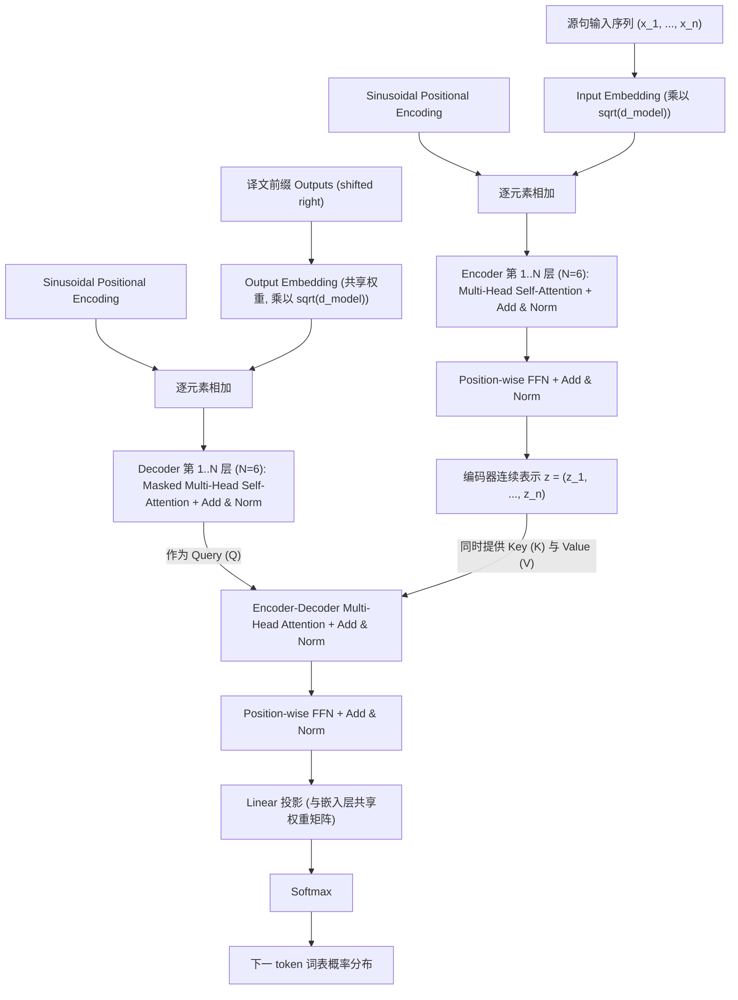

# Attention Is All You Need

# First Time

## 1.Title & Authors
论文原标题：Attention Is All You Need。
自然中文译法：注意力机制就是你所需要的一切（或直译为“只需注意力”）。
标题短到只有五个英文单词，却直接喊出了整篇论文最具颠覆性的架构主张：
- Attention（注意力机制）：在当时（2017 年），注意力机制原本只是挂在循环神经网络（RNN/LSTM）编码器与解码器之间的一条“辅助连线”，用来帮解码器在翻译时回头瞄一眼源句里的关键词。
- Is All You Need（就是全部所需）：标题最核心的主张是把序列建模里的循环结构（Recurrence）和卷积结构（Convolution）彻底拆掉，只留下注意力机制本身来承担整套序列转换任务。以前大家以为处理一句话必须靠 RNN 从左到右一个词一个词往下传，或者靠 CNN 一层层叠卷积核把局部信息往外扩；这篇论文直接用实验证明：拿掉它们，纯靠注意力机制不仅能跑通，而且翻译质量更高、并行度强得多、训练成本骤降。
作者按原文署名顺序列出：Ashish Vaswani（Google Brain）、Noam Shazeer（Google Brain）、Niki Parmar（Google Research）、Jakob Uszkoreit（Google Research）、Llion Jones（Google Research）、Aidan N. Gomez（University of Toronto，研究工作完成于 Google Brain 期间）、Łukasz Kaiser（Google Brain）、Illia Polosukhin（研究工作完成于 Google Research 期间）。
原文题名处脚注特别注明：八位作者均为共同第一作者（Equal contribution），且署名顺序是随机排列的（Listing order is random），不能按先后顺序揣测贡献大小。脚注还罕见地给出了极其清晰的分工记录：
- Jakob Uszkoreit 首先提出用自注意力（self-attention）取代 RNN，并启动了验证该设想的研究。
- Ashish Vaswani 与 Illia Polosukhin 共同设计并实现了最早的 Transformer 模型，且 Ashish 深度参与了研究的方方面面。
- Noam Shazeer 提出了缩放点积注意力（scaled dot-product attention）、多头注意力（multi-head attention）以及无参数位置表示（正弦余弦位置编码），同样深度参与了几乎所有核心细节。
- Niki Parmar 在早期代码库和 tensor2tensor 中设计、实现、调优并评测了大量模型变体。
- Llion Jones 实验了多种新颖变体，负责早期代码库、高效推理与可视化工作。
- Łukasz Kaiser 与 Aidan N. Gomez 投入大量时间设计并实现了 tensor2tensor 框架，替换了早期代码库，大幅提升了实验效果与研究迭代速度。
本篇阅读对应 NIPS 2017 正式会议论文集版本。从论文引文脉络看，团队深度承接了神经机器翻译中的编码器—解码器框架（Sutskever 等、Bahdanau 等、GNMT）以及可分解注意力（Parikh 等，Jakob Uszkoreit 为共同作者）、稀疏混合专家（MoE，Noam Shazeer 为第一作者）和 Neural GPU（Łukasz Kaiser 为第一作者）的长期积累。

## 2.Abstract
摘要只有短短六句话，却像一记干净利落的组合拳，沿着“现状痛点 → 灵感切口 → 架构提出 → 综合收益 → 两组硬指标战绩”层层推进。下面按原文语义单元逐句拆透。
1. 现有主流范式：当时占据统治地位的序列转换（sequence transduction，如把一句英文转成一句德文）模型，普遍基于结构复杂的循环神经网络（RNN）或卷积神经网络（CNN），并采用编码器—解码器架构。
   直觉上，RNN 像串行流水线，必须先算完第 1 个词才能算第 2 个词，天生拖慢训练速度；CNN 虽然能并行，但单个卷积核视野有限，想让句首和句尾两个词对上话，必须堆叠很多层。
2. 已有体系里的亮眼线索：在那些表现最好的序列模型里，编码器和解码器之间往往还架着一座“注意力机制”的桥梁。
   换句话说，注意力在旧模型里已经悄悄立了大功——它让解码器每生成一个词都能直接跨越距离去查源句的任意位置，只是之前没人敢让它单挑大梁。
3. 提出全新主角（Transformer）：作者提出一种更简洁的新网络架构——Transformer，完全基于注意力机制，彻底抛弃循环与卷积。
   这就是全篇的立身之本：不再把注意力当成 RNN 的挂件，而是把编码器内部、解码器内部以及编解码器之间的全部序列交互都统一交给注意力机制完成。
4. 两项翻译任务上的整体表现：在两个机器翻译任务上的实验表明，Transformer 在翻译质量上更胜一筹，同时具备更强的并行计算能力，且训练时间大幅缩短。
   速度与质量在这里并非互相妥协，而是同步提升：因为去掉了时间步串行依赖，GPU 可以一口气并行算完整句话的注意力矩阵，同样的时间内能吃下更多数据、把模型训得更充分。
5. 战绩一（WMT 2014 英德翻译）：模型在 WMT 2014 English-to-German 任务上取得 28.4 BLEU，比当时已知的全部最佳结果（甚至包括多个模型融合的集成模型 ensembles）还要高出超过 2 个 BLEU。
   对照正文 Table2 可知，此前最强单模型 MoE 为 26.03 BLEU，此前最强集成模型 ConvS2S Ensemble 为 26.36 BLEU，Transformer 单个大模型直接跨过 28.4，净胜最强集成模型 2.04 BLEU。
6. 战绩二（WMT 2014 英法翻译与算力成本）：在 WMT 2014 English-to-French 任务上，模型在 8 块 GPU 上训练 3.5 天后取得 41.0 BLEU，刷新了单模型最优纪录（single-model state-of-the-art），而其训练算力开销只是文献中最佳模型的一小部分。
   对照正文 Table2 与第 6.1 节，此处的 41.0 超过全部已发表单模型（此前最高 MoE 为 40.56），训练算力为 $2.3 \cdot 10^{19}$ FLOPs，不到此前最省单模型（Deep-Att + PosUnk 的 $1.0 \cdot 10^{20}$ FLOPs）的四分之一，更是远低于多模型集成（如 ConvS2S Ensemble 虽达 41.29 BLEU，但消耗高达 $1.2 \cdot 10^{21}$ FLOPs，约高出 52 倍）。
把摘要浓缩为四个核心要素：

| 要素 | 本文核心内容 |
|---|---|
| 问题 | 主流序列转换模型依赖复杂的 RNN 或 CNN 编码器—解码器结构，前者受限于时间步串行计算难以并行，后者捕捉远距离词间依赖需要多层堆叠。 |
| 方法 | 提出完全基于注意力机制的 Transformer，彻底取消循环与卷积，用多头自注意力、编码器—解码器交叉注意力、逐位置前馈网络与正弦余弦位置编码构建全并行序列建模框架。 |
| 结果 | 在 WMT 2014 英德翻译上取得 28.4 BLEU（超越既有全部单模型与集成模型超 2 BLEU）；在 WMT 2014 英法翻译上以 8 块 GPU 训练 3.5 天取得 41.0 BLEU（刷新单模型纪录），算力开销仅为既有顶尖模型的一小部分。 |
| 意义 | 证明了纯注意力架构足以独立支撑高质量序列转换，打破了“序列建模必用循环或卷积”的思维定式，开启了高并行、短依赖路径的现代序列架构时代。 |

## 3.Conclusion
原文第 7 节为独立的 Conclusion，一共四段，精炼地盘点了核心贡献、实验战绩、未来方向与代码开源。
1. 第一段——架构定位总账：本文提出了 Transformer，这是首个完全基于注意力机制的序列转换模型，用多头自注意力（multi-headed self-attention）替代了编码器—解码器架构中最常见的循环层。
   这句话精准点出了 Transformer 的历史坐标：它保留了成熟的编码器—解码器宏观范式，但把里面的“心脏”彻底换成了多头自注意力。
2. 第二段——速度与翻译战绩回顾：在翻译任务上，Transformer 的训练速度远快于基于循环层或卷积层的架构；在 WMT 2014 英德和英法两项任务上均取得新的最优表现，且在英德任务上，最佳单模型甚至超越了此前报道的所有集成模型。
   结合正文 Table2 核对这一表述：英德任务中，Transformer (big) 的 28.4 BLEU 确实超越全部单模型与集成模型（甚至 base 模型的 27.3 也已超过此前最优集成 ConvS2S Ensemble 的 26.36）；英法任务中，41.0 BLEU 是新的单模型最优，略低于两个超大规模集成模型（GNMT + RL Ensemble 的 41.16 与 ConvS2S Ensemble 的 41.29），与摘要“单模型最优”的界定保持一致。
3. 第三段——作者明确指出的三大未来方向（同时也坦诚映照了当时版本的边界）：
   - 跨模态扩展：将 Transformer 推广到文本以外的输入与输出模态（如图像、音频和视频），而本文实验仅验证了机器翻译文本任务。
   - 局部受限注意力（local, restricted attention）：针对图像、音频、视频这类超长输入输出序列，全局自注意力的二次方开销 $O(n^2 \cdot d)$ 会迅速膨胀，因此计划深入研究只关注局部邻域的受限注意力以压低计算成本（呼应第 4 节和 Table1 中的 restricted self-attention）。
   - 降低生成过程的串行性（making generation less sequential）：尽管训练时编码器和解码器可以高度并行，但推理生成译文时仍是自回归的——每生成一个新词都要等前面所有词吐出来，这一串行瓶颈也是作者下一步想要攻克的方向。
4. 第四段——开源复现入口：作者公开了训练和评测所用的官方代码库 `https://github.com/tensorflow/tensor2tensor`，把论文方法直接落成可复现的工程实现。

## 4.Analogy
可以把三种主流序列模型想象成“把一篇英文长文章翻译成德文的三种团队协作模式”：
- RNN（循环神经网络）像“传话筒接力队”：第 1 个人看完第 1 个词，在脑子里记下摘要传给第 2 个人；第 2 个人看完第 2 个词，结合上个人的摘要再传给第 3 个人……一直传到句尾。缺点一眼可见：后面的人只能干等着前面的人传完才能开工（无法并行），而且如果第 1 个词和第 50 个词有语法照应，信息要辗转 50 个人之手，传到后面早就失真忘光了。
- CNN（卷积神经网络）像“只准问左右邻居的小组汇报”：所有人可以同时开工，但第一轮每人只能跟身边 $k$ 个邻居聊天；想让第 1 个人知道第 50 个人的意思，必须一层一层往上逐级汇总，距离越远需要搭的汇报层级越多。
- Transformer 像一场“全员圆桌即时群聊”：
  - 编码器（Encoder）是“原文精读圆桌”：文章里的每一个词同时坐在一张大圆桌旁。为了不弄混词的前后顺序，入座前每人领一张刻着独一无二波浪频率纹路的“座次牌”（Positional Encoding 位置编码），贴在自己的词义名片（Embedding）上。会议开始后，所有人同时掏出自己的问题卡片（Query $Q$），全场扫视每个人的主题标签（Key $K$），谁跟自己的问题最对口，就重点抄录谁手里的话稿内容（Value $V$）。无论第 1 个词和第 50 个词隔多远，眼神一对上，一步就能直接沟通！
  - 多头注意力（Multi-Head Attention）是“8 组专业评审团并行讨论”：如果全场只有一套打分标准，一个词想同时关注“主谓搭配”“代词指代”和“前后转折”时，不同需求揉在一起平均掉反而糊成一团。于是每个词把自己的资料拆成 8 份精简版视角，交给 8 个评审小组同步群聊——1 号组专查主语动词，2 号组专盯代词指代，3 号组专看修饰语——聊完把 8 份纪要拼回一张完整报告（Concat + Linear），再用每人独立的思考消化室（Position-wise FFN）深化理解。整套流程连开 6 轮（$N=6$ 层），源句的深层语义就彻底吃透了。
  - 解码器（Decoder）是“边写边核对的译文圆桌”：译文小组要一个词一个词往外写译文。训练时虽然整篇参考译文都在桌上，但为了防止“偷看后面的标准答案”，每位译员左侧全敞开、右侧挡一块黑板（Masked Multi-Head Attention，把未来位置设为 $-\infty$），只能回头参考已经写完的前文；紧接着，每位译员再带着当前写译文的需求（$Q$），直接向对面原文圆桌的最终纪要（$K, V$）提问核对（Encoder-Decoder Cross-Attention）；最后经过独立思考室和词表打分（Linear + Softmax），选出下一个最贴切的德文词。
- 这个比喻的边界同样清晰：第一，真实圆桌人一多就会吵成一团，对应自注意力计算量随序列长度 $n$ 按 $n^2$ 平方增长，面对几万像素或超长视频会吃不消；第二，圆桌虽然在“阅读理解”和“带标准答案练习（训练）”时能全员并行，但真正现场口译出稿（自回归推理）时，译文仍然必须一个词一个词往外吐，无法一口气吐出整句；第三，真实网络中的“打分与抄录”是完全可微的矩阵乘法与缩放 softmax，并非离散的人类逻辑推理。

# Second Time

## 1.Notation & Parameters
全文的数学主线非常紧凑，核心符号全部围绕“序列输入输出 → 缩放点积与多头注意力 → 前馈与位置编码 → 复杂度比较 → 训练学习率与正则化”五块展开。下表整理了读懂正文主线必需的重点符号，全部保留论文原记号。

| 符号/参数 | 含义与作用 | 关键设定/约束 |
|---|---|---|
| $(x_1, \dots, x_n)$、$\mathbf{z}=(z_1, \dots, z_n)$、$(y_1, \dots, y_m)$ | 输入符号序列、编码器输出的连续表示序列、解码器自回归生成的输出符号序列 | 第 3 节定义；输入长度 $n$，输出长度 $m$；第 4 节中单层映射的等长输入输出亦记为 $(x_1, \dots, x_n)$ 与 $(z_1, \dots, z_n)$，其中 $x_i, z_i \in \mathbb{R}^d$ |
| $N$ | 编码器与解码器各自堆叠的相同层数 | base 与 big 模型均取 $N=6$（Table3 第 C 组测试了 $N=2, 4, 8$） |
| $d_{\mathrm{model}}$ | 模型全局表示维度（嵌入层与所有子层的输出维度） | 便于残差相加，全模型统一维度；base 取 $512$，big 取 $1024$ |
| $x$、$\mathrm{Sublayer}(x)$ | 单个子层的输入向量与子层自身实现的变换函数 | 第 3.1 节用于残差归一化 $\mathrm{LayerNorm}(x + \mathrm{Sublayer}(x))$；第 3.3 节亦用 $x$ 表示单个位置的 FFN 输入向量 |
| $Q, K, V$ | 打包成矩阵的查询（Queries）、键（Keys）、值（Values） | 经多头线性投影前各位置为 $d_{\mathrm{model}}$ 维；进入单次缩放点积注意力时，$Q, K$ 最后一维为 $d_k$，$V$ 最后一维为 $d_v$ |
| $d_k, d_v$ | 单个注意力头中查询/键的维度、值的维度 | 默认 $d_k = d_v = d_{\mathrm{model}} / h = 64$（base 与 big 均保持每头 $64$ 维）；缩放因子取 $1/\sqrt{d_k}$ |
| $q, k, q_i, k_i$ | 单个查询向量、单个键向量及其第 $i$ 个分量 | 仅用于第 3.2.1 节脚注 4 的点积方差推导，$i = 1, \dots, d_k$，假设分量独立且均值 $0$、方差 $1$ |
| $h$、$\mathrm{head}_i$ | 并行注意力头数及第 $i$ 个头的输出 | base 取 $h=8$，big 取 $h=16$；Table3 第 A 组扫描 $h \in \{1, 4, 8, 16, 32\}$ |
| $W_i^Q, W_i^K, W_i^V, W^O$ | 多头注意力的可学习线性投影参数矩阵 | $W_i^Q, W_i^K \in \mathbb{R}^{d_{\mathrm{model}} \times d_k}$，$W_i^V \in \mathbb{R}^{d_{\mathrm{model}} \times d_v}$，$W^O \in \mathbb{R}^{h d_v \times d_{\mathrm{model}}}$ |
| $W_1, b_1, W_2, b_2$、$d_{ff}$ | 逐位置前馈网络（FFN）的两层线性权重、偏置及内层隐藏维度 | base 取 $d_{ff}=2048$，big 取 $d_{ff}=4096$；层内各位置共享参数，层与层之间参数独立；Table3 表头印作正体 $d_{\mathrm{ff}}$ |
| $PE_{(pos, 2i)}, PE_{(pos, 2i+1)}$ | 位置 $pos$ 处位置编码的偶数维 $2i$ 与奇数维 $2i+1$ 分量 | 与词嵌入同为 $d_{\mathrm{model}}$ 维并直接相加；固定正弦/余弦函数，无训练参数 |
| $n, d, k, r$ | 第 4 节复杂度分析的序列长度、表示维度、卷积核宽、受限注意力邻域大小 | Table1 核心变量；注意此处 $k$ 指卷积核宽，而第 3.5 节 $PE_{pos+k}$ 中的 $k$ 指固定位置偏移量 |
| $\beta_1, \beta_2, \epsilon$ | Adam 优化器的一阶矩衰减、二阶矩衰减与数值稳定项 | 固定为 $\beta_1 = 0.9$，$\beta_2 = 0.98$，$\epsilon = 10^{-9}$ |
| $lrate$、$step\_num$、$warmup\_steps$ | 当前训练步的学习率、当前步数、线性预热步数 | 由公式（3）动态决定；默认 $warmup\_steps = 4000$ |
| $P_{drop}$、$\epsilon_{ls}$ | 残差与嵌入和的 Dropout 概率、标签平滑系数 | base 取 $P_{drop}=0.1, \epsilon_{ls}=0.1$；big 英德取 $P_{drop}=0.3$，big 英法取 $P_{drop}=0.1$ |
| $\alpha$ | 推理阶段束搜索（beam search）的长度惩罚系数 | 第 6.1 节设定 beam size $= 4$，$\alpha = 0.6$，最大生成长度为输入长度 $+ 50$ |

读公式时只需提前看清三处“同形不同义”的记号：第一，$k$ 在脚注 4 是单个键向量，在第 3.5 节 $PE_{pos+k}$ 是位置偏移步数，在第 4 节 Table1 则是卷积核宽度；第二，$i$ 在第 3.1 节指解码器位置索引，在第 3.2.1 节脚注 4 指向量分量下标，在第 3.2.2 节指注意力头编号，在第 3.5 节指正余弦配对维度的编号；第三，$\epsilon = 10^{-9}$ 是 Adam 优化器分母防除零项，而带下标的 $\epsilon_{ls} = 0.1$ 是标签平滑超参数。随上下文自然区分即可。

## 2.Introduction
对应原文 Section 1。引言开门见山，三段话就把当时的序列建模困局和 Transformer 的破局点讲得一清二楚。
1. 确立对手的江湖地位：循环神经网络（RNN），特别是长短期记忆网络（LSTM）和门控循环单元（GRU），在语言建模和机器翻译等序列转换任务上已经稳坐头把交椅，大量后续工作都在沿着循环语言模型和编解码器框架继续挖潜。
2. 戳中循环架构的死穴——固有串行性：循环模型把计算按输入输出序列的符号位置逐一排开，把词的位置死死绑在计算时间步上，依次生成一系列隐藏状态 $h_t$，且当前状态 $h_t$ 必须是上一时刻隐藏状态 $h_{t-1}$ 与当前位置 $t$ 输入的函数。
   这种天生的串行依赖直接掐死了单条训练样本内部的并行化。短句子时还能靠增大 batch size（同时多算几条样本）把 GPU 塞满；可一旦句子变长，显存限制了跨样本拼 batch 的规模，单条样本内部又无法并行，硬件算力就大量白白闲置。即便前人用矩阵分解技巧（factorization tricks）或条件计算（conditional computation，如 MoE）大幅提升了计算效率，串行计算的根本枷锁依然纹丝不动。
3. 找到破局的火种——注意力机制：注意力机制早已成为优秀序列模型的标配，它最迷人的地方在于无视两个词在序列中隔了多远，都能直接建立依赖联系。但放眼学界，除了极少数例外（如 Parikh 等的可分解注意力），注意力几乎总是绑在循环网络身上当配角。
4. 亮出本文核心主张：作者干脆甩掉循环结构，提出完全依赖注意力机制来刻画输入与输出全局依赖的 Transformer。摆脱串行枷锁后，模型并行度跃升一个台阶，只需在 8 块 NVIDIA P100 GPU 上训练短短 12 小时（对应 base 模型），就能在翻译质量上刷新当时的最高纪录。

## 3.Background
对应原文 Section 2。这一节像一张学术地图，把当时所有同样想“甩掉 RNN 串行瓶颈”的先行探索摆上桌面，精准划出 Transformer 的创新边界。
1. 卷积派的尝试与局限：为了压低串行计算量，Extended Neural GPU、ByteNet 和 ConvS2S 都改用卷积神经网络当基础积木，可以并行算出所有输入输出位置的隐藏表示。但卷积核天生只看局部窗口，想把两个任意位置的信号连起来，所需的操作数会随位置间距增大而增长——ConvS2S 呈线性增长，ByteNet（靠空洞卷积）呈对数增长。根据 Hochreiter 等人的经典分析，路径越长，梯度和信号在前后传播时越难学好远距离依赖。
   Transformer 直接把任意两位置建立联系的操作步数压缩到常数级 $O(1)$！同时作者也非常清醒地指出了一项伴生代价：把所有位置按注意力权重加权平均，会降低单一输出的有效分辨率（effective resolution）；而他们用第 3.2 节的“多头注意力”精准化解了这一副作用。
2. 自注意力（Self-attention / Intra-attention）的前世今生：自注意力指的是在单条序列内部关联不同位置，以计算出该序列的新表示。此前它已在阅读理解、抽象式摘要、文本蕴含和通用句向量学习等任务上展现出强劲实力，但尚未被拿来独自撑起完整的序列到序列转换。
3. 端到端记忆网络（End-to-End Memory Networks）：这类模型用“循环式注意力”代替按序列位置展开的循环，在简单问答和语言建模上表现不错，但仍带有多跳循环味道。
4. 划清本文独创边界：Transformer 是首个完全不依赖按序列展开的 RNN、也不依赖卷积，纯靠自注意力来计算输入与输出表示的序列转换模型。

## 4.Model Architecture
对应原文 Section 3。在钻进具体模块公式之前，先从高空俯瞰整座 Transformer 大厦的轮廓。
绝大多数有竞争力的神经序列转换模型都采用编码器—解码器（encoder-decoder）结构：
- 编码器负责把输入符号表示序列 $(x_1, \dots, x_n)$ 映射成一串等长的连续表示序列 $\mathbf{z} = (z_1, \dots, z_n)$。
- 解码器拿到整份连续表示 $\mathbf{z}$ 后，以自回归（auto-regressive）方式一次生成一个符号，逐步吐出输出序列 $(y_1, \dots, y_m)$——每一步生成下一个词时，都会把此前已经生成出来的符号当作额外输入喂回解码器。
Transformer 完整继承了这套编码器—解码器宏观架构，但把左右两半的内部积木全部统一成了“堆叠的自注意力层 + 逐位置全连接前馈层”，全景结构见 [Fig1 精读](#fig1)。
下面用一张可编辑 Mermaid 流程图把整条端到端信息流画透（图中省略了具体的张量维度、残差与嵌入和处的 Dropout $P_{drop}$、多头内部拆分 $h$ 路的展开细节，以及推理时把新预测词逐个回填至右移译文前缀的自回归循环）：

看懂这张图，抓住一条铁律就能避免初学者最常见的误解：数据沿着编码器或解码器从下往上走一层，只是在把整句话的语义特征提炼得更深，绝不是“往上走一层就多生成一个词”！编码器一口气把全部 $n$ 个源句词加工 $N=6$ 层输出 $\mathbf{z}$；解码器则把已知的译文前缀一口气加工 $N=6$ 层，输出每个位置对应的下一词概率分布。

## 5.Encoder and Decoder Stacks
对应原文 Section 3.1。这一节具体拆解编码器栈和解码器栈的内部排布，以及贯穿全模型的两大工程支柱：残差连接 + 层归一化、维度对齐与因果掩码。
1. 编码器（Encoder）：由 $N = 6$ 个结构完全相同的层垂直堆叠而成（每层参数独立，不共享权重）。每一层内部按顺序包含两个子层（sub-layers）：
   - 第一个子层：多头自注意力机制（multi-head self-attention），负责让源句里所有位置的词互相交换上下文信息。
   - 第二个子层：简单的逐位置全连接前馈网络（position-wise fully connected feed-forward network），负责让每个位置各自消化、加工刚汇总来的特征。
2. 残差连接与层归一化（无编号核心公式）：作者在每一个子层外围都包了一层残差连接（residual connection），再紧跟层归一化（layer normalization），输出写为：
$$
\mathrm{LayerNorm}(x + \mathrm{Sublayer}(x))
$$
   其中 $x$ 是该子层的输入，$\mathrm{Sublayer}(x)$ 是该子层自己完成的运算（如多头注意力或 FFN）。直觉上，残差连接 $x + \mathrm{Sublayer}(x)$ 给梯度修了一条直通底层的“高速公路”，让 6 层乃至更深的堆叠网络不会梯度消失；层归一化则把每个 token 向量的均值和方差拉回稳定区间，防止数值越叠越飘。注意原文采用的是把 $\mathrm{LayerNorm}$ 放在残差相加之后的 Post-LN 结构（呼应 [Fig1 精读](#fig1) 中的 `Add & Norm` 框）。
3. 全局统一维度：为了能让残差加法 $x + \mathrm{Sublayer}(x)$ 处处直接相加而无需额外维度适配矩阵，模型里所有子层以及嵌入层的输出维度全部统一为 $d_{\mathrm{model}} = 512$。
4. 解码器（Decoder）：同样由 $N = 6$ 个相同层堆叠而成，但在编码器的两个子层中间插入了第三个子层，形成“三明治”结构：
   - 第一个子层：带掩码的多头自注意力（Masked Multi-Head Attention），整理当前允许看到的译文前缀。
   - 第二个子层：编码器—解码器多头注意力（Multi-Head Attention），对编码器栈的最终输出 $\mathbf{z}$ 做跨序列查询，让译文每个位置都能精准查阅源句。注意这一层没有掩码，译文可以自由查阅整句源文。
   - 第三个子层：逐位置全连接前馈网络（Feed Forward）。
   同样，解码器每个子层外部都包裹 $\mathrm{LayerNorm}(x + \mathrm{Sublayer}(x))$。
5. 防止“剧透未来”的双重保险：训练时我们手里握着整条参考译文，为了能一口气并行计算所有位置的损失，解码器必须把自注意力子层改造成带掩码版本，禁止当前位置去关注它后面的位置。再加上输入端把目标序列整体向右错开一位（Outputs shifted right，即在句首补入起始位，把第 1 到 $i-1$ 个已知词作为第 $i$ 个位置的输入），这两项机制联手确保：位置 $i$ 的预测只能依赖严格位于位置 $i$ 之前的已知输出，彻底守住自回归因果律。

## 6.Attention
对应原文 Section 3.2。先用一句话把注意力机制的抽象本质讲透，后面所有矩阵乘法就全变成了水到渠成的具象操作。
注意力函数本质上是在做一件事：给定一个查询向量（query）和一组键值对（key-value pairs），输出一个加权汇总向量。这里的查询、键、值和输出全都是向量；输出是所有值向量的加权和，而每个值分到多少权重，取决于查询向量和对应键向量之间的兼容性函数（compatibility function，也就是“匹配度有多高”）。
用生活里的查资料一秒理解：
- Query（查询）：你脑子里现在想找的问题（比如“前面哪个词是这个动词的主语？”）。
- Key（键）：图书馆书架上每本书的封面索引标签（描述每个位置“我是什么角色”）。
- Value（值）：每本书翻开之后真正有用的正文内容（每个位置实际携带的语义信息）。
- 注意力计算过程：拿你的问题去跟所有书的索引标签逐一比对打分，把分数归一化成总和为 1 的概率权重，再按这个权重把各本书的正文内容加权融合成你的最终答案。

## 7.Scaled Dot-Product Attention
对应原文 Section 3.2.1。这是整篇论文最核心的原子算子，结构见 [Fig2 精读](#fig2) 左半部分。
1. 单个查询的直觉步骤：输入的查询和键维度都是 $d_k$，值的维度是 $d_v$。先计算查询与所有键的点积（几何上衡量两个向量的方向对齐与投影强度），把每个点积除以 $\sqrt{d_k}$，再过一遍 $\mathrm{softmax}$ 函数得到各值的归一化权重，最后对值做加权求和。
2. 矩阵并行计算——公式（1）：实际运算时，把一整组查询打包成矩阵 $Q$（每一行是一个查询向量），把所有键和值分别打包成矩阵 $K$ 和 $V$（每一行是一个键或值向量），一次性算出全部位置的输出矩阵：
$$
\mathrm{Attention}(Q, K, V) = \mathrm{softmax}\!\left(\frac{QK^T}{\sqrt{d_k}}\right)V
$$
   逐项追踪矩阵维度（以序列长度 $n$ 的自注意力为例）：
   - $Q \in \mathbb{R}^{n \times d_k}$，$K \in \mathbb{R}^{n \times d_k}$，$V \in \mathbb{R}^{n \times d_v}$。
   - $QK^T$ 形状为 $n \times n$：每一行对应一个查询位置，每一列对应一个键位置，矩阵中对应元素正是这两个位置之间的点积匹配分数。
   - 逐元素除以 $\sqrt{d_k}$ 不改变 $n \times n$ 形状。
   - 按行施加 $\mathrm{softmax}$：每一行的 $n$ 个分数全部变成 $(0, 1)$ 之间的非负权重且和为 $1$，构成该查询位置对所有 $n$ 个位置的注意力分配。
   - 右乘 $V \in \mathbb{R}^{n \times d_v}$：把 $n \times n$ 权重矩阵乘以 $n \times d_v$ 值矩阵，得到输出矩阵形状 $n \times d_v$，每一行就是对应位置按权重融合后的新表示。
   （若在解码器带掩码自注意力中使用，如第 3.2.3 节所述，在进入 $\mathrm{softmax}$ 之前会把所有非法连接的分数置为 $-\infty$，原文公式（1）本身简洁地省略了可选掩码步骤，并在 [Fig2 精读](#fig2) 左图以 `Mask (opt.)` 标出。）
3. 为什么选点积而不是加性注意力？当时最常用的两种注意力分别是加性注意力（additive attention，用单隐藏层前馈网络算匹配分）和点积（乘性）注意力（dot-product attention，和公式（1）的唯一区别就是没除以 $\sqrt{d_k}$）。两者理论计算复杂度相近，但点积注意力在工程上快得多、省显存得多——因为它可以直接调用高度优化的底层矩阵乘法库（GEMM），把整批查询一次性打包算完。
4. 为什么要除以 $\sqrt{d_k}$？完整方差推导（对应原文脚注 4）：
   经验观察发现（引用 Britz 等 [3]），当 $d_k$ 较小时，加性注意力和不缩放的点积注意力难分伯仲；可一旦 $d_k$ 变大，不缩放的点积注意力就会明显落后于加性注意力。作者给出了一个极其透彻的数学诊断：维度 $d_k$ 越大，点积的数值幅度就越大，会把 $\mathrm{softmax}$ 推入梯度几乎为零的饱和区！
   下面严格沿用原文脚注 4 的原始符号逐行推导：设单个查询向量 $q$ 与单个键向量 $k$ 的各个分量 $q_i, k_i$（$i = 1, \dots, d_k$）是彼此独立的随机变量，且都满足均值 $0$、方差 $1$，即 $\mathbb{E}[q_i] = \mathbb{E}[k_i] = 0$，$\mathrm{Var}(q_i) = \mathrm{Var}(k_i) = 1$。考察它们的点积：
$$
q \cdot k = \sum_{i=1}^{d_k} q_i k_i
$$
   - 第一步，求期望（均值）：利用期望的线性性质和 $q_i, k_i$ 相互独立，有 $\mathbb{E}[q_i k_i] = \mathbb{E}[q_i]\mathbb{E}[k_i] = 0 \cdot 0 = 0$，因此总点积的均值为：
$$
\mathbb{E}[q \cdot k] = \sum_{i=1}^{d_k} \mathbb{E}[q_i k_i] = 0
$$
   - 第二步，求单个乘积项的方差：利用方差定义 $\mathrm{Var}(q_i k_i) = \mathbb{E}[(q_i k_i)^2] - (\mathbb{E}[q_i k_i])^2$ 及独立性 $\mathbb{E}[q_i^2 k_i^2] = \mathbb{E}[q_i^2]\mathbb{E}[k_i^2]$，又由 $\mathbb{E}[q_i^2] = \mathrm{Var}(q_i) + (\mathbb{E}[q_i])^2 = 1 + 0 = 1$（对 $k_i$ 同理），得：
$$
\mathrm{Var}(q_i k_i) = \mathbb{E}[q_i^2]\mathbb{E}[k_i^2] - 0 = 1 \cdot 1 = 1
$$
   - 第三步，求总点积的方差：由于不同维度下标 $i$ 对应的分量相互独立，各乘积项 $q_i k_i$ 之间也相互独立，独立随机变量之和的方差等于方差之和：
$$
\mathrm{Var}(q \cdot k) = \sum_{i=1}^{d_k} \mathrm{Var}(q_i k_i) = \sum_{i=1}^{d_k} 1 = d_k
$$
   - 第四步，验证除以 $\sqrt{d_k}$ 后的效果：把常数 $1/\sqrt{d_k}$ 提出方差时要平方，因此：
$$
\mathbb{E}\!\left[\frac{q \cdot k}{\sqrt{d_k}}\right] = 0,
\qquad
\mathrm{Var}\!\left(\frac{q \cdot k}{\sqrt{d_k}}\right) = \frac{1}{(\sqrt{d_k})^2}\mathrm{Var}(q \cdot k) = \frac{d_k}{d_k} = 1
$$
   - 第五步，为什么方差为 $d_k$ 会让 $\mathrm{softmax}$ 梯度消失？代入具体数字立刻有体感：若不缩放，当 $d_k = 512$ 时点积标准差高达 $\sqrt{512} \approx 22.6$，两个候选键的得分差距动辄拉到 $20$ 以上。拿得分 $(1, 0)$ 和 $(20, 0)$ 分别送进 $\mathrm{softmax}$ 一比：
     - $(1, 0)$ 经 $\mathrm{softmax}$ 输出约 $(0.731, 0.269)$，对输入得分的导数量级按“输出概率乘以一减输出概率”计算约为 $0.731 \times 0.269 \approx 0.197$，反向传播梯度饱满通畅；
     - $(20, 0)$ 经 $\mathrm{softmax}$ 输出约 $(0.999999998, 2.06 \times 10^{-9})$，几乎塌缩成非黑即白的 one-hot 分布，导数骤降至约 $2.06 \times 10^{-9}$，梯度近乎归零，参数彻底推不动！
   除以 $\sqrt{d_k}$ 把方差稳稳钉回 $1$，无论维度 $d_k$ 选多大，输入 $\mathrm{softmax}$ 的分数尺度始终温和健康。这正是 Scaled Dot-Product Attention 名字里“Scaled”的精髓所在。

## 8.Multi-Head Attention
对应原文 Section 3.2.2，对应 [Fig2 精读](#fig2) 右半部分。
1. 为什么单头注意力不够用？如果只拿完整的 $d_{\mathrm{model}} = 512$ 维向量跑一次注意力，每个位置就只能算出一组全局权重，把所有关注到的信息揉进同一次加权平均里。可自然语言里，一个词往往需要同时干好几件完全不同的事——比如一方面要回溯主语保持单复数一致，另一方面要看紧邻的介词短语，再一方面要照应前句的代词指代。单头平均会把这些彼此独立的关系搅在一起，拉低有效分辨率。
2. 多头注意力的核心操作（无编号核心公式）：与其在 $d_{\mathrm{model}}$ 维空间里只跑一次大注意力，作者把 $Q, K, V$ 分别通过 $h$ 套彼此不同、可学习的线性投影，降维投影到 $d_k, d_k, d_v$ 维子空间，在 $h$ 个头里并行执行缩放点积注意力，各自产出 $d_v$ 维输出，再沿着特征维拼接起来，过最后一道线性投影 $W^O$ 融合回 $d_{\mathrm{model}}$ 维：
$$
\mathrm{MultiHead}(Q, K, V) = \mathrm{Concat}(\mathrm{head}_1, \dots, \mathrm{head}_h)W^O
$$
$$
\mathrm{where}\ \mathrm{head}_i = \mathrm{Attention}(QW_i^Q, KW_i^K, VW_i^V)
$$
   其中各可学习投影矩阵的精确形状为：
   - $W_i^Q \in \mathbb{R}^{d_{\mathrm{model}} \times d_k}$，把每个 $d_{\mathrm{model}}$ 维查询映射到第 $i$ 个头的 $d_k$ 维查询子空间；
   - $W_i^K \in \mathbb{R}^{d_{\mathrm{model}} \times d_k}$，把每个键映射到第 $i$ 个头的 $d_k$ 维键子空间；
   - $W_i^V \in \mathbb{R}^{d_{\mathrm{model}} \times d_v}$，把每个值映射到第 $i$ 个头的 $d_v$ 维值子空间；
   - $W^O \in \mathbb{R}^{h d_v \times d_{\mathrm{model}}}$，把拼接后的 $h d_v$ 维向量重新混合、投影回模型统一维度 $d_{\mathrm{model}}$。
3. 为什么分成 8 个头，总计算量却没有暴涨？
   正文默认配置为 $h = 8$，且每个头维度缩减为 $d_k = d_v = d_{\mathrm{model}} / h = 512 / 8 = 64$。我们来核对一遍参数量与核心计算量：
   - 参数量账：每个头的 $W_i^Q, W_i^K, W_i^V$ 各含 $d_{\mathrm{model}} \cdot (d_{\mathrm{model}} / h)$ 个参数，全部 $h$ 个头加起来正好是 $3 h \cdot d_{\mathrm{model}} \cdot (d_{\mathrm{model}} / h) = 3 d_{\mathrm{model}}^2$，再加上 $W^O \in \mathbb{R}^{d_{\mathrm{model}} \times d_{\mathrm{model}}}$ 的 $d_{\mathrm{model}}^2$，合计 $4 d_{\mathrm{model}}^2$，与单头全维线性投影完全一致。
   - 注意力矩阵乘法账：每个头计算 $(QW_i^Q)(KW_i^K)^T$ 和加权乘以 $VW_i^V$ 的开销分别是 $O(n^2 d_k)$ 和 $O(n^2 d_v)$；全部 $h$ 个头合计 $O(h \cdot n^2 d_k + h \cdot n^2 d_v) = O(n^2 (h d_k) + n^2 (h d_v)) = O(n^2 d_{\mathrm{model}})$，同样和单头全维注意力完全同一量级！
   用几乎相同的计算预算，换来模型在不同位置同时关注不同表示子空间的能力——这正是 Table3 第（A）组消融里 8 头和 16 头比单头高出 0.9 BLEU 的根本原因。

## 9.Applications of Attention in our Model
对应原文 Section 3.2.3。别看 [Fig1 精读](#fig1) 里出现了三个长得很像的 Multi-Head Attention 方框，它们底层用的是完全同一个多头注意力公式，只是 $Q, K, V$ 的来源和是否加掩码各不相同：
1. 编码器—解码器注意力（Encoder-Decoder Attention，常称交叉注意力）：位于解码器每层的第二个子层。查询 $Q$ 来自上一层解码子层（即刚做完掩码自注意力的译文表示），而记忆键 $K$ 与记忆值 $V$ 全部来自编码器栈的最终输出 $\mathbf{z}$。这让解码器的每一个位置都能纵览整个源句的所有位置，直接对应传统序列到序列模型（如 Bahdanau 等、GNMT、ConvS2S）里的编解码对齐注意力。
2. 编码器自注意力（Encoder Self-Attention）：位于编码器每层的第一个子层。$Q, K, V$ 全部来自同一个地方——上一层编码器的输出（第 1 层则来自词嵌入与位置编码之和）。编码器里每个位置都可以双向自由地关注上一层的所有位置，没有任何遮挡。
3. 解码器带掩码自注意力（Masked Decoder Self-Attention）：位于解码器每层的第一个子层。$Q, K, V$ 同样全部来自上一层解码器的输出，但每个位置只允许关注自己及自己之前的位置。为了阻断解码器中向左回流的信息（防止未来词泄露给前面，破坏自回归性质），具体做法是在缩放点积注意力内部（[Fig2 精读](#fig2) 左图 `Mask (opt.)`），将输入 $\mathrm{softmax}$ 之前所有对应非法连接的元素置为 $-\infty$。由于 $e^{-\infty} = 0$，经过 $\mathrm{softmax}$ 后这些未来位置的注意力权重严格归零，后续对 $V$ 加权求和时未来信息一丝一毫也渗不过来。

## 10.Position-wise Feed-Forward Networks
对应原文 Section 3.3。注意力子层负责“跨位置横向沟通”，紧跟其后的逐位置前馈网络（FFN）则负责“单位置纵向深加工”。
1. 核心公式——公式（2）：编码器和解码器的每一层都包含一个全连接前馈网络，独立且完全相同地作用在每一个序列位置上，由两层线性变换夹一个 ReLU 激活函数组成：
$$
\mathrm{FFN}(x) = \max(0, xW_1 + b_1)W_2 + b_2
$$
2. 逐项维度与“先升维再降维”的直觉：
   - 单个位置的输入是行向量 $x \in \mathbb{R}^{d_{\mathrm{model}}}$（base 中 $d_{\mathrm{model}} = 512$）；
   - 第一层线性映射 $W_1 \in \mathbb{R}^{d_{\mathrm{model}} \times d_{ff}}, b_1 \in \mathbb{R}^{d_{ff}}$ 把特征一口气放大 4 倍到内层维度 $d_{ff} = 2048$，再经 $\max(0, \cdot)$（ReLU）引入非线性筛选；
   - 第二层线性映射 $W_2 \in \mathbb{R}^{d_{ff} \times d_{\mathrm{model}}}, b_2 \in \mathbb{R}^{d_{\mathrm{model}}}$ 再把特征压回 $d_{\mathrm{model}} = 512$，方便外面继续套残差相加。
   注意：注意力子层本身除了 $\mathrm{softmax}$ 权重归一化外，对值向量 $V$ 做的是线性加权组合；如果没有 FFN 里的 ReLU 非线性变换，多层堆叠后的特征表达力会大打折扣。先扩宽到 4 倍高维空间做非线性特征重组再压回原维，赋予了每个位置丰富的非线性拟合容量。
3. 参数共享边界与 1×1 卷积等价性：在同一层里，无论句子有 10 个词还是 100 个词，所有位置共享同一套 $(W_1, b_1, W_2, b_2)$，但不同层之间使用各自独立的参数。作者指出，另一种等价的理解方式是“两层卷积核大小为 1 的一维卷积”——卷积核宽为 1 时，滑动窗口每次只看单个词、不混入相邻词，且全序列共享同一套卷积权重，数学上与逐位置 FFN 丝毫不差。

## 11.Embeddings and Softmax
对应原文 Section 3.4。这一节短小却藏着两个非常实用的架构工程细节，专门解决“词编号怎么进模型、模型向量怎么变回词表概率”的接口问题。
1. 标准输入输出接口：与常见序列转换模型一样，输入端用可学习的词嵌入层（learned embeddings）把输入和输出 token 编号查表映射成 $d_{\mathrm{model}}$ 维向量；输出端用可学习的线性变换加 $\mathrm{softmax}$，把解码器顶层输出向量映射成整个词表的下一个 token 预测概率分布。
2. 三处权重共享（Weight Tying）：借鉴 Press & Wolf [24] 的思路，作者让输入词嵌入层、输出词嵌入层以及 $\mathrm{softmax}$ 之前的线性变换层共享同一张权重矩阵（前提是源语言与目标语言使用共享子词词表，正如第 5.1 节用 BPE / WordPiece 构造的约 37,000 和 32,000 共享词表）。这样既大幅削减了大词表带来的参数量，又让语义相近的词在输入编码与输出预测两端保持一致的几何表示。
3. 嵌入权重乘以 $\sqrt{d_{\mathrm{model}}}$：作者特别注明，在嵌入层里要把共享权重矩阵乘以 $\sqrt{d_{\mathrm{model}}}$（base 模型里即 $\sqrt{512} \approx 22.6$）。直觉很清晰：如果权重按常规方式初始化（如方差与 $1/d_{\mathrm{model}}$ 同阶，以适配输出端线性投影），单个嵌入元素的数值幅度会远小于正弦余弦位置编码（取值恒在 $[-1, 1]$ 之间）；直接相加时，位置信号可能会把微弱的词义信号淹没掉。把嵌入乘上 $\sqrt{d_{\mathrm{model}}}$ 后，词嵌入向量各分量的尺度被拉回到与位置编码匹配的量级，二者相加时词义与位置信息才能势均力敌。

## 12.Positional Encoding
对应原文 Section 3.5。因为 Transformer 彻底删掉了循环和卷积，如果只把词嵌入直接扔进自注意力，把“狗咬人”的三个词打乱成“人咬狗”，自注意力算出来的每个词的特征集合竟然完全一模一样（置换等变性）——模型天生是个“位置盲”！
为了把词序信息注入模型，作者在编码器栈和解码器栈的最底端，把维度同为 $d_{\mathrm{model}}$ 的位置编码直接加到词嵌入向量上。
1. 正弦与余弦位置编码（无编号核心公式）：作者选用了不同频率的正弦和余弦函数，偶数维用正弦，奇数维用余弦：
$$
PE_{(pos, 2i)} = \sin(pos / 10000^{2i / d_{\mathrm{model}}})
$$
$$
PE_{(pos, 2i+1)} = \cos(pos / 10000^{2i / d_{\mathrm{model}}})
$$
   其中 $pos$ 是词在序列中的绝对位置，$i$ 是配对维度的编号（从 $0$ 到 $d_{\mathrm{model}}/2 - 1$，覆盖全部 $d_{\mathrm{model}}$ 个通道）。
2. 多尺度“时钟指针”的几何直觉：每一个通道 $2i$ 或 $2i+1$ 随位置 $pos$ 变化都走出一条正弦或余弦波，其波长（走完一个完整 $2\pi$ 周期所需的步数）等于 $2\pi \cdot 10000^{2i / d_{\mathrm{model}}}$。
   - 当 $i = 0$ 时，$2i / d_{\mathrm{model}} = 0$，波长最短为 $2\pi$（大约每走 6 个词就转满一圈，像秒针，负责区分紧挨着的局部位置）；
   - 随着 $i$ 增大，相邻两对维度的波长按固定公比 $10000^{2 / d_{\mathrm{model}}}$ 呈等比数列拉长，直到 $2i / d_{\mathrm{model}}$ 逼近 $1$ 时波长达到 $10000 \cdot 2\pi$（约 62,832 个词才转一圈，像时针，负责分辨长距离宏观位置）。
   每个位置 $pos$ 都像定格了一块拥有 $d_{\mathrm{model}}/2 = 256$ 根不同转速指针的精密钟表，所有指针角度拼在一起，就成了该位置独一无二的连续“二进制指纹”。
3. 核心性质推导：为什么任意固定偏移 $k$ 下的 $PE_{pos+k}$ 都是 $PE_{pos}$ 的线性函数？
   作者选择正余弦函数的核心动机是让模型能够轻松学会按相对位置去关注——只要给定位移 $k$，从位置 $pos$ 跳到位置 $pos+k$ 的变换完全不依赖起点 $pos$ 在哪儿！下面直接套用三角函数的正弦与余弦和角公式，严格保留原文原记号逐行展开验证：
   - 对偶数维 $2i$：
$$
PE_{(pos+k, 2i)}
= \sin\!\left(\frac{pos + k}{10000^{2i / d_{\mathrm{model}}}}\right)
= \sin\!\left(\frac{pos}{10000^{2i / d_{\mathrm{model}}}}\right)\cos\!\left(\frac{k}{10000^{2i / d_{\mathrm{model}}}}\right)
+ \cos\!\left(\frac{pos}{10000^{2i / d_{\mathrm{model}}}}\right)\sin\!\left(\frac{k}{10000^{2i / d_{\mathrm{model}}}}\right)
$$
   把原定义 $PE_{(pos, 2i)}$ 与 $PE_{(pos, 2i+1)}$ 直接代回上式，立得：
$$
PE_{(pos+k, 2i)}
= \cos\!\left(\frac{k}{10000^{2i / d_{\mathrm{model}}}}\right) PE_{(pos, 2i)}
+ \sin\!\left(\frac{k}{10000^{2i / d_{\mathrm{model}}}}\right) PE_{(pos, 2i+1)}
$$
   - 对奇数维 $2i+1$：
$$
PE_{(pos+k, 2i+1)}
= \cos\!\left(\frac{pos + k}{10000^{2i / d_{\mathrm{model}}}}\right)
= \cos\!\left(\frac{pos}{10000^{2i / d_{\mathrm{model}}}}\right)\cos\!\left(\frac{k}{10000^{2i / d_{\mathrm{model}}}}\right)
- \sin\!\left(\frac{pos}{10000^{2i / d_{\mathrm{model}}}}\right)\sin\!\left(\frac{k}{10000^{2i / d_{\mathrm{model}}}}\right)
$$
   同样代回原定义：
$$
PE_{(pos+k, 2i+1)}
= -\sin\!\left(\frac{k}{10000^{2i / d_{\mathrm{model}}}}\right) PE_{(pos, 2i)}
+ \cos\!\left(\frac{k}{10000^{2i / d_{\mathrm{model}}}}\right) PE_{(pos, 2i+1)}
$$
   - 写成 $2 \times 2$ 矩阵形式，几何画面豁然开朗：
$$
\begin{bmatrix}
PE_{(pos+k, 2i)} \\
PE_{(pos+k, 2i+1)}
\end{bmatrix}
=
\begin{bmatrix}
\cos(k / 10000^{2i / d_{\mathrm{model}}}) & \sin(k / 10000^{2i / d_{\mathrm{model}}}) \\
-\sin(k / 10000^{2i / d_{\mathrm{model}}}) & \cos(k / 10000^{2i / d_{\mathrm{model}}})
\end{bmatrix}
\begin{bmatrix}
PE_{(pos, 2i)} \\
PE_{(pos, 2i+1)}
\end{bmatrix}
$$
   紧盯中间那个 $2 \times 2$ 旋转矩阵：里面所有的系数都只取决于偏移量 $k$ 和维度 $i$，完全不含绝对位置 $pos$！也就是说，把所有 $d_{\mathrm{model}}/2$ 个 $2 \times 2$ 块拼成一个分块对角正交矩阵，就能通过一次与 $pos$ 无关的固定线性变换，把任意起点处的 $PE_{pos}$ 精确旋转成 $PE_{pos+k}$。更进一步，顺手算一下两者的直接内积：
$$
PE_{pos} \cdot PE_{pos+k}
= \sum_{i=0}^{d_{\mathrm{model}}/2 - 1} \left[\sin\!\left(\frac{pos}{10000^{2i / d_{\mathrm{model}}}}\right)\sin\!\left(\frac{pos+k}{10000^{2i / d_{\mathrm{model}}}}\right) + \cos\!\left(\frac{pos}{10000^{2i / d_{\mathrm{model}}}}\right)\cos\!\left(\frac{pos+k}{10000^{2i / d_{\mathrm{model}}}}\right)\right]
= \sum_{i=0}^{d_{\mathrm{model}}/2 - 1} \cos\!\left(\frac{k}{10000^{2i / d_{\mathrm{model}}}}\right)
$$
   纯内积也只跟相对距离 $k$ 有关（且关于 $+k$ 和 $-k$ 对称；而经过多头注意力里的可学习矩阵 $W_i^Q, W_i^K$ 混合偶奇维度后，矩阵里非对称的正弦项还能帮模型区分“往前看 $k$ 步”还是“往后看 $k$ 步”）。
4. 固定正弦编码 vs 可学习位置嵌入：作者在消融实验中也测试了直接学习位置嵌入（如 ConvS2S 的做法），结果在验证集上几乎打平（见 [Table3 精读](#table3) 第 E 行：BLEU 25.7 对 25.8，PPL 均为 4.92）。作者最终保留无参数的正弦余弦版本，理由是它不绑定训练时见过的最大长度词表，有潜力外推到比训练集更长的序列。

## 13.Why Self-Attention
对应原文 Section 4。这一章是整篇论文的理论说服核心：把自注意力层和循环层、卷积层放在同一个擂台上——同样完成把一条长度为 $n$ 的序列 $(x_1, \dots, x_n)$ 映射到等长序列 $(z_1, \dots, z_n)$（其中 $x_i, z_i \in \mathbb{R}^d$）——用三把硬尺子逐项量化高下，完整对比见 [Table1 精读](#table1)。
1. 三把硬尺子（Three Desiderata）：
   - 每层总计算复杂度（Complexity per Layer）：算完这一层总共要做多少次浮点乘加？
   - 并行化程度（Minimum Number of Sequential Operations）：最少有多少步运算必须排队先后执行、无法并行？
   - 长程依赖最大路径长度（Maximum Path Length）：序列里任意两个输入和输出位置之间，前向与反向传播信号最多要跨越多少步才能连上？路径越短，模型越容易学好长距离依赖。
2. 逐类层结构的复杂度与路径推导：
   - Self-Attention（全局自注意力）：
     - 计算量 $O(n^2 \cdot d)$：核心交互 $QK^T$ 是 $(n \times d)$ 乘以 $(d \times n)$，开销 $O(n^2 \cdot d)$；权重矩阵乘以 $V$ 是 $(n \times n)$ 乘以 $(n \times d)$，同样 $O(n^2 \cdot d)$。
     - 串行操作数 $O(1)$：所有位置的点积、缩放、softmax 和加权和都可以用常数次大型矩阵运算同步完成，完全不需要沿序列长度 $n$ 循环排队。
     - 最大路径长度 $O(1)$：任意两个位置（哪怕相隔整句话）在单层内直接算点积互通，只需 1 步直达！
   - Recurrent（循环层）：
     - 计算量 $O(n \cdot d^2)$：共有 $n$ 个时间步，每一步都要把 $d$ 维隐藏状态乘以 $d \times d$ 的循环权重矩阵，单步开销 $O(d^2)$，合计 $O(n \cdot d^2)$。
     - 串行操作数 $O(n)$：必须按 $1 \to 2 \to \dots \to n$ 逐位推进。
     - 最大路径长度 $O(n)$：第 1 个位置的信号传到第 $n$ 个位置必须依次穿越 $O(n)$ 个时间步。
   - 关键胜负拐点（$n$ vs $d$）：把自注意力的 $O(n^2 \cdot d)$ 和循环层的 $O(n \cdot d^2)$ 一比，两边同除 $n \cdot d$，就剩下 $n$ 和 $d$ 的直接对决！只要序列长度 $n$ 小于表示维度 $d$（机器翻译里用 word-piece 或 BPE 切分后，一个句子通常几十个 token，远小于 $d = 512$），自注意力不仅并行度碾压、路径最短，连每层总计算量都比循环层更省！
   - Self-Attention (restricted)（局部受限自注意力）：面对超长序列（$n \gg d$）时，可以让每个输出位置只关注以自己为中心、大小为 $r$ 的局部邻域。于是每个位置只算 $r$ 次内积，计算量降为 $O(r \cdot n \cdot d)$，串行操作仍保持 $O(1)$，代价是每层最多跨出 $r$ 步，跨越全序列的最大路径长度上升到 $O(n / r)$。作者明确把这条路线留作未来研究方向。
   - Convolutional（卷积层）：
     - 计算量 $O(k \cdot n \cdot d^2)$：核宽为 $k$ 的常规卷积在每个位置都要把 $k$ 个 $d$ 维邻域向量映射到 $d$ 维输出，单位置开销 $O(k \cdot d^2)$，乘以 $n$ 个位置即 $O(k \cdot n \cdot d^2)$，通常比循环层还贵 $k$ 倍。
     - 串行操作数 $O(1)$：所有位置的滑动窗口可以完全并行。
     - 最大路径长度：单层核宽 $k < n$ 无法连通所有位置对。如果用连续卷积核（contiguous kernels），每层扩大 $k$ 的视野，覆盖全句需要堆叠 $O(n / k)$ 层；如果采用空洞卷积（dilated convolutions，如 ByteNet），视野呈指数扩张，最大路径长度可压到 $O(\log_k(n))$（即 Table1 填入的值）。
     - 与深度可分离卷积（Separable Convolutions，如 Xception [6]）的精妙对照：可分离卷积把空间混合和通道混合拆开，复杂度大降至 $O(k \cdot n \cdot d + n \cdot d^2)$。即便把核宽拉满到整句长度 $k = n$，其复杂度变成 $O(n^2 \cdot d + n \cdot d^2)$——恰好等于 Transformer 里“一层自注意力 $O(n^2 \cdot d)$ + 一层逐位置前馈网络 $O(n \cdot d^2)$”的组合复杂度！这个对比极其巧妙：Transformer 在不增加理论复杂度的前提下，用数据动态生成的注意力权重取代了静态卷积核。
3. 附加收益——可解释性（与当前 PDF 版本范围说明）：作者最后提到，自注意力还能带来更强的可解释性，单个注意力头会自发学会分工执行不同子任务，许多头呈现出与句子句法和语义结构相呼应的关注模式。原文此处写到在附录（appendix）中展示并讨论了注意力分布样例；但本篇阅读所依据的 NIPS 2017 会议正式版 PDF 在第 7 节致谢与参考文献后即结束，未附带该附录内容，因此正文中不对其中的具体可视化案例作无依据转述。

## 14.Training
对应原文 Section 5。这一章完整交代了让 Transformer 真正训得稳、训得快、泛化好的全套训练配方，包括数据切分与按长拼批、硬件耗时、动态学习率预热公式以及正则化手段。

## 15.Training Data and Batching
对应原文 Section 5.1。两套标准机器翻译基准配置清晰分工：
- WMT 2014 English-German（英德）：约 450 万（4.5 million）句对，采用字节对编码（BPE），源语言与目标语言共用约 37,000 个 token 的共享词表。
- WMT 2014 English-French（英法）：规模大得多，包含 3,600 万（36M）句对，切分为 32,000 个 token 的 word-piece 共享词表。
- 按近似句长拼批（Batching by approximate sequence length）：为了减少长短不一带来的无效填充（padding）浪费，把长度相近的句对聚在同一个 batch 里，每个训练 batch 约包含 25,000 个源句 token 和 25,000 个目标句 token。

## 16.Hardware and Schedule
对应原文 Section 5.2。所有模型均在单台配备 8 块 NVIDIA P100 GPU 的机器上训练，规模与时间形成鲜明对比（完整超参数配置见 [Table3 精读](#table3)，算力对比见 [Table2 精读](#table2)）：
- Base 模型：每训练一步耗时约 0.4 秒，共训练 100,000 步，总耗时仅 12 小时。
- Big 模型（即 Table3 最底行配置）：每步耗时约 1.0 秒，共训练 300,000 步，总耗时 3.5 天。

## 17.Optimizer
对应原文 Section 5.3。Transformer 早期（Post-LN 结构）对优化器与学习率节奏非常敏感，这里提出的“先线性预热、再平方根倒数衰减”策略（后世常称 Noam schedule）堪称工程典范。
1. 优化器设定：使用 Adam 优化器，超参数设为 $\beta_1 = 0.9$、$\beta_2 = 0.98$（比常规的 0.999 更小，让二阶矩估计对梯度变化响应更灵敏）以及 $\epsilon = 10^{-9}$。
2. 动态学习率日程——公式（3）：训练过程中学习率随步数实时变化，默认 $warmup\_steps = 4000$：
$$
lrate = d_{\mathrm{model}}^{-0.5} \cdot \min(step\_num^{-0.5}, step\_num \cdot warmup\_steps^{-1.5})
$$
3. 分段解析与峰值精算（严格沿用原公式记号）：
   比较 $\min(\cdot, \cdot)$ 括号内的两项大小，找出临界切换点：
$$
step\_num \cdot warmup\_steps^{-1.5} \le step\_num^{-0.5}
\iff step\_num^{1.5} \le warmup\_steps^{1.5}
\iff step\_num \le warmup\_steps
$$
   这条分段线干净利落，在 $step\_num = warmup\_steps$ 处完美连续衔接、没有任何跳变：
   - 第一阶段（线性预热，$step\_num \le warmup\_steps$）：第二项更小，公式化为：
$$
lrate = d_{\mathrm{model}}^{-0.5} \cdot warmup\_steps^{-1.5} \cdot step\_num
$$
     学习率从 $0$ 出发，随 $step\_num$ 匀速直线爬坡。直觉上，刚初始化的 Post-LN Transformer 注意力分布和 Adam 二阶矩统计都很不稳定，起步步子迈太大会把梯度直接炸散；先慢步热身 4,000 步，把统计量和初始表示稳住再加速。
   - 峰值拐点（$step\_num = warmup\_steps = 4000$）：两项恰好相等，均等于 $warmup\_steps^{-0.5}$，此时学习率触顶：
$$
lrate = d_{\mathrm{model}}^{-0.5} \cdot warmup\_steps^{-0.5} = \frac{1}{\sqrt{d_{\mathrm{model}} \cdot warmup\_steps}}
$$
     把论文实际参数代入一看便知：
     - Base 模型（$d_{\mathrm{model}} = 512$）：峰值学习率为 $1 / \sqrt{512 \times 4000} \approx 6.99 \times 10^{-4}$；
     - Big 模型（$d_{\mathrm{model}} = 1024$）：峰值学习率为 $1 / \sqrt{1024 \times 4000} \approx 4.94 \times 10^{-4}$。前置因子 $d_{\mathrm{model}}^{-0.5}$ 自动实现了“模型越宽、峰值学习率越保守”的尺度自适应。
   - 第二阶段（平方根倒数衰减，$step\_num > warmup\_steps$）：第一项更小，公式化为：
$$
lrate = d_{\mathrm{model}}^{-0.5} \cdot step\_num^{-0.5} = \frac{1}{\sqrt{d_{\mathrm{model}} \cdot step\_num}}
$$
     学习率按步数的平方根倒数缓慢平滑衰减，既不需要预先写死总训练步数就能自然退火，也能在后期稳定精调参数。训练结束时，base 模型（100K 步）学习率降至约 $1.40 \times 10^{-4}$，big 模型（300K 步）降至约 $5.70 \times 10^{-5}$。

## 18.Regularization
对应原文 Section 5.4。作者在开头写道“We employ three types of regularization during training”，但正文随后明确列出标题并说明的正则化段落为两项（其中 Residual Dropout 实际施加在两处位置，加上 Label Smoothing 构成三处具体正则化操作，原文未再单独列出第三项标题）：
1. 残差 Dropout（Residual Dropout）：施加在两个位置——一是每个子层的输出之后、送入残差相加与层归一化之前；二是编码器与解码器底端“词嵌入 + 位置编码”之和之后。base 模型默认 $P_{drop} = 0.1$（big 模型在英德任务加大到 $P_{drop} = 0.3$ 以防在较小数据集上过拟合，在超大英法数据集上则沿用 $P_{drop} = 0.1$）。
2. 标签平滑（Label Smoothing）：训练时采用 $\epsilon_{ls} = 0.1$ 的标签平滑（即将原本集中在真实目标词上 $100\%$ 的概率质量匀出一小部分分给其余词表）。作者点出了一个极有意思的训练现象：标签平滑会刻意让模型变得“没那么过度自信”，从而损害验证集困惑度（PPL 变差），但却能实打实提升翻译准确率与 BLEU 分数！这在 [Table3 精读](#table3) 第（D）组中得到了极其直观的量化验证（去掉标签平滑 $\epsilon_{ls}=0.0$ 时，PPL 从 4.92 降到更漂亮的 4.67，可 BLEU 反而从 25.8 跌到了 25.3）。

## 19.Figure & Table
本版 NIPS 2017 正文共有 2 张图、3 张表，合计 5 项，下面严格按正文实际出现顺序逐项精读。

#### Fig1:
这是全篇最重要的一张正文图（原图题：The Transformer - model architecture），因为它把整个 Transformer 的编码器栈、解码器栈、残差与层归一化、位置编码、三类注意力与词表预测头全部浓缩进了一张清晰的蓝图；以后无论读 BERT、GPT 还是多模态大模型，脑子里复现的都是这张图的变形。
按“左半边编码器 → 右半边解码器 → 跨边连线与通用标注”顺着箭头走一遍：
- 左半边（Encoder 编码器栈，外框标注 $N\times$ 表示堆叠 $N=6$ 层）：
  - 底部入口 `Inputs` 送入源句 token，先经粉框 `Input Embedding` 转成 $d_{\mathrm{model}}=512$ 维向量，再在圆圈加号 $\oplus$ 处与带正弦波形图标的 `Positional Encoding` 逐元素相加。
  - 进入灰色大框内的第一子层：箭头一分为三同时接入橙框 `Multi-Head Attention`（形象表示 $Q, K, V$ 全部同源，即编码器自注意力），旁边拉出一条绕过注意力框的残差捷径，在黄框 `Add & Norm` 中完成 $\mathrm{LayerNorm}(x + \mathrm{Sublayer}(x))$。
  - 紧接着进入第二子层蓝框 `Feed Forward`（逐位置前馈网络），同样配一条残差旁路汇入黄框 `Add & Norm`。
  - 经过 $N=6$ 层重复提炼后，左半边顶部送出整句源文的连续上下文表示 $\mathbf{z}$——此时还没有生成任何译文词。
- 右半边（Decoder 解码器栈，外框同样标注 $N\times$）：
  - 底部入口刻意标注为 `Outputs (shifted right)`，强调输入是向右错开一位的已知译文前缀，经 `Output Embedding` 并与 `Positional Encoding` 在 $\oplus$ 处相加。
  - 进入灰色大框内的第一子层：箭头一分为三接入 `Masked Multi-Head Attention`（只看当前位置及之前，屏蔽未来信息），外绕残差进入 `Add & Norm`。
  - 进入第二子层：这是一个无掩码的 `Multi-Head Attention`（编码器—解码器交叉注意力）！紧盯它的三个底部输入箭头：左侧两个箭头直接从左半边编码器栈顶部横跨而来（提供源句的 $K$ 和 $V$），最右侧一个箭头来自下方刚算完的解码器掩码自注意力输出（提供当前译文查询 $Q$），随后外绕残差进入 `Add & Norm`。
  - 进入第三子层蓝框 `Feed Forward` 及外绕残差的 `Add & Norm`。
  - 走出 $N=6$ 层解码器栈后，依次经过灰框 `Linear`（把 $d_{\mathrm{model}}$ 维特征映射成词表维度的打分）和绿框 `Softmax`，最终输出 `Output Probabilities`（下一个词的概率分布）。
回看重点：一是牢记箭头向上传递的是整条序列的特征张量，跨层是加深表征而非生成新词；二是牢记只有解码器底层第一个注意力带 `Masked`，中间跨接编码器的交叉注意力并不掩码。

#### Fig2:
位置与目的：位于第 3.2.1–3.2.2 节（原图题：(left) Scaled Dot-Product Attention. (right) Multi-Head Attention consists of several attention layers running in parallel.），把 Fig1 里的橙色注意力方框放大拆开，露出内部最核心的张量流水线。
- 左面板（Scaled Dot-Product Attention，自底向上对应公式（1）的五步算子）：
  - 底部并排输入 $Q$、$K$、$V$。
  - $Q$ 与 $K$ 先汇入紫框 `MatMul`，算出原始匹配分矩阵 $QK^T$。
  - 向上进入黄框 `Scale`，逐元素除以 $\sqrt{d_k}$，按脚注 4 把点积方差拉回 $1$、防止后续梯度饱和。
  - 向上进入粉框 `Mask (opt.)`，括号 `opt.` 表示可选——仅在解码器自注意力中启用，把非法未来位置置为 $-\infty$。
  - 向上进入绿框 `SoftMax`，按行归一化成总和为 $1$ 的注意力权重矩阵。
  - 最上方紫框 `MatMul` 把刚算出的权重矩阵与一路直通上来的 $V$ 相乘，输出加权融合后的特征矩阵。
- 右面板（Multi-Head Attention，展示多头并行拆合流水线）：
  - 底部从左到右依次接入 `V`、`K`、`Q`（注意图中摆放顺序是 $V, K, Q$），各自先穿过一层叠加画成多层卡片状的灰框 `Linear`，表示分别用 $h$ 组独立的投影矩阵 $W_i^V, W_i^K, W_i^Q$ 投射到低维子空间。
  - 投影结果一齐送入叠加态紫框 `Scaled Dot-Product Attention`，右侧括号明确标出 $h$，代表 $h=8$ 个头完全并行独立地执行左面板计算。
  - 全部 $h$ 个头的输出汇入橙框 `Concat`，沿特征维首尾拼接成 $h d_v$ 维，再穿过顶部最后一块灰框 `Linear`（乘以 $W^O$）输出最终 $d_{\mathrm{model}}$ 维结果。
与正文联系：左图把公式（1）和第 3.2.3 节的 $-\infty$ 掩码落到了精确的算子顺序上，右图则直观呈现了“投影降维 → 多头并行 → 拼接融合”如何在几乎不涨算力的情况下打破单头平均瓶颈。

#### Table1:
位置与目的：位于第 4 节（原表题：Maximum path lengths, per-layer complexity and minimum number of sequential operations for different layer types），把四种序列建模基础层拉到同一张三维度体检表上直接比对（$n$ 为序列长度，$d$ 为表示维度，$k$ 为卷积核宽，$r$ 为受限自注意力的邻域大小）。
四行核心数据与战略权衡一眼看穿：
- Self-Attention（全局自注意力）：每层复杂度 $O(n^2 \cdot d)$，串行操作 $O(1)$，最大路径长度 $O(1)$。三项里有两项拿了理论最优常数级；且在常见机器翻译句子中 $n < d$，连每层复杂度都胜过循环层。唯一短板是当 $n$ 极大（超长文本或高分辨图像）时 $n^2$ 项会迅速膨胀。
- Recurrent（循环层）：每层复杂度 $O(n \cdot d^2)$，串行操作 $O(n)$，最大路径长度 $O(n)$。串行队列和长程路径都随句子长度线性恶化，拖累训练并行度与远距离依赖学习。
- Convolutional（卷积层）：每层复杂度 $O(k \cdot n \cdot d^2)$，串行操作 $O(1)$，最大路径长度 $O(\log_k(n))$。并行度优秀，但每层计算量比循环层还贵 $k$ 倍，且必须借助空洞卷积多层堆叠才能把最大路径压到对数级（普通连续卷积需要 $O(n/k)$）。
- Self-Attention (restricted)（受限自注意力）：每层复杂度 $O(r \cdot n \cdot d)$，串行操作 $O(1)$，最大路径长度 $O(n/r)$。通过限定邻域窗口 $r$ 把关于 $n$ 的复杂度从二次降回线性，代价是远距离路径按 $n/r$ 拉长，构成面向超长序列的折中预案。
与正文联系：Table1 是整篇论文放弃 RNN/CNN 拥抱自注意力的核心理论凭证，直接支撑了引言“并行更强、训练更快”与第 4 节“更易学习长程依赖”的主张。

#### Table2:
位置与目的：位于第 6.1 节（原表题：The Transformer achieves better BLEU scores than previous state-of-the-art models on the English-to-German and English-to-French newstest2014 tests at a fraction of the training cost），是全篇的主实验成绩单，在 WMT 2014 `newstest2014` 测试集上同时比拼翻译质量（BLEU，越高越好）与训练算力成本（Training Cost，单位 FLOPs，越低越好）。注意表中 Transformer 两行的 FLOPs 单元格横跨了 EN-DE 与 EN-FR 两列，表示单套训练时长对应的统一算力估算（按脚注 5，P100 单卡持续单精度算力按 9.5 TFLOPS 估算）。
分两组读懂压倒性战绩与精确边界：
- WMT 2014 英德（EN-DE）全面登顶：
  - 此前最强单模型为 MoE（26.03 BLEU，消耗 $2.0 \cdot 10^{19}$ FLOPs）与 ConvS2S（25.16 BLEU，$9.6 \cdot 10^{18}$ FLOPs）；此前最强多模型集成是 ConvS2S Ensemble（26.36 BLEU，$7.7 \cdot 10^{19}$ FLOPs）与 GNMT + RL Ensemble（26.30 BLEU，$1.8 \cdot 10^{20}$ FLOPs）。
  - Transformer (base model) 仅花 $3.3 \cdot 10^{18}$ FLOPs（表内最低，粗体标出，不到 ConvS2S 单模型的三分之一、不到 ConvS2S Ensemble 的二十分之一），就拿下 27.3 BLEU，单枪匹马超过之前所有单模型和集成模型！
  - Transformer (big) 消耗 $2.3 \cdot 10^{19}$ FLOPs，直接飙升到 28.4 BLEU（表内粗体第一），净胜此前最佳集成模型 2.04 BLEU。
- WMT 2014 英法（EN-FR）刷新单模型纪录且算力大降：
  - 此前最强单模型为 MoE（40.56 BLEU，$1.2 \cdot 10^{20}$ FLOPs）、ConvS2S（40.46 BLEU，$1.5 \cdot 10^{20}$ FLOPs）、GNMT + RL（39.92 BLEU，$1.4 \cdot 10^{20}$ FLOPs）与 Deep-Att + PosUnk（39.2 BLEU，$1.0 \cdot 10^{20}$ FLOPs）。
  - Transformer (big) 以 $2.3 \cdot 10^{19}$ FLOPs（不到前述任一顶尖单模型算力的四分之一）拿到 41.0 BLEU（表内粗体，刷新单模型最高分）；而 Transformer (base model) 为 38.1 BLEU（仅耗 $3.3 \cdot 10^{18}$ FLOPs）。
  - 与超大集成模型对比：GNMT + RL Ensemble（41.16 BLEU，$1.1 \cdot 10^{21}$ FLOPs）与 ConvS2S Ensemble（41.29 BLEU，表内粗体，$1.2 \cdot 10^{21}$ FLOPs）在分数上仍高出 0.16–0.29 BLEU，但它们烧掉了约 50 倍的训练算力。
口径提醒：FLOPs 并非精确硬件计数器实测，而是“训练时长 × GPU 数量 × 估算单卡持续 TFLOPS”（K80 2.8、K40 3.7、M40 6.0、P100 9.5）的近似估算，适合看量级差异；此外 Transformer 测试时对 base/big 分别做了最后 5/20 个检查点的权重平均。

#### Table3:
位置与目的：位于第 6.2 节（原表题：Variations on the Transformer architecture），在英德开发集 `newstest2013` 上系统拆解各个超参数和结构设计的真实作用（未列出的参数均与第一行 `base` 相同；全部使用束搜索但不做检查点平均；困惑度 PPL 按 BPE 子词统计，不可与按完整单词统计的 PPL 直接比较）。基准 `base` 配置为：$N=6, d_{\mathrm{model}}=512, d_{\mathrm{ff}}=2048, h=8, d_k=64, d_v=64, P_{drop}=0.1, \epsilon_{ls}=0.1$，100K 步，参数量 65M，成绩 PPL 4.92、BLEU 25.8。
沿着 (A)–(E) 与 `big` 六组读清每条设计规律：
- （A）保持总计算量恒定（$h \cdot d_k = 512$），改变头数 $h$：
  - $h=1$（$d_k=d_v=512$）：PPL 恶化至 5.29，BLEU 跌到 24.9（比最佳差整整 0.9 BLEU），实锤单头平均的分辨率瓶颈。
  - $h=4$（$d_k=128$）：PPL 5.00，BLEU 25.5；$h=8$（base）：PPL 4.92，BLEU 25.8；$h=16$（$d_k=32$）：PPL 4.91，BLEU 25.8（与 8 头并列最佳）。
  - $h=32$（$d_k=16$）：PPL 反弹至 5.01，BLEU 回落到 25.4——头太多把每个子空间切得太碎，反而伤质量。
- （B）固定 $h=8, d_v=64$，单独压小键维度 $d_k$：
  - $d_k=16$ 时 PPL 5.16、BLEU 25.1（58M 参数）；$d_k=32$ 时 PPL 5.01、BLEU 25.4（60M 参数），均弱于 base 的 $d_k=64$（25.8）。作者据此敏锐推断：准确判断查询与键的兼容性并不容易，缩窄匹配空间会立刻伤害效果，未来或许值得探索比点积更精细的兼容性函数。
- （C）缩放模型容量（层数 $N$、宽度 $d_{\mathrm{model}}$、前馈宽度 $d_{\mathrm{ff}}$）：
  - 层数 $N$：$N=2$（36M）跌至 23.7 BLEU，$N=4$（50M）升至 25.3，$N=6$（65M）达 25.8；继续加到 $N=8$（80M）时 PPL 进一步变好到 4.88，但开发集 BLEU 为 25.5（在相同 100K 步和未重调学习率下未继续涨分）。
  - 模型宽度 $d_{\mathrm{model}}$（同步缩扩 $d_k, d_v$）：缩到 256（28M）跌到 24.5 BLEU；扩到 1024（168M）PPL 降至 4.66，BLEU 涨至 26.0。
  - 前馈宽度 $d_{\mathrm{ff}}$：缩到 1024（53M）跌至 25.4；翻倍到 4096（90M）PPL 降至 4.75，BLEU 跃升至 26.2——只扩宽 FFN 就以较少参数增量换来 0.4 BLEU 提升，性价比极高！
- （D）正则化消融（Dropout $P_{drop}$ 与标签平滑 $\epsilon_{ls}$）：
  - 去掉 Dropout（$P_{drop}=0.0$）后 PPL 暴涨至 5.77、BLEU 骤降 1.2 分到 24.6，过拟合立竿见影；增至 $0.2$ 时 PPL 4.95、BLEU 25.5，说明 base 上 $0.1$ 恰到好处。
  - 去掉标签平滑（$\epsilon_{ls}=0.0$）后 PPL 竟然变优至 4.67，但 BLEU 反降 0.5 分至 25.3；加到 $0.2$ 时 PPL 涨到 5.47，BLEU 25.7——完美验证了第 5.4 节“牺牲困惑度、换取 BLEU 提升”的规律。
- （E）位置编码方式对比：将固定正弦余弦替换为可学习位置嵌入，PPL 同为 4.92，BLEU 为 25.7（对比 base 的 25.8）。两者差距仅 0.1 BLEU 且表中未报告多次随机种子运行的方差，实际表现基本持平。
- `big`（大号配置）：$N=6, d_{\mathrm{model}}=1024, d_{\mathrm{ff}}=4096, h=16$（继承每头 $d_k=d_v=64$），$P_{drop}=0.3$，训练 300K 步，参数量 213M，在 `newstest2013` 上一举刷新 PPL 4.33（粗体）与 BLEU 26.4（粗体）。
## 20.Results
对应原文 Section 6。本版 NIPS 2017 论文的结果部分包含两节：第 6.1 节汇报 WMT 2014 英德、英法两项机器翻译主结果与推理设置，第 6.2 节通过系统变体消融拆解各组件贡献。以下对两节做结构化速读，核心数据细节直接链接至上文精读表。

## 21.Machine Translation
对应原文 Section 6.1。本节旨在回答核心问题：彻底去掉 RNN 和 CNN 后，Transformer 在真实大规模机器翻译上的质量与训练效率到底站到什么高度？
- 主结果结论（详见 [Table2 精读](#table2)）：在 WMT 2014 英德任务上，Transformer (big) 以 8 块 P100 训练 3.5 天取得 28.4 BLEU，超出此前全部模型（含集成）超过 2.0 BLEU；连仅训练 12 小时的 base 模型（27.3 BLEU）也超过所有既有单模型与集成模型。在 WMT 2014 英法任务上，Transformer (big)（此处改用 $P_{drop}=0.1$ 而非 0.3）以不到此前最强单模型四分之一的训练算力取得 41.0 BLEU，刷新单模型纪录。
- 推理与评测设置：
  - 检查点平均（checkpoint averaging）：每隔 10 分钟保存一次检查点，base 模型对最后 5 个检查点权重求平均得到单个最终模型，big 模型对最后 20 个检查点求平均。
  - 解码策略：采用束搜索（beam search），束宽 beam size $= 4$，长度惩罚系数 $\alpha = 0.6$（两项均在开发集上调优选定）；推理最大输出长度设为“输入长度 $+ 50$”，允许提前结束。
- 算力估算口径：训练 FLOPs 按“训练时间 × GPU 数量 × 单卡估算持续单精度算力（脚注 5 给出 K80/K40/M40/P100 分别为 2.8/3.7/6.0/9.5 TFLOPS）”估算。

## 22.Model Variations
对应原文 Section 6.2。本节通过在英德开发集 `newstest2013` 上逐项变动 base 模型（保留束搜索、关闭检查点平均），验证每个结构决策的贡献（完整数值与逐组解读见 [Table3 精读](#table3)）：
- 头数权衡（A 组）：总计算量不变时，单头明显掉点（-0.9 BLEU），8 头与 16 头最佳，增至 32 头后因单头维度过窄反而回落。
- 键维度瓶颈（B 组）：压低 $d_k$ 会直接伤及质量，提示点积兼容性对特征维度敏感。
- 容量扩展与正则化（C、D 组）：更宽的模型（尤其 $d_{\mathrm{model}}=1024$ 和 $d_{\mathrm{ff}}=4096$）与更长训练带来稳定收益（`big` 达 26.4 BLEU）；Dropout 是防止过拟合的刚需，标签平滑在拉高 PPL 的同时稳定提升 BLEU。
- 位置编码对照（E 组）：可学习位置嵌入与固定正弦余弦编码结果几乎一致（25.7 对 25.8 BLEU）。
- 实验边界：本版 NIPS 2017 论文的全部实证仅覆盖机器翻译任务（英德、英法）；正文第 4 节提到的注意力分布可视化附录未包含在当前 NIPS 2017 会议正式版 PDF 中；Table3 各项变体均报告单次运行分数，未附多次随机种子的均值与标准差。

# Overall Review

- 主要贡献： 全篇的里程碑贡献凝练为两条相互咬合的突破。第一，提出完全摒弃循环与卷积、纯由注意力机制构建的序列转换架构 Transformer（[Fig1 精读](#fig1)），将序列中任意两个位置建立依赖的最大路径长度压至常数 $O(1)$，同时把训练时的串行操作量压至 $O(1)$，从根源上打破了 RNN 无法在单句内并行、CNN 捕捉长程依赖路径过长的双重困局（[Table1 精读](#table1)）。第二，设计出“缩放点积注意力 + 多头子空间并行 + 逐位置前馈网络 + 固定正弦余弦位置编码 + 预热衰减学习率”的完整可训练套件（[Fig2 精读](#fig2)、公式 1–3），用一套简洁、高吞吐的矩阵算子在 WMT 2014 英德（28.4 BLEU）和英法（41.0 BLEU）翻译任务上以极低算力成本刷新纪录（[Table2 精读](#table2)）。
- 技术优点： 整套设计的每一颗螺丝都拧得极准且数学直觉通透。第一，除以 $\sqrt{d_k}$ 仅用一行缩放就从方差上根治了高维点积导致的 $\mathrm{softmax}$ 梯度消失，让大维度点积注意力既保留底层矩阵乘法的高速工程红利，又拿到稳定的训练动态。第二，多头注意力通过把每头降维到 $d_{\mathrm{model}}/h$，在几乎不增加参数量和计算量的前提下，换来了多表示子空间并行关注能力，彻底化解单头平均分辨率不足的难题。第三，正弦余弦位置编码用多尺度等比波长自然赋予了相对偏移 $k$ 的位置无关线性旋转结构，零额外参数且具备长度外推潜力。第四，残差连接 + 层归一化、嵌入与输出权重共享、$\sqrt{d_{\mathrm{model}}}$ 嵌入缩放、Noam 预热学习率日程、残差 Dropout 与标签平滑环环相扣，让深度纯注意力网络在 8 块 P100 上短短 12 小时就能稳健收敛并超越既有集成模型。
- 潜在不足： 结合原文作者坦诚与精读核查，可清晰看到四处边界。第一，全局自注意力的计算量与显存随序列长度按 $O(n^2 \cdot d)$ 平方增长，在句子较短（$n < d$）的机器翻译上占尽便宜，但面对超长文本、高分辨率图像、音频与视频时会迅速触碰算力墙（作者在第 4 节和第 7 节均明确指出需进一步研究局部受限注意力）。第二，虽然训练阶段高度并行，但解码器推理生成仍依赖自回归逐词输出，存在固有串行延迟（作者在结论中将其列为后续攻关目标）。第三，本版 NIPS 2017 论文的实验范围完全聚焦于机器翻译双语基准，跨任务、跨模态泛化与长序列外推能力在当前文本中尚缺实证；Table3 消融未提供多次运行方差，像 0.1 BLEU 的微小差异（如正弦 vs 学习位置编码）难以断言稳定优劣。第四，细节呈现有少量小瑕疵：第 5.4 节开头写“三种正则化”，正文只列出两项小标题；第 4 节引用了注意力可视化附录，而该 NIPS 2017 正式版 PDF 未附附录；第 3.1 节采用的 Post-LN 残差结构高度依赖精心设计的预热学习率，后续研究发现将其调整为 Pre-LN 能大幅降低训练敏感度。
- 相关工作定位： 在序列建模演进史中，Transformer 站在“RNN 编解码器 + 外挂注意力（Bahdanau 等、GNMT）”和“全卷积序列模型（ByteNet、ConvS2S）”的交叉突破口上。它继承了编码器—解码器宏观框架、残差连接（ResNet）、层归一化（Ba 等）、嵌入权重共享（Press & Wolf）与标签平滑（Szegedy 等）等成熟构件，却做出了最决绝的减法与重构：把原本屈居配角的注意力机制升格为唯一序列交互引擎，并在“计算量、并行度、最大路径长度”三项指标上同时完成了对 RNN 与 CNN 的结构性代际跨越。
- 启发与延伸： 这篇论文后续直接衍生出了整个现代深度学习的基础设施版图：拆出编码器单独预训练孕育了 BERT 等双向表征模型；拆出带掩码解码器做大规模自回归语言建模催生了 GPT 系列大语言模型；把图像切块当 token 送入同一套骨架诞生了 ViT 与扩散/流匹配主干 DiT。沿着原文自身留下的问题，后续研究也沿着四条主线持续突破：针对 $O(n^2)$ 瓶颈的稀疏/线性注意力与 FlashAttention 硬件感知算子；针对位置编码外推局限的相对位置编码与旋转位置编码（RoPE，直接深化了本文 $2 \times 2$ 旋转矩阵的几何直觉）；针对 Post-LN 难训的 Pre-LN 与 RMSNorm；以及针对自回归串行解码的 KV-Cache、非自回归生成与投机采样。
- 适合谁读： 几乎所有深度学习、自然语言处理、计算机视觉与多模态方向的学习者和研究者都值得把这篇奠基论文吃透。刚入门 Transformer 的读者，顺着符号表、第 4–12 节配合 [Fig1 精读](#fig1) 和 [Fig2 精读](#fig2) 就能把数据流、缩放方差推导、多头维度拆合与正余弦旋转性质一次打通；准备手写代码复现或魔改注意力的工程与科研同学，重点细读第 10–11 节的 FFN 与权重共享细节、第 13 节的复杂度拐点（[Table1 精读](#table1)）、第 17–18 节的 Noam 学习率预热与标签平滑配方，以及 [Table3 精读](#table3) 揭示的头数、键维度与宽度缩放规律。
