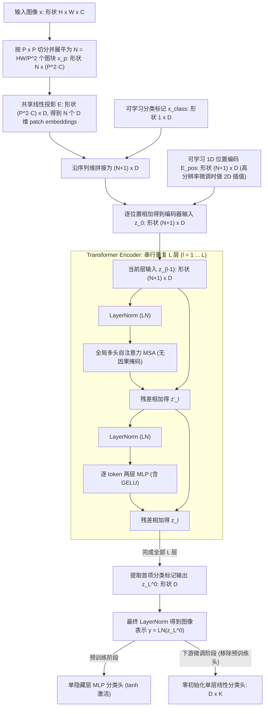

# An Image is Worth 16x16 Words: Transformers for Image Recognition at Scale

# First Time

## 1.Title & Authors
论文原标题：An Image is Worth 16x16 Words: Transformers for Image Recognition at Scale。
自然中文译法：一图胜过 $16\times 16$ 个词：大规模图像识别中的 Transformer。
标题巧妙化用了英文谚语 “A picture is worth a thousand words（一图胜千言）”，把整篇论文的核心构想一语道破：
- 16x16 Words（$16\times 16$ 视觉词块）：在 NLP 里，Transformer 处理的是一串词元（token）；放到视觉里，作者把一张二维图像切成固定大小（典型如 $16\times 16$ 像素）的小图块（patch），把每个图块当成一个“视觉词”，直接送进标准 Transformer。
- Transformers for Image Recognition（用纯 Transformer 做图像识别）：抛弃“必须把注意力嵌进卷积网络”的惯性思路，直接用几乎未改动的 NLP 标准 Transformer 编码器完成图像分类。
- at Scale（在大规模条件下）：标题最关键的限定词是 “at Scale”——纯 Transformer 缺少卷积的局部先验，在中型数据集上并不占优；但一旦把预训练数据推到千万乃至三亿量级，大规模训练就能压倒归纳偏置，让标准 Transformer 在精度与训练计算效率上双双超越顶尖 CNN。
作者按原文顺序列出：Alexey Dosovitskiy$^{*,\dagger}$、Lucas Beyer$^{*}$、Alexander Kolesnikov$^{*}$、Dirk Weissenborn$^{*}$、Xiaohua Zhai$^{*}$、Thomas Unterthiner、Mostafa Dehghani、Matthias Minderer、Georg Heigold、Sylvain Gelly、Jakob Uszkoreit、Neil Houlsby$^{*,\dagger}$，全部来自 Google Research, Brain Team（致谢注明研究工作在柏林、苏黎世与阿姆斯特丹三地协作完成）。原文脚注标明 6 位作者（Dosovitskiy、Beyer、Kolesnikov、Weissenborn、Zhai、Houlsby）为共同同等技术贡献（$*$ equal technical contribution），Alexey Dosovitskiy 与 Neil Houlsby 为共同指导（$\dagger$ equal advising）。
团队成员与本项研究一脉相承：Jakob Uszkoreit 是原始 Transformer 论文（Vaswani et al., 2017）与 Image Transformer（Parmar et al., 2018）的核心作者；Alexander Kolesnikov、Lucas Beyer、Xiaohua Zhai、Sylvain Gelly、Neil Houlsby 正是大规模视觉迁移基线 Big Transfer（BiT，ECCV 2020）、19 任务迁移评测集 VTAB（Zhai et al., 2019b）以及 ImageNet-ReaL 重标注集（Beyer et al., 2020）的原班核心作者；Dirk Weissenborn 则在 Axial Attention（Ho et al., 2019）与大尺度自回归视频建模（Weissenborn et al., 2019）中有直接积累。这篇发表于 ICLR 2021 的论文，正是这支深耕视觉大迁移与 Transformer 架构的团队合力交出的里程碑之作。

## 2.Abstract
摘要只有短短四句话，却按“现状反差 → 现有局限 → 颠覆方案 → 规模成效”四步干脆利落地立住了全文骨架。下面按原文语义单元逐句拆解。
1. 现状反差：Transformer 架构已经成为自然语言处理（NLP）的事实标准，但在计算机视觉（CV）领域的应用仍然受限。
   直觉上看，同样是做特征表示，NLP 早早靠标准 Transformer 打通了“大语料预训练 + 下游微调”的统一扩展路线，而当时视觉界仍牢牢被 ResNet、EfficientNet 这类卷积神经网络（CNN）统治。
2. 现有视觉注意力的两种妥协做法：在视觉任务里，注意力机制要么与卷积网络拼接联用，要么只替换卷积网络中的某些局部组件，整体骨架依然保留 CNN 结构。
   换句话说，前人普遍默认“视觉离开卷积不行”，于是给注意力套上了大量视觉专属的局部窗口或卷积外壳，结果反而丢失了标准 Transformer 在硬件加速器上极易并行扩展的优势。
3. 提出核心突破（纯 Transformer 读图块序列）：作者证明这种对 CNN 的依赖完全不必要——把一个纯净的标准 Transformer 直接作用在图像块（image patches）组成的序列上，就能在图像分类任务上表现得非常出色。
   整篇论文最核心的架构主张就在这里：把二维图像切块展平、做一次共享线性投影，就把它变成了和文本词向量毫无二致的一维序列，此后完全交给标准 Transformer 编码器处理。
4. 规模条件与实验成效：当在海量数据上预训练、再迁移到多个中小型图像识别基准（ImageNet、CIFAR-100、VTAB 等）时，Vision Transformer（ViT）相对顶尖卷积网络取得了优异成绩，同时训练所需的计算资源大幅减少。
   对照正文数据，在 3 亿张图像的 JFT-300M 上预训练后，旗舰模型 ViT-H/14 在 ImageNet 达到 88.55%、ImageNet-ReaL 达到 90.72%、CIFAR-100 达到 94.55%、VTAB 19 任务平均达到 77.63%，预训练耗费约 2.5k TPUv3-core-days，远低于同类强基线 BiT-L（ResNet152x4）的 9.9k 和 Noisy Student（EfficientNet-L2）的 12.3k。摘要同时在脚注中开源了微调代码与预训练权重。
把摘要浓缩成四个核心要素：

| 要素 | 本文核心内容 |
|---|---|
| 问题 | 标准 Transformer 已称霸 NLP，但在视觉中仍高度依赖 CNN 骨架或定制局部注意力，难以直接发挥其原生扩展效率。 |
| 方法 | 提出 Vision Transformer（ViT）：将二维图像切分为固定尺寸的图块序列，经线性嵌入与位置编码后直接送入标准 Transformer 编码器，经大规模监督预训练后迁移微调至下游分类任务。 |
| 结果 | 经 JFT-300M 预训练的 ViT-H/14 取得 ImageNet 88.55%、ImageNet-ReaL 90.72%、CIFAR-100 94.55%、VTAB 77.63%，在更低预训练算力下追平或超越 BiT-L 与 Noisy Student；在公开 ImageNet-21k 上预训练的 ViT-L/16 同样具有很强竞争力。 |
| 意义 | 确立了“大规模训练可以弥补视觉归纳偏置缺失”的经验规律，打通了视觉与 NLP 共享统一标准 Transformer 主干的道路。 |

## 3.Conclusion
原文 Section 5 为独立的 Conclusion，共两段：第一段收束全文的设计理念与核心成果，第二段直面三个尚未解决的挑战。
1. 第一段——极简架构与大规模回报的总结：
   - 极简去先验：与以往视觉自注意力工作不同，ViT 除了最开始把图像切成图块这一步之外，没有在网络架构里硬塞图像专属的归纳偏置（严格对照第 3.2 节，高分辨率微调时的二维位置编码插值是另一处人为引入的二维结构信息）。
   - 核心范式：把图像视作一串图块序列，交给 NLP 领域久经考验的标准 Transformer 编码器处理。
   - 实证结论：这种简单而高度可扩展的策略，只要配上大规模数据预训练就能释放惊人威力——在多个图像分类基准上追平或超越当时最优水平，而且预训练计算成本相对低廉。
2. 第二段——作者指出的三大未来挑战：
   - 挑战一（拓展至密集预测任务）：把 ViT 从图像分类推广到目标检测、语义分割等其他视觉任务。作者结合 DETR（Carion et al., 2020）的成功，认为这一方向前景明朗。
   - 挑战二（缩小自监督预训练差距）：作者在正文第 4.6 节做了类似 BERT 的掩码图块预测（masked patch prediction）初步实验，ViT-B/16 在 ImageNet 上达到 79.9%，比从零训练高出 2 个百分点，但仍落后大规模监督预训练约 4 个百分点。如何把 NLP 式自监督在视觉上真正做强，是重要课题。
   - 挑战三（继续扩大规模）：实验曲线（第 4.4 节）显示 ViT 在本文测试的算力与模型规模上限处仍未出现饱和迹象，继续放大模型与数据规模有望换来进一步提升。
整体看，结论与摘要严丝合缝，既给出了清晰的成功条件（大规模预训练 + 图像分类迁移），也坦率点明了密集任务与自监督两大后续战场。

## 4.Analogy
可以把 CNN 和 ViT 想象成“两位鉴赏名画流派的艺术鉴定师”。
- CNN 像一位拿着小放大镜的传统工匠：他天生有一套严格的看画规矩——每次只能透过 $3\times 3$ 的小镜片盯着局部几毫米，从左上角一格一格滑到右下角，先认笔触和边缘，再逐层拼出花瓣、树枝，最后才看清整幅画（这就是局部性、二维邻域和平移等变性）。靠着这套先验规矩，哪怕只看过几百幅教材画（小中型数据集），他也能很快总结出规律，不容易死记硬背。
- ViT 像一个没有固定套路的圆桌评审团：拿到一幅画后，它干脆拿裁纸刀把画横竖裁成几百张 $16\times 16$ 的正方形拼图卡片（patch），用同一套摘要模板把每张卡片压缩成固定长度的信息卡（共享线性投影 $\mathbf{E}$），给每张卡片贴上一张序号贴纸（位置编码 $\mathbf{E}_{pos}$），再在最前面摆一张空白的“总评汇总卡”（$\mathbf{x}_{\mathrm{class}}$）。随后所有卡片一次性摊在大圆桌上开 $L$ 轮讨论会（Transformer Encoder）：每一轮里，左上角的天空卡片可以直接和右下角的飞鸟卡片跨画对话（全局多头自注意力 $\mathrm{MSA}$），聊完每张卡片再各自整理一遍自己的笔记（逐块 $\mathrm{MLP}$）。$L$ 轮结束后，只看那张吸收了全场信息的总评汇总卡，就能报出画作类别。
- 为什么数据少时圆桌评审团考不过工匠，数据多时反而反超？刚起步时，评审团连“1 号卡片紧挨着 2 号卡片和 15 号卡片”都不知道，全得靠看画自己悟出来；画作太少时，他们容易死记每张画的偶发细节（过拟合）。可一旦把三亿张画摆到桌上，评审团不仅自己悟出了二维排布和局部纹理（后文 Fig7 会亲眼见证），还因为每一轮都能跨全图自由沟通、且标准圆桌流程在现代硬件上算得飞快，最终在准确率和训练成本上双双反超工匠。
- 这个比喻的边界也很明确：现实里的 ViT 并非完全不看二维几何，最初裁切正方形图块和微调高分辨率图时对位置贴纸做二维插值，都用到了图像的二维结构；而且每轮圆桌讨论的沟通权重是根据当前画作内容动态算出来的，不是固定不变的投票规则。

# Second Time

## 1.Notation & Parameters
ViT 的公式极其精炼，正文核心只有 4 个编号公式，全部围绕“图像切块投影 → 位置与分类标记拼接 → Pre-LN 编码器堆叠 → 提取分类表示”四步展开。下表汇总了理解正文主线所需的重点符号，严格沿用论文原始记号（含粗体与上下标）。

| 符号/参数 | 含义与作用 | 关键设定/约束 |
|---|---|---|
| $\mathbf{x}$ | 输入的原始二维彩色图像张量 | $\mathbf{x} \in \mathbb{R}^{H \times W \times C}$ |
| $H, W, C$ | 输入图像的高、宽与通道数 | 预训练统一为 $H=W=224$，$C=3$（RGB）；微调常用 $384$、$512$ 或 $518$ |
| $P$ | 正方形图像块的边长（patch size） | 每块尺寸 $(P, P)$；典型取值 $32, 16, 14$；$P$ 越小序列越长、算力越高 |
| $N$ | 切分出的图像块总数，即有效输入序列长度 | $N = HW / P^2$；要求 $H, W$ 能被 $P$ 整除（附录 A 泛指一般序列长度） |
| $\mathbf{x}_p$、$\mathbf{x}_p^1, \dots, \mathbf{x}_p^N$ | 展平后的二维图像块序列及第 $1$ 至第 $N$ 个图块行向量 | $\mathbf{x}_p \in \mathbb{R}^{N \times (P^2 \cdot C)}$，单个图块展平维度为 $P^2 \cdot C$ |
| $D$ | Transformer 全程恒定的隐藏向量维度 | ViT-Base 为 $768$，ViT-Large 为 $1024$，ViT-Huge 为 $1280$ |
| $\mathbf{E}$ | 共享的可学习图块线性投影矩阵 | $\mathbf{E} \in \mathbb{R}^{(P^2 \cdot C) \times D}$，输出称作 patch embeddings |
| $\mathbf{x}_{\mathrm{class}}$ | 拼接在序列最前端的可学习分类 token 嵌入 | 维度为 $D$，对应编码器输入首项 $\mathbf{z}_0^0 = \mathbf{x}_{\mathrm{class}}$ |
| $\mathbf{E}_{pos}$ | 可学习的一维位置编码矩阵 | $\mathbf{E}_{pos} \in \mathbb{R}^{(N+1) \times D}$，随机初始化，不含预设二维坐标 |
| $\mathbf{z}_0$ | 送入编码器第 1 层的初始嵌入序列 | $\mathbf{z}_0 \in \mathbb{R}^{(N+1) \times D}$，由 $[\mathbf{x}_{\mathrm{class}}; \text{各图块嵌入}]$ 加 $\mathbf{E}_{pos}$ 得到 |
| $L, \ell$ | Transformer 编码器的总层数与当前层序号 | $\ell = 1 \dots L$；Base/Large/Huge 分别为 $L = 12, 24, 32$ |
| $\mathbf{z}'_\ell, \mathbf{z}_\ell$ | 第 $\ell$ 层经 MSA 残差后的中间状态、经 MLP 残差后的层输出 | 全程维持 $(N+1) \times D$ 形状不变 |
| $\mathbf{z}_L^0, \mathbf{y}$ | 编码器最后一层输出的分类 token 状态与最终图像表示 | $\mathbf{y} = \mathrm{LN}(\mathbf{z}_L^0) \in \mathbb{R}^D$，送入下游分类头 |
| $\mathrm{MSA}, \mathrm{MLP}, \mathrm{LN}$ | 多头自注意力、两层前馈网络（含 GELU）、层归一化 | Pre-LN 排布：$\mathrm{LN}$ 放在每个子块之前，残差放在每个子块之后 |
| $K$ | 下游分类任务的类别总数 | 微调时用零初始化的 $D \times K$ 线性层替换预训练头；few-shot 回归目标在 $\{-1, 1\}^K$ |
| $\beta_1, \beta_2$ | 预训练 Adam 优化器的一阶与二阶矩衰减系数 | 预训练统一 $\beta_1 = 0.9, \beta_2 = 0.999$，batch size $4096$，weight decay $0.1$ |

读公式前先留心两处记号细节：第一，正文公式（1）里的 $N = HW/P^2$ 指图块数量，加上 $\mathbf{x}_{\mathrm{class}}$ 后送入编码器的实际长度是 $N+1$；而在附录 A 单独写通用自注意力公式（5）至（8）时，作者直接复用 $N$ 代表任意输入序列长度，按上下文区分即可。第二，编码器内部 $\mathrm{MLP}$ 使用 GELU 激活函数，而预训练阶段挂在 $\mathbf{y}$ 后面的单隐藏层分类头 $\mathrm{MLP}$ 使用 $\tanh$ 激活函数（见附录 D.3）。

## 2.Introduction
对应原文 Section 1。引言围绕一个直击要害的问题展开：既然标准 Transformer 在 NLP 里已经能轻松扩到千亿参数且性能还不见顶，为什么视觉领域一直没能直接享受到这份红利？
1. NLP 的扩展范式与成功密码：以自注意力为核心的 Transformer（Vaswani et al., 2017）已成为 NLP 首选架构。主流路线是在大规模文本语料上预训练，再微调到较小的特定任务上（如 BERT）。得益于 Transformer 极高的计算效率与可扩展性，模型参数已突破 100B（如 GPT-3、GShard），且随着模型与数据继续变大，性能仍无饱和迹象。
2. 视觉领域的现状与卡点：视觉这边仍是 CNN 的天下（LeNet、AlexNet、ResNet）。此前不少研究试图借 NLP 的东风，走过两条路：一是把自注意力和 CNN 拼在一起（如 Non-local、DETR），二是用特制局部注意力彻底替换卷积（如 Stand-Alone Self-Attention、Axial-DeepLab）。后一类模型理论上算力很省，但因为注意力模式太特殊、访存不规则，始终难以在现代硬件加速器（GPU/TPU）上高效放大。因此在大规模图像识别榜首坐着的，依然是经典的 ResNet 家族（如 BiT、Noisy Student）。
3. 本文的极简实验路线：作者决定不做花哨魔改，直接以最少的改动把标准 Transformer 搬到图像上——把图像切成图块（patches），把图块的线性嵌入排成一维序列当成 NLP 里的词元（tokens），直接用有监督图像分类来训练。
4. 先抑后扬的核心发现：
   - 挫折（中型数据）：在 ImageNet（130 万张图）这类中型数据集上训练且不加强正则时，ViT 的准确率比同等规模的 ResNet 低几个百分点。作者立刻点出原因：Transformer 缺少 CNN 与生俱来的图像归纳偏置——平移等变性（translation equivariance）和局部性（locality）——数据不够多时很难泛化好。
   - 反转（大规模数据）：一旦把预训练数据集扩大到 14M 至 300M 张图像，局面彻底逆转——大规模训练压倒了归纳偏置（large scale training trumps inductive bias）。在公开的 ImageNet-21k 或内部 JFT-300M 上充分预训练后迁移到小样本下游任务，ViT 全面追平或击败顶尖 CNN（见 [Table2 精读](#table2) 与 [Fig3 精读](#fig3)）：最佳模型拿下 ImageNet 88.55%、ImageNet-ReaL 90.72%、CIFAR-100 94.55% 与 VTAB 19 任务 77.63%。

## 3.Related Work
对应原文 Section 2。作者系统梳理了五条相关脉络，把 ViT 精准锚定在历史坐标里。
1. NLP 的 Transformer 预训练—微调范式：源自 Vaswani et al. (2017)，衍生出 BERT（掩码去噪自监督预训练）与 GPT（自回归语言建模）两大主线。ViT 直接继承了 BERT 式的双向编码器结构、`[class]` 标记思路，以及“大规模预训练 + 下游微调”的整体范式（只是主实验采用监督预训练，并在第 4.6 节初步探索了类 BERT 自监督）。
2. 像素级视觉注意力的近似探索：如果直接让一张图像里的每个像素去注意所有其他像素，复杂度随像素总数呈平方爆炸，完全无法处理真实分辨率图像。因此前人想出各种近似方案：
   - 局部窗口自注意力（Image Transformer、Local Relation Networks、Stand-Alone Self-Attention、Zhao et al. 2020）：每个查询像素只看周围一小块邻域，借此替换卷积；
   - 稀疏全局注意力（Sparse Transformers）；
   - 分块与轴向注意力（Weissenborn et al. 2019；Axial Attention，仅沿行和列两个坐标轴分别做注意力）。
   这些特制结构在精度上各有亮点，但共同痛点是工程实现复杂，难以吃满 TPU/GPU 的矩阵乘法吞吐量（后文附录 D.6 会亲自复现 AxialResNet 验证这一硬件瓶颈）。
3. 最接近的先行工作（Cordonnier et al., 2020）：他们同样从输入图像切出图块并在上面运行全局标准自注意力，思路与 ViT 极为相近。区别在于两点：第一，Cordonnier et al. 只用了极小的 $2\times 2$ 图块，序列长度依然太长，导致模型只能跑在低分辨率小图（如 CIFAR）上，而 ViT 用 $16\times 16$、$14\times 14$ 等较大图块直接攻克了常见中等分辨率图像；第二，ViT 进一步把规模推到千万至三亿级预训练，首次证明原生标准 Transformer 能在主流基准上正面打败顶尖 CNN。
4. CNN 与自注意力的混合结合，以及生成式像素 Transformer（iGPT）：
   - 结合路线包括在分类中用注意力增强特征图（Bello et al. 2019），或在 CNN 特征图之上再接自注意力用于检测（DETR）、视频、分类（Wu et al. 2020）、无监督物体发现（Slot Attention）及图文多模态（UNITER、ViLBERT、VisualBERT）。ViT 在正文第 3.1 节也设计了 Hybrid 变体，用来精确检验“加个 CNN 前端到底还有多大帮助”。
   - iGPT（Chen et al., 2020a）则是把图像先大幅降分辨率、压缩色彩空间后，用自回归生成式 Transformer 直接对像素建模，在 ImageNet 上最高拿到 72% 准确率；相比之下，ViT 通过图块化保留了完整 RGB 与更高分辨率，精度跃升超过 16 个百分点。
5. 超越 ImageNet 的大规模视觉预训练：延续 Sun et al. (2017)、Mahajan et al. (2018)、FixRes、Noisy Student，以及同团队的 BiT（Kolesnikov et al., 2020）和 Djolonga et al. (2020) 对 ImageNet-21k 与 JFT-300M 迁移规律的探索。本文沿用完全相同的两大超大规模数据集与迁移评测框架，把骨干网络从 ResNet 换成了标准 Transformer。

## 4.Method
对应原文 Section 3 开篇。作者开宗明义地交代了设计哲学：尽可能原汁原味地照搬原始 Transformer（Vaswani et al., 2017）。这种“刻意克制、不做复杂视觉魔改”的设计带来了巨大的工程红利——NLP 社区已经打磨成熟的大规模 Transformer 架构、分布式并行策略和高效硬件内核，拿过来几乎可以开箱即用。
在展开 3.1 与 3.2 节的逐公式推导前，先用一张可编辑 Mermaid 流程图把 ViT 从输入图像到预训练/微调输出的完整数据流一图看清（图中合并了 $\mathrm{MSA}$ 内部多头查询/键/值投影细节，省略了 dropout、混合架构 CNN 前端选项以及冻结线性少样本评测路径；Encoder 内框标示的 $L$ 层沿网络深度依次串联堆叠，预训练分类头与下游微调分类头分属两个独立阶段）：

完整原架构图见 [Fig1 精读](#fig1)。接下来两节把每个公式、维度变换和归纳偏置逻辑彻底拆开讲透。

## 5.Vision Transformer (ViT)
对应原文 Section 3.1，是全篇最核心的模型定义章节。下面按数据流经网络的真实顺序，一步步推演公式（1）至（4），再深挖归纳偏置与混合架构。
1. 为什么非得切块？——算一笔直观的序列长度账：
   标准 Transformer 吃的是一维词向量序列。如果把一张常见的 $224\times 224\times 3$ 图像直接按像素拉成一维序列，长度就是 $224\times 224 = 50,176$；自注意力两两算相似度，仅一张图、一个注意力头的注意力矩阵就有 $50,176^2 \approx 2.5\times 10^9$ 个元素，显存与算力瞬间爆炸。
   ViT 的解法简单得令人拍案：把二维图像 $\mathbf{x} \in \mathbb{R}^{H \times W \times C}$ 按固定正方形网格 $(P, P)$ 切成互不重叠的小块，再把每块里的像素拉直成一维向量，重排为图块序列 $\mathbf{x}_p \in \mathbb{R}^{N \times (P^2 \cdot C)}$，其中图块总数（即有效序列长度）为：
   $$
   N = \frac{HW}{P^2}.
   $$
   拿经典配置 `ViT-Base/16`（$H=W=224, C=3, P=16, D=768$，见 [Table1 精读](#table1)）代入一算：图像横竖各切 $224/16 = 14$ 份，总块数立刻降到 $N = 14 \times 14 = 196$，比 5 万像素短了 256 倍，和 NLP 里一篇短段落的词数几乎一样！每个图块展平后包含 $P^2 \cdot C = 16 \times 16 \times 3 = 768$ 个原始像素数值。
   顺手看出一个极其重要的计算规律：在参数量上，改变 $P$ 只微调第一层投影矩阵和位置编码表（占 86M 总参数的不到 1%），但序列长度 $N \propto 1/P^2$，缩小 $P$ 会让自注意力和逐块计算量成倍攀升——所以模型名后面的 `/32`、`/16`、`/14` 数字越小，算得越细也越贵。
2. 线性嵌入、分类标记与位置编码——公式（1）逐项拆解：
   Transformer 每一层内部都使用恒定宽度 $D$ 的隐向量，所以需要把每个长度为 $P^2 \cdot C$ 的展平图块投影到 $D$ 维，同时补上全局分类标记和位置坐标：
   $$
   \mathbf{z}_0 = [\mathbf{x}_{\mathrm{class}}; \, \mathbf{x}_p^1 \mathbf{E}; \, \mathbf{x}_p^2 \mathbf{E}; \, \cdots; \, \mathbf{x}_p^N \mathbf{E}] + \mathbf{E}_{pos}, \qquad \mathbf{E} \in \mathbb{R}^{(P^2 \cdot C) \times D}, \quad \mathbf{E}_{pos} \in \mathbb{R}^{(N+1) \times D}.
   $$
   把等号右边的四个零件逐个拆开看：
   - 共享线性投影 $\mathbf{x}_p^1 \mathbf{E}, \dots, \mathbf{x}_p^N \mathbf{E}$：所有 $N$ 个图块共用同一个可训练矩阵 $\mathbf{E} \in \mathbb{R}^{(P^2 \cdot C) \times D}$。每个图块行向量（形状 $1 \times (P^2 \cdot C)$）右乘 $\mathbf{E}$，得到 $1 \times D$ 的图块嵌入（patch embedding）。从工程实现的几何等价性看，“把原图切成不重叠的 $P \times P$ 块，再对每块乘同一矩阵 $\mathbf{E}$”，在数学上完全等价于用一个卷积核尺寸为 $P \times P$、步幅为 $P$、输出通道数为 $D$ 的二维卷积层直接扫过原图！后文 [Fig7 精读](#fig7) 左图正是把 $\mathbf{E}$ 的主成分还原成 $P\times P$ 的彩色滤波器来观察。
   - 拼接可学习分类标记 $\mathbf{x}_{\mathrm{class}}$：方括号里的分号表示沿序列（token）维度纵向堆叠。借鉴 BERT 的 `[class]` token，作者在 $N$ 个图块嵌入最前面拼上一个可学习的 $1 \times D$ 向量 $\mathbf{x}_{\mathrm{class}}$（即序列第 0 个位置 $\mathbf{z}_0^0 = \mathbf{x}_{\mathrm{class}}$），序列总长度变为 $N+1$（以 `ViT-Base/16` 在 $224\times 224$ 上为例，形状变为 $197 \times 768$）。它本身不绑定图像的任何一块局部像素，专门负责在后续 $L$ 层自注意力里像“海绵”一样吸纳整张图的全局语义。
   - 逐元素加上一维可学习位置编码 $\mathbf{E}_{pos}$：自注意力本身对序列排列顺序是置换等变的——如果把 $N$ 个图块打乱顺序喂进去，输出只是同步打乱，网络根本分不清哪块在上哪块在下（彻底退化成“图块袋”）。因此必须给每个位置加上唯一坐标向量 $\mathbf{E}_{pos} \in \mathbb{R}^{(N+1) \times D}$（第 0 行给 $\mathbf{x}_{\mathrm{class}}$，第 1 至 $N$ 行按光栅顺序给 $N$ 个图块）。作者特意选用最朴素的一维可学习参数表，而非手工设计的二维位置编码，因为附录 D.4 的消融表明复杂二维编码并没有带来明显增益——数据够多时，一维编码自己就能学出精准的二维拓扑关系（见 [Fig7 精读](#fig7) 中图）。
3. Pre-LN Transformer 编码器堆叠——公式（2）与公式（3）逐层推演：
   编码器把初始序列 $\mathbf{z}_0 \in \mathbb{R}^{(N+1) \times D}$ 依次送过 $L$ 个结构完全相同的层（$\ell = 1 \dots L$），每层包含一个多头自注意力子块和一个前馈网络子块：
   $$
   \mathbf{z}'_\ell = \mathrm{MSA}(\mathrm{LN}(\mathbf{z}_{\ell-1})) + \mathbf{z}_{\ell-1}, \qquad \ell = 1 \dots L,
   $$
   $$
   \mathbf{z}_\ell = \mathrm{MLP}(\mathrm{LN}(\mathbf{z}'_\ell)) + \mathbf{z}'_\ell, \qquad \ell = 1 \dots L.
   $$
   顺着数据流看清其中的四个关键架构细节：
   - Pre-LN 排布（先归一化，后进子块，残差直通）：原始 Vaswani Transformer 把 LayerNorm 放在残差加法之后（Post-LN）；ViT 遵循 Wang et al. (2019) 与 Baevski & Auli (2019) 的改进，把 $\mathrm{LN}$ 移到 $\mathrm{MSA}$ 和 $\mathrm{MLP}$ 之前。这样做最大的好处是保留了一条从 $\mathbf{z}_0$ 直通 $\mathbf{z}_L$ 的“纯净残差高速公路”——反向传播时梯度可以直接沿加法支路畅通无阻地回传到浅层，训练 24 层、32 层深网络时稳定得多。
   - 全局多头自注意力 $\mathrm{MSA}$：每个 token 先经 $\mathrm{LN}$ 沿特征维度 $D$ 归一化，再进入 $\mathrm{MSA}$（具体矩阵展开式为附录 A 的公式 5 至 8）。与 GPT 解码器不同，图像的所有图块同时可见，因此 ViT 的 $\mathrm{MSA}$ 不使用任何因果掩码，每个图块（含 $\mathbf{x}_{\mathrm{class}}$）都能直接与全图全部 $N+1$ 个位置交互，是 ViT 中唯一跨空间混合信息的模块。输出经残差加回 $\mathbf{z}_{\ell-1}$ 得到中间序列 $\mathbf{z}'_\ell \in \mathbb{R}^{(N+1) \times D}$。
   - 逐 token 两层前馈网络 $\mathrm{MLP}$：把 $\mathbf{z}'_\ell$ 再过一次 $\mathrm{LN}$，随后独立作用到序列里的每一个 token 上（不跨图块混合信息）。两层全连接先把每个 $D$ 维向量升维到 MLP size（[Table1 精读](#table1) 中统一为 $4D$，如 Base 为 $768 \to 3072$），经过平滑非线性的 GELU 激活，再投影回 $D$ 维，最后残差加回 $\mathbf{z}'_\ell$ 得到本层输出 $\mathbf{z}_\ell \in \mathbb{R}^{(N+1) \times D}$。
   - 全程等宽等长：无论经过多少层，序列张量始终保持 $(N+1) \times D$，既没有 CNN 的逐阶段池化降采样，也没有通道数倍增，所有层结构高度规整，天然贴合张量并行和加速器矩阵计算。
4. 最终图像表示与两阶段分类头——公式（4）：
   走完全部 $L$ 层编码器后，取出序列最前端分类标记的最终状态 $\mathbf{z}_L^0 \in \mathbb{R}^D$，再做一次最终层归一化（正好给 Pre-LN 残差主干收尾）：
   $$
   \mathbf{y} = \mathrm{LN}(\mathbf{z}_L^0).
   $$
   为什么最后还要单独加一层 $\mathrm{LN}$？因为在 Pre-LN 结构中，残差相加后的 $\mathbf{z}_L$ 并没有经过归一化，末尾补上 $\mathrm{LN}$ 才能把送入分类头的特征尺度稳住。拿到最终图像表示 $\mathbf{y}$ 后，两个训练阶段挂接不同的分类头：
   - 预训练阶段：接一个含单隐藏层的 $\mathrm{MLP}$ 分类头（附录 D.3 注明其隐藏层使用 $\tanh$ 非线性激活），映射到预训练大词表类别（如 JFT 的 18k 类或 ImageNet-21k 的 21k 类）。
   - 下游微调阶段：丢弃整个预训练 $\mathrm{MLP}$ 头，换成单个线性分类层映射到下游 $K$ 类。
   （附录 D.3 进一步证实，不用 $\mathbf{x}_{\mathrm{class}}$ 而改对所有图块做全局平均池化 GAP 也能达到同等精度，只是需要换用更小的学习率。）
5. Inductive bias（归纳偏置剖析）：
   这一小段是理解 ViT 行为规律的钥匙。作者把 CNN 与 ViT 的视觉先验摆在台面上做了一笔彻底的清点：
   - CNN 的先验：局部性（locality，卷积核只看局部感受野）、二维邻域结构（2D neighborhood structure）和平移等变性（translation equivariance，物体挪到画面另一处时特征图同步平移）从第一层到最后一层全部硬编码在架构里。
   - ViT 的先验：整座网络里只有 $\mathrm{MLP}$ 层是局部且平移等变的（因为对每个图块独立套用同一组权重），而所有自注意力层都是全局的。二维邻域结构只被极克制地用在了两处——最开头把原图裁成二维正方形图块，以及微调不同分辨率图像时对位置编码做二维插值。除此之外，初始化时的 $\mathbf{E}_{pos}$ 完全不带任何二维坐标信息，图块之间谁挨着谁、怎么构成物体，全靠模型从海量数据里从头学出来。
   这就完美解释了引言里那组看似矛盾的实验现象：数据少时，CNN 靠先验作弊少走了很多弯路；数据大到千万上亿时，ViT 不受固定局部窗口束缚，既能在浅层自动分化出局部头和全局头，又能把算力花在真正需要长程关联的区域上。
6. Hybrid Architecture（混合架构）：
   除了直接切原始像素块，作者还给出了天然的混合变体：先用 CNN（实验采用去掉 BatchNorm、换用 GroupNorm 与权重标准化的 ResNet50）提取中间特征图，再把公式（1）的线性投影 $\mathbf{E}$ 作用到从 CNN 特征图上切出来的图块上。
   一个极其简洁的特例是把特征图上的图块尺寸设为 $1\times 1$：这意味着根本不用切块，直接把 CNN 特征图的空间高宽两个维度展平成一维序列，每个空间位置的通道向量经 $\mathbf{E}$ 投影到 $D$ 维，再拼上 $\mathbf{x}_{\mathrm{class}}$、加上 $\mathbf{E}_{pos}$ 送入标准 Transformer 编码器即可。正文第 4.1 节用两种 ResNet50 截断方式控制混合模型的序列长度：（i）取标准 ResNet50 第 4 阶段输出（总下采样 32 倍，224 输入得 $7\times 7=49$ 个 token）；（ii）删掉第 4 阶段，把对应层数并入第 3 阶段保持总层数不变，取扩展后第 3 阶段输出（总下采样 16 倍，序列长度变为 4 倍，224 输入得 $14\times 14=196$ 个 token）。

## 6.Fine-tuning and Higher Resolution
对应原文 Section 3.2。ViT 预训练都在 $224\times 224$ 分辨率上跑，但下游微调时往往需要喂更高分辨率的图像（如 $384\times 384$，ImageNet 榜单冲刺时甚至用到 $512\times 512$ 和 $518\times 518$）来换取更清晰的细粒度细节。这一节讲清了微调的两项核心操作，以及为什么 ViT 能丝滑切换分辨率。
1. 替换整个分类头并零初始化：
   微调到下游任务时，移除整个预训练分类头（即预训练单隐藏层 MLP 的全部两层，见附录 B.1.1，作者发现整头替换比只重置最后一层更稳健），在 $\mathbf{y}$ 后面接一个全新且全零初始化的 $D \times K$ 线性前馈层，其中 $K$ 为下游任务类别数。
   为什么特意零初始化？因为权重全零时，微调第 0 步模型对 $K$ 个类别输出完全相等的 logits（均匀概率分布），不会像随机初始化线性层那样在第一步产生剧烈、无方向的错误梯度，从而保护辛辛苦苦在大数据集上学出来的编码器特征不被震坏。
2. 保持图块尺寸 $P$ 不变，靠二维插值适配 $\mathbf{E}_{pos}$：
   提高输入图像分辨率 $(H, W)$ 时，ViT 保持图块边长 $P$ 和隐藏维度 $D$ 完全不变，于是有效序列长度 $N = HW/P^2$ 自然变长。
   先看一个神奇的架构性质：投影矩阵 $\mathbf{E} \in \mathbb{R}^{(P^2\cdot C)\times D}$、每一层 $\mathrm{MSA}$ 的投影权重、每一层 $\mathrm{MLP}$ 权重以及所有 $\mathrm{LN}$ 参数，尺寸都只取决于 $P$ 和 $D$，与序列长度 $N$ 彻底无关！因此只要显存撑得住，Transformer 编码器本身可以零修改地吃下任意长度的序列。
   唯一被序列长度 $N$ 卡住的参数，就是形状为 $(N+1) \times D$ 的预训练位置编码 $\mathbf{E}_{pos}$——网格变密了，原来按旧网格学出来的位置编号对不上号了。作者的解法非常干净：
   - 第一步：把 $\mathbf{E}_{pos}$ 中对应 $\mathbf{x}_{\mathrm{class}}$ 的第 0 行单独拿出来保持不动；
   - 第二步：把剩下的 $N$ 个图块位置向量按原始二维空间排列还原回 $(H/P) \times (W/P)$ 的二维网格（每个网格点存着一个 $D$ 维向量）；
   - 第三步：按照新分辨率对应的更密二维网格，对这组二维位置向量执行二维插值（2D interpolation），让新图块继承原图对应空间位置的平滑位置编码；
   - 第四步：把插值后的新网格重新展平为一维序列，再把第 0 行的 $\mathbf{x}_{\mathrm{class}}$ 位置向量拼回最前面。
   用具体数字感受一下序列长度的变化（由 $N = HW/P^2$ 直接推算）：
   - 对 `ViT-B/16`（$P=16, D=768$）：$224\times 224$ 预训练时网格 $14\times 14$，序列形状 $197 \times 768$；升到 $384\times 384$ 微调时网格扩为 $24\times 24$，序列形状变为 $577 \times 768$；
   - 对 `ViT-L/16`（$P=16, D=1024$）：在 ImageNet 冲刺 $512\times 512$ 分辨率时，网格扩为 $32\times 32$，序列长达 $1025 \times 1024$；
   - 对 `ViT-H/14`（$P=14, D=1280$）：在 ImageNet 冲刺 $518\times 518$ 分辨率时，$518/14 = 37$，网格扩为 $37\times 37$，序列长达 $1370 \times 1280$。
   作者在节末再次点题：前面切图块和这里做二维位置插值，就是全篇人为注入 Vision Transformer 的仅有的两处二维图像结构归纳偏置。

## 7.Figure & Table
正文共有 7 张图、2 张表，合计 9 项，下面严格按正文实际出现顺序逐项精读。

#### Fig1:
这是全篇最重要的一张正文图，因为它在单一视野里完整定格了 Vision Transformer 的极简架构全景——左图展示二维图像如何被转化为一维 token 序列并送入分类头，右图展开了标准 Pre-LN Transformer 编码器的内部重复单元，是理解全文公式（1）至（4）的视觉锚点。
画面分左右两栏，中间用虚线隔开：
- 左栏 `Vision Transformer (ViT)`：自底向上展示端到端前向过程。最左下角是一张建筑风景图，被网格线整齐切成 $3\times 3 = 9$ 个正方形图块（示意图用 9 块代表实际 $N$ 块），向右展开排成一维序列。所有展平图块共同穿过粉色长框 `Linear Projection of Flattened Patches`（对应共享矩阵 $\mathbf{E}$），输出 9 个粉色圆角矩形（`Embedded Patches`）。最左侧额外注入一个带星号 `*` 的紫色圆角矩形（`Extra learnable [class] embedding`，即 $\mathbf{x}_{\mathrm{class}}$）。随后从 0 到 9 的 10 个位置依次叠加上带数字编号的灰色位置编码圆角框（`Patch + Position Embedding`，对应加 $\mathbf{E}_{pos}$ 得到 $\mathbf{z}_0$），一起进入灰色大框 `Transformer Encoder`。编码器输出端只从第 0 号位置引出一条箭头进入橙色 `MLP Head`（其余 1 至 9 号图块输出在分类时不接入分类头），最终输出 `Class` 预测标签（如 Bird、Ball、Car 等）。
- 右栏 `Transformer Encoder`：放大拆解编码器单层结构，最外侧括号标注 `L x` 表示串行重复 $L$ 层。数据从底部 `Embedded Patches` 进入，先走第一条主线：`Norm`（LayerNorm）→ 绿色 `Multi-Head Attention` → 与输入跳过连接汇聚于圆圈 `+`（对应公式 2 得 $\mathbf{z}'_\ell$）；再走第二条主线：`Norm` → 蓝色 `MLP` → 与上一残差结果跳过连接汇聚于圆圈 `+`（对应公式 3 得 $\mathbf{z}_\ell$）。
读图核对要点：第一，右栏清楚显示 `Norm` 在注意力与 MLP 之前（Pre-LN），残差分支从 `Norm` 之前分出、绕过子块直接汇入 `+`；第二，左栏只画出预训练时的 `MLP Head`，微调阶段会把整个 MLP 头替换为单层线性分类器；第三，公式（4）里位于最终 $\mathbf{z}_L^0$ 之后的末尾 `LN` 未在左栏单独画框，复现代码时须补齐。

#### Table1:
位置与作用：位于第 4.1 节，给出 ViT 三个标准型号的参数蓝图。表格 6 列依次为 Model、Layers（$L$）、Hidden size $D$、MLP size、Heads、Params，共 3 行配置：
- `ViT-Base`：12 层，隐藏维度 $D=768$，MLP 隐藏维度 $3072$（$=4D$），12 个注意力头（单头维度 $D_h=768/12=64$），参数量 86M；
- `ViT-Large`：24 层，隐藏维度 $D=1024$，MLP 隐藏维度 $4096$（$=4D$），16 个注意力头（$D_h=1024/16=64$），参数量 307M；
- `ViT-Huge`：32 层，隐藏维度 $D=1280$，MLP 隐藏维度 $5120$（$=4D$），16 个注意力头（$D_h=1280/16=80$），参数量 632M。
与正文联系：Base 和 Large 直接沿用 BERT 的经典配置，Huge 是作者新增的更大档位。型号简称如 `ViT-L/16` 表示 Large 搭配 $16\times 16$ 图块。表格没有按 patch size 分行，因为改变 $P$ 对总参数量影响极微，却会通过 $N = HW/P^2$ 剧烈改变序列长度和训练/推理计算量。

#### Table2:
位置与评测协议：位于第 4.2 节，是全篇与当时最强 CNN 阵营正面交锋的核心成绩单。五列模型依次为 `Ours-JFT (ViT-H/14)`、`Ours-JFT (ViT-L/16)`、`Ours-I21k (ViT-L/16)`、强监督迁移 CNN 基线 `BiT-L (ResNet152x4)`，以及半监督高效 CNN 基线 `Noisy Student (EfficientNet-L2)`（ImageNet 与 JFT-300M 去标签训练）。纵向覆盖 7 个基准（ImageNet、ImageNet ReaL、CIFAR-10、CIFAR-100、Oxford-IIIT Pets、Oxford Flowers-102、VTAB 19 tasks），末尾附 `TPUv3-core-days` 预训练成本；ViT 与 BiT 报告三次微调运行的均值 $\pm$ 标准差，粗体标出每行最高分。
核心战绩与精准细节：
- 旗舰 `ViT-H/14 (JFT)` 几乎横扫全表：拿下 7 项中的 6 项第一——ImageNet `88.55 ± 0.04`（超越 BiT-L 的 `87.54 ± 0.02` 与 Noisy Student 的 `88.4/88.5*`）、ImageNet ReaL `90.72 ± 0.05`、CIFAR-10 `99.50 ± 0.06`、CIFAR-100 `94.55 ± 0.04`（领先 BiT-L 超 1 个百分点）、Oxford-IIIT Pets `97.56 ± 0.03`、VTAB `77.63 ± 0.23`（领先 BiT-L 的 `76.29 ± 1.70` 达 1.34 个百分点，且方差小得多）。唯一一项由同门 `ViT-L/16 (JFT)` 拔得头筹的是 Oxford Flowers-102（`99.74 ± 0.00` 对 ViT-H/14 的 `99.68 ± 0.02`）。
- 轻量级对比 `ViT-L/16 (JFT)` 性价比惊人：预训练只花了 `0.68k` TPUv3-core-days，不到 `BiT-L`（`9.9k`）的十五分之一，却在 ImageNet（`87.76` 对 `87.54`）、CIFAR-100（`93.90` 对 `93.51`）、Pets（`97.32` 对 `96.62`）和 Flowers（`99.74` 对 `99.63`）上全面胜出，在 ReaL（`90.54`）与 VTAB（`76.28 ± 0.46` 对 `76.29 ± 1.70`）上基本持平且稳定性高得多。
- 公开数据集 `ViT-L/16 (I21k)` 实用性强：只用公开的 ImageNet-21k 和 `0.23k` TPUv3-core-days（8 核标准云 TPUv3 约跑 30 天），就能拿到 ImageNet `85.30`、CIFAR-100 `93.25`、VTAB `72.72`。
- 算力门槛对照：`ViT-H/14` 耗费 `2.5k` TPUv3-core-days，约为 `BiT-L`（`9.9k`）的四分之一、`Noisy Student`（`12.3k`）的五分之一。
阅读边界：本表里的 ImageNet 分数动用了额外冲刺技巧——ViT-L/16 微调分辨率升至 512、ViT-H/14 升至 518，并叠加系数 0.9999 的 Polyak 权重平均（附录 Table 5 是统一 384 分辨率、无 Polyak 平均的纯结果，两者不能直接混比）；此外如作者在正文所述，不同论文的预训练成本还受优化器、日程与正则设置影响，严格同条件的控制变量算力对比应看 Fig5。

#### Fig2:
位置与目的：位于第 4.2 节，把 Table 2 里 VTAB 19 个低样本迁移任务（每任务仅 1,000 张训练图）拆成总分与三个语义子组，用柱状图对比四个代表模型：蓝色 `ViT-H/14`、紫色 `BiT-L (R152x4)`、绿色 `VIVI-Ex-100% (R50x3)`（ImageNet 加 YouTube 视频联合训练）、橙色 `S4L (R50x1)`（ImageNet 监督加半监督）。
四组柱状图走势清晰（纵轴范围按子组各异，读数看刻度）：
- `VTAB (19 tasks)` 总分（纵轴 65%–80%）：`ViT-H/14`（77.63%）领跑，`BiT-L`（76.29%）第二，明显甩开 `VIVI`（约 70%）和 `S4L`（约 67%）。
- `Natural (7 tasks)` 自然图像组（纵轴 70%–90%）：`ViT-H/14`（约 87%+）领先 `BiT-L`（约 86%），大幅领先另外两者。
- `Specialized (4 tasks)` 医疗与卫星专用图像组（纵轴 80%–90%）：`ViT-H/14` 与 `BiT-L` 几乎齐平（均在约 87%），都显著高于 `VIVI` 和 `S4L`（约 83%）。
- `Structured (8 tasks)` 几何计数与空间定位等结构化任务组（纵轴 50%–70%）：差距拉得最大，`ViT-H/14` 冲到约 64%，把 `BiT-L` 与 `VIVI`（约 61%–62%）和 `S4L`（约 54%–55%）甩开一截。
结论：缺少硬编码二维卷积先验的 ViT，在大规模预训练后不仅擅长常见自然物体分类，在最考验空间几何关系的 Structured 任务组上反而建立了最大优势。各子任务明细见附录 Table 9。

#### Fig3:
位置与目的：位于第 4.3 节，是验证全篇核心命题“大规模训练压倒归纳偏置”的决定性视觉证据。横轴依次列出三个体量呈数量级跃升的预训练数据集：`ImageNet`（1.3M）、`ImageNet-21k`（14M）、`JFT-300M`（303M）；纵轴是微调到 ImageNet 后的 Top-1 准确率（70%–90%，统一 384 分辨率，详见附录 Table 5）。灰色阴影带代表不同规模 `BiT` ResNet 模型张成的性能区间（底边对应较小 ResNet，顶边对应最大 ResNet），彩色圆点表示 5 个 ViT 变体（圆点大小与颜色区分模型容量：`ViT-B/32`、`ViT-B/16`、`ViT-L/32`、`ViT-L/16`、`ViT-H/14`）。
横跨三个数据集可以看到一次戏剧性的“双反转”：
- 第一反转（ViT vs CNN 跨带反超）：在最小的 `ImageNet` 上预训练时，即便调优了权重衰减、dropout 和标签平滑三项正则，所有 ViT 变体都落于 BiT 阴影带中下端甚至下方（例如 ViT-B/16 77.91%、ViT-B/32 73.38%，而 BiT 顶边超过 81%）；在 `ImageNet-21k` 上，大号 ViT（L/16 85.15%、H/14 85.13%）追平并触及 BiT 阴影带上沿；到了 `JFT-300M`，`ViT-H/14`（88.04%）直接跃出 BiT 阴影带上沿（约 87.5%），实现全面反超。
- 第二反转（大 ViT vs 小 ViT 内部反超）：在 `ImageNet` 上，大容量模型反而更差——`ViT-L/16`（76.53%）输给 `ViT-B/16`（77.91%），`ViT-L/32`（71.16%）输给 `ViT-B/32`（73.38%），典型表现为数据不足导致大容量过拟合；到 `ImageNet-21k`，L/16 与 H/14 基本打平并甩开 Base；到 `JFT-300M`，容量越大的模型稳稳排在越上面（H/14 > L/16 > L/32 $\approx$ B/16 > B/32），充分释放大模型红利。
阅读细节：在 `ImageNet` 预训练列里，模型依然在 ImageNet 上做了一次 384 更高分辨率微调（原文脚注 2），所以性能受益于分辨率提升，但仍明显弱于同数据集上的 BiT。

#### Fig4:
位置与目的：位于第 4.3 节，弥补 Fig3 的一个变量漏洞——Fig3 换数据集时既换了分布也调了正则强度，Fig4 则改用同一数据集 JFT-300M 的随机子集（9M、30M、90M、300M，对数横轴刻度标为 `10 M, 30 M, 100 M, 300 M`），对所有子集固定完全相同的超参数、不加额外正则（仅用早停取最优验证点），评测冻结特征下的 ImageNet 线性 5-shot Top-1 准确率（纵轴 30%–75%），纯净检验架构本身的样本效率与扩展潜力。
图中对比 6 条曲线：2 条灰色方块实线为 CNN（`ResNet50x1 (BiT)`、`ResNet152x2 (BiT)`），4 条彩色圆点实线为 ViT（`ViT-L/16`、`ViT-L/32`、`ViT-B/32` 以及把全部隐藏维度减半的极小模型 `ViT-b/32`）。
读出两组堪称教科书级的“交叉剪刀差”：
- 中等算力档对比（`ViT-B/32` 蓝线 vs `ResNet50x1` 浅灰线，前者速度略快于后者）：在 9M 子集上，ViT-B/32（约 38%）远落后于 ResNet50x1（约 48%）；30M 时迅速迫近并小幅反超；到 90M 与 300M，ResNet50x1 早早进入平台期（停在约 52%），ViT-B/32 则继续爬升并稳定超出（约 55%）。
- 大算力档对比（`ViT-L/16` 浅蓝线 vs `ResNet152x2` 深灰线）：在 9M 子集上，ResNet152x2（约 53%）大幅领先 ViT-L/16（约 42%）；30M 时差距缩小（约 67% 对 58%）；到 90M–300M 时，ResNet152x2 明显放缓趋平（约 69%–69.5%），而 ViT-L/16 陡峭上扬实现反超（突破 71%）。
- 容量瓶颈对照：`ViT-b/32`（黄线）因隐维度减半、容量过小，数据再多也卡在 42% 左右动弹不得，说明大数据的红利必须配合足够大的模型容量才能兑现。
核心结论：在严格排除数据分布差异与额外正则干扰后，卷积归纳偏置在千万级以下子集优势明显，但一旦跨过约 90M–100M 样本门槛，CNN 更早撞到天花板，纯 ViT 直接从数据学到的表示反而更具后劲。

#### Fig5:
位置与目的：位于第 4.4 节，在 JFT-300M 这一“数据不再卡脖子”的受控环境里，统一用 Adam 预训练 18 个模型（7 个 ResNet、6 个 ViT、5 个 Hybrid，具体数据见附录 Table 6），以对数横轴 `Total pre-training compute [exaFLOPs]`（$10^{18}$ 次浮点运算，覆盖约 $50$ 到 $4262$ exaFLOPs）为标尺，比较三大架构家族的迁移精度与计算效率。左子图为 5 个下游数据集的平均迁移准确率 `Average-5`（ImageNet、CIFAR-10、CIFAR-100、Pets、Flowers，纵轴约 88%–96.5%），右子图为单独 `ImageNet` 准确率（纵轴 75%–90%）；蓝色圆点代表 `Transformer (ViT)`，灰色方块代表 `ResNet (BiT)`，橙色加号代表 `Hybrid`。
从散点包络线一眼读出三大规律：
- 第一，ViT 全面支配 ResNet 的精度—算力前沿：无论左图还是右图，蓝色 ViT 点集整体位于灰色 ResNet 点集的左上方（相同算力精度更高，相同精度算力更省）。在 Average-5 上达到同等迁移精度，ViT 大约只需 ResNet 的 $1/2$ 到 $1/4$ 预训练算力（例如 224 exaFLOPs 的 ViT-B/16 与 563 exaFLOPs 的 ResNet152x2 在多项任务上已十分接近；783 exaFLOPs 的 ViT-L/16 在 ImageNet 达 86.30%，超过 1126 exaFLOPs 的 ResNet152x2 的 85.56%）。
- 第二，Hybrid 的优势只存在于小预算区间，在大规模下消失：在较低算力（约 $10^2$–$3\times 10^2$ exaFLOPs）时，橙色 Hybrid 加号清晰高出蓝色 ViT 圆点（例如 106 exaFLOPs 的 R50x1+ViT-B/32 拿到 ImageNet 84.90%，甚至超过 224 exaFLOPs 的纯 ViT-B/16 的 84.15%）；可一旦算力跨过 $10^3$ exaFLOPs，14 epoch 的 `ViT-L/16`（1567 exaFLOPs, ImageNet 87.12%）与 `R50x1+ViT-L/16`（1668 exaFLOPs, ImageNet 87.12%）几乎重合，说明模型足够大时，前置卷积层提取局部特征的加成被纯 Transformer 自身完全消化掉了。
- 第三，未见饱和迹象：最右侧 `ViT-H/14`（4262 exaFLOPs, ImageNet 88.08%）的上升斜率依然健挺，为后续继续放大 ViT 提供了直接动力。

#### Fig6:
位置与目的：位于第 4.5 节，通过 Attention Rollout（Abnar & Zuidema, 2020；详见附录 D.8——原图注误写成 D.7）可视化 `ViT-L/16` 最终输出分类 token 对输入图像空间各区域的累计注意力分布。图分两列（左 `Input` 原图，右 `Attention` 叠暗掩码的注意力图），共三行代表样例：
- 第一行（草地上的毛绒小狗）：注意力精准照亮了整只小狗的头部与身躯轮廓，大片绿色草坪被暗化抑制；
- 第二行（云层中飞行的喷气客机）：注意力紧紧聚焦在机身、机翼与尾翼上，厚重云团背景基本变暗；
- 第三行（枝叶/树皮背景上的斑纹爬行/节肢类小动物，原文未标具体类别名）：注意力主要点亮了该动物的头部与身体主体，周围亮黄色背景被大幅压暗（局部相近前景区域仍有少量泛光）。
意义与解读边界：这组样例直观展示了 ViT 在没有硬编码卷积层级池化的前提下，依然能把最终分类决策的注意力汇聚到与类别语义高度相关的前景物体上。具体做法是对各层多头注意力取均值后连乘各层矩阵，以追踪跨层信息混合路径；更大规模的 128 张随机抽样样例见附录 Fig14。

#### Fig7:
位置与目的：位于第 4.5 节，是全篇剖析 ViT“黑盒内部到底学到了什么”的三联核心诊断图，直接回应了“缺少视觉归纳偏置的模型凭什么能看懂图”的深层疑问。三个子图从输入层一路解剖到深层注意力：
- 左图 `RGB embedding filters (first 28 principal components)`：展示 `ViT-L/32` 第一层共享线性投影矩阵 $\mathbf{E}$ 学到的 RGB 滤波器的前 28 个主成分（排列成 $4\times 7$ 个彩色小方格）。肉眼可见清晰的斜向条纹、棋盘高频纹理、红绿/蓝黄颜色拮抗斑点，像极了传统 CNN 第一层卷积核和 Gabor 基函数——说明单靠线性投影加反向传播，ViT 自发学会了表达图块内部精细纹理与色彩的低维基。
- 中图 `Position embedding similarity`：展示 `ViT-L/32` 在 $7\times 7$ 图块网格（$224/32=7$）上学到的一维位置编码 $\mathbf{E}_{pos}$ 的两两余弦相似度。大图是一个 $7\times 7$ 阵列（横轴 `Input patch column` 1–7，纵轴 `Input patch row` 1–7），其中位于指定行与列的每一个小方块本身又是一张 $7\times 7$ 热力图，标示该图块与全图所有图块位置编码的余弦相似度（右侧色条从深紫 $-1$ 到亮黄 $+1$）。震撼之处在于：初始化时毫无二维概念的一维向量表，训练后自动恢复出了完整的二维几何拓扑——每个小方块里最亮黄的中心恰好落在自身所在行列位置且向四周柔和衰减（学会了空间距离），同时浮现出清晰的“十字亮带”（同一行或同一列的图块相似度普遍更高）。这也直接解释了为何附录 D.4 中手工设计二维位置编码毫无额外收益。
- 右图 `Mean attention distance (pixels)`：把 `ViT-L/16` 在 224 像素图像上的“平均注意力距离”（按注意力权重加权的像素空间距离，类比 CNN 感受野大小，纵轴 0–120 像素）按网络深度（横轴 `Network depth (layer)`，0 到 23 共 24 层）和注意力头（每层 16 个彩色圆点代表 16 个头）绘出散点。呈现两个惊艳机制：第一，在最底层的第 0–4 层，16 个头就自发完成了“分工”——部分头的平均距离极短（约 15–25 像素，等价于早期小核卷积专攻局部纹理），另一些头的平均距离一上来就冲到 100–120 像素（从第 1 层起就直接做全图全局整合，这是浅层 CNN 绝对做不到的）；第二，随着层数加深，局部头逐渐放大视野，从大约第 10 层往后的后半段网络里，几乎全部注意力头都收敛到 100–120 像素的全局尺度。需附带核对一处原文笔误：正文第 4.5 节称混合模型浅层局部头更少“见 Fig7 右图”，实际上 Fig7 右图只画了纯 `ViT-L/16`，与 `R50x1+ViT-L/16` 的并排对比图实际放在附录 D.7 的 Fig11。
## 8.Experiments
对应原文 Section 4。以下对正文全部实验小节（4.1–4.6）及四个完整附录（Appendix A–D）进行结构化速读，把每一块的实验目的、关键设定、核心结论与边界条件拎清；正文已精读的图表直接通过锚点链接关联。

## 9.Setup
对应原文 Section 4.1，交代整套实验的评测骨架：
- 预训练与下游数据集：预训练横跨三个量级——`ImageNet`（ILSVRC-2012，1k 类，1.3M 图）、`ImageNet-21k`（21k 类，14M 图）和内部 `JFT`（18k 类，303M 高清图），按 BiT 协议针对所有下游测试集做了去重以防数据泄漏。下游评测涵盖 ImageNet 原标签与去噪后的 ImageNet-ReaL、CIFAR-10/100、Oxford-IIIT Pets、Oxford Flowers-102，以及 19 任务低样本基准 VTAB（每任务仅 1,000 张训练图，分为 Natural、Specialized、Structured 三大组）。
- 对比模型家族：ViT 三档标准配置见 [Table1 精读](#table1)；CNN 基线采用 BiT 版 ResNet（将 BatchNorm 替换为 GroupNorm 并采用标准化卷积，显著增强迁移能力）；Hybrid 混合模型把 ResNet50 中间特征图按 $1\times 1$ 图块送入 ViT，通过取标准 stage 4 输出或把 stage 4 层并入 stage 3 扩展后取输出，构造 $1\times$ 与 $4\times$ 两种序列长度。
- 训练与微调：所有模型（含 ResNet）预训练统一用 Adam（$\beta_1=0.9, \beta_2=0.999$，batch size 4096，高权重衰减 0.1，线性学习率 warmup 与衰减，细节见附录 B.1）；微调统一用带动量的 SGD、batch size 512（细节见附录 B.1.1）。Table 2 中的 ImageNet 冲刺成绩采用了更高微调分辨率（ViT-L/16 用 512，ViT-H/14 用 518）与系数 0.9999 的 Polyak 权重平均。
- 两类评测指标：主报告全量微调准确率（fine-tuning accuracy）；在需要快速横向扫描的大规模对比中，改用线性少样本准确率（few-shot accuracy）——冻结特征，求解将少量训练样本映射到 $\{-1, 1\}^K$ 目标向量的正则化最小二乘回归，可直接拿到闭式精确解，计算极快。

## 10.Comparison to State of the Art
对应原文 Section 4.2。将最大两款模型 `ViT-H/14` 和 `ViT-L/16` 与当时两大巅峰 CNN——监督大迁移 `BiT-L (ResNet152x4)` 和半监督 `Noisy Student (EfficientNet-L2)`——放在同一张成绩单上（[Table2 精读](#table2)），并在 TPUv3 硬件上统计预训练消耗的 `TPUv3-core-days`（核心数 $\times$ 训练天数，每芯片 2 核）。
核心发现：JFT-300M 预训练的 `ViT-L/16` 用不到十五分之一的预训练计算量击败或追平 `BiT-L`；更大容量的 `ViT-H/14` 进一步在 ImageNet（88.55%）、CIFAR-100（94.55%）和 VTAB（77.63%）上拉开差距，总预训练成本（2.5k core-days）仍只有 BiT-L 的四分之一、Noisy Student 的五分之一。公开数据集 ImageNet-21k 预训练的 `ViT-L/16` 只需 8 核标准云 TPUv3 跑约 30 天即可训完，同样在多项基准上保持高水准。VTAB 分组拆解（[Fig2 精读](#fig2)）显示 `ViT-H/14` 在 Natural 与 Structured 组双双胜出，Specialized 组与 BiT-L 持平。作者同时指出跨论文的预训练耗时还受训练日程、优化器和正则参数影响，更严格的同条件算力对比转入第 4.4 节。

## 11.Pre-training Data Requirements
对应原文 Section 4.3。设计两组互补实验，回答“缺少卷积先验的 ViT 到底有多吃数据”：
1. 跨数据集量级扫描（[Fig3 精读](#fig3)）：在 ImageNet、ImageNet-21k、JFT-300M 上逐级放大数据，并在小数据集上精细调优权重衰减、dropout 和标签平滑三项正则。结果清楚呈现双重反转：ImageNet 上大 ViT 过拟合弱于小 ViT，且全线弱于 BiT；ImageNet-21k 上追平 BiT 顶部；JFT-300M 上大模型全面反超小模型和 BiT。
2. 同源子集受控扫描（[Fig4 精读](#fig4)）：从 JFT-300M 随机抽取 9M、30M、90M 子集与全量 300M，全程锁定相同超参数、不加额外正则，配合早停测 ImageNet 线性 5-shot 准确率。同算力档的 `ViT-B/32` vs `ResNet50x1` 与 `ViT-L/16` vs `ResNet152x2` 双双走出剪刀差：在 9M 小子集上 CNN 凭归纳偏置大幅领先，但在 90M 以上 ResNet 率先趋于饱和，ViT 顺势反超。结合 VTAB 低样本迁移表现，作者认为大规模预训练后的 ViT 在极少样本下游迁移中颇具潜力。

## 12.Scaling Study
对应原文 Section 4.4。在数据充裕的 JFT-300M 上控制全部训练条件一致，系统评测 18 个模型（7 个 ResNet：R50x1/R50x2/R101x1/R152x1/R152x2 训 7 epoch 外加 R152x2/R200x3 训 14 epoch；6 个 ViT：B/32、B/16、L/32、L/16 训 7 epoch 外加 L/16、H/14 训 14 epoch；5 个 Hybrid：R50+ViT-B/32、B/16、L/32、L/16 训 7 epoch 外加 L/16 训 14 epoch，注意混合模型后缀数字指 ResNet 总下采样倍数而非图块边长）的性能与预训练总计算量关系（[Fig5 精读](#fig5)，完整数值见附录 Table 6）。
三大结论：第一，在 5 任务均值上达到同等精度，ViT 比 ResNet 节省约 2–4 倍预训练算力；第二，混合架构只在小计算预算时略胜纯 ViT，预算扩大后差距完全消失，打破了“局部卷积前端总能帮上忙”的直觉；第三，在实测规模上限内 ViT 尚未饱和。

## 13.Inspecting Vision Transformer
对应原文 Section 4.5。从输入投影、位置编码、层级注意力距离和输出注意力热图四个切面拆开 ViT 内部机制：
- 线性嵌入基（[Fig7 精读](#fig7) 左）：$\mathbf{E}$ 的前 28 个主成分自发形成类 Gabor 边缘与色彩基函数，捕捉图块内精细局部结构。
- 位置拓扑涌现（[Fig7 精读](#fig7) 中）：一维位置编码 $\mathbf{E}_{pos}$ 自动学出二维像素邻近度与行列相关性（更大网格下有时还涌现出正弦周期条纹，见附录 Fig10），直接解释了手工二维编码为何不增分。
- 浅层分工与全局整合（[Fig7 精读](#fig7) 右与附录 Fig11）：通过类似 CNN 感受野的“平均注意力距离”统计发现，纯 ViT 最底层就同时演化出极短距离的局部头（功能类似早期卷积层）和横跨全图的全局头，而中后层几乎所有头都转向全局整合；加入 ResNet 前端的混合模型在浅层则明显少了高度局部化的头，侧面印证纯 ViT 的浅层局部头正是在干早期卷积的活。
- 语义区域聚焦（[Fig6 精读](#fig6) 与附录 Fig14）：用 Attention Rollout 追溯输出 token 对输入像素的贡献，可见模型稳健聚焦于分类相关的前景主体。

## 14.Self-Supervision
对应原文 Section 4.6。为了探索 NLP 里 BERT 式自监督能否复制到视觉，作者对 `ViT-B/16` 做了掩码图块预测（masked patch prediction）的初步试验（详细设计见附录 B.1.2）。结果在 ImageNet 上达到 79.9% 准确率——比从零监督训练大幅提高 2 个百分点，验证了自监督方向的可行性，但仍落后大规模监督预训练约 4 个百分点。作者将对比学习等更强自监督预训练留作后续工作。

## 15.Multihead Self-Attention
对应原文 Appendix A。补充写出了正文公式（2）中 $\mathrm{MSA}$ 算子的标准矩阵定义（公式 5 至 8）。对输入序列 $\mathbf{z} \in \mathbb{R}^{N \times D}$（这里 $N$ 泛指进入注意力层的序列长度；在 ViT 中实际传入含 $\mathbf{x}_{\mathrm{class}}$ 的 $N+1$ 个向量），单头 qkv 自注意力（SA）分三步计算：
$$
[\mathbf{q}, \mathbf{k}, \mathbf{v}] = \mathbf{z} \mathbf{U}_{qkv}, \qquad \mathbf{U}_{qkv} \in \mathbb{R}^{D \times 3 D_h},
$$
$$
A = \mathrm{softmax}\!\left(\mathbf{q}\mathbf{k}^\top / \sqrt{D_h}\right), \qquad A \in \mathbb{R}^{N \times N},
$$
$$
\mathrm{SA}(\mathbf{z}) = A\mathbf{v}.
$$
直觉与维度推导十分清晰：先用拼接权重矩阵 $\mathbf{U}_{qkv}$ 一次矩阵乘法同时算出查询 $\mathbf{q}$、键 $\mathbf{k}$、值 $\mathbf{v}$（各自形状 $N \times D_h$）；再算所有位置对 $(\mathbf{q}^i, \mathbf{k}^j)$ 的点积相似度 $\mathbf{q}\mathbf{k}^\top$，除以 $\sqrt{D_h}$ 防止高维点积方差过大把 softmax 推入梯度饱和区，逐行做 $\mathrm{softmax}$ 得到注意力权重矩阵 $A$（元素 $A_{ij}$ 代表第 $i$ 个位置对第 $j$ 个位置的关注比例）；最后按 $A$ 对值向量 $\mathbf{v}$ 加权求和得到输出 $A\mathbf{v} \in \mathbb{R}^{N \times D_h}$。
多头自注意力（MSA）并行运行 $k$ 个独立的 SA“头”，沿特征维拼接后经线性矩阵 $\mathbf{U}_{msa}$ 融合回 $D$ 维（公式 8，原文在右侧括号内排版为普通斜体 $z$，数学对象与左侧 $\mathbf{z}$ 相同）：
$$
\mathrm{MSA}(\mathbf{z}) = [\mathrm{SA}_1(\mathbf{z}); \, \mathrm{SA}_2(\mathbf{z}); \, \cdots; \, \mathrm{SA}_k(\mathbf{z})] \mathbf{U}_{msa}, \qquad \mathbf{U}_{msa} \in \mathbb{R}^{k \cdot D_h \times D}.
$$
通常令单头维度 $D_h = D/k$，这样无论拆成多少个头，拼接后的维度 $k \cdot D_h = D$、总参数量与计算量都保持恒定，又能让不同头在同一层同时关注不同距离和语义特征（正如 Fig7 右图所见）。

## 16.Experiment Details
对应原文 Appendix B，完整公开了预训练、微调与自监督的超参数配方：
- B.1 Training（附 Table 3）：所有预训练模型统一用分辨率 224、batch size 4096、10k 步线性学习率 warmup。正则策略随数据集体量明显梯度加码：JFT-300M 训 7 或 14 epoch，线性衰减，weight decay 0.1，dropout 0.0；ImageNet-21k 训 30 或 90 epoch，weight decay 0.03，dropout 0.1；最小的 ImageNet 从零训 300 epoch，改用余弦衰减、强 weight decay 0.3、dropout 0.1 外加全局梯度裁剪（范数 1）。Dropout 施加在除 qkv 投影外的每个全连接层之后，以及图块加位置编码之后。Hybrid 模型沿用对应 ViT 的全部设定。
- B.1.1 Fine-tuning（附 Table 4）：全部模型统一用 SGD（动量 0.9）、余弦学习率衰减、batch size 512、无 weight decay、全局梯度裁剪 1，默认分辨率 384。按数据集做小规模学习率网格搜索（用训练集划出的小开发集选优：Pets/Flowers 10%、CIFAR 2%、ImageNet 1%，定好后在全训练集重训；ImageNet 20k 步、CIFAR 10k 步、Pets/Flowers 500 步）。ResNet 额外加跑 0.06 学习率并与 BiT 原微调配置取优。VTAB 19 任务遵循 BiT 协议共用同一超参（学习率 0.01、2500 步），但全部统一到 384 高分辨率。
- B.1.2 Self-Supervision：仿照 BERT 掩码语言建模，随机破坏 50% 的图块嵌入（80% 换成可学习 `[mask]` 嵌入，10% 换成其他随机图块嵌入，10% 保持原样），让对应输出预测被遮图块的 3-bit 平均颜色（512 类离散分类）。作者在 JFT 上训 1M 步（约 14 epoch，Adam，基础学习率 $2\times 10^{-4}$），对比了 3 种预测目标（单块 3-bit 均色、$4\times 4$ 降采样 16 个 3-bit 色、全图块 RGB 的 L2 回归）以及 15% 掩码率，最终发现 50% 掩码 + 3-bit 均色在 few-shot 上表现最佳；同时观察到 100k 步后收益递减，在 ImageNet 上自监督预训练也能拿到相近涨幅。

## 17.Additional Results
对应原文 Appendix C，提供正文两张核心曲线图背后的完整数值底表：
- Table 5（对应正文 [Fig3 精读](#fig3)）：完整列出 `ViT-B/16`、`B/32`、`L/16`、`L/32`、`H/14` 在 ImageNet、ImageNet-21k、JFT-300M 上预训练后，统一在 384 分辨率（不加 512 分辨率和 Polyak 平均）微调到 6 个数据集的 Top-1 准确率。表格清晰展示了 ImageNet 预训练时 Base 反超 Large，而 JFT-300M 下 `ViT-H/14` 冲上 ImageNet 88.04%、CIFAR-100 94.55% 的完整梯度。
- Table 6（对应正文 [Fig5 精读](#fig5)）：完整列出扩展研究全部 18 个配置（6 ViT + 7 ResNet + 5 Hybrid）的 epoch 数、6 个下游基准准确率以及精确的预训练算力（exaFLOPs，从 ResNet50x1 的 50 exaFLOPs 到 ViT-H/14 的 4262 exaFLOPs），为复现和绘制精度—算力曲线提供一手数字。

## 18.Additional Analyses
对应原文 Appendix D，一口气通过 10 个专项消融与分析小节（D.1–D.10）扫清了几乎所有审稿人关心的架构与工程疑问：
1. D.1 SGD vs. Adam for ResNets（Table 7）：回应“用 Adam 训 ResNet 会不会压低了 CNN 基线”的公平性质疑。在 JFT 7-epoch 设定下对比 `ResNet50` 与 `ResNet152x2` 用 Adam 与 BiT 推荐 SGD 预训练的 5 任务迁移结果，Adam 在 5 任务均值上反倒略胜 SGD（R50: 89.33% 对 88.79%；R152x2: 94.01% 对 93.72%），证明统一用 Adam 并未亏待 ResNet。
2. D.2 Transformer Shape（Fig 8）：以 8 层、$D=1024$、$D_{MLP}=2048$、$P=32$ 为基准，分别单独放大深度、宽度、MLP 宽度、缩小图块尺寸，以及全维度按比例联合放大，在 ImageNet 与 5 任务线性 5-shot 上观察收益。结论干脆：加深层数收益最大（一路涨到 64 层，不过 16 层后边际收益递减）；缩小图块尺寸（不增参数只加序列算力）收益出人意料地稳健；单扩宽度收益最小。这说明总计算量比纯参数量更能预测性能，整体按比例联合扩展最稳妥。
3. D.3 Head Type and Class Token（Fig 9）：对比 BERT 式 `[class]` token（配 $\tanh$ 单隐藏层 MLP 头）与 ResNet 式全局平均池化（GAP，所有图块平均后接线性层）。初试时 GAP 用和 CLS 一样的学习率 $8\times 10^{-4}$ 表现很差，但只要把 GAP 的学习率调低到 $3\times 10^{-4}$，两条曲线立刻难分伯仲。这说明 `[class]` token 并非 ViT 生效的神秘前提，调准学习率后 GAP 同样好用。
4. D.4 Positional Embedding（Table 8 & Fig 10）：系统对比四种位置编码（无位置编码、默认 1D、拆成各 $D/2$ 维的 $X/Y$ 拼接 2D、基于偏移 $p_q - p_k$ 的 1D 相对注意力偏置）和三种注入位置（仅输入层 stem、每层独立加、每层共享加）。在 `ViT-B/16` 的 ImageNet 5-shot 线性评测上：去掉位置编码从 `0.642` 骤降到 `0.61382`，说明位置信息至关重要；但只要给了位置编码，1D/2D/相对位置与不同注入层的差距极小（全部落在 `0.63964`–`0.64292` 之间），因为图块级网格（如 $14\times 14$）比像素级小得多，模型极易自行学懂。Fig 10 补充显示，不同学习率、权重衰减与训练时长会改变 `ViT-L/16` 学到的 $14\times 14$ 位置相似度条纹形态（含明显周期正弦纹理）。
5. D.5 Empirical Computational Costs（Fig 12）：在真实 TPUv3 硬件上实测 64 到 512 像素多种输入尺寸的峰值推理吞吐量（左图）与单核最大可容纳 batch size（右图）。结果打破“自注意力必然很慢很费显存”的刻板印象：在 512 以下常见分辨率里，ViT 的理论四次方（随边长 $H$ 为 $N^2 \propto H^4$）衰减才刚刚露头，实测速度与同级别 ResNet 相当；而在显存效率上，大号 ViT 能塞进的单核最大 batch size 远高于 ResNet（如 `ViT-H/14` 显著高于 `R152x4`），对大规模训练极为友好。
6. D.6 Axial Attention（Fig 13）：复现 `AxialResNet50` 并构造按行、列交替做注意力加 MLP 的 `AxialViT-B/32` 与 `AxialViT-B/16`。轴向 ViT 虽然 5-shot 精度比同型号标准 ViT 更高，但因为每个全局块被拆成“行块+MLP”与“列块+MLP”两段，总 FLOPs 反而上升；而 `AxialResNet50` 在左图 FLOPs 看似划算，到了右图真实 TPU 吞吐量却惨遭垫底（注意右图横轴吞吐量从左到右递减，越靠左越快；原图注将右图误印为 left），实锤了引言关于“特制注意力模式难吃满硬件加速器”的判断。
7. D.7 Attention Distance & D.8 Attention Maps（Fig 11 & Fig 14）：Fig 11 并排对比纯 `ViT-L/16` 与混合 `R50x1+ViT-L/16` 在 128 张 224 像素图上的平均注意力距离，直观证实纯 ViT 浅层独有大量低距离局部头，而加了 ResNet 前端的混合模型浅层最小距离明显抬高（约 40 像素以上），说明前端卷积替代了浅层局部注意力。D.8 说明 Attention Rollout 对所有头取平均后逐层矩阵连乘的计算细节，并在 Fig 14 附上了 128 张随机图像的注意力热图供全面目视检查。
8. D.9 ObjectNet Results & D.10 VTAB Breakdown（Table 9）：D.9 报告旗舰 `ViT-H/14` 在更具分布外挑战的 ObjectNet 基准上达到 82.1% Top-5 和 61.7% Top-1 准确率；D.10 的 Table 9 完整列出 `ViT-H/14 (JFT)`、`ViT-L/16 (JFT)`、`ViT-L/16 (I21k)` 在 VTAB 全部 19 个单项任务上的得分明细（均值依次为 77.6、76.3、72.7），可见更大模型与更多数据整体领先，但在个别子任务（如 sNORB-Azim、Camelyon）上存在细微波动。

# Overall Review

- 主要贡献： 全篇做出了架构与范式两个层面的历史性贡献。第一，提出 Vision Transformer（ViT），通过“固定尺寸切块展平 → 共享线性投影 → 拼接分类标记与 1D 位置编码 → 标准 Pre-LN Transformer 编码器”的极简设计（[Fig1 精读](#fig1)），证明无需 CNN 骨架或特制局部注意力，原生 NLP Transformer 就能直接胜任常见分辨率的图像识别。第二，用严密的数据量级扫描与控制算力实验（[Fig3 精读](#fig3)、[Fig4 精读](#fig4)、[Fig5 精读](#fig5)），系统揭示并证实了视觉表示学习的关键规律——“大规模训练压倒归纳偏置”，打破了 CNN 在大规模图像识别中对高精度与高扩展性的长期垄断。
- 技术优点： 极简带来的工程与扩展优势贯穿全文。首先，架构几乎零魔改，直接复用高度优化的标准矩阵乘法与 Transformer 并行生态，在 TPUv3 上实现了与同级 ResNet 相当的实测吞吐和更高的单核显存利用率（附录 Fig 12），同等迁移精度下预训练算力节省 2–4 倍（[Table2 精读](#table2)、[Fig5 精读](#fig5)）。其次，分辨率适配干净优雅：依靠固定 $P, D$ 加二维位置编码插值，即可平滑从 224 迁移到 384 乃至 518 高分辨率微调。再次，实验设计逻辑严密、消融扎实——从跨数据集到同源 JFT 子集，从 Adam/SGD 公平性核验到形状缩放、CLS vs GAP 学习率排雷、位置编码消融以及内部滤波器和注意力距离解剖（[Fig7 精读](#fig7)），环环相扣地支撑了主结论。
- 潜在不足： 一是数据与算力门槛高：在仅有百万级数据的 ImageNet 上从零训练时，ViT 仍逊于同级 ResNet，最亮眼的 SOTA 结果依赖未公开的 3 亿级内部数据集 JFT-300M（虽已提供 ImageNet-21k 公开预训练版本，但精度仍有约 2.5–3 个百分点差距）。二是任务覆盖局限于图像分类，尚未在需要多尺度密集特征的目标检测与语义分割上展开验证。三是高分辨率下全局自注意力的二次序列复杂度会随像素边长呈四次方增长，当分辨率远超 512 时计算瓶颈必然凸显。四是自监督掩码图块预测（79.9%）距离大规模监督预训练仍有约 4 个百分点鸿沟；此外 Table 2 中 ImageNet 最高分依赖 512/518 高分辨率微调与 Polyak 平均，横向对照标准 384 设置时须区分口径（对照附录 Table 5）。
- 相关工作定位： ViT 是将 NLP 的 BERT/Transformer 范式彻底引入计算机视觉核心主干的分水岭之作。在它之前，视觉注意力长期处于“给 CNN 打辅助（Non-local、DETR）”或“用局部/轴向窗口模仿卷积（Stand-Alone SA、Axial-DeepLab）”的阶段，Cordonnier et al. (2020) 虽率先用 $2\times 2$ 图块跑通全局自注意力却受限于极低分辨率；ViT 通过增大图块尺度把序列压进百级、并依托 BiT 奠定的超大规模迁移范式一举打通了视觉与 NLP 的底层主干壁垒，也直接催生了后续数据高效训练（DeiT）、分层窗口架构（Swin Transformer）以及大规模视觉自监督（MAE、BEiT、DINO）整整一代视觉大模型浪潮。
- 启发与延伸： 读完 ViT 最大的研究启发是“硬件友好性与可扩展性往往比精巧的手工先验更具长期生命力”——当数据与算力跨越临界点，让模型自己从数据里学出局部性和二维拓扑，上限反而更高。顺着作者留下的三个缺口延伸，正对应后续最火的几条路线：用强数据增强与蒸馏解决中小数据集过拟合（DeiT 路线）；结合多尺度分层设计与局部窗口将 ViT 拓展到高分辨率检测与分割（Swin、PVT 路线）；改进高掩码率像素重建或对比蒸馏以补齐自监督短板（MAE、DINO 路线）；以及把统一图块化思想推向视频、多模态图文对齐与原生视觉生成（DiT、CLIP、多模态大语言模型）。
- 适合谁读： 所有深度学习、计算机视觉与多模态方向的必读奠基论文。对于初学视觉 Transformer 的同学，精读符号表、第 4–6 节配合 [Fig1 精读](#fig1) 和附录 A 的 $\mathrm{MSA}$ 展开，半小时就能彻底摸清图块嵌入、Pre-LN 编码器与高分辨率二维位置插值的每一处维度细节；对于关注大模型扩展律、归纳偏置与训练配方的研究者，第 11–13 节的 [Fig3 精读](#fig3) 至 [Fig7 精读](#fig7) 以及附录 D 的全部工程消融（尤其是 GAP 学习率陷阱、形状缩放和硬件吞吐实测）都极具一线实战参考价值。
