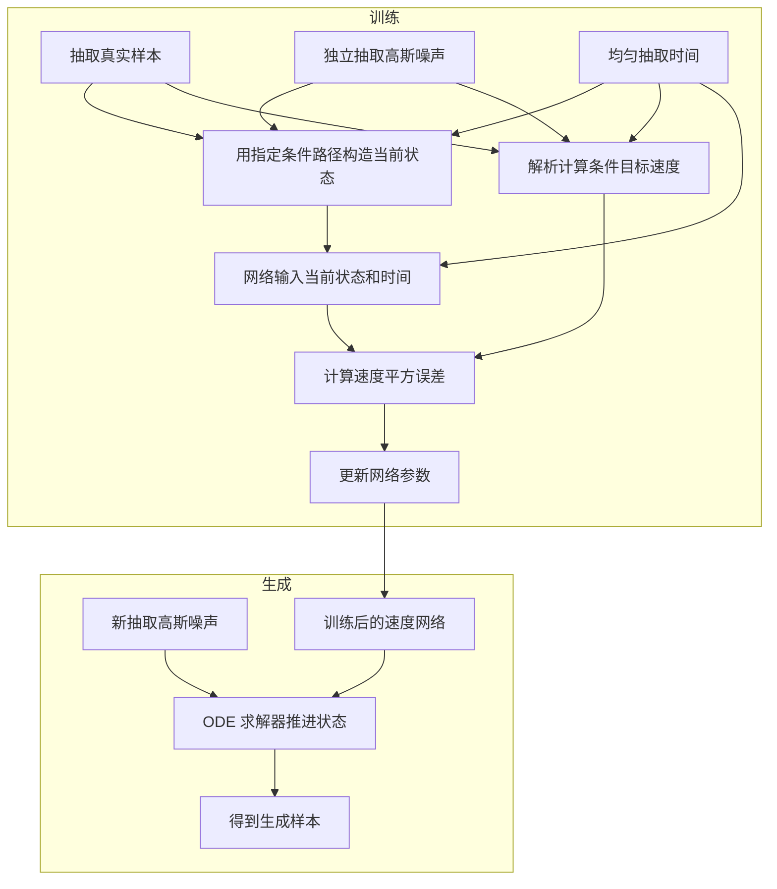

# First Time

## 1.Title & Authors
论文题名可译为《用于生成建模的流匹配》。这里的 Generative Modeling 是学习数据分布，使模型既能生成新样本，也能对数据的概率密度进行建模。论文重点研究如何把容易采样的噪声分布连续变成复杂的数据分布，图像生成是主要验证场景。
Flow 指连续流：给空间中每个位置规定一个随时间变化的速度，让随机起点沿着这些速度移动。单个起点对应一条运动轨迹；大量随机起点共同移动，则形成不断变化的概率分布。Matching 指训练一个神经网络，让它输出的速度与目标速度接近。题名的核心主张是提出一种生成模型训练方法：通过匹配速度场，学习从噪声到数据的连续变换。它没有宣称发明连续流本身，也不意味着直接逐像素匹配一张噪声图与一张真实图。
关键词包括 Flow Matching（FM，流匹配）、Continuous Normalizing Flow（CNF，连续归一化流）、conditional probability path（条件概率路径）、vector field（向量场，本文主要指速度场）以及 Optimal Transport（OT，最优传输）。第一次阅读先建立这些概念之间的关系，具体公式与证明留到正文阅读。
作者按原文列出：Yaron Lipman、Ricky T. Q. Chen、Heli Ben-Hamu、Maximilian Nickel、Matt Le。论文署名机构中，Lipman 同时标注 Meta AI（FAIR）与 Weizmann Institute of Science；Chen、Nickel、Le 标注 Meta AI（FAIR）；Ben-Hamu 标注 Weizmann Institute of Science。署名处未给出等贡献或随机排序说明，不能根据排列推断每个人的具体贡献。
与理解本文直接相关的一点是：论文在引言和预备知识中引用 Chen 等人的 Neural Ordinary Differential Equations（2018），将其作为 CNF 的基础工作。因此，本文接续的是已有的连续流生成模型路线，主要推进训练方式与概率路径的设计，而非重新发明 CNF。这里依据本文正文及参考文献介绍研究关联，不推断作者当前职位，也不把团队贡献归给单个人。

## 2.Abstract
摘要依次回答：采用什么模型、怎样训练、允许什么生成路径、与扩散模型有什么关系、为什么考虑 OT 路径，以及有哪些实验支持。下面按原文八个句子对应的语义单元精读，使用中文转述，避免把作者主张与已证明的普遍结论混在一起。
1. 研究框架与动机。作者提出一种建立在 CNF 上的生成建模范式，并声称它让 CNF 可以在此前难以达到的规模上训练。CNF 可以理解为由神经网络控制的连续运动系统：网络给出某一时刻、某一状态下的移动速度，沿时间积分后得到最终样本。困难在于，传统 CNF 训练往往需要反复执行数值积分，计算代价会妨碍大规模图像建模。这里的“前所未有的规模”是作者结合本文实验提出的历史性主张，不是对所有 CNF 训练方法、硬件和任务都成立的复杂度定理。接下来一句说明他们怎样缓解训练负担。
2. 核心方法。作者把新方法命名为 Flow Matching：对预先指定的条件概率路径所对应的向量场进行回归，从而训练 CNF。概率路径描述的是“每个时刻样本整体应该服从什么分布”，向量场描述的是“每个位置此刻应该往哪里走、走多快”。二者相互关联，但不是同一个对象。所谓条件路径，是先固定某个真实数据样本，再围绕它构造容易处理的分布演化过程；这里的条件不要求模型在生成时获得类别标签，也不表示论文只研究有标签的条件生成。回归则是给网络提供目标速度，让网络预测逐渐接近它。
   Simulation-free 的限定范围是训练：构造训练样本和目标速度时，无需先数值求解整条 ODE 轨迹。这不表示最终生成图像也无需积分。摘要最后一句仍明确使用数值 ODE 求解器进行采样。另一个要点是，fixed conditional probability paths 表示先指定监督用的概率路径，并非“样本随时间不动”。
3. 路径家族与扩散的关系。FM 可以配合一类高斯条件概率路径，把噪声与数据连接起来；已有扩散路径属于其中的特殊情形。高斯条件路径的直观含义是：围绕一个固定数据样本，控制高斯分布的均值与标准差怎样随时间变化，从而构造从噪声走向数据附近的过程。
   这里尤其要区分条件与整体分布：每个样本对应的条件分布可以是高斯，但把所有真实样本对应的条件分布混合起来，整体分布通常不再是单一高斯。否则模型无法表达复杂、多模态的图像分布。这一句也不是说 FM 必须通过扩散过程定义，而是说它能够覆盖扩散中使用的某些路径，同时容许其他路径。
4. 保留扩散路径也有价值。作者发现，即便仍然采用扩散所对应的概率路径，换成 FM 训练也能得到更稳健、更稳定的替代方案。理解这里需要把两种选择分开：一种是“走什么概率路径”，另一种是“用什么训练目标学习相应的生成动力学”。因此，这句话强调的不只是换路径，也包括直接学习速度场这一训练目标的价值。
   本句使用“我们发现”，属于论文实验观察。其适用范围是本文比较的方法、模型与设置，不能扩展成“所有扩散模型改用 FM 都必然更稳定”。FM 与 score matching 的精确关系、目标函数的差别，需要到正文再解释。
5. 从扩散推广到其他路径。FM 允许训练采用非扩散概率路径的 CNF。它与第三句呼应：既然训练机制可以直接建立在概率路径和目标速度上，就不必先找一个扩散随机过程，再间接得到生成过程。这是框架灵活性的主张，表示增加了可设计的空间；并不意味着任意随意指定的路径都容易采样、容易训练或一定效果更好。
6. 一个重点实例。作者选择 OT displacement interpolation，即最优传输位移插值，来定义条件概率路径。可以先把位移插值理解为：在给定起止分布与相应传输映射时，让点沿插值位置逐步移动。本文特定的高斯条件构造使条件轨迹具有直线、恒速的特点，因此目标速度较容易处理。
   这里的 OT 最优性针对特定的条件分布之间的传输；不能直接推出整个噪声分布与真实数据分布之间的边缘传输也全局最优。论文在 Section 4.1 明确提醒了这个边界。同样，条件轨迹是直线，不代表训练好的边缘生成模型的每条采样轨迹都严格是直线。第一次阅读先保留这一关键限定，后续再区分条件流、边缘速度场与模型实际轨迹。
7. OT 路径的经验优势。作者声称，相比本文采用的扩散路径，OT 路径更有效率，带来更快的训练与采样，以及更好的泛化表现。训练效率、采样效率与泛化是三个不同维度：训练关注达到一定效果需要多少训练投入；采样关注生成时的计算成本；泛化关注在训练样本之外的分布表现。三者不能相互替代，也不能只凭“条件轨迹直”就全部得到数学保证。
   摘要没有给出这些改善的具体数值、置信区间或统一加速倍数。因此本轮把它们标记为待正文实验核对的主张，不补造数字，也不将“更好泛化”解释为本文已经证明了某个普适的泛化误差界。
8. 主要实验与实际意义。作者在 ImageNet 上用 FM 训练 CNF，报告相对所比较的扩散方法，在似然和样本质量方面有持续优势，并且可以使用现成的数值 ODE 求解器快速、可靠地生成样本。似然侧重模型对数据分布的概率建模，样本质量侧重生成结果的分布或视觉品质，两者是不同评估维度。不能把其中一项改善直接当成另一项也改善的证据。
   “现成求解器”意味着生成过程可以借助已有数值积分工具，并不自动保证任何步长、任何求解器、任何模型误差下都得到高质量样本。ImageNet 是这里明确指出的验证数据集；摘要没有列出完整分辨率设置与指标结果，也没有承诺一次网络调用即可完成生成。“持续更好”应理解为针对论文报告的比较，而非所有生成模型与所有任务。
将摘要压成问题、方法、结果与意义四项，可以得到下表。此表用于串起上面的逐句解释，不替代逐句精读。

| 要素 | 本文摘要实际表达的内容 |
|---|---|
| 问题 | 如何在高维生成任务上高效训练 CNF，同时让生成路径不局限于已有扩散路径。 |
| 方法 | 采用 FM，回归预设条件概率路径的速度场；在高斯条件路径家族中，重点探索 OT 位移插值路径。 |
| 结果 | 作者报告扩散路径上的 FM 训练更稳健；采用 OT 路径可改善训练、采样与泛化；ImageNet 比较显示似然与样本质量优势。摘要未提供具体指标数值。 |
| 意义 | 作者明确提出更灵活的路径设计和可扩展的 CNF 训练。由此可以合理理解：模型设计者能够把概率路径作为独立设计对象；但某条新路径是否更好仍需要理论或实验验证。 |

阅读摘要后应建立的主线是：先设计易处理的条件概率路径，再用其目标速度监督训练，使网络学到整体分布的生成动力学。关键的可行性问题是“为什么只看单个数据样本构造的监督，就能学到整体分布需要的速度”；这由正文 Section 3 的条件构造及梯度等价结果回答，当前不提前展开证明。

## 3.Conclusion
原文 Section 7 的标题为 Conclusion，只有一个自然段，可以按三个连续论点精读。它与摘要相互呼应，但没有在结论中新增具体实验数值。
1. 已完成的工作：提出一种无需在训练中模拟整条生成 ODE 的 CNF 训练框架，并通过条件构造扩展到高维任务。这里“条件构造”是方法的关键：真实数据整体的分布和目标速度通常难以直接计算，单个数据样本对应的条件分布和速度则可以人为设计得很简单。论文的理论工作把二者连接起来，避免要求训练程序直接计算难以处理的整体目标速度。
   结论中的“轻松扩展到非常高维”应读成框架带来的可扩展性及本文演示的经验结果。它不等于任何模型大小、任何分布或任何维度下都没有训练困难；网络容量、优化误差与数值求解误差仍会影响最终生成表现。这些是理解主张的边界，不是作者在本段列出的正式局限清单。
2. 观念上的转变：直接指定概率路径。作者认为，与其必须先建立随机扩散过程，再从中得到生成动力学，不如直接思考噪声到数据之间的分布应该怎样变化。FM 为这种设计方式提供了可训练的实现途径，也保留了对扩散模型的另一种解释。
   这段的逻辑是：更直接地控制路径，允许构造采样更快、生成效果更好的候选路径。原文使用“更快采样和／或改善生成”，保留了两个目标不必总同时改善的可能性。路径设计的自由度增加，是框架能力；某种路径优于另一种路径，是需要在具体条件下验证的结果。二者不能合并成“所有非扩散路径都优于扩散路径”。
3. 实验证据与未来方向。作者总结，实验显示了 FM 训练与采样的便利性，并期待它支持更丰富的概率路径，例如非各向同性高斯与更一般的核。非各向同性高斯允许不同方向具有不同的方差结构；更一般的核意味着条件分布不必局限于当前主要研究的高斯形式。这里的“核”指构造条件分布的概率核，不应直接理解为神经网络中的卷积核。
   这些扩展属于未来预期，不能写成本文已经完整实现并验证的结果。本文重点展开的是特定高斯条件路径家族及其中的扩散、OT 实例。结论本段没有独立讨论失败案例、局限清单或定量的泛化保证；不能替作者补写已经承认的缺陷，也不能因为没有列出就认定不存在边界。
摘要与结论的一致性在于：二者都把无需 ODE 模拟的训练、条件构造、超越扩散路径的设计自由以及实证可扩展性作为主轴。结论没有把 FM 变成无需求解器的采样方法，也没有把条件 OT 进一步提升为整体传输必然最优。下一轮阅读应核查的核心证据是 Section 3 的理论连接、Section 4 的路径构造，以及实验中训练与采样效率的具体比较。

## 4.Analogy
可以把问题想成教一群小船从分散的海面位置出发，最后形成复杂的目标船群分布。海面上每个位置在每个时刻都有一个“此刻应该往哪开、开多快”的指示，这相当于速度场；整个船群在不同时刻的空间分布，相当于概率路径。
传统的一类训练方式像是每次调整指挥系统，都要把船群完整航行一遍，再根据最终结果更新规则。FM 的想法则是先为单个目标样本设计容易计算的局部教学方案，直接取一个随机时刻、一个相应状态以及已知的目标速度，训练公共指挥员给出正确速度。大量目标样本共同提供监督，公共指挥员学习到适合整体船群分布的规则。这一连接需要正文的理论结果，不能仅靠比喻保证。
OT 条件路径像为每个教学案例安排一条简单的直航线路，减少绕行和回头；这有助于直观理解为什么它可能比弯曲的条件路径更容易学习、数值求解更省力。但这里不是先求出所有小船与所有目标之间的全局最优配对，也不保证实际生成时每条航线都笔直。
比喻最需要保留的边界是：训练时可以直接抽查航行状态与目标速度，真正出航时仍要逐步执行所学规则。对应到模型，训练不必求解完整 ODE，生成仍需用 ODE 求解器推进。生成模型要匹配的是整个数据分布，而不是让每个噪声起点复刻某张指定训练图片；船的物理运动、碰撞和真实海流也不是论文建模的对象。

# Second Time

## 1.Notation & Parameters
下表保留理解全文主线需要的重点记号。同一个位置变量在不同公式中可能表示初始噪声或当前状态，因此每次代入时还需根据函数的输入判断，不能把所有位置变量都当成起点。

| 符号/参数 | 含义与作用 | 关键设定/约束 |
|---|---|---|
| $t$ | 连续生成时间，训练时随机抽取一个时刻。 | $t\in[0,1]$；训练通常取 $t\sim\mathcal U[0,1]$，本文从噪声向数据推进。 |
| $x\in\mathbb R^d$ | 数据空间中的位置或当前状态，图像可视作高维向量。 | $d$ 是数据维度；具体角色取决于其所在函数。 |
| $x_0$、$p$ | 初始噪声与其分布。 | 主要构造取 $x_0\sim p=\mathcal N(0,I)$。 |
| $x_1$、$q$ | 真实数据样本与未知数据分布。 | 能从数据集中取样，不要求计算 $q(x_1)$ 的密度值；主构造独立抽取噪声和数据。 |
| $p_t(x)$ | 整体即边缘概率密度路径。 | 起点为简单分布，终点近似数据分布；有限末端噪声下通常并非精确等于 $q$。 |
| $p_t(x\mid x_1)$ | 固定一个真实数据样本后的条件概率路径。 | 本文重点为各向同性高斯；对数据样本混合后得到 $p_t(x)$。 |
| $u_t(x)$ | 生成目标边缘路径的理想速度场。 | 理论定义可用，但通常不能直接计算，训练需绕开它。 |
| $u_t(x\mid x_1)$ | 生成某条条件概率路径的目标速度场。 | 需要易于计算；正文给出高斯路径的闭式构造。 |
| $v_t(x;\theta)$ | 神经网络表示的可学习速度场。 | 输入当前状态与时间，输出同维速度；$θ$ 为可训练参数，文中常省略参数。 |
| $\phi_t$ | 由模型速度场驱动的生成流映射。 | $\phi_0(x)=x$，随时间解 ODE；$φ_1(x_0)$ 为生成样本。 |
| $\psi_t$ | 为条件高斯路径人为构造的流映射。 | 依赖固定的 $x_1$，正文记号常省略该条件；不是学习后的 $\phi_t$。 |
| $[\phi_t]_*p_0$ | 推前分布，即把服从 $p_0$ 的随机变量经过流映射后得到的分布。 | 对可逆光滑流可用变量替换公式计算密度。 |
| $\mu_t(x_1)$、$\sigma_t(x_1)$ | 条件高斯的均值与标量标准差。 | 一般构造取 $\mu_0=0$、$\sigma_0=1$、$\mu_1=x_1$、$\sigma_1=\sigma_{\min}$；扩散实例的端点近似另行说明。 |
| $\sigma_{\min}$ | 数据端保留的小幅高斯标准差。 | 保持为正有助于避免末端奇异；不能把有限值与零噪声极限混同。 |
| $\mathcal L_{\rm FM}$、$\mathcal L_{\rm CFM}$ | 边缘速度回归目标、可计算的条件速度回归目标。 | 两个期望损失相差与参数无关的常数，故在条件满足时参数梯度相同。 |
| $f'$、$\dot f$ | 时间导数。 | 文中撇号表示对函数自身时间变量求导；复合函数中的 $1-t$ 会额外引入负号。 |
| $\sigma_s$（VE） | 方差爆炸扩散的噪声标准差日程。 | 原扩散时间 $s$ 中递增，$σ_0=0$、$σ_1\gg1$；生成方向用 $s=1-t$，不等同于通用条件标准差记号。 |
| $\beta(s)$、$T(s)$、$\alpha_s$（VP） | 方差保持扩散日程及其累积、信号缩放系数。 | $T(s)=\int_0^s\beta(r)\,dr$，$\alpha_s=e^{-T(s)/2}$；生成方向同样反转时间。 |
| NLL/BPD、FID、NFE、IS、PSNR、SSIM | 概率建模、样本分布品质、网络评估成本及超分辨率指标。 | NLL/BPD、FID、NFE 越低越好；IS、PSNR、SSIM 越高越好，但测量对象不同。 |

始终区分三个层次：可设计且容易计算的条件路径与条件速度；理论上希望实现、但通常难以直接计算的边缘路径与边缘速度；通过训练得到的神经网络速度及其实际生成流。它们之间有理论联系，但不是同一个函数或同一组样本轨迹。

## 2.Introduction
原文 Section 1 先给出生成建模的两个任务：估计未知数据分布，以及从这个分布采样。仅生成看起来不错的图像，不自动意味着密度估计也好；相反，仅优化似然也不自动保证视觉样本好。本文后面同时报告概率建模与生成品质指标，就是回应这两个任务。
第一层背景是扩散模型的成功。作者认为扩散提供了可扩展、相对稳定的训练方式，但常用扩散过程所允许的概率路径受到限制，训练投入较大，快速采样往往还需要专门设计方法。这是本文对当时相关工作的定位，并非在证明所有随机过程都只能慢速采样。读者需要抓住的缺口是：能否保留易训练的优点，又把路径设计的自由度放开？
第二层背景是 CNF 的表达能力。CNF 用确定性 ODE 搬运概率分布，可以表示扩散概率流中的路径，也能考虑其他路径。表达灵活不等于训练容易：以往最大似然训练需要在前向与梯度计算中处理 ODE 数值求解；另外一些无需模拟的训练方式又遇到难以估计的高维积分或小批量梯度偏差。本文追求的是一个兼顾可计算监督与一般路径的训练框架。
第三层是贡献链。先定义目标边缘速度回归的 FM，再把难以计算的整体问题拆成针对单个真实样本的条件问题。随后证明 CFM 在期望意义上产生相同参数梯度，解决“监督从哪里来”的问题。最后给出一般高斯条件路径的闭式速度，把抽象框架变成可以实际训练的算法。其间既保留扩散路径，也构造条件 OT 路径，用实验比较路径及训练目标的影响。
本文的主要新意落在训练目标和监督构造，而不是一种全新的神经网络骨干。后文图像模型采用已有 U-Net 架构进行比较。引言提到条件 OT 路径直、可能更易学习，再联系到经验上的更快训练与采样；其中“似乎转化为性能改善”保留了经验性语气，不能当作严格的普适因果定理。
引言最后用 ImageNet 的高多样性、高维图像任务说明可扩展性的验证场景。[Fig1 精读](#fig1)对应无条件生成样例，但它本身只提供定性展示；定量证据要看[Table1 精读](#table1)以及[Fig7 精读](#fig7)。下一节建立流、密度和速度的数学关系，为“匹配速度为什么能生成分布”做准备。

## 3.Preliminaries: Continuous Normalizing Flows
原文 Section 2。首先分清拉格朗日视角与欧拉视角：流映射追踪一个固定起点随时间去了哪里；速度场则告诉你某一时刻、某一个空间位置应该如何移动。生成模型学的是后者，采样时用数值积分获得前者。
原文无编号的归一化关系为 $\int_{\mathbb R^d}p_t(x)\,dx=1$。这是“每个时刻都是概率密度”的定义约束，不是损失函数。要求 $p_t(x)>0$ 也比非负更强，后续边缘速度中的密度分母因此有定义。数据位置写作 $x=(x^1,\ldots,x^d)$，上标是坐标索引，不能和表示时间端点的下标混同。密度输出一个标量，速度输出一个 $d$ 维向量，流也输出一个 $d$ 维位置；网络参数的维度与数据维度并不要求相同。
公式（1）与（2）给出运动方程及初始条件：$\frac{d}{dt}\phi_t(x)=v_t(\phi_t(x))$，$\phi_0(x)=x$。它们是模型定义，不是由数据唯一推导出来的规律。左边对固定起点求时间导数，右边在当前运动位置计算网络速度，而不是始终在起点计算。积分后的等价形式是
$$
\phi_t(x)=x+\int_0^t v_s(\phi_s(x);\theta)\,ds.
$$
这一步把微分方程改写成积分方程，说明为什么生成需要沿途反复评估速度。若速度对位置具备适当的局部 Lipschitz 性、对时间足够规则且解不爆炸，初值问题才能保证合适的存在唯一性。论文使用光滑可逆流的框架；神经网络预测一个向量，并不自动免除这些数学条件。实际数值解还受到求解误差影响。
公式（3）写作 $p_t=[\phi_t]_*p_0$，定义由流推前的分布。若 $X_0\sim p_0$，令 $X_t=\phi_t(X_0)$，那么 $X_t$ 的密度就是 $p_t$。等价地，对可积测试函数 $f$，有 $\mathbb E[f(X_t)]=\int f(\phi_t(z))p_0(z)\,dz$。这不是把密度数值直接代入网络；它描述的是随机变量经过映射后，整体分布如何改变。
公式（4）是密度变量替换公式。先令 $y=\phi_t(z)$，则质量守恒要求 $p_t(y)\,dy=p_0(z)\,dz$；再用 $z=\phi_t^{-1}(y)$，得到
$$
p_t(y)=p_0(\phi_t^{-1}(y))\left|\det D\phi_t^{-1}(y)\right|.
$$
其中 $D\phi_t^{-1}$ 是 $d\times d$ 雅可比矩阵，行列式衡量局部体积缩放。一般变量替换需要绝对值；原式没有写绝对值，因为从恒等映射连续演化的光滑 ODE 流保持定向，雅可比行列式为正。在相应正则条件下，$\det D\phi_t(z)=\exp(\int_0^t\operatorname{div}v_s(\phi_s(z))\,ds)>0$，所以两种写法在这里一致。这个补充解释了记号差异，不是擅自修改原式。
将四式连起来：网络给速度，ODE 给流，流把先验推成目标密度，雅可比控制相应密度变化。Section 2 提到用连续性方程检验速度是否生成目标路径；下节证明需要的形式是 $\partial_t p_t+\nabla\cdot(p_tu_t)=0$。它表示概率质量既不会凭空产生，也不会消失。这是为正文定理补充的工具关系，原文把详细介绍放在 Appendix B；这里不把附录整节当作已经读完。

## 4.Flow Matching
原文 Section 3 的开篇先明确可用信息：我们能从未知数据分布取得样本，却通常不能计算真实密度。记这个数据分布为 $q$，先验为 $p$。原文的边界条件是 $p_0=p$，常选 $p(x)=\mathcal N(x\mid0,I)$，而终点要求 $p_1\approx q$。这些是设计目标；不会因为写下符号就自动构造出中间路径和相应速度。
公式（5）定义 FM 的平方误差目标：
$$
\mathcal L_{\rm FM}(\theta)=\mathbb E_{t\sim\mathcal U[0,1],\,x\sim p_t}\left[\|v_t(x;\theta)-u_t(x)\|^2\right].
$$
$u_t$ 是确实生成指定目标路径的理想速度，$v_t$ 是待训练网络。同一时间与位置下，二者差向量的平方范数是一个非负标量；再对时间和状态平均。均匀取时间是原文采用的目标定义，不是唯一可能的采样日程。按 $x\sim p_t$ 取样表示监督覆盖该时刻真正有概率质量的区域，并非在整个空间均匀取位置。
这个损失是作者设计的回归目标，不需要假装证明它是唯一训练原则。其合理性在于：若损失为零，在相应测度下网络速度等于目标速度；配合足够规则的速度与流唯一性，模型能沿目标路径推进。有限数据、有限网络及未达到零损失时，不能直接把这个理想陈述当作实际生成的精确保证。
为理解优化，可以对公式（5）求参数梯度。记 $J_\theta v_t(x)$ 为网络输出对参数的雅可比，且目标路径、目标速度不依赖参数，在允许交换期望与求导时，有
$$
\nabla_\theta\mathcal L_{\rm FM}=2\mathbb E_{t,x}\left[(J_\theta v_t(x))^\top\big(v_t(x)-u_t(x)\big)\right].
$$
这是标准平方回归的链式求导。关键困难没有消失：通常既难直接从任意指定的边缘密度采样，也难计算它对应的目标速度。Section 3 的贡献不是要求使用一个未知“标准答案”，而是接下来构造可以替代它的条件监督。

## 5.Constructing Probability Paths and Vector Fields from Conditional Probability Paths and Vector Fields
原文 Section 3.1，标题中的两个对象就是边缘路径与边缘速度。先固定一个真实样本 $x_1$，构造 $p_t(x\mid x_1)$。原文无编号的起点条件为 $p_0(x\mid x_1)=p(x)$，即所有条件路径拥有相同噪声起点。终点例子为 $p_1(x\mid x_1)=\mathcal N(x\mid x_1,\sigma^2I)$，且 $\sigma>0$ 足够小。这是围绕真实样本保留一团小噪声，避免立刻坍缩为点质量；不能把这个条件终点当成整套数据分布。
公式（6）用全概率公式把这些条件路径混合成边缘路径：
$$
p_t(x)=\int p_t(x\mid x_1)q(x_1)\,dx_1.
$$
推导方式是先按数据分布抽取一个终点，再从它对应的条件分布取当前状态。联合密度为 $p_t(x\mid x_1)q(x_1)$，积分掉终点得到当前状态的边缘密度。归一化可以直接核对：先对当前状态积分得到每个条件分布的积分为一，再对数据分布积分，结果仍为一。起点代入后，由 $\int q(x_1)\,dx_1=1$ 得到 $p_0(x)=p(x)$。
公式（7）是上述关系在终点的特例：
$$
p_1(x)=\int p_1(x\mid x_1)q(x_1)\,dx_1\approx q(x).
$$
若使用前述高斯终点，这个积分是数据分布与小高斯的卷积。正的末端噪声带来平滑，而非精确复制原密度。随着噪声趋零，在合适意义与条件下可逼近原分布；本文的近似号没有承诺所有分布上的逐点误差界。若把数据集看成离散经验分布，积分可相应解释为对样本的求和或期望，不要求先给经验分布定义普通连续密度。
公式（8）构造边缘速度：
$$
u_t(x)=\int u_t(x\mid x_1)\frac{p_t(x\mid x_1)q(x_1)}{p_t(x)}\,dx_1.
$$
这里的密度比就是给定当前状态后的终点后验密度。用讲解辅助记号 $\rho_t(x_1\mid x)=p_t(x\mid x_1)q(x_1)/p_t(x)$，公式变为 $u_t(x)=\mathbb E[u_t(x\mid X_1)\mid X_t=x]$。分母需要原文假设的 $p_t(x)>0$。在当前位置更可能对应的终点，应有更大的速度权重；不能直接把各终点速度按数据先验等权平均。网络最终学到的是这种后验平均，而不是同时知道所有终点。
为什么这种平均真的能生成公式（6）的边缘路径？Theorem 1 的证明可以按连续性方程写出完整链条。每个条件路径满足 $\partial_t p_t(x\mid x_1)=-\nabla_x\cdot[p_t(x\mid x_1)u_t(x\mid x_1)]$。将其乘以数据密度并积分，得
$$
\begin{aligned}
\partial_t p_t(x)
&=\int\partial_t p_t(x\mid x_1)q(x_1)\,dx_1\\
&=-\nabla_x\cdot\int p_t(x\mid x_1)u_t(x\mid x_1)q(x_1)\,dx_1\\
&=-\nabla_x\cdot[p_t(x)u_t(x)].
\end{aligned}
$$
第一步用公式（6）并交换求导与积分，第二步代入条件连续性方程并交换散度与积分，第三步用公式（8）。需要足够的可微性、可积性以及交换操作的正则条件；原文 Appendix A 的证明明确提到 Leibniz 法则的条件。满足相应流存在唯一性条件时，边缘连续性方程与共同初始分布连接起密度路径和生成流。
这个定理解决了“条件教学能否对应一个正确整体运动”的问题，却还没有提供直接计算边缘速度的方法：公式（8）的积分与分母仍难处理。因此下一小节必须进一步证明，训练时可以回归条件速度，从期望梯度上绕开该后验积分。

## 6.Conditional Flow Matching
原文 Section 3.2。公式（9）定义可计算的 CFM 目标：
$$
\mathcal L_{\rm CFM}(\theta)=\mathbb E_{t\sim\mathcal U[0,1],\,x_1\sim q,\,x\sim p_t(\cdot\mid x_1)}\left[\|v_t(x;\theta)-u_t(x\mid x_1)\|^2\right].
$$
相较公式（5），监督目标从边缘速度换成条件速度，采样过程也变成先取一个真实样本，再抽条件状态。网络输入依旧是时间与当前状态，公式没有要求把终点样本作为网络输入。只要条件状态容易抽样、条件速度容易计算，一个训练小批量就能直接估计这个损失及其梯度，无需先计算后验混合。
Theorem 2 在正文给出无编号结论 $\nabla_\theta\mathcal L_{\rm FM}=\nabla_\theta\mathcal L_{\rm CFM}$。下面给出解释这一结果的条件期望推导；这与原文附录展开平方项的证明等价，但整理方式不同。固定时间与当前位置，记 $U=u_t(x\mid X_1)$、$m=\mathbb E[U\mid x]=u_t(x)$、$v=v_t(x;\theta)$。由于 $v$ 与 $m$ 在这个条件下不再随终点变化，且 $\mathbb E[U-m\mid x]=0$，有
$$
\begin{aligned}
\mathbb E[\|v-U\|^2\mid x]
&=\mathbb E[\|(v-m)-(U-m)\|^2\mid x]\\
&=\|v-m\|^2+\mathbb E[\|U-m\|^2\mid x]
-2\langle v-m,\mathbb E[U-m\mid x]\rangle\\
&=\|v-m\|^2+\mathbb E[\|U-m\|^2\mid x].
\end{aligned}
$$
再对时间与状态平均，就得到 $\mathcal L_{\rm CFM}(\theta)=\mathcal L_{\rm FM}(\theta)+C$，其中 $C=\mathbb E\|u_t(X_t\mid X_1)-u_t(X_t)\|^2$ 不依赖网络参数。它是条件速度在同一当前状态下的不可约分歧，非负；因此两个损失的数值通常不一样，也不能要求实际 CFM 损失一定降到零。
对参数求导，常数消失，就得到正文的梯度等式。该步骤要求这些期望有限、可以交换求导与积分，且人为设定的路径不随同一个网络参数变化；不能只凭密度正性忽略所有分析条件。原文附录采用衰减、可积及有界性等充分条件来支撑交换操作。上面的条件期望证明用平方可积与相应交换条件表达同一需求。
再从小批量角度看，单样本梯度为 $2(J_\theta v_t(x))^\top[v_t(x)-u_t(x\mid x_1)]$。在给定当前状态后对终点平均，就把括号中的条件速度替换成公式（8）的边缘速度，于是得到 FM 的条件期望梯度。等价发生在期望梯度层面，不表示每个小批量更新完全相同，也不保证梯度方差为零。它也不单独证明优化一定收敛到全局最优，或有限网络能精确表达目标速度。
至此两个理论问题都得到回答：Theorem 1 保证存在一个正确的边缘目标；Theorem 2 允许用可计算的条件监督训练它。接下来只需给出便于采样和求速度的具体条件路径。

## 7.Conditional Probability Paths and Vector Fields
原文 Section 4。CFM 的抽象构造并不限于高斯，但本文选择高斯条件路径作为可显式处理的一大类。公式（10）是设计：
$$
p_t(x\mid x_1)=\mathcal N\!\left(x\mid\mu_t(x_1),\sigma_t(x_1)^2I\right).
$$
均值是 $d$ 维向量，标准差为正标量，协方差为 $d\times d$ 矩阵。因而本文这部分是各向同性条件高斯，不是任意协方差的全部高斯分布。均值和标准差可以随时间与终点变化；控制它们即可控制中间条件密度。
原文的四个无编号边界设定分别是 $\mu_0(x_1)=0$、$\sigma_0(x_1)=1$、$\mu_1(x_1)=x_1$、$\sigma_1(x_1)=\sigma_{\min}$。把前两项代入公式（10）得到共同标准高斯起点；把后两项代入得到围绕数据样本的小高斯终点。这是人为选择端点，而非唯一的概率定律。后续扩散路径的例子另有有限时间端点近似，不可强行宣称它们全都精确满足这四个端点。
公式（11）构造条件流 $\psi_t(z)=\sigma_t(x_1)z+\mu_t(x_1)$。这里用 $z$ 替换原文流映射的输入位置变量，只为强调它是初始噪声，公式含义不变。先缩放再平移，可以将标准高斯变成均值与方差可控的条件高斯。这是一个自然的仿射构造；同样的密度路径通常还可以由包含额外旋转等成分的其他流产生，不应把“简单”当作“密度唯一允许”。更精确地，保持密度不变的附加速度需满足加权散度为零，而非一般情况下任意普通散度为零的向量场都行。
公式（12）说明上述构造确实推前到目标条件分布：$[\psi_t]_*p=p_t(\cdot\mid x_1)$。推导可直接检查矩：若 $Z\sim\mathcal N(0,I)$，则 $\mathbb E[\sigma_tZ+\mu_t]=\mu_t$，协方差为 $\sigma_t^2I$，仿射变换后仍为高斯，故得到公式（10）。也可用逆映射 $(x-\mu_t)/\sigma_t$ 和行列式 $\sigma_t^{-d}$ 代入公式（4），得到同样的高斯密度。正标准差保证可逆；零标准差端点会破坏这一直接论证。
公式（13）规定生成这个条件流的速度：$\frac{d}{dt}\psi_t(z)=u_t(\psi_t(z)\mid x_1)$。这是轨迹导数与位置速度之间的对应关系。左边是固定初始噪声时的导数，右边把当前状态作为输入。它提供一个实用技巧：训练所需的速度目标，可以先在初始噪声坐标中求导，再用当前状态表示。
公式（14）将公式（9）重参数化为
$$
\mathcal L_{\rm CFM}(\theta)=\mathbb E_{t,\,x_1\sim q,\,x_0\sim p}\left[\left\|v_t(\psi_t(x_0);\theta)-\frac{d}{dt}\psi_t(x_0)\right\|^2\right].
$$
推导第一步用公式（12），把 $x\sim p_t(\cdot\mid x_1)$ 写成 $x=\psi_t(x_0)$；第二步用公式（13），把条件速度替换成轨迹时间导数。主构造中初始噪声与数据样本独立抽取，网络只看合成的当前状态和时间；不需要计算数据密度、边缘密度或后验权重。这解释了为什么用积分定义方法，不代表训练程序也需要计算那些积分。
原文用无编号关系 $f'=\frac{d}{dt}f$ 定义撇号。Theorem 3 与公式（15）给出当前状态坐标下的闭式目标速度：
$$
u_t(x\mid x_1)=\frac{\sigma_t'(x_1)}{\sigma_t(x_1)}\big(x-\mu_t(x_1)\big)+\mu_t'(x_1).
$$
详细推导是：由公式（11）先求 $\partial_t\psi_t(z)=\sigma_t'z+\mu_t'$；再把逆映射 $z=\psi_t^{-1}(x)=(x-\mu_t)/\sigma_t$ 代入，得到 $u_t(x\mid x_1)=\sigma_t'(x-\mu_t)/\sigma_t+\mu_t'$。第一项描述以均值为中心的收缩或扩张，第二项描述中心本身的移动。两个向量项维度相同，均是位置对时间的变化率。
注意 Theorem 3 的“唯一”是相对于已经指定的仿射流映射：一旦流确定，沿它的速度由导数和逆映射确定。它并不宣称某条高斯密度路径只有一个可能的生成速度场。这与本节前面“同一密度可以有不同流”的讨论并不矛盾。
现在完整算法已经可写清楚。训练时选时间、数据和噪声，直接构造中间状态与目标速度，回归网络；生成时舍去构造监督用的真实终点，仅从噪声出发，用训练后的速度场求解 ODE。下面是据正文关系整理的可编辑流程图，省略了具体 U-Net 层、优化器及密度评估附加积分；这些省略不会改变训练与生成的连接。

## 8.Special Instances of Gaussian Conditional Probability Paths
原文 Section 4.1 把一般公式变成两个实例：沿用扩散路径，以及直接设计条件 OT 路径。这里所谓“一般”是均值和标量标准差日程的自由度，不是声称高斯路径已经囊括任意概率核。不同路径可以使用同一个 CFM 训练原则，因而能区分路径选择与训练目标的作用。
先看 Example I 的时间方向。传统扩散描述从数据加噪到近似纯噪声，而本文生成方向为噪声到数据。因此以下统一令讲解辅助变量 $s=1-t$，撇号 $\sigma_s'$、$\alpha_s'$ 表示对原日程变量 $s$ 求导，真正对生成时间求导时必须再乘以 $ds/dt=-1$。忽略这一步会把去噪方向写反。
公式（16）给出反向 VE 条件路径，按其上下文可写成 $p_t(x\mid x_1)=\mathcal N(x\mid x_1,\sigma_{1-t}^2I)$。原式左边简写为 $p_t(x)$，但右边包含固定终点，所以上下文讨论的是条件路径，不能误认为整体边缘一定是单一高斯。原文的无编号条件为 $\sigma_0=0$、$\sigma_1\gg1$，且日程递增；它们说明原扩散端从无噪声走向大噪声，不是 Section 4 一般构造中严格标准高斯端点的同一组边界。
将 VE 与公式（10）对齐，就得到两个无编号代入关系：$\mu_t(x_1)=x_1$、$\sigma_t(x_1)=\sigma_{1-t}$。均值不动，所以生成时间导数为零；标准差的生成时间导数是 $-\sigma_{1-t}'$。代入公式（15），得到公式（17）：
$$
u_t(x\mid x_1)=-\frac{\sigma_{1-t}'}{\sigma_{1-t}}(x-x_1).
$$
如果原日程递增，系数为负，速度朝向终点，符合去噪直觉。分母在正噪声区间有定义，但 $t=1$ 对应零噪声，必须处理极限或终点截断；不能把这个端点视为普通的正标准差仿射可逆流。在 $t=0$，不同终点对应的高斯仍然以不同数据为中心，仅因噪声很大而近似某个简单先验。
公式（18）包含三个独立定义：反向 VP 条件高斯、信号衰减系数、累积噪声日程：
$$
\begin{aligned}
p_t(x\mid x_1)&=\mathcal N\!\left(x\mid\alpha_{1-t}x_1,(1-\alpha_{1-t}^2)I\right),\\
\alpha_s&=e^{-T(s)/2},\qquad T(s)=\int_0^s\beta(r)\,dr.
\end{aligned}
$$
这些是引用的 VP 扩散路径及其日程定义，并非必须由 FM 推导出的唯一选择。为说明其来源，可以补充一条标准构造的验证：若原扩散满足线性漂移 $-\beta(s)X_s/2$ 和扩散系数 $\sqrt{\beta(s)}$，则条件均值的微分方程是 $m'=-\beta m/2$，解为 $m=\alpha_sx_1$；协方差系数满足 $c'=-\beta c+\beta$、$c(0)=0$，解为 $c=1-\alpha_s^2$。这仅解释作者采用的日程如何得到相应高斯，并不要求实际 FM 训练去模拟这个随机过程。
正文随后的无编号代入是 $\mu_t(x_1)=\alpha_{1-t}x_1$ 与 $\sigma_t(x_1)=\sqrt{1-\alpha_{1-t}^2}$。下面逐步推导公式（19）。暂记 $a=\alpha_s$、$a'=d\alpha_s/ds$，则 $d\mu_t/dt=-a'x_1$；由链式法则，$d\sigma_t/dt=aa'/\sqrt{1-a^2}$，所以 $\sigma_t'/\sigma_t=aa'/(1-a^2)$。带回公式（15）得
$$
\begin{aligned}
u_t(x\mid x_1)
&=\frac{aa'}{1-a^2}(x-ax_1)-a'x_1\\
&=\frac{a'}{1-a^2}(ax-x_1)\\
&=-\frac{T'(1-t)}{2}\,
\frac{e^{-T(1-t)}x-e^{-T(1-t)/2}x_1}{1-e^{-T(1-t)}}.
\end{aligned}
$$
第二行整理了终点项：$-a^2a'x_1/(1-a^2)-a'x_1=-a'x_1/(1-a^2)$。最后一行用 $a'=-T'(s)a/2$ 与 $a^2=e^{-T(s)}$，正好得到原文公式（19）的两个等价形式。均值移动和方差收缩都贡献速度，不能只保留朝均值收缩的那项。若 $T$ 在终点有限，噪声端仍有非零信号残留；数据端又可能出现分母趋零，因此原文强调有限时间下扩散端点的近似及实际处理。
为理解正文中关于条件 score 的无编号表达，令 $s_t(x\mid x_1)=\nabla_x\log p_t(x\mid x_1)$，这是此处的辅助命名。对高斯对数密度求导，常数项消失，平方项给出 $s_t(x\mid x_1)=-(x-\mu_t)/\sigma_t^2$。这说明 score 是当前位置的对数密度梯度，并不等于样本移动速度本身。对 VP 上式整理可得生成方向的条件速度为 $\beta(s)[x+s_t(x\mid x_1)]/2$；对 VE 则为 $\sigma_s\sigma_s's_t(x\mid x_1)$。这些关系解释为什么扩散条件速度与概率流相容，也说明拟合 score 与拟合速度是不同的参数化及加权回归任务。
现在看 Example II。公式（20）包含两个人为日程设计：$\mu_t(x_1)=tx_1$，$\sigma_t(x_1)=1-(1-\sigma_{\min})t$。原式把均值函数的条件参数写成简略的位置记号，实际依赖仍是固定数据终点。两个日程都线性变化，因此四个端点可以直接核对：均值从零到数据样本，标准差从一到小的正值。这避免了前面扩散实例中部分有限时间端点不匹配的问题。
令讲解辅助常数 $b=1-\sigma_{\min}$，则 $\mu_t'=x_1$、$\sigma_t'=-b$。代入公式（15），得到公式（21）：
$$
u_t(x\mid x_1)=-\frac{b}{1-bt}(x-tx_1)+x_1
=\frac{x_1-bx}{1-bt}.
$$
最后一步将终点项通分：$btx_1+(1-bt)x_1=x_1$。这是闭式的当前状态速度，不是直接把当前状态与终点做固定差。小正噪声保证对整个闭区间都有 $1-bt\geq\sigma_{\min}>0$；若将末端噪声设为零，则不能照搬闭区间上处分母非零的结论。
公式（22）给出对应条件流：$\psi_t(z)=(1-bt)z+tx_1$。它来自公式（11）代入线性日程，也可以直接检查初始状态为 $z$、末端状态为 $\sigma_{\min}z+x_1$。求时间导数得到 $\partial_t\psi_t(z)=x_1-bz$，不随时间变化；再把 $x=\psi_t(z)$ 代入公式（21），分子为 $(1-bt)(x_1-bz)$，与分母抵消，得到相同速度。因此条件流中的每个粒子走直线、保持恒速；这里固定的是初始噪声与数据终点。
公式（23）于是成为直接可训练的形式：
$$
\mathcal L_{\rm CFM}(\theta)=\mathbb E_{t,\,x_1\sim q,\,x_0\sim\mathcal N(0,I)}
\left[\left\|v_t\!\left((1-bt)x_0+tx_1;\theta\right)-(x_1-bx_0)\right\|^2\right].
$$
推导只需将公式（22）及其导数代入公式（14）。实际训练的一次样本构造就是：取真实图像、独立高斯噪声、随机时间；用线性组合得到当前状态；用另一个直接计算的向量作速度标签；让网络预测该标签。模型输出、目标和当前状态均是 $d$ 维向量，损失是标量。监督标签沿同一条件轨迹恒定，不意味着神经网络在整个空间只需输出一个常量。不同噪声、不同终点会给出不同标签，同一当前状态还可能对应多种条件来源。
公式（24）说明为什么这种构造称为 OT 位移插值：$p_t=[(1-t)\mathrm{id}+t\psi]_*p_0$。无编号定义 $\mathrm{id}(z)=z$ 表示恒等映射，$\psi$ 在此是端点 OT 映射，不是任意时间的模型流。给定端点配对，插值点为起点加上所需位移的时间比例。对于本文条件端点，终点映射为 $\psi(z)=x_1+\sigma_{\min}z$，代入后即为公式（22）。这是在固定数据终点条件下的两高斯之间的 Wasserstein-2 位移插值。
除了原文引用的标准高斯 OT 结论，还可以用一个短推导验证此处的最优性。固定 $x_1$，让任意耦合满足 $X\sim\mathcal N(0,I)$、$Y\sim\mathcal N(x_1,\sigma_{\min}^2I)$。平方位移成本可写为
$$
\mathbb E\|Y-X\|^2=\|x_1\|^2+d+\sigma_{\min}^2d
-2\mathbb E\langle X,Y-x_1\rangle.
$$
Cauchy–Schwarz 不等式给出 $\mathbb E\langle X,Y-x_1\rangle\leq\sqrt{\mathbb E\|X\|^2\mathbb E\|Y-x_1\|^2}=\sigma_{\min}d$，所以下界为 $\|x_1\|^2+d(1-\sigma_{\min})^2$。选择 $Y=x_1+\sigma_{\min}X$ 恰好取到下界，并具有正确终点分布。这验证了该条件映射在平方成本下最优，而非凭“画成直线”断言最优。上述为讲解补充推导，不是对原文引用文献的全文核查。
正文最后还给出无编号分解 $u_t(x\mid x_1)=g(t)h(x\mid x_1)$。由公式（21）可取 $g(t)=1/(1-bt)$、$h(x\mid x_1)=x_1-bx$。当当前位置与终点固定时，时间只改变正的大小因子，因此方向固定；但此时大小通常不恒定。与之相对，沿公式（22）的实际条件轨迹，位置也随时间变，最后抵消成恒定速度。两种陈述要分开理解。[Fig2 精读](#fig2)对应固定空间位置的场，[Fig3 精读](#fig3)对应轨迹几何。
把条件速度按后验混合成边缘速度后，权重本身随当前状态和时间改变，所以边缘轨迹可以弯曲，边缘传输也未必是噪声到数据的全局 OT。独立抽取噪声与数据的训练并没有求解全数据集的最优配对。条件路线简单为学习和数值求解提供了动机，但采样更省、泛化更好的实际幅度仍由实验决定。

## 9.Related Work
原文 Section 5。第一组工作是 CNF 本身及其求解加速。作者将 CNF 定位为归一化流的连续时间版本，原有最大似然训练需要沿 ODE 求解并处理相应梯度。增加状态维度、对动力学加正则、改变积分区间等方法可以让 ODE 更易求解，但作者认为它们通常没有更换训练机制本身。FM 的区别是训练阶段直接构造目标速度回归，避开每次优化都模拟生成过程这一负担；它没有取消采样或似然评估的数值计算。
第二组是更早的无需模拟 CNF 训练。本文讨论 Rozen 等人的密度插值方案及 Ben-Hamu 等人的概率路径匹配方案，并指出前者有高维积分问题，后者在随机小批量下存在梯度偏差。这里按本论文的分析理解相关工作，没有独立逐篇复核其所有适用范围。FM 的对应贡献是用条件目标建立与边缘目标的期望梯度等价，允许容易采样的监督及无偏随机梯度；无偏针对所定义目标，不是对真实未知数据分布估计完全无误的承诺。
第三组是扩散与去噪 score matching。CFM 借鉴条件训练目标能对应边缘目标这一思想，但把回归对象推广到直接的生成速度。既有扩散研究中的损失重加权、分类器引导、结构改进与噪声日程学习，是不同层面的改进。本文强调常见一参数扩散日程没有包含这里的特定条件 OT 路径，因此不必先从扩散过程出发，才能设计可训练的连续生成模型。
第四组是有限时间扩散桥，以及扩散过程与 CNF 共享概率路径的联系。作者承认已有研究处理无限时间去噪构造中的端点误差，也利用过随机扩散与确定性概率流的联系。因此不能把“随机过程可以对应确定性流”全算成 FM 的发明。本文贡献是利用这些思想提出一般的条件速度回归训练，并展示超出简单扩散路径的构造。
最后，原文明确列出同期工作 Liu 等人与 Albergo、Vanden-Eijnden 得到了相似条件目标，也提到在目标速度是梯度场的假设下推导隐式目标的工作。这提醒读者：应把 FM 放在同期连续生成研究脉络中，不能把所有无需模拟的条件回归方法都归为本文独占的思想。二维对照的直观证据见[Fig4 精读](#fig4)，其内容与相关工作定位相连，但不能代替不同理论假设之间的比较。

## 10.Experiments
原文 Section 6 的全部图表及其中的数学关系在本节和图表详解中处理；整章剩余文字与附录的补充速读接续在第 15–26 节。理解图表需要的共同设置是：CIFAR-10、多个分辨率的 ImageNet；主要无条件模型比较相近 U-Net 骨干下的 DDPM、Score Matching、ScoreFlow、FM-Diffusion 与 FM-OT。默认似然与样本评估采用 dopri5，绝对与相对容差均为 $10^{-5}$。这里的容差控制数值积分误差估计，不是模型与真实数据分布的误差保证。
Section 6.1 的密度、品质及成本见[Table1 精读](#table1)，训练随进程的品质见[Fig5 精读](#fig5)。Section 6.2 的采样路径见[Fig6 精读](#fig6)，固定计算预算下的数值误差及品质见[Fig7 精读](#fig7)。Section 6.3 的低分辨率条件生成见[Table2 精读](#table2)。这些链接指向本文件内完整详解，后面按原文实际出现顺序排列；图号本身的顺序与版面顺序不完全一致。
Section 6.2 的无编号采样关系为 $x_0\sim\mathcal N(0,I)$，然后计算 $\phi_1(x_0)$，时间区间为 $t\in[0,1]$。它不是新损失，而是公式（1）与（2）的实际推理用法。用讲解辅助记号 $z_t$ 表示当前状态，采样就是解 $\dot z_t=v_t(z_t;\theta)$、$z_0=x_0$；模型输入中没有真实数据终点。一个 Euler 步的等价离散示例为 $z_{t+h}\approx z_t+h v_t(z_t)$，而实际默认求解器采用更高阶且自适应的方法。此离散示例用于解释，不能误记为论文全部实验使用的采样器。
正文低成本比较把 NFE 限于不超过 $100$，并用 $1000$ NFE 的解作高精度参照。NFE 是速度网络调用次数，不能直接等同积分步数：Euler 每步通常一次，midpoint 每步两次，RK4 每步四次，自适应求解还可能有拒绝步及复用。比较求解器必须用同一调用预算读图。
实验中另有 $64\times64\to256\times256$ 的条件超分辨率任务。这是网络生成任务中的外部条件，与理论里用于构造监督的真实样本条件不是同一概念。正文没有为它另列一套编号损失，因此不能自行添加一个“原文公式（25）”；后续附录公式不在本轮全量推导范围。正文的指标、成本、批量及分辨率数字，分别在相应图表中解释，不能把每个数值设置都伪称为需证明的数学定理。

## 11.Conclusion
原文 Section 7 已在 First Time 精读。结合本轮理论，可以把结论落到明确的证据链：公式（6）与（8）通过 Theorem 1 连接条件与边缘；公式（9）通过 Theorem 2 获得可训练的等价梯度；公式（15）与（23）给出显式高斯及 OT 监督；实验再检验这些设计能否在高维任务中带来效率与品质收益。一般核或非各向同性路径仍是结论提出的扩展方向，不是本轮推导已经完成的全部结果。

## 12.Social Responsibility
原文 Section 8 位于结论之后，仍属于正文非实验内容，因此需要覆盖。作者先指出图像生成具有积极用途，也可能被滥用，建议借助内容受控训练集和图像验证或分类机制降低风险。这是原则性建议，文中并未给出这些措施的效果对照实验，也没有证明训练目标本身能阻止有害用途。
作者还讨论大模型训练的能源需求，认为减少梯度更新次数或训练图像吞吐量可能节省时间与能源。这个动机与 FM 的训练效率相关，但“减少样本处理量”不能直接换算成相同百分比的用电减少：网络规模、硬件与每次更新成本还会影响结果。论文没有在这里报告能耗计量，所以不能把潜在节能写成已经实测的碳排下降。

## 13.Figures and Tables
以下按原文版面出现顺序解释全部正文图表：Fig1、Fig2、Fig3、Fig4、Table1、Fig6、Fig5、Fig7、Table2。Fig5 的编号早于 Fig6，但在版面中后出现，故保留原编号和实际阅读顺序。所有子图都在相应条目中解释。本文正文未发现需要另补编号的实质图表；附录图表属于后续可选材料。

#### Fig1:
位置与目的：引言中的无条件 ImageNet $128\times128$ 生成样例，说明 FM-OT 训练的 CNF 可以用于较高维度、内容多样的图像建模。图是作者挑选的结果，不能把它当成无筛选样本分布。
读法：多行多列展示物体、动物及自然或人工场景，每格是一张生成图。它没有横纵数值轴，没有采样时间轴，也不是同一图像逐步去噪。看点是不同类别内容的多样性、局部结构及整体可辨识程度。
证据边界：这些样本支持“模型能够产生可辨识的多样图像”的定性观察，却不能单独证明覆盖了数据集全部模式、没有记忆训练数据，或相对基线的 FID、似然更好。后者需要 Table1 等定量结果；不能凭这张样例墙计算泛化程度或成功率。

#### Fig2:
位置与目的：Section 4.1 对照扩散条件 score 与 OT 条件速度，展示回归目标在时间上的几何变化。开头的小示意标出噪声分布中心与数据终点；随后左右两组各有四个时刻，依次为 $0$、$1/3$、$2/3$、$1$。
左组画扩散路径的条件 score，右组画 OT 路径的条件速度。箭头给方向，颜色反映大小，原文约定蓝色较大、红色较小；不能套用“红色总是更强”的常见直觉。两组使用相同起止高斯，但中间日程和拟合对象不同。左组 score 随条件均值、方差变化，场的结构与大小随时间明显改变；右组在固定空间位置的方向不变，时间只改变尺度。
公式联系：高斯 score 为 $-(x-\mu_t)/\sigma_t^2$；OT 速度则为 $(x_1-bx)/(1-bt)$，可拆成纯时间尺度与固定位置向量的乘积。这里比较的是两种训练所回归的对象，不是把两种速度场放在完全相同定义下对照。扩散的条件速度另有其表达，不应把左图箭头直接称为所有扩散样本的运动方向。
结论与边界：图为“OT 监督结构可能更容易拟合”提供直观动机，不构成网络逼近复杂度、优化稳定性或整体传输最优性的证明。右组固定位置方向恒定，也不表示该位置的向量大小恒定；沿条件粒子轨迹恒速是公式（22）的另一个结论。

#### Fig3:
位置与目的：同一方法小节的轨迹示意，左右分别标为 Diffusion 与 OT。多个彩色曲线表示不同初始噪声粒子的条件运动，点或方块标出起止位置；背景给条件分布的直观参照。它没有定量时间刻度或误差纵轴。
左图的扩散条件轨迹可以弯曲、先越过目标附近再回折；右图的 OT 条件轨迹沿直线推进。对应关系是公式（22）对时间线性，因此同一个初始噪声与终点的条件速度为常量。保留正末端噪声时，粒子最终落在终点周围，不能把图的汇聚示意读成所有粒子严格坍缩到同一点。
它说明条件路线的几何差别，支持减少不必要绕行的动机。它没有展示实际训练后边缘流每条轨迹，也没有证明扩散中每条轨迹必然回折，更没有给出节省多少 NFE 的定量结论；采样预算的量化证据在 Fig7。

#### Fig4:
这是本轮选出的最重要正文图，因为同一张图同时分开比较训练目标、概率路径，以及有限计算预算的生成后果，能把正文方法与采样效率连接起来。回看时先比前两行的目标差异，再比后两行的路径差异，最后看右侧低 NFE。
左侧三行依次是 Score Matching + Diffusion、Flow Matching + Diffusion、Flow Matching + OT。每行从左向右展示二维分布从初始团状噪声向棋盘目标分布演化；颜色是密度可视化，不是图像像素语义。横向序列是生成时间的分布变化，不是训练 epoch，不能把中间某帧直接称为一次训练失败。
前两行使用扩散路径，但换了训练目标，可见 FM 路线的中间形状更规整；后两行都用 FM，但 OT 路径更早显现棋盘结构。这样有助于分离“目标怎么学”和“路径怎么设计”。作者据此讨论训练稳定性，不过静态可视化本身没有展示多次独立训练方差或完整优化轨迹，所以只能作为定性支持。
右侧仍按同样三种方法分行，列为 NFE $4$、$8$、$10$、$20$，使用 midpoint 求解。很低预算下，扩散路径的结果主要呈现边缘或畸变棋盘；FM-OT 更早获得相对完整格局。增加调用次数后，各方法结果均改善，但 OT 更快接近目标图样。由于 midpoint 通常每步两次评估，不能把 NFE $4$ 说成四个 midpoint 步。
这张图支持在该二维数据与求解设置下，OT 路径更便于低成本采样，也提示目标选择会影响学习表现。它不能证明 ImageNet 同样幅度的提升、所有数据上的几何优势，或条件 OT 自动变成全局 OT。二维直观要与 Table1 和 Fig7 的高维实验相互印证。

#### Table1:
位置与目的：Section 6.1 的主要定量比较，分为左侧相同架构的训练方法消融，以及右侧 ImageNet $128\times128$ 与既有生成模型的对照。NLL 以 bits per dimension 报告，FID 衡量生成特征分布差异，NFE 为数值求解中的网络评估次数；三者均向下更好。NFE 是计算成本代理，并不是实际秒数。
左侧三组数据为 CIFAR-10、ImageNet $32\times32$、ImageNet $64\times64$。行分为 DDPM、Score Matching、ScoreFlow 这些基线，以及 FM-Diffusion、FM-OT。粗体标出每个报告列的最佳值。正文说明使用相同骨干和主要超参数比较，并为某些基线允许更多训练以收敛；因此不能把“同架构”扩张成所有运行训练墙钟时间、更新次数都完全相同。NFE 是对 $50{,}000$ 个样本求解时的平均值，通常默认使用相同容差设置。
CIFAR-10 上，FM-OT 的 NLL 为 $2.99$ BPD、FID 为 $6.35$、NFE 为 $142$；对照 DDPM 的对应值为 $3.12$、$7.48$、$274$，三项都改善。正文承认这套骨干并未专门针对 CIFAR-10 调优，FID 比一些既有工作报告得高；因此不能据此声称 FM-OT 已在 CIFAR-10 全领域达到最好结果。
ImageNet $32\times32$ 上，FM-OT 给出 $3.53$ BPD、FID $5.02$、NFE $122$；各列为该表左侧同组最佳。这里也有必须保留的例外：FM-Diffusion 的 FID 为 $6.37$，比普通 Score Matching 的 $5.68$ 更高；其 NFE $193$ 也高于后者 $178$。所以“把所有扩散训练改成 FM 后每个指标都提升”不受此表支持。FM 与 OT 的组合在所列设置中优势更一致。
ImageNet $64\times64$ 上，FM-OT 的 NLL 为 $3.31$、FID 为 $14.45$、NFE 为 $138$，FM-Diffusion 为 $3.33$、$16.88$、$187$。例如 NFE 从 $187$ 降为 $138$，按这两个 FM 变体比较约减少 $26.2\%$，但这只是相同容差下的网络调用数比例，不是所有设备上时间必然减少同样比例。与 DDPM 相比，FM-Diffusion 在该数据组的 NLL 仍略高，因此仍不应掩盖单项例外。
右侧的基线分组包括 MGAN、PacGAN2、Logo-GAN-AE、Self-conditioned GAN、Unconditional BigGAN、PGMGAN，报告的 FID 从较高值逐步降到 $21.7$；FM-OT 为 $20.9$，并报告 $2.90$ BPD。许多 GAN 行的似然为横杠，表示未报告或不适用，不能解释成零。此处不同方法架构与训练方案不同，也没有逐一提供同等 NFE，不能把右半表读成严格同算力的消融。
正文说明未把使用额外自监督表征条件的 IC-GAN 放入这组无条件比较。因此表内最好不等于跨所有条件、所有模型的绝对最好。表格没有多次运行误差条或统计显著性报告，能支持的是报告设置下的指标比较，不能进一步断言每个小差异都统计显著。

#### Fig6:
位置与目的：Section 6.2 使用 ImageNet $64\times64$ 模型展示生成时间中的图像变化，版面上先于 Fig5 出现。三组横向排布分别是 Score Matching + Diffusion、FM + Diffusion、FM + OT；组内多行表示不同样本，横向表示从噪声到图像的进程。
同一行的各组从相同噪声种子出发，以便比较生成过程。扩散路径中，明显可辨的图像结构较晚出现；FM-OT 更早呈现结构、视觉噪声逐渐减少。这与条件线性日程及二维 Fig4 的观察相呼应。
需要区分视觉和定量：噪声“近似线性减弱”是图示趋势及所设计条件日程的直观解释，并非测得每张边缘生成图的像素噪声都严格线性。相同噪声经不同速度场可以变成不同物体，图中的最终内容差异不是评估误差，也不说明某一路线用了不同初始种子。图没有展示同一真实目标的逐像素重建任务。
此图支持不同路径会重新分配生成过程中的结构形成时机，不能单独证明较早看清物体就一定更好，也不能由少量样本估计模式覆盖。对应量化成本与品质仍需看 Fig7 和 Table1。

#### Fig5:
位置与目的：Section 6.1 的训练过程图，横轴为 Epoch，纵轴为 FID，数据为 ImageNet $64\times64$；FID 越低越好。图例含 FM-OT、FM-Diffusion、SM-Diffusion、DDPM、ScoreFlow。曲线上的标记给出不同训练进程的评估点，图未提供误差带。
蓝色 FM-OT 曲线较早下降并保持较低 FID；橙色 FM-Diffusion 也较平滑改善。红色 SM-Diffusion 和绿色 DDPM 在所绘评估点出现较明显波动；紫色 ScoreFlow 部分区间位于图的显示上限附近或之外，不能把被截断部分当作缺失训练或 FID 正好等于上限。到后段，各方法的差距可以结合 Table1 理解。
这张图支持本文设置中 FM-OT 用较少数据遍历达到较好 FID，也为训练稳定性的讨论提供经验依据。但 Epoch 不是 GPU 小时，不同每步成本和硬件会影响真实时间，单次曲线没有提供跨随机种子的方差。原文另比较 $128\times128$ 任务的更新数与图像吞吐量：FM 使用更大批量且模型更大，不能用更新次数之比直接声称数倍墙钟加速。相关吞吐量数字也不等于已实测能耗。
回到研究问题，FM-Diffusion 与 SM-Diffusion 侧重目标变化，FM-OT 与 FM-Diffusion 侧重路径变化。蓝线优于两者的趋势支持“可训练目标加上合适路径”的组合价值，而非仅凭此图证明概率路径是性能差异的唯一原因。

#### Fig7:
位置与目的：Section 6.2 的高维低成本采样证据，数据为 ImageNet $32\times32$。全图四个面板：最左比较数值解误差，后三个分别展示 FM-OT、FM-Diffusion、SM-Diffusion 的品质与调用预算关系。所有横轴为 NFE，向右成本增加。
最左面板纵轴为对数尺度的数值 Error，越低越好；图例为三种训练方法，求解器固定为 midpoint。作者用 $256$ 个噪声种子，将低 NFE 解与相应模型的 $1000$ NFE 解比较，统计逐像素 MSE。FM-OT 曲线在同预算下更低；正文称达到相似误差阈值约需扩散路线 $60\%$ 的 NFE。这里的参照是同一模型的高预算数值解，不是真实图像，因而误差低说明求解更接近该模型的动力学解，不能直接证明模型分布更接近数据。
后三个面板纵轴均为 FID，比较 Euler、Midpoint、RK4。FM-OT 在较低调用预算就获得较合理 FID，随着成本增加，几种求解方式趋向更好的区域；FM-Diffusion 和 SM-Diffusion 在很低预算下更容易劣化。不同阶方法的变化并不总按“阶数越高、相同 NFE 越好”排列，因为相同调用预算意味着可用步数不同，高曲率或时间尺度变化也会影响误差。图中超出纵轴上限的点不能读成等于上限。
将四个面板合起来，左边测“这个 ODE 能否低成本求准”，右边测“低成本求出的样本分布品质如何”。两者相关但不等价：即便 ODE 数值求得非常准，学到的分布仍可能不准确。该图支持 FM-OT 在报告设置中具有更好的成本—品质折中，不支持任意容差、分辨率、求解器和硬件上都有固定加速倍数。图无重复运行误差带，因此不额外声称统计显著性。

#### Table2:
位置与目的：Section 6.3 的 ImageNet 验证集超分辨率，将 $64\times64$ 图像作为条件生成 $256\times256$ 图像。四类行分别是原始验证图的 Reference、回归基线 Regression、扩散超分方法 SR3、FM-OT。列为 FID 向下、IS 向上、PSNR 向上、SSIM 向上；原表粗体标示各报告指标的最佳生成方法。
Reference 的 FID 为 $1.9$、IS 为 $240.8$，提供真实验证图的评价参照；PSNR 与 SSIM 为横杠，不是零。回归基线取得最高的逐样本重建指标，PSNR $27.9$、SSIM $0.801$，但 FID $15.2$、IS $121.1$ 较弱，提示重建接近与生成逼真可以取舍。
与 SR3 相比，FM-OT 将 FID 从 $5.2$ 降为 $3.4$，IS 从 $180.1$ 升至 $200.8$。相对地，PSNR 从 $26.4$ 降为 $24.7$，SSIM 从 $0.762$ 降为 $0.747$；PSNR 差 $1.7$ dB，SSIM 差 $0.015$。因此证据是分布品质指标改善，同时像素或结构重建指标降低，不能写成四项都更好。
正文用“相近”形容 PSNR 与 SSIM，并强调 FID、IS 更能反映其关心的生成品质。这是作者的评价取向，不是这些指标可以互相替代：超分辨率存在多种合理高频细节，生成真实感与对某张配对真值的像素吻合不是同一个目标。表格本身没有足够信息把下降称为统计不显著，也没有提供同算力训练、推理时间的全套对照，因而不能据此独立推断速度优势。

## 14.Formula Coverage
编号公式已按正文顺序解释公式（1）至（24），没有把实验或方法后的条目排除。公式（18）内的条件密度、信号系数与累积日程是三个独立定义；公式（20）内的均值和标准差是两个独立日程。因此按独立关系区分，24 组编号公式包含 27 项关系。连续等号连接的同一推导仍作为一个条目；定义和设计解释其来源与作用，没有假称推导出唯一选择。
无编号关系另外逐项对照如下。这里的检查项编号只用于本导读，不是原文公式号；重复出现的同一关系回指首次讲解。类型签名、坐标尺寸、单独符号提及和普通实验数值不充当额外公式。

| 导读检查项 | 原文关系或约束 | 本文件讲解位置与作用 |
|---|---|---|
| 1 | $\int p_t(x)\,dx=1$ | Preliminaries：概率归一化定义。 |
| 2 | 数据样本服从 $q$ | Flow Matching：只要求样本访问，不要求密度求值。 |
| 3 | $p_0=p$ | Flow Matching：指定共同起始分布。 |
| 4 | $p(x)=\mathcal N(x\mid0,I)$ | Flow Matching：简单可采样先验。 |
| 5 | $t\sim\mathcal U[0,1]$ | Flow Matching：时间采样定义，并用于两种目标。 |
| 6 | $x\sim p_t(x)$ | Flow Matching：边缘状态采样。 |
| 7 | $p_0(x\mid x_1)=p(x)$ | Constructing Probability Paths：条件路径共享起点。 |
| 8 | $p_1(x\mid x_1)=\mathcal N(x\mid x_1,\sigma^2I)$ | 同节：小高斯终点及混合近似。 |
| 9 | $\sigma>0$ | 同节：保留非退化条件密度。 |
| 10 | $p_t(x)>0$ | 同节及 CFM：边缘速度分母与定理条件。 |
| 11 | $x\sim p_t(x\mid x_1)$ | Conditional Flow Matching：直接条件取样。 |
| 12 | $\nabla_\theta\mathcal L_{\rm FM}=\nabla_\theta\mathcal L_{\rm CFM}$ | 同节：完整条件期望推导及交换条件。 |
| 13 | $\mu_0(x_1)=0$ | Conditional Probability Paths：起始均值设计。 |
| 14 | $\sigma_0(x_1)=1$ | 同节：起始标准差设计。 |
| 15 | $\mu_1(x_1)=x_1$ | 同节：终点均值设计。 |
| 16 | $\sigma_1(x_1)=\sigma_{\min}$ | 同节：终点正标准差设计。 |
| 17 | $f'=\frac{d}{dt}f$ | 同节：撇号定义及时间求导。 |
| 18 | VE 的 $\sigma_0=0$ | Special Instances：原扩散数据端无噪声，反向终点可能奇异。 |
| 19 | VE 的 $\sigma_1\gg1$ | 同节：大噪声端仅近似公共先验。 |
| 20 | VE 的 $\mu_t(x_1)=x_1$ | 同节：均值不动，推得公式（17）。 |
| 21 | VE 的 $\sigma_t(x_1)=\sigma_{1-t}$ | 同节：反转日程及负号。 |
| 22 | VP 的 $\mu_t(x_1)=\alpha_{1-t}x_1$ | 同节：均值导数及公式（19）。 |
| 23 | VP 的 $\sigma_t(x_1)=\sqrt{1-\alpha_{1-t}^2}$ | 同节：标准差导数及公式（19）。 |
| 24 | $\mathrm{id}(x)=x$ | 同节：位移插值中的恒等映射。 |
| 25 | $u_t(x\mid x_1)=g(t)h(x\mid x_1)$ | 同节：明确给出分解，区分固定位置与沿轨迹。 |
| 26 | $x_0\sim\mathcal N(0,I)$ | Experiments：生成初始状态，复用共同先验。 |
| 27 | $t\in[0,1]$ | Experiments 与 Preliminaries：积分区间及生成端点。 |
| 28 | 低成本比较的 NFE 不超过 $100$ | Experiments 与 Fig7：预算约束，非理论误差界。 |

无编号的条件 score 写法还在 Special Instances 中通过对高斯对数密度求导解释；它本身是向量函数的记号提及，未在上表再次计为原文等式。讲解中补出的连续性方程、梯度展开、条件方差分解、VP 矩方程与条件 OT 成本证明都说明了依据，未伪造新的原文公式编号。正文图表共 9 项及全部面板均已在前节解读；本节公式覆盖清单针对正文，附录的证明、实现与额外实验接续在第 19–26 节作补充速读。

## 15.Experiments
补充速读原文 Section 6 尚未按章节展开的实验文字。三个问题依次是：同一模型骨干用不同训练目标，分布建模与样本品质如何；不同概率路径能否减少数值求解的成本；方法能否用于带外部图像条件的生成。正文图表已经完整详解，这里只补充比较协议、论证关系及未涵盖的文字结论，不重复全部数字。
实验对象是 CIFAR-10 与 ImageNet 的多个分辨率。扩散路径使用 VP 作为主要对照，OT 路径采用前述线性高斯条件构造。默认以 dopri5 的绝对、相对容差 $10^{-5}$ 评估；固定步长实验另作说明。图像分辨率、网络规模与评估方式都影响成本，不能跨不同任务直接比较一个 NFE 数字就判定谁全面更快。

## 16.Density Modeling and Sample Quality on ImageNet
补充原文 Section 6.1。作者以相近 U-Net 骨干对比常见扩散训练目标，分别考查 NLL、FID 与采样 NFE。FM-OT 在[Table1 精读](#table1)的主要同架构对照中三项表现最一致；这支撑的是本文设置下的组合优势，而非“任意 FM 路径都优于任意扩散基线”。CIFAR-10 的 FID 不是针对该数据集专门调优后的最好值，正文主动提出了骨干适配程度这一解释。
对于 ImageNet $128\times128$，论文使用 FM-OT 给出更高维的生成与似然结果；与既有 GAN 的比较不是严格相同架构、相同训练预算的消融。作者将使用额外表征条件的 IC-GAN 排除在该无条件对照之外。因此该段展示可扩展性及竞争力，不能据此抹去不同条件和资源设置。
训练效率部分，正文比较了既有 ScoreFlow、VDM 的大量迭代需求，并用[Fig5 精读](#fig5)展示本组模型的 FID 随训练进程变化。另一个例子中，既有模型为 $4.36$ 百万次更新、批量 $256$；FM 的模型约大 $25\%$，使用 $500{,}000$ 次更新、有效批量 $1536$。按这些数字，相应图像处理量约为 $1.116$ 十亿与 $0.768$ 十亿，后者约少 $31\%$；正文概述为约少三分之一，其“1.5k”是批量的取整写法。这里应保留约数，不把它误写成精确的能耗或墙钟加速比例。
附录 Fig10 还显示训练期间采样成本的变化，用来支撑 FM 对应 ODE 的求解成本较稳定这一经验观察。它测的是不同训练阶段模型的采样 NFE，不是训练本身每次更新需要的网络调用数，两者应分开。

## 17.Sampling Efficiency
补充原文 Section 6.2。作者先说明即使扩散模型也可以从确定性概率流 ODE 角度采样，因此本文不是把“一方用随机慢采样、另一方用确定性快采样”作为唯一比较。关键是用相近数值求解框架，比较所学速度场的可求解性及相同预算下的生成品质。
定性证据来自二维棋盘以及图像生成过程，见[Fig4 精读](#fig4)、[Fig6 精读](#fig6)。这些图提示 OT 路径更早形成结构，但真正的计算—品质比较依赖[Fig7 精读](#fig7)。数值解误差由固定初始噪声下的低预算解与高预算参照解比较；样本品质则另用 FID 测量。约 $60\%$ NFE 达到相同数值误差的陈述来自特定数据、求解器与参照协议，不能直接换算成所有场景的生成速度提升。
本节把设计路径与数值积分难度联系起来，但没有给出一个普适的“OT 条件路径必使边缘 ODE 的误差阶常数最小”的定理。条件流简单是一种设计理由，高维速度网络实际学成什么样、求解要花多少次评估，仍通过实验证明其可行性。

## 18.Conditional Sampling from Low-Resolution Images
补充原文 Section 6.3。任务是把低分辨率图像作为外部条件，生成高分辨率细节，沿用 SR3 的评估流程与验证集。与无条件模型不同，这时生成结果不仅受初始噪声影响，也要满足输入图像提供的结构约束。
证据见[Table2 精读](#table2)：FM-OT 改善 FID、IS，但未改善 PSNR、SSIM。可以把其结果理解为偏向生成逼真细节的取舍，而非更准确恢复唯一真值。附录 Fig14、Fig15 给出验证图像上的超分辨率示例，补充视觉效果；示例无法独立证明所有细节都忠实于真实高分辨率图像。

## 19.Theorem Proofs
原文 Appendix A 补全三个主定理。Theorem 1 通过对条件连续性方程积分，证明后验加权的条件速度生成边缘路径；需要交换时间导数、散度与积分的正则条件。对应完整证明已在本文件 Constructing Probability Paths 一节展开，此处确认与原文证据相符。
Theorem 2 的原文证明先展开平方误差，再检查网络平方项与网络—目标内积项在边缘、条件目标中相同，剩下的目标平方项不依赖网络参数。本文件使用条件方差分解表达同一结果。原证明还陈述了衰减、积分存在以及交换积分所需的充分条件；所以“正文定理只写正密度”不代表其他分析条件可以不管。
Theorem 3 用条件流可逆性，把轨迹时间导数从初始坐标转成当前坐标，得到公式（15）。其唯一性是已指定仿射流的速度唯一，不是固定密度的所有生成方式唯一。附录支持的是主文构造的数学连接，没有在这里额外证明有限网络优化收敛、所有实际样本直线运动，或全局边缘 OT 最优。

## 20.The Continuity Equation
原文 Appendix B 的作用是提供检验“某速度是否生成某密度路径”的工具。公式（26）为 $\partial_t p_t+\nabla\cdot(p_tv_t)=0$，空间散度作用在密度乘速度形成的概率通量上。密度在局部增减，是概率流入流出的结果，不是粒子概率质量的创造或消灭。
这条 PDE 与沿特征线的 ODE 流联系起来，需要足够规则的速度、相应初值及唯一性等条件。它不单独保证任意粗糙网络或任意退化端点都产生光滑可逆流。正文 Theorem 1 正是利用这条守恒关系证明条件到边缘的构造，而不是直接对复杂边缘流求闭式解。

## 21.Computing Probabilities of the CNF Model
原文 Appendix C 回答“训练没有直接优化似然，为什么仍能评估概率”。核心是连续流的变量替换性质仍在。沿轨迹，对数密度变化率为负散度；公式（27）至（33）把状态与累计对数密度变化放入联合 ODE，再从给定数据点反向求解到先验位置，从已知先验密度恢复该点的模型对数密度。训练无需模拟，不代表似然评估也无需 ODE。
高维下逐坐标计算散度成本很高，公式（34）、（35）使用 Hutchinson 随机迹估计。若随机向量满足二阶矩为单位矩阵，则二次型的期望等于雅可比的迹，因而可以用向量—雅可比运算估计散度。这里严格论证无偏的是对数密度估计，不是把它取指数后得到的密度也自动无偏。原文小标题和部分总结简写为概率估计，但其推导的目标是对数概率。数值求解还会引入受容差影响的误差，严格无偏的理论陈述以相应精确求解和交换积分条件为基础。
本节还处理数据坐标变换：把网络工作区间和原始像素区间相连时，雅可比常数必须计入对数密度。公式（36）使用每个维度的缩放修正；公式（37）再换成以二为底、按维度平均的 BPD。它解释了为什么比较 NLL 时不仅要看网络输出，还要看预处理、去量化以及概率估计口径是否一致。这里是评估机制的速读，不声称已对附录每个公式逐行详推。

## 22.Diffusion Conditional Vector Fields
原文 Appendix D 把扩散的随机过程描述与正文的确定性条件速度连接起来。先证明时间反转会把路径顺序反转，并使速度改为原时间倒序速度的负值；这正是正文 VE、VP 推导里负号的来源。
接着从漂移为 $f_t$、空间无关扩散系数为 $g_t$ 的 SDE 出发，将 Fokker–Planck 方程重写成连续性方程，得到概率流速度 $f_t-\tfrac12g_t^2\nabla\log p_t$。这针对本节给定的扩散系数形式；不能把它不加修改地套到任意空间依赖扩散矩阵。
分别代入 VE、VP 的漂移、扩散系数与高斯条件 score，再反转时间，作者得到正文公式（17）、（19）。本节的作用是确认 FM 构造与既有扩散概率流的相容性，不是说 FM 训练必须先经过 SDE。附录开头某处将相关正文公式编号简写得不够精确，实际核对以其最终速度表达式与正文对应式为准。
附录 Fig8 补充了 VP 的条件速度场，对照正文 Fig2 中的条件 score，避免把两种场混为一谈。Fig9 用 ScoreFlow、DDPM 补充二维棋盘生成时间中的分布演化，并说明与 Fig4 使用相同学习率和其他超参数；它扩展了定性基线覆盖，不能据静态图量化跨运行稳定性。

## 23.Implementation Details
原文 Appendix E 首先说明骨干与数据处理。二维示例使用五层、每层 $512$ 个神经元的 MLP；图像使用既有 U-Net。图像经过裁剪与缩放，低分辨率 ImageNet 使用所引用的数据预处理。这个区分说明本文比较的是同一任务中的训练目标和路径，不是用二维网络结构直接推断图像结果。
附录特别强调 FM-OT、FM-Diffusion、SM-Diffusion 使用相同架构、主要超参数及训练 epoch，以加强消融的可比性。该说明有具体方法范围，不宜扩张成所有来自既有论文的模型都使用完全相同资源。整体实验复现还需要基线参数化、精度、日程和评估细节，后面两个小节补充这些信息。

## 24.Diffusion Baselines
原文 Appendix E.1 列出三种扩散回归目标。score matching 回归条件对数密度梯度；SM 与 ScoreFlow 通过不同的时间权重改变训练侧重点。DDPM 则回归标准化噪声。即使高斯条件路径相同，目标参数化和时间加权也会改变优化过程，因而不应把所有差异都归因于选了哪条路径。
VP 日程取线性噪声率，从 $\beta_{\min}=0.1$ 变化到 $\beta_{\max}=20$，累积日程是一次加二次项。训练、似然与采样对奇异端点使用小的截断量，文中给出 $10^{-5}$ 的设定。此举与正文“零方差端点可能有问题”的讨论一致；不能在复现中一边保留除以标准差的式子，一边随意把终点当作普通数值点。
这份文稿的符号约定存在可定位的不一致，应在理解或复现时单独核查。公式（42）将网络解释为通常意义的 score，即回归 $\nabla_x\log p_t(x\mid x_1)$。但公式（43）展开后写的是回归正的 $(x-\mu_t)/\sigma_t^2$，而高斯的对数密度梯度应为它的负值。公式（46）及其 DDPM 换算又能与“网络预测负 score”的约定相协调。因此这些印刷表达不能全部同时按同一种通常 score 定义直接理解。
这是一处文稿内部可直接核对的定义／符号问题：按正文公式（19）及 Appendix D 的概率流推导，若网络输出通常的 score，生成方向 VP 速度应为 $\beta(1-t)[x+s_t(x)]/2$；若网络输出其负值，速度才写成 $\beta(1-t)[x-s_t(x)]/2$。两种约定都可以使用，但损失标签与采样式必须一致。这里没有检查或运行作者实验代码，因此不能从文稿符号差异推出实际基线训练错误、实验失效或结果需要反转。正文 FM 速度的推导不依赖默默选择其中某个不一致写法。

## 25.Training & Evaluation Details
原文 Appendix E.2 与 Table3 补充可复现的资源与优化设置。不同任务采用不同通道数、深度、注意力分辨率和有效批量；例如 ImageNet $128\times128$ 使用有效批量 $1536$、约 $500{,}000$ 次更新，表中列出 $32$ 张 GPU。CIFAR-10、ImageNet-32 使用全精度，较高分辨率使用混合精度。因此“训练更快”需结合任务和实现设置，不能只看更新次数。
优化器为 Adam，动量参数为 $0.9$、$0.999$，权重衰减为零，数值稳定项为 $10^{-8}$。表中有恒定学习率，也有带预热的衰减日程；正文说明预热从很小学习率线性升到峰值，然后线性降到很小值。尽管表里称 Polynomial Decay，这里的描述是线性升降，不应自行换成任意阶数的多项式曲线。
似然评估对离散像素做均匀去量化，并用公式（47）的多样本平均密度后取对数的估计。增加去量化样本数会使报告口径改变，不能把它当成重新训练后性能提升。Table4 专门比较不同样本数：例如 CIFAR-10 的 FM-OT 从单次去量化估计的 $3.11$ BPD 到 $50$ 次估计的 $2.99$ BPD；模型相同，主要变化来自评估估计。不同分辨率采用的去量化样本数也不同，跨表比较需核对。
正文 Table1 与附录 Table4 有少量数值表述不完全一致，例如 ImageNet-32 的 SM、FM-Diffusion 条目末位或去量化估计值存在差异；因此不能把两表的数字不加说明地拼成同一精确口径。本导读在解释各表时保留其各自报告值，不替作者猜测究竟是版本编辑、估计波动还是设置差异。
附录 Fig10 的横轴为训练 epoch，纵轴为采样 NFE 的对数尺度，使用相同 dopri5 容差。SM-Diffusion 早期的求解成本有明显峰值，之后下降；FM 的两条曲线整体更低、更平稳，OT 较低。它为“训练过程中的采样成本稳定性”补充经验支持，不等于严格不变的常数，也不是误差带意义上的统计稳定性。
FID 与 IS 的计算实现也有区分：低分辨率任务使用 TensorFlow GAN 评估工具，高分辨率比较使用相应既有工作提供的评估实现以保持可比。只报告一个指标名字不足以保证不同论文的预处理、特征提取和样本数全部一致；这段提供的是具体比较协议。

## 26.Additional Tables and Figures
原文 Appendix F 主要是更多视觉证据。Fig11、Fig12、Fig13 分别给出不同 ImageNet 分辨率的无条件 FM-OT 样例，作者注明未精选。样例内容多样，也存在模糊结构或不规则细节；它们比只看引言精选图更能帮助观察总体生成风格，但仍不是训练集近邻或记忆检验，不足以独立证明泛化。
Fig14、Fig15 展示低分辨率输入和 FM-OT 超分结果的成对示例。可以看到边缘、纹理与局部细节变清楚，支持方法能以输入图像为条件补全高频结构。图中未提供覆盖每个样本的真实高分辨率目标、SR3 及回归基线全套并排对照，不能凭这些图宣称细节与真值完全相同；指标取舍仍以正文 Table2 为准。
Fig16 使用 ImageNet $128\times128$，同一行共享初始噪声，列为 NFE $10$、$20$、$40$、$100$。较高预算一般改善结构与细节，有些低预算结果甚至改变物体内容，说明数值误差可以影响语义，而不只是带来轻微模糊。它提供高分辨率的成本—外观对照，但未逐列给出总体 FID 或误差条，不能从个别样本推出统一阈值。
Fig17 对 ImageNet $256\times256$ 作类似展示，列为 NFE $10$、$20$、$40$、$60$、$100$。部分样本低预算已相当可辨，也有样本在低预算时结构明显偏差。该图说明 FM-OT 可以展示更高分辨率的生成及低调用预算探索，不等于论文已经提供这个分辨率下与所有基线同资源的系统量化胜出。
本轮已按章节速读剩余实验与 Appendix A–F，并查看相应原图核对关键定义、设置及视觉作用；没有将其包装成附录每个公式、每张图的全面详推或逐样本审计。正文系统图表详解与公式推导仍保留原先范围，用户如需追问可直接指定定理、附录小节、公式或图号。

# Overall Review

## 1.Main Contributions
第一项核心贡献是把难以直接计算的边缘速度学习，改写成容易构造的条件速度回归，并证明二者有相同的期望参数梯度。Section 3 的逻辑缺一不可：公式（6）先混合条件路径得到边缘路径；公式（8）与 Theorem 1 确认后验平均的条件速度确实生成它；公式（9）与 Theorem 2 再允许训练时直接使用条件标签。贡献不只是写一个平方损失，而是使这个损失能在不知道真实数据密度、无需计算边缘速度积分、无需模拟完整 ODE 的情况下训练。
第二项核心贡献是把概率路径作为直接设计对象，给出易实现的高斯条件路径框架及其闭式速度，尤其是条件 OT 的线性构造。公式（15）统一均值移动与标准差变化，公式（23）将其化为简单的中间样本和速度标签计算。扩散是其中可对照的实例，而非建立方法的唯一入口。
这两项贡献由不同类型证据支持：Theorem 1–3 与 Appendix A 支撑理论连接及具体构造；ImageNet 与 CIFAR-10 的实验支撑高维训练可行性以及所比较设置中的效率、品质表现。理论没有证明一切路径都容易学，实验也没有证明 FM 在一切任务上占优。将可计算的训练原理和有价值的实例分开，是理解这篇论文的关键。

## 2.Technical Strengths
训练接口清楚而简洁。以条件 OT 为例，独立抽取数据、噪声和时间，就能直接得到当前状态与目标速度；不需要在每次梯度更新时先生成一个完整样本。训练目标可以用标准小批量回归实现，而采样继续使用成熟 ODE 求解器。这让路径研究与数值求解、网络骨干之间形成清楚分工。
框架把“设计概率路径”与“学习能生成这条路径的速度”联系起来。高斯并非要求整体数据分布是高斯，而是让每个条件教学案例容易构造，混合后仍能表达复杂分布。Theorem 2 解释了为什么网络不输入真实终点，也可以从这些条件标签学到边缘所需的速度。
条件 OT 设计兼顾端点控制和几何简单性。正末端噪声保持仿射构造可逆，线性条件流提供恒速目标，减少绕行是直观的数值动机。正文[Fig4 精读](#fig4)将目标与路径的差异放在同一二维场景，便于看清设计作用；[Fig7 精读](#fig7)则把这一动机连接到高维的数值误差和品质—预算结果。
评估不只关注一项指标。正文同时报告似然、样本分布品质及调用预算，并展示条件超分辨率；Appendix C、E 还说明如何计算概率、处理像素坐标变换和去量化。这使读者能判断“训练目标虽不是直接似然，模型仍如何保留密度评估能力”，也能识别各指标之间的取舍。

## 3.Limitations and Open Questions
条件 OT 不保证边缘 OT，直线条件轨迹也不保证模型采样轨迹严格笔直。这是 Section 4.1 明确给出的边界。不同数据终点的后验混合会随状态和时间变化，独立抽取噪声与数据并没有解决整体最优配对。因此不能把本文等同于已经求出了噪声与真实数据的全局最优传输。
期望梯度等价不消除监督方差、网络误差、有限样本误差或优化困难。CFM 与 FM 损失相差一个条件方差常数，小批量梯度并不逐次相同。实际模型不一定达到理想目标速度，数值采样又会叠加求解误差。论文提供的是可训练构造和经验结果，没有给出一套覆盖全部误差来源的统一有限样本保证。
采样成本仍然存在。Simulation-free 限定在训练，而不是一遍网络调用完成生成；似然评估还涉及反向 ODE 与散度估计。正末端噪声使目标终点成为平滑后的数据分布，取零噪声极限时则要重新处理端点退化。这些是具体模型定义与数值实现的取舍，不表示该方法无效。
实验结论应保留范围与例外。[Table1 精读](#table1)支持 FM-OT 在报告的同架构比较中优势较一致，但 FM-Diffusion 并未在每项指标上超过所有扩散基线；[Table2 精读](#table2)中生成品质指标改善伴随 PSNR、SSIM 下降。没有重复运行误差条的差异不宜称为统计显著，网络调用数减少也不能直接等同相同比例的墙钟、能耗下降。摘要所说更好泛化，不能提升成已证明的一般泛化误差界或训练数据记忆排除结果。
本版本还有需要谨慎阅读的印刷与报告问题：Appendix E.1 的 score 正负号表述不一致，正文与附录个别似然数值也未完全对齐。本导读标明了可定位的矛盾，并把数学上相容的约定说清楚；未核对作者实验代码，故不能把这些文稿问题升级为实验实现错误。若后续要复现，这些将是需要优先查证的具体问题。

## 4.Positioning in Related Work
本文继承 CNF 的连续 ODE 生成框架、可逆变换与密度评估工具；它没有把神经 ODE、变量替换或随机迹估计全部作为新发明。相对传统 CNF 的最大似然训练，它的重要变化是无需通过完整生成 ODE 来构造每次训练的梯度。
与扩散模型的关系也包含继承与推广。CFM 借鉴去噪条件回归能够对应边缘目标的思想，并利用已有扩散概率流关系说明相容性；它进一步直接学习速度，并允许设计不必从常用扩散过程导出的路径。因而“FM 可以与扩散路径结合”与“FM 不局限于扩散路径”可以同时成立。
Section 5 明确承认更早的无需模拟 CNF 研究以及同期的相似条件目标。合理定位是：本文给出具有明确理论连接、简洁高斯实例和大规模图像证据的速度回归框架，而非声称首次提出所有条件连续生成思想。这里的比较依据当前论文的相关工作与证据，没有把后续方法的发展倒灌成本文已经完成的成果。

## 5.Insights and Extensions
一个值得保留的研究视角是：生成模型的困难不仅由网络大小决定，还取决于让网络学习什么时间参数化、什么中间分布、什么速度监督。本文在同一主框架中分离目标和路径，使“路径设计是否降低学习与求解难度”成为可以独立测试的问题。
作者直接提出非各向同性高斯以及更一般条件核作为未来方向。这些扩展有潜力适应不同方向的几何或更复杂的数据结构，但也可能增加采样、求目标速度和端点处理的成本。需要重新验证监督能否保持易算、条件与边缘连接是否满足正则条件，以及实际数值求解是否获益，不能仅凭“更灵活”预测效果必然更好。
讲解者的进一步启发是同时比较三层误差：条件标签的学习难度、所学边缘 ODE 的数值难度、最终模型分布与数据的差距。只让条件轨迹更直，未必同时优化三者；只追求低 NFE，也可能牺牲品质或密度建模。可以在明确任务与资源预算下设计新的路径或时间日程，再用训练投入、固定预算品质和高精度参照误差共同判断。这是待验证的研究方向，本轮没有开展额外实验或代码复现。

## 6.Who Should Read This Paper
适合已经了解基础深度生成模型、希望理解扩散与连续流关系的读者，也适合研究 ODE 生成训练与采样效率的人。最低数学准备包括条件概率与期望、平方回归、链式求导、简单 ODE 和密度变量替换；连续性方程与散度是进一步理解理论证明的关键。
如果目标是读懂方法，优先回看本文件 Conditional Flow Matching 的方差分解、Conditional Probability Paths 的逆映射求速度，以及 Special Instances 的公式（20）至（23）。如果目标是评估论文主张，回看[Fig4 精读](#fig4)、[Table1 精读](#table1)、[Fig7 精读](#fig7)及超分辨率的指标取舍。如果目标是后续复现，再重点核对 Appendix C 的密度口径、Appendix E 的超参数、去量化与符号约定。
本轮保留了标题与摘要精读、结论分析、重点符号表、全部正文非实验精读、全部正文图表详解与公式推导，以及剩余实验和 Appendix A–F 的速读。阅读与数学核对已完成；没有将其等同于作者代码复现、独立实验验证或用户已经掌握每一步证明。
