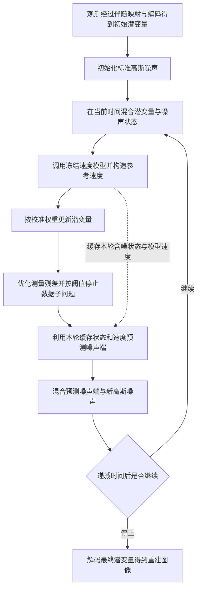

# Solving Inverse Problems with FLAIR

# First Time

## 1.Title & Authors
原文题名：Solving Inverse Problems with FLAIR。
自然中文译法：使用 FLAIR 求解逆问题。
“逆问题”指从退化后的观测恢复产生它的原始信号。本文研究图像逆问题：输入可能是低分辨率图像、运动模糊图像或局部缺失图像，输出是与观测相容的清晰图像。前向过程描述“清晰图像如何变成观测”；逆向求解则利用观测和先验，寻找合理的原图。信息损失使同一观测往往对应多个候选解，这也是论文关注后验分布和样本多样性的原因。
FLAIR 是 flow-based latent adaptive inference with deterministic re-noising 的缩写，可理解为“基于流模型的潜空间自适应推断，配合确定性重加噪”。名称的展开来自 Introduction：flow-based 指利用流匹配生成模型，latent 指主要在预训练自编码器的潜空间中工作，adaptive 对应推断过程中调整正则权重，deterministic re-noising 对应让重加噪带有模型引导的确定性成分。
标题以“用某种方法解决问题”的形式提出方法主张。本文的贡献集中在推断框架：把已经训练好的生成模型作为图像先验，设计如何将它用于恢复任务。Stable Diffusion 3 是主要实验骨干，FLAIR 是围绕骨干进行逆问题求解的框架。
理解标题时抓住一个问题：生成模型知道什么样的图像自然，FLAIR 要让这份知识服务于当前这张退化图像的恢复。
作者按原文顺序列为：
1. Julius Erbach：ETH Zürich、Max Planck Institute for Informatics。
2. Dominik Narnhofer：ETH Zürich。
3. Andreas Dombos：ETH Zürich。
4. Bernt Schiele：Max Planck Institute for Informatics。
5. Jan Eric Lenssen：Max Planck Institute for Informatics。
6. Konrad Schindler：ETH Zürich。
原文将 Max Planck Institute for Informatics 与 Saarland Informatics Campus 一并列出。作者栏未标注等贡献说明；本文据此保留署名与机构关系，不据排序分配具体研究贡献。

## 2.Abstract
摘要的推进顺序是：生成先验的潜力 → 应用于逆问题的障碍 → FLAIR 的框架与组件 → 实验主张。
语义单元 1：流式潜空间生成模型已经具备很强的图像生成能力。
作者以 Stable Diffusion 3 为例，指出这类模型能够生成高质量、具有照片真实感的图像。“潜空间”指生成过程主要作用于自编码器压缩后的表示，随后再通过解码器形成图像；“流式”在本文中对应以时间相关速度场描述从噪声到数据的变换。
这句话建立方法的出发点：预训练模型已经从大量图像中学到纹理、结构和语义规律，恢复图像时可以调用这些规律。这里讨论的是生成模型提供先验的能力。
语义单元 2：优秀的生成能力尚未转化为同等水平的逆问题恢复效果。
生成自然图像时，模型可以在大量合理图像中选择；恢复一张具体图像时，输出还要解释给定观测。由此形成全文的研究缺口：如何把强大的生成先验可靠地接入带观测约束的推断过程。
“先验”描述看到本次观测之前，模型偏好哪些图像；“似然”描述候选图像经过退化后，与实际观测吻合到什么程度；“后验”综合这两类信息，描述给定观测后哪些候选图像更合理。这三个概念决定了后续各组件的职责。
语义单元 3：作者列出三个主要障碍。
1. 数据似然项通常难以直接处理。Background 的观测模型在清晰图像层面具有明确的数据项；困难出现在把观测约束接到随时间变化、含噪的生成状态上。潜空间中的解码非线性又增加了计算难度。因此，摘要中的“难以处理”针对生成推断过程中的似然使用方式。
2. 预训练生成模型不能直接把退化观测当作合适的条件。模型原先学习的是生成任务，当前观测可能只有低频信息、被模糊或存在大片缺失。此时，先验倾向于生成高概率的自然内容，数据项要求保留当前观测对应的特征，两者可能把更新推向不同方向。
3. 重建结果可能偏离观测。即使输出看起来清晰、自然，把它再次降采样、模糊或施加掩码后，也可能与输入对不上。这里的判断依据是观测一致性。
这三个障碍相互关联：似然难处理会影响观测引导；观测引导与先验协调不好，最终就会产生视觉上合理却不符合输入的重建。
语义单元 4：FLAIR 是一个免训练的变分推断框架。
“免训练”指求解这些逆问题时，使用现成生成骨干，不为每种退化重新训练或微调生成模型。推断时仍然需要迭代优化；摘要后面提到的离线校准也需要额外计算。
“变分”指选取可操作的近似分布，通过优化使其接近目标后验。本文将数据匹配与生成先验结合到这一框架中。理解这句话时，可先把 FLAIR 看作“借助预训练模型，优化当前恢复问题的求解过程”，具体近似及其含义留到 Background 与 Method 精读。
语义单元 5：把退化类型无关的流匹配目标，与确定性轨迹调整结合。
这里包含两个相互配合的设计。流匹配目标提供可调用预训练速度场的正则项；确定性轨迹调整改变构造含噪状态的方式，让先验更新更多落在符合当前观测的候选区域。
“退化类型无关”描述流匹配先验项的通用性：更换超分辨率、去模糊或修补任务时，可以继续使用这类先验目标。具体观测如何产生，仍由相应前向算子和数据项表达。
轨迹调整的动机是：给当前估计随意加入噪声后，状态可能落入生成模型支持较弱的区域，模型给出的更新便容易把它拉向其他常见图像。FLAIR 在重加噪中引入模型引导的确定性成分，以改善这类更新。算法同时保留随机成分，用于探索不同解。
语义单元 6：分开优化数据保真项与正则项，以强化观测一致性。
“数据保真”关心候选图像能否解释输入，“正则”关心候选图像是否符合生成先验。作者让两类更新分别执行：先用先验改善图像，再用数据一致性步骤修正与观测的偏差。
这一设计把“补充自然细节”和“符合观测”变成职责明确的两个步骤，是理解 FLAIR 的关键。
摘要使用 exact consistency 描述一致性目标；Method 与 Algorithm1 将它落实为数据残差优化。实际的一致性程度还与优化求解精度、前向算子及观测噪声有关。含噪观测中的噪声也属于测量的一部分，因此“与观测一致”和“恢复到真实无噪原图”需要分别判断。
语义单元 7：用离线误差估计，按时间调整正则强度。
生成模型在不同噪声水平上的预测可靠性不同。作者先用一小组图像估计各时间位置的预测误差，再让推断时的正则权重随这种可靠性变化。可靠性较好的位置可以提供更有用的先验引导，误差较大的位置则需要减弱影响。
这一步解释了名称中的 adaptive：权重沿时间轨迹变化。离线校准提供预先估计的模型可靠性，具体恢复任务再使用这套权重；它与对生成模型重新训练有不同的计算含义。
语义单元 8：实验声称重建质量与样本多样性优于现有扩散、流式方法。
摘要将两个结果并列：单个样本的恢复质量，以及同一观测下多个样本的差异。对于存在多解的逆问题，多样性可以表达观测未能确定的细节；观测已经约束的结构则应保持一致。
摘要没有给出性能增益数字。结合 Experiments 核对，主要实验覆盖 FFHQ 和 DIV2K，任务包括超分辨率、运动去模糊和图像修补。正文还报告像素空间版本，说明框架的应用范围包括潜空间与像素空间。
“优于”需要按指标理解。Table1 中，FLAIR 在所列任务和数据集组合上取得更好的 LPIPS 与 pFID；PSNR、SSIM 的最优结果随任务变化。例如 FFHQ 的 12 倍超分辨率，在 50 NFE、观测噪声标准差为 0.5% 的设置下，FLAIR 的 LPIPS 为 0.271，FlowDPS 为 0.413，越低越好；相应 PSNR 为 27.71 和 28.05，越高越好。这个比较体现了感知质量与逐像素误差的不同取向。
最后一句说明作者提供了代码入口。这属于可获取资源的信息；本次阅读依据用户提供的论文，代码实现尚未核对。
摘要四要素如下。

| 要素 | 解读 |
| --- | --- |
| 问题 | 预训练流式生成模型具有强图像先验，但逆问题中仍存在似然使用困难、先验与观测冲突，以及重建偏离测量的问题。 |
| 方法 | 以流匹配构造变分正则目标，结合确定性轨迹调整、分开的硬数据一致性优化，以及按离线预测误差校准的时间相关正则权重。 |
| 结果 | 作者报告标准恢复基准上的感知质量与样本多样性改善；主要证据来自 FFHQ、DIV2K 的多种恢复任务，以及正文的像素空间比较。具体指标各自反映不同性质。 |
| 意义 | 强生成先验能够在免微调的恢复框架中，与观测约束及多解探索协同工作。这是作者的方法主张及实验支持的应用价值。 |

## 3.Conclusion and Limitations
对应原文第 6 节 Conclusion and Limitations。本节有两个自然段：第一段总结方法与结果，第二段说明限制及潜在误用。
第一段的论证分为以下六步。
1. 工作定位：作者提出 FLAIR，用流式生成模型作为图像先验，建立免训练的逆问题变分框架。“免训练”与摘要一致，强调复用预训练模型；恢复过程本身仍包含优化。
2. 第一项机制：退化类型无关的流匹配损失，配合确定性噪声向量，将生成导向符合观测的图像。流匹配提供先验方向，轨迹调整改善使用先验时的状态和路径。二者共同承担“怎样让生成知识服务于当前观测”的任务。
3. 第二项机制：数据一致性约束与正则化分开处理，以获得硬数据一致性并维持样本多样性。其直观逻辑是，数据步骤约束测量能够确定的内容，生成步骤补充剩余的合理细节。对超分辨率而言，观测对低频结构约束较强，高频细节具有更多可选空间。
4. 自适应权重：正则项按离线校准的预期精度调整。作者将它纳入上述整体框架，避免沿整个时间过程以相同方式相信模型预测。
5. 结果概括：作者认为不同数据集和任务上的实验支持更高的重建质量。Table1 的感知指标比较、Table3 的组件消融，以及相应视觉示例构成这一结论的主要依据；各项指标的含义需要结合 Abstract 中的口径说明理解。
6. 综合目标：作者特别强调感知质量、输入符合程度和样本多样性三者同时表现良好。Fig3 对固定观测生成 32 个样本，展示了样本差异及其在纹理区域的分布。这支持该示例中的解探索能力；真实后验分布的整体逼近精度仍需要更完整的分布检验。
结论的核心是三类目标的协同：图像自然、测量相容、未确定的细节允许多种合理答案。
第二段列出以下限制。
1. 训练数据偏差：FLAIR 继承生成骨干学到的分布偏好。某些外观或语义在训练数据中更常见时，先验可能更倾向于它们。
2. 输出分辨率约束：骨干模型的能力和适用分辨率会限制恢复框架。实际实验分辨率与骨干配置有关，不能从“通用逆问题框架”直接推到任意分辨率的恢复能力。
3. 分布外模式恢复能力有限：当目标图像的内容或细节偏离骨干熟悉的分布时，先验可能难以提供正确候选。这一限制直接影响论文最初希望解决的“先验偏好与当前观测的协调”。
4. 额外超参数：确定性轨迹调整引入需要设置的参数。免训练框架仍然需要选择推断过程的参数与校准设置，方法效果依赖这些选择。
5. 潜在误用：作者指出高保真恢复可被用于不当图像操纵。这是原文提出的应用风险。
本节没有单独展开未来工作方案。若进一步研究更稳健的分布外恢复、更省调参的轨迹调整等问题，它们属于根据限制提出的延伸方向，尚不是本节报告的已完成结果。
摘要与结论在主线上一致：都强调流匹配变分目标、确定性轨迹调整、分开的数据一致性处理和可靠性校准。结论补充了骨干模型的限制与新增参数代价，使“高质量恢复”的适用条件更具体。

## 4.Intuition
可以把任务想成修复一张被压缩、模糊或遮住一部分的照片。手里有一位看过大量照片的画师，也有一套能够模拟“清晰照片如何变成当前输入”的检查设备。
画师对应预训练生成先验：他擅长补出自然的纹理、头发或建筑细节。检查设备对应前向算子与数据一致性步骤：每次改完，都把候选照片重新降采样、模糊或遮挡，检查它是否与现有观测相符。
如果只听画师的，结果可能越来越精美，却逐渐换成他熟悉的另一张脸或另一种纹理。FLAIR 的轨迹调整相当于给画师设置与当前恢复状态有关的参考方向，使先验更新更贴近这次任务；分开的数据步骤则持续纠正与观测的偏差。
离线校准相当于先了解画师在不同工作阶段的可靠性，再决定各阶段采用多少建议。多样性对应在观测允许的范围内给出若干合理版本，例如远处头发的细丝可以不同，但低分辨率观测已经确定的整体轮廓应保持相容。
这个比喻对应各组件的职责。实际方法通过潜变量、速度场、随机噪声和数值优化实现；多个合理版本也不意味着其中某个必然还原了真实丢失的细节。

# Second Time

## 1.Notation & Parameters
先抓住“观测约束、当前估计、生成先验、时间轨迹”四组量。以下保留论文原记号；原文在像素空间和潜空间之间复用部分符号，相关歧义在表中注明。

| 符号/参数 | 含义与作用 | 关键设定/约束 |
| --- | --- | --- |
| $x$、$x_0$ | 原始目标或无噪状态；$x_0$ 也用于流路径的数据端 | 第 3.1 节为像素信号；潜空间方法中须结合编码器语境理解 |
| $y$ | 已知退化观测 | 第 3.1 节中属于 $\mathbb R^m$ |
| $\mathcal A$、$\mathcal A^\top$ | 前向退化算子及像素空间线性算子的伴随 | 潜空间伪代码把解码后的测量过程也简写为 $\mathcal A$，两种语境须区分 |
| $\nu$、$\sigma_\nu$ | 加性高斯观测噪声及其标准差 | 主实验标准差 0.5%；式 (4) 附近另写 $\sigma^2$，记号未完全统一 |
| $E$、$D$ | 预训练 VAE 编码器与解码器 | $E:\mathbb R^n\mapsto\mathbb R^d$，$D:\mathbb R^d\mapsto\mathbb R^n$，$d\ll n$ |
| $f$ | 式 (7)、(9) 的测量预测函数 | 正文未单独定义；潜空间实现需包含解码与退化，详见 Variational flow sampling |
| $\mathcal E$、$\mathcal D$、$\mathcal R$ | 总能量、数据保真项、先验正则项 | 花体 $\mathcal E$、$\mathcal D$ 与编码器 $E$、解码器 $D$ 不同 |
| $p(x_0)$、$p(x_0\mid y)$ | 图像先验及给定观测的目标后验 | 前者来自生成模型，后者通常难直接采样 |
| $q(x_0\mid y)$、$\mu_x$、$\sigma_x^2$ | 变分近似分布及其均值、方差 | 正文采用单粒子退化近似 $\sigma_x^2=0$；$\mu_x$ 为优化状态，不能直接等同真实后验均值 |
| $x_t$、$q(x_t\mid y)$、$p(x_t)$ | 时间相关含噪状态及其变分分布、先验边缘分布 | 基础路径中 $q(x_t\mid y)=\mathcal N((1-t)\mu_x,t^2I)$ |
| $t$、$T$、$\Delta t$、$\delta t$ | 流时间、积分终点、离散时间步及上次状态的时间差 | 数据端 $t=0$，噪声端 $t=1$；正文说明实际止于 $t=0.2$；积分中的 $T$ 未另作定义 |
| $\psi_t$ | 从数据端与噪声构造中间状态的流映射 | 基础条件路径为 $\psi_t(x_0\mid\epsilon)=(1-t)x_0+t\epsilon$ |
| $v_\theta(x_t,t)$、$v_{\theta,t}$ | 预训练模型的时间相关速度场 | 两种写法均见原文；模型参数 $\theta$ 在恢复时冻结 |
| $u_t(x_t\mid\epsilon)$ | 条件路径的参考速度场 | 基础路径中为 $(\epsilon-x_t)/(1-t)$；轨迹调整后采用式 (16) |
| $\nabla_x\log q(x_t\mid y)$、$\nabla_x\log p(x_t)$ | 含噪变分分布与先验的 score | 对当前含噪状态求导；原文也使用 $\nabla_{x_t}$ |
| $\omega(t)$、$\beta(t)$ | score 表述中的时间权重及引用扩散公式的噪声日程 | 正文给出 $\omega(t)=\beta(t)/2$ 的联系；不等同于后续经验校准权重 |
| $\lambda_{\mathcal R}(t)$ | 流正则项的时间相关权重 | 由式 (14) 校准；$t<0.2$ 时置零；原文印刷的归一化位置需核对 |
| $\epsilon$、$\hat\epsilon$ | 新采样的标准高斯噪声及传递到下一轮的混合噪声状态 | $\hat\epsilon$ 加入确定性引导后一般不再是独立标准高斯 |
| $\hat x_1$ | 利用当前速度外推到噪声端的预测 | 下标 1 对应噪声端；不是重建清晰图像 |
| $\alpha$ | 确定性噪声与随机噪声的混合系数 | $\alpha\in[0,1]$；算法取 $\alpha=1-t$ |
| $N$ | 离线校准图像数量 | 正文在 100 个等距时间位置估误差；该 100 与图像数 $N$ 是不同量 |
| $\mu_{init}$ | Algorithm1 的初始优化状态 | 原文推荐 $\mu_x=E(\mathcal A^\top y)$，也允许其他初始化 |

阅读时尤其注意三个区别： $\mu_x$ 是当前单粒子优化状态；$\hat x_1$ 是噪声端预测；$\hat\epsilon$ 是跨轮传递的噪声状态。三者在算法中承担不同职责。

## 2.Introduction
原文第 1 节先解释为什么现代图像生成模型适合充当恢复先验：它们已经从大规模训练数据学习自然图像的结构与语义，能够提供传统稀疏、平滑等手工假设难以覆盖的知识。把这种知识用于恢复时，可以复用模型而不为每种退化训练专用网络。
接着，作者把“有先验”与“能有效使用先验”之间的差距分成两个层面。表示层面，生成模型在 VAE 潜空间工作；即使像素退化是线性的，潜变量到观测的映射也要经过非线性解码器。时间层面，模型读取的是不同噪声水平的状态，观测却对应干净图像经过退化的结果；二者不能直接逐像素比较。
第三个困难是先验的分布偏好。当前图像即使合理，也可能处于预训练分布的低密度区域。模型会倾向于把它拉向更常见的模式，结果可能更“像自然图像”，却更不像输入对应的对象。作者把这一问题与变分优化中的模态集中、过平滑联系起来，后面的确定性轨迹调整由此引出。
FLAIR 的四项贡献各自对应一个环节：以流匹配速度差构造正则项；调整重加噪轨迹以改善先验更新；把观测匹配作为单独的数据优化步骤；根据离线预测误差调整正则强度。框架的整体循环见 [Fig1 精读](#fig1)，完整执行顺序见 [Algorithm1 精读](#algorithm1)。
主线是如何协调预训练先验与当前测量：先验提供候选细节，数据步骤约束观测，轨迹调整与权重校准决定何时、怎样调用先验。
原文“首次统一潜空间生成、流匹配和变分推断”的表述属于作者的新颖性主张；本文提供的方法结构能够说明这项组合，优先权仍需系统比较此前工作才能独立确认。

## 3.Related Work
对应原文第 2 节。第一类路线直接学习从退化输入到干净图像的逆映射；另一类路线学习图像先验，再让推断过程处理具体观测。后一类更容易复用同一个生成模型解决不同退化，但需要设计如何把观测接入生成过程。
作者先概括扩散后验采样中的几类观测引导：约束生成状态接近相应噪声流形，在奇异值分解后的谱域中处理观测，利用值域与零空间分解，以及利用前向算子的伪逆引导。共同目标是把可测量的信息与生成先验提供的缺失信息结合起来。它们对算子结构、表示空间或求导路径的要求可能不同。
潜空间方法的额外难点来自 VAE。ReSample 通过优化与重采样加强硬数据一致性；PSLD 引入额外目标以协调潜空间更新；FlowChef 在流轨迹中加入引导；FlowDPS 将对干净状态和噪声的估计分开处理。这里的描述依据本文 Related Work，尚未逐篇复核原算法。
FLAIR 更接近直接优化变分后验目标的路线。RSD 在相关框架中加入排斥作用来增加样本差异；本文则使用确定性轨迹调整改善单粒子更新。其差别在于多样性的实现方式：RSD 的排斥项作用于样本之间，FLAIR 的重加噪状态带有模型引导并保留随机成分。
对比实验中的“RSD”需要结合设置理解：Table1 使用去掉排斥项的变体；Fig3 的多样性比较则启用排斥项。两处承担不同问题，不能把它们视为完全相同的基线配置。该区别见 [Table1 精读](#table1)、[Fig3 精读](#fig3)。

## 4.Background
原文第 3 节把方法需要的概念按三步连接起来：先建立退化观测与变分能量，再说明流生成模型如何提供先验，最后将后验逼近写为可优化的分布目标。下面按原小节顺序展开。所有推导保留论文记号；定义式说明其建模选择，近似式说明成立条件。

## 5.Inverse problems
对应原文第 3.1 节。
式 (1)：$y=\mathcal A x+\nu$。这是观测模型的定义：先将原始信号通过前向算子，再叠加观测噪声。$x$ 属于原始信号空间，$y$ 与 $\nu$ 属于测量空间，$\sigma_\nu$ 表示噪声标准差。超分辨率会丢弃高频信息，修补会删除部分像素，去模糊则压低部分频率的可辨识程度；因此算子可能不可逆或病态。
“病态”意味着很小的观测扰动也可能造成很大的逆向误差。仅凭式 (1) 求解，通常会遇到多解、不稳定或两者兼有的问题。先验用于在这些候选解之间提供偏好。
式 (2)：$\mathcal E(x,y)=\mathcal D(x,y)+\mathcal R(x)$。这是变分能量的设计形式：数据项衡量观测解释程度，正则项衡量先验偏好。它没有规定两项一定采用何种具体表达。
本节无编号关系：$p(x\mid y)\propto p(y\mid x)p(x)$。贝叶斯规则将后验分成似然与先验；归一化因子只依赖已知观测，在固定观测的优化中可以忽略。对乘积取负对数，就得到两项相加的结构。
本节另外两个无编号定义分别为 $\mathcal D(x,y)=-\log p(y\mid x)$ 和 $\mathcal R(x)=-\log p(x)$。代入后，最小化能量等价于最大化后验密度，即 MAP 解释。后文希望表达多个合理解，因此进一步引入后验近似；单个 MAP 与对后验的分布描述是不同任务。
利用高斯噪声，负对数似然中与恢复变量有关的部分为 $\|y-\mathcal A x\|^2/(2\sigma_\nu^2)$。推导来自高斯密度指数中的二次型：取负对数后指数变成正的平方残差，归一化因子在噪声方差固定时与恢复变量无关。该形式要求各测量维度采用相应各向同性高斯噪声假设；有色噪声需要不同的协方差处理，本文正文没有展开。

## 6.Flow based priors
对应原文第 3.2 节。本文采用 $t=1$ 为噪声端、$t=0$ 为数据端的约定。速度场沿“时间增大”的方向定义，实际生成则沿时间减小方向求解；理解更新的正负号时必须保留这个方向约定。
式 (3) 的原文为：
$$
\frac{d}{dt}\psi_t(x)=v_{\theta,t}(\psi_t(x)),\qquad t\in[0,1].
$$
左侧是轨迹上状态对时间的变化率，右侧让预训练速度场给出该位置的变化方向。它定义了由速度场驱动的 ODE。沿同一轨迹反向积分，便可从简单噪声分布生成复杂数据分布；这个结论依赖速度场拟合与数值积分质量。
正文将简单分布写为 $p_1(x)$，将目标数据分布写为 $p_0(x)$。这些下标对应流时间端点，不代表模型层数。式 (3) 描述无观测约束的生成机制，FLAIR 后面会以交替优化替代纯粹沿这个 ODE 采样的做法。
VAE 的编码器为 $E:\mathbb R^n\mapsto\mathbb R^d$，解码器为 $D:\mathbb R^d\mapsto\mathbb R^n$，且 $d\ll n$。潜空间降低生成计算量，但像素观测要经过解码后才能比较。对于潜变量 $\mu_x$，测量预测应包含 $\mathcal A D(\mu_x)$ 这一复合过程；解码器非线性使其通常不再是线性函数。
潜空间的收益是降低生成维度，代价是观测算子的结构变复杂；像素空间中可直接使用的线性投影公式因此不能原样搬入。

## 7.Variational flow sampling
对应原文第 3.3 节。
式 (4)：$p(x_0\mid y)\propto p(y\mid x_0)p(x_0)$，与前面的贝叶斯分解采用同一原理。似然衡量能否解释观测，先验衡量图像合理性；后验将两者结合。
无编号似然定义，原文写为 $p(y\mid x_0)=\mathcal N(\mathcal A x_0,\sigma^2 I_d)$。其意图是令观测以前向预测为均值、以高斯噪声为扰动。这里原文写的是 $\sigma$，而观测模型使用 $\sigma_\nu$；此外，测量空间此前为 $\mathbb R^m$，$d$ 又被用于潜空间维度。故 $I_d$ 的维度标记与前文不完全一致，理解二次数据项时应按测量空间核对，不能默认为所有维度相同。
无编号近似分布定义：$q(x_0\mid y)=\mathcal N(\mu_x,\sigma_x^2)$。它用可优化均值和方差描述后验候选。正文采用标量方差简写，并未在此式完整写出协方差矩阵；不能由这行推出额外的相关性结构。
式 (5)：
$$
q(x_0\mid y)\in\operatorname*{arg\,min}_{q(x_0\mid y)}\operatorname{KL}\bigl(q(x_0\mid y)\Vert p(x_0\mid y)\bigr).
$$
作者选择从近似分布到真实后验的 KL 方向。优化族不能覆盖真实后验时，结果是该族中的最佳近似；单高斯本身无法表达多个分离的模式。这个 KL 方向也会惩罚把近似概率质量放到真实后验密度很低的区域。
式 (6) 的分解为：
$$
\operatorname{KL}\bigl(q(x_0\mid y)\Vert p(x_0\mid y)\bigr)
=-\mathbb E_{q(x_0\mid y)}[\log p(y\mid x_0)]
+\operatorname{KL}\bigl(q(x_0\mid y)\Vert p(x_0)\bigr)+\log p(y).
$$
逐步推导：先将 KL 写为对 $\log q(x_0\mid y)-\log p(x_0\mid y)$ 的期望；再代入贝叶斯分解，把第二个对数拆为 $\log p(y\mid x_0)+\log p(x_0)-\log p(y)$；最后把 $\log q-\log p(x_0)$ 合并回先验 KL。$\log p(y)$ 与近似分布参数无关，因此固定观测时可以从优化目标中移除。前两项分别对应数据拟合与先验约束，这个分解在密度与 KL 有定义的条件下成立。
无编号选择 $\sigma_x^2=0$ 将变分高斯退化为单粒子。此时 $\mu_x$ 就是当前候选状态。连续先验下，Dirac 分布与先验之间的普通密度 KL 通常不能作为有限量直接代入；后面的优化需要理解为去除与位置无关的退化熵项后的梯度或平滑极限表述。论文没有据此把一个单粒子变成可完整表示多峰后验的分布。
式 (7) 的原文目标为：
$$
\operatorname*{arg\,min}_{q(x_0\mid y)}
\mathbb E_{q(x_0\mid y)}\!\left[\frac{\|y-f(\mu_x)\|^2}{2\sigma_\nu^2}\right]
+\int_0^T\omega(t)\,\mathbb E_{q(x_t\mid y)}\!\left[\|\nabla_x\log q(x_t\mid y)-\nabla_x\log p(x_t)\|^2\right]dt.
$$
第一项来自高斯负对数似然；单粒子下，被积数据残差只依赖当前均值。第二项比较两个含噪分布的 score，即密度对状态的对数梯度。它在多个噪声水平上要求当前候选的局部概率结构接近生成先验，而不是只在干净状态上调用一个难以计算的先验密度。
原文此处使用 $f$ 而未独立定义。结合潜空间设置，测量预测需要包含解码和退化，因而可将 $f(\mu_x)$ 按 $\mathcal A D(\mu_x)$ 理解；这是根据前后文进行的符号消歧。伪代码后面直接写 $\mathcal A(\mu_x)$，同样省略了解码器。积分终点 $T$ 在这里没有另作解释；与此前归一化时间范围对应时，应为噪声端 1。
从 KL 到时间积分的联系需要额外条件。若两分布由同一扩散过程平滑，在足够正则、边界项消失且末端 KL 可处理的条件下，KL 随时间耗散，其导数与 score 差平方的期望相关。对时间积分后，末端项与权重才决定是否恢复原 KL。正文引用既有结果引入式 (7)，并没有为当前退化单粒子和所有流路径逐项建立这些条件。
无编号权重关系为 $\omega(t)=\beta(t)/2$。作者在扩散参数化语境下用它连接 score 匹配与 ELBO 梯度；$\beta(t)$ 是所引用扩散日程的系数。它不是式 (14) 的经验精度校准。这里可核实的是作者采用这一联系；正文缺少足够条件，不能把任意时间权重下的式 (7) 都证明为原 KL 的精确等式。
式 (8)：
$$
\nabla_{\mu_x}\mathcal R(x)
=\mathbb E_{t,q(x_t\mid y)}\!\left[\omega(t)\left(\nabla_x\log q(x_t\mid y)-\nabla_x\log p(x_t)\right)\right].
$$
直觉是把当前近似分布的 score 与先验 score 作差，用这个分布层面的方向移动粒子。对基础高斯路径，变分 score 可解析计算；先验 score 则由模型提供。
这一式被作者作为 Wasserstein 梯度流表述引入，不能当成对式 (7) 的平方范数直接求普通参数梯度。若直接对平方项求导，会出现 score 对状态的导数及状态对均值的链式因子；式 (8) 中没有这些项。理解它需要采用作者引用的分布变分与粒子更新解释，或说明相应的停止梯度及时间权重约定。正文没有把两条求导路线逐项等同。
这种表述的计算动机很清楚：利用一次模型预测构造更新方向，避免对大型速度网络反向传播。单独优化先验方向与 SDS 思路有关；FLAIR 在其外加入当前任务的数据一致性约束。

## 8.Method
对应原文第 4 节。方法包含三个紧密联系的问题：如何用流速度替代 score；如何让生成先验与测量分别完成各自的优化；如何根据模型可靠性和当前轨迹决定先验更新。第 4.1 节再将它们组成求解器。
训练与恢复要分开看：模型已经预训练，本文在测试时优化当前图像的潜变量和噪声状态。离线校准只估计预测误差，不更新生成模型参数。

## 9.Flow Formulation
这是原文 Method 中的第一项。作者希望把式 (7) 的 score 差写成流速度差，使预训练流模型可以直接充当正则器。
先处理本节的无编号基础路径：$q(x_t\mid y)=\mathcal N((1-t)\mu_x,t^2I)$，以及 $\psi_t(x_0\mid\epsilon)=(1-t)x_0+t\epsilon$，其中 $\epsilon\sim\mathcal N(0,I)$。当单粒子固定在 $x_0=\mu_x$ 时，仿射变换把均值变为 $(1-t)\mu_x$、协方差变为 $t^2I$，因此得到前述高斯。
这也给出无编号状态关系 $x_t=(1-t)\mu_x+t\epsilon$。在 $t=0$ 回到当前候选，在 $t=1$ 变成噪声；其间模型读取的是按时间混合的状态。
由基础路径对时间求导，$d\psi_t(x_0\mid\epsilon)/dt=\epsilon-x_0$。再由 $x_0=(x_t-t\epsilon)/(1-t)$ 代回，可得 $u_t(x_t\mid\epsilon)=(\epsilon-x_t)/(1-t)$。这些变形沿用原符号，要求当前代数表达中的 $t\ne1$。
式 (11) 的原文为：
$$
\nabla_x\log q(x_t\mid y)=-\frac{(1-t)u_t(x_t\mid\epsilon)+x_t}{t}.
$$
逐步推导：高斯对数密度对含噪状态求导得到 $-(x_t-(1-t)\mu_x)/t^2$；代入状态关系后为 $-\epsilon/t$；再把 $\epsilon=(1-t)u_t(x_t\mid\epsilon)+x_t$ 代回，就得到式 (11)。第一步是高斯密度的解析梯度，后两步是同一路径内的代入，要求 $t>0$。
式 (12) 的原文为：
$$
v_\theta(x_t,t)\approx\frac{-t\nabla_x\log p(x_t)-x_t}{1-t}.
$$
这里将条件参考速度与边缘最优速度联系起来。对同一线性高斯路径，给定 $x_t$ 后平均条件速度，得到 $\mathbb E[\epsilon-x_0\mid x_t]$；高斯扰动的边缘 score 为 $-\mathbb E[\epsilon\mid x_t]/t$。由状态关系还可得 $\mathbb E[x_0\mid x_t]=(x_t-t\mathbb E[\epsilon\mid x_t])/(1-t)$。将这两项代入平均条件速度，并整理，就得到右侧。
如果速度场确为相同路径下的最优条件均值，此联系可写为精确关系；论文以有限训练模型 $v_\theta$ 代替最优速度，所以采用近似号。文本条件、引导及实际模型误差也会影响这种解释。
式 (13) 为式 (12) 的代数整理：
$$
\nabla_x\log p(x_t)\approx-\frac{(1-t)v_\theta(x_t,t)+x_t}{t}.
$$
先把式 (12) 两边乘以 $1-t$，再移项得到 $-t\nabla_x\log p(x_t)$，最后除以 $-t$。因此式 (12)、(13) 表达同一个速度—score 联系；$t=0$ 和 $t=1$ 的端点需要分别取极限或避开分母。
把式 (11)、(13) 相减，公共的 $x_t$ 项抵消：
$$
\nabla_x\log q(x_t\mid y)-\nabla_x\log p(x_t)
\approx\frac{1-t}{t}\left(v_\theta(x_t,t)-u_t(x_t\mid\epsilon)\right).
$$
这说明 score 差与速度差方向对应，并带有显式时间尺度。平方范数则带来 $((1-t)/t)^2$，不能把它在推导中直接丢弃。
式 (9) 是作者提出的流式目标：
$$
\operatorname*{arg\,min}_{q(x_0\mid y)}
\mathbb E_{q(x_0\mid y)}\!\left[\frac{\|y-f(\mu_x)\|^2}{2\sigma_\nu^2}\right]
+\int_0^T\lambda_{\mathcal R}(t)\,\mathbb E_{q(x_t\mid y)}\!\left[\|v_\theta(x_t,t)-u_t(x_t\mid\epsilon)\|^2\right]dt.
$$
它保留数据项，将先验项改成速度匹配。速度差为零时，当前条件路径与模型预测局部对齐；权重控制各时间位置的影响。这是一项方法设计，同时具有上述 score 重参数化动机。
若要求式 (9) 的积分与式 (7) 原样代入后的积分逐项相同，则必须有 $\lambda_{\mathcal R}(t)=\omega(t)((1-t)/t)^2$。这是由平方直接推出的匹配条件。正文后续把 $\lambda_{\mathcal R}(t)$ 改为经验精度校准，因此最终方法不应被描述为任意校准权重下都与最初 KL 目标严格相同。
式 (10) 按原文印刷为：
$$
\nabla_{\mu_x}\mathcal R(x)=\mathbb E_{t,q(x_t\mid y)}\left[\lambda_{\mathcal R}(t)v_\theta(x_t,t)-u_t(x_t\mid\epsilon)\right].
$$
这里有一个实质性的权重位置差异：式 (10) 只给模型速度乘权重，而 Algorithm1 先计算速度差，再把整个正则更新乘权重。两种更新一般不相同，尤其当两速度已经相等、权重又不为 1 时，前者仍可能不为零。
由式 (8) 和 score 差的代入，可以得到与 $\mathbb E[\omega(t)(1-t)(v_\theta-u_t)/t]$ 同方向的分布更新表达；采用作者的算法权重约定时，对应“整体加权速度差”。它支持 Algorithm1 的结构，但不能推出原印刷式 (10) 的单边加权形式。故笔记保留式 (10)，将与算法的一致性标为待代码或作者说明核实。
另外，若对式 (9) 的平方损失直接求关于 $\mu_x$ 的普通参数梯度，仍会包含模型的 Jacobian 与路径链式因子。Algorithm1 使用的是作者的粒子更新方向，不能把它称作平方损失未经近似的直接反向传播梯度。
可核实的推导链是：线性路径 → 解析变分 score → 同路径的速度—score 联系 → 速度差正则的动机。尚未闭合的部分是：退化单粒子下完整 KL 等价条件、任意校准权重的精确等价性，以及印刷式 (10) 与算法的权重一致性。

## 10.Hard Data Consistency
对应 Method 的第二项。软约束在同一个目标中折中数据残差与先验；FLAIR 让两者分别执行更新。正则步补充先验，数据步再最小化测量残差，防止先验更新持续改变观测已经确定的信息。
本节无编号优化式为 $\min\mathbb E_{q(x_0\mid y)}[-\log p(y\mid x_0)]$。它沿用式 (6) 的数据项。代入高斯似然并使用单粒子后，与最小化当前候选的测量平方残差一致，固定方差下比例常数不改变最优解位置。
无编号初始化式为 $\mu_x=E(\mathcal A^\top y)$。先用线性像素算子的伴随把测量映回图像空间，再编码为潜变量。伴随仅提供与测量有关的初始方向，通常不是逆算子；超分辨率中它不会凭空恢复丢失的高频信息。文中还允许其他初始化。
潜空间实现中，残差要经过解码器；求导需要通过解码与前向过程回到潜变量。生成速度模型可以冻结并避免反传，数据项却仍需可计算的优化路径，因此“免训练”不意味着整套求解不使用梯度。
正文把这一步称作硬数据一致性，图示也采用“投影”直觉。对于非线性解码、含噪测量及有限步优化，实际操作是残差最小化，不自动等于一个已证明的精确正交投影。为理解算法终止条件，核对 A.4 可见：作者采用 SGD，并在残差达到 $1\times10^{-4}\cdot\operatorname{len}(y)$ 时提前停止，以避免拟合观测噪声。该阈值是求解设置，不能将“硬一致性”解释为所有输出都满足零残差。
图表对应：[Fig1 精读](#fig1)、[Table3 精读](#table3)、[Fig6 精读](#fig6)。算法对应：[Algorithm1 精读](#algorithm1)。

## 11.Accuracy Calibration
对应 Method 的第三项。作者认为不同时间的预测任务难度不同，因此先测量模型沿时间的误差，再校准先验更新的强度。这个选择把“何时相信模型”从统一权重变为基于预测误差的经验规则。
校准过程：取 $N$ 张图像，在 0 到 1 之间的 100 个等距时间位置构造条件路径；比较模型速度与参考速度；对图像聚合误差。参考速度来自已知图像与所抽噪声，因此离线阶段可计算。正文没有在这段给出校准图像的详细抽样和噪声重复次数。
式 (14) 经过原图核对，印刷为：
$$
\lambda_{\mathcal R}(t)=\frac{1}{N}\left(\sum_{i=1}^{N}\left\|v_\theta(x_t^{(i)},t)-u_t(x_t^{(i)}\mid\epsilon)\right\|^2\right)^{-1}.
$$
其计算结构是：先对每张图像的速度误差取平方范数，再求和，取倒数，最后乘 $1/N$。误差越大，权重越小，因而相对时间趋势符合“按可靠性加权”的动机。它属于经验校准设计，不能从贝叶斯规则唯一推出。
正文的文字则说“先对图像平均误差”，若随后对平均误差取倒数，应是：
$$
\left(\frac{1}{N}\sum_{i=1}^{N}\left\|v_\theta(x_t^{(i)},t)-u_t(x_t^{(i)}\mid\epsilon)\right\|^2\right)^{-1}.
$$
后者等于 $N$ 除以误差和，原印刷式等于 1 除以 $N$ 与误差和的乘积，两者相差 $N^2$。固定 $N$ 时曲线形状一致，但绝对更新强度不同；能否被全局步长吸收取决于具体实现，论文原式本身没有解决这个差异。这里保留两种写法的来源，不替作者改式。
无编号规则为：当 $t<0.2$ 时，$\lambda_{\mathcal R}(t)=0$。作者给出的理由是低噪声区域模型准确度明显下降。第 4.1 节进一步说明实际时间遍历止于 0.2；这不仅改变权重，也避免继续在不可靠区域调用正则。
若误差和为零，倒数会发散；正文未给出稳定项或截断规则。它在实际校准中是否发生、代码怎样处理，需核对实现。这是公式边界条件，不能自行添加一个论文没有定义的稳定常数。
消融用无编号替代规则 $\lambda_{\mathcal R}(t)=t$ 检查校准作用；它保留时间变化，但去掉数据估计的可靠性信息。结果见 [Table3 精读](#table3)、[Fig6 精读](#fig6)。

## 12.Deterministic Trajectory Adjustment
对应 Method 的第四项。基础方法每轮把当前均值与独立高斯噪声混合；当这些混合状态远离模型可靠支持的区域时，模型预测可能将恢复推向其他高概率模式。作者将噪声的一部分改成由模型预测的噪声端方向，使相邻轮次形成有联系的轨迹，同时保留随机探索。
本节原文提到额外根据估计端点 $\mu$ 条件化状态，但这个不带下标的 $\mu$ 没有在相邻公式中单独定义。实际可明确追踪的是 $\mu_x$ 和 $\hat x_1$；笔记据此讲解公式，不为未定义记号补造含义。
无编号预测式为：
$$
\hat x_1=x_{t+\delta t}+(1-t-\delta t)v_\theta(x_{t+\delta t},t+\delta t).
$$
在时间 $t+\delta t$，用当前位置加上“到时间 1 的剩余时间乘局部速度”，得到单步外推的噪声端。时间从 1 向 0 递减，因此 $t+\delta t$ 对应上一轮较大的时间。单步外推只是一阶预测，依赖该位置的模型速度，不等于完整积分得到的精确端点。
下标 1 指噪声端。 $\hat x_1$ 在原算法中用于预测确定性噪声，不能按常见去噪图示把它读成清晰图像预测。
式 (15)：
$$
q(x_t\mid y)=\mathcal N\!\left((1-t)\mu_x+t\alpha\hat x_1,\;t^2(1-\alpha^2)I\right).
$$
其来源是原文的混合构造：$\hat\epsilon=\alpha\hat x_1+\sqrt{1-\alpha^2}\epsilon$，再令 $x_t=(1-t)\mu_x+t\hat\epsilon$。当本轮把 $\hat x_1$、$\alpha$ 和 $\mu_x$ 视为给定值时，新随机项只有标准高斯 $\epsilon$；其均值为零、协方差为单位阵。仿射变换后，均值成为式中的前两项，协方差则是 $t^2(1-\alpha^2)I$。
该高斯关系是给定引导状态的条件描述。$\hat x_1$ 随历史随机路径而变化时，把这些历史一起边缘化，整体分布可以更复杂；不能据式 (15) 宣称整个求解过程只有一个固定高斯。
参数约束为 $\alpha\in[0,1]$。当 $\alpha=0$ 时回到独立随机噪声；当 $\alpha=1$ 时，本轮随机协方差为零，状态完全由确定性部分决定。算法选择 $\alpha=1-t$，因此噪声较大时随机成分强，接近数据端时模型引导比例更大。由于正文止于 $t=0.2$，实际运行不会到完全确定的 $t=0$。
式 (16)：
$$
u_t(x_t\mid\epsilon)=\frac{\alpha\hat x_1+\sqrt{1-\alpha^2}\epsilon-x_t}{1-t}.
$$
推导先在本轮把引导端点与混合系数固定。修改后的路径为 $(1-t)x_0+t(\alpha\hat x_1+\sqrt{1-\alpha^2}\epsilon)$；对路径时间求导得到 $\alpha\hat x_1+\sqrt{1-\alpha^2}\epsilon-x_0$；由路径反解 $x_0$，代回并整理，得到式 (16)。由于括号中的混合量就是 $\hat\epsilon$，算法中也可按 $(\hat\epsilon-x_t)/(1-t)$ 计算同一个参考速度。
这里的固定条件很重要：如果沿整条曲线把 $\alpha=1-t$ 和模型预测端点都视为随时间连续变化，再对整条复合曲线全求导，会多出相关导数项。原文推导采用固定引导的局部路径，算法则逐轮重新构造路径；它没有证明后者等于某条全局时间依赖路径的完整导数。
为核对变分 score，可直接对式 (15) 的高斯求导：
$$
\nabla_x\log q(x_t\mid y)=-\frac{x_t-(1-t)\mu_x-t\alpha\hat x_1}{t^2(1-\alpha^2)}=-\frac{\epsilon}{t\sqrt{1-\alpha^2}}.
$$
该式要求 $t>0$ 且 $\alpha<1$。它也显示轨迹调整后变分 score 的尺度发生变化；不能把基础高斯的式 (11) 不加条件地套用到修改分布。论文给出了对应参考速度，但没有完整闭合修改后同一 KL 目标、校准权重与最终更新的全部等价条件。
本项改变的是先验调用的轨迹与噪声状态；观测约束仍由独立数据步骤承担。三项组件的联合效果由 [Table3 精读](#table3)、[Fig6 精读](#fig6) 检查，多样性示例见 [Fig3 精读](#fig3)。

## 13.Algorithm
对应原文第 4.1 节。作者采用线性递减时间日程，正文说明止于 $t=0.2$，混合比例取 $\alpha=1-t$，数据一致性子问题用 SGD 求解。完整逐步说明集中在 [Algorithm1 精读](#algorithm1)。
下面用可编辑流程图梳理控制顺序。生成模型冻结；噪声端预测使用本轮已经计算的含噪状态与速度，不能把数据优化后的潜变量误当成伪代码中重新计算过的含噪状态。

图中省略了 VAE 内部网络、数据子问题的逐步 SGD 以及校准曲线的离线计算；这三者分别对应表示转换、内层求解和预先估权重，不应被误画成生成模型再训练。

## 14.Conclusion and Limitations
对应原文第 6 节。完整逐段解读已经保存在 First Time 的同名章节，本轮核对后不重复整节。结合正文，结论中的“硬一致性”应按有限精度残差优化理解；“后验重建”由单粒子随机求解和样本差异提供经验支持；感知质量与逐像素误差需要分别评价。
结构上，独立实验章之后没有额外的非实验讨论章需要漏补。正文方法精读覆盖 Introduction、Related Work、Background、Method 及第 4.1 节；实验章中的全部所选图表与数学关系继续在下文处理，附录按后续速读执行。

## 15.Experimental Formulas & Evaluation Context
本节集中处理正文实验章中理解图表所需的数学关系与评测条件，不把图表选择误当成只覆盖方法章节。
正文给出观测噪声设定 $\sigma_\nu=0.5\%$，其作用是确定模拟测量中的高斯扰动水平。它是实验设置，不是可推导的理论结论；百分比对应的像素归一化细节需结合实现核对。
正文使用 $\operatorname{Var}[x\mid y]$ 表示同一观测下的后验方差，并从 32 个样本估计逐像素差异。原文没有在正文写出经验方差分母的具体定义，因此不能认定其采用某个未注明的无偏估计式。Fig3 实际展示的是标准差图，文字讨论的方差与可视化的标准差应区分。
第 5.3 节的替代权重为 $\lambda_{\mathcal R}(t)=t$。这是移除校准后的消融设计，保留时间相关性并以线性权重替代经验曲线。它与式 (14) 的差异在于是否使用模型误差估计；不是固定权重消融。
原文给出 8 次采样后平均用于后验均值估计的实验，但正文没有另写一个均值估计公式。其作用是区分单个高质量样本与平方误差意义上的均值估计；完整附录结果在剩余阅读中说明。
图表所需评测背景：主实验输出为 $768\times768$；超分辨率倍率为 8 与 12，采用双三次降采样；运动模糊核大小为 61；修补使用大面积掩码。感知指标包含 LPIPS 与由 $256\times256$ 图块计算的 pFID，均越低越好；SSIM 与 PSNR 越高越好。NFE 表示模型函数评估次数，不等于包含数据子问题在内的总计算量。
正文声称统一 NFE 预算、Table1 标题写 50 NFE；为核对比较协议查看 A.5，发现 FlowChef 的修补设置另写为 200 NFE，其余任务为 50。这个正文与附录差异会影响“同预算”的判断，应与代码进一步核对。A.4、A.5 还明确骨干为 Stable Diffusion 3.5-Medium，而正文简称 SD3；阅读时保留这一区别。
数学覆盖核对：式 (1)–(16) 均已逐项解释；无编号关系已按出现语境处理，包括贝叶斯分解、两项负对数定义、似然、变分高斯与退化方差、扩散权重、基础含噪分布与路径、测量优化、伴随初始化、低时间权重规则、噪声端预测、混合比例和实验权重。Algorithm1 中其余初始化与更新关系在末尾逐行解释。对原文未闭合的严格等价性，笔记给出了可完成推导与缺失条件，没有将这些缺口标为已证明。

## 16.Figure & Table
以下按正文版面出现顺序混合排列：Fig1、Table1、Fig2、Table2、Fig3、Fig4、Table3、Fig5、Fig6。共 6 图、3 表，Algorithm1 单独处理；每个多面板图的全部任务与比较组均在对应条目说明。

#### Fig1:
位置与目的：Introduction 的整体方法示意，展示从伴随初始化到最终修补结果的交替更新。它是本轮选择的最重要正文图，因为能把“生成先验补充内容”和“数据步骤纠正观测偏差”两项职责连到同一求解循环。
读法：左下是带遮挡的初始化，红色路径对应正则更新，上方一排显示生成先验逐步补出的候选内容；黄色路径对应数据一致性优化，下方一排显示重新匹配观测后的状态。右侧展示原图及最终结果，原图用于比较，不是推断输入。
从左向右，先验步可以补出被遮区域，也可能改变已知区域；数据步再约束已有测量。多轮交替表达的是反复优化，而非把上排当作一个独立网络、下排当作另一个需要训练的网络。图中未展开编码器、解码器和每轮重加噪。
图中的初始化标签简写为 $\mu_0=\mathcal A^\top y$，正文潜空间初始化则写为 $\mu_x=E(\mathcal A^\top y)$；两者属于示意简写与实际潜空间状态的区别。数据步骤的“投影”含义应与 Hard Data Consistency 中的数值残差优化一起理解。
回看重点是两种箭头为何交替：单独先验会偏离当前对象，单独数据匹配又无法补全丢失信息。此图支持流程理解，不提供速度、误差或多样性的定量证明。

#### Table1:
位置与目的：第 5.2 节主要潜空间定量比较，检验同一恢复框架在两类数据与四种退化任务上的表现。
读法：分为 FFHQ 与 DIV2K 两个数据组，每组又按 8 倍超分辨率、12 倍超分辨率、运动去模糊、图像修补排列。每个任务列出 LPIPS、FID、SSIM、PSNR；前两者越低越好，后两者越高越好。正文说明这里的 FID 实际由图块计算，应按 pFID 理解。本文方法在表中标为 Ours。
比较行包括 ReSample、FlowDPS、RSD、FlowChef。主要表格中的 RSD 不启用排斥项。表题写 50 NFE、噪声标准差 0.5%、输出分辨率 $768\times768$；附录对 FlowChef 修补写了不同 NFE，已在 Experimental Formulas & Evaluation Context 记录，公平预算结论需保留这项待核对信息。
FFHQ 的 8 倍超分辨率：FLAIR 的 LPIPS 为 0.213、pFID 为 13.3，相比最接近的 FlowChef 0.341、30.5 明显更低；但 SSIM 最优是 ReSample 的 0.815，PSNR 最优是 RSD 的 29.69，说明感知改善与逐像素指标不完全同步。
FFHQ 的 12 倍超分辨率：FLAIR 的 LPIPS/pFID 为 0.271/16.2，仍优于各基线；PSNR 为 27.71，低于 RSD 的 28.11 与 FlowDPS 的 28.05。倍率增大使缺失信息增加，该结果支持先验提供感知细节的价值，同时保留失真指标上的取舍。
FFHQ 的运动去模糊：FLAIR 的 LPIPS/pFID 为 0.236/10.7，PSNR 为 29.61，三个指标均在比较组中最优；SSIM 0.772 低于 ReSample 的 0.788。修补任务中，FLAIR 的四个指标均最优，包括 LPIPS 0.184 与 pFID 8.7。
DIV2K 的 8 倍超分辨率：FLAIR 的 LPIPS/pFID 为 0.353/26.5，表现最好；SSIM 和 PSNR 的最优者分别为 ReSample 与 RSD。12 倍超分辨率保持相同格局：FLAIR 的 LPIPS/pFID 为 0.421/32.1，但 SSIM 与 PSNR 没有最优。
DIV2K 的运动去模糊和修补：FLAIR 在所列四个指标上都最好。去模糊的 LPIPS 为 0.315、pFID 为 21.1；修补的对应值为 0.163、11.0。跨人脸与自然场景都取得感知指标优势，比只展示单一人脸任务更能支持方法适用性。
总体证据：FLAIR 在全部 8 个数据集—任务组合中取得最低 LPIPS 与 pFID，但不是所有 SSIM、PSNR 都最好。该表未给出这些主结果的误差条；附录另有统计分析，不能仅凭表中粗体宣布任意两项差距都达到统计显著。

#### Fig2:
位置与目的：第 5.2 节主要潜空间视觉比较。按行分为矩形修补、12 倍超分辨率、运动去模糊；每组均有局部放大和完整图像。按列依次为观测、FlowDPS、FlowChef、FLAIR、真实图像。
第一组是戴帽儿童的人脸修补。观测缺失了眼部及相邻面部区域；FlowDPS 的补全部分偏模糊，FlowChef 的眼部形状和连接出现不自然内容，FLAIR 补出的面部结构更连续。应同时比较遮挡边缘与周围皮肤的衔接，不能只看被补区域是否“有一只眼睛”。
第二组是龟的 12 倍超分辨率。放大块显示头部纹理：FlowDPS 更平滑，FlowChef 的局部纹理与形状不稳定，FLAIR 形成更清晰、连续的黄色与黑色图案。与真实图像比较，恢复的具体细纹仍可能不同；低分辨率输入并不能唯一确定每条纹理。
第三组是蝴蝶运动去模糊。FlowDPS 仍保留较强平滑，FlowChef 的翅膀边缘及局部形态不够稳定，FLAIR 的翅脉、斑点和轮廓更清楚。完整图与放大块共同帮助判断局部锐化是否伴随整体结构破坏。
此图为 Table1 的感知指标提供直观示例，覆盖三类退化；8 倍超分辨率不在这张图的面板中。单次视觉展示不能确定跨样本平均优势，也不能从看起来相似推断测量残差已精确为零。

#### Table2:
位置与目的：正文像素空间比较，检查框架是否依赖 VAE 潜空间。这里换用在 $256\times256$ CelebA-HQ 上训练的流骨干，比较修补和 8 倍超分辨率；不能把这一组数值与 Table1 的高分辨率潜空间组直接横比。
读法：两大列组分别是 Inpainting 与 SR ×8，各自仍列 LPIPS、FID、SSIM、PSNR。比较行是 DDNM、DPS、MM（Moment Matching）、ΠGDM、FLAIR。表题同样写 50 NFE、噪声标准差 0.5%。若干指标带“±”，FID 没有；表题及正文未充分说明这些离散量的计算口径，因此不能把它们擅自认作置信区间。
修补组：FLAIR 的 LPIPS 为 $0.097\pm0.035$，比其他方法约 0.158–0.195 更低；FID 为 14.2，其他方法约 26.9–30.2；SSIM 0.831 与 PSNR 21.87 也为该组最高。它同时改善了感知指标与这组失真指标。
8 倍超分辨率组：FLAIR 的 LPIPS 为 $0.143\pm0.039$，FID 为 22.9，SSIM 为 0.712，PSNR 为 25.93，四项均优于所列基线；其中 ΠGDM 的 LPIPS/FID 为 0.157/26.5，PSNR 为 24.98，是若干指标上较接近的比较对象。
表中修补任务的 DPS 与 ΠGDM 多个数值完全相同；原文没有在此解释原因，不能仅由重复数值判断实现等价或认定抄录错误。需要实现与原始评测记录才能核查。
该表支持“框架可扩展到像素空间”，证据范围是此骨干、分辨率、数据与两种任务。由于骨干和测试配置都改变，它不能单独说明潜空间与像素空间哪个更优。

#### Fig3:
位置与目的：12 倍超分辨率的多样性比较。三行依次为 FLAIR、FlowDPS、RSD；左侧四列是各方法的不同样本，右侧两列分别显示从 32 次采样估计的均值和逐像素标准差。
颜色条从 0 到 0.16，亮色表示该位置的样本差异更大。最后一列显示的是标准差，不应将颜色值直接当作方差。左侧四个样本只展示 32 次采样中的部分结果。
FLAIR 行中的眼睫毛与周围细纹较清晰，样本之间的高频细节存在变化；均值图更平滑，反映不同细节在平均后被抵消。标准差主要集中在纹理和边缘区域，而不是均匀覆盖整张图。
FlowDPS 行的单样本较平滑，差异较弱；RSD 行也更平滑，并有不同的局部变化分布。此处 RSD 启用了排斥项，和 Table1 的配置不同，因此是在其多样性设置下比较。
这张图回答“同一观测能否得到多个清晰而有差异的解”，并提示差异能否集中到观测不确定的细节。它支持示例中的探索能力和细节表达，不足以验证真实后验的覆盖率、概率校准或所有模式是否被找到。均值更平滑也不自动说明每个样本都围绕真实后验均值无偏分布。

#### Fig4:
位置与目的：文本条件编辑扩展示例。第一列为同一男性人像原图，后四列分别加入飞行员眼镜、巫师帽、指定风格的面部纹身，以及红鼻子、红色妆容与颈饰的“小丑”描述。
各编辑图左上角的小示意给出掩码位置；它定义允许生成内容的局部区域。目标文本通过生成模型影响补全部分，未编辑区域继续由观测约束。读图时既看新增对象与提示词是否相符，也看脸部姿态、背景和边界是否保持协调。
眼镜面板考察遮挡与面部贴合；帽子面板考察头部上方新增结构；纹身面板考察皮肤表面局部修改；小丑面板考察多个相关语义元素同时变化。这四个例子覆盖不同编辑尺度，都是在同一恢复框架中改变提示与缺失区域。
该图展示编辑能力，并不属于恢复唯一真实原图的任务。作者未在此提供编辑成功率、身份保持指标或与编辑专用模型的定量比较，因此可以据此确认存在可行示例，不能据此排序通用编辑性能。

#### Table3:
位置与目的：第 5.3 节组件消融，针对 FFHQ、DIV2K 的 12 倍超分辨率子集，比较硬数据一致性 HDC、确定性轨迹调整 DTA、校准正则权重 CRW。正文说使用 100 个样本的子集；该表与主表的取样范围不同，数值不能直接一一相减作为同一测试集的变化。
读法：前三列勾叉标记组件开关，后面分别列两个数据集的 LPIPS 与 PSNR。共五组：全部启用、只去 HDC、只去 DTA、只去 CRW、全部去掉。它不是完整的八种组合析因实验，因此不能从此单独分离所有交互作用。
全部启用：FFHQ 的 LPIPS/PSNR 为 0.259/27.45，DIV2K 为 0.427/21.05。这是本表内的比较起点。
去 HDC：对应值为 0.297/27.17 与 0.467/20.82。两个数据集的 LPIPS 均变差，PSNR 也降低，支持独立观测优化有助于保持测量相关内容。
去 DTA：对应值为 0.432/27.20 与 0.622/21.69。LPIPS 分别变差 0.173 与 0.195，是单项移除中最大的感知损失；但 DIV2K 的 PSNR 比完整模型提高 0.64。因此“最大性能下降”应具体指这里的感知指标。
去 CRW：对应值为 0.363/28.58 与 0.583/21.98。LPIPS 显著升高，而 PSNR 分别提高 1.13 与 0.93。更平滑的图像可以在平方误差指标上占优，同时失去感知细节，这与作者强调的指标取舍一致。
全部去掉：FFHQ 的 LPIPS/PSNR 为 0.392/28.33，DIV2K 为 0.605/21.99。它的 LPIPS 反而比单独去 DTA 更低，显示组件作用具有依赖关系，不能把每个移除差距当成可直接相加的独立贡献。
该表最清楚地支持 DTA 与 CRW 对 LPIPS 的价值，以及 HDC 对数据匹配相关指标的作用。它也保留了真实代价：完整方案的 PSNR 不是本表最优。视觉对应见 [Fig6 精读](#fig6)。

#### Fig5:
位置与目的：像素空间的视觉比较，与 Table2 配套。两组任务分别是矩形修补和 8 倍超分辨率；每组都有完整人脸及局部放大。列依次为观测、ΠGDM、MM、FLAIR、真实图像。
修补组重点是眼部与遮挡区域。ΠGDM 与 MM 生成了可识别的人脸，但局部眼形、纹理及与周围区域的连接较弱；FLAIR 的局部轮廓和细节更清楚。比较完整脸部可以检查局部修改是否破坏整体外观。
超分辨率组重点是另一张人像的眼睛与相邻发丝。ΠGDM 与 MM 的输出更平滑；FLAIR 有更清楚的眼部边界和纹理，但细节仍需与真实图像对照，不能把锐利度直接等同于逐像素真实性。
这张图覆盖 Table2 的两项任务，但只展示其中两条基线，不能视为对所有比较方法的完整视觉排序。它支持像素空间样例中的感知改善；总体指标仍需结合 Table2。

#### Fig6:
位置与目的：Table3 的单例视觉消融。列依次为真实图像、完整 HDC+DTA+CRW、去 HDC、去 DTA、去 CRW、全部去掉；每列同时展示眼镜与眼部放大以及完整人像。
完整方案较好保留眼镜框、眼部边缘和脸部细节。去 HDC 后，结果仍可形成自然人像，但局部结构与原图的对应变弱；单凭这幅图难量化偏离程度，Table3 与测量残差才是互补信息。
去 DTA 的输出明显更平滑，眼部和眼镜附近细节较弱，呼应 Table3 中最大的 LPIPS 损失。去 CRW 同样呈现较强平滑，说明简单时间权重不能在该例中替代精度校准。
全部去掉的图像也偏平滑，细节不足；它与单项消融的视觉关系提示多个组件并非简单独立叠加。该例展示了感知现象，不能独立证明低密度区域的梯度机制，也不能仅凭一个人像确定每个组件的平均作用。
图表覆盖核对：6/6 张正文图、3/3 张正文表已解释；图中的全部任务组、主要比较列及放大/统计面板均已涵盖。最重要的回看图为 Fig1，组件证据重点回看 Table3 与 Fig6。
## 17.Algorithms

#### Algorithm1:
原题名：The FLAIR solver for inverse imaging problems。位于原文第 4.1 节，是测试时求解过程，生成模型参数在此保持冻结。
输入与输出：输入写为 $\mu_x=\mu_{init}$、$\lambda_{\mathcal R}$、$\alpha$、$y$、$\mathcal A$、$v_\theta$；输出为最终 $\mu_x$。潜空间实验还需解码得到像素图像，伪代码把这部分省略。$\lambda_{\mathcal R}$ 与 $\alpha$ 在代码框中未显式写时间自变量，但正文将它们视为时间相关设置。
步骤 1，初始化：$\hat\epsilon\sim\mathcal N(0,I)$。第一次进入循环前没有上一轮预测噪声端，因此先抽一份标准高斯。它与每轮末尾新抽的 $\epsilon$ 是不同状态：前者用于构造当前含噪样本，后者用于准备下一轮混合。
步骤 2，外层时间循环：原框写“$t$ 从 1 到 0，每次减 $\Delta t$”。正文同节却明确止于 $t=0.2$。因此代码框与文字的端点不一致，实际实现应核对时间数组；不能把未经修正的印刷范围直接称为完整可运行规范。
步骤 3，构造含噪潜变量：$x_t\leftarrow(1-t)\mu_x+t\hat\epsilon$。输入是当前经过上一轮数据优化的潜变量及上轮混合噪声；输出是本轮供速度模型读取的状态。均值状态被修改后，下一轮会重新构造含噪状态，而不是无条件沿一条固定 ODE 继续走。
步骤 4，计算参考速度：$u_t(x_t\mid\hat\epsilon)\leftarrow(\hat\epsilon-x_t)/(1-t)$。代入步骤 3 可化为 $\hat\epsilon-\mu_x$，说明这是一条固定端点线性路径的速度。原分式在 $t=1$ 为 $0/0$；代数消去后具有可延拓的值，但原框没有说明采用消去形式还是跳开端点。该点须由实现明确，笔记不替代码假定。
步骤 5，调用模型并形成正则方向：$\nabla_{\mu_x}\mathcal R\leftarrow v_\theta(x_t,t)-u_t(x_t\mid\hat\epsilon)$。模型速度在给定状态与时间上预测先验方向，参考速度来自当前候选路径，两者相减形成粒子更新。这里没有对速度模型反向传播求 Jacobian；箭头定义的是求解器采用的方向，不是对式 (9) 平方损失直接求普通梯度的完整表达。
步骤 6，更新潜变量：$\mu_x\leftarrow\mu_x-\lambda_{\mathcal R}\nabla_{\mu_x}\mathcal R$。沿负方向更新，使当前候选更符合先验；权重乘整个速度差。这与式 (10) 的单边加权不同，已在 Flow Formulation 说明。A.4 另给正则 SGD 学习率 1，说明整体尺度由权重与该步长共同决定。
步骤 7，数据一致性子问题：$\mu_x\leftarrow\operatorname*{arg\,min}_{\mu_x}\|y-\mathcal A(\mu_x)\|^2$。它以正则步后的状态为起点，优化前向预测与观测的残差。潜空间中算子简写需包含解码。若按这一复合过程求导，平方残差对潜变量的方向由 $2\nabla_{\mu_x}(\mathcal A D(\mu_x))^\top(\mathcal A D(\mu_x)-y)$ 给出；这是链式法则说明，依赖可微解码和前向过程。
该 argmin 在伪代码中像精确求解，A.4 的实际操作为多步 SGD 与阈值提前停止。若残差降到 $1\times10^{-4}\cdot\operatorname{len}(y)$ 则终止数据优化；正文未在算法框给出内层最大步数等完整异常退出规则。它并非每轮都运行某个已知闭式投影。
步骤 8，抽新噪声：$\epsilon\sim\mathcal N(0,I)$。它保留跨次运行的随机差异，也防止完全锁在单一确定性轨迹。伪代码没有规定用多个粒子同时优化；多个输出来自不同随机运行。
步骤 9，预测噪声端：$\hat x_1\leftarrow x_t+(1-t)v_\theta(x_t,t)$。当前状态加上到噪声端的剩余时间乘速度，得到局部一阶外推。注意，此处用的是步骤 3 的 $x_t$ 和步骤 5 的模型预测：伪代码没有在数据更新后重新构造 $x_t$、重新调用模型。因此它把本轮已计算的轨迹信息传给下一轮。
步骤 10，更新噪声状态：$\hat\epsilon\leftarrow\alpha\hat x_1+\sqrt{1-\alpha^2}\epsilon$。确定性预测与独立高斯按系数混合，下一轮再用它构造含噪潜变量。$\sqrt{1-\alpha^2}$ 使随机部分的条件协方差成为 $(1-\alpha^2)I$；给定预测端点时可以得到式 (15)。由于 $\hat x_1$ 通常不是独立标准高斯，这个平方和系数不意味着混合后的无条件分布仍为标准高斯。
时间更新与结束：减小时间后重复构造状态、正则更新、数据优化、噪声预测与混合。按正文描述走到 0.2 时结束；输出最新的潜变量，随后通过解码器得到图像。最后一轮结束时已经执行数据一致性步骤，但其精度仍取决于内层求解阈值。
边界与依赖汇总：原框未显式列出 $\Delta t$、编码器/解码器、数据内循环最大次数和全局异常退出策略；$t=1$ 的分母、循环终点以及式 (10) 权重位置需要核对实现。算法本身没有给出全局最优性、精确后验采样或统一迭代复杂度保证。每轮主要成本包含速度模型评估以及若干次解码器/前向算子的残差求导，所以 NFE 只能衡量一部分计算成本。
算法覆盖核对：输入输出、初始化、外层循环、全部 8 个循环内有效步骤、时间更新、内层停止阈值、端点问题及最终解码均已解释；正文实际只出现这一个算法框，全部正文算法已覆盖。
## 18.Experiments
以下速读先补完原文第 5 节的实验叙述，再按附录实际小节顺序说明目的、设置、结果与边界。正文图表和公式已经详解的部分直接回指，不重复整套分析。
实验主要检验三件事：跨退化任务的恢复效果；同一观测下的样本多样性；三项设计对结果的贡献。附录再补充计算成本、文本条件、采样均值、统计与失败案例。
作者使用预训练 SD3 系列骨干而不微调，主要实验在 NVIDIA RTX 4090、24 GB 显存上运行。指标同时包含感知质量和失真质量；作者更重视 LPIPS、pFID，但仍报告 SSIM、PSNR，使读者能够看到取舍。

## 19.Setup
对应原文第 5.1 节。FFHQ 取前 1000 张图像，DIV2K 使用 800 张自然场景图像；输出统一为 $768\times768$。后者的场景、纹理与光照更复杂，因此两个数据集共同检查了人脸特定先验和一般自然图像恢复。
任务包括双三次降采样的 8 倍、12 倍超分辨率，核大小 61 的运动去模糊，以及大面积矩形修补。正文写观测叠加标准差 0.5% 的高斯噪声。
FFHQ 使用统一的人脸文本提示；DIV2K 使用通用前缀加上从观测生成的 DAPE 描述。文本不是额外真实高分辨率图像，而是从当前输入得到的语义条件；它仍会影响先验支持范围，效果由 A.7 单独检查。
基线为 ReSample、FlowDPS、FlowChef、RSD。主表 RSD 去掉排斥项，而多样性实验保留；正文与附录的 NFE 差异已在第 15 节记录。评估公平性应同时核对骨干、文本条件、求解步数和实际数据内循环成本。

## 20.Experimental Results
对应原文第 5.2 节。恢复任务的主要结论是：在 Table1 的 8 个数据集—任务组合上，FLAIR 的 LPIPS 与 pFID 最优，视觉例子显示更清楚的局部结构与纹理；PSNR、SSIM 仍有未占优的任务。参见 [Table1 精读](#table1)、[Fig2 精读](#fig2)。
多样性实验对固定观测生成 32 个样本，比较 FLAIR、FlowDPS 与启用排斥项的 RSD。高频区域出现较明显变化、低频结构相对受约束，是作者期望的行为。完整解读见 [Fig3 精读](#fig3)；经验样本差异支持探索能力，真实后验的概率校准需要更进一步验证。
编辑实验通过修补区域和目标文本改变生成内容，展示眼镜、帽子等局部编辑。它体现框架的灵活性，没有建立与编辑专用模型的系统性能排序。参见 [Fig4 精读](#fig4)。
像素空间实验换用 CelebA-HQ 流模型，与 DDNM、DPS、MM、ΠGDM 比较修补与 8 倍超分辨率。四类指标都改善，说明主要设计可以迁移到像素空间。参见 [Table2 精读](#table2)、[Fig5 精读](#fig5)。
正文还以“8 次采样取平均”连接单样本恢复与 MMSE 估计。其数值与文字的差异见下文 Ensembling Experiment，不能将均值估计改善直接等同于单样本感知质量改善。

## 21.Ablation Studies
对应原文第 5.3 节。作者对 12 倍超分辨率子集逐项关闭 HDC、DTA、CRW，并加入全部关闭的组合，观察 LPIPS 与 PSNR。
HDC 的移除同时损害这两个数据集的 LPIPS、PSNR；DTA 的移除造成最大的单项 LPIPS 损失；CRW 的移除也使 LPIPS 明显变差。它们支持各组件在完整框架中的实际作用。
数值同时显示：去掉 DTA 或 CRW 时，部分 PSNR 可以上升；全部关闭的 LPIPS 也不总是比单独关闭 DTA 更差。组件相互作用及感知—失真取舍都是真实结果的一部分。完整比较见 [Table3 精读](#table3)、[Fig6 精读](#fig6)。

## 22.Derivations
附录 A 先补充数学推导，再给实现、评测和失败案例。A.1–A.3 的作用是解释正文如何从线性条件路径连接 score、速度与轨迹调整；A.4 之后主要支持实验可解释性和可复现性。
本轮对附录采取速读：说明各部分在论证中的作用，并核对影响正文理解的关系；没有将附录全部图表改为逐图精读，也没有把每个附录等式宣称为已单独证明。

## 23.Derivation of flow-based variational formulation
对应 A.1。式 (17)–(24) 从线性插值开始，计算路径导数、反解初始点，再将解析高斯 score 写成参考速度的函数，最后用学习速度近似先验 score。这与正文式 (11)–(13) 的推导一致，已在 Flow Formulation 展开。
附录随后声称选择 $\omega(t)=(1-t)/t$ 得到无权重的速度平方目标。按正文已推得的 score 差，平方范数带有 $((1-t)/t)^2$；单凭这个权重不能在平方目标中把该因子消去。若转而讨论粒子梯度，还需要明确另一套时间系数约定。因而该段不能补上正文式 (7)–(10) 的全部严格等价缺口。
式 (25) 的数据分母另写为 $2\nu^2$，而正文使用 $2\sigma_\nu^2$；此前 $\nu$ 表示噪声向量，记号也存在不一致。式 (26) 给出未加权速度差更新，与 Algorithm1 的基础结构对应。阅读价值是确认设计动机及解析联系，具体尺度仍需实现核对。

## 24.Derivation of trajectory adjusted flow-based variational formulation
对应 A.2。作者先以模型速度预测噪声端，再把确定性预测与高斯噪声混合，由仿射高斯变换得到式 (29)，并计算相应 score。随后对固定引导条件路径求导、反解初始状态，得到式 (34)，对应正文式 (16)。
这一部分明确支持：给定本轮引导状态时，修改后的条件分布具有正文所写均值与协方差；参考速度可以按混合噪声端减当前状态、再除以剩余时间计算。
限制在于推导把混合系数和预测端点作为固定条件，未对随时间更新的整个历史过程求全导数。其局部路径解释已在 Deterministic Trajectory Adjustment 说明；速读到此不将它扩写成论文未提供的全局后验正确性证明。

## 25.Derivation of Score from Flow
对应 A.3。作者从高斯扰动条件 score 出发，利用给定含噪状态后对干净状态的条件期望，连接边缘 score 与流匹配最优速度。
核心链条是：边缘 score 等于条件 score 的后验平均；线性均值允许把条件期望移入仿射表达；最优流速度为给定当前状态后的端点速度均值；代入线性插值关系后得到正文式 (13)。这解释了为什么流模型能够提供 score 型先验信息。
其中把训练优化结果与 score 本身直接写在同一等式中的记号需要按“最优模型函数”理解，而不能把参数的 argmin 当成向量 score。对于实际预训练模型，有限误差使最终联系采用近似号。该推导针对同一高斯线性路径，不自动覆盖任意耦合、任意引导及所有轨迹修改。

## 26.Implementation details
对应 A.4。骨干明确为 Stable Diffusion 3.5-Medium，classifier-free guidance scale 取 2，正则优化采用学习率 1 的 SGD。正文简称 SD3 时应与这个具体版本对应。
数据项使用测量残差平方和而非均值，因此测量数量改变会影响梯度尺度；作者据任务调整学习率。达到 $1\times10^{-4}\cdot\operatorname{len}(y)$ 的残差阈值时提前停止，以减少对观测噪声的拟合。
超分辨率的前向算子是双三次降采样，12 倍和 8 倍的数据步学习率分别为 12、6。运动模糊核每张图分别生成，大小 61、强度 0.5，数据项学习率为 $10^{-1}$。
FFHQ 使用固定矩形掩码；DIV2K 使用由六个矩形构成的固定掩码。它们是本文的实验协议，不是每次对每张图重新采样任意缺失模式。
数据处理先将短边调整到 768，再中心裁剪为方形。附录明确 DIV2K 使用 800 张训练图像；“训练图像”是该数据集的划分名称，本文未据此微调生成模型。样本划分与预训练数据重叠未在这里系统审计。

## 27.Baselines
对应 A.5。作者为比较把多种方法适配到相同 SD3.5-Medium 骨干与任务定义。它们是特定适配与调参后的版本，结果应按这些版本解读。
FlowDPS 使用 50 NFE、引导尺度 2，修补步长 15，其他任务步长 10。FlowChef 在附录写修补 200 NFE、其他任务 50 NFE、步长 1；这与正文统一预算表述存在差异。
RSD 为流匹配改写，主表去掉像素增强和排斥项，作者称这些改动在当前 VAE/骨干下更有利于保真；只有多样性比较启用排斥项。这意味着表中性能不是对原始 RSD 所有配置的穷尽评价。
ReSample 同样改写到流形式，每轮都执行数据一致性，数据优化学习率 15。PSLD 的适配尝试即使采用 500 NFE 也未得到有意义结果，因此未进入主表；这说明本文适配未成功，不能据此认定原方法在其原生设置下失效。

## 28.Regularizer weighting
对应 A.6。附录用 100 张校准图像展示流匹配误差随时间的变化：误差从噪声端先下降，靠近数据端又明显上升。作者将低噪声区域的困难与细节/残余噪声难分、局部预测误差放大联系起来，后者属于其机制解释。
原文默认权重写为 $\lambda_{\mathcal R}(t)=\mathcal L_{CFM,t}^{-1}$，并在 $t<0.2$ 时置零；另比较平移倒数曲线，使零时间处权重为零。这里保留附录原有损失记号，它不是本笔记新增的辅助变量。
默认方案在多项超分辨率和去模糊感知指标上更好，但平移方案在修补等任务上可更好，且常有较高 PSNR。这个结果支持默认选择的实用性，同时显示其不是所有指标与任务上的唯一最佳权重。
附录若干相关表题写 $\sigma_\nu=0.01$，正文主实验写 0.5%。若使用同一归一化尺度，两者不相同；这些表又复用了主表数值。原文未充分解释这一差异，应保留为设置核对项，不能自行统一成某一个噪声水平。

## 29.Effect of captioning
对应 A.7。作者将数据相关文本与统一泛化提示比较，检验文本是否帮助当前图像落到先验更支持的区域。
FFHQ 的增益较小：LPIPS 从 0.278 降至 0.271，FID 从 17.0 降至 16.2。DIV2K 的感知增益更大：LPIPS 从 0.488 降至 0.421，FID 从 51.5 降至 32.1，说明复杂自然场景更受益于内容描述。
DIV2K 的 SSIM 从 0.546 降至 0.525，PSNR 从 21.82 降至 21.39，显示语义条件改善感知指标时也可能增加逐像素偏差。故“文本帮助先验”需要同时保留它改变生成偏好的代价。

## 30.Additional Experimental Results
对应 A.8。附录将主表按任务拆开，并为 LPIPS、SSIM、PSNR 加入逐样本标准差，FID 仍按集合报告。它补充不同图像之间的难度差异，使平均值的离散程度可见。
这些标准差描述样本间波动，不能直接当成平均性能的置信区间，也不等同于每张图多次随机采样的波动。其主趋势与 Table1 一致，具体组别的解读见 [Table1 精读](#table1)。
该处表题同样存在 0.01 与正文 0.5% 的噪声标记差异。数值重复不等于这一协议差异已经得到解释。

## 31.FLAIR in Pixel Space
对应 A.9。作者在 CelebA-HQ、$256\times256$ 的流模型上实现 DTA 与误差倒数权重，并在 1000 个样本上评价修补和 8 倍超分辨率。它避免 VAE，使同类框架直接作用于图像。
作者为基线分别调似然权重：DDNM 为修补 4、超分 1；DPS 为 64、512；MM 为 4、8；ΠGDM 为 64、8。像素空间 FLAIR 的相应设置为 0.5、32，并给出正则权重 0.4。不同方法的权重尺度不能横向当成同一物理量。
附录定量表和视觉示例重现正文像素空间结果，没有构成新的独立测试集。其证据支持跨表示空间适用性，完整指标见 [Table2 精读](#table2)，视觉解释见 [Fig5 精读](#fig5)。

## 32.Runtime Analysis
对应 A.10。作者直接检查硬数据一致性内循环的代价，并比较大 VAE、tinyVAE 和限制数据步数的版本。验证场景为 FFHQ 的 100 张图像、12 倍超分辨率。
完整大 VAE 版本耗时 172.34 秒、显存 12389.4 MB；使用 tinyVAE 后为 40.77 秒、5960.2 MB；再把数据优化限制为最多 5 步后为 22.46 秒、5960.2 MB。其 LPIPS 分别为 0.259、0.256、0.264，PSNR 分别为 27.42、27.59、27.61。
这说明该设置下的主要加速来自降低解码成本与限制数据内循环，感知指标变化较小。限步版本不再等同于每轮优化到原残差阈值；是否牺牲测量一致性需要相应残差评估，表中没有直接给出。
基线耗时包括 FlowChef 15.23 秒、RSD 21.19 秒、FlowDPS 34.15 秒、ReSample 88.02 秒。完整 FLAIR 明显更慢；快速版本缩小差距，但不能据此说原始完整版本本来就具有相同速度。
NFE 相同并不意味着总成本相同；恢复框架中的 VAE 与数据优化内循环需要单独计量。

## 33.Ensembling Experiment
对应 A.11。作者对每种方法独立采样 8 次并平均，检查能否得到平方误差意义上更好的均值估计。平均能抵消样本之间的高频差异，因此提高 PSNR 与削弱锐利细节可以同时发生。
表中 FLAIR 在 FFHQ 的 12 倍超分辨率中，PSNR 从 27.42 升至 29.00；LPIPS 则从 0.2594 升至 0.2999，按越低越好的口径是变差。在 DIV2K 同任务中，PSNR 从 21.05 升至 22.27，LPIPS 从 0.4270 升至 0.4930，同样变差。
FFHQ 的 8 倍超分辨率与 DIV2K 的 8 倍超分辨率也出现 FLAIR 平均后 PSNR 提高、LPIPS 变差的趋势。某些基线的 LPIPS 则有所降低，因此不能把所有方法概括为同一感知变化方向。
正文及本节文字写“降低 LPIPS”，与 FLAIR 表中实际数值方向冲突，应以数值和指标方向明确保留这项差异。作者关于样本分布在后验均值周围的说法得到平均误差改善的间接支持，但真实后验均值不可知，不能由 PSNR 增益独立证明无偏或精确覆盖。

## 34.Statistical Relevance
对应 A.12。主要评测规模为 FFHQ 1000 张、DIV2K 800 张；pFID 用 $256\times256$ 图块，分别得到 9000 与 7200 个图块样本。图块数大于原图数，但来自同图的图块不应自动视为完全独立的原始场景。
作者还对 100 张 FFHQ、80 张 DIV2K 图像各生成三次重建，报告整体指标均值及这些均值的标准差。这里的离散量不同于 A.8 的逐图标准差，也不同于 Fig3 对单张观测生成 32 个样本的逐像素标准差。
补充统计覆盖两个数据集的四类任务。FLAIR 的感知优势整体保持，部分指标也展示比基线更明显的随机变化；这与追求多样性的设计相容，是否足够稳定仍需根据具体任务的测量一致性与输出分布判断。

## 35.t-Test Analysis
对应 A.12.1。作者对 FlowDPS 与 FLAIR 的 LPIPS 做配对 t 检验，以同一输入上的比较减少图像难度差异影响。
八个数据集—任务组合给出的检验值均小于 0.001，范围约为 $3.00\times10^{-5}$ 到 $7.19\times10^{-4}$。它支持这些设置下 FLAIR 相对 FlowDPS 的平均 LPIPS 改善具有统计证据。
检验只针对这对方法和 LPIPS，不能扩展为所有基线、所有指标都显著更优。原文未提供逐样本原始结果以供本次重算，也未在该段充分展开三次重建与配对单元如何组织；本轮记录作者报告及其范围，不声称独立复算过。

## 36.Additional Qualitative Examples
对应 A.13。附录按 FFHQ 修补、12 倍超分辨率、运动去模糊，再按 DIV2K 的相同三类任务，给出多列视觉例子；比较行依次包含观测、RSD、ReSample、FlowDPS、FLAIR 与目标图像。
FFHQ 例子支持人脸眼部、发丝和局部轮廓更清楚的趋势；DIV2K 包含街景、建筑、动物、山水、花束与复杂运动场景，展示先验对一般结构与高频纹理的帮助。个别细节仍与目标不同，符合逆问题中信息缺失的性质。
附录原编号 Fig9 给出正文多样性例子的完整图与局部标准差，使纹理差异和全局结构可一起观察。它与正文 Fig3 是同类证据的补充展示，不是额外独立的分布校准实验。
这些附录图采用原附录编号，与正文存在重号；这里以“A.13 的附录图”区分，不把附录 Fig3 等误链接到正文同号精读。速读保留各组的作用，不另做整套逐图详解。

## 37.Failure cases
对应 A.14。作者报告两类失败：第一类是自然场景超分辨率中的颗粒状纹理，常出现在高频内容密集、光传输复杂的区域；第二类是语义不一致或错位的结构，尤其是面部特征。
附录失败图的上组展示复杂雕饰、逆光场景、密集人群和室内细节中的颗粒或不稳定纹理；下组展示动物及人脸中局部语义、相对位置或表情未能正确恢复的现象。这些错误可以在图像看起来更锐利时仍然发生。
作者将第一类错误可能归因于相关图像在先验下支持不足，并说明在人脸数据中没有观察到同类颗粒现象；这是提出的解释，尚不是通过密度测量或受控实验建立的因果结论。
失败案例给出方法的实际边界：硬数据优化约束观测可见的内容，无法替缺失信息提供语义真实性保证；强先验补出的细节仍可能错误。
剩余阅读覆盖核对：正文第 5 节及其三个小节、附录 A.1–A.14 和 A.12.1 均已按原顺序速读；已逐项处理实现、基线、权重、文本、补充结果、像素空间、耗时、集成、统计、视觉补充与失败案例。附录公式与图表采取速读深度，未冒充全部逐式、逐图精读。

# Overall Review

- 主要贡献：FLAIR 将预训练流模型用于逆问题的方式，从一般的轨迹观测引导推进到一个免微调的变分恢复框架：以速度匹配提供先验方向，以单独的数据优化约束测量，再通过模型引导的重加噪和精度校准控制更新。变分推断、生成先验及硬一致性各自已有基础，本文的新增价值主要在于面向流模型的组合方式与轨迹调整设计。
  第二项有价值的结果是把感知质量与样本探索放在同一框架中检验。Table1 的全部 8 个数据集—任务组合中，FLAIR 的 LPIPS 与 pFID 最好；Fig3 展示固定观测下更清晰且有差异的细节；Table3 中去掉 DTA 后，FFHQ、DIV2K 的 LPIPS 分别从 0.259、0.427 升至 0.432、0.622。它们共同支持这些设计对当前基准的感知恢复有用；真实后验的完整覆盖与概率校准仍超出这些证据。
- 技术优点：方法把三个职责分得清楚：数据步骤处理观测相容性，生成先验提供缺失信息，轨迹和校准控制先验何时、以怎样的状态发挥作用。确定性引导与新随机噪声并用，给出了在保持当前观测结构的同时探索细节的可操作机制；低噪声区域减弱正则，则利用了模型可靠性随时间变化这一实际性质。
  实验覆盖人脸与自然图像、多种退化，并补充像素空间结果，使应用证据比单一数据与单一任务更完整。作者还提供组件消融、随机重复、计算成本、文本作用和失败案例，帮助区分“方法有效”“哪些组件有用”以及“代价在哪里”。感知优势与 PSNR 的冲突在表格中保留下来，这对评估生成式恢复尤其重要。
- 潜在不足：理论目标与可执行更新之间存在尚需核对的环节：单粒子退化下的 KL 处理、时间权重与 score/速度的尺度、式 (10) 的权重位置、式 (14) 的归一化，以及伪代码端点。可完成的解析推导已经逐式给出；这些差异影响对“精确目标等价”及“怎样忠实实现”的理解，不能仅凭方法名称或 Proposition 标题视为已经解决。
  实验上，完整大 VAE 版本的运行代价较高，A.10 中为 172.34 秒，快速版本依靠 tinyVAE 与限制数据步骤降至 22.46 秒；这说明低 NFE 不能替代总成本分析。Table3 和 A.11 显示感知质量与逐像素误差之间的取舍；A.14 则直接展示颗粒纹理和语义错位，说明观测一致性无法保证缺失内容真实。骨干的训练偏差、分辨率及分布外能力也继续限制结果。
  比较协议仍有具体待核实项：正文统一 50 NFE 与附录 FlowChef 修补 200 NFE 的差异，主文与部分附录的噪声标记差异，以及集成实验的 LPIPS 文字与数值方向冲突。它们需要原实现和评测记录澄清；本轮没有执行复现或独立重算，因此保留为明确的核对边界。
- 相关工作定位：FLAIR 属于利用冻结生成模型、在测试时求解逆问题的路线。与直接学习退化到清晰图像的网络相比，它把任务差异主要交给前向算子和求解器；与 FlowDPS、FlowChef 一类流过程观测引导相比，它强调变分目标和交替数据优化。
  它与 RSD 共享利用生成先验优化后验近似的背景，但以轨迹调整替代依赖样本排斥的多样性机制；与 ReSample 共享强化数据一致性的动机，但在流式变分更新中组织这一操作。因此值得学习的是它怎样组合已有思想并处理潜空间约束，而不是把所有组件都归为全新发明。本文的优先权与其他论文完整机制的比较没有在本轮另做文献审计。
- 启发与延伸：第一条可检验方向是把模型支持不足的问题做得更可测：除了看纹理是否清楚，还检查同一观测下哪些区域出现不确定性、这种差异是否与缺失信息相符，以及是否覆盖语义上不同的合理解。它由 Fig3 与 A.14 共同引出，目前仍是进一步研究问题。
  第二条方向是把目标、粒子更新和实现尺度严格对齐：明确时间权重、哪些量在本轮固定、是否停止模型梯度，以及端点如何处理。这样可以区分轨迹调整本身的效果与隐含步长、校准幅度的效果。第三条方向是联合报告测量残差、感知指标、失真指标和总耗时，检查限步数据优化、不同 VAE 与不同语义条件的真实收益。这里提出研究问题，不将它们记作已完成实验。
- 适合谁读：适合已经了解流匹配、贝叶斯后验和 VAE，希望理解如何把大规模生成先验接入图像恢复的读者；也适合关注随机恢复、多解表达及感知—失真取舍的研究者。阅读门槛主要在 score 与速度的联系、分布变分与普通参数梯度的区别，以及潜空间观测优化。
  回看路线可从 [Fig1 精读](#fig1) 与 Notation & Parameters 开始，沿 Flow Formulation 的式 (11)–(13) 理解速度—score 关系，再读 Deterministic Trajectory Adjustment 与 [Algorithm1 精读](#algorithm1)，最后用 [Table3 精读](#table3)、Runtime Analysis、Ensembling Experiment 和 Failure cases 判断机制、指标与成本。这样可以把“问题—方法—证据—限制”连成一条完整主线。
