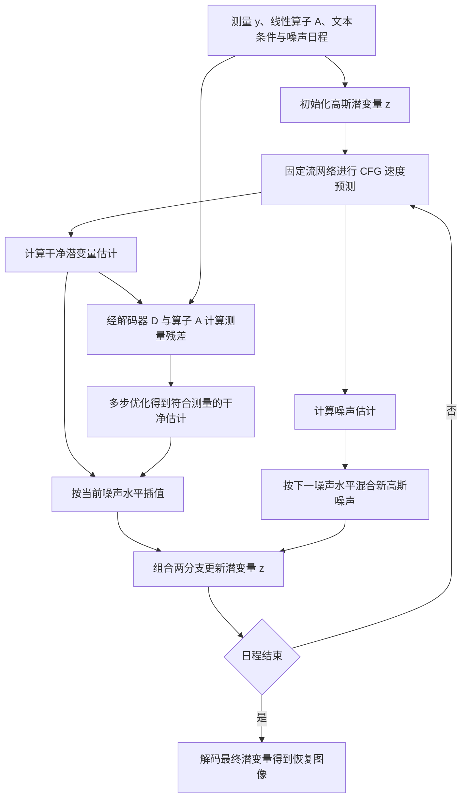

# FlowDPS: Flow-Driven Posterior Sampling for Inverse Problems

# First Time

## 1.Title & Authors
论文原标题为 FlowDPS: Flow-Driven Posterior Sampling for Inverse Problems，自然的中文译法是“FlowDPS：面向逆问题的流驱动后验采样”。标题提出一种求解方法：利用流生成模型，把采样过程引向符合已有测量的图像。
“Inverse Problems”指逆问题：已知经过成像或退化过程得到的观测，反推原始信号。本文的基本观测模型是 $\boldsymbol{y}=\boldsymbol{A}\boldsymbol{x}_0+\boldsymbol{n}$，其中 $\boldsymbol{x}_0$ 是待恢复图像，$\boldsymbol{A}$ 是已知线性前向算子，$\boldsymbol{y}$ 是测量，$\boldsymbol{n}$ 是测量噪声。例如，超分辨率中的前向过程会丢失细节，去模糊中的前向过程会混合邻近位置的信息；多种原图都可能与同一观测相容，因此需要图像先验约束解的选择。
“Posterior Sampling”指给定测量后的后验采样。生成模型提供自然图像的先验，测量模型说明什么样的图像与观测相容，两者共同决定恢复结果。理解这个词的关键是：恢复既要符合测量，也要具有合理的图像结构和细节。
“Flow-Driven”表明生成先验来自流模型，其生成轨迹由常微分方程控制。本文通过分解这条轨迹的离散更新，分别处理干净图像估计与噪声估计，再将逆问题的测量约束接入生成过程。标题的核心主张是：流模型也能形成有后验采样依据、可实际用于图像恢复的逆问题求解器。
作者按原文顺序为 Jeongsol Kim、Bryan Sangwoo Kim、Jong Chul Ye。Jeongsol Kim 的署名单位为 KAIST 的 Department of Bio and Brain Engineering；Bryan Sangwoo Kim 与 Jong Chul Ye 的署名单位为 KAIST 的 Kim Jaechul Graduate School of AI。原文明确标注 Jeongsol Kim 与 Bryan Sangwoo Kim 为等贡献作者，未在这一脚注中进一步划分个人职责。
与研究脉络直接相关的是：本文参考文献 [3] 所列的 Diffusion Posterior Sampling for General Noisy Inverse Problems 的作者也包括 Jeongsol Kim 与 Jong Chul Ye。本文把扩散后验采样中的思路推进到流模型背景，阅读时可以沿着“生成先验如何接收测量信息”这条线理解两项工作的联系。

## 2.Abstract
摘要按“生成模型背景 → 逆问题研究缺口 → 从扩散向流模型迁移 → 更新分解 → 两类修正 → 潜空间适配 → 实验结论”的顺序展开。
语义单元一：Flow Matching 是基于常微分方程的生成建模框架。作者先交代模型基础：神经网络学习随时间变化的速度场，采样时沿速度场把噪声状态逐步变成数据。摘要中的 state-of-the-art 是作者对当时方法发展的背景判断；本论文的研究任务是利用这种生成能力求解逆问题。
语义单元二：Flow Matching 与扩散模型关系密切，并提供更一般的生成建模视角。这里的“一般”指可以从概率路径和速度场组织生成过程，进而讨论不同路径下的采样更新。两类模型之间的联系，为借鉴扩散逆问题求解器提供了入口；实际迁移仍需处理流模型的速度表示、时间系数和更新方式。本文的推导主要围绕仿射条件流展开，不能仅凭摘要中的概括，把后续具体公式直接推广到任意流结构。
语义单元三：扩散模型已被广泛用于逆问题，但流模型背景下的相应研究尚不充分。作者指出的缺口包括两层：怎样借用流模型的先验完成测量条件下的恢复，以及这种操作为什么能够与后验采样联系起来。已有流模型能够生成清晰图像，接下来还需要让它生成与特定退化观测相符的图像。
语义单元四：把扩散逆问题求解器扩展到流框架。摘要将 diffusion inverse solvers 缩写为 DIS，并用“去噪扩散先验与似然梯度相结合”概括其中一类方法。生成先验提供图像结构的约束，似然梯度提供与当前观测相符的修正方向。以本文的线性测量为例，候选图像经过相同前向过程后，应与已知测量在噪声水平允许的范围内接近。这一句确立了论文主线：让流生成过程同时利用先验与观测。
语义单元五：借助流版本的 Tweedie 公式，把流 ODE 分解为干净图像估计和噪声估计两个组成部分。Tweedie 公式在这里的作用，是从中间状态及其速度信息中得到条件均值估计，进一步把离散采样更新写成两个估计的组合。干净图像估计表示当前状态所对应的原始图像信息；噪声估计表示当前生成状态中的噪声来源信息。它们共同描述一次更新，因此可以分别接受具有不同目的的修正。这里的噪声估计与观测模型中的测量噪声 $\boldsymbol{n}$ 承担不同角色，阅读时应按上下文区分。
语义单元六：分别向两个组成部分加入似然梯度和随机噪声。原文中的 respectively 确定了对应关系：似然梯度作用于干净图像估计，用来增强数据一致性；随机噪声混入噪声估计，用来调节采样随机性并改善生成质量。数据一致性与生成质量分别通过两个组成部分进行调节，是 FlowDPS 最值得记住的机制。随机项属于采样器的设计；本论文仍以带高斯测量噪声的观测模型计算似然，两种噪声的作用需要分开理解。
这里的 data consistency 可以理解为“恢复出的图像经过已知退化后，能够解释观测”。本文允许测量中存在噪声，实际更新追求对测量的合理拟合。生成质量则关心恢复结果的纹理、结构与感知自然度，这也说明单看测量残差或某一个像素指标，难以完整评价方法。
语义单元七：FlowDPS 可结合具有 Transformer 架构的潜空间流模型。潜空间模型先在图像的压缩表示中生成，再通过解码器得到图像。本文因此能够利用预训练模型的生成能力处理高分辨率恢复任务。连接测量约束时，需要将潜变量对应的图像解码出来，再经过前向算子与测量比较。这里的 Transformer 是所用生成模型的架构，FlowDPS 的贡献集中在采样及数据一致性更新方式。
语义单元八：在四种线性逆问题上报告优于比较方法的结果，且无需额外训练。四种任务在原文 Section 4.2 中具体为：平均池化的 12 倍超分辨率、双三次下采样的 12 倍超分辨率、高斯去模糊和运动去模糊。摘要没有列出具体提升幅度；详细证据在 Table1 及相关定性比较中。
“无需额外训练”指求解逆问题时使用预训练生成模型，省去针对这些退化任务重新训练模型的步骤。推理仍包含采样和数据一致性优化，因而仍有计算成本。原文 Section 3.4 与 Algorithm1 说明了潜变量的优化更新。
摘要所说的“优于”应结合指标解读。Table1 同时考察 PSNR、SSIM、FID 和 LPIPS，FlowDPS 的优势在多个设置中的 PSNR 与感知质量指标上体现，SSIM 则并非每项最高。例如 FFHQ 的高斯去模糊中，FlowDPS 的 FID 为 41.31，FlowChef 为 112.8，FID 越低越好；同一任务的 SSIM 分别为 0.702 与 0.767，SSIM 越高越好。作者的总体性能判断需要与像素保真度、结构相似度和感知质量的具体结果一起理解。
四要素归纳如下。

| 要素 | 从摘要及对应正文能够确认的内容 |
| --- | --- |
| 问题 | 利用流生成模型恢复受退化与噪声影响的图像，同时说明测量条件下的更新与后验采样之间的关系。 |
| 方法 | 推导流版本的 Tweedie 公式，把流采样更新分成干净图像估计与噪声估计；在前者加入数据一致性修正，在后者混合随机噪声，并扩展到潜空间模型。 |
| 结果 | 在两种 12 倍超分辨率和两种去模糊任务上，与多种逆问题求解器比较，报告较强的恢复表现；性能优势随指标与设置而变化。 |
| 意义 | 作者给出连接流模型与后验采样的分析框架，并提供利用预训练流模型求解逆问题的具体方法，便于将高分辨率生成先验用于恢复任务。 |

摘要的逻辑可以串成一条线：流模型提供强生成先验，逆问题需要测量约束；更新分解给出了分别调节观测拟合与生成随机性的接口，随后通过潜空间实现和实验检验其价值。

## 3.Conclusion
原文 Section 5 的标题为 Conclusion，结论集中在一个段落中。下面沿原段落的论点顺序解释。
第一层：工作要补上的缺口。作者认为，需要一个适用于流模型的通用逆问题求解框架，已有基于潜空间扩散模型的方法在流模型上的表现仍有不足。这里的“通用”主要体现为：同一套方法可以通过更换已知前向算子，服务于本文考察的多种线性退化。当前实验支持的具体任务范围，是两种超分辨率与两种去模糊。
第二层：方法的核心动作。作者再次强调将流 ODE 拆成干净图像与噪声两个组成部分。按 Section 3.1 的实际推导，更准确的理解是：先由流速度得到两个条件均值估计，再将离散 ODE 更新表达成它们的组合。这让“修改哪一部分、为什么修改”变得清楚，为后面的数据一致性与随机性设计提供了共同框架。
第三层：两个部分分别承担什么作用。对干净估计施加与似然相关的修正，使恢复结果解释已知观测；对噪声部分进行随机混合，调节采样并改善生成质量。潜空间实现还在数据一致性优化前后的估计之间插值，平衡测量拟合与原生成轨迹。结论中的 targeted manipulation，对应的就是这些有明确职责的更新。
第四层：结果支持了什么。作者声称，这种方法能够在严重退化的高分辨率图像上取得较好的线性逆问题恢复效果。正文的主要定量评测涉及 AFHQ、FFHQ 与 DIV2K，主要评测分辨率为 $768\times768$；Table1 提供像素及感知指标，Fig3 展示代表性恢复结果，Table2 与 Fig5 进一步检查随机噪声设计的作用。它们分别支持“方法能否恢复”和“某个设计是否有帮助”两类判断，结论中的结果主张应与这些具体设置对应。
第五层：理论视角与实用方法的结合。作者希望论文既解释流模型后验采样的构造，也提供可以接入现有模型的求解流程。推导从条件均值和后验速度出发，实际方法采用可计算的近似：Section 3.2 中使用干净估计近似难以直接计算的似然项，并在特定流形假设下分析如何绕开网络 Jacobian；Section 3.4 进一步利用解码器连接潜变量与图像测量。理论关系帮助组织算法，实际采样质量仍由近似、离散更新与优化设置共同决定。
第六层：未来方向。段落最后表达了作者希望该框架启发更多应用的期待，没有列出具体的新任务、计划或已经完成的额外验证。可以从中读出扩展研究的动机；目前已验证的能力仍以本论文提供的分析和实验为依据。
结论与摘要在核心主张上保持一致：流更新分解、测量约束与生成质量的分别调节，以及潜空间流模型用于高分辨率逆问题的可行性。结论未单列限制清单，其“多种应用”的展望也没有增加新的实验证据。最直接的后续阅读问题是：分解在什么条件下成立，似然近似如何进入更新，以及潜空间中的具体实现与理论形式如何衔接。

## 4.Analogy
可以把这项任务想成修复一张经过缩小和模糊处理的老照片。手里只有受损照片，许多细节已经丢失；修图者既需要理解“正常照片通常长什么样”，也需要让修复结果中的人物、轮廓和位置符合现有照片。
预训练流模型像一位熟悉自然图像的修图者，提供结构与纹理的经验。测量约束像一项核对步骤：把当前修复图按同样方式缩小或模糊，再与手里的照片比较，据此调整不相符的内容。
FlowDPS 的分解，可以类比为在每轮工作中分别处理“当前画面草稿”与“还可以调整的随机细节”。画面草稿接受观测带来的修正，随机细节的变化帮助采样摆脱部分伪影，得到更自然的结果。实际潜空间算法还按噪声日程调节两种干净估计的插值：较早阶段重视与测量一致的整体结构，较晚阶段更多利用模型生成细节。
这个比喻的对应关系是：受损照片对应测量，修图经验对应生成先验，退化后的核对对应数据一致性，随机细节的变化对应采样噪声。真实算法在高维变量上计算速度、解码和优化；比喻只帮助理解各部分的职责。丢失的信息存在多种合理补全，恢复出的清晰纹理是否与原图一致，需要结合观测和评测证据判断。

# Second Time

## 1.Notation & Parameters
先沿“测量 → 流先验 → 两类估计 → 修正 → 潜空间实现”的主线确认重点记号。下面的表服务于正文阅读，局部定义在相应公式处继续解释。

| 符号/参数 | 含义与作用 | 关键设定/约束 |
| --- | --- | --- |
| $\boldsymbol{x}_0,\boldsymbol{y},\boldsymbol{A},\boldsymbol{n}$ | 原始图像、测量、已知线性前向算子、测量噪声 | $\boldsymbol{x}_0\in\mathbb R^d$，$\boldsymbol{y},\boldsymbol{n}\in\mathbb R^m$，$\boldsymbol{A}\in\mathbb R^{m\times d}$；$\boldsymbol{y}=\boldsymbol{A}\boldsymbol{x}_0+\boldsymbol{n}$。 |
| $\sigma_n$ | 测量噪声标准差 | $\boldsymbol{n}\sim\mathcal N(0,\sigma_n^2\boldsymbol{I}_m)$；正文实验取 $\sigma_n=0.03$。原文紧随式 (1) 将其称为 variance，与公式中的平方不一致，按协方差表达理解为标准差。 |
| $p,q,p_t$ | 源分布、目标数据分布、生成过程中的边缘分布 | $p_1=p$，$p_0=q$；源分布为标准高斯，数据位于时间 $0$。 |
| $X_1,X_0,X_t$；$\boldsymbol{x}_1,\boldsymbol{x}_0,\boldsymbol{x}_t$ | 源、目标与中间状态的随机变量及对应样本 | 生成方向是 $t:1\to0$；$\boldsymbol{x}_1$ 是生成端噪声，区别于测量噪声 $\boldsymbol{n}$。 |
| $\psi_t$ | 随时间变化的流映射 | $\psi_t(X_1)=X_t$，$\psi_1(\boldsymbol{x})=\boldsymbol{x}$；条件映射写为 $\psi_t(\boldsymbol{x}\mid \boldsymbol{x}_0)$。 |
| $v_t,v_t^\theta,\theta$ | 理论边缘速度、神经网络速度估计、网络参数 | 条件流匹配用于预训练；FlowDPS 推理使用预训练网络，网络目标是边缘速度。 |
| $a_t,b_t,\dot a_t,\dot b_t$ | 仿射条件路径系数及时间导数 | $\boldsymbol{x}_t=a_t\boldsymbol{x}_0+b_t\boldsymbol{x}_1$；$a_0=1,b_0=0,a_1=0,b_1=1$。线性路径取 $a_t=1-t,b_t=t$。 |
| $dt,C_1(t),C_2(t)$ | Euler 步长及分解更新的两个系数 | $dt<0$，$C_1(t)=a_t+\dot a_tdt$，$C_2(t)=b_t+\dot b_tdt$。一般非线性日程下它们是 Euler 系数。 |
| $\hat{\boldsymbol{x}}_{0\mid t},\hat{\boldsymbol{x}}_{1\mid t}$ | 给定中间状态的干净图像与噪声条件均值估计 | 原文定义为 $\mathbb E[\boldsymbol{x}_0\mid \boldsymbol{x}_t]$ 与 $\mathbb E[\boldsymbol{x}_1\mid \boldsymbol{x}_t]$；网络实现得到近似估计。 |
| $\tilde{\boldsymbol{x}}_{0\mid t},\tilde{\boldsymbol{x}}_{1\mid t}$ | 经过似然修正的干净估计、混入随机性的噪声估计 | 分别进入式 (29) 的两条更新分支。 |
| $\eta_t,\boldsymbol{\epsilon}$ | 随机混合强度与新采样的高斯噪声 | 式 (15) 使用 $\sqrt{1-\eta_t}$ 与 $\sqrt{\eta_t}$；实数混合要求 $0\leq\eta_t\leq1$。算法输入将强度写为 $\eta$。 |
| $J_\theta(\boldsymbol{x}_t),\mathcal M,\mathcal{P}_{\mathcal M}$ | 干净估计的 Jacobian、干净数据流形、其投影算子 | Proposition 2 在仿射子空间和均匀分布假设下给出 $J_\theta=\mathcal{P}_{\mathcal M}/a_t$；投影的微分对应子空间的切向方向。 |
| $\zeta_t,\beta_t$ | 后验速度修正与干净估计修正的系数 | $\beta_t=(\zeta_t/a_t)dt/C_1(t)$。本文提供版本的 $\zeta_t$ 表达式前后不一致，详见 Posterior Sampling via Flow Models 中的逐式核对。 |
| $\mathcal{E}_\phi,\mathcal{D}_\varphi$ | 原文带参数下标的编码器与解码器 | 本文 PDF 的编码器下标为 $\phi$、解码器下标为 $\varphi$；后文冻结两者，简写为 $\mathcal{E},\mathcal{D}$。 |
| $\boldsymbol{z}_0,\boldsymbol{z}_t,\hat{\boldsymbol{z}}_{0\mid t},\hat{\boldsymbol{z}}_{1\mid t}$ | 干净潜变量、中间潜变量及其两类估计 | 与图像空间的两个估计对应；测量残差通过 $\boldsymbol{A}\mathcal{D}(\hat{\boldsymbol{z}}_{0\mid t})$ 计算。 |
| $\hat{\boldsymbol{z}}_{0\mid t}(\boldsymbol{y}),\tilde{\boldsymbol{z}}_{0\mid t},\gamma$ | 数据一致性优化结果、插值结果、插值权重 | $\tilde{\boldsymbol{z}}_{0\mid t}=(1-\gamma)\hat{\boldsymbol{z}}_{0\mid t}+\gamma\hat{\boldsymbol{z}}_{0\mid t}(\boldsymbol{y})$；采用 $\gamma=\sigma_t$。 |
| $\sigma_t$ | 线性流实现中的噪声日程 | 理论线性路径写作 $\sigma_t=t$；与测量噪声 $\sigma_n$ 不同。算法按日程从大到小更新。 |
| $c_\emptyset,c,\lambda$ | 无条件与条件文本嵌入、CFG 强度 | Algorithm1 组合两次条件速度预测；正文实验取 $\lambda=2.0$。 |
| NFE | 原文用于报告采样计算量的网络函数评估次数指标 | 正文报告 NFE $=28$；有 CFG 双分支和解码器优化时，不能把这个数直接等同于全部网络调用数或总耗时。 |

编码器与解码器的下标仅用于保留原文区分，后续沿用原文简写 $\mathcal{E},\mathcal{D}$。最先要记住的方向约定是：$t=1$ 对应源噪声，$t=0$ 对应干净数据，因此生成步长为负。

## 2.Introduction
原文 Section 1 从测量过程开始，而后依次介绍正则化、扩散后验采样、潜空间生成先验和流模型上的研究缺口。这一顺序说明：本文要解决的是把强生成模型用于给定观测的恢复问题。
式 (1)：线性观测模型为 $\boldsymbol{y}=\boldsymbol{A}\boldsymbol{x}_0+\boldsymbol{n}\in\mathbb R^m$。矩阵乘法把 $d$ 维未知信号送到 $m$ 维测量空间，随后加入测量噪声。这里 $\boldsymbol{A}$ 可以包含下采样或模糊；模型是作者对问题的设定，不能从生成模型中推导出来。正文指定 $\boldsymbol{n}\sim\mathcal N(0,\sigma_n^2\boldsymbol{I}_m)$，意味着各测量维度使用同方差、各向同性高斯噪声。原文将 $\sigma_n$ 直接称为方差，而协方差写为 $\sigma_n^2\boldsymbol{I}_m$；后文计算按后者理解。
逆问题困难来自信息丢失及噪声。当不同图像经 $\boldsymbol{A}$ 映射后难以区分时，只靠测量残差无法决定缺失细节。原文用 $\boldsymbol{y}-\boldsymbol{A}\boldsymbol{x}_0=0$ 描述数据一致性的几何直觉：解落在观测所限定的集合中。此式对应无噪声理想化；有噪声时，本文后续使用高斯似然而不是严格要求残差为零。集合非空时，这个线性等式限定的是仿射集合，未必经过原点。
传统 MAP 方法把数据拟合项和正则项合起来寻找高后验点。生成先验方法则利用模型学到的数据分布 $q(\boldsymbol{x}_0)$，在生成过程中加入测量信息。MAP 的一个优化解与后验采样的分布目标属于不同问题；本文在算法构造中采用后验采样视角，评价时主要检查恢复质量。
接着，作者介绍潜空间扩散模型。将主要生成计算放在压缩表示中，可以利用大模型先验处理高分辨率数据，并接收文本条件。原文将 PSLD、ReSample、DAPS 列为相关潜空间求解器，再介绍 P2L、TReg、DreamSampler 如何使用文本或潜空间优化。这些工作的共同作用，是说明逆问题求解已经能利用比单纯像素正则更强的先验。文本条件提供额外语义约束，也意味着提示词的来源与适配程度会影响恢复。
研究缺口出现在生成骨干转向流模型之后。作者认为，原先为扩散模型设计的求解方法迁移到流模型时，采样结构及效果需要重新处理。FlowChef 通过条件损失的梯度引导速度场，PnP-Flow 把预训练流模型作为即插即用恢复中的去噪器；本文希望进一步明确这些操作与后验采样之间的联系。这里是作者对相关方法的定位，本文的实验直接比较其中部分方法及其流模型适配版本。
引言最后给出贡献链：先用 Tweedie 型关系得到干净与噪声估计，再分解流更新；数据一致性作用于干净分支，随机性作用于噪声分支；最后接入潜空间流骨干。在本文的 SD3.0 比较协议下，作者用高分辨率恢复结果支持这一设计。开篇可视化先展示效果，详见 [Fig1 精读](#fig1)；整体效果的定量边界见 [Table1 精读](#table1)。

## 3.Background
原文 Section 2 准备两件工具：用速度场描述生成分布的运动，以及用可采样的条件路径训练这个速度场。后续的更新分解依赖这里的仿射路径，两个条件均值也由同一组路径系数连接起来。

## 4.Flow-based Models and Flow Matching
分布与时间约定：源分布为 $p$、目标分布为 $q$，$X_1\sim p$、$X_0\sim q$，且 $\psi_t(X_1):=X_t\sim p_t$。其中 $p_1=p,p_0=q$，$0\leq t\leq1$。这些是概率路径的定义与边界条件。论文将常见的源端、数据端时间编号调换，使实现从 $1$ 走向 $0$；不要据“速度”的正负直觉改变这一约定。
式 (2)：流满足
$$
\frac{d\psi_t(\boldsymbol{x})}{dt}=v_t(\psi_t(\boldsymbol{x})),\qquad \psi_1(\boldsymbol{x})=\boldsymbol{x}.
$$
左侧表示同一源点沿轨迹运动的瞬时变化，右侧表示在当前空间位置读取的速度。这是流与速度场的定义关系。若速度场在所考虑区域满足足以保证 ODE 解存在唯一的正则性条件，源点便对应确定轨迹；原文这一段没有展开这些分析条件。数值生成用离散求解器逼近这条轨迹。
式 (3)：将轨迹表示改为空间位置表示。原文使用已有的 $\boldsymbol{x}'=\psi_t(\boldsymbol{x})$，即 $\boldsymbol{x}=\psi_t^{-1}(\boldsymbol{x}')$，于是
$$
v_t(\boldsymbol{x}')=v_t(\psi_t(\boldsymbol{x}))=\frac{d}{dt}\psi_t(\boldsymbol{x})=\dot\psi_t(\psi_t^{-1}(\boldsymbol{x}')).
$$
推导分三步：用流映射找到时刻 $t$ 的位置；在该轨迹上求时间导数；再用逆映射把当前位置送回源坐标。$\dot\psi_t=d\psi_t/dt$ 是原文的时间导数记号。式中的逆映射要求在对应时间和支持集上能够反解；它是位置变换，不是对当前位置额外求一次空间梯度。
式 (4)：理想的流匹配训练目标为
$$
\min_\theta\mathbb E_{t,\boldsymbol{x}_t\sim p_t}\lVert v_t(\boldsymbol{x}_t)-v_t^\theta(\boldsymbol{x}_t)\rVert^2.
$$
这是回归速度场的设计目标：给定时间和中间样本，网络预测理论边缘速度。平方误差惩罚向量每个分量上的偏差，训练调整 $\theta$。困难是 $v_t$ 涉及对所有可能数据来源的平均，直接计算通常不可行，因此下一步引入条件路径。
式 (5)：固定干净数据 $\boldsymbol{x}_0$ 后，条件速度按同样的坐标转换定义：
$$
v_t(\boldsymbol{x}\mid \boldsymbol{x}_0)=\dot\psi_t\bigl(\psi_t^{-1}(\boldsymbol{x}\mid \boldsymbol{x}_0)\mid \boldsymbol{x}_0\bigr).
$$
其推导重复式 (3) 的步骤，但每个映射都带有相同条件 $\boldsymbol{x}_0$。输入 $\boldsymbol{x}$ 在这一式中是当前空间位置，先经条件逆映射得到源坐标，再计算条件流的时间导数。固定数据后的路径通常容易构造，因此条件速度可以作为训练标签。
式 (6)：条件流匹配目标为
$$
\min_\theta\mathbb E_{t,\boldsymbol{x}\sim p_{t\mid0}(\boldsymbol{x}_t\mid \boldsymbol{x}_0)}\lVert v_t(\boldsymbol{x}_t\mid \boldsymbol{x}_0)-v_t^\theta(\boldsymbol{x}_t)\rVert^2.
$$
原文期望的下标是压缩写法，训练还需要从数据分布采样 $\boldsymbol{x}_0$，从指定条件路径采样 $\boldsymbol{x}_t$。条件是训练标签的构造工具；网络输入不因训练标签使用了 $\boldsymbol{x}_0$ 就自动得到真实干净图像。
为什么式 (6) 与式 (4) 对网络参数有相同梯度？在后文式 (11) 的条件平均关系下，平方误差可分解为
$$
\begin{alig\boldsymbol{n}ed}
&\mathbb E\lVert v_t(\boldsymbol{x}_t\mid \boldsymbol{x}_0)-v_t^\theta(\boldsymbol{x}_t)\rVert^2\\
&=\mathbb E\lVert v_t(\boldsymbol{x}_t\mid \boldsymbol{x}_0)-v_t(\boldsymbol{x}_t)\rVert^2
+\mathbb E\lVert v_t(\boldsymbol{x}_t)-v_t^\theta(\boldsymbol{x}_t)\rVert^2.
\end{alig\boldsymbol{n}ed}
$$
展开平方后的交叉项为零，因为给定 $\boldsymbol{x}_t$ 时，$v_t(\boldsymbol{x}_t\mid \boldsymbol{x}_0)-v_t(\boldsymbol{x}_t)$ 的条件均值为零。第一项不含网络参数，因而对 $\theta$ 的梯度为零，剩下的梯度与边缘回归一致。这一解释使用平方可积及允许交换求导、期望的条件；它说明训练目标的联系，不意味着有限训练的网络恰好等于理论速度。

## 5.Affine conditional flows
原文先规定独立耦合 $\pi_{0,1}(\boldsymbol{x}_0,\boldsymbol{x}_1)=q(\boldsymbol{x}_0)p(\boldsymbol{x}_1)$，且 $p(\boldsymbol{x}_1)=\mathcal N(0,\boldsymbol{I})$。这个无编号定义表示训练时独立抽取干净数据和标准高斯源噪声。独立的是路径两端的采样；一旦给定中间状态，两端的条件估计一般不再独立。
式 (7)：条件流设计为 $\psi_t(\boldsymbol{x}\mid \boldsymbol{x}_0)=a_t\boldsymbol{x}_0+b_t\boldsymbol{x}$。它对源坐标 $\boldsymbol{x}$ 做缩放，再加上由条件数据决定的平移，因此是仿射映射。这里的 affine conditional flow 描述数据与噪声的插值路径，不应直接理解为某一种特定耦合层网络架构。
边界定义 $a_0=1,b_0=0,a_1=0,b_1=1$ 代入后得到 $\psi_0(\boldsymbol{x}\mid \boldsymbol{x}_0)=\boldsymbol{x}_0$ 与 $\psi_1(\boldsymbol{x}\mid \boldsymbol{x}_0)=\boldsymbol{x}$。前者把条件路径收拢到固定数据点，后者保留源输入。在 $b_t\neq0$ 的中间时间可以反解源坐标；$b_0=0$ 时条件映射坍缩，不能直接在端点使用式 (5) 中要求的逆映射。
式 (8)：把源样本 $\boldsymbol{x}_1$ 代入式 (7)，得到 $\boldsymbol{x}_t=\psi_t(\boldsymbol{x}_1\mid \boldsymbol{x}_0)=a_t\boldsymbol{x}_0+b_t\boldsymbol{x}_1$。每个 $\boldsymbol{x}_t$ 都由一对端点样本及当前路径系数构造。$a_t,b_t$ 是时间函数，不是网络预测的图像内容。
式 (9)：固定这对端点，对式 (8) 求时间导数：
$$
v_t(\boldsymbol{x}_t\mid \boldsymbol{x}_0)=\dot\psi_t(\boldsymbol{x}_1\mid \boldsymbol{x}_0)=\dot a_t\boldsymbol{x}_0+\dot b_t\boldsymbol{x}_1.
$$
端点本身不随路径时间变化，因此只有两个系数被求导。这里必须把 $\dot\psi_t$ 评价在源样本 $\boldsymbol{x}_1$ 上，才能得到沿该条件轨迹的导数。正文另一些位置把它简写为带 $\boldsymbol{x}_t$ 的形式，应依式 (5)、式 (9) 区分当前坐标与源坐标。
线性路径的无编号设定为 $a_t=1-t,b_t=t$。因此 $\dot a_t=-1,\dot b_t=1$，条件速度成为 $\boldsymbol{x}_1-\boldsymbol{x}_0$，且 $\boldsymbol{x}_t=(1-t)\boldsymbol{x}_0+t\boldsymbol{x}_1$。这是一条连接给定端点的直线路径；不同端点会产生不同直线，它们条件平均后的边缘速度场仍可随位置非线性变化。
式 (10)：将上述条件速度代入式 (6)，得到
$$
\min_\theta\mathbb E_{t,\boldsymbol{x}\sim p_{t\mid0}}\lVert v_t^\theta(\boldsymbol{x}_t)-(\boldsymbol{x}_1-\boldsymbol{x}_0)\rVert^2.
$$
训练标签由端点差直接计算，网络学习相同中间状态下所有可能端点差的条件平均。这解释了作者的提醒：用条件流标签训练，得到的目标仍是边缘速度 $v_t(\boldsymbol{x}_t)$，并非对某一对未知端点的条件速度逐样本精确复现。推理时只需中间状态、时间及模型允许的条件，不需要真实 $\boldsymbol{x}_0$。

## 6.Main Contribution
原文 Section 3 按“分解无条件更新 → 加入后验信息 → 与其他方法比较 → 潜空间实现”的顺序展开。下面分别保留四个原小节标题。核心接口是同一个：先计算两类估计，再决定如何修改它们，最后组合成下一时刻的状态。

## 7.Decomposition of Flow ODE
对应原文 Section 3.1。式 (11) 从条件速度过渡到边缘速度：
$$
\begin{alig\boldsymbol{n}ed}
v_t(\boldsymbol{x})&=\mathbb E[v_t(\boldsymbol{x}_t\mid \boldsymbol{x}_0)\mid \boldsymbol{x}_t=\boldsymbol{x}]\\
&=\mathbb E[\dot\psi_t(\boldsymbol{x}_t\mid \boldsymbol{x}_0)\mid \boldsymbol{x}_t=\boldsymbol{x}]\\
&=\dot a_t\mathbb E[\boldsymbol{x}_0\mid \boldsymbol{x}_t=\boldsymbol{x}]+\dot b_t\mathbb E[\boldsymbol{x}_1\mid \boldsymbol{x}_t=\boldsymbol{x}].
\end{alig\boldsymbol{n}ed}
$$
第一行把经过同一当前位置的条件路径速度做条件平均；最后一行代入式 (9) 并利用期望的线性性。中间一行保留原文写法，其中 $\dot\psi_t(\boldsymbol{x}_t\mid \boldsymbol{x}_0)$ 应按上一节所述理解为条件轨迹速度，而不是将源坐标直接替换成当前位置后的偏导。$\dot a_t,\dot b_t$ 只依赖时间，可以移出条件期望。
Proposition 1：正文未编号的两条 Tweedie 关系分别为
$$
\mathbb E[\boldsymbol{x}_0\mid \boldsymbol{x}_t]=\left[a_t-\dot a_t\frac{b_t}{\dot b_t}\right]^{-1}
\left(\boldsymbol{x}_t-\frac{b_t}{\dot b_t}v_t(\boldsymbol{x}_t)\right),
$$
$$
\mathbb E[\boldsymbol{x}_1\mid \boldsymbol{x}_t]=\left[b_t-\dot b_t\frac{a_t}{\dot a_t}\right]^{-1}
\left(\boldsymbol{x}_t-\frac{a_t}{\dot a_t}v_t(\boldsymbol{x}_t)\right).
$$
这两个量并非对真实端点的直接读取，而是给定中间状态的条件均值。推导可以只用式 (8)、式 (11) 的两个线性关系，不需要额外引入讲解变量。先对式 (8) 条件平均：$\boldsymbol{x}_t=a_t\mathbb E[\boldsymbol{x}_0\mid \boldsymbol{x}_t]+b_t\mathbb E[\boldsymbol{x}_1\mid \boldsymbol{x}_t]$。再从该式减去 $b_t/\dot b_t$ 倍的式 (11)：
$$
\boldsymbol{x}_t-\frac{b_t}{\dot b_t}v_t(\boldsymbol{x}_t)
=\left(a_t-\dot a_t\frac{b_t}{\dot b_t}\right)\mathbb E[\boldsymbol{x}_0\mid \boldsymbol{x}_t].
$$
两边除以右侧的标量系数，便得到第一条。类似地，从条件平均的式 (8) 减去 $a_t/\dot a_t$ 倍的式 (11)：
$$
\boldsymbol{x}_t-\frac{a_t}{\dot a_t}v_t(\boldsymbol{x}_t)
=\left(b_t-\dot b_t\frac{a_t}{\dot a_t}\right)\mathbb E[\boldsymbol{x}_1\mid \boldsymbol{x}_t],
$$
再除以相应系数，得到第二条。按原式写法，第一条要求 $\dot b_t\neq0$，第二条要求 $\dot a_t\neq0$，还要求消元系数非零；更本质的线性可解条件是 $a_t\dot b_t-b_t\dot a_t\neq0$。遇到单个导数为零时应回到这两个线性关系处理，不能继续使用含零分母的表示。
原文定义 $\hat{\boldsymbol{x}}_{0\mid t}:=\mathbb E[\boldsymbol{x}_0\mid \boldsymbol{x}_t]$、$\hat{\boldsymbol{x}}_{1\mid t}:=\mathbb E[\boldsymbol{x}_1\mid \boldsymbol{x}_t]$。两者与 $\boldsymbol{x}_t$ 的关系因此为 $\boldsymbol{x}_t=a_t\hat{\boldsymbol{x}}_{0\mid t}+b_t\hat{\boldsymbol{x}}_{1\mid t}$；速度则为 $v_t(\boldsymbol{x}_t)=\dot a_t\hat{\boldsymbol{x}}_{0\mid t}+\dot b_t\hat{\boldsymbol{x}}_{1\mid t}$。这组式子解释了为什么同一个速度预测可以提供两条分支。
式 (12)：Euler 更新为 $\boldsymbol{x}_{t+dt}=\boldsymbol{x}_t+v_t(\boldsymbol{x}_t)dt$，其中 $dt<0$。它来自对时间轨迹做一阶 Taylor 展开并舍去二阶及以上局部项；在速度场光滑时，一步局部截断误差通常为步长平方量级。式中的等号表示作者定义的数值更新，不等于连续解在任意有限步长下的精确演化。
式 (13)：把上一段两条关系代入式 (12)，逐项合并：
$$
\begin{alig\boldsymbol{n}ed}
\boldsymbol{x}_t+v_t(\boldsymbol{x}_t)dt
&=a_t\hat{\boldsymbol{x}}_{0\mid t}+b_t\hat{\boldsymbol{x}}_{1\mid t}
+\dot a_tdt\hat{\boldsymbol{x}}_{0\mid t}+\dot b_tdt\hat{\boldsymbol{x}}_{1\mid t}\\
&=(a_t+\dot a_tdt)\hat{\boldsymbol{x}}_{0\mid t}+(b_t+\dot b_tdt)\hat{\boldsymbol{x}}_{1\mid t}\\
&=C_1(t)\hat{\boldsymbol{x}}_{0\mid t}+C_2(t)\hat{\boldsymbol{x}}_{1\mid t}.
\end{alig\boldsymbol{n}ed}
$$
其中无编号定义 $C_1(t)=a_t+\dot a_tdt$、$C_2(t)=b_t+\dot b_tdt$ 就是合并后的标量系数。在给定当前状态时，两类估计都是确定函数；原文将第二项称为确定性噪声分支，强调其中尚未抽取新的随机扰动。
式 (14)：作者将其改为 $\boldsymbol{x}_{t+dt}=C_1(t)\hat{\boldsymbol{x}}_{0\mid t}+C_2(t)\tilde{\boldsymbol{x}}_{1\mid t}$。这是采样器设计：干净估计暂时保留，噪声估计换成混合后的版本。它具有与分解 Euler 更新相同的组合接口，但引入随机性后已经改变了采样动态。
式 (15)：混合规则为
$$
\tilde{\boldsymbol{x}}_{1\mid t}=\sqrt{1-\eta_t}\,\hat{\boldsymbol{x}}_{1\mid t}+\sqrt{\eta_t}\,\boldsymbol{\epsilon},
\qquad\boldsymbol{\epsilon}\sim\mathcal N(0,\boldsymbol{I}).
$$
新噪声与当前估计按两个平方根权重相加；$\eta_t=0$ 时回到确定性分支，$\eta_t=1$ 时该分支只保留新噪声。平方权重之和为一，提供调节两种噪声来源的规则。条件均值估计 $\hat{\boldsymbol{x}}_{1\mid t}$ 一般不等于方差为单位阵的真实端点噪声，因此不能仅凭这一权重形式就断言混合严格保持某个目标边缘分布；它在本文中的效果由后面的消融检验。
式 (16)：代入混合规则，作者写成广义 DDIM 风格：
$$
\boldsymbol{x}_{t+dt}=C_1(t)\hat{\boldsymbol{x}}_{0\mid t}
+\sqrt{C_2(t)^2-k_t^2}\,\hat{\boldsymbol{x}}_{1\mid t}
+\sqrt{k_t^2}\,\boldsymbol{\epsilon}.
$$
其中 $k_t$ 在正文此处未先定义，所引用的补充推导定义为 $k_t=C_2(t)\sqrt{\eta_t}$。把它代回去，$C_2(t)^2-k_t^2=C_2(t)^2(1-\eta_t)$，便重现式 (14)、式 (15) 的系数；按原式正平方根写法，需要 $C_2(t)\geq0$。在线性流且时间没有跨出有效区间时，该系数为下一步的非负噪声水平。
紧随式 (16) 的无编号关系把 $C_1(t)$ 写作 $a_{t+dt}$、$C_2(t)$ 写作 $b_{t+dt}$。一般日程下这两个等号是一阶近似；在线性日程下才是精确相等。原因是一般只有 $a_{t+dt}=a_t+\dot a_tdt$ 加上高阶项，$b_t$ 同理。式 (16) 展示与 DDIM 的代数组合形式相同，不能单独证明任意加入随机噪声的更新都精确采样同一分布。
这一节的结果是得到一个可操作的分解接口：干净分支承载图像估计，噪声分支承载随机性。下一节将测量信息接入前者。几何关系见 [Fig2 精读](#fig2)，随机混合的实验证据见 [Table2 精读](#table2) 与 [Fig5 精读](#fig5)。

## 8.Posterior Sampling via Flow Models
对应原文 Section 3.2。论证分成两段：先把速度写成密度对数梯度的形式，利用 Bayes 法则引入测量；再用干净估计和流形近似，把难计算的后验更新变成实际可用的操作。
式 (17)：由 $\boldsymbol{x}_t=a_t\mathbb E[\boldsymbol{x}_0\mid \boldsymbol{x}_t]+b_t\mathbb E[\boldsymbol{x}_1\mid \boldsymbol{x}_t]$ 消去干净条件均值，再代入式 (11)：
$$
\begin{alig\boldsymbol{n}ed}
v_t(\boldsymbol{x}_t)
&=\frac{\dot a_t}{a_t}\boldsymbol{x}_t+left[\dot b_t-b_t\frac{\dot a_t}{a_t}\right]\mathbb E[\boldsymbol{x}_1\mid \boldsymbol{x}_t]\\
&=\frac{\dot a_t}{a_t}\boldsymbol{x}_t-left[\dot b_tb_t-b_t^2\frac{\dot a_t}{a_t}\right]\nabla\log p_t(\boldsymbol{x}_t).
\end{alig\boldsymbol{n}ed}
$$
第一行需要 $a_t\neq0$；第二行使用下一式的高斯扰动恒等式。它把速度分成显式线性项和依赖分布的 score 项。score 是对当前位置求密度对数梯度，指向局部概率密度增加的方向，并非图像分类置信度。
式 (18)：仿射路径与独立标准高斯源噪声给出 $p_t(\boldsymbol{x}_t\mid \boldsymbol{x}_0)=\mathcal N(\boldsymbol{x}_t\mid a_t\boldsymbol{x}_0,b_t^2\boldsymbol{I})$。对该高斯的对数密度求导，原文的无编号关系为
$$
\nabla_{\boldsymbol{x}_t}\log p_t(\boldsymbol{x}_t\mid \boldsymbol{x}_0)=-\frac{\boldsymbol{x}_t-a_t\boldsymbol{x}_0}{b_t^2}.
$$
因为 $\boldsymbol{x}_t-a_t\boldsymbol{x}_0=b_t\boldsymbol{x}_1$，右侧也等于 $-\boldsymbol{x}_1/b_t$。再对条件数据来源取平均，得到式 (18)：
$$
\begin{alig\boldsymbol{n}ed}
\nabla_{\boldsymbol{x}_t}\log p_t(\boldsymbol{x}_t)
&=\mathbb E_{\boldsymbol{x}_0\sim q}[\nabla_{\boldsymbol{x}_t}\log p_t(\boldsymbol{x}_t\mid \boldsymbol{x}_0)\mid \boldsymbol{x}_t]\\
&=-\frac1{b_t}\mathbb E[\boldsymbol{x}_1\mid \boldsymbol{x}_t].
\end{alig\boldsymbol{n}ed}
$$
第一行可以从边缘密度积分直接核对：对 $\log\int p_t(\boldsymbol{x}_t\mid \boldsymbol{x}_0)q(\boldsymbol{x}_0)d\boldsymbol{x}_0$ 求导，将分子中的 $\nabla p_t(\boldsymbol{x}_t\mid \boldsymbol{x}_0)$ 写成条件密度乘以其 score，除以边缘密度后，权重恰好是给定 $\boldsymbol{x}_t$ 的条件分布。这里要求相应微分与积分可以交换，并且 $b_t\neq0$。这条恒等式解释了式 (17) 中噪声条件均值如何变成 score。
式 (19)：原文给出的测量条件速度为
$$
v_t(\boldsymbol{x}_t\mid \boldsymbol{y})=\frac{\dot a_t}{a_t}\boldsymbol{x}_t-left[\dot a_tb_t-b_t^2\frac{\dot a_t}{a_t}\right]\nabla_{\boldsymbol{x}_t}\log p_t(\boldsymbol{x}_t\mid \boldsymbol{y}).
$$
原式方括号的第一项写为干净路径系数的导数乘以噪声系数，与式 (17) 的噪声路径系数导数不同，无法从上一式直接推出。如果将同一高斯扰动路径的目标改为测量条件下的数据分布，推导应沿式 (17) 进行：先对端点条件均值再条件于 $\boldsymbol{y}$，再使用同样的高斯 score 恒等式；这样方括号仍应为 $\dot b_tb_t-b_t^2\dot a_t/a_t$。这里只能确认所提供版本存在这一系数不一致，不能把印刷的式 (19) 当成已由式 (17) 证明的结果。
式 (20)：Bayes 法则给出
$$
\nabla_{\boldsymbol{x}_t}\log p_t(\boldsymbol{x}_t\mid \boldsymbol{y})=\nabla_{\boldsymbol{x}_t}\log p_t(\boldsymbol{y}\mid \boldsymbol{x}_t)+\nabla_{\boldsymbol{x}_t}\log p_t(\boldsymbol{x}_t).
$$
推导从条件密度分解取对数开始，得到似然对数加先验对数，再减去只依赖 $\boldsymbol{y}$ 的归一化项。对 $\boldsymbol{x}_t$ 求梯度时，最后一项为常数而消失。这个等式本身不需要近似；它说明后验方向包含已有生成先验的 score，以及测量提供的额外信息。
式 (21)：原文将速度写为 $v_t(\boldsymbol{x}_t\mid \boldsymbol{y})=v_t(\boldsymbol{x}_t)-\zeta_t\nabla_{\boldsymbol{x}_t}\log p_t(\boldsymbol{y}\mid \boldsymbol{x}_t)$，并定义 $\zeta_t=\dot a_tb_t-b_t^2\dot a_t/a_t$。这个定义与印刷的式 (19) 相同，但与式 (17) 的系数不一致。若要由式 (17) 和式 (20) 精确相减得到这一结构，系数应满足 $\zeta_t=\dot b_tb_t-b_t^2\dot a_t/a_t$。后续讨论保留原文 $\zeta_t$、$\beta_t$ 的名字，明确区分原文定义与代数一致性要求，不将两种表达混在同一条证明中。
为什么引入测量之后仍难计算？中间状态 $\boldsymbol{x}_t$ 不是干净图像，给定它以后仍有许多可能的 $\boldsymbol{x}_0$。要准确计算 $p_t(\boldsymbol{y}\mid \boldsymbol{x}_t)$，必须把这些干净图像可能性及对应测量似然一起积分，生成模型并未直接提供这个积分。
式 (22)：作者采用 DPS 风格近似，写作
$$
\nabla_{\boldsymbol{x}_t}\log p_t(\boldsymbol{y}\mid \boldsymbol{x}_t)\approx\nabla_{\boldsymbol{x}_t}\log p(\boldsymbol{y}\mid\mathbb E[\boldsymbol{x}_0\mid \boldsymbol{x}_t]).
$$
近似把对整个干净图像条件分布的计算，替换为在其条件均值处评价似然。它属于用代表性估计替代分布积分的设计，通常不满足“似然积分等于条件均值处似然”的精确关系，尤其在测量非线性或条件分布较分散时应注意。本文虽使用线性 $\boldsymbol{A}$，测量似然的对数与条件平均仍不能任意交换。
式 (23)：再把右侧写成对干净估计求梯度的形式：
$$
\nabla_{\boldsymbol{x}_t}\log p_t(\boldsymbol{y}\mid\hat{\boldsymbol{x}}_{0\mid t})
=J_\theta(\boldsymbol{x}_t)\nabla_{\hat{\boldsymbol{x}}_{0\mid t}}\log p(\boldsymbol{y}\mid\hat{\boldsymbol{x}}_{0\mid t}),
$$
原文无编号定义为 $J_\theta(\boldsymbol{x}_t)=\partial\hat{\boldsymbol{x}}_{0\mid t}/\partial \boldsymbol{x}_t$。这是复合函数求导：测量似然依赖干净估计，干净估计又依赖中间状态。若把梯度统一写成列向量、Jacobian 的行对应输出分量，标准链式法则右侧应使用 $J_\theta(\boldsymbol{x}_t)^\top$；原文未注明其向量微分约定。下一步将 Jacobian 近似为对称正交投影，届时转置不影响结果。一般网络情形仍应说明约定，不能据此普遍省略转置。
实际计算这一 Jacobian 与梯度的乘积，通常需要反向传播通过速度网络。作者希望利用干净数据的局部几何简化它，从而减少穿过大型生成骨干的求导。
Proposition 2 与式 (24)：假设干净数据分布在仿射子空间 $\mathcal M$ 上，并采用该空间上的均匀分布理想化，作者给出
$$
J_\theta(\boldsymbol{x}_t)=\frac{\partial\hat{\boldsymbol{x}}_{0\mid t}}{\partial \boldsymbol{x}_t}=\frac1{a_t}\mathcal{P}_{\mathcal M}.
$$
其几何含义是：扰动中间状态时，只有沿干净数据子空间方向的变化会进入干净估计，而尺度受到路径系数影响。若 $\mathcal M$ 真的是带平移的仿射空间，仿射投影的位置表达带有平移项；微分取其线性切向投影。原文使用同一个投影记号描述这一结构。
可核对的推导是：将各向同性高斯扰动分解为平行、垂直于该空间的部分。垂直部分不能由改变干净数据来解释，因此归入噪声；沿空间的部分在均匀先验理想化下由投影后的当前位置确定。干净条件均值随 $\boldsymbol{x}_t$ 变化的部分于是为 $\mathcal{P}_{\mathcal M}\boldsymbol{x}_t/a_t$，可能的平移常数求导后消失，得到 $\mathcal{P}_{\mathcal M}/a_t$。这一结论使用真实条件均值和理想子空间先验；将其直接用于训练近似网络及真实图像流形，是算法采用的几何近似。
式 (25)：将式 (24) 代入链式法则后，作者进一步写为
$$
\begin{alig\boldsymbol{n}ed}
\nabla_{\boldsymbol{x}_t}\log p_t(\boldsymbol{y}\mid\hat{\boldsymbol{x}}_{0\mid t})
&=\frac1{a_t}\mathcal{P}_{\mathcal M}\nabla_{\hat{\boldsymbol{x}}_{0\mid t}}\log p(\boldsymbol{y}\mid\hat{\boldsymbol{x}}_{0\mid t})\\
&=\frac1{a_t}\nabla_{\hat{\boldsymbol{x}}_{0\mid t}}\log p(\boldsymbol{y}\mid\hat{\boldsymbol{x}}_{0\mid t}).
\end{alig\boldsymbol{n}ed}
$$
第一行使用理想子空间 Jacobian；第二行还要求干净估计处的似然梯度不离开该子空间，即投影作用于它后保持不变。单凭干净估计位于数据空间并不能保证梯度也切向；这个额外条件承担了省掉投影算子的作用。实际应用中，这一步将计算简化为对干净估计的似然梯度乘以时间系数。
式 (26)：由式 (21)、式 (22)、式 (25) 得到作者使用的近似形式
$$
v_t(\boldsymbol{x}_t\mid \boldsymbol{y})\approx v_t(\boldsymbol{x}_t)-\frac{\zeta_t}{a_t}\nabla_{\hat{\boldsymbol{x}}_{0\mid t}}\log p(\boldsymbol{y}\mid\hat{\boldsymbol{x}}_{0\mid t}).
$$
原文紧随其后的无编号关系为 $\zeta_t/a_t=\dot a_t(b_t/a_t)(1-b_t/a_t)$。它可以由原文印刷的 $\zeta_t$ 定义展开得到，却仍不能消除与式 (17) 的差异。式 (26) 的近似还包含似然代表点及几何投影两层条件，需要分别记住。
式 (27)：将这个近似速度放进 Euler 更新：
$$
\begin{alig\boldsymbol{n}ed}
\boldsymbol{x}_{t+dt}&=\boldsymbol{x}_t+v_t(\boldsymbol{x}_t\mid \boldsymbol{y})dt\\
&=\boldsymbol{x}_t+\left(v_t(\boldsymbol{x}_t)-\frac{\zeta_t}{a_t}\nabla_{\hat{\boldsymbol{x}}_{0\mid t}}\log p(\boldsymbol{y}\mid\hat{\boldsymbol{x}}_{0\mid t})\right)dt\\
&=C_1(t)\tilde{\boldsymbol{x}}_{0\mid t}+C_2(t)\hat{\boldsymbol{x}}_{1\mid t}.
\end{alig\boldsymbol{n}ed}
$$
原文在这一数值式中使用等号；其中后验速度已经以式 (26) 近似，阅读时应把第二行理解为采用该近似后的更新。推导最后一行时，先用式 (13) 替换 $\boldsymbol{x}_t+v_tdt$，再把测量修正项从组合外移入第一分支。
式 (28)：移入第一分支的定义是
$$
\tilde{\boldsymbol{x}}_{0\mid t}=\hat{\boldsymbol{x}}_{0\mid t}-\beta_t\nabla_{\hat{\boldsymbol{x}}_{0\mid t}}\log p(\boldsymbol{y}\mid\hat{\boldsymbol{x}}_{0\mid t}),
\qquad\beta_t:=\frac{\zeta_t}{a_t}\frac{dt}{C_1(t)}.
$$
验证只需将第一式乘以 $C_1(t)$：修正系数 $C_1(t)\beta_t$ 恰好成为 $(\zeta_t/a_t)dt$，与式 (27) 相同。这个等价变形要求 $C_1(t)\neq0$。式中减号与实际增加、降低似然的方向还取决于 $\beta_t$，不能把它直接视为正学习率。
线性路径提供一个重要的系数核对。若沿式 (17) 保持代数一致，则代入 $a_t=1-t,b_t=t,\dot a_t=-1,\dot b_t=1$ 后，应有 $\zeta_t=t/(1-t)$，于是
$$
\frac{\zeta_t}{a_t}=\frac{t}{(1-t)^2},\qquad
\beta_t=\frac{dt\,t}{(1-t)^2(1-t-dt)}.
$$
对 $0<t<1$、有效负步长且下一时刻仍在有效区间时，$\beta_t<0$，因此式 (28) 的减负系数形成沿对数似然梯度的上升修正。相反，若代入原文式 (21) 的印刷定义，则 $\zeta_t=t(2t-1)/(1-t)$，相应 $\beta_t$ 多出 $2t-1$ 因子，会在中间时间改变符号。这处差异影响更新方向，也影响原文关于自适应似然权重的论证，不能作为无关紧要的排版差异忽略。这份笔记给出了核对链，未据此更改原 PDF 或声称已核验作者代码。
式 (29)：在干净分支修正之后，再采用式 (15) 的噪声分支，得到 $\boldsymbol{x}_{t+dt}=C_1(t)\tilde{\boldsymbol{x}}_{0\mid t}+C_2(t)\tilde{\boldsymbol{x}}_{1\mid t}$。这是 FlowDPS 的概括性更新：数据一致性和随机性先分开处理，再按同一时刻的系数组合。原文将其描述为 SDE 形式；这里实际写出的是离散随机更新。若要确立某一连续 SDE 及其精确边缘分布，还需说明随机强度随步长的尺度关系，单凭离散式不足以完成该证明。
式 (30)：线性路径下，Proposition 1 直接简化为
$$
\hat{\boldsymbol{x}}_{0\mid t}=\boldsymbol{x}_t-tv_t(\boldsymbol{x}_t),\qquad
\hat{\boldsymbol{x}}_{1\mid t}=\boldsymbol{x}_t+(1-t)v_t(\boldsymbol{x}_t).
$$
第一条：$a_t-\dot a_tb_t/\dot b_t=(1-t)+t=1$，剩下 $\boldsymbol{x}_t-tv_t$。第二条：$b_t-\dot b_ta_t/\dot a_t=t+(1-t)=1$，而 $a_t/\dot a_t=-(1-t)$，因此减去负项得到加号。这两条都与 $\boldsymbol{x}_t$ 具有相同维度，可直接从网络速度计算。
对应的无编号日程关系是 $\sigma_t=t$、$C_1(t)=1-\sigma_{t+dt}$、$C_2(t)=\sigma_{t+dt}$。原因是线性系数的一阶展开精确等于下一时刻系数；这里的 $\sigma_t$ 与式 (1) 的 $\sigma_n$ 完全不同。
式 (31)：将这些系数代入式 (29)，得到 $\boldsymbol{x}_{t+dt}=(1-\sigma_{t+dt})\tilde{\boldsymbol{x}}_{0\mid t}+\sigma_{t+dt}\tilde{\boldsymbol{x}}_{1\mid t}$。它把两个修正后的估计组合为下一状态。时间下降时，干净分支权重逐步增大，噪声分支权重逐步减小。端点处理论 score 表达可能含零分母，而这个组合式和式 (30) 的代数形式更便于实现；实际是否在端点评价网络仍由采样日程决定。
几何概括见 [Fig2 精读](#fig2)。本节中可以直接成立的关系，包括仿射路径的条件均值消元、高斯 score 恒等式与 Bayes 分解；实际求解器再引入有限步长、网络近似、似然近似、几何近似和随机设计。将它们逐层区分，才能准确理解论文的后验采样解释。

## 9.Comparison with other methods
对应原文 Section 3.3。式 (32) 将 FlowChef 的一种引导方式概括为 $\boldsymbol{x}_t\leftarrow \boldsymbol{x}_t-s\nabla_{\boldsymbol{x}_{0\mid t}}\mathcal L(\boldsymbol{A}\hat{\boldsymbol{x}}_{0\mid t},\boldsymbol{y})$，其中无编号损失定义为 $\mathcal L(\boldsymbol{A}\hat{\boldsymbol{x}}_{0\mid t},\boldsymbol{y})=\lVert \boldsymbol{A}\hat{\boldsymbol{x}}_{0\mid t}-\boldsymbol{y}\rVert^2$，$s$ 为固定步长。原式梯度下标使用 $\boldsymbol{x}_{0\mid t}$，而损失输入使用带帽估计；按上下文，它指对干净估计进行的梯度引导。该式是作者对比较方法的概括，不能用本文的短式替代对 FlowChef 原论文全部实现的独立核验。
这个损失由观测残差的平方构成。若求对干净估计的梯度，线性 $\boldsymbol{A}$ 下得到 $2\boldsymbol{A}^\top(\boldsymbol{A}\hat{\boldsymbol{x}}_{0\mid t}-\boldsymbol{y})$，再从 $\boldsymbol{x}_t$ 减去与该方向成比例的向量。这里的残差、梯度和状态应具有相容维度。损失本身是设计选择，梯度由平方范数求导得出。
作者强调的差别是修正位置：FlowChef 的概括式直接改变整个中间状态，FlowDPS 在分解后修改干净估计，再与噪声分支组合。分解使干净估计的时间权重和噪声混合权重成为可分开的接口；这也使本文容易讨论随机增强和随时间变化的数据一致性。
接下来作者用自适应系数解释“早期确定结构、后期恢复细节”：较早阶段偏重测量拟合，较晚阶段减少引导，让生成先验修复细节。这是理解潜空间插值设计的重要动机。不过，前节已核对出印刷的 $\zeta_t$ 与式 (17) 不一致，因此不能直接把原文给出的 $\beta_t$ 表达视为已经无误证明的全程权重规律。更稳妥的证据是后续明确写出的插值日程及其可视化消融，见 [Fig4 精读](#fig4)。
比较节的价值在于解释为什么要把修正放在可解释分支上，而不仅是沿某个梯度推动轨迹。实际性能还受优化次数、CFG、随机性及骨干适配等因素影响，Table1 的差距不是单独归因于某一个理论系数的实验。

## 10.Latent FlowDPS
对应原文 Section 3.4。前面的变量位于图像空间；本节改在潜空间生成，同时仍在图像空间检查测量。编码器、解码器和流网络预先训练并固定，逆问题求解阶段更新的是潜变量。
式 (33)：原文用 $\boldsymbol{z}_0=\mathcal{E}_\phi(\boldsymbol{x}_0)=\mathcal{E}_\phi(\mathcal{D}_\varphi(\boldsymbol{z}_0))$ 表示干净图像与潜变量的关系。第一段等号定义干净图像的编码；第二段等号表达编码、解码在所考虑潜变量上的一致性理想化。真实有损 VAE 通常近似满足重建一致性，因而这个等式并不能自动保证所有输入都能完美重建。作者随后省去固定参数下标，写作 $\mathcal{E},\mathcal{D}$。
把目标分布 $p_0$ 改为干净潜变量的分布，再构造条件流 $\psi_t(\boldsymbol{z}\mid \boldsymbol{z}_0)$ 及条件速度 $v_t(\boldsymbol{z}\mid \boldsymbol{z}_0)$，就可以沿用前面的分解。原文并没有为此重新训练一个针对退化的新流网络，而是借用已有潜空间生成模型。文本条件可以在这个模型的速度预测中加入。
式 (34)：对应图像空间式 (28)，潜变量上的干净修正写为 $\tilde{\boldsymbol{z}}_{0\mid t}=\hat{\boldsymbol{z}}_{0\mid t}-\beta_t\nabla_{\hat{\boldsymbol{z}}_{0\mid t}}\log p(\boldsymbol{y}\mid\hat{\boldsymbol{z}}_{0\mid t})$。形式沿用同一系数与似然思想，梯度维度改为潜变量维度。测量 $\boldsymbol{y}$ 仍在图像或测量空间，因而下一步需要解码器桥接。
式 (35)：潜变量似然通过可能对应的图像积分：
$$
\begin{alig\boldsymbol{n}ed}
\nabla_{\hat{\boldsymbol{z}}_{0\mid t}}\log p(\boldsymbol{y}\mid\hat{\boldsymbol{z}}_{0\mid t})
&=\nabla_{\hat{\boldsymbol{z}}_{0\mid t}}\log\int p(\boldsymbol{y}\mid \boldsymbol{x}_0)p(\boldsymbol{x}_0\mid\hat{\boldsymbol{z}}_{0\mid t})d\boldsymbol{x}_0\\
&\simeq\nabla_{\hat{\boldsymbol{z}}_{0\mid t}}\log p(\boldsymbol{y}\mid \mathcal{D}(\hat{\boldsymbol{z}}_{0\mid t})).
\end{alig\boldsymbol{n}ed}
$$
第一行使用图像作为中间变量，并假定给定图像后测量不再依赖潜变量。原文以无编号关系 $p(\boldsymbol{x}_0\mid \boldsymbol{z}_0):=\delta(\boldsymbol{x}_0-\mathcal{D}(\boldsymbol{z}_0))$ 表示近乎完美的确定性解码假设。若严格采用这个点质量模型，积分按 Dirac delta 的抽样性质等于在 $\mathcal{D}(\hat{\boldsymbol{z}}_{0\mid t})$ 处评价测量似然；对真实自动编码器，作者用近似号表示这种简化。它忽略同一潜变量所对应图像的不确定性，实际限制取决于编码器、解码器的表示能力。
式 (36)：由式 (1) 的加性高斯噪声得到 $p(\boldsymbol{y}\mid \boldsymbol{x}_0)=\mathcal N(\boldsymbol{y}\mid \boldsymbol{A}\boldsymbol{x}_0,\sigma_n^2\boldsymbol{I}_m)$。给定 $\boldsymbol{x}_0$ 后，测量均值为 $\boldsymbol{A}\boldsymbol{x}_0$，随机性完全来自 $\boldsymbol{n}$。这条关系直接由平移高斯分布得到。
式 (37)：高斯对数似然中与潜变量有关的部分是负的平方残差除以两倍噪声方差，因此
$$
\nabla_{\hat{\boldsymbol{z}}_{0\mid t}}\log p(\boldsymbol{y}\mid \mathcal{D}(\hat{\boldsymbol{z}}_{0\mid t}))
=-\nabla_{\hat{\boldsymbol{z}}_{0\mid t}}\frac{\lVert \boldsymbol{y}-\boldsymbol{A}\mathcal{D}(\hat{\boldsymbol{z}}_{0\mid t})\rVert^2}{2\sigma_n^2}.
$$
求导时归一化常数消失。将复合函数求导继续展开，可核对为
$$
\nabla_{\hat{\boldsymbol{z}}_{0\mid t}}\log p(\boldsymbol{y}\mid \mathcal{D}(\hat{\boldsymbol{z}}_{0\mid t}))
=\frac1{\sigma_n^2}
\left(\frac{\partial \mathcal{D}(\hat{\boldsymbol{z}}_{0\mid t})}{\partial\hat{\boldsymbol{z}}_{0\mid t}}\right)^\top
\boldsymbol{A}^\top\bigl(\boldsymbol{y}-\boldsymbol{A}\mathcal{D}(\hat{\boldsymbol{z}}_{0\mid t})\bigr).
$$
这里直接展开原有解码器导数，没有新增辅助矩阵记号。梯度先从测量残差经 $\boldsymbol{A}^\top$ 回到图像空间，再经解码器反向传播回潜空间。省去大型速度网络的 Jacobian，不等于省去全部神经网络反向传播；解码器梯度仍需计算。
接着，作者借鉴分解式扩散求解的思想：对干净潜变量进行多次数据一致性优化，得到 $\hat{\boldsymbol{z}}_{0\mid t}(\boldsymbol{y})$。正文将 DDS 关联到这一动机；原文此处所标参考编号 [3] 与参考文献中 DDS 实际列于 [5] 不一致，按方法名称理解该关联。本文潜空间实现采用梯度优化，不能仅因提到共轭梯度就断言它也在非线性解码目标上使用共轭梯度。
实际优化目标在 Algorithm1 中写成 $\hat{\boldsymbol{z}}_{0\mid t}(\boldsymbol{y})\leftarrow\operatorname*{arg\,min}_\boldsymbol{z}\lVert \boldsymbol{y}-\boldsymbol{A}\mathcal{D}(\boldsymbol{z})\rVert^2$。这是数据拟合的目标表示；非线性解码器使其通常无法闭式求解，有限步优化得到的是近似结果。省去 $1/(2\sigma_n^2)$ 不改变正噪声方差下的最小值位置，但会改变给定学习率时的梯度尺度。
多次优化能让测量残差更小，也可能把估计推离原生成轨迹。原文因此引入无编号插值关系
$$
\tilde{\boldsymbol{z}}_{0\mid t}=(1-\gamma)\hat{\boldsymbol{z}}_{0\mid t}+\gamma\hat{\boldsymbol{z}}_{0\mid t}(\boldsymbol{y}).
$$
其中第一项来自原流模型，第二项来自测量优化。$\gamma=0$ 时完全使用原估计，$\gamma=1$ 时完全使用优化结果；在 $0\leq\gamma\leq1$ 时是两者的凸组合。该式是作者选择的控制机制，不是对多步优化自动成立的恒等式。
采用的两项日程是 $\gamma=\sigma_t$ 与 $\eta=1-\sigma_{t+dt}$。由于噪声水平从高到低，干净插值早期偏重优化结果、后期偏重原估计；噪声混合的随机占比则随下一时刻噪声水平下降而提高。把后者代入式 (15)，潜空间的混合分支成为由 $\sqrt{\sigma_{t+dt}}$ 和 $\sqrt{1-\sigma_{t+dt}}$ 加权的两个来源。虽然新随机项的相对占比后期提高，它还要乘上最终更新中的 $\sigma_{t+dt}$，所以进入状态的绝对随机幅度仍会在干净端归零。
潜空间实际算法通过多步优化与插值实现数据一致性，没有直接逐步评价原文含争议的后验速度系数。因此系数推导中的不一致影响理论解释，但不能仅据这一点断言实测的插值算法无效；两者需要分别评价。
下面的 Mermaid 图对应 Algorithm1 的推理流程。它省略文本编码、模型内部层结构和优化器内部细节，保留每一轮的分支、合流及状态循环；所有生成网络参数固定，循环改变潜变量。

图中的初始化、预测、两类估计、优化、插值、随机混合和合流均对应算法步骤；最终解码是从潜变量得到图像的使用环节，原伪代码没有单独列出 return 行。逐步解读见 [Algorithm1 精读](#algorithm1)，插值与随机性的证据分别见 [Fig4 精读](#fig4)、[Table2 精读](#table2) 及 [Fig5 精读](#fig5)。

## 11.Experimental Formulas & Context
本节处理正文实验部分中已选中的数学关系，并补充读懂图表与算法所需的设置。实验章其余叙述及附录仍可在剩余阅读中按章节展开。
Section 4.1 的比较使用预训练 Stable Diffusion 3.0-medium。AFHQ 与 FFHQ 分别使用 1k 图像，DIV2K 使用 0.8k 图像，主要定量评测统一为 $768\times768$。正文将前两者称为 validation images，将 DIV2K 称为 training images；Fig3 图题却写 DIV2K validation set，存在划分表述不一致。不能仅凭图题替正文决定实际取样划分。
Section 4.2 的四种退化为平均池化 12 倍超分辨率、双三次下采样 12 倍超分辨率、高斯模糊、运动模糊。高斯核尺寸为 61、标准差为 3.0；运动核尺寸为 61、intensity 为 0.5。所有任务向测量加入 $\sigma_n=0.03$ 的高斯噪声，这与前面的高斯似然一致。原文没有在这一段进一步给出图像数值范围及噪声标准差的单位换算，不能自行补成某一灰度量纲。
Section 4.1 用固定类别提示词处理 AFHQ、FFHQ，用 DAPE 从测量提取 DIV2K 文本提示。所有比较方法使用同一个流骨干，原本面向扩散的求解器经过流模型适配；所以 Table1 反映本文统一流骨干下的实现协议，不等于各方法原始论文所有设置的排名。
Section 4.3 再次使用 $\tilde{\boldsymbol{z}}_{0\mid t}=(1-\gamma)\hat{\boldsymbol{z}}_{0\mid t}+\gamma\hat{\boldsymbol{z}}_{0\mid t}(\boldsymbol{y})$。这与 Section 3.4 是同一关系，故不重复推导。三种比较分别为 $\gamma=1$、$\gamma=1-\sigma_t$、$\gamma=\sigma_t$：第一种始终全用优化结果；第二种早期偏原估计、后期偏优化结果；第三种将顺序倒过来，早期重数据、后期重生成细节。把三种设定依次代入同一个插值式，即可得到它们的作用，并非三条不同的理论定律。轨迹证据见 [Fig4 精读](#fig4)。
随机性消融的含义是去掉或保留式 (15) 的新噪声来源，比较见 [Table2 精读](#table2)、[Fig5 精读](#fig5)。正文报告 NFE $=28$ 与 CFG 强度 $\lambda=2.0$ 能产生较好的结果，这些是实验设定及经验观察，不是从后验推导唯一确定的值。Algorithm1 中 CFG 的独立数学关系将在算法条目内展开。
正文 Conclusion 已在 First Time 逐论点精读。本次核对后，其核心总结仍对应分解、测量一致性、随机性与潜空间恢复；本文不存在实验章后另一个需要单独精读的正文 Discussion 或 Limitations 章节。前文公式核对得到的限制应与作者总结一起理解。

## 12.Figure & Table
以下按正文版面出现顺序混合排列全部 5 张图与 2 张表。Algorithm1 单独放在后面的算法区；图表内部的局部放大框属于原图面板，一并解释。

#### Fig1:
位置与目的：开篇结果图用恢复前后的对照，展示四种退化及高分辨率运动去模糊的直观效果。它回答“要恢复的是什么、结果大致是什么样”，为引言提供任务动机。
上排从左到右分别对应平均池化超分辨率、双三次超分辨率、高斯去模糊、运动去模糊。每幅示例用竖线分隔退化观测与恢复结果，展示结构和纹理的清晰化；四个示例覆盖本文主要任务类别，而非四种算法之间的比较。
下排给出鸟类图像的高分辨率运动去模糊，标出 Measurement 与 Reconstruction，标注尺寸为 $1024\times1408$。蓝色、黄色框及连线对应局部区域的放大，用来查看羽毛、头部轮廓与细小结构。读取时应先对齐同一位置，再比较恢复前后的模糊程度和细节。
这一图展示的是挑选的定性样例，下排没有同时给出 Ground Truth，也没有误差条或全数据指标。它支持“方法能产生清晰恢复示例”，全数据相对性能要接着看 Table1。图中更清晰的细节本身不证明其逐像素等于未知原图。

#### Fig2:
位置与目的：原文 Section 3.2 的几何示意图，解释无条件流采样与加入数据一致性后的差别。它是本次选出的最重要正文图，因为两条分支的分解、干净估计的修正和生成轨迹的重新组合都可以在这里连起来理解。
左侧子图 (a) 是无条件采样。横向层表示不同时间状态的集合，标为 $\mathcal M_t,\mathcal M_{t-1},\mathcal M_{t-2}$ 等，底部为干净数据集合 $\mathcal M_0$。黑点及箭头示意当前状态先对应一个干净估计，再通过噪声分支组合到下一时刻；底部不同黑点标出带系数的干净估计。图中的逐层索引用于示意离散生成过程，不是在此另行定义连续时间步长。
右侧子图 (b) 加入测量约束。橙色线标注 $\boldsymbol{y}=\boldsymbol{A}\boldsymbol{x}$，表示无噪声数据一致性的几何位置；橙色点和短箭头示意在干净估计上进行测量修正，然后再与噪声分支组合。它对应式 (27) 至式 (31) 中先得到 $\tilde{\boldsymbol{x}}_{0\mid t}$ 再生成下一状态的顺序。
在图的几何语言中，先验限定什么位置像真实图像，测量限定哪些位置能解释观测，两者通过干净估计处的修正连接。带噪声实际目标使用高斯似然而不是严格交线，图为了展示机制省略了这个厚度。
原图图注把橙色箭头关联到式 (35)，但式 (35) 位于潜空间似然讨论；此图整体采用图像空间记号。应把该引用理解为似然梯度的作用方向，而非图中所有量都由式 (35) 直接定义。高维数据流形、优化误差和随机性在图中均被简化，因此图本身不构成精确后验采样证明。
回看时抓住三个位置：当前中间状态、原干净估计、测量修正后的干净估计。比较左右图的新增部分，就能定位 FlowDPS 将测量约束放在哪里。对应推导见 Decomposition of Flow ODE 与 Posterior Sampling via Flow Models。

#### Fig3:
位置与目的：跨方法的主要定性比较，展示高分辨率自然图像在四种线性退化下的恢复表现。图题标作 DIV2K validation set，但正文设置写 0.8k training images，数据划分需保留这一表述差异。
列从左到右为 Measurement、Resample、PSLD、LatentDAPS、FlowChef、Ours、Ground Truth。每行是一种任务：平均池化 12 倍超分辨率、双三次 12 倍超分辨率、高斯去模糊、运动去模糊。黄色框标记相同空间位置，嵌入框将细节放大，应该按同一行、同一局部区域比较。
第一行的小动物图像考察毛发、眼部与边缘；第二行的山地风景考察地形轮廓和纹理；第三行的蝴蝶考察翅膀条纹与边界；第四行的企鹅考察头部、羽毛和明暗边缘。原本面向扩散的几个适配方法在这些例子中分别出现模糊、噪点、细节不自然或结构偏离；FlowChef 的部分结果更清晰，但局部纹理与轮廓仍有差距。Ours 在这些展示样例中较好地兼顾结构与纹理。
与 Ground Truth 比较时，既看清晰度，也要看局部形状是否对应。尤其超分辨率中的高频细节无法完全由观测唯一确定，纹理看起来自然与纹理完全正确属于不同判断。该图为作者的恢复主张提供定性支持，Table1 负责扩展到数据集尺度的指标比较。

#### Table1:
位置与目的：正文主要定量结果表，按 AFHQ、FFHQ、DIV2K 三个数据集分成三组，每组包含四种任务。它检查总体恢复质量，不是单一模块消融。
行比较 ReSample、LatentDAPS、PSLD、FlowChef 与 Ours。每种任务下有 PSNR、SSIM、FID、LPIPS 四列：PSNR、SSIM 越高越好，FID、LPIPS 越低越好。PSNR 通常以 dB 报告；表头没有额外标明单位。PSNR 更直接反映像素误差，SSIM 比较结构相似性，LPIPS 衡量成对图像感知距离，FID 比较生成与参考图像特征分布。粗体标最佳、下划线标第二，不能只按视觉加粗位置认定所有指标同向。
协议与解释边界：三组图像数量为 1k、1k、0.8k，分辨率均为 $768\times768$。比较使用相同 SD3.0 流骨干，但各求解器的采样、优化设置和调用预算并不因此相同。不同数据集样本数与内容不同，FID 更适合在同一组设置内比较，不能将跨组绝对值直接解释为数据集难度的唯一排序。表中没有报告多随机种子误差条或置信区间。
AFHQ 组：FlowDPS 在两类超分辨率上的 PSNR、FID、LPIPS 较强，例如平均池化超分辨率的 PSNR 为 25.88，FlowChef 为 23.93，差 1.95 dB；FID 为 16.85 对 21.14，LPIPS 为 0.198 对 0.249。两种去模糊中，FlowDPS 的 FID、LPIPS 继续更低，但运动去模糊的 PSNR 为 25.61，低于 FlowChef 的 26.16；这项差异说明其感知优势并不总伴随最高 PSNR。AFHQ 的 SSIM 在四项任务中均不是本文方法最高。
FFHQ 组：FlowDPS 的四项任务 PSNR 均高于表中其他比较方法，FID、LPIPS 也更低。平均池化超分辨率的 FID 为 33.78，对比 ReSample 的 102.7 和 FlowChef 的 41.50；高斯去模糊的 FID 为 41.31，对比 FlowChef 的 112.8。SSIM 的次序不同：高斯去模糊中 FlowChef 为 0.767、FlowDPS 为 0.702；平均池化中 ReSample 为 0.734、FlowDPS 为 0.703。这些较高 SSIM 与其他感知指标之间的差异，应作为评价取舍保留。
DIV2K 组：FlowDPS 的四项任务 PSNR、FID、LPIPS 均为表中较优值；平均池化超分辨率的 PSNR 为 20.84，对 ReSample 的 20.41 提高 0.43 dB，同时 FID 从 101.5 降至 58.29、LPIPS 从 0.352 降至 0.258。运动去模糊的 PSNR 为 21.04，对 ReSample 的 20.82 提高 0.22 dB；FID 为 62.68，低于 FlowChef 的 88.86。SSIM 仍较低，例如运动去模糊为 0.495，而 FlowChef 为 0.546。
跨组归纳：FlowDPS 在表内全部 12 个“数据集—任务”组合中都获得最低 FID 和最低 LPIPS，在 11 个组合中获得最高 PSNR；AFHQ 运动去模糊为 PSNR 的例外。它在这 12 个组合中没有获得最高 SSIM。这样表述比“所有指标都领先”更忠实于原数据。
作者将一些基线的高 SSIM 与模糊结果联系起来，这与 Fig3 的部分视觉现象一致；表本身没有单独隔离模糊程度对 SSIM 的因果贡献。可确认的结论是：在本文统一流骨干协议中，FlowDPS 的感知指标优势很稳定，像素指标则需要逐项查看。

#### Table2:
位置与目的：随机噪声的消融表，比较 Ours (w/o $\epsilon$) 与 Ours (w/ $\epsilon$)。它只覆盖 AFHQ、FFHQ 上的平均池化和双三次 12 倍超分辨率，没有覆盖全部四种任务或 DIV2K。
列结构与 Table1 相同，仍使用 PSNR、SSIM、FID、LPIPS 四项指标及相同的优劣方向。两行主要变化是有无随机噪声；将这一对照与式 (15) 的新噪声分支联系起来，才能理解消融要检验什么。
AFHQ 的平均池化任务中，加入随机噪声后 PSNR 从 24.75 增至 25.88，FID 从 32.85 降至 16.85，SSIM、LPIPS 也分别朝有利方向变化。双三次任务同样是四项指标改善，其中 FID 从 34.81 降至 15.71。这说明优势同时见于两种超分辨率算子。
FFHQ 的平均池化任务中，FID 从 78.67 降至 33.78，LPIPS 从 0.249 降至 0.159；双三次任务中，FID 从 82.07 降至 33.75，PSNR 从 25.53 增至 27.00。两种任务的其余指标也一致改善。
这四组对照一致支持“随机混合在所测设置中有帮助”，且感知指标变化较大。它不证明任何骨干、任何随机强度或任何逆问题都必须加入随机项；具体推广还需要相应比较。Fig5 给出这项结果的视觉补充。

#### Fig4:
位置与目的：Section 4.3 的插值日程消融。它将三种 $\gamma$ 规则下的采样轨迹并排展示，检查数据一致性优化何时应占较大权重。
最左侧是 Measurement，最右侧是 Ground Truth，旁边带对应局部放大。中间各列按图中原标签 $T=28,21,14,7,0$ 展示若干采样阶段；这里的 $T$ 是图中用于标记阶段的记号，不应直接替换理论连续时间 $t$。另有 Reconstruction 局部细节列，便于比较嘴部的最终清晰度。
三行依次为 $\gamma=1$、$\gamma=1-\sigma_t$、$\gamma=\sigma_t$。第一行全程采用数据优化结果，整体结构形成较早，但最终局部较模糊。第二行早期更偏原始流估计，图中人物外观及结构在早期更不稳定，随后逐步向观测靠近；作者认为这种相反日程干扰了结构与细节的分工。第三行采用本文规则，早期重测量、晚期重生成，展示样例中嘴部与轮廓更清楚。
黄色框保证局部比较落在同一图像区域。读图时既应看最后的嘴部细节，也应回看各行整体外观何时稳定；这正好对应作者对“早期结构、后期细节”的解释。
图中只有选定轨迹的可视化，没有提供多个随机种子的统计或定量的结构稳定度指标。因此它支持该设计动机及此样例的日程差异，不足以单独证明所有图像都遵循完全相同的生成阶段机制。它也不能修复前述后验速度系数的代数不一致，实际插值设计应作为明确的经验机制评价。

#### Fig5:
位置与目的：随机噪声消融的定性结果，与 Table2 配套。四列依次是 Measurement、No Stochastic Noise、Ours、Ground Truth，比较两张人脸示例。
上排的红框关注眼周区域，下排的黄框关注鼻部区域，底部放大框按同一颜色、同一列呈现对应局部。无随机噪声的示例出现明显的斑点与不自然纹理，Ours 的眼部、鼻部及周围皮肤更平滑且更接近参考图像。
把图与 Table2 连起来看，定性图说明“改善发生在哪里”，数值表说明在所测图像集合中的指标变化。两者共同支持本文在相应 SD3.0 超分辨率设置下混入随机噪声的选择。该图没有展示所有样本或测量残差，不能只依据这两张图判断随机性对每个样本都改善，也不能把更自然的细节等同于唯一真实细节。

## 13.Algorithms
Section 3.4 的潜空间方法最终在 Section 4.1 附近给出 Algorithm1。以下保留原行号并覆盖全部步骤；注释行也说明作用。它是推理与潜变量优化算法，生成模型参数在整个过程中固定。

#### Algorithm1:
原题名为 Algorithm of FlowDPS (SD3.0, FLUX)。输入包含测量 $\boldsymbol{y}$、线性算子 $\boldsymbol{A}$、预训练流模型 $\boldsymbol{v}_\theta$、VAE 编码器与解码器 $\mathcal{E},\mathcal{D}$、文本嵌入 $c_\emptyset,c$、CFG 强度 $\lambda$、随机性强度 $\eta$ 与日程 $\sigma_t$。输入表列了编码器，但逐行流程没有实际调用编码器；它从随机潜变量开始，而不是先编码测量图像。
第 1 行：$\boldsymbol{z}\sim\mathcal N(0,\boldsymbol{I}_d)$。从标准高斯初始化潜变量，维度必须与所用骨干的潜空间一致。这里 $\boldsymbol{I}_d$ 是单位阵；原伪代码沿用下标 $d$，并没有在算法内另行给出该维度与像素维度的换算。
第 2 行：按 $t:1\to0$ 循环。这表示按既定噪声日程从源端走向数据端，不是连续执行无穷次，也没有要求单位整数步长。每轮读取当前 $\sigma_t$ 与下一时刻 $\sigma_{t+dt}$；步长为负。原框图不单独写迭代次数、提前停止或失败分支，循环结束由日程控制。
第 3 行：CFG 速度预测为
$$
\boldsymbol{v}_t(\boldsymbol{z})\leftarrow\boldsymbol{v}_\theta(\boldsymbol{z},c_\emptyset)
+\lambda\bigl(\boldsymbol{v}_\theta(\boldsymbol{z},c)-\boldsymbol{v}_\theta(\boldsymbol{z},c_\emptyset)\bigr).
$$
先读取无条件和文本条件下的速度，再放大两者差异。$\lambda=0$ 对应无条件分支，$\lambda=1$ 对应条件预测；更高值为引导设计。时间条件隐含在这一轮模型调用中，原式省略网络的显式时间参数。这里保留算法使用的粗体速度记号，与正文普通字形的速度记号按各自上下文对应。CFG 本身是构造条件预测的设计，并非由线性测量似然推导出的更新。
第 4 行：$\hat{\boldsymbol{z}}_{0\mid t}\leftarrow \boldsymbol{z}-\sigma_t\boldsymbol{v}_t(\boldsymbol{z})$，计算干净潜变量估计。它来自式 (30) 的线性流关系，以当前日程值替代连续噪声时间。输入是本轮尚未被数据一致性优化改变的状态与速度。
第 5 行：$\hat{\boldsymbol{z}}_{1\mid t}\leftarrow \boldsymbol{z}+(1-\sigma_t)\boldsymbol{v}_t(\boldsymbol{z})$，计算同一当前状态的噪声估计。两条估计共用第 3 行的速度；顺序上先把两者算好，再更新干净分支，避免把修正后的变量误当作计算噪声分支的原始输入。
第 6 行是 Likelihood Gradient 注释，标明随后处理测量信息，没有单独执行运算。
第 7 行：$\hat{\boldsymbol{z}}_{0\mid t}(\boldsymbol{y})\leftarrow\operatorname*{arg\,min}_\boldsymbol{z}\lVert \boldsymbol{y}-\boldsymbol{A}\mathcal{D}(\boldsymbol{z})\rVert^2$。它把当前干净估计作为优化起点，计算解码图像经 $\boldsymbol{A}$ 退化后的残差，再反向传播到潜变量。多次更新得到较符合测量的估计。框内 argmin 表示目标，不保证有限迭代达到全局最优；正文说明进行多步梯度更新，具体次数与步长在实现细节中给出。解码器保持固定，只对潜变量求优化。
第 8 行：$\tilde{\boldsymbol{z}}_{0\mid t}\leftarrow\sigma_t\hat{\boldsymbol{z}}_{0\mid t}(\boldsymbol{y})+(1-\sigma_t)\hat{\boldsymbol{z}}_{0\mid t}$。将优化结果与原流估计插值，等价于前面 $\gamma=\sigma_t$ 的规则。它只修改干净分支：早期噪声水平高时较重视测量优化，晚期较多保留模型的原估计。
第 9 行是 Stochasticity 注释，将注意力转到噪声分支，没有额外状态更新。
第 10 行：$\epsilon\sim\mathcal N(0,\boldsymbol{I}_d)$。本轮抽取新的高斯扰动。它与第 1 行的初始随机状态承担不同作用：初始噪声决定生成起点，本轮新噪声用于混合噪声估计。
第 11 行：原伪代码写作 $\tilde{\boldsymbol{z}}_{1\mid t}\leftarrow\sqrt{\sigma_{t+dt}}\boldsymbol{z}_{1\mid t}+\sqrt{1-\sigma_{t+dt}}\epsilon$。这里右侧没有帽子的噪声变量未在前面单独定义；第 5 行定义的是带帽的噪声估计。由式 (15) 和 Section 3.4 的日程可知，其预期作用是混合第 5 行的估计与第 10 行新噪声，但所提供伪代码的字面写法存在变量衔接缺口。笔记保留这个差异，没有无说明地将原式改写。若按该预期衔接，平方根系数来自 $\eta=1-\sigma_{t+dt}$。
第 12 行是 Euler update 注释，标明下一行将两个分支合回中间状态。
第 13 行：$\boldsymbol{z}\leftarrow(1-\sigma_{t+dt})\tilde{\boldsymbol{z}}_{0\mid t}+\sigma_{t+dt}\tilde{\boldsymbol{z}}_{1\mid t}$。这是潜空间版本的式 (31)，使用下一时间的两个权重。它把当前局部优化的结果变回可交给下一轮速度网络的状态。噪声混合虽在后期提高新随机项的相对占比，其绝对系数是 $\sigma_{t+dt}\sqrt{1-\sigma_{t+dt}}$，因此在噪声水平归零时消失。
第 14 行结束循环。原框中没有显式 return 或最终解码行；循环后保留下来的状态 $\boldsymbol{z}$ 是最终潜变量，使用固定解码器 $\mathcal{D}$ 得到恢复图像。图像输出的这一步由潜空间模型的用途确定，不能声称它在原算法框中被单列。
输入中 $\eta$ 与循环的关系：原算法列出随机性强度作为输入，但第 11 行已经直接代入特定日程，没有另用自由参数 $\eta$。若需要不同骨干的随机性配置，应进一步核对正文、附录与实际实现，不能仅凭输入表推断框内仍可任意调节它。
计算联系：每轮包含 CFG 速度预测、解码器参与的数据一致性优化、简单插值和随机组合。生成骨干不需要为测量项反向传播，但解码器优化仍消耗计算。原伪代码本身没有给出总复杂度或总耗时，正文的 NFE 也不能覆盖全部解码器计算。
算法的完整执行主线是：随机初始化 → 在当前状态预测速度 → 同时取得两类估计 → 优化并插值干净分支 → 混合噪声分支 → 更新状态 → 按日程重复 → 解码。第 11 行的记号衔接和前述后验系数问题分别属于伪代码与理论表达的核对事项；实际运行行为还需源码核验，本次阅读未执行模型。

## 14.Reading Checks
正文非实验部分已按原文顺序精读：Introduction、Background、Main Contribution 及其四个小节；Conclusion 与 First Time 的详细解释核对。正文实验部分已完成所选图表、数学关系及 Algorithm1 的必要上下文，不以此替代随后按章节进行的剩余实验速读。
图表详解覆盖 Fig1、Fig2、Fig3、Table1、Table2、Fig4、Fig5，共 7 项，包含所有面板与局部放大。最重要图为 Fig2。正文链接指向同文件显式锚点，Algorithm1 的输入、初始化、全部 14 行、循环结束和最终输出使用均已解释。
公式讲解覆盖原文编号 (1) 至 (37)，包括式 (30) 内的两条独立估计关系。未编号及段内实质关系也已按出现位置展开：源/目标与时间边界、流的坐标变换与时间导数、独立耦合和高斯源分布、仿射边界和线性路径、Proposition 1 的两条关系、两个条件均值与两个更新系数、随机混合强度及 DDIM 代数系数、高斯条件密度及其 score、Jacobian 定义、后验修正系数、线性日程、FlowChef 损失、潜空间目标与解码假设、干净插值与两项日程，以及实验中的插值规则、CFG 和 Algorithm1 的更新关系。同一数学关系在正文及算法中重复出现时，回指其推导并解释执行角色，不按重复次数增添公式。
“覆盖全部公式”表示逐项解释其定义、推导或设计依据，也记录无法按印刷原式成立的地方；不等于原文所有等式都已经被证明正确。主要核对事项包括：式 (17) 与式 (19)、式 (21) 的系数不一致；一般日程中下一时刻系数与 Euler 系数的区别；式 (23) 的 Jacobian 转置约定；Proposition 2 及式 (25) 的几何条件；Algorithm1 第 11 行的未衔接变量。它们均在对应位置说明，未被静默替换。

## 15.Experiments
接续速读原文 Section 4 的剩余实验叙述。前面已经详解的图表与公式保持原有深度，这里将它们放回实验设计的论证链：先交代比较协议，再检查四种恢复任务，最后通过插值与随机性消融说明设计作用。

## 16.Experimental setup
原文 Section 4.1 的数据包含 AFHQ 动物脸、FFHQ 人脸和 DIV2K 自然图像，前两者各 1k，后者 0.8k，主要定量分辨率为 $768\times768$。这一组合用于检查不同内容域，而非只展示模型在某一种对象上的恢复。DIV2K 的 training/validation 文字差异已在图表部分记录，实际划分仍需数据清单核验。
评估分为像素保真度和感知质量两组：PSNR、SSIM 与 FID、LPIPS。使用两组指标的原因，是强生成先验可以恢复自然纹理，但这些纹理未必逐像素匹配参考图；反过来，较平滑的输出也可能取得较高的某些像素或结构分数。应并列读取，而不是在单一指标上判断全部恢复质量。
比较方法为 PSLD、LatentDAPS、ReSample 和 FlowChef，统一使用 SD3.0-medium 流骨干。这样控制了生成模型来源，但各方法的采样步数和优化方式不同，完整计算成本还需结合实现细节。论文中的性能比较针对这些流模型适配实现。
文本条件也属于实验输入。AFHQ、FFHQ 使用固定人脸或动物类别提示，DIV2K 因物体复杂而使用 DAPE 从退化测量提取描述，CFG 强度固定为 $\lambda=2.0$。提示词能够帮助语义恢复，也可能引入与观测不完全一致的偏好；正文没有在这里单独分离文本提取器对性能的贡献。

## 17.Experimental Results with Inverse Problems
原文 Section 4.2 检查四种带噪线性恢复问题：平均池化和双三次下采样的 12 倍超分辨率，以及高斯和运动去模糊。模糊核与测量噪声设置见前文 Experimental Formulas & Context；这些已知算子和高斯噪声是算法使用测量似然的依据。
主要发现由 [Table1 精读](#table1) 与 [Fig3 精读](#fig3) 支持：与本文适配的扩散求解器相比，FlowDPS 在流骨干上更好地恢复结构及自然细节；与 FlowChef 相比，感知指标优势更稳定。跨数据集汇总后，FID、LPIPS 在全部 12 个组合中最低，PSNR 在 11 个组合中最高，SSIM 在全部组合中均未最高。
作者将部分较高的 SSIM 解释为模糊输出带来的现象，并援引感知质量与像素指标之间的关系。现有结果支持指标存在取舍，但没有逐一验证每个高 SSIM 的成因，因此保留数值、视觉样例与作者解释三个证据层次。
本节结尾把更高分辨率与 FLUX 结果留给补充材料。它们有助于说明可迁移性，仍需按各自设置读取，不能将正文的统一定量比较直接套用到额外展示。

## 18.Ablation study
原文 Section 4.3 分别检查插值系数、随机噪声，以及 NFE 与 CFG 的关系。
插值消融比较三种日程，详见 [Fig4 精读](#fig4)。作者的解释是：较早阶段先用测量稳住整体结构，后期让生成模型改善高频细节。可视化支持这一设计在展示样例中的效果；没有独立的整体结构稳定度统计，因此应把它读作设计动机与观察，而不是普遍阶段定律。
随机性消融由 [Table2 精读](#table2)、[Fig5 精读](#fig5) 支持。在 AFHQ、FFHQ 的两种超分辨率任务中，加入新噪声的比较结果一致改善。该消融为 SD3.0 中采用随机混合提供直接依据；它的范围没有覆盖全部骨干与全部退化。
正文选取 NFE $=28$、$\lambda=2.0$ 作为能够获得较好结果的组合，具体相互作用在补充材料展开。这说明增加步数、提高引导强度并不是两个彼此独立、越大越好的操作。

## 19.Derivation of DDIM form
补充材料 Section 6 的作用，是把正文式 (14) 的噪声分支整理为 DDIM 风格的两个平方根项。式 (38) 展开随机混合，式 (39) 引入原文已有的 $k_t=C_2(t)\sqrt{\eta_t}$，式 (40) 再把干净分支加回去。
这与前面式 (16) 的详细代数核对相同，因此不重复整套推导。核心条件仍是平方根对应的非负系数和有效噪声强度；一般日程中 Euler 系数等于下一时刻路径系数的写法，也仍需要一阶近似说明。该附录证明的是代数组合形式的联系，没有额外给出任意随机混合均保持正确后验分布的结论。

## 20.Proofs
补充材料 Section 7 分别提供 Proposition 1 和 Proposition 2 的证明。第一项通过仿射状态与条件速度的两个线性关系消元，式 (41)、式 (42) 对应正文两个条件均值的求解。其主线与前文已展开的 Tweedie 推导一致。
第二项希望从子空间上的高斯先验出发，令其方差趋于无穷来表达均匀先验的理想化，再计算扰动后密度及其 score，最终得到投影形式的 Jacobian。这里的均匀分布在无界子空间上属于极限意义的非正规化先验理解，使用时应说明理想化条件。
核对附录式 (43)、式 (53) 时可以看到，干净条件均值的 score 项前写了减号；但由正文式 (8)、式 (18) 联立，应得到 $a_t\mathbb E[\boldsymbol{x}_0\mid\boldsymbol{x}_t]=\boldsymbol{x}_t+b_t^2\nabla_{\boldsymbol{x}_t}\log p_t(\boldsymbol{x}_t)$，即加号。将附录式 (52) 的负垂向 score 代入原文的减号，也不能直接得到其式 (54) 所写的减去垂向投影。这是附录证明内部可直接核对的符号不一致。
另外，式 (49) 中高斯系数的分母按原式写为 $b_t^2+\sigma^2+a_t^2$。对仿射缩放后的独立高斯而言，切向方差应包含 $a_t^2\sigma^2$ 的乘积，而不是这两个量的直接相加；式 (48) 至式 (51) 的配方与符号也需重新核对。这里仅指出影响证明链的具体位置，没有把整段印刷推导当成已验证证明。
理想子空间中的投影 Jacobian 可由条件均值几何关系解释；当前附录的若干中间等式仍存在符号或系数问题。这两件事应分开记录。本文对真实数据流形及网络 Jacobian 的近似也仍超出理想线性子空间结论本身。

## 21.Implementation details
补充材料 Section 8 用于说明基线如何迁移到流骨干，以及各自的优化和采样设置。统一骨干为 SD3.0，时间日程的 shift factor 为 4.0；因此实际实现使用的是指定调度器上的离散日程。
PSLD 保留通过中间状态求梯度的方式，作者采用 Euler 求解并报告 200 NFE，相关超参数为 $\eta=1.0$、$\gamma=0.1$。这里的超参数属于该基线设置，不能与 FlowDPS 的同名插值参数混为一谈。
ReSample 通过重新参数化扩散噪声系数适配线性流。作者指出，照搬其分阶段软/硬数据一致性策略会在较少 ODE 步数下表现较差，于是把 skip step size 设为 1，在所有相关步骤进行硬数据一致性；重采样系数采用原方法设置中的 $\gamma=40$。这说明比较中的基线已经经过适配与调参，同时也说明它不等同于原扩散实现。
LatentDAPS 沿用官方实现的基本流程，修改骨干及 ODE 求解。作者给出 $N_{ODE}=5$、$N_A=28$、Langevin Dynamics 的 $N=50$，并报告总 NFE 为 120。这里按原文记录其报告值；仅将前两个参数简单相乘不能推出 120，具体计数规则仍需实现核对。
FlowChef 的固定步长由 100 张图像上的网格搜索选出：超分辨率任务为 200，去模糊任务为 50。这样设置旨在为该基线选择合适引导强度，但没有构成所有方法都使用相同计算预算的协议。
FlowDPS 对每次数据一致性优化使用 3 步梯度下降，步长为 15，四种任务保持一致。这个设置补足 [Algorithm1 精读](#algorithm1) 第 7 行的有限步优化含义。它同时表明 argmin 是目标写法，实际过程并未求得已证明的全局最优解。

## 22.Ablation Study
补充材料 Section 9 将正文两项经验选择进一步分成系数分析，以及 CFG 强度与采样计算量的关系。这里接续速读各小节，不将其所有图表或证明自动升级为逐项详解。

## 23.Analysis on $\beta_t$ and $\gamma_t$
原文 Section 9.1 用 $\beta_t$ 的变化动机支持插值日程，写出式 (56)、式 (57)，并用 Fig6 绘制随生成进程变化的 $-\beta_t$。横向时间从高噪声端朝干净端推进，曲线展示前期较大的引导幅度随后迅速接近零。
这与前文检查的后验系数问题直接相关：附录线性表达沿用了原文含 $2\sigma_t-1$ 因子的系数，因此在中间噪声水平会发生符号变化。图中的整体尺度不能替代对该因子符号的检查，也不能直接证明全程始终进行同向似然增强。
可保留的设计动机是“早期较强调数据、后期较强调生成细节”。实际实现用 $\gamma_t=\sigma_t$ 或正文简写 $\gamma=\sigma_t$ 作为插值规则；这一选择及其效果的证据应结合正文 [Fig4 精读](#fig4) 读取，而不是完全依赖当前印刷的系数推导。

## 24.CFG scale and NFE
原文 Section 9.2 用 Fig7 比较 NFE 为 28、50、100 时，$\lambda=0.0,2.0,7.5$ 的恢复结果。图中以同一只犬类图像及局部放大观察高频细节，网格中的行、列分别体现计算量与引导强度变化。
作者观察到较弱 CFG 容易缺少细节，较强 CFG 可增强细节，但过强时也可能使结果偏离正确方向；在其展示中，更高 NFE 往往需要更强引导来维持高频细节。该图说明两项参数的相互作用，是选定样例的定性对照，未给出全数据网格搜索或显著性检验。
因此，正文的 28 与 2.0 是本文协议下的可用设置。若更换骨干、测量、提示词或日程，不能只增加 NFE 就预期各项质量指标都会提高。

## 25.Runtime Comparison
补充材料 Section 10 主要分析计算瓶颈。PSLD 需要反向传播通过 Transformer 去噪器/速度网络，因此成本较高；ReSample、FlowChef、FlowDPS 避开这一部分，主要成本转为解码器反向传播。作者据此认为后三者的运行时间可相近。
LatentDAPS 虽不需要同样的神经网络反向传播，但需要重复求解流 ODE 并执行 Langevin 更新，作者将其额外耗时归于这些重复步骤。
这一节没有给出包含硬件、批量大小和具体耗时的完整实测比较表。因此它支持“为什么省去骨干反向传播可能降低成本”的机制解释，尚不足以量化 FlowDPS 相对所有基线的实际加速倍数。尤其不能把质量改善加上较少 NFE，直接等同于已测得固定倍数的总耗时优势。

## 26.Additional Results
补充材料 Section 11 分别扩展到更高分辨率、另一个流模型骨干，并增加 AFHQ 与 FFHQ 的定性比较。它们主要补充视觉证据，评价范围与正文主定量表不同。

## 27.Higher pixel resolution
原文 Section 11.1 利用潜空间模型对不同宽高比与更高分辨率的支持。Fig8 对 DIV2K 图像中心区域裁剪得到 $1024\times1408$ 的输入，展示 SD3.0 上的运动去模糊；文本描述来自 LLaVA。
这些结果说明方法可以用于主定量设置之外的尺寸与宽高比。提示词来源与正文 DIV2K 所用 DAPE 不同，且这里只展示定性恢复，没有附上同分辨率的跨方法定量比较。因此可确认高分辨率应用示例，不据此推出所有尺寸上的统一排名。

## 28.Inverse problem solving with FLUX
原文 Section 11.2 将方法接到 FLUX 1.0-schnell。Fig9 展示 $512\times512$ DIV2K 图像的 8 倍平均池化与双三次超分辨率；Fig10 展示同分辨率的高斯与运动去模糊。展示包括自然场景、动物、人物及建筑等内容，观测与重建的局部对照说明更换骨干后仍可进行恢复。
这里与正文主设置有两项关键差异。第一，超分辨率倍率为 8，而正文 Table1 为 12；第二，作者设 $\eta_t=0$，关闭新随机噪声，数据一致性优化改为 10 次，步长在超分辨率取 7.0、去模糊取 12.0。文本提示仍从测量经 DAPE 提取。
FLUX 示例支持框架具有骨干适配能力，也说明随机性与优化参数需要随骨干调整。它同时限制了“随机混合对任何流模型都必需”的推广：本文自己就在 FLUX 展示中采用确定性噪声分支。这与 SD3.0 的随机性消融可以并存，因为两者的骨干、退化强度和优化设置不同。
Fig9、Fig10 没有提供所有基线的并列定量表，也没有给每个恢复样例同时展示参考原图，因此主要支持可用性与定性恢复能力，不能直接当成与正文同条件的性能排名。

## 29.Additional Qualitative comparisons
原文 Section 11.3 用 Fig11 至 Fig18 扩充 AFHQ 和 FFHQ 的恢复示例。每组按 Measurement、Resample、LatentDAPS、FlowChef、Ours、Ground Truth 排列；这组附录图未列 PSLD，因此其视觉证据没有覆盖正文 Table1 的全部比较方法。
AFHQ 的 Fig11、Fig12 分别是平均池化和双三次 12 倍超分辨率，Fig13、Fig14 分别是高斯和运动去模糊。猫、狗示例覆盖不同毛色与面部形态，便于观察眼睛、毛发、耳缘及脸部轮廓。展示中 ReSample 较常出现残余斑点，LatentDAPS 的部分结果偏平滑或外观变化较大，FlowChef 及 Ours 的结构更稳定；Ours 在不少局部兼顾了自然纹理和轮廓。
FFHQ 的 Fig15、Fig16 是两种 12 倍超分辨率，Fig17、Fig18 是两种去模糊。示例包含不同年龄、发型、眼镜与光照条件。与参考图对照时，除了皮肤和发丝清晰度，还应检查五官位置、眼镜边界与表情是否匹配。部分比较方法虽然有较高结构指标，视觉上仍可见噪点、模糊或细节偏移，这与正文多指标评估的动机一致。
这些是附加样例的视觉扩充，没有新的全数据统计、随机种子范围或统一失败率。它们加强了正文所展示现象的覆盖面，评价总体优势时仍以 [Table1 精读](#table1) 的定量结果和适用设置为主。

# Overall Review

## 1.Main Contributions
第一项贡献是把流模型的逆问题更新组织为可解释的两分支框架。Section 3.1 从仿射路径及边缘速度的条件平均关系出发，得到干净数据和源噪声的条件均值，再将 Euler 更新分解为两者的加权组合。Section 3.2 因而可以把测量相关修正放入干净分支，把随机性放入噪声分支。[Fig2 精读](#fig2) 最集中地呈现了这条“概率关系 → 分解接口 → 测量修正”的主线。
第二项贡献是形成可接入潜空间流骨干的恢复算法。Section 3.4 与 [Algorithm1 精读](#algorithm1) 用固定解码器连接潜变量和图像测量，通过多步数据一致性优化、随日程插值及随机混合实现恢复。正文 SD3.0 结果在三类图像、四种线性退化上支持其实用价值，补充材料再展示更高分辨率和 FLUX 骨干的适配。无需额外训练指复用预训练模型，实际推理仍包含潜变量优化。

## 2.Technical Strengths
分解使各项操作的职责清楚。条件均值关系与分解 Euler 更新可直接代数核对，干净分支负责观测拟合，噪声分支负责随机变化。相比只给出一个综合引导向量，这种表示便于分析哪些步骤改变结构、哪些步骤改变随机性，也便于分别做消融。
潜空间实现保留了预训练生成先验，又将测量残差放在正确的观测空间计算。算法通过解码器把潜变量变成图像，再经前向算子比较测量，因此能够适配已知线性退化。利用几何近似避开生成骨干的反向传播，具有明确的计算动机；解码器梯度仍是实际成本来源。
实验的强证据来自感知指标与随机性消融。在 [Table1 精读](#table1) 的 12 个组合中，FID、LPIPS 全部最低，PSNR 在 11 个组合最高；[Table2 精读](#table2) 的四组 SD3.0 超分辨率对照均支持加入随机噪声。两类证据分别检查整体恢复质量与具体设计效果。潜空间插值还为“数据拟合过强会偏离生成轨迹”提供了可直接调节的控制量。

## 3.Limitations and Evidence Boundaries
理论表达需要逐式核对。正文式 (17) 与式 (19)、式 (21) 的系数导数不一致，在线性路径下会影响引导方向；附录的 Jacobian 证明也有 score 符号及高斯系数不一致。算法框还存在一个未衔接的噪声变量记号。这些都是当前提供版本中的具体问题；阅读笔记已给出能够核验的关系及问题位置，尚未通过源码判断作者实际运行是否采用同一表达。
后验解释还依赖可计算性近似：用干净条件均值代替似然积分、用理想仿射子空间分析 Jacobian、进一步假定似然梯度保持在相应方向内，以及以确定性解码器代表潜变量对应的图像。真实图像流形和网络估计的偏差会影响这些近似。现有恢复质量实验检查输出效果，没有直接检验完整后验分布、样本多样性或不确定性校准。
指标存在明确取舍。FlowDPS 在全部 12 个组合中都未取得最高 SSIM，AFHQ 运动去模糊的 PSNR 也低于 FlowChef。较好的感知质量与这些例外应同时保留。原文关于模糊和高 SSIM 的解释有视觉现象支持，但尚未逐项隔离其成因。
比较和推广范围也需要具体化。基线经过作者的流模型适配，计算预算、优化方式不完全相同；运行时间部分主要是瓶颈分析，缺少完整硬件与实测耗时表。FLUX 使用 8 倍超分辨率、不同优化参数并关闭随机噪声，与正文 12 倍、随机混合的 SD3.0 主设置不同。因此当前材料支持多骨干可用示例，尚未提供跨骨干同条件的全面排名。

## 4.Position Relative to Prior Work
与 DPS 的联系是“生成先验加测量似然”，尤其是使用干净估计近似难计算的中间状态似然。FlowDPS 将这条思路放在流模型的速度与概率路径表示中讨论，而不是直接照搬扩散采样日程。
与 DDS 的联系是分解生成更新后处理干净估计，以及借助数据流形几何简化计算。本文的潜空间非线性解码目标采用多步梯度优化，不能把相关工作中的共轭梯度步骤直接等同于这里的优化实现。
与 FlowChef 的比较围绕修正位置和时间控制展开：本文概括的 FlowChef 更新直接推动中间状态，FlowDPS 先修正干净估计再组合两分支，并提供随机混合接口。与 PnP-Flow 相比，作者更强调后验速度与条件均值的联系。这些定位依据本文的相关工作描述；对各方法原论文的全部理论及实现，本次没有另行进行跨论文核验。
SD3.0、FLUX、Transformer、VAE 和 CFG 是被利用的已有生成组件。本文的新增工作集中在逆问题采样的组织、分析与具体更新方案，而不是重新提出这些基础架构。

## 5.Insights and Extensions
后续最有价值的一条验证线，是把理论系数、潜空间插值规则和实际源码逐项对齐。这样可以区分当前版本中的记号问题、理论近似，以及真正执行的更新方式，再判断精确后验解释能够支持到什么程度。该项属于待做核验，本次没有运行代码或复现实验。
另一个值得检验的问题是随机性如何与骨干、日程及优化强度共同作用。正文 SD3.0 的消融显示加入随机噪声有益，而 FLUX 展示关闭了随机项；这种差异提示可以在固定预算与任务下系统比较随机日程、优化次数及文本引导，而不是预设一种配置普遍最好。
从恢复指标进一步走向后验评价，也有研究价值。除平均恢复质量外，可以检查多次采样是否覆盖合理的不确定细节，以及测量一致性、感知质量和样本变化之间的关系。这是由论文后验采样目标引出的延伸问题，当前结果尚未完成这些检验。
用于阅读其他潜空间流逆问题方法时，可以沿用四个比较问题：在哪个变量上施加测量修正；如何避免偏离生成轨迹；随机性加在哪里、按什么日程变化；性能优势由哪些同条件证据支持。这个框架可作为继续阅读 HDPS、FLAIR 等工作的参照，不预设它们采用相同机制。

## 6.Who Should Read This Paper
适合已经了解 Flow Matching、ODE 数值采样和基本 Bayes 推断，希望把预训练流模型用于图像恢复的读者。理解实现还需要熟悉向量求导、自动编码器和潜变量优化；不必先掌握生成骨干内部的全部 Transformer 细节。
若重点是把握方法，优先串起式 (8)、式 (11)、Proposition 1、式 (13)、式 (29) 至式 (31)，再看潜空间插值与 [Algorithm1 精读](#algorithm1)。若重点是判断效果，结合 [Table1 精读](#table1)、[Table2 精读](#table2) 与附录的设置差异。若重点是借用理论，需要回到本文已标记的系数、符号和几何条件逐一核对。
这份累计笔记保留了第一次阅读、正文精读、全部正文图表与公式讲解、算法逐步解释、剩余实验及附录速读，以及通篇评价。对论文的理解与实验复现分开记录；本次完成的是阅读解读与原文核对。
