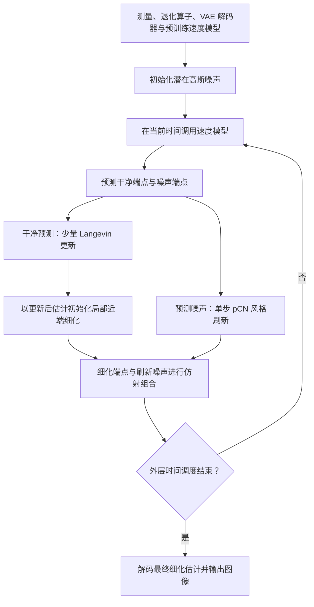

# FlowLPS: Langevin-Proximal Sampling for Flow-based Inverse Problem Solvers

# First Time

## 1.Title & Authors
原题：FlowLPS: Langevin-Proximal Sampling for Flow-based Inverse Problem Solvers。
自然中文译法：FlowLPS：面向流模型逆问题求解器的朗之万—近端采样。
研究对象是成像逆问题：已知模糊、降采样或遮挡后的观测，恢复与观测相符、同时符合自然图像先验的清晰图像。同一观测往往对应多种可能的原图，因此求解器需要同时利用测量信息和生成模型学到的图像规律。
标题中的 Flow-based 指以预训练流模型作为生成先验；Inverse Problem Solvers 指使用这个先验恢复未知图像的推理算法；Langevin 指带梯度引导和随机扰动的更新；Proximal 指兼顾测量拟合与局部约束的细化操作。Sampling 表明方法保留随机性。作者将这些组件组织成一个有限步数的混合求解流程。
标题的核心主张：在每个逆向生成步骤中，先用少量 Langevin 更新得到面向后验的随机初始化，再做局部近端细化，将探索能力和测量一致性结合起来。 本文关注的是已有生成先验之上的求解过程设计。
作者为 Jonghyun Park 和 Jong Chul Ye，论文署名机构均为 KAIST。原文未标注等贡献，也未提供个人贡献分工。
与本文直接相关的研究背景：从 References [6]、[10]、[14] 可核对，Jong Chul Ye 也参与了 Diffusion Posterior Sampling（DPS）、Decomposed Diffusion Sampler（DDS）和 FlowDPS。这些工作分别涉及扩散后验采样、分解式测量校正及流模型驱动的逆问题求解，构成理解本文研究脉络的相关背景。

## 2.Abstract
摘要围绕一个问题展开：有限计算预算下，怎样同时获得测量一致性和感知真实感？下面按原文语义顺序精读。
语义单元 1：生成先验已经很强，潜在流模型求解器仍面临有限步数的取舍。
深度生成模型学习了图像分布，可以为缺失或退化的信息提供先验约束。例如，遮挡区域可以有多种与可见部分兼容的内容，生成模型帮助筛选其中符合自然图像规律的候选。潜在流模型在压缩后的潜在空间中生成或修正表示，再经解码器得到图像。
Training-free 表示使用已有模型完成逆问题推理，无需为这些退化任务重新训练生成模型。推理期间仍会计算梯度并更新待恢复的表示。Finite-step 强调实际只允许有限次模型调用和内部更新，算法在这个预算内的表现是本文关心的重点。
语义单元 2：偏重优化的方法能快速贴合测量，但对局部细化的起点敏感。
Measurement consistency 指将当前重建结果通过已知的退化算子后，所得预测观测与实际观测相符。反复优化测量误差，通常能迅速改善这种一致性。
在高度非线性的潜在空间中，局部优化的结果与初始化有关。潜在表示的变化经过解码器后，会以复杂方式影响图像；从不同起点出发，优化可能进入不同的局部区域。作者指出，强测量校正有时会牺牲纹理自然度或产生伪影。因此，这一句建立的矛盾是：测量误差下降与感知真实感改善需要分别检验。
语义单元 3：偏重随机采样的方法保留探索能力，但有限步数下可能难以得到清晰且符合测量的结果。
Posterior exploration 是探索观测条件下的可能解。观测有歧义时，随机性有助于保留不同候选，而不是过早固定在某个局部解附近。
作者指出，这类方法往往需要较多迭代，才能将探索中的候选集中到清晰且测量一致的重建附近。前一句强调优化对起点的依赖，这一句强调随机探索的计算成本；二者共同引出本文的设计问题：如何分配探索和细化的更新预算。
语义单元 4：FlowLPS 用 Langevin-Proximal Sampling 构造混合求解器。
FlowLPS 是一个无需额外训练的潜在流模型逆问题求解方法。Langevin 更新负责提供随机、面向后验的探索，近端细化负责在选定的局部区域内改善测量拟合。本文贡献在于把这两种作用组织进每个逆向步骤，并配合后续的噪声刷新形成完整流程。
语义单元 5：每个逆向步骤先对模型预测的干净估计做少量 Langevin 更新。
模型会从当前带噪状态预测一个干净样本估计。这里的“干净”是模型给出的预测，仍可能与真实观测不完全一致；在潜在模型的实现中，更新对象是相应的潜在表示。
Langevin 更新同时利用后验方向的梯度和随机扰动。梯度让候选结合观测信息及模型诱导的局部先验，随机扰动则提供不同的探索路径。摘要将其作用明确定位为：为下一步局部细化提供随机初始化。
理解这一设计的关键，是把少量 Langevin 更新看作“给后续优化寻找起点”。 这里的 posterior-oriented 表示方向受到后验信息引导；有限次更新本身不构成已经精确抽到真实后验样本的保证。
语义单元 6：从 Langevin 更新后的估计出发，做局部 MAP 风格的近端细化。
MAP 即最大后验估计，寻找在观测和先验共同约束下后验密度较高的解。近端目标将测量拟合与局部约束结合，帮助细化阶段在改善测量一致性的同时控制偏离。
摘要强调了操作顺序：先探索，再从探索得到的起点做确定性细化。它希望利用随机初始化减轻固定起点带来的敏感性，同时通过局部优化较快得到集中、清晰的估计。MAP-style 和 local 对应实际的近似后验、有限步局部优化设定，结果应按这一范围理解。
语义单元 7：通过受控的 pCN 风格重新加噪，稳定后续逆向轨迹。
完成干净估计的修正后，求解器还要构造下一噪声水平的状态。pCN 风格刷新将已有噪声方向与新随机噪声混合，调节新随机性的注入程度。
Trajectory coherence 指保留当前生成轨迹中已有的方向信息，让局部修正后的状态与接下来的生成过程衔接。摘要给它的角色是稳定逆向轨迹，同时保留随机性。正文第 4.4 节进一步说明，实现从模型预测噪声开始刷新，是在轨迹连贯性与严格高斯边缘保持之间作出的实际取舍。
语义单元 8：在两类数据与五种线性逆问题上检验，并提供额外任务实验。
摘要给出的主要实验范围是 FFHQ 和 DIV2K，以及五种线性成像逆问题。FFHQ 对应人脸图像，DIV2K 对应更丰富的自然图像；正文第 5.1 节列出的五种任务是高斯去模糊、运动去模糊、超分辨率、块状修补和随机修补。像素空间逆问题与相位恢复被作为额外实验提及。
作者报告的结果是测量保真与感知质量之间较好的平衡。Measurement fidelity 关注观测约束，perceptual quality 关注图像的感知质量；在正文的实验评价中，还需要区分对真实图像的失真指标与感知指标。摘要没有给出具体提升幅度、运行时间或逐项排名，这里的“较好平衡”应结合后续实验中的任务、指标和比较预算理解。
摘要四要素归纳：

| 要素 | 对应内容 |
| --- | --- |
| 问题 | 潜在生成逆问题求解中，有限更新预算需要兼顾随机后验探索与局部测量细化。偏重优化会受初始化影响，偏重采样则可能需要更多迭代。 |
| 方法 | 在每个逆向步骤中，将少量 Langevin 初始化、局部 MAP 风格近端细化和受控 pCN 风格噪声刷新相结合。 |
| 结果 | 作者在 FFHQ、DIV2K 的五种线性逆问题上报告较好的保真—感知平衡，并提供像素空间及相位恢复的额外实验；摘要未列具体数值。 |
| 意义 | 在既有生成先验和实际有限步数下，通过安排探索与细化的职责改善重建效果；这是摘要直接提出的设计目标与实验主张。 |

## 3.Conclusion
原文有独立的第 6 节 Conclusion，由工作总结段和 Limitations 段组成。
工作总结段的第一个论点，是 FlowLPS 将面向后验的 Langevin 初始化与局部测量一致性近端细化结合，形成无需额外训练的潜在流模型求解器。这里再次强调两个阶段的职责：前者为后者提供有观测引导的随机起点，后者从该起点改善测量拟合。
第二个论点，是该设计针对随机探索与确定性细化之间的有限步数取舍。作者用局部分析和消融实验支持这套设计。局部分析讨论进入有用局部区域后的收缩与随机方差行为；它的解释范围是局部细化机制。消融则用于检查实际更新预算如何影响重建表现。两类证据分别承担机制解释和经验检验的作用。
第三个论点，是结合受控的 pCN 风格重新加噪后，方法在所考察的逆问题上取得较好的测量保真—感知真实感平衡。这与摘要的结果主张一致：两个阶段的配合处理当前干净估计，噪声刷新负责让后续生成轨迹继续运行。
这段结论将论文主线串成了“有限预算下的探索—细化分配问题 → Langevin 初始化与近端细化 → 噪声刷新衔接轨迹 → 理论解释、消融和重建比较”的证据链。
Limitations 段明确指出，FlowLPS 依赖预训练骨干模型的先验。对于与训练分布差异很大的输入，模型可能产生伪影，或补出观测无法支持的细节。这个限制说明感知上自然的内容仍需结合测量依据判断。
作者进一步提醒，医学、司法取证和科学成像等高风险应用需要谨慎。其原因直接对应上述生成细节的可靠性：这些任务需要确认结构和细节有真实依据。原文在该段未提出具体的未来研究方案，也未将这些高风险场景列为已验证应用。

## 4.Analogy
可以把方法想成用一张模糊照片修复一幅画。
观测图像像修复者手中的模糊照片，生成模型的先验像他对人物、纹理和构图的经验。同一张模糊照片可以对应几种合理细节，因此既要尊重照片里留下的线索，也要保证补出的内容自然。
Langevin 阶段相当于先试画少量受线索引导的候选草图。每次尝试都有一定随机变化，帮助修复者获得不同的起点。
近端细化阶段相当于从当前候选出发，集中调整，使重新模糊后的画面更贴近手中的照片，同时限制局部调整的偏离。受控噪声刷新则像进入下一轮修复时保留上一轮的部分构思，再引入适量新变化。
本文想利用的配合是：先探索几种起点，再把有限时间用于有方向的局部细化。修复后的画面既要符合照片线索，也要有自然的细节。
类比的边界是，真实算法通过潜在表示、后验梯度、随机噪声和数值优化完成更新；“草图”不代表算法会显式生成多幅图再人工挑选。模糊照片缺失的信息也无法仅凭经验确定，类比中的“自然细节”仍受预训练先验及观测信息的限制。

# Second Time

## 1.Notation & Parameters
下面列出理解方法主线所需的重点记号。向量的粗体、预测量的帽子及条件下标沿用原文；理论段落里另有局部记号，在相应推导中解释。

| 符号/参数 | 含义与作用 | 关键设定/约束 |
| --- | --- | --- |
| $\mathbf{x}_0$、$\mathbf{y}$ | 未退化的真实图像与实际测量 | 观测关系见式 (1)；测量通常不足以唯一确定原图。 |
| $\mathcal{A}$ | 前向测量/退化算子 | 主实验包括模糊、降采样、修补；潜在实现中作用于解码图像。 |
| $\mathcal{D}$ | VAE 解码器，从潜在表示得到图像 | Algorithm 1 的数据项是 $\lVert\mathbf{y}-\mathcal{A}(\mathcal{D}(\mathbf{z}))\rVert^2$。 |
| $\mathbf{n}$、$\sigma_n$ | 测量噪声及其标准差 | $\mathbf{n}\sim\mathcal{N}(\mathbf{0},\sigma_n^2\mathbf{I})$；主实验 $\sigma_n=0.03$。 |
| $\mathbf{z}_0$、$\mathbf{z}_t$、$\mathbf{z}_1$ | 干净端点、中间流状态与源噪声端点 | 逆向生成从 $t=1$ 朝 $t=0$ 运行；正文使用潜在流状态。 |
| $t$、$\Delta t$ | 当前连续时间与离散逆向步长 | 下一状态位于 $t-\Delta t$；实际实现另有截断时间调度。 |
| $p_1=p$、$p_0=q$、$p_t$ | 源分布、目标分布与中间边缘分布 | 本行的 $q$ 是数据分布，与局部理论里的同名收缩因子不同。 |
| $\mathbf{v}_t(\mathbf{z}_t)$、$\mathbf{v}_t^\theta$ | 理想边缘速度场与预训练参数化速度模型 | 前者用于推导，后者用于 Algorithm 1；求解时使用既有模型。 |
| $\hat{\mathbf{z}}_{0\mid t}$、$\hat{\mathbf{z}}_{1\mid t}$ | 模型诱导的干净端点与噪声端点条件均值预测 | 式 (5) 从当前状态和速度场得到两者。 |
| $p(\mathbf{z}_0\mid\mathbf{z}_t,\mathbf{y})$ | 当前时间与观测条件下的干净潜变量后验 | 实际计算采用局部条件高斯近似及观测似然。 |
| $s_t^2$ | 条件干净分布的近似方差 | 式 (9) 中是启发式设定；Appendix B.1 取 $s_t^2=t$。 |
| $\eta_t$、$\zeta_t$ | 正文 Langevin 步长与实现说明中的步长记号 | 正文式 (11) 写 $\eta_t$，Appendix B.1/Table 4 写 $\zeta_t$ 并取 $10^{-4}$；原文未显式写出二者对应关系。 |
| $N_L$、$N_P$、$N_T$ | Langevin、近端及二者总更新次数 | 主文消融固定 $N_T=15$，将更新预算在两阶段间分配。 |
| $\hat{\mathbf{z}}_{0\mid t}^{(j)}$ | 第 $j$ 次 Langevin 更新后的干净估计 | 初始值为模型预测；末值用于近端细化初始化。 |
| $\mathbf{z}_{0\mid t}^{*}$ | 局部细化得到的干净估计 | 正文式 (12) 写理想极值；实际仅做有限步优化。 |
| $\rho_t$ | pCN 风格噪声刷新中的旧噪声保留系数 | 主文第 4.4 节取 $\rho_t=\sqrt{1-t}$；Algorithm 1 使用下一时间水平，后文核对差异。 |
| $\hat{\boldsymbol{\epsilon}}_{1\mid t}$ | Algorithm 1 中刷新后的噪声估计 | 由模型预测噪声与独立高斯噪声混合得到。 |
| $\Phi$、$\mathbf{z}_B^\star$、$\Omega_B$ | 负对数条件后验、局部极小点及其凸邻域 | 局部分析假定迭代留在该邻域；不直接覆盖全局非凸轨迹。 |
| $\mu$、$L$、$\tau$ | 局部曲率下界、上界与理论更新步长 | 假定 $0<\mu\le L$、$0<\tau\le1/L$。 |
| $q$、$R_N$ | 局部收缩因子与连续 $N$ 次梯度细化的映射 | 此处 $q=1-\tau\mu$；$R_N$ 用于 Proposition 2，与前述数据分布 $q$ 区分。 |

需要保留的记号差异：正文式 (12) 的近端参考点与 Algorithm 1 的参考点不同，pCN 的时间索引也有差异。下面分别按各自原式讲解，不将它们合并成一条未经核实的实现公式。

## 2.Introduction
对应原文第 1 节。作者先定义成像逆问题，再把困难收束到有限计算预算下的探索与细化分配。
式 (1) 是观测模型：$\mathbf{y}=\mathcal{A}(\mathbf{x}_0)+\mathbf{n}$。先对真实图像施加已知退化，再叠加测量噪声，得到可见观测。它是任务定义，不是优化算法推导出来的性质。修补丢失部分像素，降采样丢失高频信息，模糊削弱细节；由此可能有多幅原图与同一观测兼容。
正文无编号的噪声假设为 $\mathbf{n}\sim\mathcal{N}(\mathbf{0},\sigma_n^2\mathbf{I})$。它表示零均值、各方向相同方差的高斯噪声。结合式 (1)，观测似然与 $\exp[-\|\mathbf{y}-\mathcal{A}(\mathbf{x}_0)\|^2/(2\sigma_n^2)]$ 成正比；因此平方测量残差会自然进入后续 MAP 目标。实际潜在模型先经过解码器，再进入测量算子。
第二步是引入生成先验。作者将相关求解方法概括为后验引导和优化校正两条路线：前者用观测调整生成分布或轨迹，后者用显式目标降低测量误差。这是方法组织方式；同一个算法可以同时具有两种成分。
第三步是指出潜在空间的特殊困难。测量位于图像空间，更新位于潜在空间；两者通过非线性 VAE 解码器连接。即便成像退化本身是线性的，潜变量到测量的复合映射也通常非线性。单次小修正可能不够，重复强校正又可能远离生成先验支持的轨迹。引言以 ReSample、FlowDPS 和 FLAIR 说明增强测量约束的研究趋势。
第四步是提出两种有限步数运行状态。Refinement-dominant 把较多计算用于局部测量校正，优势是快速降低不一致，困难是起点敏感。Sampling-dominant 把较多计算用于随机后验探索，优势是保留候选多样性，困难是在较少步数内难以集中得到清晰且一致的结果。这里讨论的是预算内的运行行为，不能仅凭“采样”或“优化”标签判断实际效果。
FlowLPS 的切入点是让少量探索服务于局部细化。每个逆向步骤从模型预测出发，先用观测引导的 Langevin 更新产生随机起点，再做有限次近端优化；噪声刷新负责衔接后续流轨迹。引言的四项贡献分别对应混合求解流程、局部机制分析、受控重新加噪，以及多任务实验验证。
图表对应：[Fig1 精读](#fig1)展示任务效果，[Fig2 精读](#fig2)概括三种运行状态。

## 3.Related Work
对应原文第 2 节。第一部分讨论后验引导与优化校正，第二部分转向探索—细化的运行状态。
本节无编号的核心关系是后验 score 分解：
$$
\nabla_{\mathbf{z}_t}\log p(\mathbf{z}_t\mid\mathbf{y})
=\nabla_{\mathbf{z}_t}\log p(\mathbf{z}_t)
+\nabla_{\mathbf{z}_t}\log p(\mathbf{y}\mid\mathbf{z}_t).
$$
从 Bayes 规则出发，后验密度正比于先验密度乘观测似然；取对数后，乘积变加法。对当前状态求梯度时，观测的边缘归一化项与该状态无关，梯度为零，得到上式。先验 score 维持生成分布方向，似然 score 把轨迹引向符合观测的状态。
难点在于中间噪声状态到观测的条件似然通常难以直接计算。DPS 等方法用去噪估计或条件高斯近似处理它；后续一些方法直接在预测干净估计上更新，从而减少对完整生成轨迹求导的成本。FlowLPS 继承了利用条件干净估计和局部近似进行后验引导的思路。
优化路线利用显式目标、变分目标或近端校正强化数据一致性。作者将 DDS、FLAIR、Flower 作为细化占比较高的代表，将 DAPS 作为采用 Langevin 探索的代表。这些是本文用于组织比较的运行状态概括；原方法的完整机制还包含各自的调度与实现细节。
两条分类轴的作用不同：后验引导/优化校正描述算法如何构造，探索占优/细化占优描述有限步数计算主要花在哪里。FlowLPS 的研究动机建立在第二条轴上，其新意应放在探索初始化、局部细化与轨迹刷新之间的安排上理解。
图表对应：[Fig2 精读](#fig2)。

## 4.Preliminaries
对应原文第 3 节的 Flow Matching 部分。这里先把流模型的速度预测改写为干净端点和噪声端点估计，为后面的“修改干净端点、保留并刷新噪声”提供接口。
正文无编号的分布定义为 $p_1=p$、$p_0=q$：时间 1 是源分布，时间 0 是目标数据分布，中间边缘分布为 $p_t$。本节的 $q$ 是分布名。
式 (2)：$\mathrm{d}\mathbf{z}_t=\mathbf{v}_t(\mathbf{z}_t)\mathrm{d}t$，且 $\mathbf{z}_1\sim p_1=p$。速度场的定义域为 $[0,1]\times\mathbb{R}^d$，输出在 $\mathbb{R}^d$，输入输出与状态维度一致。生成时从时间 1 向 0 积分，因此离散时间增量是负的；微分方程本身不必额外添负号。
式 (3)：$\mathbf{z}_t=t\mathbf{z}_1+(1-t)\mathbf{z}_0$。这是 rectified flow 采用的线性插值路径设计：在时间 0 得到干净端点，在时间 1 得到源端点。无编号关系 $\pi(\mathbf{z}_0,\mathbf{z}_1)=q(\mathbf{z}_0)p(\mathbf{z}_1)$ 指训练路径的端点采用独立耦合；端点独立这一设定不表示给定中间状态后二者仍独立。
式 (4) 从路径时间导数得到速度目标。对式 (3) 求时间导数，路径速度为 $\mathbf{z}_1-\mathbf{z}_0$；在同一中间状态处汇集路径，边缘速度取条件期望：
$$
\mathbf{v}_t(\mathbf{z}_t)
=\mathbb{E}[\mathbf{z}_1-\mathbf{z}_0\mid\mathbf{z}_t]
=\mathbb{E}[\mathbf{z}_1\mid\mathbf{z}_t]-\mathbb{E}[\mathbf{z}_0\mid\mathbf{z}_t].
$$
最后一步只利用条件期望的线性性。它给出理想边缘速度场的性质；数值求解用预训练网络近似该速度场。
式 (5) 包含两条独立定义：$\hat{\mathbf{z}}_{0\mid t}:=\mathbb{E}[\mathbf{z}_0\mid\mathbf{z}_t]$ 和 $\hat{\mathbf{z}}_{1\mid t}:=\mathbb{E}[\mathbf{z}_1\mid\mathbf{z}_t]$。从式 (3) 对当前状态取条件期望，有
$$
\mathbf{z}_t=t\mathbb{E}[\mathbf{z}_1\mid\mathbf{z}_t]+(1-t)\mathbb{E}[\mathbf{z}_0\mid\mathbf{z}_t].
$$
用式 (4) 消去两个条件期望之间的差，分别得到
$$
\hat{\mathbf{z}}_{0\mid t}=\mathbf{z}_t-t\mathbf{v}_t(\mathbf{z}_t),
\qquad
\hat{\mathbf{z}}_{1\mid t}=\mathbf{z}_t+(1-t)\mathbf{v}_t(\mathbf{z}_t).
$$
这两条式子无须除以时间，所以在端点也有代数意义。它们是条件均值预测，不表示恢复了当前样本背后唯一的真实端点，也不保证预测噪声仍有精确标准高斯分布。
式 (6) 是 Euler 更新的端点表达。逆向一步先写成
$$
\mathbf{z}_{t-\Delta t}=\mathbf{z}_t-\Delta t\bigl(\mathbb{E}[\mathbf{z}_1\mid\mathbf{z}_t]-\mathbb{E}[\mathbf{z}_0\mid\mathbf{z}_t]\bigr).
$$
把上面的条件期望插值代入，并收集两个期望项的系数，得到
$$
\mathbf{z}_{t-\Delta t}
=\bigl(1-(t-\Delta t)\bigr)\mathbb{E}[\mathbf{z}_0\mid\mathbf{z}_t]
+(t-\Delta t)\mathbb{E}[\mathbf{z}_1\mid\mathbf{z}_t].
$$
两个系数之和为 1；当下一时间落在零与一之间，它们是非负插值权重。这里的等价是对 Euler 离散式的代数改写，Euler 与连续 ODE 精确解之间仍有离散误差。FlowLPS 随后替换干净端点，并处理噪声端点，这使带测量校正的轨迹偏离原先无条件的 Euler 轨迹。

## 5.Langevin+correction viewpoint
对应原文第 3 节中的同名部分。作者用一个通用的“随机探索后接校正”结构解释设计来源。
式 (7) 为
$$
\tilde{\mathbf{z}}^{k+1}=\mathbf{z}^{k}-\gamma\nabla f(\mathbf{z}^{k})+\sqrt{2\gamma}\,\epsilon^{k},
\qquad \epsilon^{k}\sim\mathcal{N}(\mathbf{0},\mathbf{I}).
$$
这里 $f$ 是该通用抽象中的势函数，$\gamma$ 是正步长，$k$ 是迭代索引。负梯度项降低势能，噪声项保留探索。平方根系数使随机增量的协方差随步长线性变化，为 $2\gamma\mathbf{I}$。该形式可视为 Langevin 连续动力学的 Euler 离散结构；有限步离散更新仍可能有偏差。
式 (8)：$\mathbf{z}^{k+1}=\mathcal{C}_\gamma(\tilde{\mathbf{z}}^{k+1})$。它是探索之后施加校正算子的设计抽象，不是从式 (7) 唯一导出的算子。正文列出的三个无编号选择分别是 $\mathcal{C}_\gamma=\mathrm{Id}$、$\mathcal{C}_\gamma=\Pi_{\mathcal{C}}$、$\mathcal{C}_\gamma=\operatorname{prox}_{\gamma g}$。
取恒等映射时，随机更新后直接保留结果，对应 ULA。取集合投影时，将结果送回约束集，对应投影 Langevin。取近端映射时，将当前随机点作为局部参考，兼顾原文中的函数 $g$ 与距离约束。按近端算子的标准定义，其作用可写为
$$
\operatorname{prox}_{\gamma g}(\tilde{\mathbf{z}}^{k+1})
=\arg\min_{\mathbf{z}}\left\{g(\mathbf{z})+\frac{1}{2\gamma}\|\mathbf{z}-\tilde{\mathbf{z}}^{k+1}\|^2\right\}.
$$
这是对原文已有算子记号的展开；最小解的存在性和唯一性取决于函数条件。正文未给该抽象里的具体 $f$、$g$，不能直接把它当作 FlowLPS 已满足的全局采样收敛定理。
FlowLPS 借鉴的是探索后接校正的操作结构，目标是在有限逆向步数内改善重建。 后文用局部高斯近似建立具体更新，再用局部分析解释细化与持续加噪的差异。

## 6.Method
对应原文第 4 节总述。方法不重新训练生成骨干；它围绕预训练速度模型的干净预测构造观测条件推理。
每个外层步骤包含三个职责：Langevin 更新在当前干净预测附近探索；局部近端优化从探索结果出发细化测量拟合；pCN 风格刷新噪声，然后通过端点组合前进到下一时间。完整步骤见 [Algorithm1 精读](#algorithm1)。

图中两条分支依赖同一次速度预测；pCN 分支不需要等待近端优化的结果。Algorithm 1 将噪声刷新写在内层 Langevin 循环之前，上图用依赖关系表达这种可提前计算的顺序。图省略具体时间网格、任务提示词与优化器学习率；实际实现的截断时间调度在补充阅读中说明。两种近端参考点及时间索引差异在下面保留原文写法。

## 7.Phase 1: Posterior-Oriented Langevin Initialization
对应原文第 4.1 节。输入是当前流状态、模型预测干净估计和观测；输出是供下一阶段使用的随机干净估计。
式 (9)：$p(\mathbf{z}_0\mid\mathbf{z}_t)\approx\mathcal{N}(\hat{\mathbf{z}}_{0\mid t},s_t^2\mathbf{I})$。均值由式 (5) 提供，方差由启发式设定。这个各向同性高斯是局部近似：真实条件分布可以更复杂，本文采用它是为了得到可计算的条件后验梯度。实现说明取 $s_t^2=t$；这是一种设计设定。
式 (10) 用 Bayes 规则把观测加入条件分布：
$$
\nabla_{\mathbf{z}_0}\log p(\mathbf{z}_0\mid\mathbf{z}_t,\mathbf{y})
=\nabla_{\mathbf{z}_0}\log p(\mathbf{y}\mid\mathbf{z}_0)
+\nabla_{\mathbf{z}_0}\log p(\mathbf{z}_0\mid\mathbf{z}_t).
$$
推导先使用观测在给定干净样本后不再依赖当前带噪状态的条件关系；条件后验正比于观测似然乘条件先验。取对数、对干净潜变量求梯度，归一化项与优化变量无关，因而消失。这与 Related Work 的 score 分解采用同一个 Bayes 原理，但求导对象从中间状态变成干净估计。
在式 (9) 的高斯近似下，条件先验梯度可以直接写为 $-(\mathbf{z}_0-\hat{\mathbf{z}}_{0\mid t})/s_t^2$。它把当前候选拉回模型预测附近。按正文式 (12) 的简写，似然梯度为
$$
\nabla_{\mathbf{z}_0}\log p(\mathbf{y}\mid\mathbf{z}_0)
=-\frac{1}{2\sigma_n^2}\nabla_{\mathbf{z}_0}\|\mathbf{y}-\mathcal{A}(\mathbf{z}_0)\|^2.
$$
因此，后验梯度一方面降低测量残差，另一方面维持与条件干净预测的接近。实际潜在实现将数据项中的测量预测写成 $\mathcal{A}(\mathcal{D}(\mathbf{z}_0))$，梯度通过解码器传播；不能把非线性解码器省略后的简写误当成真正线性的潜变量优化。
正文无编号初始化关系为 $\hat{\mathbf{z}}_{0\mid t}^{(0)}=\hat{\mathbf{z}}_{0\mid t}$。式 (11) 随后执行：
$$
\hat{\mathbf{z}}_{0\mid t}^{(j+1)}
=\hat{\mathbf{z}}_{0\mid t}^{(j)}
+\eta_t\nabla_{\hat{\mathbf{z}}_{0\mid t}^{(j)}}\log p(\hat{\mathbf{z}}_{0\mid t}^{(j)}\mid\mathbf{z}_t,\mathbf{y})
+\sqrt{2\eta_t}\,\boldsymbol{\epsilon}_j,
\qquad \boldsymbol{\epsilon}_j\sim\mathcal{N}(\mathbf{0},\mathbf{I}).
$$
循环索引从 $j=0$ 到 $N_L-1$。后验对数密度的梯度以正号加入，等价于沿负对数后验下降；噪声项的协方差为 $2\eta_t\mathbf{I}$。本次内循环的条件状态与初始模型预测固定，迭代变量是当前干净估计，完成后才推进外层时间。
这个更新的作用是提供观测引导的随机初始化。随机性可以改变后续优化进入的局部区域；较少 Langevin 更新并不保证遍历所有区域，也不保证达到条件后验稳态。其经验价值由更新预算消融检验，见 [Fig4 精读](#fig4)和 [Fig5 精读](#fig5)。

## 8.Phase 2: Local MAP-Style Proximal Refinement
对应原文第 4.2 节。Langevin 阶段提供探索，但有限次带噪更新可能仍不够集中；这一阶段使用确定性局部优化改善测量拟合。
Proposition 1 把式 (9) 中的近似高斯当作所采用的条件模型，并假定高斯测量噪声。正文式 (12) 为
$$
\mathbf{z}_{0\mid t}^{*}
=\arg\max_{\mathbf{z}_0}\log p(\mathbf{z}_0\mid\mathbf{z}_t,\mathbf{y})
=\arg\min_{\mathbf{z}_0}
\left\{\|\mathbf{y}-\mathcal{A}(\mathbf{z}_0)\|^2
+\frac{\sigma_n^2}{s_t^2}\|\mathbf{z}_0-\hat{\mathbf{z}}_{0\mid t}\|^2\right\}.
$$
推导第一步是条件 Bayes 分解；第二步代入观测似然与条件先验的高斯指数。去掉与优化变量无关的加法项后，最大化对数后验等价于最小化
$$
\frac{\|\mathbf{y}-\mathcal{A}(\mathbf{z}_0)\|^2}{2\sigma_n^2}
+\frac{\|\mathbf{z}_0-\hat{\mathbf{z}}_{0\mid t}\|^2}{2s_t^2}.
$$
当两个方差为正时，将目标乘以正数 $2\sigma_n^2$ 不改变极小点，便得到式 (12)。这是高斯条件模型下的 MAP 等价关系；对于原始真实条件分布，它继承高斯近似的误差。
数据项鼓励预测测量接近真实测量；第二项限制离开模型预测的程度。测量噪声越大，观测可靠性越低，乘方差比后的相对约束越强；条件先验方差越小，也越强地约束在预测附近。若采用 $s_t^2=t$，时间趋近零时分母趋小，不能在零方差端点直接照用高斯密度与该除法；实现采用截断调度。
“初始化位置”与“目标函数参考点”是两件事。正文描述是在 $\hat{\mathbf{z}}_{0\mid t}^{(N_L)}$ 初始化优化，但式 (12) 的平方惩罚仍以 $\hat{\mathbf{z}}_{0\mid t}$ 为中心。起点改变局部优化路径和可达的吸引区域；若中心也改变，目标函数本身就改变。
原文存在需要保留的差异：Algorithm 1 的惩罚中心写成 $\hat{\mathbf{z}}_{0\mid t}^{(N_L)}$，并显式加入解码器。前者改变了所优化的局部参考分布，后者补全了潜在实现的前向路径。当前 PDF 没有解释惩罚中心为何替换；因此正文的固定条件后验 MAP 推导与算法框的具体目标应分别理解。详见 [Algorithm1 精读](#algorithm1)。
实际运行的是有限次梯度更新，因而算法输出一般只是局部细化结果，式中的 $\arg\min$ 表达其理想优化目标。第 4.2 节还给出两个无编号边界设定：$N_P=0$ 时省去近端细化，运行行为接近采样占优；$N_L=0$ 时省去 Langevin 初始化，运行行为接近细化占优。这里的“类似 DAPS/Flower”是组件职责上的联系，不能据此判定实现与那些方法完全相同。

## 9.Local Finite-Step Analysis
对应原文第 4.3 节。问题是：一旦探索得到一个有用局部起点，为什么接着做确定性细化会比一直加噪更容易集中？
正文首先定义 $\Phi(\mathbf{z}_0):=-\log p(\mathbf{z}_0\mid\mathbf{z}_t,\mathbf{y})$。在上述高斯条件模型中，它与式 (12) 的目标相差正比例因子和加法常数，因而极小点相同，但固定学习率下的梯度大小会随比例变化。这里的理论步长 $\tau$ 不能未经换算就当作实现中优化缩放目标的学习率。
式 (13)：$\mu\mathbf{I}\preceq\nabla^2\Phi(\mathbf{z})\preceq L\mathbf{I}$，对所有 $\mathbf{z}\in\Omega_B$ 成立。$\Omega_B$ 是局部极小点 $\mathbf{z}_B^\star$ 周围的凸邻域；两个矩阵不等式限制 Hessian 的全部特征值。无编号条件 $0<\mu\le L$ 给出局部强凸性与光滑性；$0<\tau\le1/L$ 限制理论步长。另一个关键假设是所有被分析的迭代始终留在该邻域。
式 (14) 的结论是 $\|R_N(\mathbf{z})-\mathbf{z}_B^\star\|\le q^N\|\mathbf{z}-\mathbf{z}_B^\star\|$，其中正文无编号定义 $q=1-\tau\mu<1$，$R_N$ 表示连续 $N$ 次梯度细化。
推导沿用原文 Appendix A 已定义的局部映射 $T(\mathbf{z})=\mathbf{z}-\tau\nabla\Phi(\mathbf{z})$，仅用于解释正文命题。由于极小点的梯度为零，
$$
T(\mathbf{z})-\mathbf{z}_B^\star
=\mathbf{z}-\mathbf{z}_B^\star-\tau\bigl(\nabla\Phi(\mathbf{z})-\nabla\Phi(\mathbf{z}_B^\star)\bigr).
$$
在凸邻域中沿两点间线段积分 Hessian，得到
$$
T(\mathbf{z})-\mathbf{z}_B^\star
=\left[\mathbf{I}-\tau\int_0^1\nabla^2\Phi\bigl(\mathbf{z}_B^\star+s(\mathbf{z}-\mathbf{z}_B^\star)\bigr)\,\mathrm{d}s\right](\mathbf{z}-\mathbf{z}_B^\star).
$$
这里积分变量 $s$ 也沿用原证明。平均 Hessian 的特征值位于 $[\mu,L]$；乘步长再用单位矩阵相减后，特征值位于 $[1-\tau L,1-\tau\mu]$。步长条件令它们非负且最大值为 $q$，所以一次更新最多将距离缩小到原来的 $q$ 倍。递推 $N$ 次便得到式 (14)。它描述局部距离收缩。
式 (15) 用到无编号球定义 $B_r=\{\mathbf{z}:\|\mathbf{z}-\mathbf{z}_B^\star\|\le r\}$，以及条件 $B_{r/q^N}\subset\Omega_B$。由式 (14)，只要起点距离不超过 $r/q^N$，经过 $N$ 次细化后的距离就不超过 $r$，因此
$$
B_{r/q^N}\subseteq R_N^{-1}(B_r).
$$
$R_N^{-1}(B_r)$ 表示集合的原像，不要求 $R_N$ 存在可逆函数。它说明局部细化能把更大半径范围内的起点送入小球；$q^{-N}$ 是半径因子，不是全局成功概率或后验质量增益。这个写法还要求 $q>0$；步长条件允许的退化情形 $q=0$ 应直接用式 (14) 理解，不能计算除以零的半径。
式 (16) 在相同局部目标上加入 ULA 噪声：
$$
\mathbf{z}_{k+1}=\mathbf{z}_k-\tau\nabla\Phi(\mathbf{z}_k)+\sqrt{2\tau}\,\boldsymbol{\xi}_k,
\qquad\boldsymbol{\xi}_k\sim\mathcal{N}(\mathbf{0},\mathbf{I}_d).
$$
$k$ 是局部迭代索引，$d$ 是状态维度。这里的 $\mathbf{z}_0$ 若作为该循环初始状态出现，表示局部迭代的起点，不必等于前面流时间零的真实干净端点；原文复用符号，需要依语境区分。
式 (17) 为有限步均方距离上界：
$$
\mathbb{E}\|\mathbf{z}_N-\mathbf{z}_B^\star\|^2
\le q^{2N}\|\mathbf{z}_0-\mathbf{z}_B^\star\|^2
+2\tau d\frac{1-q^{2N}}{1-q^2},
\qquad q=1-\tau\mu.
$$
推导先条件于当前迭代状态。高斯增量独立、均值为零，故平方展开的交叉项期望为零；标准高斯平方范数的期望为 $d$。于是
$$
\mathbb{E}\left[\|\mathbf{z}_{k+1}-\mathbf{z}_B^\star\|^2\mid\mathbf{z}_k\right]
=\|T(\mathbf{z}_k)-\mathbf{z}_B^\star\|^2+2\tau d
\le q^2\|\mathbf{z}_k-\mathbf{z}_B^\star\|^2+2\tau d.
$$
取总期望后反复代入，得到初始误差乘 $q^{2N}$，再加每次注入噪声的衰减和：
$$
\mathbb{E}\|\mathbf{z}_N-\mathbf{z}_B^\star\|^2
\le q^{2N}\|\mathbf{z}_0-\mathbf{z}_B^\star\|^2
+2\tau d\sum_{\ell=0}^{N-1}q^{2\ell}.
$$
有限几何级数等于 $(1-q^{2N})/(1-q^2)$，得到式 (17)。确定性细化只有收缩项；持续 ULA 还保留一个正的随机方差上界项。这解释了有限步数内“保持探索”与“集中在局部极小点附近”的不同目标。上界中的方差项不等于已证明实际误差必然达到该值。
理论的适用范围是已获得有用起点后的局部行为。 真实潜在目标整体非凸；本文没有证明 Langevin 一定进入更好的吸引域，也没有给出含无界高斯扰动的全过程留在局部邻域的概率保证。局部光滑强凸模型与迭代留域假设应随结论一起保留。Algorithm 1 换了近端参考点，也需要针对实际目标重新核对这些条件。
这一分析提出更新分配的动机：太少探索保留起点依赖，太多探索挤占细化预算。经验检验见 [Fig4 精读](#fig4)、[Fig5 精读](#fig5)；局部界本身没有推导出某个对所有任务都最优的步数。

## 10.Controlled pCN-Style Re-Noising
对应原文第 4.4 节。上一阶段改变了干净端点，需要构造下一噪声水平的状态并保持生成轨迹连贯。
式 (18) 先给出独立重新加噪的形式：
$$
\mathbf{z}_{t-\Delta t}
=\bigl(1-(t-\Delta t)\bigr)\mathbf{z}_{0\mid t}^{*}
+(t-\Delta t)\boldsymbol{\epsilon},
\qquad\boldsymbol{\epsilon}\sim\mathcal{N}(\mathbf{0},\mathbf{I}).
$$
它沿用式 (3) 的端点权重，将干净端点换成细化结果，噪声端点换成独立高斯样本。这是重新加噪的设计步骤，不能从干净估计受到修改后的原 ODE 精确推出。
式 (19) 改为刷新已有噪声：
$$
\hat{\mathbf{z}}_{1\mid t}^{(i+1)}
=\rho_t\hat{\mathbf{z}}_{1\mid t}^{(i)}+\sqrt{1-\rho_t^2}\,\boldsymbol{\epsilon},
\qquad\boldsymbol{\epsilon}\sim\mathcal{N}(\mathbf{0},\mathbf{I}).
$$
$i$ 表示噪声刷新次数，不是外层时间或 Langevin 索引。若旧噪声确实为标准高斯，且与新噪声独立，则混合均值为零，协方差为 $\rho_t^2\mathbf{I}+(1-\rho_t^2)\mathbf{I}=\mathbf{I}$；高斯线性组合仍是高斯，因而保持标准高斯边缘分布。实数平方根要求系数绝对值不超过一，本文使用非负系数。
实际初始化关系是 $\hat{\mathbf{z}}_{1\mid t}^{(0)}=\mathbf{z}_t+(1-t)\mathbf{v}_t(\mathbf{z}_t)$，与式 (5) 的噪声预测相同。条件均值预测一般不是独立标准高斯样本，所以实现不能直接继承上面的严格边缘保持结论。保留该预测的价值是维持轨迹方向，这是作者明确作出的实际取舍。
正文选择单次刷新，$\rho_t=\sqrt{1-t}$。代入式 (19)，新噪声系数为 $\sqrt{t}$：较早的高噪声时间注入更多新随机性，较晚时间更保留模型预测方向。这个调度由设计与消融支持，不是高斯边缘保持条件唯一指定的调度。
Algorithm 1 的实际写法是
$$
\hat{\boldsymbol{\epsilon}}_{1\mid t}
=\sqrt{1-(t-\Delta t)}\,\hat{\mathbf{z}}_{1\mid t}
+\sqrt{t-\Delta t}\,\boldsymbol{\epsilon}.
$$
它相当于在下一时间水平选用相同形状的调度，而正文按当前 $t$ 表述。两者有限步下不相同；原文未给出二者等价说明。完整实现讨论见 [Algorithm1 精读](#algorithm1)。
正文消融还使用 $\rho_t=0$、$\rho_t=0.5$、$\rho_t=1-t$ 三种无编号设定。零系数表示完全刷新；固定半系数令新噪声权重为 $\sqrt{1-0.5^2}$；线性调度的对应权重为 $\sqrt{1-(1-t)^2}$。这些是式 (19) 的代入方案，评价它们需要同时看重建与感知指标。对应 [Table2 精读](#table2)、[Table3 精读](#table3)。
最后的 Diversity 说明随机性来自 Langevin 更新与噪声刷新两处。近端细化会局部集中各条轨迹，但仍可产生不同输出；其多样性是否对应有效观测条件解，需要额外实验判断，不能只由“仍有噪声”得出。

## 11.Experimental Relations
本节处理正文实验中与所选图表、公式直接相关的关系及设置；对应原文第 5 节。
第 5.3.1 节的无编号设定为 $N_T=15$。根据两类更新的总数含义，分配满足 $N_T=N_L+N_P$；因此固定总数后，提高探索步数就减少近端步数。$N_L=0$ 是无 Langevin 的边界，$N_L=15$ 用满探索预算；原文把 $N_L=5\text{–}7$ 概括为这组消融中较好的中间区域。这些数值是经验设置与观察，局部收缩定理没有推导出该最优范围。
该消融使用 200 张 FFHQ 图像。[Fig4 精读](#fig4)展示两个任务的可视化例子，[Fig5 精读](#fig5)展示四类任务的失真与感知曲线。具体曲线的最佳位置依赖任务和指标，应同时看优化预算如何被重新分配。
第 5.3.2 节将噪声调度与刷新起点分别消融，也使用 200 张 FFHQ 图像。调度关系已经在式 (19) 后逐项代入解释；[Table2 精读](#table2)检验四种保留系数，[Table3 精读](#table3)比较独立高斯与模型预测初始化。
主比较中的 $\sigma_n=0.03$ 是测量噪声标准差，不是 Langevin 随机增量或条件先验方差。[Table1 精读](#table1)保留主比较协议与全部任务分组，[Fig3 精读](#fig3)解释相应可视化例子。

## 12.Conclusion
对应原文第 6 节，完整逐段解读已经保存在 First Time 的 Conclusion 中。本轮核对后，主张仍是有限步数下的探索—细化配合，加上受控噪声刷新，取得较好的重建与感知平衡。
读完方法后，对限制可以定位得更具体：条件高斯是近似，局部理论需要曲率与留域假设，预训练先验会影响分布外内容；此外，正文与算法框的近端中心、pCN 时间索引需要保留差异。前几项分别来自作者的近似设定、理论条件与 Limitations，最后两项来自本轮对 PDF 公式的对照核验。

## 13.Figures & Tables
下面按正文出现顺序解读全部五张图和三张表，包含实验章节图表。每个条目解释其全部面板或任务分组；仅用文字分析与必要数字，不复刻原图或完整实验表。

#### Fig1:
位置与目的：标题后的任务效果概览，展示 FlowLPS 对多种退化观测的恢复能力。
读法：上排 (a)–(d) 分别是运动去模糊、高斯去模糊、十二倍超分辨率和随机修补，通过左右分割展示处理前后的差别。下排 (e)、(f) 各给出一组块状修补前后结果，灰块表示缺失观测区域。
逐项看：(a) 的方向性运动模糊和 (b) 的散焦式模糊需要恢复边缘与局部细节；(c) 从低分辨率恢复面部结构；(d) 利用剩余随机像素补全图像；(e)、(f) 则要依据大块缺失区域之外的信息补全内容。后两组具有较强歧义，生成先验的影响尤其明显。
它给出“方法能处理这些任务”的直观例子，但没有并排基线、真值误差或多样性统计，不能单凭这一概览判定优于其他方法或确认被补全细节就是原图细节。量化比较由 Table1 承担。

#### Fig2:
位置与目的：引言之后、Related Work 之前，概括有限步数下三种运行状态。这是本轮选择的最重要正文图，因为它直接连接研究问题、两阶段职责和后续局部分析。
读法：三列各自画出从较噪状态到干净状态的轨迹；灰色曲线表示不同噪声层级的生成结构示意，黑点与连接表示状态推进，粉色线表示测量一致性关系。蓝色箭头表示测量校正/近端细化，红色折线表示 Langevin 随机探索。图中使用图像状态记号，而方法正文主要使用潜在状态记号，不能据示意图把解码器影响视为消失。
(a) DDS/PnP：反复蓝色校正能够快速向测量一致性方向移动，但局部校正受起点影响，较大调整可能偏离先验支持的路径。这一面板展示作者对细化占优状态的概括。
(b) DAPS：红色轨迹在候选附近探索，保留随机性；有限预算下可能尚未集中在清晰且测量一致的解附近。图用红色折线表达探索，不提供实际混合时间数值。
(c) Ours：每个步骤先做短段红色探索，再用蓝色校正集中。它突出 Langevin 为近端优化提供起点的顺序，连接式 (11)、式 (12) 与 Algorithm1。
回看重点是“红色探索提供起点、蓝色细化提高局部一致性”，以及两者在相同有限预算内分工。该图是机制示意，没有实验坐标、概率密度或误差条，不能作为局部假设在所有实际轨迹上成立的证明。

#### Table1:
位置与目的：第 5 节主定量结果，回答方法在两类图像、五种线性逆问题上如何权衡失真和感知质量。
读法：行按块状修补、随机修补、高斯去模糊、运动去模糊、十二倍超分辨率分组，每组比较 DAPS、RLSD、FlowDPS、FlowChef、FLAIR、Flower 与 Ours。两大列组是 FFHQ 1k 与 DIV2K 0.8k；各自报告 PSNR、SSIM、FID、LPIPS。PSNR/SSIM 越大越好，FID/LPIPS 越小越好。原表粗体标最优、下划线标次优，蓝色底纹标本文方法。
比较协议：图像统一调整为 $768\times768$，测量标准差为 $0.03$；本文将基线适配到同一 SD3 骨干，一般采用 40 NFE，并对重复测量校正的方法设置最多 15 次内部更新。DAPS 用 20 个外层步骤、每步 2 次去噪预测 ODE 模型评价匹配 NFE；NFE 匹配不表示解码次数、内部更新总量和运行时间完全相同。
任务条件：高斯模糊核大小 181、intensity 9.0；运动模糊核大小 183、intensity 0.5，按原文命名保留参数，正文没有进一步给出 intensity 的单位。超分辨率使用十二倍 bicubic；FFHQ 块修补为一个 $384\times384$ 区域，DIV2K 为两个 $192\times192$ 区域；随机修补遮掉 70% 像素。FFHQ 使用人脸文本提示，DIV2K 使用 DAPE 生成的描述。这些条件构成表内比较范围。
块状修补：FlowLPS 在两个数据集的 FID/LPIPS 最好，但不占据全部失真指标。FFHQ 上其 PSNR 为 21.68 dB，略低于 FLAIR 的 21.84 dB；FID 为 21.90，优于 FLAIR 的 22.63 与 Flower 的 48.91。DIV2K 上 Flower 的 PSNR 24.41 dB 高于 FlowLPS 的 23.73 dB，而 FlowLPS 的 FID 15.50 优于 Flower 的 22.38。这是感知收益与像素失真之间的具体取舍。
随机修补：FlowLPS 在 FFHQ 四个指标都最好，PSNR 34.34 dB、LPIPS 0.019；DIV2K 的 PSNR、FID、LPIPS 最好，但 SSIM 0.841 略低于 Flower 的 0.843。FLAIR 在这一任务的本次适配结果明显较弱，FFHQ PSNR 14.09 dB；该现象属于本文协议下的结果，不能据此推断所有原始配置下 FLAIR 都有同样表现。
高斯去模糊：FFHQ 上 Flower 的 PSNR/SSIM 最好，FLAIR 的 FID 29.03 最好；FlowLPS 的 LPIPS 0.130 最好，但 FID 31.22 并非最优。DIV2K 上 FlowLPS 的 PSNR、FID、LPIPS 最好，SSIM 0.549 低于 Flower 的 0.561。这里清楚显示，感知指标之间也可能不一致。
运动去模糊：FFHQ 上 Flower 的 PSNR 31.00 dB 高于 FlowLPS 的 29.81 dB，后者 FID 21.15、LPIPS 0.067 更好；DIV2K 上 FlowLPS 四项指标均最好，其中 PSNR 24.29 dB、FID 36.02。这一组较直接支持作者提出的综合平衡优势。
十二倍超分辨率：FFHQ 上 FlowLPS 的 LPIPS 0.158 最好，但 PSNR 27.12 dB 低于 Flower 的 28.10 dB，FID 34.54 也高于 FLAIR 的 31.33。DIV2K 上 FlowLPS 的 FID 65.52、LPIPS 0.267 最好，PSNR 21.16 dB 低于 Flower、FlowChef 和 FlowDPS，SSIM 也未领先。超分辨率是理解“较好平衡”与“所有指标最佳”差别的重要例子。
按表内数据汇总，FlowLPS 在十个数据集—任务组合中 LPIPS 全部最优，FID 在八个组合中最优；PSNR 与 SSIM 的最优位置则分布于不同方法。RLSD 在本次 SD3 适配中整体较弱，FlowDPS/FlowChef 在若干任务仍有失真指标竞争力，DAPS 在较少预算下的表现也依任务而变，因而应保留具体协议看待各行结果。
表中的 PSNR/SSIM 衡量相对真值的重建失真，FID 衡量样本集合的特征分布差异，LPIPS 衡量成对感知距离；它们都不等同于直接报告前向测量残差。表中未给多次运行误差条或显著性检验，不能仅凭小数差距断言统计显著。

#### Fig3:
位置与目的：第 5.2 节的定性比较，用具体区域说明主表中的感知差异。
读法：列从左到右为 Measurement、DAPS、FlowDPS、FLAIR、Flower、Ours、Ground Truth；这一张图没有展示 RLSD 和 FlowChef。行依次为人脸高斯去模糊、运动场景去模糊、十二倍超分辨率和儿童图像块状修补。黄色框标出局部关注区域，并给出放大细节。
高斯去模糊行看眼镜附近与嘴部：测量明显模糊，各方法恢复不同程度的边缘和皮肤细节；FlowLPS 的局部细节较清楚。运动去模糊行看运动员脸部及轮廓：复杂自然场景考验细小结构和纹理，本文方法的局部放大较接近清晰参考。
超分辨率行看发丝、眼部及唇部：锐度、纹理自然度和结构相似性需要同时判断，单一“更锐”不能确定恢复正确。块状修补行看被遮住的脸部：部分基线生成的面部结构与该例真值差别明显，FlowLPS 在这个示例中较接近真值。
该图补充表内感知指标的可见表现，选出的有限示例不包含随机修补，也没有覆盖所有失败模式。大缺失区域中的逼真内容仍可能是先验生成的可行解；对正确性的判断需要结合真值、测量与样本统计。

#### Fig4:
位置与目的：第 5.3.1 节 Langevin 步数消融的定性例子，检验探索与细化预算的分配。
读法：(a) 是高斯去模糊，(b) 是十二倍超分辨率。上方给测量与 Ground Truth，下方比较不同步数结果；红框和黄框分别标出眼部/嘴部或头发/牙齿等局部区域，并给出相应放大。
(a) 比较 $N_L=0$、$N_L=6$、$N_L=15$。零步时眼部和嘴部较平滑；中间步数恢复较清晰结构；十五步时一些细节更不稳定。由于总更新数固定，十五步探索也意味着没有剩余近端更新预算。
(b) 比较 $N_L=0$、$N_L=5$、$N_L=15$。零步结果比较平滑，中间设置在发丝与牙齿区域较自然，过多探索的结果可见噪点及不稳定纹理。图像显示的变化与“更多随机性”同时伴随“更少细化”，不能只归因于其中一个因素。
图注把中间较好区域概括为 $N_L=5\text{–}7$，具体示例分别使用 6 与 5。它提供机制的可视化支持；平均趋势和任务差异需要结合 Fig5。

#### Fig5:
位置与目的：第 5.3.1 节的定量更新分配消融，使用 200 张 FFHQ 图像，固定 $N_T=15$。
读法：横轴均为 $N_L$；上排分别是 PSNR、SSIM，下排分别是 FID、LPIPS。前两者越大越好，后两者越小越好。图例用蓝、橙、绿、浅蓝分别表示高斯去模糊、运动去模糊、超分辨率、修补；图例对修补只标 Inpainting，不自行补定掩码类型。不同子图纵轴尺度不同，应比较同一指标中的变化。
PSNR 面板：去模糊曲线在少量探索后有局部改善，探索较多时下降；超分辨率总体随探索增加而降低，修补变化较小。SSIM 面板也显示高探索占比会损失结构指标，超分辨率下降尤其明显。
FID 面板：去模糊与超分辨率从完全无探索开始加入少量探索后改善，但超分辨率在较大步数下明显反弹；运动去模糊在中间区域较低，修补曲线相对平缓。LPIPS 面板：多数任务呈现中间较低、两端较差或高探索端恶化的趋势，超分辨率在大步数下明显升高。
论文把 $N_L=5\text{–}7$ 概括为较好的探索—细化平衡区间，但并非每条曲线在同一点最优，失真指标的最佳点也可能偏向更少探索。这个区别支持按任务选预算，而不是把中间步数当作普适常数。
图没有误差条或独立重复运行分布。它支持固定总更新数下的经验取舍，不直接证明随机初始化一定跨入更好的吸引域；对机制的解释仍需与理论条件和其他消融一起看。

#### Table2:
位置与目的：第 5.3.2 节的 pCN 混合调度消融，在 200 张 FFHQ 的块状修补设置下比较 $\rho_t=0$、$0.5$、$1-t$、$\sqrt{1-t}$。
读法：各行改变旧噪声的保留系数，列为 PSNR、SSIM、FID、LPIPS；前两者向上为好，后两者向下为好。比较的是调度，不是增加 Langevin 或近端预算。
完全刷新时 PSNR 22.29 dB 最好，但 FID 54.21、LPIPS 0.116 较差。固定半系数的 FID 53.79 变化有限。线性调度将 FID 降至 43.56，平方根调度进一步降至 37.40，同时 SSIM 0.854、LPIPS 0.101 最好。
平方根调度的 PSNR 21.89 dB 比完全刷新低 0.40 dB，因此表支持的是在该设置下较好的感知与结构平衡。旧方向保留率随时间变化的方案较有利，但这一实验没有证明该调度对所有任务、噪声或步数都最优。

#### Table3:
位置与目的：第 5.3.2 节的刷新初始化消融，在使用单步平方根调度时，对比独立标准高斯与模型预测噪声作为刷新起点。
读法：分为十二倍超分辨率和块状修补两组，每组含两种初始化，报告 PSNR、FID、LPIPS。它隔离的是起点来源；与 Table2 的调度变化是两个问题。
超分辨率组：模型预测初始化把 FID 从 73.43 降到 63.08，LPIPS 从 0.181 降到 0.155，PSNR 则从 27.21 dB 略降至 27.13 dB。块状修补组：FID 从 48.69 降至 37.40，LPIPS 从 0.106 降至 0.101，PSNR 从 22.42 dB 降至 21.89 dB。
两个任务都显示保留预测方向的感知收益，并伴随不同幅度的像素失真取舍。这为 trajectory coherence 的设计动机提供经验支持。它没有检验预测噪声是否严格标准高斯，因此不能用这些指标替代式 (19) 的分布条件。
## 14.Algorithms

#### Algorithm1:
原题为 Algorithm of FlowLPS，位于 Method。它是观测条件推理算法，目标是输出一幅重建图像。
输入：测量 $\mathbf{y}$、测量算子 $\mathcal{A}$、VAE 解码器 $\mathcal{D}$、预训练速度模型 $\mathbf{v}_t^\theta$ 与 Langevin 次数 $N_L$。算法 Require 行未列完时间调度、Langevin 步长和近端优化预算等运行参数，这些需要结合正文和实现说明确定；不能从输入行缺省推断无需这些设置。
步骤 1，初始化：$\mathbf{z}_1\sim\mathcal{N}(\mathbf{0},\mathbf{I})$。这是整条生成轨迹的初始随机状态，与每次 pCN 刷新采样和内层 Langevin 噪声不同。
步骤 2，外层时间循环：算法框写 $t:1\to0$，每轮从当前状态调用 $\mathbf{v}_t\leftarrow\mathbf{v}_t^\theta(\mathbf{z}_t)$。这里更新的是状态及估计，没有训练网络参数；时间网格与步长通过 $\Delta t$ 进入后续式子。实际截断调度没有跑到零端点，详见补充阅读。
步骤 3，计算两种端点预测：$\hat{\mathbf{z}}_{0\mid t}^{(0)}\leftarrow\mathbf{z}_t-t\mathbf{v}_t$，$\hat{\mathbf{z}}_{1\mid t}\leftarrow\mathbf{z}_t+(1-t)\mathbf{v}_t$。这是式 (5) 的网络实现；同一次速度调用同时提供干净估计和预测噪声，供两条后续分支使用。
步骤 4，提前刷新噪声：从独立高斯采样 $\boldsymbol{\epsilon}$，按算法原式计算
$$
\hat{\boldsymbol{\epsilon}}_{1\mid t}
\leftarrow\sqrt{1-(t-\Delta t)}\,\hat{\mathbf{z}}_{1\mid t}
+\sqrt{t-\Delta t}\,\boldsymbol{\epsilon}.
$$
这是式 (19) 采用下一时间水平调度的一步代入。它不依赖后面细化结果，因此能放在 Langevin 内循环之前；虽然正文的概念叙述在细化之后介绍刷新，两者的数据依赖没有冲突。当前时间与下一时间的系数差异仍然存在。
步骤 5，Langevin 内循环：对 $j=0,1,\ldots,N_L-1$，读取当前干净估计、固定条件状态和测量，计算条件后验梯度，再采样高斯噪声并更新估计。算法框把该噪声写作 $Z_j\sim\mathcal{N}(\mathbf{0},\mathbf{I})$，对应正文式 (11) 的 $\boldsymbol{\epsilon}_j$，两处原文记号分别保留。更新为当前估计加 $\eta_t$ 倍后验梯度，再加 $\sqrt{2\eta_t}Z_j$。每轮更新传给下一轮，循环结束得到 $\hat{\mathbf{z}}_{0\mid t}^{(N_L)}$。零次时跳过内循环，保留初始模型预测。
步骤 6，设置近端优化起点：$\mathbf{z}\leftarrow\hat{\mathbf{z}}_{0\mid t}^{(N_L)}$。此处 $\mathbf{z}$ 是原算法使用的优化变量。随后算法框给出
$$
\mathbf{z}_{0\mid t}^{*}\leftarrow\arg\min_{\mathbf{z}}
\left\{\|\mathbf{y}-\mathcal{A}(\mathcal{D}(\mathbf{z}))\|^2
+\frac{\sigma_n^2}{s_t^2}\|\mathbf{z}-\hat{\mathbf{z}}_{0\mid t}^{(N_L)}\|^2\right\}.
$$
第一项把潜在变量解码成图像，再施加前向测量并比较实际观测；第二项以 Langevin 末值作为局部参考。其梯度由数据项梯度加 $2\sigma_n^2(\mathbf{z}-\hat{\mathbf{z}}_{0\mid t}^{(N_L)})/s_t^2$ 构成。实际采用有限次 SGD，不是求出全局精确最小点。
本步骤同时包含“从末值初始化”与“以末值为惩罚中心”。正文式 (12) 只采用前者，惩罚中心仍是原干净预测。二者不能通过不同初始化互相解释；PDF 未说明差异的原因，核对实际代码之前保留为实现待核实项。
步骤 7，前进到下一噪声水平：
$$
\mathbf{z}_{t-\Delta t}\leftarrow\bigl(1-(t-\Delta t)\bigr)\mathbf{z}_{0\mid t}^{*}
+(t-\Delta t)\hat{\boldsymbol{\epsilon}}_{1\mid t}.
$$
这是式 (18) 将独立噪声替换为步骤 4 的刷新噪声，形成下一轮速度网络的输入。两个分支在这里汇合。下一状态的测量一致性并不自动等同于干净细化估计的一致性，下一轮仍需重新预测与校正。
步骤 8，循环结束并返回：外层按既定时间调度停止，返回 $\mathcal{D}(\mathbf{z}_{0\mid t}^{*})$。返回的是最后一次细化干净估计的解码图像，而不是直接解码最后一个带噪流状态。
循环、边界与成本：算法没有其他条件分支。若去掉近端阶段，需按正文边界设置另行省略该更新，算法框本身没有写一个显式 $N_P=0$ 分支。每个外层步骤需要速度模型评价，内部更新还需要数据项及解码器梯度计算，因此相同 NFE 不代表相同运行成本。本文没有由该算法框给出真实非凸问题上的全局收敛保证；有限步、局部优化与截断时间是理解实际求解行为的必要条件。

## 15.Experimental Setup
补充速读原文第 5.1 节。主要数据为 FFHQ 1k 和 DIV2K 0.8k，图像调整到 $768\times768$，使用高斯/运动去模糊、十二倍超分辨率、块状/随机修补五类线性退化，并加入标准差为 $0.03$ 的高斯测量噪声。
评价将重建失真与感知质量分开：PSNR/SSIM 对应相对真值的失真，FID/LPIPS 提供分布及成对感知比较。模型还使用文本条件，FFHQ 为人脸提示，DIV2K 使用 DAPE 描述。因而实验结论包含这些图像、退化和条件设置。
主比较把方法适配到同一 SD3 骨干，通常采用 40 NFE；具体内部更新次数因算法而异。匹配模型调用数主要控制骨干推理预算，运行时间需要另外测量。完整任务参数与图表比较已见 [Table1 精读](#table1)。

## 16.Results
补充速读原文第 5.2 节。该节主张 FlowLPS 在不适定问题中取得较好的感知—失真平衡，理由是不同合理重建可能同样符合观测，所以像素指标与感知指标应一起看。
[Table1 精读](#table1)表明其 LPIPS 优势一致，但部分任务的 PSNR、SSIM 或 FID 由其他方法领先。[Fig3 精读](#fig3)给出纹理、结构及修补细节的示例。作者将这些结果解释为适量探索配合局部集中带来的收益；机制归因还需要下面的步数与组件消融支持。
该节还将像素空间及相位恢复作为主潜在空间实验之外的扩展，具体见 Appendix B.4。主表的指标并未直接报告全部任务的测量残差，重建指标与严格数据一致性应分别理解。

## 17.Ablation Studies
补充速读原文第 5.3 节。第 5.3.1 节固定总更新数，改变 Langevin 所占比例，用 [Fig4 精读](#fig4)和 [Fig5 精读](#fig5)检验“完全不探索”与“探索过多”之间是否存在更好中间区域。
第 5.3.2 节分别改变 pCN 保留系数与噪声初始化，用 [Table2 精读](#table2)、[Table3 精读](#table3)检验时间相关刷新与模型预测方向的价值。两组实验的设计都保留了代价：感知收益不总是伴随 PSNR 最高。
这些消融支持具体设置下的组合设计；固定总预算改变步数时，探索强度与细化机会同时变化，不能把曲线当作只改变随机噪声大小的实验。

## 18.Proofs
对应 Appendix A。此处的作用是补全正文三个理论结果的证明链，不额外引入全局采样收敛结论。
Proposition 1 用条件 Bayes 分解、观测条件独立与两个高斯密度，将 MAP 改写为平方测量残差加二次局部约束。证明中的 $\max$ 与 $\min$ 行应理解为优化问题的等价转换；最大对数密度的数值本身不等于正平方损失的最小值。完整目标推导已在 Second Time 的 Phase 2 保存。
Proposition 2 用梯度映射、线段上的 Hessian 积分与谱界证明单步收缩，再递推得到有限步距离界。Lemma 1 条件于当前状态展开平方、消去零均值噪声交叉项，再展开几何级数得到随机方差项。相应完整推导已在 Local Finite-Step Analysis 保存。
附录没有补充全局跨吸引域成功概率，也没有取消强凸邻域与迭代留域的条件。式 (20)–(33) 主要展开正文命题的中间步骤；本文的局部理论定位因此保持不变。

## 19.Implementation Details
对应 Appendix B 的总述。主实验具体骨干为 Stable Diffusion 3.5-Medium，硬件为单张 NVIDIA RTX 3090。主文概括写 SD3，附录给出具体版本。
附录将 FlowLPS 配置、各基线适配、其他骨干/更高预算对照、运行时间和像素空间扩展分开说明。阅读这些内容的意义是把“同骨干、同 NFE”具体化，并识别其他预算差异。

## 20.FlowLPS Configuration
对应 Appendix B.1。主实验总内部更新数为 $N_T=15$，条件方差取 $s_t^2=t$，实现说明的 Langevin 步长记为 $\zeta_t=10^{-4}$。正文写作 $\eta_t$，PDF 未用等式说明两种步长记号的对应关系，因此沿用各自写法。
近端阶段使用 SGD；超分辨率初始学习率为 0.5，其他任务为 0.1。超分辨率每 5 次优化乘 0.85，修补每 10 次乘 0.65。前向算子采用 DPS 的实现。CFG scale 为 2.0，使用包含 blurry、noisy、a bad quality photo 的负面提示。
Table4 按任务分配探索与细化：块状修补为 4 次 Langevin 与 11 次近端，随机修补为 5 与 10，两种去模糊均为 6 与 9，超分辨率为 4 与 11。这说明正文消融中的中间有利区域并不是五项主任务统一采用的唯一配方。
Time Schedule 用 100 张 FFHQ 图像检查解码后干净估计的相对 MSE。Fig6 的去模糊曲线在 $t\approx0.2$ 附近较低，超分辨率在 $t\approx0.3$ 附近较低，继续逼近零反而上升。作者据此采用截断调度：从 $40+\alpha$ 的调度中使用前 40 步，超分辨率取 $\alpha=5$，其他任务取 $\alpha=3$。
该规则给出采样调度的构造说明，但 PDF 未列完整离散时间数组，不能仅由偏移量反推出精确的最终时间。它足以确认实际实现没有照算法框字面一直走到零；较晚生成阶段可能使重建误差反弹，是采用提前停止的经验依据。

## 21.Baseline Details
对应 Appendix B.2。DAPS 被适配为 20 个退火外层步骤、每步 2 次去噪预测 ODE 调用以匹配 40 NFE。多数任务采用 15 次 MCMC 更新；超分辨率例外地用 60 次及不同学习率，并在 200 张验证图像上网格搜索参数。因此“匹配 15 次内部更新”不能机械套到所有基线和任务。
RLSD 的 SD3 适配关闭了像素空间增强及排斥项，作者理由是在其测试中损害重建。FlowDPS 使用 40 NFE、每步 15 次优化；FlowChef 保留每步一次更新，因为作者尝试增加到 15 次没有改善结果。这些都是本文的具体适配条件，不宜将表内结果直接当成原始算法所有配置的排名。
FLAIR 使用 40 NFE、每步 15 次优化与 CFG 2.0，超分辨率数据项学习率设为 1.0。Flower 同样采用 40 NFE、15 次优化，关闭可选不确定性项，将原文相应参数取为零。各方法使用的测量更新与模块并不完全相同，运行成本应看后续实测。

## 22.Additional Baseline Comparisons
对应 Appendix B.3，包含原始扩散骨干、更高预算 DAPS 与运行时间三类对照。
原始骨干比较：Table5 额外报告 DAPS、RLSD 的 SD2.1 版本，使用 250 NFE，而主比较 SD3 适配是 40 NFE。作者用它提供骨干与预算变化的背景，主要主张仍依据匹配 SD3 的比较。两个因素同时改变，不能将差别全归因于某一求解组件。
运行时间：Table6 在 RTX 3090 修补任务上报告 FlowLPS 264.5 秒/图，FLAIR 288.7 秒，Flower 270.8 秒，FlowDPS 207.1 秒；DAPS 的 SD3 版本为 107.6 秒，RLSD 为 27.46 秒，FlowChef 为 23.06 秒。FlowLPS 与 FLAIR/Flower 接近，但不是最快方法。它用重复解码和测量更新换取重建质量，40 NFE 并不消除这些成本。
更高预算 DAPS：Table7 把 DAPS 增加到 40 个外层步骤、每步 3 次去噪预测模型评价，共 120 NFE。若干指标改善，但提升依任务与指标而变。随机修补中 DAPS 的 PSNR 34.99 dB、SSIM 0.906 高于 FlowLPS 的 34.34 dB、0.886，而 FlowLPS 的 FID 7.460、LPIPS 0.019 更好。块状修补两者 LPIPS 同为 0.107，不能表述成 FlowLPS 每个感知指标都严格领先。
这些扩展支持有限预算下的综合优势，同时保留计算预算、失真、感知和速度之间的取舍。它们不足以把较高预算下的全部采样方法统一判为劣势。

## 23.Pixel-Space Inverse Problems and Phase Retrieval
对应 Appendix B.4。作者改用像素空间流模型，在 CelebA-HQ 1k 上测试块状修补、八倍超分辨率，以及非线性的相位恢复，测量噪声标准差仍为 $0.03$。该实验检验 Langevin—近端原则能否超出主潜在空间线性设置。
Table8 的块状修补中，FlowLPS 的 FID 26.91、LPIPS 0.106 最好，PSNR 24.46 dB 低于 Flower 的 25.66 dB。八倍超分辨率中，FlowLPS 的 FID 28.61 最好，但 LPIPS 0.214 不及 FlowDPS 的 0.203，PSNR 也低于 Flower、FlowDPS。感知指标之间仍有取舍。
相位恢复中，FlowLPS 的 PSNR 30.75 dB 略低于 Flower 的 31.08 dB，而 FID 68.10、LPIPS 0.218 略好于 Flower 的 69.37、0.220。该设置为每个方法生成 4 个重建，再按最佳 PSNR 选一个报告；这是依赖真值的选择协议，不是单次随机输出或四次平均表现。
结果为跨表示空间和一个非线性任务提供了经验扩展，尚不足以覆盖任意非线性算子、任意初始化或分布外图像。

## 24.Additional Ablation Studies
对应 Appendix C 总体结构。它从探索强度、随时间分配预算、pCN 刷新次数及两个随机组件的独立作用四方面，补充正文的机制证据。
这部分尤其有助于区分三个问题：总计算量是否足够、计算怎样分配、随机性在哪个位置加入。它们对应不同干预，不能把全部收益都归因于“有噪声”。

## 25.Effectiveness of the Langevin-Proximal Update
对应 Appendix C.1。Fig7 在两组高斯去模糊和两组运动去模糊示例中比较无探索、中间探索与大量探索。无探索结果倾向过平滑，适量探索保留较清晰细节，较多探索产生颗粒或高频伪影。
该部分是正文 [Fig4 精读](#fig4)、[Fig5 精读](#fig5)的视觉补充；它没有增加新的全局理论保证，也没有把所有任务的最优步数固定成同一个值。

## 26.Dynamic Update-Budget Allocation
对应 Appendix C.2。作者假设早期干净估计较不可靠，更需要随机探索；晚期可减少 Langevin 更新。Table9 比较固定与线性衰减方案：去模糊从 6 次降到 1 次，超分辨率及块修补从 4 次降到 0 次，并在后两类中额外减少一次近端更新，使末段总数达到 $N_T=10$。
指标总体接近固定方案但各有变化。例如块修补 FID 从 37.40 到 37.00，LPIPS 从 0.101 到 0.108；运动去模糊 PSNR 提高而 FID/LPIPS 略变差。这支持后期减预算的可行性，不能写成所有质量指标完全不变。
Fig8 改变总数 $N_T=N_P+N_L$，观察到超过约 10 次后收益递减。正文选择 15 次倾向较高质量，较低总数则提供速度选项；“收益递减”是曲线观察，不是严格复杂度定理。
Table10 用修补任务比较大 VAE 与 Tiny VAE。大 VAE 固定 15 次为 262.2 秒，动态 15 降到 10 为 232.7 秒，约减少 11.3%；Tiny VAE 对应为 31.65 与 29.34 秒。高效解码器能显著影响运行时间，但该表本身只报告时间，不能据此宣称更换解码器的全部重建指标不变。Table6 的 264.5 秒与这里的 262.2 秒来自各自报告，保留其原数值。

## 27.Detailed Analysis of pCN Steps
对应 Appendix C.3。它分别检查“每次刷新做多少轮”与“旧噪声保留系数怎样随时间变化”，补充正文使用单次平方根调度的理由。
应区分理想高斯不变性、模型预测噪声的经验轨迹信息，以及实际重建指标；它们在这部分中承担不同论证作用。

## 28.Impact of Number of pCN Re-noising Steps
对应 Appendix C.3.1。式 (34) 说明标准高斯作为目标、pCN 高斯提议满足相应可逆关系时，Metropolis–Hastings 比值抵消，接受率为 $\min\{1,1\}=1$。这是理想标准高斯目标下的性质，不能转用为观测后验采样的精确性保证；FlowLPS 实际从模型预测噪声开始刷新。
Table11 比较 1、2、3 次刷新及从 4 次降到 1 次的动态方案。多次刷新在部分任务稍改善 PSNR，却降低感知质量；Fig9 展示局部结构逐渐过平滑。作者把这解释为重复混合稀释模型预测噪声中的结构信息。
动态次数在块修补与超分辨率上得到该表较好的 FID，但也有失真或其他感知指标代价，去模糊收益有限。综合任务表现、简单性及效率，作者采用单次刷新。这个结论取决于具体设置，不等于任何多次 pCN 都无效。

## 29.Qualitative Analysis of $\rho_t$ Schedules
对应 Appendix C.3.2。Fig10 用同一块遮挡输入比较零、固定半系数、线性和平方根调度。作者关注遮挡边界处的发丝与语义连续性，平方根调度的示例更连贯。
这给正文 [Table2 精读](#table2)的指标变化补充视觉解释。示例并未测量噪声边缘分布，因而其支持的是重建效果和结构衔接，而非严格分布保持。

## 30.Component-wise Effect of Langevin Updates and pCN-style Re-Noising
对应 Appendix C.4。Table12 在保持近端阶段的基础上做两组件的 $2\times2$ 消融：是否使用 Langevin，是否使用受控 pCN 风格刷新。不使用后者时仍有独立高斯重新加噪，即 $\rho_t=0$，不等于完全没有随机性。
两者都关闭时 FID 为 45.37；只保留受控刷新为 28.81，只保留 Langevin 为 30.95，两者都用为 21.90。相应组合的 PSNR 21.68 dB 低于都关闭时的 22.62 dB。它支持两组件对感知指标的互补作用，并保留失真代价。
正文的探索步数消融同时减少细化机会，这里增加组件开关的对照，有助于缩小“收益是否仅来自某一个随机组件”的解释空间。PDF 对关闭组件后全部内部预算如何重分配的说明仍有限，不能据此精确分解独立贡献百分比。

## 31.Additional Qualitative Results
对应 Appendix D 总体结构。它检查 FLAIR 的语义变化示例、重复重建的多样性与有效比例，再给五类任务的完整可视化网格。
这一部分把“看起来清晰”“接近真实身份或结构”“符合观测”“产生不同合理解”分开，补足只看主表平均指标时容易混淆的评价维度。

## 32.Visual Analysis of Generative Bias in FLAIR
对应 Appendix D.1。Fig11 比较高斯去模糊与超分辨率中的测量、FLAIR、FlowLPS 和真值。作者指出 FLAIR 某些示例在保持清晰度的同时改变眼形、皱纹或表情，FlowLPS 较接近这些例子的参考结构。
这里可核实的证据是所展示样例存在外观差异。将其概括为生成先验偏置是作者的解释；图本身没有提供独立的身份识别统计、语义误差分布或逐例测量残差，不能直接推广为所有 FLAIR 输出都会忽视测量。

## 33.Sample Diversity
对应 Appendix D.2。同一测量生成 32 个样本，先按固定测量残差阈值筛选有效样本，再计算有效样本间 DINO 特征的平均成对余弦相似度；数值越低表示在该特征度量下越多样。同时报告有效样本比例，避免把不满足观测的差异当成有用多样性。当前 PDF 未给该阈值的具体数值。
Table13 中 DAPS、Flower、FlowLPS 的有效比例均为 1.0，相似度分别为 0.9681、0.9823、0.9714。因此 FlowLPS 在这组有效样本中比 Flower 更多样，略少于 DAPS；它不是表中相似度最低的方法。
FlowDPS 与 FlowChef 的相似度更低，分别为 0.9215、0.8341，但有效比例只有 0.47、0.12。RLSD 因有效样本过少没有报告可靠的多样性分数，FLAIR 也没有列入该表，不能将表中结论补推到未报告方法。
Fig12 展示同一个块遮挡输入的多次补全，遮挡区内可出现不同的眼部、表情或高频细节。该证据支持近端细化后仍保有有效随机变化；DINO 特征相似度及一个阈值通过率不等于已验证真实后验的覆盖率或精确校准。

## 34.Full Reconstruction Results
对应 Appendix D.3。Fig13–Fig17 依次补充 FFHQ/DIV2K 的块状修补、十二倍超分辨率、高斯去模糊、运动去模糊、随机修补。这里对全部可访问网格作速读，不将附录图表扩展成逐张系统详解。
块修补网格突出大缺失区域中的结构、身份与自然度；超分辨率网格展示人物、动物及建筑纹理的锐度和重建差异；两类去模糊网格补充面部与自然场景；随机修补网格展示剩余稀疏像素条件下的恢复。前四张列出 DAPS、FlowDPS、FLAIR、Flower 与本文方法，随机修补网格未列 FLAIR。
这些补充例子与主文选择的趋势相符，也能看到任务及图像内容的差异。它们扩充视觉覆盖，但没有用样例网格替代总体指标、失败率或概率分布验证；附录速读没有开展额外代码实验或独立复现。

# Overall Review

- 主要贡献：本文把有限计算预算下的潜在流逆问题求解组织为“少量后验引导的 Langevin 初始化 → 局部近端细化 → 受控噪声刷新”。关键贡献是让探索为局部优化提供起点，并在每个逆向步骤内安排探索与集中的职责。条件高斯近似、Langevin、近端操作和 pCN 形式都有既有来源，本文新增内容应放在它们对有限步潜在流推理的组合与验证上理解。
另一个贡献是为这种组合提供局部解释和分层实验。Proposition 2、Lemma 1 解释有用局部起点之后的收缩与随机方差差异；[Fig5 精读](#fig5)检验固定更新总数时的中间分配，[Table2 精读](#table2)、[Table3 精读](#table3)检验噪声刷新策略，Appendix C.4 的组件消融检验两种随机操作的互补性。理论与实验共同支持设计动机，覆盖范围分别是局部条件模型与所测试的任务协议。
- 技术优点：第一，方法提供清楚的推理接口：由流速度得到干净与噪声端点预测，对前者进行观测条件更新，对后者进行受控刷新，然后组合成下一状态。[Fig2 精读](#fig2)最便于回看这一主线，[Algorithm1 精读](#algorithm1)给出全部操作与依赖。
第二，在本文匹配骨干与主要 NFE 的设置下，感知收益较一致。[Table1 精读](#table1)中十个数据集—任务组合的 LPIPS 均最优，FID 在八个组合中最优，同时保留任务依赖的失真取舍。例如 FFHQ 运动去模糊的 PSNR 29.81 dB 低于 Flower 的 31.00 dB，FID 21.15 与 LPIPS 0.067 更好。这样的具体比较比“全面领先”更准确地表达其价值。
第三，证据不只包含主表。更高预算 DAPS、像素空间与相位恢复、两组件消融及有效样本多样性分别检查预算、表示空间、组件作用和随机输出性质。Appendix D.2 中 FlowLPS 的有效比例为 1.0，DINO 相似度 0.9714，比 Flower 的 0.9823 更低，说明在该协议下近端细化后仍保有有效变化。
第四，推理无需额外训练，内部预算和解码器效率又提供可调选项。Appendix C.2 展示减少后期探索可以降低耗时；它使“有限预算怎样分配”成为可直接考察的算法设计问题。
- 潜在不足：作者明确承认，预训练先验会影响分布外图像，可能产生伪影和缺乏观测依据的细节。感知自然、符合测量与恢复真实结构是相关但不同的要求，医学、司法取证或科学成像需要针对真实结构可靠性作额外验证。
理论方面，条件干净分布采用启发式各向同性高斯近似；收缩界需要光滑强凸的局部邻域及迭代留域。它解释局部集中，尚未证明有限次 Langevin 一定改善全局吸引域选择、真实后验覆盖或全局收敛。实际预测噪声也不满足独立标准高斯的直接保证，所以 pCN 形式的理想不变性不能直接当作整个求解器的分布精确性。
可复核性方面，式 (12) 与 Algorithm 1 的近端惩罚中心不同，pCN 系数采用当前或下一时间的索引不同，正文与实现说明的 Langevin 步长记号也未显式对齐。本文笔记逐处保留了原式；在实际实现核验前，这些仍是待确认项。算法框的零端点循环与实际截断调度也需要结合阅读。
评价方面，主图表未给重复运行误差或显著性检验，多样性筛选未报告具体残差阈值；相位恢复还采用四次重建中最佳 PSNR 的选择协议。它们影响差距稳定性、有效样本判定和单次输出性能的解释。
成本方面，RTX 3090 上修补约 264.5 秒/图，与 FLAIR/Flower 接近，慢于本次较少内部校正的若干基线。Tiny VAE 时间结果展示加速潜力，但单独的时间表不能证明替换解码器后所有质量指标保持不变。
- 相关工作定位：DPS 代表利用近似似然梯度引导生成后验的路线，DDS、FlowDPS 等提供基于干净预测的分解或校正视角；FlowLPS 继承了使用预训练生成先验和条件干净估计的接口。FLAIR、Flower 等强调强测量约束或近端细化，DAPS 强调 Langevin 探索；FlowLPS 将它们之间的有限步运行取舍作为设计出发点。
与经典近端 Langevin 方法相比，本文关注预训练潜在流模型中的实用有限步重建，其局部目标、启发式调度与近似条件分布需要单独核对。将它定位为探索—细化混合求解器，能更准确地区分已有数学组件、组合机制、局部理论与经验收益。
Appendix B.3 还表明比较必须带上骨干和预算：原始 SD2.1 扩散设置与适配 SD3 设置不同，增加 DAPS 预算会改变部分失真排名。因此本文最有力的相对结论是指定协议下的感知—失真平衡。
- 启发与延伸：第一，可以先解决文中两种近端参考点的差异，再设计保持其他预算一致的对照，分别检验“改变优化起点”和“改变局部惩罚中心”的作用。这一问题直接来自原式核对，属于值得验证的机制区分。
第二，可以在 Appendix C.2 已验证的时间衰减方案基础上，研究依据观测残差、局部更新稳定性或噪声水平分配探索与细化预算。已有实验只支持所测的线性衰减；更自适应的策略仍需验证收益与成本。
第三，可以把公平比较进一步推进到相同运行时间、相近解码与梯度成本，并同时报告失真、感知、测量残差和有效样本多样性。对同一测量的多次重建，还应公开筛选阈值及随机种子协议，区分单次、平均与依赖真值的最佳样本选择结果。
第四，可以检验局部高斯近似在真实潜在表示中的误差，以及不同预测噪声刷新方式对轨迹和重建的影响。这些是从现有近似与证据边界引出的研究方向，尚未由本文完成。
- 适合谁读：适合已经了解 flow matching 或 rectified flow 基本生成过程，希望学习如何把预训练生成模型用于成像逆问题的读者。理解主线需要条件概率、梯度优化和高斯噪声；深入式 (13)–(17) 还需要 Hessian 谱界、条件期望和递推不等式。
阅读时可先用 First Time 建立问题与贡献，再用 Notation & Parameters 对齐记号，以 [Fig2 精读](#fig2)和 [Algorithm1 精读](#algorithm1)串起方法，随后看 [Table1 精读](#table1)与 Appendix C、D 的补充证据。若目标是实现或复现，应先核对本文保留的目标中心、时间索引与截断调度差异，再按具体骨干和预算确认结果；当前记录完成的是论文阅读与分析。
