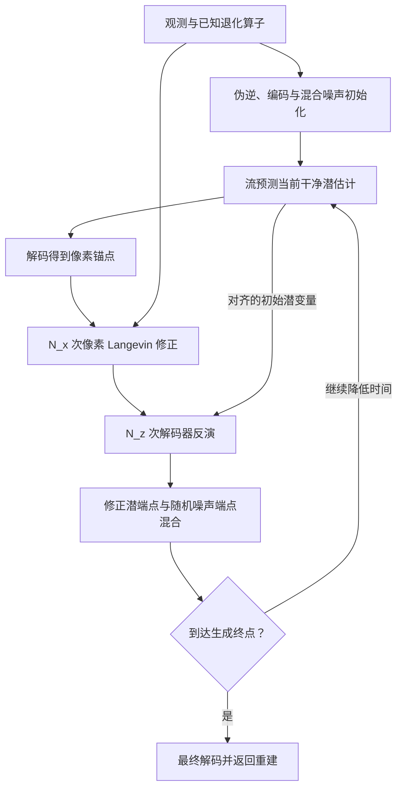

# Hybrid-Domain Posterior Sampling for Inverse Problems via Latent Flow Matching

# First Time

## 1.Title & Authors
论文原标题：Hybrid-Domain Posterior Sampling for Inverse Problems via Latent Flow Matching。
自然中文译法：基于潜空间流匹配的逆问题混合域后验采样。
标题的研究对象是图像逆问题：已知受损图像或测量，希望恢复产生这些观测的清晰图像。去模糊、图像修补和超分辨率都属于这里的任务。难点在于观测通常无法唯一决定清晰图像，还需要利用自然图像的统计规律，判断哪些恢复结果更合理。
“Posterior Sampling”指结合观测与图像先验，探索与观测相容的重建结果。这里的先验来自预训练生成模型，观测一致性来自已知退化过程。标题表达的是一个逆问题求解框架，后验分布的近似方式与有限步采样效果需要结合正文判断。
“Latent Flow Matching”指在压缩后的潜空间中使用流匹配模型。生成模型学习潜变量如何随时间变化，再由解码器把潜变量转换成图像。这是本文调用的生成先验基础。
“Hybrid-Domain”指像素空间与潜空间协同工作。像素空间直接对应图像和测量，适合处理退化算子带来的约束；潜空间承载生成模型学到的图像先验，适合维持结构和语义合理性。标题的核心主张是：将观测修正与生成先验安排在各自适合的空间，再让两者在采样过程中持续交换结果。
作者依原文列出：Hongjie Wu、Yiping Xie、Jiancheng Lv。三位作者的论文署名单位均为四川大学计算机学院。Hongjie Wu 与 Yiping Xie 标注为等贡献作者；Jiancheng Lv 标注为通讯作者。这些脚注是原文明确给出的贡献信息。

## 2.Abstract
摘要按照“应用瓶颈—几何解释—混合域框架—回映射设计—实验结果”的顺序展开。下面依原文语义单元精读。
语义单元一：潜空间流模型已推动压缩空间中的图像生成，但用于高保真逆问题时仍遇到瓶颈。
这句话先交代背景，再提出研究缺口。生成任务关注结果是否符合自然图像分布；逆问题同时要求结果符合实际观测。例如，恢复一张模糊人脸，需要五官看起来合理，也需要这张清晰图像经过指定模糊过程后能够解释输入。本文关注的“高保真”由此包含两层要求：图像自然，以及结构细节与测量相符。将生成模型迁移到逆问题时，后一个要求成为本文要解决的困难。
语义单元二：作者把这一困难追溯到预训练自编码器的几何限制，并将其命名为 First-Order Manifold Blindness。
这个术语可译为“一阶流形盲区”。“流形”在这里指解码器能够产生的图像在高维像素空间中形成的局部几何结构。“一阶”关注当前潜变量附近，通过微小调整潜变量，图像能够朝哪些方向变化。如果修复某项误差需要的方向落在这些局部可达方向之外，利用当前一阶梯度的潜空间优化就接收不到对应修正信号。作者由此将问题定位到观测梯度通过解码器传回潜空间的环节。
语义单元三：压缩使潜变量自由度很少，例如约为原图像自由度的 2%；解码器雅可比的列空间因此只能覆盖像素空间的一部分，正交补中的高频测量残差无法进入潜梯度，即使目标图像整体上可以被解码器表示。
这是摘要的关键因果链。解码器雅可比描述“潜变量发生微小变化时，像素如何变化”；其列空间给出当前局部能够产生的一阶图像变化。像素空间的误差梯度传回潜空间时，位于这个列空间正交补中的分量会被消去，优化器因而无法利用这些分量直接修复图像。
这里的“约 2%”描述坐标自由度的比例，视觉信息保留情况还取决于编码与解码的具体能力。原文用“秩亏”强调相对于像素空间维度的秩受限；潜维度远小于像素维度时，即使雅可比具有满列秩，其列空间依然无法覆盖整个像素空间。
需要分清全局表示能力与当前局部优化能力：目标存在于解码器的可表示集合中，并不保证当前的一阶梯度能指向目标。“高频”通常对应边缘、细纹理和精细结构，但某个误差方向是否不可见，取决于它与当前雅可比列空间的几何关系。这一结论的适用对象是局部一阶修正机制。
语义单元四：为克服这一瓶颈，作者提出 Hybrid-Domain Posterior Sampling，简称 HDPS，把物理测量一致性与语义先验建模解耦。
物理测量一致性要求恢复图像经过已知退化过程后，与观测相符；语义先验建模利用生成模型约束图像的整体结构和自然程度。这里的“解耦”是为两项任务安排不同的计算位置：前者在像素空间处理，后者由潜空间流模型提供。两者仍属于同一条迭代求解过程，修正结果需要反馈到后续生成状态。
语义单元五：HDPS 进入像素空间，利用 Langevin 动力学吸收精确的观测梯度，再把结构修正投回生成流形。
Langevin 动力学结合梯度修正与随机扰动。本文利用它在像素空间中更新图像，使观测修正能够包含先前被潜空间梯度消去的方向。随后需要把修正后的图像与潜空间生成过程重新衔接，才能让后续步骤同时利用测量信息和图像先验。
“投回流形”指寻找能由解码器生成、又贴近修正图像的结果。投影的效果取决于解码器的表示能力与实际优化过程。这里先建立整体分工，具体近似后验、更新公式与实现步骤留到正文精读。
语义单元六：作者引入基于优化的潜变量对齐，以过滤像素空间伪影，并避免直接编码带来的语义漂移。
像素空间修正可能带入噪声或不自然纹理。若把修正图像直接送入预训练编码器，这些偏离训练图像分布的结构可能被编码成不合适的潜特征，继而改变生成内容。作者采用解码器反演：从已有潜变量估计出发，优化潜变量，使其解码结果贴近修正后的图像。
这种设计使跨空间衔接成为可控制的优化过程。解码器能够表达的结构修正有机会被保留，它难以表达的伪影则可能在对齐中被滤去。摘要将这一设计与减少语义漂移联系起来，其实际贡献需要结合消融实验判断。
语义单元七：多种逆问题上的实验显示，HDPS 获得较强的恢复效果，能够恢复纯潜空间求解容易遗漏的高频结构精度。
这是摘要的结果主张，原文将性能概括为新的最优水平。正文第 5 节的主要比较覆盖五种线性逆问题：高斯去模糊、运动去模糊、双三次退化的 12 倍超分辨率、平均池化退化的 12 倍超分辨率，以及随机图像修补。数据集为 FFHQ、AFHQ、DIV2K，统一图像分辨率为 768 × 768；实验对观测添加标准差为 0.03 的高斯噪声。主要指标为 PSNR、SSIM 与 LPIPS。
“最优水平”是作者对论文评测范围内结果的概括，具体任务与指标仍需分别查看。例如 Table1 中，DIV2K 平均池化超分辨率的 PSNR 为 HDPS 21.05 dB、FlowDPS 21.08 dB，而 LPIPS 为 HDPS 0.240、FlowDPS 0.250，体现了不同指标上的实际差异。这个例子限定了摘要概括的读法：论文展示了多项优势，各项优势的幅度与覆盖面由具体实验结果决定。
语义单元八：作者说明代码已提供。
作者提供了代码链接，可用于核对算法实现和复现实验。
摘要的四个核心要素如下。

| 要素 | 本文内容 |
|---|---|
| 问题 | 潜空间生成先验很强，但测量梯度经过低维解码器后，可能丢失当前局部不可达的修正分量，影响高保真图像恢复。 |
| 方法 | HDPS 在像素空间执行观测修正，在潜空间利用流匹配先验，并以基于优化的解码器反演连接两者。 |
| 结果 | 在五种线性逆问题、三个数据集的评测中，作者报告多项重建质量改善；优势需结合任务、指标与预算逐项判断。 |
| 意义 | 本文将逆问题中的先验建模与测量约束分别放在合适空间处理，并指出跨空间对齐本身是影响最终恢复效果的关键环节。 |

## 3.Conclusion
原文第 6 节为明确的 Conclusion，由工作总结以及“Limitations and future work”两段构成。下面按原文顺序解释。
第一段的第一层意思：作者识别了 First-Order Manifold Blindness，将纯潜空间求解器恢复高频测量残差的困难，联系到解码器雅可比的秩限制。
这一结论承接第 3.2 节的 Proposition 3.1。其最直接的数学内容是：相对于解码器当前局部切空间正交的像素梯度分量，无法通过一阶链式求导进入潜梯度。正文还以 Fig1 展示梯度大小与空间结构的变化，为这一问题提供经验观察。几何分析解释修正信号在哪里丢失，实验观察说明该现象在论文设置中如何表现。
第一段的第二层意思：HDPS 将测量一致性交给像素空间，将语义先验交给潜空间，并用基于优化的潜变量对齐连接两者。
这概括了方法的三个要点。像素空间直接处理观测误差，潜空间生成模型提供自然图像结构，潜变量对齐把前一个空间的修正传给后一个空间。理解 HDPS 时，应把跨空间反馈视为核心机制：像素修正需要进入后续潜变量状态，才能持续影响生成过程。
第一段的第三层意思：作者报告在三个数据集、五种线性逆问题上取得较强性能，并用“相对最强基线提升超过 2 dB”概括部分优势。
这里的 dB 对应 PSNR，具体提升取决于评测任务。Table1 的 FFHQ 运动去模糊中，HDPS 为 32.83 dB，最强 PSNR 基线 FLAIR 为 30.56 dB，差值为 2.27 dB；同一数据集随机图像修补中，HDPS 为 34.62 dB，FLAIR 为 32.74 dB，差值为 1.88 dB。因此，“超过 2 dB”有具体任务支持，不能作为所有数据集、退化方式和指标的统一提升幅度。摘要较宽泛的性能概括，在结论中明确落到了五种线性逆问题和三个数据集；这也是理解主要实验结论时应保留的范围。
第二段的第一层意思：像素与潜变量交替优化增加了内循环开销。
像素侧 Langevin 步数为 $N_x$，潜变量对齐步数为 $N_z$。这些循环需要额外计算，尤其潜变量对齐需要通过解码器计算梯度。作者同时指出，在重建质量相当的比较中，这种成本可以与既有方法接近。评估效率时，应同时考虑运行时间与恢复质量；只统计流模型调用次数，无法完整体现内循环成本。这是作者在结论中明确列出的计算代价。
第二段的第二层意思：方法性能上限最终受解码器的表示能力限制。
像素空间允许先计算更丰富的修正，但最终结果仍由解码器生成。如果目标细节超出解码器能够表达的范围，潜变量对齐也无法将其完整保留下来。这个限制与摘要中的研究动机可以连起来理解：本文着力改善局部一阶修正受阻的问题，而最终输出仍受所用生成表示的能力约束。
第二段的第三层意思：作者提出两个未来方向。
其一是引入更快的像素空间求解器，例如一致性模型，以降低像素修正的计算成本。其二是把解耦框架扩展到盲逆问题，即正向退化算子 $mathcal{A}$ 未知的情况。盲逆问题还需要估计退化过程，因而比本文主要设置中已知算子的恢复任务多出一层不确定性。这两点属于未来工作。
综合摘要与结论，本文的主线可以表述为：识别潜空间一阶观测修正的局部几何盲区，在像素空间利用更完整的测量梯度，再通过优化对齐将修正送回潜空间生成过程，并以图像恢复实验检验这套设计的效果与代价。

## 4.Analogy
可以把这项工作想成用一套少量控制杆修复一幅复杂画面。
潜变量像控制杆，解码器像将控制杆位置转换成画面的装置。控制杆很少，却能通过已学到的规律生成结构丰富的图像。流模型则提供一条逐步形成自然画面的调整路线。
测量告诉你画面哪些地方还不符合实际观测，例如某条边缘的位置或某处细纹理需要修正。你可以直接在画面上指出这些误差，但当前控制杆的微小动作只能带来某些成组变化。当所需修正方向恰好落在这些变化之外，传回控制杆的信号就可能消失。这对应一阶流形盲区。
HDPS 先在画面上进行局部修改，对应像素空间的观测修正；随后从已有控制杆位置出发，寻找能尽量重现修正结果的控制杆设置，对应基于优化的潜变量对齐；再把更新后的设置交给后续生成过程。像素修正提供具体误差信息，潜空间生成规律维持画面的自然结构。
这套做法在论文实验中改善了多项恢复结果，但最终画面仍由那套控制装置产生，其表达能力决定能够保留多少细节。这个比喻帮助理解两种空间的分工与反馈；真实算法中的随机扰动、局部曲率与有限步优化，需要结合正文公式和算法理解。

# Second Time

## 1.Notation & Parameters
下表列出理解主线所需的重点记号。潜变量的下标 $0$、$1$ 对应干净数据端与噪声端，$0\mid t$ 表示在当前时刻对干净端点的估计；帽子表示经过本文修正的量。

| 符号/参数 | 含义与作用 | 关键设定/约束 |
|---|---|---|
| $\boldsymbol{x}$、$\boldsymbol{y}$ | 待恢复信号与实际观测 | $\boldsymbol{x}\in\mathbb{R}^{n}$；观测由已知退化算子与加性噪声产生。 |
| $\mathcal{A}$、$\mathcal{A}^{\top}$、$\mathcal{A}^{\dagger}$ | 正向退化算子、伴随算子与伪逆 | 正文主要方法与实验针对已知线性算子；伴随用于观测梯度，伪逆用于初始化。 |
| $E$、$D$ | 预训练自编码器的编码器与解码器 | $E:\mathbb{R}^{n}\to\mathbb{R}^{d}$，$D:\mathbb{R}^{d}\to\mathbb{R}^{n}$，$d\ll n$；推理时优化潜变量，不训练这两个网络。 |
| $\boldsymbol{z}_t$ | 当前时间的带噪潜状态 | 流生成方向从噪声端 $t=1$ 走向数据端 $t=0$。 |
| $\boldsymbol{z}_0$、$\boldsymbol{z}_1$；$p_0$、$p_1$ | 潜数据端与高斯噪声端及其分布 | $\boldsymbol{z}_0\sim p_0=E_{\#}p_{\mathrm{data}}$，$\boldsymbol{z}_1\sim p_1=\mathcal{N}(0,I)$。 |
| $v_{\theta}$、$\theta$ | 流模型速度场及预训练参数 | 输入当前潜状态、时间和可选条件；HDPS 使用该网络，不重新训练流模型。 |
| $c$、$\varnothing$、$\lambda$ | 文本条件、空条件与 CFG 参数 | 式（6）使用 $(1+\lambda)$ 与 $-\lambda$ 两个系数；原文将默认 $\lambda=2.0$ 称为 CFG scale，具体系数按原式理解。 |
| $\boldsymbol{z}_{0\mid t}$、$\boldsymbol{x}_{0\mid t}$ | 流预测的干净潜估计与其解码锚点 | $\boldsymbol{x}_{0\mid t}=D(\boldsymbol{z}_{0\mid t})$；尚未执行当前轮的观测修正。 |
| $\hat{\boldsymbol{x}}_{0\mid t}$、$\hat{\boldsymbol{z}}_{0\mid t}$ | 像素修正结果与对齐后的干净潜估计 | 前者经 $N_x$ 步 Langevin 更新，后者经 $N_z$ 步解码器反演；两者通常只有近似重建关系。 |
| $\boldsymbol{z}_{1\mid t}$、$\hat{\boldsymbol{z}}_{1\mid t}$ | 当前估计的噪声端点与随机更新后的噪声端点 | 正文给出后者的混合公式；前者的具体计算未单列定义式，相关解释见 State Update。 |
| $\sigma_t$、$\tau_t$ | 潜轨迹的混合/噪声日程与像素锚定尺度 | $\tau_t=\sigma_t/\sqrt{1+\sigma_t^2}$ 为经验日程；正文未完整指定 $\sigma_t$ 与 $t$ 的对应。 |
| $\sigma_y$、$\sigma_n$ | 模型中的观测噪声尺度、实验表中的观测噪声尺度记法 | 式（1）、（7）、（8）用 $\sigma_y$；实验用 $\sigma_n=0.03$，保留这两种原写法。 |
| $\eta_x$、$\eta_z$ | 像素 Langevin 步长、潜变量对齐步长 | 控制内循环更新幅度；所提供配置表没有列出 HDPS 这两个步长的数值。 |
| $N_x$、$N_z$ | 每轮像素修正步数、潜变量对齐步数 | 正文第 5.6 节给出默认 $N_x=20$、$N_z=15$；运行时间比较另用匹配步数。 |
| $t_0$、$\Delta t$ | 采样起始时间与外循环时间步长 | 常用 $t_0=0.8$；算法时间递减，终点索引存在需要实现时明确的约定。 |
| $\mathcal{L}_{\mathrm{FM}}$、$\mathcal{L}_{\mathrm{rec}}$ | 流匹配训练目标、观测重建目标 | 前者用于预训练背景；后者用于解释潜空间观测梯度及其盲区。 |
| $J_D$、$\mathcal{R}(J_D)$ | 解码器雅可比及其列空间 | $J_D\in\mathbb{R}^{n\times d}$；列空间是当前点可由潜变量一阶变化产生的像素方向。 |
| $\boldsymbol{g}_{\mathrm{pixel}}$、$\boldsymbol{g}_{\parallel}$、$\boldsymbol{g}_{\perp}$ | 像素观测梯度及切向、正交分量 | Proposition 3.1 中作正交分解；Theorem 4.1 用 $\boldsymbol{g}$ 表示对应的总梯度。 |
| $\mathcal{H}_D$ | 解码器的 Hessian 张量 | 用于 Theorem 4.1 的二阶局部分析，实际算法不显式计算。 |

两处需要保持区分：观测噪声 $\sigma_y$ 与轨迹日程 $\sigma_t$ 承担不同作用；理想投影的理论分析与有限步对齐的实际算法也采用不同条件。

## 2.Introduction
对应原文第 1 节。引言首先把本文放在生成模型从像素空间走向潜空间的背景下：Stable Diffusion 3、SD3.5、FLUX 等模型利用压缩表示降低高分辨率生成成本，流匹配则提供随时间演化的生成轨迹。这里介绍的是可利用的预训练基础，HDPS 的新增工作发生在逆问题推理阶段。
随后，作者从“能够生成自然图像”转向“能够解释给定观测”。生成先验描述哪些图像合理，逆问题还要求恢复结果经过已知退化过程后与观测相符。常见做法是在潜空间优化观测误差，原文引言写作 $\mathcal{L}(\boldsymbol{z})=\|\mathcal{A}(D(\boldsymbol{z}))-\boldsymbol{y}\|^2$。这是人为选择的平方误差目标：先解码、再模拟退化、最后与观测比较。第 3.2 节采用带 $1/2$ 系数的 $\mathcal{L}_{\mathrm{rec}}$，两者的最小值位置一致，梯度相差常数因子。
作者进一步指出，观测误差经 $\mathcal{A}\circ D$ 反向传播时，必须通过低维解码器的局部几何结构。像素中的某些误差方向会在这个过程中消失。图像整体可被解码器表示，仍可能出现当前局部梯度无法有效修复的情况。这个论证把问题从“生成先验不够强”定位到“观测修正怎样进入潜状态”。[Fig1 精读](#fig1)解释相应的曲线与梯度图证据。
接着，作者提出混合域分工：像素空间处理测量，潜空间承载生成先验。直接在像素上修正之后，还需要解决如何回到潜空间的问题。引言提到的直接编码 $\boldsymbol{z}=E(\boldsymbol{x})$ 是编码器前向计算这一设计选择，不是对逆问题目标的优化。作者认为像素修正中的伪影可能使直接编码发生语义漂移，因此改用从已有潜估计出发的解码器反演。
引言的四项贡献可沿论证链理解：识别局部一阶盲区；设计像素—潜空间交替的 HDPS；以优化对齐连接两个空间；在多种逆问题上评价整个框架。Langevin 更新、自编码器与流匹配都是已有组件，本文的贡献集中在几何诊断、组合方式和跨域反馈。引言还声称二阶曲率机制能够解释这一设计，其数学内容与适用条件在 Latent Alignment via Decoder Inversion 中逐式核对。

## 3.Related Work
对应原文第 2 节，介绍作者对像素空间与潜空间逆问题方法的分类。
第一组是像素空间逆问题算法。DPS 将生成先验的 score 与观测似然梯度结合；DDRM 利用退化算子的奇异值分解构造条件更新；$\Pi$GDM 借助伪逆改善似然引导；Plug-and-Play 方法把物理算子与学习得到的去噪器结合。它们共同表明：已知观测过程可以直接参与生成式恢复，而不必为每种退化重新训练一个完整恢复网络。
DAPS 与本文联系更紧。作者借鉴其退火式 Langevin 思路，在每个噪声层级分别处理先验与观测。HDPS 将这种像素空间计算作为潜流轨迹内部的修正层，随后把结果对齐回潜变量。因而本文继承了像素似然计算的便利，又希望利用潜空间模型的高分辨率生成能力。
第二组是潜空间方法。PSLD 优化中间潜变量以改善数据一致性；ReSample 进行数据一致性优化，再做随机重采样。流匹配路线中的 FlowChef、FlowDPS、FLAIR 分别被作者概括为利用流轨迹进行引导、将似然梯度纳入流动力学，以及采用无需重新训练的变分式轨迹调整。本文并未把这些方法视为相同算法，而是从“观测修正最终如何通过解码器进入潜变量”这个角度寻找共同困难。
作者将潜空间方法的问题概括为复合反传 $\mathcal{A}\circ D$ 的病态性。这里有两种相关但不同的现象：雅可比奇异值差异可能造成数值条件差；像素维度高于潜维度则使某些像素方向位于雅可比列空间之外。第 3.2 节的命题直接处理后者。两者可以同时存在，低维性本身并不等于潜变量坐标中的所有梯度都数值不稳定。
本文的位置由此明确：利用预训练潜流模型，在像素域执行物理观测修正，以解码器反演把修正送回生成过程。其与直接编码或纯潜优化的差别，需要由后面的更新式、[Table2 精读](#table2)与[Fig4 精读](#fig4)共同判断。

## 4.Preliminaries and Motivation
对应原文第 3 节。这一节先建立观测模型与潜空间流匹配背景，再分析潜梯度为什么会遗漏特定方向。理解时应将“生成模型怎样预训练”与“HDPS 怎样利用已训练模型推理”分开：式（2）至（4）解释生成先验的来源，后续方法在给定观测下调用该先验。

## 5.Problem Setup and Latent Flow Matching
对应原文第 3.1 节。
公式（1）：观测模型。
$$
\boldsymbol{y}=\mathcal{A}\boldsymbol{x}+\boldsymbol{\epsilon},
\qquad
\boldsymbol{\epsilon}\sim\mathcal{N}(0,\sigma_y^2 I).
$$
这里 $\boldsymbol{x}\in\mathbb{R}^{n}$ 是清晰信号，$\mathcal{A}$ 是已知线性退化算子，$\boldsymbol{\epsilon}$ 是观测空间中的加性高斯噪声，$\sigma_y$ 为其标准差，$I$ 是对应维度的单位矩阵。式子规定观测如何产生，属于建模假设。噪声协方差为标量乘单位矩阵，意味着模型采用各向同性高斯观测噪声。$\mathcal{A}$ 可以改变信号维度；$\mathcal{A}\boldsymbol{x}$、$\boldsymbol{y}$ 与这里的噪声具有相同形状。
无编号关系：后验分解与似然。
$$
p(\boldsymbol{x}\mid\boldsymbol{y})
\propto p(\boldsymbol{y}\mid\boldsymbol{x})p(\boldsymbol{x}),
\qquad
p(\boldsymbol{y}\mid\boldsymbol{x})
\propto
\exp\!\left(-\frac{\|\mathcal{A}\boldsymbol{x}-\boldsymbol{y}\|^2}{2\sigma_y^2}\right).
$$
第一步，由贝叶斯规则，后验等于似然乘先验，再除以只依赖观测的归一化项；固定观测时可写成正比。第二步，式（1）的噪声在给定清晰图像时等于观测与预测观测之差，代入各向同性高斯密度，其指数就是平方残差除以两倍噪声方差。高斯密度的前置常数与待优化图像无关，因此在正比式中省略。$\sigma_y>0$ 是这类密度表达式的条件；无噪声极限不能直接把分母设为零。先验 $p(\boldsymbol{x})$ 表达自然图像统计规律。
无编号关系：潜空间与端点分布。原文定义编码器 $E:\mathbb{R}^{n}\to\mathbb{R}^{d}$、解码器 $D:\mathbb{R}^{d}\to\mathbb{R}^{n}$，并设潜空间 $\mathcal{Z}=\mathbb{R}^{d}$，其中 $d\ll n$。这是计算域的定义。潜数据分布为 $p_0=E_{\#}p_{\mathrm{data}}$：从数据分布取图像，再经编码器得到的分布称为推前分布，符号 $\#$ 表达这一映射。噪声端分布取 $p_1=\mathcal{N}(0,I)$。两者均处于潜空间。
公式（2）：生成用的常微分方程。
$$
\frac{d\boldsymbol{z}_t}{dt}=v_{\theta}(\boldsymbol{z}_t,t),
\qquad \boldsymbol{z}_1\sim p_1.
$$
$v_{\theta}$ 是随状态与时间变化的速度场，输出与潜状态形状相同。方程规定每一时刻潜状态如何变化；从噪声端 $t=1$ 向 $t=0$ 反向积分，目标是得到潜数据分布。反向生成指积分时间递减，并非另外把已定义速度场的符号任意翻转。能够定义并稳定求解这一流，还需要速度场与数值求解器满足相应的常规条件；本文在这里用它作为预训练生成模型背景。
公式（3）：条件线性插值路径。
$$
\boldsymbol{z}_t=(1-t)\boldsymbol{z}_0+t\boldsymbol{z}_1.
$$
这是训练时构造的路径：$t=0$ 给出数据端，$t=1$ 给出高斯端。对固定的一对端点沿时间求导，就得到原文无编号目标速度 $\dot{\boldsymbol{z}}_t=\boldsymbol{z}_1-\boldsymbol{z}_0$。因此，在这种条件路径上，速度恒定，方向由数据端指向噪声端；采样反向走时间，便从噪声走向数据。
公式（4）：流匹配训练目标。
$$
\mathcal{L}_{\mathrm{FM}}(\theta)
=\mathbb{E}_{t,\boldsymbol{z}_0,\boldsymbol{z}_1}
\left[
\|v_{\theta}(\boldsymbol{z}_t,t)-(\boldsymbol{z}_1-\boldsymbol{z}_0)\|^2
\right].
$$
代入式（3）生成训练状态，再用该状态和时间预测速度，最后与刚求得的条件目标速度比较。对时间与端点采样取期望，得到平方回归目标。它是训练设计，不是由观测似然直接推出的恢复损失。
这个目标还解释了为何生成网络不需要知道某个训练样本的原始配对端点：对于相同状态和时间，可能存在多组端点；平方回归的最优预测为条件目标速度的条件平均。原文采用的边缘速度场由此与许多条件路径共同关联。无需假定网络对每一对随机端点都能零误差复现其速度。
训练完成后，积分式（2）并用 $D$ 解码，形成基础生成过程。HDPS 在这一生成过程上加入观测修正，式（4）本身不作为每次逆问题推理中重新训练网络的步骤。

## 6.Why Latent-Only Optimization Fails
对应原文第 3.2 节。作者假定流轨迹或显式正则项 $R(\boldsymbol{z})$ 提供先验约束，先单独考察潜空间观测一致性。这里 $R$ 只是对相关方法的正则项记号，本节没有给出其具体定义，不能自行补成某种特定正则函数。
公式（5）同时包含优化问题与损失定义。
$$
\boldsymbol{z}^{*}=\arg\min_{\boldsymbol{z}}\mathcal{L}_{\mathrm{rec}}(\boldsymbol{z}),
\qquad
\mathcal{L}_{\mathrm{rec}}(\boldsymbol{z})
=\frac12\|\mathcal{A}(D(\boldsymbol{z}))-\boldsymbol{y}\|^2.
$$
损失定义中的 $1/2$ 用来消去平方求导时的系数 $2$。它与式（1）高斯似然负对数的关系是：固定正噪声尺度后，二者相差正比例系数和常数，因此单独最小化观测误差时具有相同的极小点；在与其他项共同优化时，比例会影响相对权重。
无编号关系：链式梯度。先对像素求导，线性算子的伴随把观测残差送回像素空间；再对潜变量求导，解码器雅可比的转置把像素梯度送回潜空间：
$$
\nabla_{\boldsymbol{z}}\mathcal{L}_{\mathrm{rec}}
=J_D^{\top}\mathcal{A}^{\top}
\bigl(\mathcal{A}(D(\boldsymbol{z}))-\boldsymbol{y}\bigr).
$$
其中 $J_D$ 在当前 $\boldsymbol{z}$ 处求值。原文定义
$$
\boldsymbol{g}_{\mathrm{pixel}}
=\mathcal{A}^{\top}\bigl(\mathcal{A}(D(\boldsymbol{z}))-\boldsymbol{y}\bigr).
$$
这就是同一平方误差的像素梯度。$\mathcal{A}^{\top}$ 的输出在像素空间，随后 $J_D^{\top}$ 的输出在潜空间，维度因此衔接。像素梯度已经受测量算子限制；HDPS 绕过的是解码器这一额外瓶颈，观测缺失本身仍须由先验补充。
无编号几何关系：原文用四个潜通道、空间每边下采样 8 倍作示例，写出 $n=3HW$、$d=4(H/8)(W/8)=HW/16$，因而 $d=n/48$，约为像素自由度的 2.1%。这是该示例的维度换算，不是所有潜模型的统一通道设定，也不能未经核对就归为本文实验骨干的实际压缩比。由 $J_D\in\mathbb{R}^{n\times d}$ 可知，其列空间最多具有 $d$ 个独立方向。
Proposition 3.1 的起点是正交分解：
$$
\boldsymbol{g}_{\mathrm{pixel}}
=\boldsymbol{g}_{\parallel}+\boldsymbol{g}_{\perp},
\qquad
\boldsymbol{g}_{\parallel}\in\mathcal{R}(J_D),
\qquad
\boldsymbol{g}_{\perp}\in\mathcal{R}(J_D)^{\perp}.
$$
按定义，正交分量与雅可比每一列都正交，所以 $J_D^{\top}\boldsymbol{g}_{\perp}=0$。将分解代入链式梯度：
$$
\nabla_{\boldsymbol{z}}\mathcal{L}_{\mathrm{rec}}
=J_D^{\top}(\boldsymbol{g}_{\parallel}+\boldsymbol{g}_{\perp})
=J_D^{\top}\boldsymbol{g}_{\parallel}.
$$
这一步是精确线性代数结论：当前一阶潜梯度不包含正交分量。若切向分量也很小，潜空间观测梯度就可能很小，而像素中的误差仍然存在。
“投影”在此需要精确理解：$J_D^{\top}$ 消去了正交补分量，但它通常不是像素空间的正交投影矩阵；其余方向还会受雅可比的尺度与条件数影响。潜梯度与像素梯度属于不同空间，数值范数也不能直接当作同一坐标下的信号强弱比较。
原文将这一现象称为 First-Order Manifold Blindness。它证明局部一阶信息存在盲区；对非线性解码器，有限潜步长带来的二阶变化仍需另行分析。把命题扩大成“所有潜空间优化在任意阶都无法改变正交方向”，超出了这里的推导。
经验部分引用 [Fig1 精读](#fig1)：四项任务的曲线展示梯度随轨迹的变化，图像展示结构对应性。它们为特定轨迹下的现象提供观察，尚不足以把所有误差或所有高频方向一概归入正交补。由此进入方法设计：先在像素域处理观测误差，再研究怎样把修正有效传回潜状态。

## 7.Hybrid-Domain Posterior Sampling
对应原文第 4 节。每个外循环由四个顺序步骤组成：生成锚定、像素修正、潜变量对齐、状态更新。下面的原文无编号流程关系给出数据流：
$$
\boldsymbol{z}_t
\xrightarrow{\mathrm{flow}}\boldsymbol{z}_{0\mid t}
\xrightarrow{D}\boldsymbol{x}_{0\mid t}
\xrightarrow{\mathrm{Langevin}}\hat{\boldsymbol{x}}_{0\mid t}
\xrightarrow{\mathrm{alignment}}\hat{\boldsymbol{z}}_{0\mid t}
\xrightarrow{\mathrm{update}}\boldsymbol{z}_{t-\Delta t}.
$$
每个箭头代表不同计算：流模型给出当前干净端点估计，解码器生成锚点，像素内循环修正观测，对齐内循环优化潜变量，最后将修正后的潜端点重新混入带噪轨迹。像素输出会改变下一轮的输入，因此它能反复影响后续生成。
原文强调，先验没有作为额外正则项显式出现在对齐目标中，但每轮的对齐初始化来自流预测，更新后又重新进入流轨迹。这提供了先验影响的计算路径；它与证明整个离散算法精确采自真实后验，是不同层次的结论。
下图按正文计算顺序绘制，省略张量形状、CFG 的两次网络调用和噪声日程的具体数值；保留观测输入、锚点约束、对齐初始化、两个内循环和随机状态更新。所有网络均为调用预训练模型，图中的优化对象是状态而非网络权重。

原图对应：[Fig2 精读](#fig2)。完整伪代码对应：[Algorithm1 精读](#algorithm1)。

## 8.Generation Anchoring via Flow Prediction
对应原文第 4.1 节。输入为当前潜状态 $\boldsymbol{z}_t$、时间 $t$ 和可选文本条件 $c$，输出为干净端点估计。
公式（6）：
$$
\boldsymbol{z}_{0\mid t}
=\boldsymbol{z}_t-\sigma_t
\left[(1+\lambda)v_{\theta}(\boldsymbol{z}_t,t,c)
-\lambda v_{\theta}(\boldsymbol{z}_t,t,\varnothing)\right].
$$
先解释生成端点估计的来源。由式（3）与目标速度相减，逐项计算：
$$
\boldsymbol{z}_t-t(\boldsymbol{z}_1-\boldsymbol{z}_0)
=(1-t)\boldsymbol{z}_0+t\boldsymbol{z}_1
-t\boldsymbol{z}_1+t\boldsymbol{z}_0
=\boldsymbol{z}_0.
$$
在线性路径下，如果知道这一对端点的准确条件速度，就能通过这个代数恒等式恢复干净端点。实际网络给的是学习到的速度预测，所以相应表达式是估计。原文进一步用 $\sigma_t$ 替代这里的路径系数；当 $\sigma_t=t$ 时与上述推导直接一致。若另用非线性时间日程，速度的时间参数化也需要相应匹配。正文未把这项对应完整展开，不能仅凭式（3）就认定任意日程下式（6）都是同一精确恒等式。
方括号中的条件与无条件组合，是 CFG 的设计。它也可直接展开成条件速度，加上 $\lambda$ 倍“条件速度减无条件速度”；因此 $\lambda=0$ 时使用条件预测，增大它会加强条件相对无条件的偏移。这是引导规则，无法从观测似然唯一推出。
CFG 的记法需要按原式核对：正文及配置将默认参数写为 $\lambda=2.0$，而式（6）的条件与无条件系数对应为 $3$ 与 $-2$。有些实现把条件预测前的总系数称为 guidance scale；本文采用的参数名与那种惯例不能直接互换。
无编号关系 $\boldsymbol{x}_{0\mid t}=D(\boldsymbol{z}_{0\mid t})$ 把潜端点估计解码为像素锚点。它保持了当前流模型所偏好的语义与结构，却还没有利用当前轮像素似然修正。该锚点既是下一步的初始图像，也是约束像素更新不要偏移过远的中心。

## 9.Pixel-Space Correction
对应原文第 4.2 节。这里直接在像素空间优化，使观测修正无需先通过解码器雅可比。输入是锚点和观测，输出是修正图像。
公式（7）：锚定的近似后验。
$$
p(\hat{\boldsymbol{x}}_{0\mid t}\mid\boldsymbol{x}_{0\mid t},\boldsymbol{y})
\propto
\exp\!\left(
-\frac{\|\mathcal{A}\hat{\boldsymbol{x}}_{0\mid t}-\boldsymbol{y}\|^2}{2\sigma_y^2}
\right)
\exp\!\left(
-\frac{\|\hat{\boldsymbol{x}}_{0\mid t}-\boldsymbol{x}_{0\mid t}\|^2}{2\tau_t^2}
\right).
$$
第一项沿用式（1）的高斯观测模型，奖励能解释观测的图像。第二项人为采用以解码锚点为中心、尺度为 $\tau_t$ 的高斯局部先验，限制当前轮修正偏离锚点的幅度。将似然与这个局部高斯先验相乘，得到式（7）。完整生成先验已参与锚点生成；这里使用的是围绕锚点的近似，而不是将预训练模型的完整像素密度显式求出。
无编号日程定义为 $\tau_t=\sigma_t/\sqrt{1+\sigma_t^2}$。它是引用先行工作启发的经验选择。对非负噪声日程，它随 $\sigma_t$ 增大而增大；靠近数据端、$\sigma_t$ 趋近零时，$\tau_t$ 也趋近零，使锚定变强。不能把它当作由观测噪声方差唯一推导出来的最优值。
求梯度时固定观测与锚点，对式（7）取对数：乘积成为两项之和，归一化项相对于待更新像素为常数。对第一项求导时，平方残差产生系数 $2$，负号与残差方向相抵，得到观测拉回项；第二项求导得到锚点拉回项：
$$
\nabla_{\hat{\boldsymbol{x}}_{0\mid t}}
\log p(\hat{\boldsymbol{x}}_{0\mid t}\mid\boldsymbol{x}_{0\mid t},\boldsymbol{y})
=
\frac{\mathcal{A}^{\top}(\boldsymbol{y}-\mathcal{A}\hat{\boldsymbol{x}}_{0\mid t})}{\sigma_y^2}
-\frac{\hat{\boldsymbol{x}}_{0\mid t}-\boldsymbol{x}_{0\mid t}}{\tau_t^2}.
$$
两个输出都在像素空间，可以相加。它们分别由测量噪声方差与锚定方差调节，和式（5）中未缩放的重建梯度符号与比例应分别核对。
公式（8）：将这一对数密度梯度代入 Langevin 离散更新。
$$
\hat{\boldsymbol{x}}_{0\mid t}^{(j+1)}
=\hat{\boldsymbol{x}}_{0\mid t}^{(j)}
+\eta_x\left[
\frac{\mathcal{A}^{\top}(\boldsymbol{y}-\mathcal{A}\hat{\boldsymbol{x}}_{0\mid t}^{(j)})}{\sigma_y^2}
-\frac{\hat{\boldsymbol{x}}_{0\mid t}^{(j)}-\boldsymbol{x}_{0\mid t}}{\tau_t^2}
\right]
+\sqrt{2\eta_x}\,\boldsymbol{\xi}_j.
$$
局部索引 $j$ 表示像素内循环，$\eta_x$ 为步长。向对数密度较高的方向移动后，再加入随机扰动；按通常 Langevin 构造，$\boldsymbol{\xi}_j$ 解释为新抽取的标准高斯噪声，因而扰动方差与 $2\eta_x$ 对应。所提供正文没有单独声明这一噪声的分布与独立性，复现时需要核对。原图 Fig2 对相应噪声使用 $\boldsymbol{\epsilon}_j$，正文式（8）使用 $\boldsymbol{\xi}_j$，此处保留正文记号。
初始化关系为 $\hat{\boldsymbol{x}}_{0\mid t}^{(0)}=\boldsymbol{x}_{0\mid t}$，完成关系为 $\hat{\boldsymbol{x}}_{0\mid t}=\hat{\boldsymbol{x}}_{0\mid t}^{(N_x)}$。所以第一步的锚点拉回项为零，之后随着像素偏移而起作用。这两式是内循环初值与输出定义，不是额外的优化定理。
这一步的关键是 $\mathcal{A}^{\top}(\boldsymbol{y}-\mathcal{A}\hat{\boldsymbol{x}})$ 直接作用于像素。它可以包含相对于当前解码器切空间的正交分量；但观测算子的零空间仍缺乏直接测量信息。有限步 Langevin 以及有限非零步长还会产生采样近似，式（7）本身不能保证实际输出是精确后验样本。
两个数值条件影响使用：$\sigma_y$ 与当前 $\tau_t$ 应为正；步长需适配观测项与锚定项共同形成的曲率。随着 $\tau_t$ 接近零，锚定项更硬，式（8）在恰好零尺度时不可直接计算。本文没有完整交代终点处如何处理这个除零边界，需与 Algorithm1 的终点约定一起核对。
与 DAPS 的联系在于退火式像素 Langevin 修正；HDPS 的区别在于将这一步接在流预测锚点之后，再反馈到潜空间。对应结构见 [Fig2 精读](#fig2)。

## 10.Latent Alignment via Decoder Inversion
对应原文第 4.3 节。像素修正得到的图像可能偏离解码器可表示的图像集合，因此原文通过优化潜变量，使其解码结果接近修正图像。
公式（9）：
$$
\hat{\boldsymbol{z}}_{0\mid t}^{(k+1)}
=\hat{\boldsymbol{z}}_{0\mid t}^{(k)}
-\eta_z\nabla_{\boldsymbol{z}}
\left\|\hat{\boldsymbol{x}}_{0\mid t}
-D(\hat{\boldsymbol{z}}_{0\mid t}^{(k)})\right\|^2.
$$
$k$ 是潜对齐内循环索引，$\eta_z$ 为其步长。固定已经完成像素修正的 $\hat{\boldsymbol{x}}_{0\mid t}$，先计算当前潜变量的解码残差，再经解码器求梯度。相应导数为
$$
\nabla_{\boldsymbol{z}}
\left\|\hat{\boldsymbol{x}}_{0\mid t}-D(\boldsymbol{z})\right\|^2
=2J_D^{\top}\left(D(\boldsymbol{z})-\hat{\boldsymbol{x}}_{0\mid t}\right).
$$
这里目标没有 $1/2$，所以系数 $2$ 保留。将该梯度代入下降更新，就得到式（9）的计算含义；优化的是潜变量，解码器权重保持固定。该梯度只通过 $D$，不在这个内循环里通过 $\mathcal{A}\circ D$。
初值为 $\hat{\boldsymbol{z}}_{0\mid t}^{(0)}=\boldsymbol{z}_{0\mid t}$，输出为 $\hat{\boldsymbol{z}}_{0\mid t}=\hat{\boldsymbol{z}}_{0\mid t}^{(N_z)}$。从流预测出发而只做有限步对齐，使生成先验继续通过初始化与后续轨迹发挥作用。目标函数本身没有显式的潜先验惩罚，因此不能把任何优化结果都自动等同于高概率潜代码。
直接编码的替代关系是 $\hat{\boldsymbol{z}}=E(\hat{\boldsymbol{x}})$。它只需编码器前向计算，但不保证输出潜变量的解码图像是当前修正图像的最佳近似。原文将其在消融中出现的偏移解释为编码器对非高斯伪影敏感。[Table2 精读](#table2)与[Fig4 精读](#fig4)支持优化对齐在所测设置中更有效；“对齐过滤伪影”的能力同时受解码器表示范围和优化质量影响。
Theorem 4.1 的作用是分析理想投影产生的局部二阶项。原文令 $\boldsymbol{x}_{0\mid t}=D(\boldsymbol{z}_{0\mid t})$，并把该点的像素重建梯度写为 $\boldsymbol{g}=\nabla_{\boldsymbol{x}}\mathcal{L}_{\mathrm{rec}}(\boldsymbol{x}_{0\mid t})=\boldsymbol{g}_{\parallel}+\boldsymbol{g}_{\perp}$。此处 $\mathcal{L}_{\mathrm{rec}}$ 按像素平方观测误差理解；它是式（5）解码前对应的函数。切向与正交分量的空间条件沿用 Proposition 3.1。
理论中先采用确定性像素步 $\hat{\boldsymbol{x}}_{0\mid t}=\boldsymbol{x}_{0\mid t}-\eta_x\boldsymbol{g}$，再定义精确投影
$$
\hat{\boldsymbol{z}}_{0\mid t}
=\arg\min_{\boldsymbol{z}}
\|\hat{\boldsymbol{x}}_{0\mid t}-D(\boldsymbol{z})\|^2,
\qquad
\Delta\boldsymbol{x}=D(\hat{\boldsymbol{z}}_{0\mid t})-\boldsymbol{x}_{0\mid t}.
$$
这与实际算法采用含噪声、含锚定项的多个像素步，以及有限个对齐步存在条件差别。该定理针对理想化局部投影。
公式（10）：
$$
\langle\Delta\boldsymbol{x},\boldsymbol{g}_{\perp}\rangle
=\frac12\eta_x^2
\boldsymbol{v}^{\top}
\left(\boldsymbol{g}_{\perp}^{\top}\mathcal{H}_D\right)\boldsymbol{v}
+O(\eta_x^3),
\qquad
\boldsymbol{v}=-(J_D^{\top}J_D)^{\dagger}J_D^{\top}\boldsymbol{g}_{\parallel}.
$$
$\mathcal{H}_D$ 是解码器在 $\boldsymbol{z}_{0\mid t}$ 处的 Hessian 张量，$\boldsymbol{v}$ 是原文定义的投影潜路径的一阶变化方向，$\dagger$ 为 Moore–Penrose 伪逆。$\boldsymbol{g}_{\perp}^{\top}\mathcal{H}_D$ 是把每个像素输出的 Hessian 按正交梯度分量收缩得到的潜空间二阶形式。
推导第一步：对照原文 Appendix A，假定最优投影随步长存在可展开的局部分支，原文使用
$$
\hat{\boldsymbol{z}}_{0\mid t}
=\boldsymbol{z}_{0\mid t}+\eta_x\boldsymbol{v}
+\frac12\eta_x^2\boldsymbol{w}+O(\eta_x^3).
$$
$\boldsymbol{w}$ 是原证明已经引入的二阶潜变化量，并非为讲解另设的变量。解码器展开为
$$
D(\hat{\boldsymbol{z}}_{0\mid t})
=\boldsymbol{x}_{0\mid t}+\eta_xJ_D\boldsymbol{v}
+\frac12\eta_x^2
\left(J_D\boldsymbol{w}+\boldsymbol{v}^{\top}\mathcal{H}_D\boldsymbol{v}\right)
+O(\eta_x^3).
$$
这同时包含潜路径自身的二阶变化，经 $J_D$ 映射后仍在切空间；以及解码器弯曲所产生的二阶变化。
第二步：精确投影的驻点条件是
$$
J_D(\hat{\boldsymbol{z}}_{0\mid t})^{\top}
\left(D(\hat{\boldsymbol{z}}_{0\mid t})-\hat{\boldsymbol{x}}_{0\mid t}\right)=0.
$$
将像素一步及上述展开代入，比较 $\eta_x$ 的一阶系数，得到 $J_D^{\top}(J_D\boldsymbol{v}+\boldsymbol{g})=0$。再利用 $J_D^{\top}\boldsymbol{g}_{\perp}=0$，得到 $J_D^{\top}J_D\boldsymbol{v}=-J_D^{\top}\boldsymbol{g}_{\parallel}$。原文用伪逆选取其最小范数解，便得到式（10）中的 $\boldsymbol{v}$。如果存在雅可比零空间，一阶驻点条件本身不能唯一指定全部潜变化分量。
第三步：将解码增量与 $\boldsymbol{g}_{\perp}$ 做内积。$J_D\boldsymbol{v}$ 与 $J_D\boldsymbol{w}$ 都在列空间中，其内积均为零，剩余的二阶项为
$$
\langle\Delta\boldsymbol{x},\boldsymbol{g}_{\perp}\rangle
=\frac12\eta_x^2
\left\langle\boldsymbol{v}^{\top}\mathcal{H}_D\boldsymbol{v},
\boldsymbol{g}_{\perp}\right\rangle+O(\eta_x^3).
$$
把张量内积写成收缩形式，就是公式（10）。
这个推导支持的结论是：在相应局部展开条件下，投影后的解码增量可能具有相对于起点切空间的二阶正交分量。这一结论依赖以下条件。
第一，二阶项并非必然非零。即使 $\boldsymbol{g}_{\perp}^{\top}\mathcal{H}_D\ne0$，沿具体 $\boldsymbol{v}$ 的二次型也可能为零；尤其 $\boldsymbol{g}_{\parallel}=0$ 时，原文给出的 $\boldsymbol{v}=0$，这一二阶项就消失。若从原潜点初始化对齐，而像素一步完全沿正交梯度，对齐的起点梯度也为零。因而不能从式（10）推出任意盲区均被消除。
第二，非零内积的符号没有被控制。该式描述沿正交方向发生多少变化，单凭它不能保证变化降低观测损失，也不能保证对齐完整保留像素修正。
第三，原文把纯潜优化的 $\langle\Delta\boldsymbol{x},\boldsymbol{g}_{\perp}\rangle=0$ 扩大到所有阶，这对一般非线性解码器不成立。用原文同一方向考察有限潜位移，Taylor 展开给出
$$
\left\langle
D(\boldsymbol{z}_{0\mid t}+\eta_x\boldsymbol{v})-\boldsymbol{x}_{0\mid t},
\boldsymbol{g}_{\perp}
\right\rangle
=\frac12\eta_x^2
\boldsymbol{v}^{\top}
\left(\boldsymbol{g}_{\perp}^{\top}\mathcal{H}_D\right)\boldsymbol{v}
+O(\eta_x^3).
$$
所以非线性解码后的有限潜位移也可能出现二阶正交分量。Proposition 3.1 的一阶结论依然成立；二阶曲率项本身却不能构成 HDPS 相对所有纯潜更新的独有优势证明。
第四，原定理只明确假设解码器二阶可微，而证明还使用了投影解的平滑分支、特定一阶解，以及三阶量级余项。投影唯一性、分支正则性和足够的余项控制需要额外条件；仅二阶可微通常不足以自动保证这里写出的 $O(\eta_x^3)$。
这些是等式条件与后续强解释之间的具体差别。HDPS 在消融中的效果仍由实验结果评价，理论等式应按其实际能推出的范围使用。

## 11.State Update
对应原文第 4.4 节。对齐结果是干净潜端点，下一轮需要的是相应噪声水平的潜状态，因此不能只把前者直接当成下一时刻的带噪状态。
原文无编号噪声端点更新为
$$
\hat{\boldsymbol{z}}_{1\mid t}
=\alpha_t\boldsymbol{z}_{1\mid t}
+\sqrt{1-\alpha_t^2}\,\boldsymbol{\epsilon}',
\qquad
\alpha_t=1-\sigma_t,\qquad
\boldsymbol{\epsilon}'\sim\mathcal{N}(0,I).
$$
它将旧噪声端点与新高斯扰动混合。若 $\sigma_t$ 在 $[0,1]$ 内，则 $\alpha_t$ 也在该范围；高噪声时更多采用新噪声，低噪声时更多保留已有端点。若旧端点本身也是标准高斯且与新噪声独立，两个权重平方相加为 $1$，混合后仍保留标准高斯的边缘协方差。这是混合设计的解释条件，不能自动套用于任何受观测条件化的端点估计。
公式（11）：
$$
\boldsymbol{z}_{t-\Delta t}
=(1-\sigma_{t-\Delta t})\hat{\boldsymbol{z}}_{0\mid t}
+\sigma_{t-\Delta t}\hat{\boldsymbol{z}}_{1\mid t}.
$$
这是按下一时刻的日程重新组合数据端点与噪声端点的设计，结构延续式（3）。修正后的 $\hat{\boldsymbol{z}}_{0\mid t}$ 显式进入下一状态，构成观测修正反馈到后续生成的直接通路；随机端点则提供额外探索。
原文没有单列 $\boldsymbol{z}_{1\mid t}$ 的计算式。若按照同一条线性端点混合来重建它，并且 $\sigma_t>0$，可以代数整理为
$$
\boldsymbol{z}_{1\mid t}
=\frac{\boldsymbol{z}_t-(1-\sigma_t)\boldsymbol{z}_{0\mid t}}{\sigma_t}.
$$
这是由所采用线性混合假定得到的解释性重建，不是原文已经明确给出的实现定义。结合式（6），它等价于
$$
\boldsymbol{z}_{1\mid t}
=\boldsymbol{z}_t+(1-\sigma_t)
\left[(1+\lambda)v_{\theta}(\boldsymbol{z}_t,t,c)
-\lambda v_{\theta}(\boldsymbol{z}_t,t,\varnothing)\right].
$$
因为先把式（6）的 $\boldsymbol{z}_{0\mid t}$ 代入分子，含 $\boldsymbol{z}_t$ 的系数剩下 $\sigma_t$，再约去该系数即可。实现是否确实采用这一端点估计，仍需核对；在 $\sigma_t=0$ 时，不能直接使用前一个除法式。
当下一时刻的日程为零，式（11）只保留修正后的干净端点。原文对随机性作用的表述是维持探索与后验多样性，但未在正文给出整个离散更新保持真实后验分布的证明。

## 12.Initialization Strategy
对应原文第 4.5 节。高噪声时的干净端点预测可能缺乏稳定结构，此时像素修正与对齐容易围绕不合理锚点工作。作者因此从中间时间 $t_0<1$ 开始，典型值为 $t_0=0.8$。
公式（12）：
$$
\boldsymbol{z}_{t_0}
=\sigma_{t_0}\boldsymbol{\epsilon}
+(1-\sigma_{t_0})E(\mathcal{A}^{\dagger}\boldsymbol{y}),
\qquad
\boldsymbol{\epsilon}\sim\mathcal{N}(0,I).
$$
先以伪逆把观测映回像素空间，得到粗略恢复；再编码到潜空间；最后按起始日程与高斯潜噪声混合。它在形式上借用式（3）的端点插值，但数据端换成观测导出的粗估计，属于初始化设计，并非精确后验条件分布的推导。
$\mathcal{A}^{\dagger}$ 不意味着能够完全反演信息损失：伪逆只根据已有观测给出一个代数恢复，丢失信息仍需要先验补充。$\boldsymbol{\epsilon}$ 在本式是潜空间标准高斯，与式（1）同名的观测噪声处于不同空间、具有不同尺度，必须按上下文区分。
按设计边界理解，若起始噪声系数为 $1$，初始化退化为纯噪声；若为 $0$，初始化由编码粗恢复决定。正文没有完整写出 $\sigma_t$ 与 $t$ 的映射，因此这两个系数边界与具体时间值的对应应按所选日程核对。$0.8$ 是作者实验中使用和比较的起点，不是对所有模型、退化与预算都成立的数学最优值。相关证据见 [Fig5 精读](#fig5)与[Table2 精读](#table2)。

## 13.Computational Analysis
对应原文第 4.6 节。原文按一次外循环拆成三类计算：CFG 所需的两次流网络前向；$N_x$ 次仅涉及像素、正向算子和伴随算子的 Langevin 修正；$N_z$ 次通过解码器计算梯度的潜变量对齐。最终解码与锚点解码也属于实际运行成本。
这里的节省来自计算路径的拆分：观测梯度在像素域计算，对齐梯度只通过解码器；纯潜观测优化则需要通过 $\mathcal{A}\circ D$。二者都仍需处理物理算子与解码器，具体速度差取决于算子、自动求导实现、内循环预算与硬件。仅凭算子被拆开，不能推出对所有任务都更快。
[Table3 精读](#table3)给出 FFHQ 高斯去模糊、单张 RTX 4090 下的实际质量—时间比较。附录 C.1 进一步拆解了各类操作的耗时。

## 14.Figure & Table

#### Fig1:
目的与位置：对应第 3.2 节，比较潜空间与像素空间的梯度演化及空间结构，为“一阶流形盲区”的动机提供经验观察。
面板（a）包含四幅曲线：Random Inpainting、Gaussian Deblur、Motion Deblur、SR Bicubic ×12。横轴为 Denoising Step，纵轴为对数尺度的 Gradient Norm。蓝色实线为 $\boldsymbol{g}_{\mathrm{pixel}}$，红色虚线为 $\boldsymbol{g}_{\mathrm{latent}}$；这两个图例是原图的记法。必须逐幅看纵轴，因为四个任务的数量级不同。
随机修补中，红线从很大的初始值快速下降，随后缓慢衰减，末段再次下跌并低于蓝线；整体变化达到多个数量级。蓝线也在下降，幅度较温和。高斯去模糊中，红线在大部分轨迹高于蓝线，末端快速下降；蓝线则较平滑地下降。运动去模糊中，红线的最后阶段下降尤其剧烈，最终远低于蓝线。双三次 12 倍超分辨率中，两线同样都在降低，红线在后期出现陡降。
因此，这些曲线直接显示“潜梯度在末段快速衰减，某些任务中出现数量级落差”。“像素梯度保持稳定”宜理解为相对平滑、末段没有同等程度的突然衰减。图上并非所有时间的潜梯度都小于像素梯度，也没有直接显示所有任务都很早就停止优化。不同空间的维度和坐标尺度还会影响范数大小。
面板（b）按行展示 NFE 为 10、25、40 的状态，按列依次展示输入图像、Residual、像素梯度和潜梯度可视化。应先把残差中的轮廓和细纹理，与像素梯度中的位置对应，再看潜梯度图是否保留相似结构。例子中，像素梯度与误差位置的细节关联更直观，潜梯度的纹理更粗且结构对应性较弱。原图未完整说明如何把低维潜梯度转换为与像素图同尺寸的可视化，颜色归一化与不同图的尺度也未充分交代。
与正文的联系：Proposition 3.1 证明正交分量在一阶反传中被消去，图则观察实际轨迹下梯度的大小与外观。可视化没有直接测出每个方向在雅可比正交补中的分量，也不能仅凭纹理外观完成因果归因。它适合作为几何分析的经验动机。

#### Fig2:
这是本次最重要的正文图，因为它把流先验、像素观测修正、潜变量对齐和状态更新连接成一条可执行反馈链。回看时抓住“像素修正后的结果如何改变下一轮潜状态”这一条路径即可串起整篇方法。
读图方式：上方浅色带表示潜空间，下方蓝色带表示像素空间；蓝、绿、橙和黄的箭头分别对应生成锚定、像素修正、潜对齐与状态更新。上方的多个节点表示外循环中的不同状态，省略号表示重复执行。图的起点写为一般的 $\boldsymbol{z}_T$，而实际初始化在第 4.5 节采用中间时间 $t_0$，不能仅从示意起点推断实际必须从纯噪声开始。
第一步，从 $\boldsymbol{z}_t$ 经流网络估计 $\boldsymbol{z}_{0\mid t}$，再解码为 $\boldsymbol{x}_{0\mid t}$，对应式（6）与锚点定义。图中的人脸表示当前预测图像，不是单独训练的恢复网络输出。
第二步，绿色箭头把锚点变成 $\hat{\boldsymbol{x}}_{0\mid t}$。图内写出的 Langevin 关系为“当前图像加上步长乘对数近似后验梯度，再加随机噪声”；将式（7）的对数梯度代入，便得到正文式（8）的观测项与锚定项。观测 $\boldsymbol{y}$ 的作用在该概率和梯度中体现，示意图没有把所有条件输入都逐一画成连接线。
第三步，橙色路径从修正图像回到 $\hat{\boldsymbol{z}}_{0\mid t}$。这对应式（9）的解码器反演，起点是已有的 $\boldsymbol{z}_{0\mid t}$。图中不是用一个编码器箭头替代这一优化，正是本文与 Pixel + Encoder 变体的区别。
第四步，黄色箭头将修正潜端点带入下一带噪状态。图使用 $\boldsymbol{z}_{t-1}$ 的离散示意记法，正文式（11）写为 $\boldsymbol{z}_{t-\Delta t}$；两者都表达外循环前进一轮，不能把图中的“减 1”直接当成连续时间步长。噪声端点的随机混合未在图里完全展开，应结合 State Update 的公式读。
最终输出是解码后的修正潜变量。图中的局部像素修正不是结束后的独立后处理；它在每轮都通过对齐和状态更新影响后续生成。图说明计算连接，不单独证明每个模块的必要性或真实后验采样正确性；模块贡献应结合 Table2、Fig4 和相关理论条件判断。

#### Table1:
目的与协议：比较五种线性退化下的总体恢复质量。表分为 FFHQ 1k、AFHQ 1k、DIV2K 0.8k 三个数据块，图像统一为 768 × 768。正文说明前两者各取 1,000 张验证图像，DIV2K 取 800 张训练集图像用于评测；这里的“训练集”是原数据集划分名称，不能据此说 HDPS 在这些图像上进行了训练。
每个数据块都有随机修补、高斯去模糊、运动去模糊、双三次 12 倍超分辨率、平均池化 12 倍超分辨率五组列。每组列分别为越高越好的 PSNR、SSIM，以及越低越好的 LPIPS。粗体表示最佳，下划线表示第二名。行依次比较 LatentDAPS、ReSample、FlowChef、FlowDPS、FLAIR 和 HDPS，不能根据方法在原始论文中属于哪类模型就推断本表使用了其原始骨干。
共同设置按第 5.1 节：高斯模糊核尺寸 61、标准差 3.0；运动模糊核尺寸 61、强度 0.5；随机修补遮去 30%—70% 像素；观测噪声为 $\sigma_n=0.03$。作者声明所有求解器使用预训练 Stable Diffusion 3 Medium，并配置数据集相关文本条件，CFG 参数按原文给为 2.0。相同骨干有助缩小先验差异，但不同内循环和流调用预算仍会影响比较，表本身不是等时间评测。
FFHQ 分组：随机修补、高斯去模糊、运动去模糊的三项指标均由 HDPS 获得表中最佳值。随机修补 PSNR 相对 FLAIR 为 34.62 对 32.74 dB，增加 1.88 dB；运动去模糊为 32.83 对 30.56 dB，增加 2.27 dB。双三次超分辨率中，HDPS 的 PSNR 与 SSIM 最佳，但 LPIPS 为 0.154，略高于 FlowDPS 的 0.152。平均池化超分辨率中，FlowDPS 的 PSNR、SSIM 更高，而 HDPS 的 LPIPS 更低。这一组显示了失真指标与感知指标的实际取舍。
AFHQ 分组：随机修补及两类去模糊中，HDPS 的三项指标均在表中领先；随机修补与运动去模糊相对 FLAIR 的 PSNR 分别增加 1.37 和 1.72 dB。双三次超分辨率中，HDPS 的三项指标最佳。平均池化超分辨率中，HDPS 的 PSNR 为 26.90 dB，略低于 FlowDPS 的 26.96 dB，SSIM 也低于 FlowDPS，而 LPIPS 更优。因而动物域上的总体优势仍有明确任务与指标例外。
DIV2K 分组：随机修补、高斯去模糊、运动去模糊三组中，HDPS 的三项指标均在表中最佳，说明结果不局限于人脸或动物面部。双三次超分辨率中，HDPS 的 PSNR、SSIM 最佳，LPIPS 0.250 略逊于 FlowDPS 的 0.246。平均池化超分辨率中，FlowDPS 的 PSNR、SSIM 更优，HDPS 的 LPIPS 更优；对应 PSNR 为 21.08 对 21.05 dB。这些数字支持跨数据域的有效性，也说明“所有指标均最佳”不是本表的结论。
各基线的比较意义：LatentDAPS 提供潜空间采样路线，ReSample 提供数据一致性与重采样路线，FlowChef、FlowDPS、FLAIR 提供不同潜流引导与优化策略。HDPS 与这些方法的结果差异反映整个实现与超参数组合，不能只由 Table1 将提升唯一归因于某个模块。
表中没有误差条或跨随机种子的变异统计，微小数字差别不宜自动解释为稳定显著优势。作者所说“最好的失真—感知平衡”应结合上述逐任务取舍理解；该表没有额外定义一个统一的平衡分数。

#### Fig3:
目的：展示恢复结果的局部结构与伪影。列从左至右为 Input、ReSample、FlowChef、FlowDPS、FLAIR、Ours、Reference。彩色框标出同一位置的放大区域，方法结果上的 LPIPS 标注对应当前示例，不能与 Table1 的数据集平均值直接混用。
图题概括“五种逆问题”，但实际展示三行代表性例子：随机修补、平均池化 12 倍超分辨率、高斯去模糊。图中没有另外展示运动去模糊或双三次超分辨率的独立行，应以实际可见面板为准。
第一行是动物面部的随机修补。输入含遮挡与噪声，放大框关注眼部及毛发细节。ReSample、FlowChef 与 FlowDPS 的纹理或局部结构与参考仍有偏差；FLAIR 与 HDPS 更接近参考。该示例 LPIPS 从 FLAIR 的 0.030 降到 HDPS 的 0.018，支持这个样例中感知匹配改善，参考图有助判断纹理是否对应真实位置。
第二行是摩天轮的平均池化超分辨率。粉色框关注背景附近的细线结构，黄色框关注吊舱及支架。不同方法可能恢复出模糊支架、错误细线或局部形状偏差；HDPS 展示了更清楚的吊舱轮廓与结构连接。其示例 LPIPS 为 0.139，低于 FlowDPS 的 0.202 和 FLAIR 的 0.247。这个例子说明严重信息损失下的可见差别，但不能由一张图证明每条生成细线都由观测唯一确定。
第三行是人脸高斯去模糊。放大框包括条纹结构、耳部及边缘。部分基线呈现不自然纹理或过度平滑；HDPS 更接近参考中的条纹与局部轮廓。示例 LPIPS 为 HDPS 0.059、FLAIR 0.085。应同时查看完整人脸和局部放大，避免只凭某一小块“更锐”判断整体恢复。
图支持作者关于纹理与结构恢复的定性结论，且与 Table1 的感知指标改善相呼应。所选案例没有给出抽样规则，也不能由可视锐度单独认定观测一致性、全数据集优势或唯一的机制解释。

#### Fig4:
目的：对照不同推理策略，观察像素修正与回映射方式的影响。左右两组分别为 Random Inpainting 与 Gaussian Deblur；每组的（a）为观测，（b）为参考，（c）为 Latent-Only，（d）为 Pixel + Encoder，（e）为本文方法。
左侧随机修补中，（a）缺失大量像素且带噪声，（b）给出儿童面部、牙齿与服饰边缘的参考。（c）仍出现局部颜色或细节差异；（d）补出更多纹理，但嘴部和相邻细节未完全贴合参考；（e）在放大的牙齿轮廓与边缘处更接近参考。比较应按同一彩色框逐个对应，而非只判断图像是否看起来完整。
右侧高斯去模糊中，（a）的眼镜、眼部与背景字样模糊，（b）提供真实细节。（c）出现可见色调偏移和局部纹理问题；（d）恢复了较清晰的形状，但眼部与背景细节仍与参考不同；（e）在这些放大部位提供更接近参考的结构。
与方法的联系：（c）通过复合算子潜优化执行测量修正；（d）在像素修正后直接编码；（e）改为从流预测初始化的解码器反演。图中差别与 Table2 的消融组合相呼应。
“颜色偏差”“局部细节更接近参考”属于可见观察；“曲率噪声被放大”“语义漂移来自编码器映射”是作者对现象的机制解释。图没有直接测量曲率或潜语义位置，不能仅凭外观把这些解释当作已经完成的因果证明。

#### Table2:
目的：在 FFHQ 上比较解耦、对齐和初始化策略。两组列为 Inpainting 与 Gaussian Deblur，每组均报告 PSNR、SSIM、LPIPS。四行是 Latent-Only、Pixel + Encoder、HDPS w/o Init、HDPS Full。前两行改变观测优化与回映射方式，后两行比较标准高斯初始化 $t_0=1.0$ 与热启动 $t_0=0.8$ 的效果。
从 Latent-Only 到 Pixel + Encoder，随机修补 PSNR 从 27.19 升至 30.86 dB，去模糊从 25.98 升至 27.04 dB，LPIPS 也分别降低。这说明像素修正即使配合简单编码，也已经带来改进。去模糊的 SSIM 却从 0.781 降到 0.619，表明增加像素修正与直接编码后，指标变化并非全部同向。
从 Pixel + Encoder 到 HDPS Full，修补 PSNR 增加 3.38 dB，去模糊增加 3.11 dB，两项任务的 SSIM 与 LPIPS 也改善。它支持完整方案优于该编码变体。原文将约 3.4 dB 的修补增益归于优化投影，但这里 Full 还包括初始化设计。
若比较 HDPS w/o Init 与 Pixel + Encoder，修补与去模糊 PSNR 分别增加 2.99 与 2.64 dB；这更接近剔除 Full 热启动后对齐方案所呈现的差别。表中未完整说明所有变体的其余超参数与计算预算是否逐项相同，归因应限于这些已列变体。
从 HDPS w/o Init 到 Full，修补 PSNR 从 33.85 到 34.24 dB，增加 0.39 dB；去模糊从 29.68 到 30.15 dB，增加 0.47 dB，SSIM 提高、LPIPS 降低。这与第 5.4 节“约增加 0.4 dB”的初始化概括基本一致。
两点数值核对值得保留。其一，原文说 Latent-Only 得到最差分数，但至少去模糊 SSIM 高于 Pixel + Encoder，不能把这句话扩展到每个指标。其二，本表 Full 的 FFHQ 数字与 Table1 不完全一致，例如修补 PSNR 为 34.24 对 34.62 dB。原文未在这两个表旁明确说明造成差别的全部设置，不能将它们拼成完全相同的一次实验。
本表支持解耦、优化对齐与热启动组合的实用价值；若要严格分离每个组件的独立因果贡献，还需更完整的同预算和逐项控制说明。对应定性表现见 Fig4。

#### Fig5:
目的：比较不同初始化时间下的生成轨迹。横向依次为 NFE 1、10、20、30、40 与最终 Result；纵向分为两个人脸例子，每个例子各有从 $t=1$ 和从 $t=0.8$ 开始的两行。Result 是最终恢复，不是单列参考图。
第一个例子中，纯噪声起点的早期图像缺乏稳定结构，后续逐渐形成面部，但最终放大区域仍可见头发或相邻结构的伪影。中间时间热启动在第一个展示状态就有可识别的人脸结构，之后围绕较连贯的轮廓细化。
第二个儿童例子呈现类似对照：从纯噪声开始时，早期结构混乱，随后外观变化较大，最终放大框中仍有不自然局部；热启动行则更早建立一致的面部布局，并逐步修整边缘。两组放大框帮助观察初始化差别如何延续到最终结果。
对应关系是式（12）：伪逆编码的观测信息进入初始潜状态，减少高噪声阶段对不稳定锚点的依赖。第 5.4 节将 $t>0.8$ 的区域称为缺乏结构的高噪声阶段，并在 NFE 为 50 的预算下比较；这是其模型、日程和示例下的经验解释。
正文还给出起点扫描集合 $t_0\in\{1.0,0.9,\ldots,0.5\}$。它表示实验选取的候选值，不是通过解析优化求出的约束。图与 Table2 支持所测热启动的效果；起点更低也可能限制从噪声探索的范围，所以不能由本图推出所有任务都应更晚开始，或将 $0.8$ 当成普适临界点。

#### Table3:
目的：在 FFHQ 高斯去模糊上联合比较运行时间与重建质量。时间单位为秒，硬件为单张 RTX 4090，质量为 PSNR。蓝、红两组对应内循环预算 3 与 15；HDPS 行的“3 (+3)”与“15 (+15)”分别明确包含潜对齐步数和额外像素步数。
先读预算：表题写 NFE 为 50，但 FlowChef 列实际为 100；ReSample、FLAIR、FlowDPS 与 HDPS 各列为 50。因此这一表不能整体称为所有方法完全相同的流调用预算。ReSample 的优化步数为 30，FLAIR 为 15，不同方法也有不同内循环。
低预算配对：FlowDPS 与 HDPS 的潜步数均为 3，HDPS 另做 3 次像素修正。时间为 6.86 与 6.21 秒，PSNR 为 26.59 与 28.82 dB。HDPS 在该配对中增加 2.23 dB，并缩短约 0.65 秒，说明额外像素步骤并未使这套实现更慢。
高预算配对：两者潜步数均为 15，HDPS 另做 15 次像素修正。时间为 FlowDPS 16.95 秒、HDPS 15.46 秒；PSNR 为 26.56 与 30.18 dB。FlowDPS 从 3 增加到 15 步没有带来 PSNR 改善，而 HDPS 在此获得明显收益，说明简单增加潜观测步数在该设置中并不等价于改用混合域更新。
跨预算比较是正文强调的例子：HDPS 3 步潜对齐的 28.82 dB，比 FlowDPS 15 步的 26.56 dB 高 2.26 dB；“少 5 倍潜梯度步数”指这两个内循环预算之比，不是总计算量少 5 倍。对应实际时间为 6.21 对 16.95 秒。
其余基线提供时间—质量位置：ReSample 为 25.25 秒、22.47 dB；FlowChef 为 10.27 秒、25.14 dB，且使用更多流调用；FLAIR 为 22.13 秒、28.33 dB。该表的 HDPS 低预算已高于 FLAIR 的 PSNR，高预算则进一步改善。由于设置、循环和方法不同，这些是完整求解器的实测比较。
这里 HDPS 的像素步数与潜步数配对为 3/3 和 15/15，不同于正文默认的 $N_x=20$、$N_z=15$。表的数字应与其明确预算绑定，不宜拿默认配置解释时间。该结果也只支持所测任务、硬件与实现的速度优势。

#### Fig6:
目的：分析内循环步数对质量的影响。面板（a）改变像素步数 $N_x$，面板（b）改变潜对齐步数 $N_z$；每个面板包含 Random Inpainting 与 Gaussian Deblur 两幅图，共四幅曲线。
各图横轴为候选迭代次数 5、10、15、20、30、40；蓝色实线为 PSNR，读左侧纵轴且越高越好；红色虚线为 LPIPS，读右侧纵轴且越低越好。左右轴范围不同且明显截断，不能根据两条线是否交叉判断某个方法或指标更优，也不能将图中细小起伏自动理解为有统计显著性。
面板（a）的随机修补：增加像素步数后，LPIPS 总体下降并逐渐变平，PSNR 在初期上升后小幅波动，没有严格单调地随超过 20 步而下降。高斯去模糊：PSNR 在中等步数附近达到较好值，继续增加后有所回落，而 LPIPS 仍趋于降低。后者展示了感知距离改善与像素误差指标不再同步改善的取舍。
面板（b）的随机修补：潜对齐步数约在 15 时 PSNR 较高、LPIPS 较低，继续增加则两项指标转差。高斯去模糊也在中等步数附近达到较好结果，增加到较大预算后 PSNR 降低、LPIPS 上升。图支持有限步对齐存在合适预算，过长对齐可能过度贴合带噪的中间修正图像。
正文把 $N_x>20$ 的退化解释为过锐化与噪声累积，把 $N_z>15$ 的退化解释为对中间图像过拟合，并采用 $N_x=20$、$N_z=15$ 为默认设置。这些不等式是观察区间的经验概括，不是算法稳定性定理；尤其像素侧随机修补的 PSNR 曲线并不完全符合“超过 20 一律下降”。
本图没有给出每次运行的误差条、种子间变化，图注也没有充分列出每条扫描的全部固定设置。可以据此理解作者选择默认预算的依据，不能由这些曲线认定所有退化、日程和步长都在同一预算最优。
## 15.Algorithms
Algorithm1 执行逆问题推理：流模型与自编码器保持预训练权重，循环更新像素与潜变量状态。

#### Algorithm1:
原题名为 Hybrid-Domain Posterior Sampling，位于第 3.2 节后的算法框，由第 4 节各步骤具体定义。输入是观测 $\boldsymbol{y}$、已知算子 $\mathcal{A}$、流模型 $v_\theta$、自编码器 $(E,D)$、日程 $\sigma_t,\tau_t$ 和参数 $t_0,\Delta t,N_x,N_z$；输出是重建 $\hat{\boldsymbol{x}}_0$。算法头部没有列全正文使用的 $\eta_x,\eta_z,\lambda,c$ 与观测噪声尺度，它们是执行所调用公式时还需要的参数或条件。
初始化行读取观测，经 $\mathcal{A}^{\dagger}$ 形成粗恢复，再经 $E$ 得到潜变量，并与高斯潜噪声按起点日程混合，得到 $\boldsymbol{z}_{t_0}$。这一步对应式（12）；噪声在此处属于潜空间。它在进入外循环之前只进行一次。
外循环写作 $t=t_0,t_0-\Delta t,\ldots,0$。每次循环读取当前 $\boldsymbol{z}_t$，按固定顺序完成四个模块，然后将新状态传给下一轮。算法没有训练分支，也没有按观测误差自适应早停的条件。$\Delta t$ 应使所采用的时间网格与终点约定一致；原文未明确非整除网格如何处理，不能自行把它描述为可变步长算法。
模块一 Generation Anchoring：依据式（6）计算 $\boldsymbol{z}_{0\mid t}$。含文本条件时需要条件和无条件流预测，再按原 CFG 系数组合；随后调用 $D$ 得到锚点 $\boldsymbol{x}_{0\mid t}$。这个干净潜估计暂存供潜对齐初始化，像素锚点则同时供像素循环初始化和锚定项使用。
模块二 Pixel-Space Correction：先将像素状态初始化为锚点，再按式（8）执行 $N_x$ 次更新。每步读取当前像素状态，计算正向退化与观测残差，用伴随算子回传到像素，加入锚点拉回项与随机扰动，然后覆盖当前像素状态。它不改变潜状态或网络权重。完成后把最后的像素状态记为 $\hat{\boldsymbol{x}}_{0\mid t}$，传给模块三。
模块三 Latent Alignment：从模块一保留的 $\boldsymbol{z}_{0\mid t}$ 初始化潜对齐状态，固定模块二输出的像素目标，按式（9）执行 $N_z$ 次解码器反演。每步解码当前潜估计，计算与目标图像的平方误差，对当前潜变量求梯度并更新。解码器用于反传但不更新其参数。最终潜估计记为 $\hat{\boldsymbol{z}}_{0\mid t}$，而非直接调用编码器替代这一循环。
模块四 State Update：读取修正潜端点及原文所用噪声端点估计，对噪声端点做随机混合，再以式（11）构造下一时间的带噪状态 $\boldsymbol{z}_{t-\Delta t}$。因此下一轮流网络看到的状态已经包含本轮像素修正的反馈，四个模块具有严格的数据依赖。
循环结束后，返回行给出 $\hat{\boldsymbol{x}}_0=D(\hat{\boldsymbol{z}}_0)$。这里的 $\hat{\boldsymbol{z}}_0$ 表示最终修正干净潜变量；前面的循环主要使用 $\hat{\boldsymbol{z}}_{0\mid t}$，算法框没有另外写出两者最后的赋值约定。最终输出为解码结果，有限对齐通常不保证它逐像素等于某轮像素修正图像。
算法框有两处端点约定需要补足才能无歧义执行。第一，它把 $0$ 写入循环时间列表，却仍在每轮要求计算 $t-\Delta t$，若照字面在零时刻执行更新就会越过数据端。第二，若数据端的 $\sigma_t$ 和 $\tau_t$ 为零，式（8）的锚定项无法直接计算。因此需要在实现中明确最后一次有效修正的时刻及返回方式。
正文还缺少若干执行细节：噪声端点 $\boldsymbol{z}_{1\mid t}$ 的计算未单列；$\sigma_t$ 与时间的关系、两个步长的 HDPS 默认数值以及随机噪声独立性未在所提供正文完整声明。这些定义会影响算法的具体实现。
复杂度方面，每轮包括流预测、一次锚点解码、像素内循环和解码器反传内循环，最终还要解码。固定模型后，增大 $N_x$、$N_z$ 会增加相应操作次数；实际耗时应以 Table3 的预算与硬件为准。
## 16.Experiments
对应正文第 5 节。本节整体回答三个层次的问题：完整求解器的恢复效果如何；像素修正、潜对齐和初始化各自带来什么变化；质量改善需要多少计算以及如何选取内循环预算。

## 17.Setup
对应第 5.1 节。作者选择随机修补、两类去模糊及两种 12 倍超分辨率，分别测试缺失观测、卷积退化和严重降采样。FFHQ、AFHQ、DIV2K 提供人脸、动物和一般图像三类内容，统一分辨率使方法在相近图像尺寸下比较。
评测使用已知退化与加性高斯噪声，属于合成观测条件。本文没有在这一节建立未知相机退化、未知模糊核或复杂真实噪声的评测协议。公共预训练骨干和数据集相关文本条件降低了一部分先验差异，同时文本本身也是求解器可利用的条件信息。
PSNR、SSIM 与 LPIPS 分别从像素误差、结构相似和感知特征距离侧面评价结果。这里没有将观测一致性、感知指标与后验不确定性合并为同一个任务。具体退化参数、样本数量和指标方向已保留在 [Table1 精读](#table1)。

## 18.Main Results
对应第 5.2 节。定量结果的主要证据是 Table1：随机修补及两类去模糊中，混合域方法在三个数据块表现突出；严重超分辨率中的优势与指标取舍需要分别看。定性结果的主要证据是 Fig3：通过同位置局部放大，比较结构破坏、过平滑与伪影。
作者把这些结果解释为像素空间修正补回了潜空间遗漏的高频残差。完整方法的优势与这一机制相容，但单一主结果表不能排除预算、超参数或其他模块共同影响，因而还需要消融。具体结果见 [Table1 精读](#table1)、[Fig3 精读](#fig3)。

## 19.Ablation: Decoupling and Alignment Strategy
对应第 5.3 节。三个推理策略依次考察纯潜观测优化、像素修正后直接编码、像素修正后优化对齐；表中再加入有无热启动的比较。
它最有力的经验结论是：在所测 FFHQ 任务上，将像素修正与有限步潜对齐结合，得到比所列纯潜或编码变体更好的整体质量。Fig4 为这种差别提供可见例子。单独归因时，需要区分“Full 对编码变体”的差值与“无热启动对齐对编码变体”的差值；前者还含初始化变化。细节见 [Table2 精读](#table2)、[Fig4 精读](#fig4)。

## 20.Ablation: Initialization
对应第 5.4 节。固定流调用预算后，作者比较纯高斯起点与观测引导的中间时间起点，检验像素修正是否需要先有相对合理的生成锚点。
Fig5 显示结构建立的轨迹差别，Table2 显示加入热启动后的质量改善；起点扫描则放到 Appendix C.3。这个实验支持本文配置下的起点选择，不能直接给所有噪声水平和退化过程规定同一时间阈值。对应式（12）的实验结果见 [Fig5 精读](#fig5)。

## 21.Runtime Analysis
对应第 5.5 节。作者分别使用低预算与高预算，既比较相同潜步数，也比较 HDPS 低预算与 FlowDPS 高预算。它检验的是“改变更新方式是否比只增加潜优化次数更有效”，同时报告墙钟时间。
Table3 支持该实现下质量与时间同时改善，尤其 HDPS 的少量潜对齐步优于更多 FlowDPS 步数。FlowChef 的流调用次数、HDPS 的额外像素步数和测试硬件都要保留；跨任务推广速度结论仍需实测。预算与数值见 [Table3 精读](#table3)，更细运行分解在 Appendix C.1。

## 22.Hyperparameter Sensitivity
对应第 5.6 节。作者分别扫描像素修正与潜对齐步数，观察改善是否会在较大预算下饱和或反转。其作用既是选默认参数，也检验有限步优化的意义。
潜对齐过长时的指标变差，与“固定含噪目标并持续拟合可能吸收伪影”的解释一致。像素侧则表现出 PSNR 与 LPIPS 的取舍，不同任务曲线并不完全一致。默认 $N_x=20$、$N_z=15$ 是该扫描下的经验选择，详见 [Fig6 精读](#fig6)。

## 23.Proof of Theorem 4.1
对应 Appendix A。证明按“假设投影解能局部展开—展开解码器—使用投影驻点条件—比较一阶系数—与正交梯度做内积”推进，最终保留曲率二阶项。原文式（13）至（18）服务于正文式（10）。
一阶正交消去成立；二阶项可能出现；非零性、下降方向、投影分支的正则性，以及纯潜更新“所有阶都为零”的强解释，不能由原文已列条件一并保证。

## 24.Implementation Details
对应 Appendix B。它补充方法默认配置、文本条件及比较方法的参数。它的作用是使实验更接近可执行描述，同时帮助判断不同方法是否拥有相同计算预算。

## 25.HDPS Configurations
对应 Appendix B.1。Table4 汇总默认流调用预算 50、起点 $t_0=0.8$、像素步数 $N_x=20$、对齐步数 $N_z=15$、CFG 参数 $\lambda=2.0$ 和实验噪声 $\sigma_n=0.03$。这些值与正文方法和扫描选择相衔接，但表中仍未列 HDPS 的两个内循环步长和完整日程。
文本条件按数据集提供：FFHQ 使用人脸描述；AFHQ 按狗或猫选择描述；DIV2K 使用 DAPE 生成描述。原文人脸提示中的措辞为 “a photo of a closed face”，此处按原文记录，不擅自改成更常见但不同的提示。

## 26.Comparison Methods
对应 Appendix B.2。作者再次声明共同使用预训练 Stable Diffusion 3.0 骨干和固定的引导设置，随后列出各方法的优化细节。相同骨干不意味着相同计算。
LatentDAPS 使用 50 次流调用，观测权重 $\beta_y=1\times10^{-4}$，Langevin 内循环 $N=15$、步长 $\eta=1\times10^{-4}$。这些符号是该比较方法在本附录的局部参数，不能与 HDPS 的两个步长混同。
ReSample 使用 50 次流调用、跳步尺寸 1、优化次数 $N=30$；超分辨率配置 $\gamma=0.5$、$\eta=10$，其他任务采用 $\gamma=1$、$\eta=1$。它说明该方法的参数会随任务调整。
FlowChef 使用 100 次流调用，数据一致性步长为 0.5。FlowDPS 的通用比较配置使用 50 次流调用、3 次梯度步、步长 15；正文 Table3 又专门加入 15 步预算比较，应按具体表格区分。
FLAIR 沿用其原工作正则权重，数据一致性采用 15 次梯度步；超分辨率步长为 $\eta=12$，其他任务为 $\eta=0.1$。附录没有在这里展开全部正则权重，需结合其原定义或代码才能完全复现，不能从这个段落补造数值。

## 27.Additional Experimental Results
对应 Appendix C。三个部分分别补充成本拆解、观测误差轨迹和起点扫描，为“为什么有效、代价在哪里、起点怎样选”提供更多观察。

## 28.Detailed Runtime Analysis
对应 Appendix C.1。Table5 将 FlowDPS 的复合算子梯度耗时，与 HDPS 的潜对齐、像素修正和两者联合耗时对照，在三档迭代预算下报告。
表中联合 HDPS 操作的时间低于 FlowDPS 复合操作：例如高预算列为 11.6242 对 12.6074 秒。像素侧计算占比相对较小，主要成本仍来自解码器梯度。该分解支持本实现的成本解释，不代表一般算子拆分都具有同等加速。
联合列与两个分项列并非严格算术相加，原文未完整解释分项与联合计时口径；因此应把它们作为报告的测量值，而不是用分项自行重建一个精确总时间。完整求解器耗时仍回到正文 Table3。

## 29.Convergence Analysis
对应 Appendix C.2。作者跟踪潜预测解码后的观测误差与像素修正后的观测误差，比较 Latent-Only、Pixel + Encoder、无热启动路径与 Pixel + Alignment。
Fig8 的总体观察是：纯潜路线残差保持较高；编码变体在后段可能反弹；对齐路线达到更低残差；热启动减轻初期较大的波动。它进一步说明像素修正若不能稳定传回生成轨迹，低残差可能在回映射中丢失。
文中用“单调收敛”及“低多个数量级”作较强概括，而曲线含局部波动，图示纵轴范围也不足以对所有对照支持数量级差距。可直接支持的是所展示轨迹上的总体下降及较低终值。这里没有给出对任意输入的算法收敛定理。

## 30.Initialization Parameter Sweep
对应 Appendix C.3。Fig7 扫描从 1.0 到 0.5 的候选起点，分别观察 PSNR 与 LPIPS，作者据此选 $t_0=0.8$ 为折中配置。
解释链是：起点太接近纯噪声时，缺少可靠锚点，修正易受初始结构混乱影响；起点太接近数据端时，生成探索受限，粗恢复的偏差更难修正。扫描支持这个模型和评测条件下的取舍，图中不同指标的最优位置不必严格重合。

## 31.Further Analysis
对应 Appendix D。这一部分很重要，因为它将主结果之外的比较范围、有限步对齐、多样性与真实退化边界说得更明确。

## 32.Comparison with Pixel-Space Samplers
对应 Appendix D.1。Table6 将 HDPS 与 DPS、DAPS 在 FFHQ 子集、256 × 256、观测噪声 $\sigma_n=0.05$ 下比较。像素扩散先验与潜流先验属于不同模型家族，作者明确没有把它们称为先验能力完全相同的比较。
随机修补中，HDPS 的 PSNR 与 SSIM 最好，DAPS 的 LPIPS 最好。运动去模糊中，DAPS 的 PSNR 与 LPIPS 最好，HDPS 的 SSIM 最好；PSNR 为 DAPS 31.15 dB、HDPS 30.37 dB。它支持 HDPS 与像素采样器具有竞争力，也显示感知与失真指标取舍。
这个低分辨率、不同噪声设置的补充结果不能直接合并进 Table1 的高分辨率平均比较，更不能据此宣称 HDPS 全面优于像素采样器。其合理作用是补齐与另一类生成先验的相对位置。

## 33.Explanation about Anchoring and Early Stopping
对应 Appendix D.2。作者把有限步对齐解释为流预测与测量修正图像之间的锚定折中：从流预测起步，初期吸收主要结构修正，继续过久则可能拟合 Langevin 伪影。
这说明本文的“投影”在实际运行中强调初始化与早停，而不是必须找到像素拟合目标的全局最优点。解码器最终有能力拟合某个伪影，与当前潜一阶梯度是否能有效获得测量修正，也是不同问题。Fig6 的预算扫描与这一解释对应。

## 34.Posterior Diversity
对应 Appendix D.3。作者指出两处随机性：像素 Langevin 的 $\boldsymbol{\xi}_j$，以及返回潜轨迹时的独立扰动 $\boldsymbol{\epsilon}'$。这补充了正文对后者独立性的文字说明。确定性潜对齐可能压缩一部分样本变化，内循环步数与状态噪声日程共同影响保真度—多样性取舍。
作者明确承认，本次评价主要关注重建保真度与感知质量。多样本两两差异、条件不确定性和校准不确定性图等尚未完整评价。因此，加入噪声说明算法有随机探索，后验多样性是否充分、是否校准仍是待检验的问题。

## 35.Extension to Nonlinear and Real-World Degradations
对应 Appendix D.4。作者说明，若已知正向模型可微，像素似然梯度可以通过其雅可比转置计算；原文式（19）用这一梯度替换线性伴随项，而潜对齐与流状态更新的结构可以保留。这是由高斯观测似然和链式求导得到的扩展形式。
若物理算子不可微但有配对数据或模拟器，作者提出使用可微代理模型 $\widetilde{\mathcal{A}}$ 提供近似梯度，恢复质量将依赖代理误差。这里提出的是可能的技术路径，论文没有给出相应大规模实证结果。
盲逆问题与真实世界恢复还涉及未知算子、未知参数及噪声分布失配。仅有可微性不足以解决这些问题，还需要联合或交替估计退化与图像，并检验模型失配鲁棒性。作者明确将其视为未来扩展，本文已验证能力仍以主要线性合成退化实验为依据。

## 36.Additional Qualitative Results
对应 Appendix E。各图的列都保持 Input、ReSample、FlowChef、FlowDPS、FLAIR、Ours、Reference，便于在同一内容上比较多种恢复方法。
Fig9 补充随机修补，内容包含动物、人脸、鸟类和一般场景。应关注修补后的局部细节能否与参考对应，以及恢复过程中是否出现过平滑或局部结构偏移。
Fig10 补充高斯去模糊，包含纹理丰富的物体、动物和不同人脸。例子扩展了正文的单一展示，能观察锐度、颜色与自然纹理之间的平衡。
Fig11 补充运动去模糊，包括人脸、动物、建筑和爬行动物等内容。它强调方向性模糊下的轮廓、细纹理与几何结构恢复。
Fig12、Fig13 分别补充双三次和平均池化 12 倍超分辨率，展示建筑、动物、人脸与一般场景。部分方法输出更平滑，另一些输出纹理更多，但“更清晰”仍需与 Reference 对应位置比较，尤其要看有无结构改动或并不对应真实图像的细节。
这些案例扩大了可见内容的范围，支持主要定性观察；它们没有提供随机抽样规则、完整失败率或全部结果分布。论文关于“严格遵守数据一致性”的强文字表述，还需要结合误差测量而非单凭视觉判断。所有补充图的观测噪声说明为 $\sigma_y=0.03$，与其高分辨率合成退化设置相衔接。

# Overall Review

## 1.Main Contributions
本文最值得保留的贡献，是把潜空间观测修正的局部几何问题，与一个可执行的混合域反馈框架连接起来。
第一项是问题诊断。Proposition 3.1 用链式梯度与正交分解说明：像素观测梯度中，位于当前解码器雅可比列空间正交补的分量，在一阶潜梯度中被消去。这使“图像可表示”与“当前局部优化能否有效修正”成为两个明确区分的问题。
第二项是推理设计。HDPS 在每轮流预测后执行像素修正，再以有限步解码器反演对齐潜变量，最后把修正端点送回带噪轨迹。Langevin、自编码器反演与流匹配各有先行基础；本文的价值集中在其分工、顺序耦合与跨域反馈。最直接的机制索引是 [Fig2 精读](#fig2)与[Algorithm1 精读](#algorithm1)。
作者进一步提出二阶曲率解释。该局部展开帮助理解非线性投影可能产生的正交变化，但其强解释存在已注明的条件缺口，应与一阶命题和算法实证分别评价。

## 2.Technical Strengths
方法把已知物理观测直接放在像素域计算，避免所有测量修正都必须先通过解码器雅可比。同时，它保留强潜流先验对语义与自然结构的影响，使像素计算的结果持续改变后续生成状态。这种分工清楚，易于从模块输入输出检查其实际作用。
优化对齐从已有流预测起步，采用有限预算拟合像素修正结果，提供了兼顾结构吸收与伪影抑制的实际手段。[Table2 精读](#table2)显示，所测对齐方案优于直接编码变体；Appendix D.2 则说明初始化与早停本身也是这套方案的组成部分。
实验覆盖三个数据集、五种线性退化，质量优势在随机修补及去模糊中较明显。FFHQ 运动去模糊相对最强表中基线增加 2.27 dB，而超分辨率中存在明确指标取舍，详见 [Table1 精读](#table1)。这些结果支持完整方案在相应设置下的恢复价值。
成本比较也提供了具体证据：Table3 中，HDPS 只做 3 次潜对齐时，以 6.21 秒达到 28.82 dB；FlowDPS 做 15 次潜观测步时为 16.95 秒、26.56 dB。这个例子说明，在该任务与实现上，改善更新机制比简单增加潜步数更有效。速度优势应与其硬件、预算和任务绑定。

## 3.Limitations and Open Questions
作者明确承认两项方法限制：内循环引入计算成本；最终输出受解码器表示能力约束。像素空间能够先计算较丰富的修正，但最终通过解码器返回时仍可能丢失无法表达的细节。
作者也在 Appendix D.3 明确说明，评测尚未完整刻画条件多样性与校准不确定性。随机噪声提供探索机制，确定性对齐却可能收缩变化；因此“后验采样”这一框架名称不能替代多样本与校准实验。
验证范围主要是已知线性退化和指定高斯噪声。Appendix D.4 给出可微非线性算子的扩展形式，但没有相应实证来建立真实退化或盲恢复能力。Table6 的像素采样器比较还显示，HDPS 在低分辨率运动去模糊的 PSNR 与 LPIPS 上低于 DAPS，整体定位应包含这些实际取舍。
二阶等式尚不足以支持“彻底消除盲区”的强解释。式（10）的二次型可能为零，符号也未保证；一般非线性解码器下，纯潜有限位移同样可能产生二阶正交分量。投影解的平滑性、伪逆解选择和余项阶数也需要附加条件。这些问题收窄了理论主张，并不替代对算法实验效果的评价。
复现还需要核对噪声日程、噪声端点估计、HDPS 内循环步长、CFG 系数惯例及时间终点处理。部分表格之间的数值差异、分项计时口径和变体预算尚未完全说明，微小指标差别又缺少跨运行变化统计。它们分别影响可复现性、组件归因和优势稳定性的判断。

## 4.Position Relative to Prior Work
Flow Matching 提供潜空间生成轨迹，自编码器提供压缩表示；DPS、DAPS 等工作说明似然梯度与生成先验可以共同用于逆问题，DAPS 的退火式像素 Langevin 思路与本文直接相关。HDPS 借用这些基础，在强潜生成先验的轨迹内部安放像素测量修正。
与主要通过潜变量处理观测约束的路线相比，本文改变了测量梯度的计算域；与像素修正后直接编码的路线相比，本文改变了修正返回潜空间的方式。其区别应落在实际更新路径上，而不是把所有使用潜变量或 Langevin 的方法归为同一算法。
FLAIR 在本文中既是重要比较对象，也代表另一种利用潜流先验求解逆问题的路线。仅凭 HDPS 对它的综述和结果表，尚不足以替代对 FLAIR 原文中目标、轨迹与近似条件的独立阅读。之后并读两篇论文时，最有价值的比较点是：先验如何进入目标或轨迹、观测梯度在哪里计算、每轮优化什么变量，以及有限步近似造成什么取舍。

## 5.Insights and Extensions
对阅读生成式逆问题论文的启发是：除观察先验强弱，还要沿计算图追踪观测误差如何传递。当前表示空间保留哪些方向、跨域回映射又保留哪些修正，都会影响恢复效果。强生成先验与精确观测修正之间，需要可检查的信息通路。
一个直接的研究问题是，何时像素修正的有效部分能够在有限步潜对齐后保留下来。比起只证明存在二阶项，更有用的条件应涉及误差下降、对齐稳定性和不同退化下的适用范围。这属于由本次分析提出的待验证方向。
其他可检验方向包括：在相同时间预算下选择两个内循环；按锚点可靠性调整起点和修正强度；比较有限步优化对齐与其他回映射；在多随机样本上评价保真度、多样性和校准。若扩展到未知或真实退化，还需同时评估算子及噪声失配，而非只替换一个梯度表达式。
这些扩展方向仍需通过实验验证。

## 6.Intended Readers
适合已经理解基本 Flow Matching、梯度下降和高斯观测模型，希望继续学习生成先验如何用于图像逆问题的读者。理解雅可比列空间、正交补和链式求导，有助于抓住本文最明确的理论内容；熟悉 Taylor 展开后，再读二阶分析会更稳妥。
若以方法理解为目标，可从符号表进入第 7—12 节，并用 [Fig2 精读](#fig2)和[Algorithm1 精读](#algorithm1)串起计算过程。若以研究判断为目标，应重点结合第 10 节的理论核对、[Table2 精读](#table2)的消融归因，以及 Appendix D 的多样性与适用范围说明。
