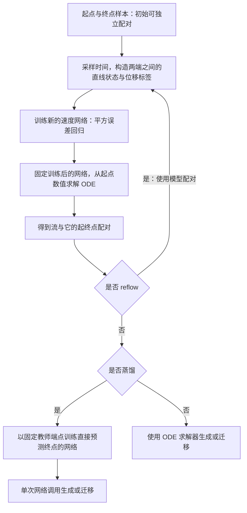

原文：[[Paper/GLM/Reflow/Flow_Straight_and_Fast_Learning_to_Generate_and_Transfer_Data_with_Rectified_Flow.pdf|打开论文 PDF]]

# Flow Straight and Fast: Learning to Generate and Transfer Data with Rectified Flow

# First Time

## 1.Title & Authors
标题原文：Flow Straight and Fast: Learning to Generate and Transfer Data with Rectified Flow。
自然中文译法：《让流更直、更快：用整流学习数据生成与迁移》。也可以把 Rectified Flow 保留为“整流流”，以便与后续文献的术语对应。
标题前半句提出“更直、更快”的核心主张，后半句交代实现方法与任务。这里的 flow 指连续时间动力系统产生的流：样本从一个分布出发，在所学习的速度场作用下运动，最终到达另一个分布。“Straight”指样本的运动轨迹尽量接近恒速直线；“Fast”指推理时可以减少数值求解所需的步数。两者之间的联系是：足够直、速度变化足够小的轨迹，更容易用很少的数值更新近似。
研究对象是两个分布之间的运输。把起点分布记为 $\pi_0$，终点分布记为 $\pi_1$。当起点是高斯噪声、终点是真实图像时，这是生成建模；当起点和终点来自不同的数据域时，这是数据迁移。同一种训练思想由此覆盖两类任务。
关键词包括 Rectified Flow、ordinary differential equation（常微分方程，ODE）、distribution transport（分布运输）、coupling（耦合）、rectification（整流）、reflow（重复整流）、generative modeling（生成建模）与 domain transfer（域迁移）。其中 coupling 描述起点与终点如何联合配对，flow 描述样本在两端之间如何运动，两者有关联但不是同一个对象。
标题中的“直”是希望获得的性质，不能理解为第一次训练结束后，每条生成轨迹就已经严格为直线；“快”主要指生成与迁移时的推理速度，也不等于训练没有额外成本。
作者按原文顺序为 Xingchao Liu、Chengyue Gong、Qiang Liu。署名信息中，三位作者的机构均为 University of Texas at Austin。脚注明确写明 Xingchao Liu 与 Chengyue Gong 对本文等贡献；不能仅根据署名位置推断每位作者承担了哪些理论、算法或实验工作。
与本研究直接相关的作者研究线索来自本文自己的参考文献：参考文献 [44] 列有 Xingchao Liu、Qiang Liu 等共同署名的《Let us build bridges: Understanding and extending diffusion generative models》，参考文献 [90] 列有包含本篇三位作者的《Diffusion-based molecule generation with informative prior bridges》。这些题名反映了与扩散、桥过程和分布运输相关的研究脉络；本稿未给出三位作者更细的贡献分工。

## 2.Abstract
摘要依次回答：要解决什么问题、用什么训练办法、为什么要追求直线、整流有什么理论性质，以及少步数推理是否在任务中有效。下面按原文八个语义单元解释。
语义单元 1：提出用简单的 ODE 学习框架统一分布运输任务。
作者提出 Rectified Flow，用于学习把两个可通过样本观察的分布 $\pi_0$ 与 $\pi_1$ 连接起来的神经常微分方程。这里“通过样本观察”意味着训练主要依赖两个分布的样本，不要求事先知道它们的完整概率密度。神经 ODE 的基本形式可以写成 $\mathrm{d}Z_t/\mathrm{d}t=v_\theta(Z_t,t)$：神经网络读取样本的当前位置和时间，输出它接下来应该朝哪里、以多快的速度运动。
“统一”来自对两端分布的设置：噪声到图像属于生成，源域数据到目标域数据属于迁移。统一的是运输任务的表达方式和核心学习框架，具体数据、网络结构及任务设置仍然可以不同。一个需要保留的条件是：两端必须能放进论文考虑的共同状态空间；不能把这一表述直接扩展成任意不同维度、不同类型的数据之间都能原样使用。
这一句承担背景与方法定位的作用。它先把通常分开讨论的生成和迁移重新表述为同一个问题：如何让一个分布的样本经过可学习的运动，变成另一个分布的样本。
语义单元 2：让学习到的运动尽量跟随连接两端样本的直线。
基本设想是：取一对起点和终点样本 $X_0$ 与 $X_1$，把它们之间的直线当作训练参考。理解这句话可以借助线性插值 $X_t=(1-t)X_0+tX_1$：时间从零走到一，参考点便从起点匀速走向终点。
这里存在一个重要区别：训练时可以同时看到两端，因此能够构造直线；生成时只能从起点出发，并不知道自己应该去的具体终点。模型要学会根据当前位置和时间决定速度，而不是在推理时索取一个真实目标样本。不同配对产生的参考线还可能相交，同一位置和时间未必对应唯一的参考方向，因此“尽量跟随”不等于逐条照搬每条训练直线。
这一句提出核心几何直觉，但没有声称随意配对之后一次回归就能得到处处严格笔直的轨迹。后文的 reflow 正是围绕如何进一步改善轨迹展开。
语义单元 3：把训练写成普通的非线性最小二乘问题。
作者使用平方误差训练速度模型：模型对中间状态给出速度预测，再与参考路径对应的速度比较。对于上述恒速线性插值，参考速度就是端点位移 $X_1-X_0$。这样，即使没有人工标注的正确跨域配对，也能通过采样与插值构造回归训练数据。
“非线性最小二乘”中的“非线性”主要来自速度网络对参数的依赖，并不意味着训练参考路径要采用非线性曲线。与普通监督学习相似，这个训练过程可以对样本、时间和误差做随机采样，再更新网络参数，因此容易使用现有的大规模神经网络训练方式。
摘要关于“不引入超出标准监督学习的额外参数”的表述，应结合上述训练形式理解：不需要为核心方法再搭建对抗博弈等额外机制。它并没有声称网络不含参数，也没有保证优化器、模型容量、训练时长和采样配置都不需要选择。
这一句解释了方法为何被作者称为简单：几何上的路径学习，被转化为容易优化的回归目标。
语义单元 4：直线的价值在于运输几何和数值求解。
作者强调，直线是固定两个端点之间的最短路径，而严格恒速的直线运动不需要逐段逼近整条曲线。若学习到的某条轨迹确实恒速直行，时间跨度取一时，用一次欧拉更新 $Z_1=Z_0+v(Z_0,0)$ 就能到达该轨迹的精确终点。
这里必须保留“严格恒速”的条件。几何上位于一条直线、但沿途速度改变的运动，仍然可能存在单步欧拉误差；实际训练得到的近似直线轨迹也不自动享有精确单步求解的结论。因此，摘要说直线路径可以精确模拟，是理想路径性质；实验中少步数能否保持质量，还需要实际结果支持。
还要区分两个层面的最短：固定起点与终点后，直线具有最短路程；但在整个人群或整个分布之间，怎样选择起终点配对才能使总运输代价最小，是另一个问题。单条路径走直线，不能单独证明配对已经达到最优传输。
语义单元 5：整流把已有耦合转化为新的确定性耦合，并有凸运输代价不增加的理论性质。
耦合指一个联合分布：分别看起点，其分布是 $\pi_0$；分别看终点，其分布是 $\pi_1$；联合起来则额外规定哪些起点与哪些终点相配。最初完全独立地抽取两端样本，也是一种有效耦合，只是它通常没有利用数据的几何或语义关系。
整流学习速度场后，从一个起点求解 ODE 会产生一个终点。在满足适当条件、ODE 具有唯一解时，这形成一个由起点决定终点的新耦合。这里“确定性”是指给定起点后结果由流决定；起点仍然可以随机采样，所以它不等于每次生成相同的输出。
摘要的理论主张是：在相应理想化假设和可积性等条件下，相比输入耦合，新耦合对于凸的端点位移代价，其期望不会增加。它关心的是耦合整体的期望，不是保证每个单独样本都缩短距离，更不是保证每个下游任务指标都会改善。
“代价不增加”也不等于“已经找到最优传输”。理论上的精确速度场与实际有限网络训练得到的近似速度场，需要分别看待。 正文 Section 3.2 与 Section 3.4 会进一步区分这些结论。
语义单元 6：重复整流让轨迹趋于平直，服务于粗时间离散的快速推理。
递归应用 rectification 就是 reflow。它先用上一轮训练好的流生成起点与终点的配对，再把这些新的配对作为下一轮训练的输入。下一轮仍然学习这些端点之间的参考直线，但端点对应关系已经来自上一轮模型，而不是继续使用最初的独立配对。
因此，reflow 包含重新生成配对和重新训练两个环节。它可以改善学到的流的几何性质，并不只是把同一个模型的采样步数调小，也不等于保持原有输入输出对应关系完全不变的蒸馏。蒸馏与整流的区别在正文 Section 2.2 单独讨论。
摘要把这种趋势概括为路径越来越直。严谨阅读时，应把这一概括与正文对平直度的具体定义及收敛结论对应起来，不能擅自扩展成有限网络、每条路径、每一轮的所有误差都严格单调下降。其计算意义是：当沿途速度变化较小时，推理可以用较少的时间步完成，而不必不断调用网络去追踪弯曲路径。
语义单元 7：实验覆盖图像生成、图像翻译与域适应。
作者报告了三类应用：图像生成从简单分布产生图像；图像到图像翻译把源域图像转向目标域；域适应通过分布迁移帮助分类等下游任务。三类任务分别检查了生成能力、跨域变化能力，以及迁移是否对任务表现有用。
摘要在这里使用较强的正面评价，但没有逐项给出数据集、指标数值、比较方法或统计误差。因此，第一次阅读可以确认实验覆盖的任务范围，不能仅凭这一句就推断它在所有指标上都优于所有比较对象。具体证据应回到 Section 5 的相应实验与表格。
这一句的作用是把前面的学习框架与理论性质，连接到实际可测试的任务。
语义单元 8：特别强调一次欧拉更新也能产生高质量生成与翻译结果。
最后一句收紧实验亮点：在图像生成和图像翻译中，作者得到近乎笔直的流，即使用一次欧拉离散更新也能获得高质量结果。这个“一次”是推理更新步数，不是只训练一次、只看一个样本，或者不需要 reflow 等训练阶段。
“近乎笔直”与“单步仍有较好质量”在这里是相互关联的经验结果；它们没有把近似轨迹变成严格直线，也没有证明任何数据集和任意计算预算下单步都足够。若比较单步、多步、蒸馏前后模型，需要保留各自的训练过程与评估设置，不能只比较推理步数这个数字。
把摘要压成一条主线：先构造两端样本之间的直线路径并回归速度，再用学习到的 ODE 重新建立配对；重复整流改善轨迹形状，最终争取用更少的推理更新完成分布运输。
下面提取摘要的四个要素，保留其证据边界。

| 要素 | 本文内容 | 阅读时保留的条件与边界 |
| --- | --- | --- |
| 问题 | 如何学习两个可采样分布之间的运输，并减少连续时间生成模型推理时的数值求解成本。 | 统一的是运输框架；不同任务仍有各自的数据表示、训练配置与评价方式。 |
| 方法 | 利用连接端点的直线路径构造速度回归任务，学习 Rectified Flow；再通过 reflow 使用模型产生的新配对继续训练。 | 原始参考直线与真正求解得到的 ODE 轨迹需要区分；重复整流还会增加训练与配对生成的工作。 |
| 结果 | 报告图像生成、图像翻译和域适应实验；特别指出生成和翻译在一次欧拉更新下也能取得高质量结果。 | 摘要未给出具体 FID、IS 或分类准确率；理论性质依赖其假设，实际模型存在拟合和求解误差。 |
| 意义 | 通过简单回归学习分布运输，并将轨迹几何与快速推理联系起来。 | 这是作者明确主张的意义；不能直接推广为严格最优传输、通用单步生成保证或所有任务指标改善。 |

第一次接触时最需要抓住的区别是：训练时构造的直线，不等于模型已经学出的真实轨迹；轨迹变直，不等于配对达到最优传输；推理只用一步，也不等于整个训练流程只需一步。

## 3.Related Works and Discussion
本稿没有单独的 Conclusion 或 Conclusions。这里按已确定的替代安排，精读原文 Section 4 末尾的两个讨论小节：Re-thinking the role of diffusion noise 和 Optimal vs. straight transport。它们分别讨论“分布运输是否必须依赖随机扩散”与“快速运输是否必须求得最优耦合”，共同解释作者为何选择直接学习接近恒速直线的 ODE。
这两部分是作者对方法的定位和解释，并不构成一个逐项回顾全部实验的正式结论。下面依照原文论点展开，把可核实的方法性质、作者的经验判断以及解释时补充的适用条件分别说明。

## 4.Re-thinking the role of diffusion noise
这一小节的中文意思是“重新思考扩散噪声的作用”，原位置在 Section 4。
第一段先提出反问：扩散噪声在已有方法的推导里十分重要，但它是否就是这些方法成功的必要原因？作者以 Rectified Flow 仅使用 ODE、仍能在所考察任务中取得有竞争力结果为依据，主张把随机扩散机制与其他优点分开看。这里“仅使用 ODE”指生成动力学没有持续加入布朗运动噪声；它不排除随机采样初始噪声，也不排除训练时随机抽取样本和时间。
接着，作者提出一个解释：扩散方法的成功，可能主要来自简单、稳定、可扩展的优化训练程序，而未必主要来自生成过程中持续注入的随机噪声。这个“可能”必须保留。本文展示了另一种有效训练框架，但没有通过完全控制网络、路径、目标、计算量与采样器的实验，单独测量每个因素对成功的贡献。因此，它支持“可以不依赖 SDE 推导来学习有效的生成 ODE”，还不能证明“随机噪声在所有生成任务中没有价值”。
第二段把问题分成两个层次：如果目的已经是学习 ODE，就可以直接设计 ODE 的训练方式；如果任务还没有确定动力学形式，则仍需要选择 ODE 或 SDE。作者倾向优先考虑 ODE，并列出六项比较。这个倾向是本文问题设置下的方法立场，下面逐项说明它的依据与边界。
概念简洁与数值速度：ODE 给出由当前位置和时间决定的速度；SDE 还需要描述随机扰动及其时间演化。作者因此认为 ODE 更容易理解和模拟。对于本文希望获得的近直线流，较少的网络调用确实是明确的计算目标。但仅凭“ODE”这个类别，无法保证任意一个具体 ODE 总比任意 SDE 更快；实际代价还受到路径形状、误差容忍度、求解器和模型大小影响。这里的主线是更简单的动力学加上更适合少步求解的轨迹设计。
时间可逆性：在流存在、解唯一且能够沿区间双向求解的条件下，可以沿同一个 ODE 速度场正向或反向求解，得到两端样本间的确定性对应。SDE 的逆向过程则通常需要额外的分布信息与相应理论。作者据此强调 ODE 在双向迁移中的便利。数学上可逆也不保证数值上完全无误差；若端点附近速度场奇异或反向求解不稳定，实际重建仍可能有偏差。
潜在空间：对于确定性 ODE，给定 $Z_0$ 后，生成终点 $Z_1$ 由流决定，因此初始状态可以作为与输出对应的潜在表示。Rectified Flow 的运输代价性质为这种对应关系提供了额外的几何动机。与之相比，SDE 的输出还依赖沿途随机扰动，仅知道初始状态通常不足以唯一确定结果。作者对随机耦合用于潜在表示的价值作了很强的负面评价；更稳妥的理解是，它缺少“仅由初始状态决定输出”这种直接对应，而不是随机模型不可能构造任何有用的表示。即使固定全部随机数使一次程序运行可复现，也不等于只固定起点就获得同样的对应。
训练难度：作者认为，没有理由仅因为 ODE 缺少扩散项就断言它更难训练。在其讨论的扩散设置中，ODE 与 SDE 可以共享训练输入的边缘分布，而训练目标通过相应变换联系起来；原文具体指向公式（15）与（18）。这个论点说明训练 ODE 不必采用昂贵的轨迹反向传播或似然优化方式。它不是所有模型、优化器和有限数据条件下的训练难度定理，也不能把这两个公式在特定设定下的联系扩展成任意 ODE 损失与任意 SDE 损失等价。
表达能力：作者借助 probability flow 的思想指出，在适当条件下，SDE 可以对应一个具有相同时间边缘分布的 ODE。因此，当任务只要求把初始分布运到目标分布时，ODE 并不因为去掉沿途随机扰动就自动失去所需的分布表达能力。这里的关键对象是单个时刻的 $\operatorname{Law}(Z_t)$，不是整个随机过程的联合分布。两种过程可以在每个时刻具有相同的分布快照，却具有不同的轨迹、端点配对及跨时间相关性。原文也明确承认，如果任务需要丰富的时间相关结构，SDE 可能更合适。
相同的时间边缘分布，不等于相同的随机过程；能够表示同一个目标分布，也不等于有限模型与有限计算下的学习表现相同。
流形数据：作者认为图像、文本等结构化数据具有低维结构，确定性动力学与这种结构较契合，而 SDE 需要适当减弱末期随机扰动才能得到更平滑的输出。他们同时指出，高噪声数据或本身包含物理扩散机制的任务，可能更适合 SDE。这里应补充一个数学条件：若初始分布满维，有限时间内的 ODE 流映射始终足够规则且可逆，就不能仅因使用神经网络速度场而把它精确压成严格低维的分布。接近低维结构、终点处的奇异极限和严格有限时间降维需要分别讨论。因此，“偏向流形”应作为作者的建模直觉阅读，不宜当作本文已经证明的一般定理。
这六项比较形成的论证链是：对于本文主要关心的分布运输任务，先考虑简单的确定性动力学；直接通过回归学习它，并设计有利于快速求解的路径；如果任务本身还要求随机过程的时间结构，再评价持续随机扰动的必要性。
与摘要对照，摘要主要报告方法、运输性质和少步推理结果；这一讨论新增了对扩散成功原因的解释，以及 ODE 与 SDE 的较广泛比较。前者含有待进一步验证的因果判断，后者含有依赖任务与正则条件的论点。本小节最可靠的结论是：有效的生成 ODE 可以直接训练，持续随机扩散不是本文所示运输任务的必需组成。 把它扩大成“所有扩散模型都不需要随机性”，会超出原文实验证据。

## 5.Optimal vs. straight transport
这一小节的中文意思是“最优运输与直线运输”，原位置同样在 Section 4。
第一段说明最优运输的目标：给定两端分布，在保持两端边缘分布不变的各种耦合中，寻找使 $\mathbb{E}[c(Z_1-Z_0)]$ 最小的耦合，其中 $c$ 是选定的代价函数。常见例子是平方欧氏位移代价 $c(u)=\lVert u\rVert^2$。真正需要优化的是“哪些起点与哪些终点配对”，不是仅仅在配对已经固定时画一条直线。
第二段给出作者没有把求精确最优耦合作为核心目标的两个理由。计算方面，高维连续分布之间的最优运输映射求解困难；任务方面，选定的数学运输代价未必与生成质量、语义对应或下游分类表现完全一致。因此，花更多计算把一个代价优化到更低，不自动保证实际学习任务表现更好。这一段是在解释目标取舍，并没有证明最优运输无用，也没有证明优化运输代价一定会损害质量。
第三段转向本文目标：reflow 希望找到一个 straight coupling，使它诱导的整流流沿恒速直线运动。它不针对某个特定的 $c$ 直接优化，因此一般不能保证求得该代价下的全局最优耦合。这里应把原文概括性的“不最优”读成“不保证最优”，而不是“永远不可能最优”；Section 3.4 还专门讨论了一维情形及直线耦合与最优耦合的关系。
为何这种较弱目标仍然有意义？因为对于严格恒速的直线流，给定起点后，一次欧拉更新就能精确计算其终点。对本文的快速推理目标而言，这已经消除了沿曲线反复更新的必要。作者说不同 straight couplings 在快速推理角度“同样好”，应限定为它们都具备理想单步求解这一性质；并不是说它们的运输代价、语义结构、有限网络拟合难度或实际生成质量相同。
把这一段与摘要合起来看，有三个不同命题。第一，整流在理想条件下不会增加输入耦合的凸运输代价，这是相对于已有配对的改进性质，见 Theorem 3.5。第二，递归整流具有平直化的理论性质，见 Theorem 3.7。第三，对于指定代价找到全局最优耦合，是更强的要求，不能由前两条直接推出，见 Section 3.4。它们的作用与条件各不相同。
本文的目标取舍是：为快速求解寻找足够平直的流，同时利用整流的运输性质；不要求先解决一个高维精确最优传输问题，才允许进行有效生成。
结论替代部分的收束可以表述为：Rectified Flow 把“如何训练一个有效的分布运输模型”和“如何减少其推理步数”放在同一个简单框架中。前者通过速度回归直接学习 ODE，后者通过路径设计与 reflow 改善轨迹。作者并未在这两个讨论小节中给出一个独立的未来工作清单；其中关于扩散成功原因、不同动力学适用任务的判断，仍有进一步检验的空间，不能作为已经完成的验证。

## 6.Analogy
可以把问题想成规划两片城区之间的配送：起点城区有一批包裹，终点城区有一批收货位置。生成建模中，起点是可方便采样的噪声；迁移任务中，起点本身也是某类真实数据。我们既要让最终收货位置的整体分布正确，也希望路线容易执行、导航更新次数少。
训练时先把起点与终点配成对，为每对画一条直线，再用这些直线上的位置、时间和参考方向训练导航员。问题是，不同参考线路在同一时刻、同一位置可能给出不同方向；真正运行的导航员只能根据当前位置和时间给出一个速度。因此，它可能建立一套新的起终点对应关系，实际行驶轨迹也未必就是最初画出的直线。在论文相应理论条件下，最终整体分布仍可保持正确。
reflow 相当于观察上一版导航实际把哪些起点送到了哪些终点，再用这些新配对重新画直线、训练下一版导航。随着轨迹更接近恒速直行，就能减少沿路重新判断方向的次数。若真的已经恒速直行，起步时一次确定整段位移就足够；如果只是接近直线，单次更新仍是需要实验评估的近似。
最优运输则进一步追问：在所有合法配对里，哪一种使全城总配送代价最小？一套路线容易执行，并不自动回答这个更强的问题。这个区别对应了本文“追求平直便于快速推理”和“对于指定代价求全局最优”的不同目标。
类比的边界： 这里的路线存在于高维样本空间，不是真实街道；“同一时刻、同一位置”的方向冲突不能简化成二维图上任何两条线都不能相交；整体分布正确也不等于每对样本都具有期望的语义对应。类比用于连接问题、训练、reflow 与少步推理，不替代边缘保持性质、代价不等式或平直化定理的证明。

# Second Time

## 1.Notation & Parameters
这里列出支撑正文主线的重点记号。同一字形在不同语境下可能有不同含义，尤其要分清条件密度权重与扩散漂移系数中的两个 $\eta_t$。

| 符号/参数 | 含义与作用 | 关键设定/约束 |
| --- | --- | --- |
| $\pi_0,\pi_1$；$d$ | 起点与终点分布；共同样本空间维度。 | 本文在 $\mathbb{R}^d$ 上讨论；生成时常取 $\pi_0=\mathcal{N}(0,I)$，迁移时可取源域分布。 |
| $(X_0,X_1)$ | 训练用端点耦合，规定起终点如何配对。 | 两端边缘分布固定；初始训练常用独立耦合 $\pi_0\times\pi_1$，reflow 时改用模型端点耦合。 |
| $X_t,\dot X_t$ | 参考随机路径及其时间导数。 | 线性主设定为 $X_t=(1-t)X_0+tX_1$、$\dot X_t=X_1-X_0$；非线性扩展允许其他可微插值。 |
| $Z_t$ | 真正求解 ODE 得到的状态。 | $\dot Z_t=v(Z_t,t)$；理想条件下与 $X_t$ 的时间边缘分布相同，轨迹与联合分布未必相同。 |
| $v_\theta,\theta$ | 可训练速度场及网络参数。 | 实际输入包含状态和时间，输出为 $d$ 维速度；算法框省略时间输入的映射写法应结合公式理解。 |
| $v^X$ | 给定参考路径的理想条件平均速度。 | $v^X(z,t)=\mathbb{E}[\dot X_t\mid X_t=z]$；是总体平方损失的最优预测，不等于有限训练网络。 |
| $\operatorname{RectFlow},\operatorname{Rectify}$ | 前者输出完整流，后者输出流的端点耦合。 | 都依赖参考端点或路径；正文定理有可整流性和唯一性等条件。 |
| $Z^k,k$ | 第 $k$ 次整流得到的流；整流轮数。 | 上标是轮次，不是乘方；下一轮使用 $(Z_0^k,Z_1^k)$ 作为训练配对。 |
| $S(Z)$ | 流速度相对端点位移的均方偏离。 | 公式（3）；理想的恒速直线流满足 $S(Z)=0$。 |
| $V((X_0,X_1))$ | 给定中间位置和时间后，参考速度的剩余条件方差。 | 公式（12）；衡量同一状态处速度方向/大小的歧义，按概率意义理解。 |
| $c$ | 端点位移代价函数。 | 凸代价不增加；严格凸性用于等号与直线耦合判别；常见 $c(u)=\lVert u\rVert^2$。 |
| $T,\widehat T$ | 运输映射；蒸馏得到的直接映射。 | 常用参数化为 $\widehat T(z)=z+v_\theta(z,0)$；蒸馏追踪既有端点关系，reflow 可改变耦合。 |
| $\alpha_t,\beta_t$ | 插值两端或数据与噪声的时间系数。 | 标准整流取 $t,1-t$；扩散对应日程未必严格满足标准起点边界。 |
| $w_t$ | 时间加权。 | 公式（6）中为正；总体无限容量条件下不改变逐状态最优条件均值，有限训练时会改变侧重。 |
| $\rho(x_0\mid x_1),\eta_t(x_1,z)$ | 条件密度与归一化的密度权重。 | 公式（4）中的 $\eta_t$ 有状态和端点参数，不是扩散漂移系数。 |
| $h,\kappa_h,\omega_h$ | 核带宽、相似度核、归一化核权重。 | 公式（5）；带宽控制平滑与局部化。正文不同示例使用不同 $h$，不能一概当作同一默认值。 |
| $\xi,\xi_t,W_t$ | 固定高斯噪声、随时间关联的高斯过程、布朗运动。 | 一般插值可用同一个 $\xi$；扩散训练某时刻的损失只依赖该时刻的边缘分布，不代表全过程等价。 |
| $\eta_t,\sigma_t$（扩散语境） | 公式（14）–（18）中的线性系数与扩散系数。 | 与 $\alpha_t,\beta_t$ 的关系由公式（16）确定；不能与公式（4）的权重混淆。 |
| $a,b,\sigma_{\min},r$ | VP/sub-VP 与 VE 的日程参数。 | 本稿 VP/sub-VP 给定 $a=19.9,b=0.1$；VE 给定 $\sigma_{\min}=0.01$，并以 $r\sigma_{\min}=\sigma_{\max}$ 设噪声尺度。 |
| $N,\mathrm{NFE}$ | 离散步数与网络函数求值次数。 | 显式欧拉每步一次求值时二者一致；RK45 不能把一次接受步简单等同于一次函数求值。 |

表内没有穷尽所有临时推导记号；测试函数、局部索引、特定证明中的辅助量在相应段落解释。

## 2.Introduction
原文 Section 1 从监督学习和无监督学习的差别切入。监督学习直接提供输入与输出的对应关系，而生成、表示学习和跨域迁移通常只有两端的样本集合，没有正确配对。这一观察把困难从“怎样设计更复杂的生成器”转到“怎样在两个分布之间建立有用对应”。
无编号关系：运输映射问题。给定 $X_0\sim\pi_0$、$X_1\sim\pi_1$，寻找 $T:\mathbb{R}^d\to\mathbb{R}^d$，使 $Z_1=T(Z_0)\sim\pi_1$，其中 $Z_0\sim\pi_0$。这是推前关系 $T_\#\pi_0=\pi_1$ 的展开写法；推前符号是讲解辅助。检查方法是对任意可测集合 $A$，有 $\mathbb{P}(T(Z_0)\in A)=\pi_1(A)$。这里并没有要求 $T(X_0)$ 等于随机配给它的某个 $X_1$，要求的是总体输出分布正确。
引言依次回顾三类困难。GAN 用对抗优化匹配分布，但作者强调其训练稳定性与模式坍塌问题；VAE 和似然模型为使概率计算可行，需要变分近似或结构约束；连续时间模型则通过学习神经速度场或漂移场提供另一条道路。这些是作者对研究背景的归纳，不能理解成每个 GAN 都失败、每个似然模型都计算不可行。
连续时间模型的优势，是训练目标可以利用动力学结构，减少直接优化复杂分布差异的困难。代价是推理必须数值求解：每一次求值都可能运行一个昂贵神经网络。于是，网络是否容易训练与生成是否只需少量调用，是两个不同问题。本文选择同时考虑这两个问题，而不只在固定模型上更换求解器。
引言还比较最优运输。无编号目标 $\mathbb{E}[c(Z_1-Z_0)]$ 衡量一个耦合的期望端点位移代价，其中 $c:\mathbb{R}^d\to\mathbb{R}$。它必须连同“固定两端边缘分布”的约束一起读：没有约束，令终点等于起点就可能使代价很小，却不完成运输。作者认为高维精确最优运输代价较高，而且选定的几何代价与生成质量并不完全一致，所以转向较容易获得、又与推理速度直接相关的平直性。
这一研究缺口由此明确：能否保留扩散式回归训练的简单性，又直接设计对少步推理有利的 ODE，并自然支持数据域到数据域的迁移？图像例子先给出经验动机，再由方法和理论解释。
图表对应：[Fig1 精读](#fig1)、[Fig2 精读](#fig2)。

## 3.Contribution
原文 Introduction 中的 Contribution 部分把新增内容分为学习框架、理论性质和应用证据。框架是直接学习跟随直线参考路径的速度场；理论是边缘保持、凸运输代价不增加和平直化；应用则包括生成、翻译和域适应。平方损失、神经 ODE 和欧拉方法本身已有，本文的重点在它们如何围绕整流与重配对组合起来。
作者给出 CIFAR-10 单步模型的 FID 4.85 和 recall 0.51 作为亮点，但核对 Table 1 后要拆开：蒸馏后的二次整流模型给出 FID 4.85、recall 0.50；蒸馏后的三次整流模型给出 recall 0.51、FID 5.21。引言把两个最佳数字并列，不能当成同一个模型同时取得。这里的“最先进”也只按作者当时列出的比较对象和协议理解。
贡献段反复把直线与单步联系起来，必须记住它的严格版本要求恒速直行；模型近似、数值误差和再训练误差仍会影响实际结果。正文接下来先给最简单的算法，再解释为何它确实完成运输。
图表对应：[Table1 精读](#table1)。

## 4.Method
原文 Section 2 的安排是：Overview 给训练与推理；Main Results and Properties 解释回归解、边缘保持、代价、reflow、蒸馏与可计算速度场；A Nonlinear Extension 把直线替换为其他路径，以连接 PF-ODE 和 DDIM。
下图是依据 Algorithm 1 重绘的可编辑流程。它只展示计算与数据依赖，没有假设特定 U-Net 层数；reflow 的次数由使用者选择，不代表 ODE 时间步数。教师流求解用于产生配对，单次基本回归训练不需要反向穿过该求解过程。

基本训练只使用参考路径上的状态；推理使用真正的模型轨迹。图中回流的是端点样本对，不能把教师求得的弯曲中间轨迹误当成下一轮回归必须逐点模仿的标签。

## 5.Overview
原文 Section 2.1。无编号动力学 $\mathrm{d}Z_t=v(Z_t,t)\mathrm{d}t$ 表示位置的时间导数由速度场决定，初始状态来自 $\pi_0$。网络的输出与状态同为 $d$ 维，时间是额外输入；原文把映射简写为 $\mathbb{R}^d\to\mathbb{R}^d$，不能据此删除时间条件。
公式（1）：核心训练目标。
$$
\min_v\int_0^1\mathbb{E}\!\left[\left\|(X_1-X_0)-v(X_t,t)\right\|^2\right]\mathrm{d}t,
\qquad X_t=(1-t)X_0+tX_1.\tag{1}
$$
这是设计的回归目标，并非某个物理定律强制的唯一选择。先给定端点耦合，再用直线插值定义参考路径。对它求导得到无编号关系 $\dot X_t=X_1-X_0$，因此平方误差比较的是预测速度和参考速度，二者维度一致。时间区间长度为一，所以 $t\sim\operatorname{Uniform}([0,1])$ 的期望恰好等于该积分；若改用别的时间采样密度而不补重要性权重，就会改变目标权重。
Algorithm 1 的训练式正是把 $v$ 参数化为 $v_\theta$ 后，求 $\widehat\theta=\arg\min_\theta\mathbb{E}_{t,X_0,X_1}\lVert X_1-X_0-v_\theta((1-t)X_0+tX_1,t)\rVert^2$。每次更新的输入由样本与插值直接得到，既不需要先数值积分 ODE，也不需要计算生成样本密度。对参数求导的讲解补充为 $2\mathbb{E}[(\partial_\theta v_\theta)^\top(v_\theta-(X_1-X_0))]$，在可交换求导与期望时成立；它说明训练梯度来自普通网络回归。
为何不直接使用 $\dot X_t=X_1-X_0$ 生成？因为右端需要提前知道终点。对于只给定当前状态与时间的导航规则，它还可能包含未观察的配对信息。作者称之为 non-causal；这里指相对于当前状态描述不能直接闭合，而不是说任何预先采样好端点的随机过程在所有概率滤过下都“不因果”。把标签回归成 $v(x,t)$，就获得无需已知终点的状态规则。
无编号反向关系需要修正时间参数。若定义 $Y_s=Z_{1-s}$，链式法则给出 $\mathrm{d}Y_s/\mathrm{d}s=-v(Y_s,1-s)$、$Y_0=Z_1$。原文反向描述写成 $-v(\widetilde X_t,t)$，漏掉了时间变换；一般非自治速度场应使用 $1-s$。训练对称性同理：交换两端、令 $s=1-t$，新速度场为 $v_{\mathrm{rev}}(x,s)=-v(x,1-s)$，而不仅仅是在同一时间参数下改符号。
“Flows avoid crossing”解释的是唯一性：同一时刻、同一位置的一个单值速度场不能同时给两个方向。若有适当正则性保证唯一流，不同轨迹不能以不同速度穿过同一个时空点。几何投影交叉、不同时间经过同一空间位置，不被这一说法排除。参考直线相交时，回归会产生新的速度与端点配对，模型并不是离散地选择每个交叉口的一条旧线路。
无编号算子定义 $Z=\operatorname{RectFlow}((X_0,X_1))$ 输出过程，$(Z_0,Z_1)=\operatorname{Rectify}((X_0,X_1))$ 输出端点耦合。理想速度与适定 ODE 条件下，两者完成相同边缘分布间的运输；耦合通常改变。初始 $(X_0,X_1)\sim\pi_0\times\pi_1$ 只是常用选择，不是定理要求。
无编号递推 $Z^{k+1}=\operatorname{RectFlow}((Z_0^k,Z_1^k))$，初始端点对为 $(Z_0^0,Z_1^0)=(X_0,X_1)$，定义了 reflow。第一轮学习随机配对的参考直线，第二轮学习第一轮模型端点间的参考直线。改变配对而保持目标边缘，是后续平直化机制的关键。
图表对应：[Fig2 精读](#fig2)、[Fig3 精读](#fig3)。

## 6.Main Results and Properties
原文 Section 2.2。这里先给直觉，严格论证留在 Section 3。理解顺序是先求回归最优解，再讨论由它定义的 ODE；不能只因为网络训练了平方损失，就把以下精确结论无条件套给实际网络。
公式（2）：回归的总体最优解。
$$
v^X(x,t)=\mathbb{E}[X_1-X_0\mid X_t=x].\tag{2}
$$
推导时固定 $t$，记 $D=X_1-X_0$、$m(X_t)=\mathbb{E}[D\mid X_t]$。分解 $D-v=(D-m)+(m-v)$ 后，交叉项的条件期望为零，因为 $\mathbb{E}[D-m\mid X_t]=0$。于是 $\mathbb{E}\lVert D-v\rVert^2=\mathbb{E}\lVert D-m\rVert^2+\mathbb{E}\lVert m-v\rVert^2$。第二项非负，最优预测为条件均值。它是对参考位移的局部平均，不是逐条复制训练配对。
无编号边缘保持关系为 $\operatorname{Law}(Z_t)=\operatorname{Law}(X_t)$，进而 $(Z_0,Z_1)$ 是 $\pi_0,\pi_1$ 的耦合。与之相反，$(Z_0,Z_1)$ 的联合分布一般不同于 $(X_0,X_1)$；同一时刻的质量流量相同，与同一个粒子一生沿着相同路径，是两种不同主张。正式证明使用连续性方程。
无编号代价关系为 $\mathbb{E}[c(Z_1-Z_0)]\leq\mathbb{E}[c(X_1-X_0)]$。例如 $c(u)=\lVert u\rVert^\alpha$、$\alpha\geq1$，是范数的凸非减幂复合，因此为凸函数。整流对所有可积凸运输代价同时给出不增加的性质，但没有指定其中哪个代价是最终优化目标。对 $c(u)=\lVert u\rVert$ 的图形解释，是端点直线距离不超过曲线总长度，再结合局部平均不会增大平均速度范数；图形本身不能替代一般凸代价的证明。
图表对应：[Fig22 精读](#fig22)、[Fig23 精读](#fig23)、[Fig3 精读](#fig3)。
无编号恒速直线定义为 $Z_t=(1-t)Z_0+tZ_1$，等价于沿轨迹 $v(Z_t,t)=Z_1-Z_0$ 为常数。求导得到前者蕴含后者，反向对时间积分便得到前者。于是 $Z_1=Z_0+v(Z_0,0)$ 是严格单步欧拉关系。它要求给定起点的整条轨迹具有恒速性质；不能把固定端点的任意几何直线都当作同一条件。
无编号 Burgers 关系解释了这种性质有多强。在速度场足够光滑时，链式法则给出
$$
\frac{\mathrm d}{\mathrm dt}v(Z_t,t)
=\partial_t v(Z_t,t)+(\nabla_zv(Z_t,t))v(Z_t,t).
$$
若沿轨迹速度恒定，左边为零，便有 $\partial_t v+(\nabla_zv)v=0$，即无黏 Burgers 型方程。这个零加速度条件是直线流的性质；本文训练并没有显式把它当作额外 PDE 损失。
公式（3）：平直度。
$$
S(Z)=\int_0^1\mathbb{E}\!\left[\left\|(Z_1-Z_0)-\dot Z_t\right\|^2\right]\mathrm dt.\tag{3}
$$
它比较一条轨迹的平均位移速度与瞬时速度。对每条可微轨迹，$\int_0^1\dot Z_t\mathrm dt=Z_1-Z_0$；展开平方并积分可得 $S(Z)=\int_0^1\mathbb{E}\lVert\dot Z_t\rVert^2\mathrm dt-\mathbb{E}\lVert Z_1-Z_0\rVert^2$。因此它非负，且为零意味着速度在时间与样本的几乎处处意义下等于端点位移；配合路径正则性才可提升为处处的恒速表述。
原文在此预告 $\min_{k\leq K}S(Z^k)\leq\mathbb{E}\lVert X_1-X_0\rVert^2/K$。其可靠含义是最佳迭代的量级界；Section 3.3 的望远镜求和会给出索引更清楚的版本。它不直接保证最后一轮的误差以同样速率下降，也不保证每一步 $S$ 都单调下降。
平直度是沿轨迹的积分量；仅有它很小，还不足以无条件保证在特定起始时刻取一次速度就有统一的小误差。实际单步质量还要结合速度的时间正则性与实验检验。
无编号蒸馏关系：用固定教师流产生 $(Z_0^k,Z_1^k)$，训练 $\widehat T(Z_0^k)\approx Z_1^k$。若参数化 $\widehat T(z_0)=z_0+v_\theta(z_0,0)$，则 $\mathbb{E}\lVert\widehat T(Z_0^k)-Z_1^k\rVert^2=\mathbb{E}\lVert v_\theta(Z_0^k,0)-(Z_1^k-Z_0^k)\rVert^2$。这是把训练集中在起始时刻，并直接拟合教师端点。reflow 会产生新耦合；蒸馏试图保持教师耦合，二者不相同。过多 reflow 还会积累估计误差，所以理论可无限递推不等于实践应反复训练很多轮。
为理解正文结果而核对的实现条件：Appendix A 说明，CIFAR-10 的实际单步微调把平方误差替换为 LPIPS 感知相似度损失。上段是正文用来解释蒸馏的平方回归形式，不能直接说 Table 1 的最佳单步数字全部只靠该平方目标得到。这项补充是理解正文证据所需的协议核对，不把附录视为已经逐节精读。
公式（4）：通过条件密度显式表示速度。对 $t<1$，原式可以分成
$$
v^X(z,t)=\mathbb{E}_{X_1}\left[\frac{X_1-z}{1-t}\eta_t(X_1,z)\right],\qquad
\eta_t(x_1,z)=\frac{\rho((z-tx_1)/(1-t)\mid x_1)}{\mathbb{E}_{X_1}[\rho((z-tX_1)/(1-t)\mid X_1)]}.\tag{4}
$$
推导从条件 $X_t=z$ 开始：线性插值得到 $X_0=(z-tX_1)/(1-t)$，进而 $X_1-X_0=(X_1-z)/(1-t)$。给定 $X_1=x_1$ 时，$X_t$ 的条件密度由变量替换得到 $\rho((z-tx_1)/(1-t)\mid x_1)/(1-t)^d$。Bayes 归一化时共同 Jacobian 因子抵消，剩下的后验对先验 $\pi_1$ 的权重就是 $\eta_t$；因此 $\mathbb{E}_{X_1}\eta_t(X_1,z)=1$，代入条件均值即得公式（4）。它要求分母非零、所需矩存在，不能直接代入 $t=1$。
无编号 Jacobian 关系：在可把空间导数移入期望等条件下，对公式（4）求导得到
$$
\nabla_zv^X(z,t)=\frac{1}{1-t}\left\{\mathbb{E}\!\left[(X_1-z)(\nabla_z\log\eta_t(X_1,z))^\top\eta_t(X_1,z)\right]-I_d\right\}.
$$
这里采用向量为列、Jacobian 第 $i,j$ 项为 $\partial v_i/\partial z_j$ 的约定。对 $X_1-z$ 求导给 $-I_d$；对权重求导用 $\nabla\eta=\eta\nabla\log\eta$，形成外积。原文把单位矩阵简写成 $1$、没有显式标外积方向；在多维情况下应按上述尺寸理解。仅称密度处处连续还不足以自动获得任意期望的连续可微性，交换极限需要支配或相应可积性条件。
原文给出局部时间区间上的一致 Lipschitz 性作为 ODE 唯一性的充分条件；还需要适当增长控制以排除有限时间爆炸，且 $t\to1$ 的行为要另外核对。无编号平滑方案 $\widetilde X_0=X_0+\xi$、$\xi\sim\mathcal N(0,\sigma^2I)$、$\xi\perp(X_0,X_1)$ 给输入条件分布增加平滑。真正启动确定性流的分布已变为 $\pi_0*\mathcal N(0,\sigma^2I)$；相对于原始输入，它实现的是随机映射 $T(X_0+\xi)$。这样可得到随机运输核，不能声称原始确定性映射完全不变。
公式（5）：核近似。
$$
v^{X,h}(z,t)=\mathbb{E}\left[\frac{X_1-z}{1-t}\omega_h(X_t,z)\right],\qquad
\omega_h(X_t,z)=\frac{\kappa_h(X_t,z)}{\mathbb{E}\kappa_h(X_t,z)}.\tag{5}
$$
无编号核定义为 $\kappa_h(x,z)=\exp(-\lVert x-z\rVert^2/(2h^2))$，其中 $h>0$。代入权重可把公式（5）写成“速度乘相似度的期望”除以“相似度期望”，即局部加权平均。随 $h\to0^+$，在密度、连续性和局部矩等核回归常规条件下，权重集中到 $X_t=z$，于是收敛到 $\mathbb E[(X_1-z)/(1-t)\mid X_t=z]=v^X(z,t)$；支撑外则是依赖核的外推，不能说精确条件均值已由数据唯一确定。
有限样本时期望换成平均，权重总和仍归一化。大带宽更平滑但偏差可能更大，小带宽更局部但可能有较高方差或不稳定；图中的表现不是任意数据上的统一结论。原文说这些分量指向目标支撑点：每个分量确实指向其 $X_1$，但它们的加权平均可能指向凸包内的点，而不一定是目标分布支撑中的某一点。
本小节还解释了为什么未必追求精确拟合经验分布：已知条件密度与有限目标样本时，公式（4）可能精确回到训练样本；生成新样本却需要适当的平滑归纳偏置。精确经验运输和有用泛化不是相同目标。
图表对应：[Fig7 精读](#fig7)。

## 7.A Nonlinear Extension
原文 Section 2.3 把参考直线推广为任意适当可微的随机插值过程。作用是分开辨认三类性质：条件平均速度可以保持时间边缘；凸运输代价下降依赖更特殊的路径；reflow 的平直化也不是任意非线性路径都自动拥有。
无编号定义仍是 $\dot Z_t=v^X(Z_t,t)$、$Z_0=X_0$，但标签改为 $\dot X_t$，即 $v^X(z,t)=\mathbb E[\dot X_t\mid X_t=z]$。原文这一处条件印成 $X_t=t$，把向量状态与时间标量混在一起；Definition 3.1 明确给出正确条件 $X_t=x$，所以应按状态条件理解。
公式（6）：一般插值的加权速度回归。
$$
\min_v\int_0^1\mathbb{E}\left[w_t\left\|v(X_t,t)-\dot X_t\right\|^2\right]\mathrm dt.\tag{6}
$$
这是目标设计的推广。固定时刻和状态后，把前面的正交分解应用于标签 $\dot X_t$；只依赖时间且为正的 $w_t$ 乘在非负误差外，不改变无限容量逐状态最优解。若某些时刻权重为零，就失去这些时刻的约束；若网络参数跨时间共享或容量有限，权重会改变折中，不能宣称实际训练不受它影响。线性参考路径与 $w_t=1$ 直接恢复公式（1）。
无编号双系数插值为 $X_t=\alpha_tX_1+\beta_tX_0$，端点条件为 $\alpha_1=\beta_0=1$、$\alpha_0=\beta_1=0$，逐项代入 $t=0,1$ 即验证连接正确。求导得到 $\dot X_t=\dot\alpha_tX_1+\dot\beta_tX_0$，这是公式（6）的标签，不是始终固定的 $X_1-X_0$。
当 $\beta_t=1-\alpha_t$ 时，$X_t=X_0+\alpha_t(X_1-X_0)$，几何位置在两端所在直线上；速度为 $\dot\alpha_t(X_1-X_0)$，只有 $\dot\alpha_t$ 为常数才有恒速。若 $\alpha_t$ 单调递增，可视作标准路径的时间重参数化；若非单调则可能往返，不能无条件称作没有回头的相同运输。
当两系数不满足互补关系，且端点向量不共线时，路径通常弯曲；但特殊系数和退化端点仍可能走直线。原文例外条件中的 $X_1=aX_1$ 是自指式，无法表达所需的共线性，应理解为疑似笔误；有效的讲解例子是 $X_0$ 与 $X_1$ 共线，或其中一个系数不变，使路径只沿单一方向变化。
指定参考插值能指定目标时间边缘的演化，不等于让每个模型样本严格照搬某一条参考路径。 对非线性路径仍需要可整流性、存在唯一性和可积性；边缘保持不能单独推出代价下降或恒速直行。

## 8.Probability Flow ODEs and DDIM
原文 Section 2.3.1。作者用一般插值解释 VE、VP、sub-VP 的 probability flow ODE，并把确定性 DDIM 的连续时间对应关系放进同一图景。这里比较的是特定连续时间形式，不能把任意离散 DDIM 更新、任意随机性设置都直接视作完全相同。
无编号噪声插值为 $X_t=\alpha_tX_1+\beta_t\xi$，$\xi\sim\mathcal N(0,I)$ 且与数据独立。终点要求 $\alpha_1=1,\beta_1=0$。扩散日程的起点通常是 $X_0=\alpha_0X_1+\beta_0\xi$；只有 $\alpha_0=0$ 才完全去掉数据成分。把它近似为 $\beta_0\xi$，是在数据项相对噪声项很小时的初始化近似，得到近似起点分布 $\mathcal N(0,\beta_0^2I)$。原文后一句把 $\xi$ 自身的方差写成 $\beta_0^2I$，与先前标准高斯定义不一致，应区分 $\xi$ 和 $\beta_0\xi$。
公式（7）：VP 与 sub-VP 共用的数据系数。
$$
\alpha_t=\exp\!\left[-\frac a4(1-t)^2-\frac b2(1-t)\right],\qquad a=19.9,\ b=0.1.\tag{7}
$$
这是一项日程选择，不是回归目标唯一推出的函数。对指数求导，$\dot\alpha_t=\tfrac12[a(1-t)+b]\alpha_t>0$；故它由接近零缓慢增长至一，初始 $\alpha_0=\exp(-a/4-b/2)$ 约为 $0.00657$，并不严格为零。它与后文线性 OU 漂移系数的联系由公式（16）说明。
公式（8）的两个独立选择：VP 取 $\beta_t=\sqrt{1-\alpha_t^2}$；sub-VP 取 $\beta_t=1-\alpha_t^2$。前者满足 $\alpha_t^2+\beta_t^2=1$，后者噪声系数更小。这些是不同插值日程；只凭这两式不能说在任意数据分布上总体方差都保持为一，因为数据方差、均值和独立性仍要考虑。其导数分别为 $\dot\beta_t=-\alpha_t\dot\alpha_t/\sqrt{1-\alpha_t^2}$ 与 $\dot\beta_t=-2\alpha_t\dot\alpha_t$。由于一般 $\beta_t\ne1-\alpha_t$，不能调用标准直线插值的平直化证明。
作者比较两种影响：系数关系决定几何形状，系数如何随时间走过则决定运动速度的分配。把 $\alpha_t$ 改成 $t$，并保持 $\beta$ 关于 $\alpha$ 的关系，可以改善时间分配，却没有把弯曲的系数曲线变成直线。严格保持同一轨迹集合还需相同的系数取值区间与初始化；将原来非零 $\alpha_0$ 直接改成零，会在严格意义上改变起点，不能忽略这个差别。
无编号 VE 日程为 $\alpha_t=1$、$\beta_t=\sigma_{\min}\sqrt{r^{2(1-t)}-1}$、$\sigma_{\max}=r\sigma_{\min}$，本稿给 $\sigma_{\min}=0.01$，并用数据距离尺度设置 $\sigma_{\max}$。它使 $X_t=X_1+\beta_t\xi$、$\dot X_t=\dot\beta_t\xi$：参考路径沿固定噪声方向的一条直线，但不恒速。具体 $\dot\beta_t=-\sigma_{\min}(\log r)r^{2(1-t)}/\sqrt{r^{2(1-t)}-1}$，在终点附近可能奇异；严格运用可微性条件时需截断、极限或额外论证。
当 $\sigma_{\max}^2$ 远大于数据方差及 $\sigma_{\min}^2$，有 $\beta_0\approx\sigma_{\max}$，再忽略数据项得 $X_0\approx\sigma_{\max}\xi$。这解释 VE 从大方差噪声出发，而 Fig4、Fig5 固定标准高斯起点，不能把该日程不加调整地硬套到相同玩具比较。参考 VE 路径几何直，不意味着条件平均后的 ODE 已恒速直行。
这一节末尾的四个方法判断分别是：直接学习 ODE；自由选择插值；把初始分布选择与日程设计分开；推荐标准线性插值作简单默认。它们仍受运输是否可由所选正则流实现的条件限制。将非欧氏几何或约束加入路径，是作者提出的未来方向，此稿没有完成一般方案的验证。
图表对应：[Fig4 精读](#fig4)、[Fig5 精读](#fig5)、[Fig6 精读](#fig6)。

## 9.Theoretical Analysis
原文 Section 3 的依赖链是：Definition 3.1–3.2 定义可整流过程；Theorem 3.3 保持边缘；Theorem 3.5 用两次 Jensen 给代价关系；Theorem 3.6 描述固定点；Theorem 3.7 用平方代价的下降量获得平直化；Section 3.4 区分平直与最优；Proposition 3.11 连接扩散对应的 ODE。接下来分别解释这些结论，有限网络的近似误差没有包含在这些精确恒等式中。

## 10.The Marginal Preserving Property
原文 Section 3.1。Definition 3.1 对逐路径连续可微的 $X$ 定义 $v^X(x,t)=\mathbb E[\dot X_t\mid X_t=x]$。条件均值本质上是对 $X_t$ 的分布几乎处处定义的对象；在支撑外可人为延拓，如设为零，但任意延拓并不自动保持连续性或唯一性。Definition 3.2 因此另要求局部有界与相应积分方程存在唯一解。
公式（9）是 ODE 的积分形式，应采用独立积分变量：
$$
Z_t=Z_0+\int_0^t v^X(Z_s,s)\mathrm ds,\qquad Z_0=X_0.\tag{9}
$$
原文在被积式和积分变量中都使用 $t$，与外部上限混用。这里更名为 $s$ 不改变所表达的动力学。对积分式求导恢复 ODE；对 ODE 从零积分恢复此式。可整流性是定义与适定性假设，不是任意样本对都已证明满足。
公式（10）：测试函数的期望导数。
$$
\frac{\mathrm d}{\mathrm dt}\mathbb E[h(X_t)]
=\mathbb E[\nabla h(X_t)^\top\dot X_t]
=\mathbb E[\nabla h(X_t)^\top v^X(X_t,t)].\tag{10}
$$
这里 $h:\mathbb R^d\to\mathbb R$ 是紧支撑连续可微测试函数，不是后文图像特征映射，也不是核带宽。第一步使用链式法则与求导/期望交换，需相应局部可积性。第二步条件于 $X_t$：$\nabla h(X_t)$ 已可测，可以移出条件期望，再以 Definition 3.1 替换 $\mathbb E[\dot X_t\mid X_t]$。这不是说单个样本的速度恰好相同，而是所有测试函数的平均变化率一致。
公式（11）：连续性方程。
$$
\partial_t\pi_t+\nabla\cdot(v_t^X\pi_t)=0,\qquad \pi_t=\operatorname{Law}(X_t),\ v_t^X=v^X(\cdot,t).\tag{11}
$$
若存在密度，可把它读作质量守恒；若没有密度，应按测度的弱形式理解。乘以 $h$、空间积分，并用紧支撑消去边界项，得到 $\int h\,\partial_t\pi_t=\int\nabla h^\top v_t^X\,\pi_t$，恰好是公式（10）。反过来，对全部测试函数成立便给出分布意义的连续性方程。原文无编号分部积分式 $\int h\nabla\cdot(v\pi)=-\int\nabla h^\top v\pi$ 正是这一步的桥梁。
真正的 $Z$ 由相同 $v^X$ 驱动，其边缘也满足同一弱方程，而且起点相同。在适当的连续性方程唯一性/流唯一性理论条件下，可得 $\operatorname{Law}(Z_t)=\operatorname{Law}(X_t)$，即 Theorem 3.3。作者引用 [37] 与 [1] 完成这里的适定性联系，本稿没有重证这些底层定理。本导读给出弱形式推导，不把任意可测场上的“ODE 看起来只有一条解”当成无需条件的 PDE 唯一性证明；局部 Lipschitz 与增长条件是容易理解的充分场景。
此定理支持的是时间边缘与端点运输，不支持整条路径联合分布相同。它也没有保证用有限步求解、近似网络得到的终点严格等于目标分布。

## 11.Reducing Convex Transport Costs
原文 Section 3.2。Definition 3.4 把端点耦合的“可整流性”定义为其标准线性插值可整流，并定义 RectFlow 与 Rectify。Theorem 3.5 要在这一前提及所需代价期望有意义时使用。
令 $D=X_1-X_0$，则 $Z_1-Z_0=\int_0^1v^X(Z_t,t)\mathrm dt$。时间区间长度为一，可以把对时间的积分当成均值；凸函数的 Jensen 不等式给 $c(\int_0^1v\mathrm dt)\leq\int_0^1c(v)\mathrm dt$。再由时间边缘相同，把 $Z_t$ 换成 $X_t$；最后对条件均值再次使用 Jensen。
$$
\begin{aligned}
\mathbb E[c(Z_1-Z_0)]
&=\mathbb E\!\left[c\!\left(\int_0^1v^X(Z_t,t)\mathrm dt\right)\right]\\
&\leq\int_0^1\mathbb E[c(v^X(Z_t,t))]\mathrm dt\\
&=\int_0^1\mathbb E[c(v^X(X_t,t))]\mathrm dt\\
&=\int_0^1\mathbb E[c(\mathbb E[D\mid X_t])]\mathrm dt\\
&\leq\int_0^1\mathbb E[\mathbb E[c(D)\mid X_t]]\mathrm dt
=\mathbb E[c(D)].
\end{aligned}
$$
第一处不等式消除了轨迹在时间上的速度变化，第二处消除了同一中间状态处参考速度的条件随机性。交换期望与积分需要可积性；若两端都为无穷大，不能用“等号成立”去做后面的严格凸性判别。原文图形证明的对应关系见 [Fig23 精读](#fig23)。
无编号非恒速补充：原文还讨论 $X_t=X_0+\alpha_tD$、$\dot\alpha_t\geq0$，以及 $c(au)=|a|^mc(u)$、$0<m\leq1$ 的凸齐次代价。其直接估计为 $\mathbb E[c(Z_1-Z_0)]\leq\int_0^1(\dot\alpha_t)^m\mathrm dt\,\mathbb E[c(D)]$；当 $c$ 非负、边界 $\alpha_0=0,\alpha_1=1$ 且 $0<m\leq1$ 时，对凹函数 $u^m$ 用 Jensen，系数不超过一。对于最典型的范数 $m=1$，系数恰好为一。该齐次式对负数 $a$ 使用绝对值还要求相应偶性；不要把它当作所有凸函数都有的性质。
这是一种充分条件写法，不是非恒速路径下最一般的边缘代价定理。例如在严格递增、光滑且可逆的时间重参数化下，可以把速度写为 $\dot\alpha_t$ 乘以标准整流速度，在新时间 $s=\alpha_t$ 下恢复标准流，因而端点耦合不变；这是讲解补充，需要相应适定性。它仍不能让非恒速轨迹自动具有单步欧拉精确性。

## 12.The Straightening Effect
原文 Section 3.3。直线耦合首先被定义为 Rectify 的固定点。Theorem 3.6 在可整流条件下，把四种表述联系起来：某个严格凸有限代价在整流前后相等；端点耦合不变；模型流与线性插值过程相同；给定中间状态后参考速度无剩余歧义。
公式（12）把最后一个条件写成
$$
V((X_0,X_1))=\int_0^1\mathbb E\left[\left\|X_1-X_0-\mathbb E[X_1-X_0\mid X_t]\right\|^2\right]\mathrm dt=0.\tag{12}
$$
它是平方回归中不可消除的条件方差积分。为零表示在时间和样本的几乎处处意义下 $D=\mathbb E[D\mid X_t]$，所以局部状态已确定参考速度。原文把它说成参考路径“不相交”，需要保留这个概率意义；不应把平面投影里一个零概率交点当成定理反例，也不应把不同时间的空间交叉算进去。
等价关系的证明链如下。若 $X=Z$，端点耦合当然保持，代价也相同。如果某个严格凸代价在两次 Jensen 后仍取等号，且期望有限，条件 Jensen 的等号条件迫使给定 $X_t$ 的速度几乎处处不再随机，因此 $V=0$。反过来，$V=0$ 使 $D=v^X(X_t,t)$；对任意时间积分，$X_t=X_0+\int_0^tv^X(X_s,s)\mathrm ds$。它与 $Z$ 满足同一积分方程、同一起点，唯一性给出 $X=Z$。这些步骤解释了平直固定点如何形成，而不是假设网络逐条记住原始配对。
公式（13）给 reflow 的核心能量账本。原文这一式两项范数漏写平方；与其前句平方代价、后续递推及定义一致的版本是
$$
\mathbb E\lVert X_1-X_0\rVert^2-\mathbb E\lVert Z_1-Z_0\rVert^2
=S(Z)+V((X_0,X_1)).\tag{13}
$$
推导分两次正交分解。先由条件均值投影，$\mathbb E\lVert D\rVert^2=\int_0^1\mathbb E\lVert v^X(X_t,t)\rVert^2\mathrm dt+V$。由边缘保持，把中间能量换成 $\int_0^1\mathbb E\lVert\dot Z_t\rVert^2\mathrm dt$。再由公式（3）的展开式，该能量等于 $S(Z)+\mathbb E\lVert Z_1-Z_0\rVert^2$。合并并移项即得公式（13）；两边单位均为位移平方，原来不带平方的印式不满足这一结构。
Theorem 3.7 的无编号递推推导。设 $C_k=\mathbb E\lVert Z_1^k-Z_0^k\rVert^2$、$V_k=V((Z_0^k,Z_1^k))$，每轮耦合可整流且初始二阶矩有限。对每轮使用公式（13），得到 $C_k-C_{k+1}=S(Z^{k+1})+V_k$。从 $k=0$ 加到 $K$，中间 $C_k$ 抵消，故
$$
\sum_{k=0}^K\left[S(Z^{k+1})+V_k\right]=C_0-C_{K+1}\leq C_0,
\qquad
\min_{0\leq k\leq K}\left[S(Z^{k+1})+V_k\right]\leq\frac{C_0}{K+1}.
$$
这是按每轮输入/输出明确对齐的索引版本。它给出最佳迭代或平均量的 $O(1/K)$ 界；原文概述把不同起始索引简写在一起，不能因此给未定义的初始流 $Z^0$ 强加一个平直度。若无限递推条件持续成立，非负项总和有限，还可推出 $S(Z^{k+1})\to0$ 与 $V_k\to0$；这仍不是最后一轮具有同一速率、每轮严格单调改善的保证。
实践中误差包括条件均值拟合、教师端点数值积分、有限配对集和再训练。它们破坏精确等式，解释了“理论继续变直”与“过多 reflow 可能损害实际质量”能够同时出现。
图表对应：[Fig3 精读](#fig3)、[Fig8 精读](#fig8)、[Fig9 精读](#fig9)。

## 13.Straight vs. Optimal Couplings
原文 Section 3.4。无编号定义：$c$-optimal 指在固定两端边缘的全部耦合中达到 $\inf\mathbb E[c(X_1-X_0)]$。Theorem 3.8 说，若某个可整流耦合对一个严格凸、期望有限的代价最优，它必须是直线耦合。证明是整流不能增加代价，而全局最优又不允许严格减少，所以取等号，再用 Theorem 3.6。这个必要条件不能倒过来用。
一维无编号单调条件是：支持中的两对 $(x_0,x_1)$、$(x'_0,x'_1)$ 若 $x_0<x'_0$，应有 $x_1\leq x'_1$。若起点连续无原子，单调耦合可写成确定性映射 $X_1=T(X_0)$；若起点有原子而终点需要拆分质量，就可能不存在确定性映射。比如起点全部集中在零、终点一半在负一一半在正一，单个确定性起点不能被分成两个终点，因而不能无条件保证存在直线耦合。
Lemma 3.9 的正向证明：ODE 端点由起点决定，所以直线耦合确定；若两个起点顺序与终点顺序相反，连续轨迹在某个相同时刻必相遇，唯一性使它们不能再走向不同终点，矛盾。反向证明可更明确：确定单调映射的插值 $F_t(x)=(1-t)x+tT(x)$ 对 $t<1$ 严格保序，所以中间状态可恢复起点，从而恢复位移；条件方差 $V$ 为零，在所需适定性下即得直线耦合。原文证明中把两条轨迹写成相同字母的一处漏撇号，不应读成无内容的恒等式。
Theorem 3.10 利用一维单调耦合的唯一性与凸代价最优性：如果直线耦合存在，它就是唯一的确定单调耦合。为理解最优性的关键，可看讲解补充的交换不等式：当 $x<x'$、$y<y'$ 时，凸性使 $c(y-x)+c(y'-x')\leq c(y'-x)+c(y-x')$。右边是交叉配对，左边是保序配对；把交叉配对去掉不会增加凸位移代价。推广到一般测度需要原文引用的一维最优运输结果，这里不冒充已经重证其全部存在性条件。
讲解补充的高维反例能直观看出“不充分”：令两端都是二维标准高斯，令 $R$ 为九十度旋转，取 $X_1=RX_0$。插值矩阵 $M_t=(1-t)I+tR$ 的行列式为 $(1-t)^2+t^2>0$，故同一时刻可以从中间状态唯一恢复起点，且每个样本确实恒速走直线。它是直线耦合，但平方运输代价为 $\mathbb E\lVert RX_0-X_0\rVert^2=4$，而恒等映射代价为零。因此，高维直线耦合不必平方代价最优。这个反例是本导读补充，不是原文给出的实验。
原文最后引述独立工作 [42]：若把速度限制成梯度场 $v(x,t)=\nabla_xf(x,t)$，可能通过修改整流获得平方代价最优固定点。这个关系说明标量势函数产生向量速度，是额外结构约束；光滑时其 Jacobian 为对称 Hessian，排除一般旋转分量。但本稿没有给出所引结果的全部假设和证明，因此不能仅从“无旋”推出任意训练后的场就实现最优传输。该引述保留为本文指出的延伸，不混入已经在此稿完成的证明。

## 14.Denoising Diffusion Models and Probability Flow ODEs
原文 Section 3.5 将前面的几何直觉与扩散训练的具体参数联系起来。本节必须按本稿“时间从噪声走向数据”的方向读，不能直接混入其他论文相反的时间方向与漂移符号。
公式（14）定义生成方向的 SDE：$\mathrm dU_t=b(U_t,t)\mathrm dt+\sigma_t\mathrm dW_t$，$U_0\sim\pi_0$。$b$ 是可训练漂移，$\sigma_t$ 是标量扩散系数，$W_t$ 为 $d$ 维标准布朗运动。随机增量的方差是 $\sigma_t^2\mathrm dt$，不能把它当作普通可微路径上的确定速度。作者从数据逐渐变成噪声的 OU 过程出发，再讨论逆向生成；此处的 SDE 形式本身是模型定义。
公式（15）包含三个关系：训练输入 $V_t=\alpha_tX_1+\beta_t\xi_t$，噪声满足每时刻 $\xi_t\sim\mathcal N(0,I)$ 且与数据独立；标签 $Y_t=-\eta_tV_t-\sigma_t^2\xi_t/\beta_t$；以及
$$
\min_v\int_0^1\mathbb E[w_t\lVert v(V_t,t)-Y_t\rVert_2^2]\mathrm dt.\tag{15}
$$
当 $\beta_t>0$，平方回归使总体最优漂移为 $b(z,t)=-\eta_tz-(\sigma_t^2/\beta_t)\mathbb E[\xi_t\mid V_t=z]$。这一步仍是条件均值投影。标签形式来自扩散逆向关系，原文引用已有理论而没有在本节推导所有随机过程基础；下面给出与密度方程的必要连接，以核对它的符号。
公式（16）：系数与 OU 扰动的关系。
$$
\alpha_t=\exp\!\left(\int_t^1\eta_s\mathrm ds\right),\qquad
\beta_t^2=\int_t^1\exp\!\left(2\int_t^s\eta_r\mathrm dr\right)\sigma_s^2\mathrm ds.\tag{16}
$$
若用反向时间 $\tau=1-t$ 表示数据到噪声的线性过程，均值系数满足 $\mathrm d\alpha_{1-\tau}/\mathrm d\tau=\eta_{1-\tau}\alpha_{1-\tau}$，初值一；解一阶线性方程即得第一个指数积分。噪声方差在该时间方向满足“线性放大项加扩散方差”，换回 $t$ 后，令 $q_t=\beta_t^2$，得到 $\dot q_t=-2\eta_tq_t-\sigma_t^2$、$q_1=0$。积分因子给 $q_t=\alpha_t^2\int_t^1\sigma_s^2/\alpha_s^2\mathrm ds$，展开系数比就是第二个关系。它们需要系数可积和相应非负方差。
由公式（16）逐项求导，还得到后文最关键的无编号等价式：
$$
\dot\alpha_t=-\eta_t\alpha_t,\qquad
2\beta_t\dot\beta_t=-2\eta_t\beta_t^2-\sigma_t^2,\qquad
\sigma_t^2=2\beta_t^2\left(\frac{\dot\alpha_t}{\alpha_t}-\frac{\dot\beta_t}{\beta_t}\right).
$$
最后一式只在分母非零的内部时间使用，端点需取极限。VE 取 $\eta_t=0$，因此 $\alpha_t=1$。VP 取 $\eta_t=-\sigma_t^2/2$，于是 $\partial_t\alpha_t^2=\sigma_t^2\alpha_t^2$；与方差方程及终点条件合并可验证 $\alpha_t^2+\beta_t^2=1$。这给出公式（8）中 VP 日程的来源，sub-VP 的不同噪声幅度不能直接套用同一个系数恒等式。
原文的噪声预测参数化是 $b(x,t)=-\eta_tx-(\sigma_t^2/\beta_t)\epsilon_\theta(x,t)$，其中 $\epsilon_\theta$ 预测 $\xi_t$。它是漂移网络的重参数化，不是另一条路径；将其代入回归目标，可以看出与噪声预测误差之间的时间缩放。实际训练改变 $w_t$、网络参数化和时间采样，会改变有限容量的侧重。
精确终点分布结论使用 $U_0=\alpha_0X_1+\beta_0\xi_0$ 这种精确扰动分布，而实践通常用 $U_0\approx\beta_0\xi_0$，当数据项相对很小时近似高斯。分布近似的误差与漂移训练误差都不在理想公式的等号内。
公式（17）：相同边缘的 ODE 为 $\mathrm dZ_t=\widetilde b(Z_t,t)\mathrm dt$，其中 $\widetilde b(z,t)=\tfrac12(b(z,t)-\eta_tz)$。为何有一半？讲解补充：若时刻密度为 $p_t$，SDE 的 Fokker–Planck 方程为 $\partial_tp_t=-\nabla\cdot(bp_t)+(\sigma_t^2/2)\Delta p_t$；写成连续性方程可取 $\widetilde b=b-(\sigma_t^2/2)\nabla\log p_t$。对独立高斯扰动求条件密度梯度，$\nabla\log p_t(z)=-\mathbb E[\xi_t\mid V_t=z]/\beta_t$。代入前述 $b$，得到 $\widetilde b=-\eta_tz-(\sigma_t^2/(2\beta_t))\mathbb E[\xi_t\mid V_t=z]=(b-\eta_tz)/2$。这解释 ODE 保持的是边缘，所需正则性与初始化仍不能省略。
公式（18）的输入还是 $V_t$，标签改成 $\widetilde Y_t=-\eta_tV_t-\sigma_t^2\xi_t/(2\beta_t)$，目标为
$$
\min_v\int_0^1\mathbb E[w_t\lVert v(V_t,t)-\widetilde Y_t\rVert_2^2]\mathrm dt.\tag{18}
$$
两种标签的区别只在噪声项系数；经条件平均得到相应 ODE 速度。这是本文具体设定中的联系，不是对任意两个随机/确定模型都成立的普遍损失等价。
Proposition 3.11 的完整代数核对：由于损失逐个时刻取期望，可以在不改变损失的各时刻联合分布 $\operatorname{Law}(X_1,\xi_t)$ 的前提下，改用同一个固定高斯 $\xi$；此操作不保持原过程的时间相关。令 $X_t=\alpha_tX_1+\beta_t\xi$。用公式（16）的导数关系，有
$$
\begin{aligned}
\widetilde Y_t
&=-\eta_t(\alpha_tX_1+\beta_t\xi)-\frac{\sigma_t^2}{2\beta_t}\xi\\
&=(-\eta_t\alpha_t)X_1+
\left(-\eta_t\beta_t-\frac{\sigma_t^2}{2\beta_t}\right)\xi\\
&=\dot\alpha_tX_1+\dot\beta_t\xi=\dot X_t.
\end{aligned}
$$
因此公式（18）是公式（6）在这个插值下的实例。原文推导的中间行把 $\eta_t$ 印成 $\dot\eta_t$，并把代入噪声项的负号写成正号；后者与 $\alpha_tX_1-X_t=-\beta_t\xi$ 矛盾。上面的链条逐步来自已核对定义，是有明确依据的修正写法，并非照抄原文错误。若没有 $\alpha,\beta,\eta,\sigma$ 的关系，不能跳过这步就宣布任意扩散训练等价于任意直线整流。

## 15.Related Works and Discussion
原文 Section 4 按单步模型、ODE 学习、扩散模型的改进与组合，再到 ODE/SDE 和运输目标的讨论定位本文。它的功能是说明“新的是直接训练与平直化的组织方式”，不是把所有生成思想都归给整流。下面按真实顺序展开尚未精读的部分，最后两段回指 First Time 中已经完成的替代阅读。

## 16.Learning one-step models
GAN、VAE、离散 normalizing flow 提供不同的直接生成路径。作者强调 GAN 的对抗训练难点、VAE 的近似推断、以及可逆模型的结构与 Jacobian 计算要求。它们不是本文要逐一证明失败的对象，而是解释作者为什么寻找第四种训练路线的背景。
reflow 加最终蒸馏先学习适合少步求解的教师流，再以端点回归得到直接映射。学生推理时是一类单步模型，但训练时已经使用教师求解与可能多轮再训练，因此不能只看学生一次网络调用，就推断总训练成本比所有直接生成器更低。本文没有在这一讨论中提供全面训练算力比较。

## 17.Learning ODEs: MLE and PF-ODEs
MLE 路线用 ODE 输出分布的似然监督速度场。公式（19）原文写 $\max_v\mathbb D(\pi_1;\rho^{v,\pi_0})$，但紧接着将 $\mathbb D$ 定义为 KL divergence 或其他 discrepancy。若按这个定义，应当最小化差异；若最大化的是对数似然，目标就不能同时直接叫作正的 KL 差异。
正确的等价联系可由 KL 定义直接核对：
$$
\operatorname{KL}(\pi_1\|\rho^{v,\pi_0})
=\mathbb E_{\pi_1}[\log\pi_1(X)]-
\mathbb E_{\pi_1}[\log\rho^{v,\pi_0}(X)].
$$
第一项在优化 $v$ 时是常数，故 $\min_v\operatorname{KL}(\pi_1\|\rho^{v,\pi_0})$ 等价于 $\max_v\mathbb E_{\pi_1}\log\rho^{v,\pi_0}(X)$。公式（19）应依其上下文按这个方向理解，不能把“最大化 KL”当作有效的 MLE 更新。若真实分布没有常规密度，经验对数似然仍可定义，但上面包含真实熵项的写法要作为形式或在适当密度条件下使用。
作者说明神经 ODE 可以利用瞬时变量替换计算密度，减少离散可逆网络的某些架构约束；代价是训练时仍需求解 ODE 并处理参数梯度。讲解补充：光滑可逆流有 $\mathrm d\log\rho_t(Z_t)/\mathrm dt=-\nabla\cdot v(Z_t,t)$，积分得到终点对数密度；散度和沿轨迹积分说明了为什么似然训练仍可能昂贵。本文速度回归的基本更新不需要这一密度计算。
另一层问题是目标不足以确定路径：许多速度场都可以把同一个初始分布运到相同终点分布，终点似然并不单独偏好笔直路径。加入运输等正则项可以表达偏好；本文则预先选择参考插值，通过回归确定相应的时间边缘演化。仍须强调，它预设的不是每个模型粒子的完整身份对应。
PF-ODE/DDIM 训练同样可以避免对每次基本训练更新运行完整生成求解，但其路径和起点通常由扩散日程导出。作者认为直接以插值为设计对象可以解除部分限制，这正是公式（6）和标准线性特例的作用。普适逼近能力并不能自动保证任意不规则插值下的适定 ODE、有限容量拟合或精确降维，因此原文关于灵活性的广泛表述要与理论条件一起理解。

## 18.Learning SDEs with denoising diffusion
本部分按本文发表时列出的研究工作讨论，不据此判断后来方法的水平。作者承认扩散方法在生成质量、多样性与大模型训练方面的重要性；随后将加速路线分组，说明本文与它们的关系。
Improved training and inference：改进噪声日程、训练目标和数值求解器，可在保留模型大体框架的同时减少采样代价。作者列出的例子包括更好的扩散实现、设计空间分析、指数积分和高阶 ODE 求解器。本文的区别是改变所学习轨迹的设计，而不只更换固定轨迹的数值求解方法；二者理论上可以组合，具体效果仍需实验。
Combination with other methods：用 GAN 作为起点分布、截断扩散、蒸馏到单步模型，或在 VAE 潜在空间建模，都把成本或表示能力的一部分交给其他模型。作者把它们视为潜在可组合方向，不是已在本文完整实现的所有组件。Table 1 的跨架构比较也因此不能当作只改变某一训练目标的严格消融。
Unpaired Image-to-Image translation：已有方法可先加噪再去噪，以参考图像或能量引导生成，或用两个模型经潜在空间连接两个域。本文的基础运输形式只需把 $\pi_0$ 换成源域即可双向求解。实际图像风格翻译还用了公式（20）的特征加权目标，因此“相同框架”不意味着实验里的每一个目标函数完全没变。
Diffusion bridges：把随机过程约束到端点，扩展了路径设计空间；作者认为仍需回答什么桥更有利于学习与推理，并希望直线的简单几何直觉为 SDE 桥设计提供启发。Schrodinger bridges：作者提到其理论吸引力与求解成本，这不是本论文已经训练、比较完毕的一整套替代模型。所引工作的具体定理与性能不在本稿内重新验证。

## 19.Re-thinking the role of diffusion noise
原文这一部分已在 First Time 的同名小节完成六项比较与边界分析，现结合公式（14）–（18）核对。最关键的新增理解是：输入的高斯扰动、训练数据采样的随机性、以及生成动力学中持续出现的 $\mathrm dW_t$ 是不同层面的随机性。Rectified Flow 可以使用前两者，而在生成 ODE 中不使用第三者。
同边缘 ODE 的代数关系已经推导，并不能扩展为所有随机过程性质等价；ODE 的可逆性也不能替代对数值误差和端点奇异性的检查。First Time 对“扩散成功可能主要来自易优化训练”的判断已标为作者解释，仍不把它升级成因果定理。

## 20.Optimal vs. straight transport
原文此部分的完整替代阅读保留在 First Time。现在可用 Theorem 3.5、3.6、3.7、3.8 分别对应“代价不增加”“固定点平直”“递归平直化”“最优蕴含平直”。高维旋转反例说明最后一个蕴含不能反向使用。因此同一条论证链中，快速推理、运输代价与任务质量必须分别评价。

## 21.Experiment Formulas
这里完成原文 Section 5 中所选的全部公式任务；它不是对实验章逐段速读。必要实验设置用于明确公式的作用与图表口径，附录公式不纳入本节。正文编号公式实际到（20）；先前只清点到（19）少计了图像翻译的目标，已更正。
无编号欧拉更新：令 $\Delta t=1/N$、$t_j=j/N$，则 $\widehat Z_{t_{j+1}}=\widehat Z_{t_j}+v(\widehat Z_{t_j},t_j)/N$。它用一阶泰勒展开近似一步积分；局部误差在光滑条件下通常为步长平方，全局误差随步长缩小。更新索引应为 $j=0,\ldots,N-1$；原文把集合写到 $N$，若都更新就多走一步。欧拉的 NFE 为 $N$，而 RK45 每个尝试步会做多次速度求值，不能把表中 NFE 当成接受的 RK 步数。
无编号近邻核估计：给样本对 $(x_0^{(i)},x_1^{(i)})$，先计算 $x_t^{(i)}=(1-t)x_0^{(i)}+tx_1^{(i)}$；取它们中离 $z$ 最近的 $m$ 个索引组成 $I_m(z,t)$，再用
$$
v^{X,h}(z,t)\approx
\frac{\sum_{i\in I_m(z,t)}\kappa_h(x_t^{(i)},z)(x_1^{(i)}-z)}
{(1-t)\sum_{i\in I_m(z,t)}\kappa_h(x_t^{(i)},z)}.
$$
它来自公式（5）的经验均值并截断到近邻。原文用 $\omega_h$ 写分子分母，公共归一化因子抵消，所以此写法等价。分母非零且 $t<1$ 时才直接计算；有限样本、近邻截断与核平滑均产生近似。该段通常取 $h=1,m=100,N=100$；Fig3 特别设 $h=0.1$，Fig7 比较 $0.01$ 与 $1$，不能把这些条件混成一种全局默认。
无编号经验平直度：公式（3）在模拟轨迹与时间网上做样本和数值积分近似，可写为讲解展开的 $\widehat S\approx\sum_j\Delta t\,n^{-1}\sum_i\lVert(z_1^{(i)}-z_0^{(i)})-v(z_{t_j}^{(i)},t_j)\rVert^2$。这是对原定义的经验估计，不是新增解析定理，时间采样误差也会影响曲线。
无编号相对平方运输代价：先在有限起点集和模型终点集中求最小平方代价匹配 $i\mapsto i^*$，再比较现有配对与最优排列，含义清楚的写法为
$$
\widehat C_{\mathrm{excess}}=
\frac1n\sum_{i=1}^n\left[\lVert z_1^{(i)}-z_0^{(i)}\rVert^2-
\lVert z_1^{(i^*)}-z_0^{(i)}\rVert^2\right].
$$
括号必须包含两项；原文紧凑排版没有把共同求和范围写清。离散最优匹配使它非负，但它只对这两个有限点集成立。模型终点集本来就是由这些起点生成的，高维随机点的几何可能让原配对已近乎最优；原文特别警告该量在高维可能对随机网络也接近零，所以不能用它证明连续分布的最优运输。Fig3 展示前还做了可视化缩放，不可把缩放值当原始量纲。
无编号终点外推：$\widehat z_1^{,t}=z_t+(1-t)v(z_t,t)$ 由在当前速度下再前进剩余时间得到。对恒速直线流代入 $z_t=z_0+tD$、$v=D$，结果恒为 $z_0+D=z_1$；一般流只是切线外推。讲解补充的导数为 $\mathrm d\widehat z_1^{,t}/\mathrm dt=(1-t)[\partial_tv+(\nabla v)v]$，显示外推不变与沿轨迹加速度的联系。原文用它比较 Fig10，不是用清晰图像单独证明所有高维轨迹严格平直。
无编号图像编辑确定式：从拼接图像 $z_1$ 反解得到 $z_0$，取 $z'_0=\alpha z_0$、$0<\alpha<1$。对标准高斯先验，$\log p(z)=\mathrm{const}-\lVert z\rVert^2/2$，所以非零点径向缩小严格提高先验密度。这个推导证明的是先验密度变化，不证明输出一定更自然；高维高密度点与高概率质量的典型区域也不同，且图像密度还与流 Jacobian 有关。
无编号图像编辑随机式：$z'_0=\alpha z_0+\sqrt{1-\alpha^2}\xi$，$\xi\sim\mathcal N(0,I)$ 独立。若 $z_0$ 也独立服从标准高斯，新变量均值为零、协方差为 $\alpha^2I+(1-\alpha^2)I=I$，所以保持先验不变。对固定待编辑代码，它改变输入而不保证每次提高密度。原文称其为 Langevin 方式；更准确地，取 $\alpha=e^{-\tau}$ 时这是标准高斯 OU/Langevin 动力学的精确时间转移，而普通离散 Langevin 一步只在小步长下与其近似联系。两个公式中的 $\alpha$ 是编辑强度，不是扩散日程函数 $\alpha_t$。
无编号循环一致性：CycleGAN 用 $F(G(x))\approx x$ 的正则表达双向还原。若 ODE 的流映射为可逆 $T$，精确解满足 $T^{-1}(T(x))=x$，所以不必另加同样的循环损失；数值积分、有限网络、奇异端点仍会带来实际误差，不能据此宣称离散生成结果完全无损。
公式（20）及其无编号特征动力学。令 $h:\mathbb R^d\to\mathbb R^m$ 是希望迁移的风格特征，记标准 Jacobian $J_h(x)\in\mathbb R^{m\times d}$，则参考特征 $H_t=h(X_t)$ 满足 $\dot H_t=J_h(X_t)(X_1-X_0)$；模型特征 $H'_t=h(Z_t)$ 满足 $\dot H'_t=J_h(Z_t)v(Z_t,t)$。这两式来自链式法则。原文用 $\nabla h(x)^\top$ 表示这里的 $J_h(x)$，其乘法结果是 $m$ 维。
作者据此设计特征速度误差目标：
$$
\min_v\int_0^1\mathbb E\left[\left\|J_h(X_t)\bigl(X_1-X_0-v(X_t,t)\bigr)\right\|_2^2\right]\mathrm dt,
\qquad X_t=(1-t)X_0+tX_1.\tag{20}
$$
它在参考状态 $X_t$ 处比较特征速度，并不是已证明真实 $H'_t$ 与 $H_t$ 逐点相等。令速度残差 $e=D-v$，平方项为 $e^\top J_h^\top J_he$，所以惩罚对特征敏感的方向；一般 $J_h^\top J_h$ 有非对角项，不能只把它理解成每个像素独立乘一个显著性分数。
原文使用从 ImageNet 预训练模型微调的两域分类器的潜在表示构造 $h$，图像翻译数据按 $80\%$ 训练、其余测试，并调整到 $512\times512$；这些条件说明它带有任务特征的归纳偏置。目标有意允许人猫混合外观，作者也明确不要求输出严格服从纯目标域。
条件最优性的讲解补充：给定 $X_t=z$，$J_h(z)$ 固定，正规方程为 $J_h(z)^\top J_h(z)(v(z,t)-\mathbb E[D\mid X_t=z])=0$。若该矩阵满秩，最优速度仍被唯一确定为条件均值；若秩不足，核空间方向不受惩罚，最优解可以不唯一。所以不能把普通整流的边缘保持和代价证明无条件转移到任意特征加权训练结果上，更不能仅凭这一损失保证身份语义完整保持。
图表对应：[Fig7 精读](#fig7)、[Fig8 精读](#fig8)、[Fig9 精读](#fig9)、[Fig10 精读](#fig10)、[Fig11 精读](#fig11)、[Fig12 精读](#fig12)、[Fig13 精读](#fig13)、[Fig14 精读](#fig14)、[Fig15 精读](#fig15)、[Table2 精读](#table2)。

## 22.Figure & Table
以下按正文出现顺序混排，覆盖全部十五幅编号图、两张编号表和两处未编号技术示意，共十九项。两处示意分别补为 Fig22、Fig23：提供的原稿附录已使用 Fig16–Fig21，因此从现有最大编号之后补号，以免冲突；补号不表示原文存在这些编号。Algorithm 1 已随 Overview 完整解释，不另当作实验表重复计数。只有 Fig2 被选为最重要正文图，编号与冒号标红。

#### Fig1:
目的：这张引言中的图把“步数少能否生成”和“reflow 是否改善少步结果”放在生成、迁移两种任务里一起展示。它是结果样例，不是像素随连续时间演化的全部记录。
怎么读：四行依次是噪声到猫的一次整流、二次整流，以及人脸到猫的一次整流、二次整流。每组前两行共用相同起点。列包括初始化、欧拉步数 $N=1,2,5,10,1000$ 和最后的蒸馏单步结果；$N$ 是完成整段运输的更新次数，不能把横向这些列当成同一条路径上的连续帧。
逐组看：上面生成任务的一次整流在一步时较模糊，增加步数后猫脸更明确；二次整流在一步时已给出较清晰猫脸。下面迁移任务也呈现类似趋势：一次整流的粗步长容易保留原人脸与目标变化的混合，二次整流单步更接近相应多步结果。最后一列是另经蒸馏得到的模型，不能与未经蒸馏列混成只改步数的比较。
它支持两件事：相同框架可处理两类端点设置；改善端点配对与再训练可减少数值步数。它不能单独证明总体 FID、recall、身份保持率或训练算力优势。生成与翻译的训练目标还应分别对照公式（1）和公式（20），图上几个样本不说明两者的所有实现完全一致。

#### Fig2:
目的：解释整流如何改变配对，以及为什么对模型端点再次连线能够帮助平直化。这是最重要的正文图，因为四个面板依次连接参考路径、学习到的流、新端点耦合和 reflow，串起了方法的核心机制。
图例：紫点表示 $\pi_0$，红点表示 $\pi_1$；蓝、绿区分不同路线群。虚线/浅色直线表示参考线性插值，较实的路径表示整流 ODE。颜色不是类别精度，也不代表每一个样本必须永久保持相同目标身份。
面板（a）：最初从两端独立配对，直线路径中会出现同一时空位置的方向冲突；参考过程知道完整端点，但状态式速度场不能同时输出这些冲突速度。面板（b）：条件平均速度给出可求解的单值场，粒子流在可视化中像是把交叉路线重接，终点对应关系发生改变。中间的小示意明确区分旧终点 $X_1$ 与新终点 $Z_1$。
面板（c）：用（b）实际产生的 $(Z_0,Z_1)$ 重新画恒速直线，而不是继续模仿（b）的弯曲中间路径。面板（d）：在新配对的直线上再次回归，示例中得到更直接的路线。相同两端点云与变化的连线一起说明“边缘不变、耦合改变”可以同时成立。
边界：交叉是同一时刻、同一位置的速度歧义，二维投影几何交叉不总等同于它。连续条件平均也不是一个逐交叉口的离散换道程序。示例里第二轮近直，不表示任意分布两轮就达到严格直线或最优传输。回看时按（a）到（d）逐步指出“哪些数据用于下一轮训练”，比只看路径变短更重要。

#### Fig22:
这是一处导读补号，原文位于 Section 2.2 的 Marginal preserving property 段。两个嵌入公式的局部箭头组比较参考过程与整流过程：各条路径方向不同，但在同一微小区域、同一时刻的总体净流入/流出可以相同。
读法：箭头的蓝绿颜色区分路径来源，虚实关系承接 Fig2；等号比较的是局部概率质量通量，后面的蕴含箭头指向相同时间边缘。它不要求每个箭头与某个样本的方向一一相同，也不是说粒子流量越大图像质量越高。
与公式对应：条件期望保留了对任意测试函数的平均速度效应，公式（10）给弱形式，公式（11）给连续性方程。相同初始分布加适当唯一性条件，才可从相同通量演化得出 $\operatorname{Law}(Z_t)=\operatorname{Law}(X_t)$。图帮助理解守恒，不能省去唯一性条件或替代全过程联合分布的比较。

#### Fig23:
这是一处导读补号，原文位于 Section 2.2 的 Reducing transport costs 段，图形嵌在长度不等式中。三组蓝绿路径依次表示新端点间直线、真实整流路线与原参考路线，用来解释 $c(u)=\lVert u\rVert$ 的情况。
从左到右读：新端点的直线距离不超过连接它们的曲线长度，这是三角不等式；中间与右边在示意层面表示重接路径所经过的局部路线，帮助说明端点重新配对可以减少总路程。红紫点云仍是固定两端边缘，不是增加或删除目标样本。
严格性边界：对一般连续条件平均，整流速度的范数可因方向平均而减少，原文图中用等长重接作直觉，不宜当作任意分布下每一段路径长度都精确相等。一般结论由 Section 3.2 的两次 Jensen 支持，比较的是期望，不保证每个样本各自变短，也不证明已取得最小可能代价。

#### Fig3:
目的：把 reflow 轮数、轨迹形状和平直度/运输代价联系起来。设置是二维玩具分布，紫点为起点、红点为终点，用公式（5）的核速度场，图注明确 $h=0.1$。
面板（a）、（b）、（c）依次展示第一、第二、第三次整流。绿蓝路径在第一轮有明显绕行，后续轮次更接近直接连接对应端点的线段。这里每个上标表示重新建立配对并训练的轮次，不是同一模型积分过程的时间步。
面板（d）横轴为 reflow 轮数，纵轴将相对平方运输代价与平直度缩放到 $[0,1]$，绿色方点是代价、蓝色圆点是平直度，越低越好。平直度很快接近零，而代价停在仍为正的水平。这种分离正是“平直并不等于最优”的直观证据，不应把蓝线接近零解释成两项都已全局最优。
图中的归一化掩盖原始量纲，不能据纵轴估算原始平方距离或把不同指标的一个单位视为相同。曲线是特定低维核模型的经验结果，支持理论动机，不给有限神经网络每轮单调或高维最优性的保证。相对代价的有限样本最优匹配口径已经在 Experiment Formulas 中说明。

#### Fig4:
目的：比较标准线性整流与采用 VP、sub-VP 非线性日程的条件平均流在重复训练后的几何形状。起点固定为标准高斯，目标为低方差高斯混合；紫点、红点分别表示它们。
图分三大列，每列有第一轮和第二轮两幅小图，共六幅：左列使用 $\alpha_t=t,\beta_t=1-t$；中列使用公式（7）的 $\alpha_t$ 与 VP 的 $\beta_t$；右列共用 $\alpha_t$、改为 sub-VP 的 $\beta_t$。绿蓝路线用于区分流的不同部分。
线性整流第二轮的路线明显更直接；VP 与 sub-VP 在相同非线性插值日程下再训练后仍有弯曲。因此，重复利用模型端点本身不够，下一轮采用何种参考路径也重要。
“无法通过 reflow 拉直”必须限定为图中保留相应非线性日程的做法。若从一个 VP 模型取得端点配对后，改用标准直线 Rectified Flow 训练，那是不同设置，图不能证明它也无法变直。VE 没放进这一固定标准高斯起点比较，是因为其原日程起点尺度不同，不是本文证明 VE 在任何任务上都失效。

#### Fig5:
目的：区分几何弯曲、时间速度分配与数值步长的影响。列依次是标准整流、VP ODE、sub-VP ODE、把数据系数改成线性的 VP；行依次是 $N=1,2,5,100$。紫点为起点、红点为目标，橙点为离散更新位置，蓝线表示轨迹。各列起终点尺度一致，不能把橙点数量当成训练数据量。
第一列一步时终点聚向目标均值，两步后已覆盖较小目标点云，更多步细化结果。这一现象并不与“严格恒速直线流可单步精确”冲突：初始独立配对下，公式（2）给 $v^X(z,0)=\mathbb E[X_1]-z$，故单步结果恰为 $\mathbb E[X_1]$。第一轮流并不具备固定点的严格恒速性质。它说明参考直线、几何近直与单步精确必须分开。
中间两列在早期更新小，步数过少时大部分有效变化没有被解析，出现明显偏差；$N=100$ 才比较清楚地呈现弯曲的完整过程。最后一列改变时间系数后更新更早发生，但路线仍可弯曲，所以改善日程并不等于做到严格直线整流。
原图将最后一列标成 const speed；严格数学上，令 $\alpha_t=t$ 只让数据系数均匀增长，$\beta_t$ 及模型实际速度仍可非均匀，应把图名理解成改善时间分配的对照。该玩具例中两步表现好不是对任意高维数据两步足够的结论。

#### Fig6:
目的：直接展示 Fig5 中不同日程的时间系数。横轴为 $t\in[0,1]$，纵轴为系数值；实线表示 $\alpha_t$，虚线表示 $\beta_t$，紫色为标准整流，蓝色为 VP，绿色为 sub-VP。两种扩散设置共享 $\alpha_t$，所以部分实线重合。
紫色两条是直线增减，反映恒速参考插值；扩散日程的数据系数开始增长较慢，后段变化更快，相应噪声系数的下降也集中在后段。VP 的 $\sqrt{1-\alpha^2}$ 与 sub-VP 的 $1-\alpha^2$ 产生不同的虚线弯曲程度。
它解释“均匀分配数值时间步可能把许多计算花在早期低变化区域”的动机，但画的是插值系数，不是网络误差、图像质量或每条模型轨迹的速度范数。纵轴无统计误差条，也不是多个随机运行的置信区间；这张图呈现的是给定函数的确定曲线。

#### Fig7:
目的：检验函数近似和平滑程度对 reflow 轨迹的影响。左半为两隐层、每层64个单元的全连接网络；右半为核估计器。每半的三列分别是第一、第二、第三轮。网络两行比较 L2 惩罚 $0$ 与 $0.01$；核两行比较带宽 $h=0.01$ 与 $h=1$。
左半的无惩罚网络在初轮拟合路线中有较多弯曲；正则化后路线较平滑，重复整流继续减少绕行。右半两种带宽均能展示配对与轨迹逐轮变直接的趋势，较大带宽相当于更强局部平均。不能由这两档设置推断正则化越大或带宽越大就永远更好。
本图图注将 $\pi_0$ 标为红点、$\pi_1$ 标为紫点，与若干前图的颜色约定相反；阅读时以本图图注为准，不跨图默认同色同义。图中路线的投影形状提供定性比较，没有单独报告多次训练误差或生成指标，因此不能据它评价所有网络的泛化或严格单调性。
与正文联系：理想条件均值决定理论性质，具体函数近似决定实践偏差；平滑可能帮助数值求解，也会偏离精确经验运输。该图说明为何核示例、正则神经网络与有限训练结果不能被视为同一个精确理论模型。

#### Table1:
目的：在 CIFAR-10 无条件生成中同时比较生成质量、多样性和推理调用成本。NFE 越低越省网络求值；IS 与 recall 越高越好；FID 越低越好。括号中的数值表示额外蒸馏之后，括号外是未经蒸馏；不能把每个括号看作统计误差。缺失的横线是未报告，不是零。
先看分组：（a）使用相同 DDPM++ 架构，依次列单步欧拉 ODE、RK45 完整 ODE、两千步欧拉 SDE。（b）汇集不同架构的文献结果，依次是单步 GAN、U-Net 型 GAN 组合、单步 ODE、完整 ODE 与完整 SDE。这使（a）更适合比较目标/动力学，（b）用于外部定位；后者仍有不同训练配方、数据增强与预算，不能当成只换算法的严格消融。
（a）的单步组：未经蒸馏的一次整流 FID 为378，二次为12.21，三次为8.15，说明 reflow 对粗离散很重要；VP 与 sub-VP 的单步结果也很差。蒸馏后，一次整流 FID 6.18，二次4.85，三次5.21。最佳 FID 与最佳 recall 并非同一行：二次蒸馏为 FID 4.85、recall 0.50，三次蒸馏为 FID 5.21、recall 0.51。VP/sub-VP 也从蒸馏受益，但其 FID 16.23、14.32 在该比较中更高。只说“所有模型都单步”，会漏掉教师训练和蒸馏差异。
（a）的完整 ODE 组：一次整流的 FID 2.58、recall 0.57，在这组最好；二、三次整流完整求解的 FID 分别变为3.36、3.96，recall 也下降。这是关键例外：更多 reflow 改善少步生成，却可损害精确求解时的模型质量。对应 NFE 从127降至110、104，VP 与 sub-VP 分别为140、146，是网络调用次数，不能直接说 RK45 只接受了这些步。完整 SDE 的 FID 2.55、2.61 与一次整流2.58接近，而调用为2000；这支持调用成本优势，不是精确墙钟加速比或所有指标全面胜出。
（b）的 GAN 组包含 SNGAN、StyleGAN2、StyleGAN-XL、加入 ADA/DiffAug 的 StyleGAN2 以及 TransGAN。其质量、多样性与增强配置不同；尤其 StyleGAN-XL 的 FID 1.85 低于本表整流单步结果，所以不能说本文打败全部单步生成器。U-Net 组的 TDPM 与 Denoising Diffusion GAN，以及单步 ODE 组的 DDIM Distillation，是作者更直接强调的比较对象：二次整流蒸馏 FID 4.85 低于 TDPM 8.91 和 DDIM Distillation 9.36。VE ODE 的直接单步与本文所用蒸馏设置表现很差，不构成所有潜在 VE 蒸馏方法的普遍结论。
（b）的完整求解参考包括 NCSN++ VE ODE、DDPM 和 NCSN++ VE SDE；它们说明多步方法仍有很强质量与多样性。例如 VE SDE 的 recall 0.59 高于本文单步模型0.50–0.51，因此“多样性优势”也需说明比较对象主要是哪类单步模型。原表没有为这些数字统一给出重复运行方差，不能把数值差距都称作显著。
必要的训练协议补充：Appendix A 报告每次 reflow 先生成四百万端点对，再微调三十万步；单步微调使用 LPIPS，而不是只使用正文示意的 L2 蒸馏。故“更快”主要在推理端，训练与数据生成并非免费；最佳单步结果也不能只归因于几何拉直这一孤立因素。
本表支持本文在所列协议下的质量—调用数折中，清楚展示 reflow 与蒸馏的独立作用；它没有给出统一训练成本、全方法架构控制或通用一步最优性。引言并列的 FID 4.85 与 recall 0.51 不能合成一行新结果。

#### Fig8:
目的：把 Table 1 的若干固定预算结果扩展为“生成质量随步数变化”和“少步效果随再训练变化”的曲线。整个图分（a）、（b）两组，每组又各有 FID 与 recall 两个面板，不能只读其中一条最低曲线。
（a）横轴为欧拉步数，采用对数刻度；FID 面板也标有对数尺度，recall 面板按相应数值读。不同颜色对应第一、第二、第三轮整流和 VE、VP、sub-VP ODE；星形标记表示蒸馏后的单步模型，SDE 参考点使用相应高调用预算。较低 FID、较高 recall 为好，不能把视觉上线间距离直接换成线性数值差距。
少步区域中，第二、第三轮整流在 FID 和 recall 上均明显改善未经 reflow 的模型，蒸馏星号进一步改善一步结果。步数变多时，一次整流曲线达到更好的 FID 和 recall，后两轮的曲线不再持续占优。这与作者提到的再训练误差累积一致，也说明“更直”不是“终点模型更准确”的同义词。文中约 $N\lesssim80$ 的改善区间是该实验观察，不能当成通用阈值。
（b）横轴是训练迭代次数，单位标为 $\times10^4$；红色虚线标记进入新的 reflow 训练阶段。颜色区分第二、第三轮模型，圆、方、叉分别表示 $N=1,2,3$。在阶段切换和随后训练中，少步 FID 下降、recall 上升；不同步数的起点和最终水平不同，所以要按同一种标记比较。横轴包含更多训练工作，不能把曲线改善说成在完全相同训练预算下免费得到。
图支持“再配对训练把计算从多次推理转移到训练中，使少步生成更可用”。它没有给统一墙钟、显存或总能耗比较，也没有显示这些曲线的多次运行误差条，不能据单条曲线评价差异的统计显著性。

#### Fig9:
目的：给 Fig8 的速度—质量变化增加直接的轨迹几何证据。左侧画平直度随训练迭代变化，右侧画随机选取像素在模型轨迹上的值随时间变化。
左图横轴同样使用训练次数的 $\times10^4$ 单位，虚线标 reflow；纵轴 Straightness 对应速度偏离的指标，数值越小越直，虽然名称叫“直线程度”也不能反向解读。所示纵轴约在0.056–0.061的窄区间内，变化可见但不是从大误差骤降到严格零。第二、第三轮内部还有波动，不能把可视化读成严格单调下降。
右侧分一次、二次整流两个面板，横轴 $t$ 从零到一，纵轴为像素值，彩线是不同像素的标量轨迹。二次整流的线更接近直线，表明若干像素变化更均匀；一次整流的线更弯曲。这里颜色标识像素，不是数据域或方法类别。
少量像素投影接近线性，是高维平直性的诊断证据，不能单独证明所有坐标或所有样本严格线性，更不能由此得出最优传输。应与公式（3）的整体指标、Fig10 的外推诊断和实际单步质量一起判断。

#### Fig10:
目的：用图像而不只用低维曲线，检查沿途的“当前速度外推终点”是否稳定。左上示意曲线给出真实终点 $z_1$ 与从中间状态切线外推的 $\widehat z_1^{,t}$；这张小示意属于 Fig10 内部，不额外补号。
右上是一次整流，右下是二次整流；每组上行显示实际状态 $z_t$，下行显示 $\widehat z_1^{,t}=z_t+(1-t)v(z_t,t)$。所列时刻为 $0,0.01,0.025,0.1,0.5,1$；实际状态即使看起来仍像噪声，切线外推已可能包含可辨认图像。左下 sub-VP 仅展示 $0.4,0.6,1$ 的状态与外推，不能把这些列直接当成与右侧逐列相同的时间。
一次整流的早期外推从模糊猫脸逐渐稳定，作者约在 $t\approx0.1$ 已能看到清楚结构；sub-VP 约在 $t\approx0.6$ 才较清晰。二次整流的外推在多个时刻间更接近不变，与沿轨迹加速度较小一致。对严格恒速直线流，外推恒等于终点的公式已经在 Experiment Formulas 推导。
图注使用相同随机种子，有助于控制起始输入；不同方法学习的耦合不同，实际终点猫的外观可以不同，所以相同种子不是相同终点监督。它是所示路径的定性诊断，不提供所有样本的统一误差界，也不能把肉眼清晰等同于正确数据分布。

#### Fig11:
目的：展示一次整流框架在多类较高分辨率图像上的适用性。四组分别是（A）LSUN Church、（B）CelebA HQ、（C）LSUN Bedroom、（D）AFHQ Cat，各展示四个 $256\times256$ 结果。
按组读可见建筑形状、人脸结构、室内布局与猫脸纹理等不同生成对象。它们不是同一对象的时间演化，也不是源图和重建图对照；四组之间不能当成定量的域迁移比较。图注标的是一次整流模型，不是“一次欧拉步”，这里没有单凭图注确定采样调用次数。
它支持方法可以在多个视觉数据类型上产出有结构的样本。没有真实/生成大样本分布指标、最近邻检查和随机抽样协议，就不能由这些示例证明整体多样性、无记忆或优于所有其他方法。正文把高分辨率生成与少步示例分开给出，应保持这两类证据的范围。

#### Fig12:
目的：展示可逆 ODE 潜在空间能用于修改一张不自然的拼接图像。左侧给两张原始猫图，上下部拼接形成 Crossover；Reconstruction 展示先逆向编码、再正向还原的结果，用来检查这条输入的重建。
右侧两行均按 $\alpha=0.9,0.8,0.7,0.6,0.5$ 逐列比较。上行用确定性收缩 $z'_0=\alpha z_0$；下行用高斯扰动更新 $z'_0=\alpha z_0+\sqrt{1-\alpha^2}\xi$。上行收缩越强，样例的拼接边界逐渐柔化、外观也更平滑；下行保留随机细节变化，得到不同的毛色与纹理效果。二者不是同样确定的操作，也不是分别训练五个流模型。
公式的保证有限：收缩提高标准高斯的点密度，随机更新在先验输入下保持先验分布；它们都没有证明这张固定编辑图的输出必然符合人类自然度。原文从“不自然图像”推测其潜在代码低似然，是编辑动机，不是由可逆性自动推出的定理。因子 $\alpha$ 变小还会改变身份和细节，图片不能证明无代价修复。
这里还体现一个实用区别：底层生成流仍是确定性 ODE，外部编辑步骤可以额外加随机噪声。因此“ODE-only 生成”与“整个应用从不使用随机操作”并非一回事。

#### Fig13:
目的：检查同一运输框架能否双向处理多组无配对图像域。四组方向为（A）Cat 到 Wild Animals、（B）Wild Animals 到 Cat、（C）MetFace 到 CelebA Face、（D）CelebA Face 到 MetFace；每组给两对源图和结果，沿各行辨认输入与输出。
所有展示使用一次整流模型、$N=100$ 欧拉步，属于多步翻译证据。猫到野生动物会改变脸部纹理与类别外观，反向则转向家猫；肖像到真实人脸与反向风格化展示了材质和绘画风格的变化。部分朝向、构图和脸部结构保持相似，但这是可视样例的判断，原文此处没有给身份保持的定量指标。
这些实验采用公式（20）的特征加权设置，目标包括保留主体与迁移风格，作者允许出现混合域的结果。因此不能把它当作未经改变的公式（1）已经严格保证纯目标分布，也不能从若干图例推出任意语义迁移。双向任务可用流的可逆性组织，但不同模型、数值步数及编辑目标仍会影响实际可逆程度。

#### Fig14:
目的：在相同翻译输入上分开比较 reflow 轮次和积分步数。五列是初始化、一次整流 $N=100$、二次整流 $N=100$、一次整流 $N=1$、二次整流 $N=1$；两行分别给两个肖像输入。
多步两列均产生人猫混合外观；一次整流一步列变化不足、仍较接近原肖像；二次整流一步列出现更明确的猫脸特征，视觉上更接近其多步模型。这与 Fig1 和 Fig8 形成同一结论链：reflow 主要改善粗离散时的模型表现。
不应要求二次整流一步与一次整流百步像素完全相同，因为 reflow 本身可能改变端点耦合；也不应把二次一步与二次百步的视觉相近解读成数值误差严格为零。两个样本支持可行性，缺少身份、风格、自然度与速度的联合定量分布，不能作总体最优判断。

#### Fig15:
目的：观察图像翻译的中间轨迹，以及二次整流是否让变化更接近直接过渡。横轴是时间 $t$ 从零到一，连续列显示选取的中间图像；列数并不是 ODE 数值更新总次数。
面板（a）有四行一次整流跨域轨迹：猫与野生动物之间的双向外观变化、肖像向真实人脸的变化，以及肖像向猫外观的变化。沿行观察脸部形状、毛发或绘画质感随时间改变，端点有时保留源对象的结构。它显示的是特征约束下的视觉过渡，不是每个中间时刻的分布正确性检验。
面板（b）用两组 MetFace 到 Cat 的输入，每组对照一次与二次整流的轨迹。二次整流的中间变化在样例中更直接，与重新训练参考直线的动机一致；不同模型终点外观也有差别，不能简单把某一只猫的主观偏好等同于轨迹更直或身份更准确。
图注对（a）的简述没有完整叙述右侧全部对照，应以面板标签区分两种轮次。它和 Fig14 分别展示连续路径与离散最终结果，两者不重复：可视中间帧有助诊断机制，但不能单独证明单步精度或高维恒速性质。

#### Table2:
目的：评价运输后的目标域特征对分类是否有用。两行数据集为 OfficeHome 与 DomainNet，列为 ERM、IRM、ARM、Mixup、MLDG、CORAL 和本文方法。数值是测试分类准确率，越高越好；比较差异时用百分点，不能把0.5个百分点写成提高50%。
实验中的运输方向是新测试域 $\pi_0$ 到训练域 $\pi_1$，作用在预训练模型末层隐藏表示上，再由训练域分类器预测。OfficeHome 有四个域、65类，DomainNet 有六个域、345类；本文流推理使用100个均匀欧拉步。这里没有展示单步域适应结果，也不能把图像翻译的单步结论搬过来。
OfficeHome 中，本文为 $69.2\pm0.5$，CORAL 为 $68.7\pm0.3$，均值高0.5个百分点；相对 ERM 的66.5高2.7个百分点。其他 IRM、ARM、Mixup、MLDG 的均值也低于本文，但具体训练机制不同，不能据一张表判断所有泛化理论的优劣。
DomainNet 中，本文为 $41.4\pm0.1$，CORAL 为 $41.5\pm0.2$，本文均值低0.1个百分点；比 ERM 的40.9高0.5个百分点，MLDG 的41.2也较接近。故原文“更好或相当”的概括可理解为相近水平，不能改写成本文在两个数据集都严格第一。
正文没有在此明确统一解释正负号是标准差、标准误还是其他统计量，也未展开所有重复运行与显著性检验，不能直接由区间重叠或均值差断言显著改善。流程需要可用的目标域无标签样本来构造运输；与某些只用源域训练的泛化基线比较时，需另外核对目标数据访问协议，本表没有充分展开这一点，也不能无依据指控使用了目标标签。
它支持整流作为特征迁移工具在所列设置中有用，显示其效果可接近强基线。它不证明无标签分布对齐必然保持类别语义，也没有理论保证任意域移位都会改善分类。
## 23.Coverage & Corrections
正文非实验部分已按原顺序覆盖 Introduction、Contribution、Method 的全部小节、Theoretical Analysis 的五个小节，以及 Related Works and Discussion 的各部分。已经在 First Time 精读的两段讨论保留原解读，并结合新推导核对；没有把实验章的选中公式与图表误当作可以跳过的内容。
编号公式按原文（1）–（20）逐式核对，共20组，其中同组的独立定义、系数关系与多行变形均在对应讲解中展开。定义、日程和设计目标按其性质解释，不伪称由别的原理唯一证明。图表按实际出现顺序完成十九项，包括全部子图。无编号关系按下表核对，重复出现的同义式回指对应推导，不把单独变量或重复引用当成额外公式。

| 无编号数学关系的所在部分 | 已解释的关系与用途 |
| --- | --- |
| Introduction 与 Contribution | 两端边缘、确定性映射与推前分布；期望运输代价；并列最佳指标来自不同模型。 |
| Overview 与 Algorithm 1 | 参考插值及导数、基本 ODE、随机时间训练、经验参数优化、正反向时间变换、独立初始耦合、RectFlow/Rectify 定义、reflow 递推及初始配对、蒸馏映射。 |
| Main Results and Properties | 条件均值最优性的正交分解、边缘保持、凸幂范数代价、恒速直线条件、单步欧拉、Burgers 关系、平直度展开、概述收敛界、蒸馏损失、条件密度变量替换、Jacobian、加噪平滑、核权重/RBF/小带宽极限。 |
| A Nonlinear Extension 与 PF-ODE/DDIM | 条件平均导数、系数插值及端点条件、系数导数与时间重参数化、退化直线情形、高斯扰动与近似起点、VE 系数与尺度及导数。 |
| Marginal Preserving 与 Convex Costs | 支撑外延拓、积分动力学、测试函数条件期望、弱式分部积分、同边缘关系、双 Jensen 证明、单调非恒速插值及齐次代价条件。 |
| Straightening 与 Optimal Couplings | 固定点等价关系、零条件方差、路径积分唯一性、平方能量分解、逐轮代价差、望远镜求和与最佳迭代界、最优定义及必要条件、一维单调条件与轨迹相遇、梯度场限制的引用范围。 |
| Diffusion Models 与 MLE | OU 均值/方差动力学、日程求导、VE/VP 特例、噪声预测参数化、精确与近似初始化、同边缘漂移、得分条件均值、Proposition 3.11 逐行代数、最大似然与最小 KL 的方向。 |
| Experiment Formulas 与图注 | 欧拉更新及合法索引、近邻核经验估计、经验平直度、相对最优匹配代价、终点外推与其导数、确定/随机潜在编辑、循环一致性、参考与模型特征动力学、特征加权残差及其条件正规方程。 |

讲解补充的梯度、具体旋转反例、外推导数与部分等价写法均已明确标出，没有伪装成原文新增定理。原文引用的底层 ODE/连续性方程适定性、一维最优运输存在性和独立工作 [42] 的完整证明不在所提供稿内；这里解释了用法与条件，没有宣称已经重新核验这些外部文献的全部证明。
以下是阅读这份初稿时必须保留的校正，不应在复述中默默改写成原文从未出错。

| 原文定位 | 核对结果与解读方式 |
| --- | --- |
| Section 2.1 反向采样 | 时间翻转应同时作用于速度场的时间参数，使用 $-v(y,1-s)$。 |
| Section 2.3 条件均值 | $X_t=t$ 为状态/时间混淆，应按 Definition 3.1 读为 $X_t=z$。 |
| Section 2.3 退化端点 | $X_1=aX_1$ 为疑似自指笔误；共线端点是可解释的有效例外。 |
| Section 2.2 速度 Jacobian | 多维乘法需解释为外积与单位矩阵，且须有求导/积分交换条件。 |
| 公式（9） | 积分内用独立变量 $s$，避免与上限 $t$ 混用。 |
| 公式（13） | 两项应是平方范数期望，与平直度、条件方差和后续递推一致。 |
| Proposition 3.11 证明 | 中间行的 $\dot\eta_t$ 与噪声项正号不一致；按公式（16）重推，保持 $\eta_t$ 与负号。 |
| 公式（19） | 若 $\mathbb D$ 为 KL/差异应最小化；最大化的是期望对数似然。 |
| Section 5 欧拉更新与代价估计 | 更新终点索引止于 $N-1$；相对代价中两项应共同在求和平均内。 |
| Introduction 与 Table 1 | FID 4.85 和 recall 0.51 分别来自二次、三次蒸馏模型。 |
| Table 1 的单步训练协议 | 正文用平方损失解释蒸馏，Appendix A 的实际单步微调采用 LPIPS；评价结果时须保留这一条件。 |
| Table 1 的 NFE 与 Table 2 的结果 | RK45 的求值数不等于接受步数；DomainNet 上本文均值略低于 CORAL，不能说两数据集都第一。 |

这些校正不自动否定整流的主要思想；它们说明复用公式、设计实现或评价实验时，需要依赖相互一致的定义与条件，而不是把初稿每个印式逐字当作正确算法。

## 24.Experiments
原文 Section 5 的实验沿四个问题展开：低维例子检查整流机制，图像生成检查质量与推理调用的折中，图像翻译检查真实数据域之间的迁移，域适应检查运输是否帮助下游分类。本节及后续小节补上实验文字的速读；此前已完成的正文图表与公式直接引用，不重复整套详解。
实验首先重述训练次序：初始独立采样两端，学习一次整流；求解模型得到新端点对，再训练后续轮；需要时进行少步蒸馏。基本推理采用固定步长欧拉，较精确比较采用 RK45。欧拉步数、RK45 求值次数、reflow 轮数与蒸馏训练阶段是四种不同计数，不能互相替代。
这里真正检验的是“相应训练协议能否在应用中实现有用的速度—质量折中”，不是重证理想边缘保持，也不是证明所有任务都应该只用一步。对具体数值比较应保留架构、损失、求解器与任务设置。

## 25.Toy Examples
原文 Section 5.1 用低维可视化尽量靠近理论对象。主要路线采用公式（5）的非参数核速度场，再以近邻截断近似期望，通常取 $h=1$、近邻数 $m=100$、欧拉步数 $N=100$；个别图按图注另设条件，例如 Fig3 取 $h=0.1$。这些设置让作者较清楚地观察配对变化和平直化，而不把大型神经网络拟合误差全部混在一起。
另一条路线用两个隐藏层、每层64单元的全连接网络，通过普通回归学习同样的参考速度。作者观察到网络给出的路线没有核示例那么贴近理想结构，增加 L2 正则可以改善平滑性。这一对照说明几何性质既受训练配对影响，也受函数近似和正则化影响。
主要结论是：标准直线 reflow 可以在这些低维例子中快速减少绕行，平直度趋近零，却不必把指定平方运输代价降到最小。相对最优匹配代价的定义只适合这里的低维诊断；作者特别警告它在高维可能对随机映射也给出接近零的差距，因此不能拿一个看似漂亮的高维匹配分数证明最优运输。
本节的作用是展示机制与理论边界，不构成高维生成效果或最优传输的一般保证。图表与公式对应：[Fig2 精读](#fig2)、[Fig3 精读](#fig3)、[Fig4 精读](#fig4)、[Fig5 精读](#fig5)、[Fig7 精读](#fig7)，以及 Experiment Formulas 中的近邻与相对代价解释。

## 26.Unconditioned Image Generation
原文 Section 5.2 把起点设为标准高斯、终点设为图像数据。CIFAR-10 的比较使用 DDPM++ U-Net 表示速度，Table 1（a）尽量统一架构；Table 1（b）汇总其他架构和训练配方的文献结果，用于外部定位。FID 越低越好，IS 与 recall 越高越好，NFE 衡量网络调用次数；不能把不同设置下的所有数字视为完全相同条件的消融。
“完整求解”的主张是：一次整流在所列 ODE 组中达到 FID 2.58、recall 0.57，所需 NFE 为127；VP/sub-VP 的完整 SDE 质量相近，但使用2000次求值。这个对比支持较有效的连续时间运输，不支持它在所有方法、所有指标上最好，也没有直接报告统一墙钟时间。
“少步与单步”的主张是：reflow 显著改善粗离散结果，最终蒸馏进一步提高单步质量。最佳单步 FID 4.85 来自二次整流蒸馏，recall 0.51 则来自三次整流蒸馏；这不是同一行结果。更重要的例外是充分求解时二次、三次整流的质量反而下降，作者将其联系到速度估计误差累积。因此，这里的改进方向是特定推理预算下更好的质量，而不是无条件改善已学分布。
“reflow 拉直轨迹”的证据使用两种诊断：整体平直度/像素随时间的变化，以及从当前位置外推终点是否稳定。它们与单步收益相互支持，但仍是有限样本、有限维投影和特定模型上的证据。外推图像较早清晰不等于当前状态已经是清晰图像，也不能替代整体分布指标。
高分辨率部分展示 $256\times256$ 的 LSUN Bedroom、LSUN Church、CelebA HQ 与 AFHQ Cat 生成，并以可逆编码后的潜在修改展示拼接图像编辑。这里以定性样例为主；CIFAR-10 的数值不能直接作为这些高分辨率数据集的定量质量报告。CIFAR-10 的实际再训练、少步时间网格与 LPIPS 条件在后面的附录配置中补齐。
本节可带走的结论是：整流学习与重配对确实在作者设置中带来少步优势，但质量、步数与训练代价之间存在取舍。图表对应：[Table1 精读](#table1)、[Fig8 精读](#fig8)、[Fig9 精读](#fig9)、[Fig10 精读](#fig10)、[Fig11 精读](#fig11)、[Fig12 精读](#fig12)。

## 27.Image-to-Image Translation
原文 Section 5.3 的输入是两个没有配对标签的图像域。作者先对照 CycleGAN：后者同时学习两个方向，并显式加入循环一致性约束；适定可逆 ODE 则可用同一连续流组织正反方向，不必通过同样的循环损失来定义逆映射。数值误差和端点正则性仍会影响实际重建。
本节的目标并非严格把每个输出都变成纯目标域样本。作者明确希望迁移风格、又保留主体身份，例如把人脸变成人猫混合外观。这解释了为什么公式（20）把速度残差投影到一个域分类器的特征方向，而不是始终用原始像素空间的普通平方目标。此处的任务偏好与“输出边缘严格等于目标分布”的理论任务并不完全相同。
数据域来自 AFHQ、MetFace、CelebA-HQ 的组合，随机选 $80\%$ 训练、其余测试，图像调整到 $512\times512$，展示从测试输入出发的迁移。样例覆盖猫与野生动物互转、艺术肖像与真实人脸风格互转，以及肖像向猫外观的迁移。
作者的主要观察是多步一次整流可以完成这些外观变化，二次整流进一步使单步结果接近相应多步输出。支持它的是视觉样例，而不是统一的身份保持分数、语义一致率或大规模翻译质量指标；不能把“保留身份”从设计愿望直接提升为已证明事实。图表对应：[Fig1 精读](#fig1)、[Fig13 精读](#fig13)、[Fig14 精读](#fig14)、[Fig15 精读](#fig15)。

## 28.Domain Adaptation
原文 Section 5.4 研究训练域与测试域不一致时的分类问题。方向是把新测试域 $\pi_0$ 的特征运到训练域 $\pi_1$，再交给在训练域学习的分类器，而不是把训练域图像生成为测试域图像。两域都先映射到预训练模型末层隐藏表示，在这一表示空间中建立流。
数据集是六域、345类的 DomainNet 和四域、65类的 OfficeHome；流模型使用 DDPM++，推理使用100步均匀欧拉。Table 2 显示 OfficeHome 上本文均值69.2，高于 CORAL 的68.7；DomainNet 上本文41.4，略低于 CORAL 的41.5，所以更准确的评价是有竞争力或接近强基线，而非两个数据集都严格第一。
这一实验检验的是运输后的目标数据是否更适合原分类器，不是生成样本是否看起来真实。两域边缘接近不自动意味着类条件对齐；若把不同类别错误混合，分类仍可能变差。正文未充分展开目标数据访问协议、重复运行统计和全部消融，因此不能仅凭均值差推出显著性或所有域移位都有效。图表对应：[Table2 精读](#table2)。

## 29.Train, Sample and Reflow
原文在 Appendix A 的配置说明之前给出 Algorithm 2、Algorithm 3、Algorithm 4 三个算法框。它们是把核心流程压成伪代码的实现提示，不是独立的新模型或一套已运行的复现结果。
Algorithm 2 的 Train 输入端点样本对，采样均匀时间，在插值状态上预测端点位移，再按均方误差更新模型。它把“训练时不必求解生成 ODE”的优点表达得很直接。伪代码省略了完整的训练轮次、时间张量广播、模型结构与其他工程设置；不能照着一层循环就推断训练只遍历数据一次。
Algorithm 3 的 Sample 固定模型，从输入中的起点求解 ODE，保存实际得到的起点与终点。这个输出是模型产生的新耦合，不是从目标数据中再随机挑一个终点，也不是只返回最后一批图像。它解释教师求解为什么是 reflow 的额外计算开销。
Algorithm 4 以原端点数据初始化 Coupling，每轮先用当前 Coupling 训练，再从原始起点样本产生下一轮 Coupling。采样继续使用原始起点分布，可避免把起点也错误地反复运输。伪代码的返回对象是第 $K$ 轮端点配对，并非显式返回一个已经蒸馏好的最终网络；实际使用通常还需保留对应模型。Train 框的初始化写法抽象掉了轮间复用，而后面的 CIFAR-10 配置明确采用前一轮模型微调，应以具体实验配置解释训练成本与结果。

## 30.Additional Experiment Details
原文 Appendix A 主要补充训练配置和更多可视化，没有在这里展开一套新的理论证明。下面按原文顺序先读 CIFAR-10 配置及 Fig16，再读翻译与域适应配置，最后速读 Fig17–Fig21 的用途、观察与边界。附录图保留原编号；这里是补充速读，不把它写成附录全部图表与公式的系统详推。

## 31.Experiment Configuration on CIFAR10
图像尺寸为 $32\times32$，网络沿用 DDPM++；主优化器为 Adam，学习率 $2\times10^{-4}$，dropout 为 $0.15$。原稿明确给出 EMA 系数 $0.999999$，即对模型参数做很强的历史平滑；这个数字与后面图像翻译的 $0.9999$ 不同，不能用熟悉的默认值自行替换。配置没有在这里完整列出所有初始训练预算与教师求解容忍度，不应凭常见实现补齐。
每次 reflow 先生成四百万个 $(z_0,z_1)$ 配对作为新数据，再将第 $i$ 轮模型微调三十万步得到第 $i+1$ 轮。这里已经明确涉及额外数据生成与训练，故“一步生成”描述推理端，不代表总流程只训练一步，也不能直接换算成相同倍数的端到端训练收益。
少步微调把连续均匀时间改为预定求解网格：为了得到 $k$ 步生成器，时间从 $\{0,1/k,\ldots,(k-1)/k\}$ 中抽取。这个 $k$ 是目标推理步数，不是前文用作 reflow 轮数的上标；同一字母在不同段落的用途需区分。对 $k=1$，时间只取零，并把 L2 损失改为 LPIPS，相应最佳单步结果不能被归结成只改配对、其他条件完全一致的消融。文中说这样经验效果更好，但这段没有独立列出损失替换的完整对照表。
图表对应：[Fig16 速读](#fig16)。

#### Fig16:
这是 CIFAR-10 极少步数生成的补充样例。左侧三行比较 VE、VP、sub-VP ODE，右侧两行是一次、二次整流，分别在 $N=1,2,3$ 下展示相应离散结果。所示样例中，扩散对应 ODE 在这些预算下大多仍像噪声，一次整流能形成模糊结构，二次整流得到较清楚的目标形状。
它为 Table 1 与 Fig8 的少步趋势提供直观补充，不是完整数据集指标。图注说再做一次整流后变清楚，指从一次到二次整流，不是把数值步数从一增加到二；也不能据这张样例断言所有 VE/VP 变体、求解器或蒸馏方案都无效。
## 32.Experiment Configuration on Image-to-Image Translation
附录给出的主优化器是 AdamW，动量参数为 $(0.9,0.999)$，weight decay 为 $0.1$，dropout 为 $0.1$；batch size 为4，训练1000个 epoch。另对参数使用系数 $0.9999$ 的 EMA。EMA 是参数移动平均机制，不应因为原文把它与 optimizer 连写，就理解为替代 AdamW 的另一套主要梯度优化。
学习率从 $\{5\times10^{-4},2\times10^{-4},5\times10^{-5},2\times10^{-5},5\times10^{-6}\}$ 网格搜索，选择训练损失最低的模型。这交代了作者确实调了参数；不能把简单回归框架解读成没有任何搜索。选择标准是训练损失，不是正文单独报告的验证集语义保持分数或翻译质量指标，因此也不能默认最低训练损失必然对应最好的测试视觉效果。
数据细节：AFHQ 共15000张 $512\times512$ 动物脸图像，猫、狗、野生动物三个域各5000张；MetFace 有1336张从艺术作品提取的 $1024\times1024$ 人脸图像；CelebA-HQ 有30000张 $1024\times1024$ 人脸图像。实验随机分出 $80\%$ 训练、其余测试，再统一到 $512\times512$。AFHQ 提供三个域，不意味着所展示的所有实验都同时覆盖每个可能域对；应以正文图中的实际方向为准。
这一部分的作用是给视觉结果提供配置与数据来源规模，没有独立证明“最优超参数”“身份语义保证”或更低总训练成本。它也说明 $512\times512$ 翻译与正文 Fig11 的 $256\times256$ 生成不是相同分辨率的任务设置。

## 33.Experiment Configuration on Domain Adaptation
附录给出的训练配置为 AdamW、batch size 16、迭代50000次、学习率 $10^{-4}$、weight decay $0.1$，并使用 OneCycle 学习率日程。它补充了 Table 2 方法的基本优化预算，但没有在这一小段完整展开所有目标域访问、标签划分、误差条定义与训练随机种子。
结合正文，这是一套在预训练特征上学习运输、再分类的实验。主要结论依旧是：OfficeHome 上均值较高，DomainNet 上与 CORAL 接近；附录配置并未把接近的均值差转化为显著性结论，也没有新增一个单步域适应对照。

## 34.Supplementary Visual Evidence
以下按原顺序速读附录剩余图。它们分别补充潜在空间操作、CIFAR-10 外推诊断、反向编码与重建，以及更多跨域样例；有观察和用途的说明，不把每张图片都当作独立理论证明，也不自动展开附录全部公式推导。
图表对应：[Fig17 速读](#fig17)、[Fig18 速读](#fig18)、[Fig19 速读](#fig19)、[Fig20 速读](#fig20)、[Fig21 速读](#fig21)。

#### Fig17:
作用：展示潜在空间能否连续操作。作者抽取两个标准高斯代码，用 $\sqrt\alpha z_0+\sqrt{1-\alpha}z_1$、$\alpha\in[0,1]$ 连接它们，再分别生成图像。这里的两个下标表示插值的两个噪声代码，不是同一次生成 ODE 的噪声起点与图像终点；插值参数也不等同于 ODE 时间。
猫、人脸、教堂与卧室等样例呈现逐步变化，支持生成映射沿所选潜在方向具有可操作的连续性。平方根权重在独立标准高斯代码的分布层面保持单位协方差，但一条固定样本插值路径的视觉平滑，不证明潜在空间已经按语义严格解耦，也不检验所有可能方向。

#### Fig18:
面板（a）把潜在插值分别交给一次、二次整流，以及 RK45、未经蒸馏的单步与蒸馏单步求解。样例中，一次整流的直接单步插值较模糊，二次整流与蒸馏后单步更可辨认；较准确求解与少步求解的差别，不能当成潜在表示本身完全变坏或完全不变的证明。
面板（b）用不同掩码区域组合两张猫图的潜在代码，再比较一次与二次整流的输出。结果从黑猫经过混合外观转向白猫，显示局部代码替换可以影响整体外观；它不保证图像空间与潜在空间每个位置一一对应，或只改变掩码内的语义。
面板（c）比较起点 $\alpha\xi$，所示尺度包括 $0,0.5,1,1.25,1.5$。较小尺度产生过分平滑的样例，较大尺度产生噪点更多的样例。这支持正文 Fig12 的编辑强度存在取舍：提高先验点密度不等于不断提高自然度，过度缩小代码也会损失细节。结论来自这些定性例子，不是所有输入的单调质量规律。

#### Fig19:
作用：把正文 Fig10 的终点外推诊断补充到 CIFAR-10。图比较一次、二次整流与 sub-VP 的真实状态 $z_t$ 及外推终点 $\widehat z_1^{,t}=z_t+(1-t)v(z_t,t)$，并使用相同随机种子。
二次整流的外推图像在不同时间更接近不变，一次整流逐渐明确，sub-VP 在较后时间才形成清楚外推。它支持 reflow 的几何动机与少步现象，但相同起点不要求不同方法最后生成完全相同的图像；选取一条轨迹的稳定外推，也不等于整个分布已经严格平直或最优。

#### Fig20:
作用：把“生成快”扩展到反向嵌入与重建。先从原始图像 $z_1$ 反解潜在代码 $\widehat z_0$，再正向求解得到重建 $\widehat z_1$；图中列名分别指定反向与正向使用 RK45、单步欧拉或蒸馏器。比较时需同时看两个方向的配置，不能只看到一处 $N=1$ 就把整条往返链当成单次调用。
一次整流在某一方向或两方向都采用粗单步时明显退化；二次整流的少步编码与重建更接近原图，使用蒸馏器还能改善所示单步结果。它说明平直化可能同时有益于两端对应关系的数值执行，而不只是正向随机采样。
边界：严格 ODE 的可逆性不自动使粗离散前后更新互为精确逆。单独训练的蒸馏映射也不因各自拟合得好就必定互逆；本图是定性重建示例，没有提供所有测试图像的统一误差统计，也未在图注中给齐每个反向蒸馏器的全部训练细节。

#### Fig21:
作用：扩展正文的跨域视觉例子，展示动物与不同人脸风格之间的多组迁移。每一行沿一次整流流的轨迹均匀选取时间点，底层求解使用100步、固定步长欧拉；图中的若干显示帧并不是它实际只做了相同次数的数值更新。
这些行补充了毛色、物种外观、绘画质感和人脸形态的连续变化，也显示目标端有时刻意保留混合域外观。它们增加了案例覆盖，但没有新增定量的语义保持、分布一致性或失败比例估计，因此应与正文公式（20）的目标取舍一起阅读，而不是当成严格纯域匹配的验证。
# Overall Review

- 主要贡献： 第一，直接把分布运输写成参考路径上的速度回归，用一个简单的神经 ODE 框架连接噪声生成与跨域迁移。最基本的构造是线性插值及其位移标签，条件均值使无需知道目标样本的状态速度场成为可能；Section 3.1 在适当可整流条件下证明了时间边缘保持。这不是发明平方损失或 ODE，而是给出一套直接、可扩展的运输学习组织方式。第二，rectification 与 reflow 把配对变化、凸运输代价和轨迹平直性连在一起：Theorem 3.5 给凸运输代价不增加，Theorem 3.6 描述直线固定点，Theorem 3.7 用平方能量下降解释反复整流。它们为少步求解提供几何动机，并与最终蒸馏形成可用流程。最重要的机制证据是 [Fig2 精读](#fig2)，单步效果证据则应连同 [Table1 精读](#table1) 一起看。
- 技术优点： 基本回归更新直接采样端点与时间，不需要在每次更新里完整模拟生成 ODE，也不需要对复杂终点似然求值；这使它能复用现有网络与优化训练方式。标准参考直线把路径设计与数值效率直接连接，reflow 进一步利用模型产生的端点建立更适于学习的配对。一般插值框架又把 PF-ODE/DDIM 的若干连续时间形式解释为条件平均导数回归，有助于区分“边缘演化的正确性”与“路径是否容易求解”。实验中，这种几何设计确实转化为少步收益：CIFAR-10 二次整流蒸馏的单步 FID 为4.85、recall 为0.50，三次蒸馏的 recall 为0.51，且图像翻译也展示二次整流单步更接近多步结果。完整一次整流 ODE 的 FID 2.58、recall 0.57 与所列多步 SDE 结果接近，而网络调用显著减少；应把这看作该协议中的有效折中，不是统一墙钟加速或所有生成器的全面胜利。补充速读中的潜在插值、局部代码编辑与往返重建进一步展示了确定性流的操作空间；尤其 Fig20 表明平直化可能同时改善少步反向编码与正向重建，但目前主要是定性证据。
- 潜在不足： 理论主要针对精确条件均值、适定连续流与有意义的矩条件，尚未给出有限网络、有限样本、教师求解误差和多轮再训练下的统一质量保证。最佳/平均平直化界不等于每轮、每个样本或最后一轮都以同样速率改善。实践中也出现取舍：Table 1 的完整 ODE FID 从一次整流2.58升到二次3.36、三次3.96，说明更多 reflow 可以改善粗步长效果却降低充分求解后的质量。推理节省还伴随训练成本：实现配置每轮生成四百万配对并微调三十万步，单步微调使用 LPIPS，因而不能把最佳单步结果全部归因于纯平方回归或几何拉直。无配对边缘匹配也不唯一确定语义对应；公式（20）引入任务特征，但其秩不足方向可能失去普通整流的唯一条件均值保证。Table 2 在 DomainNet 上略低于 CORAL，且目标域样本访问与误差条定义没有充分展开；定性图、有限匹配代价或像素轨迹都不能替代更完整的语义、泛化和计算预算评估。附录 Fig18 还显示过度缩小潜在代码会导致过分平滑，因此先验点密度提高不能直接等同于自然度提高；Fig20 的粗离散与蒸馏往返也不能享有精确 ODE 的自动互逆保证。附录说明翻译配置进行了学习率网格搜索，并按训练损失选模型，所以简单回归并不等于没有参数选择或已证明测试最优。初稿还有多处明确的排印/符号问题，复用公式时必须参考 Coverage & Corrections 的核对。
- 相关工作定位： 相对 GAN，本文主要改变训练组织，减少对抗优化的需求；相对 VAE 与似然训练的 flow，它避免在基本回归目标里计算终点概率，但没有因此提供同样的似然估计功能。相对 score-based/DDPM 及由其导出的 PF-ODE，它保留容易优化的回归思想，直接设计 ODE 参考路径，并允许源分布不是高斯；Section 3.5 的联系是特定条件下的边缘和目标关系，不是全过程随机性完全相同。相对最优运输，它给出一类降低凸运输代价的变换，却把快速求解所需的平直性作为更直接目标；高维直线耦合不保证某个指定代价最优。相对一般教师蒸馏，reflow 会改变耦合，而蒸馏尽量保持教师端点关系；二者在这套方法中承担不同职责。相关工作的比较按本文提供的文献和实验定位，不把作者对噪声作用的广泛判断误写为已证明的普遍结论。
- 启发与延伸： 一个有价值的研究问题是把误差拆成“模型端点分布偏差”“沿途几何造成的求解误差”和“蒸馏近似误差”，再在相同架构、数据与总计算预算下比较。这样才能知道收益来自更好的配对、更平直的路径、额外教师计算还是感知损失，而不是仅凭最终一步输出倒推原因。另一个方向是研究更合适的源目标配对、带几何约束的插值及任务特征度量，同时检查它们是否仍有边缘保持或代价性质。若确实需要指定代价最优，可研究额外结构约束，但不能把普通 reflow 的固定点当成答案；若任务要求真实的时间随机相关，SDE 仍有单独价值。这些都是由本文机制和证据引出的待验证方向，不是本稿已经完成的改进。
- 适合谁读： 适合希望理解流模型、扩散对应 ODE、少步生成与无配对分布运输之间联系的读者，也适合需要区分 reflow 与蒸馏的人。基本主线只要求常微分方程、条件期望、平方误差和 Jensen 不等式；理论细读还会接触连续性方程、适定性与一维最优运输。初学时先用 Fig2 区分参考过程和真实流，再掌握公式（2）的条件均值、公式（13）的能量分解，最后结合 Table 1 判断质量与速度取舍，会比把“直线所以一步生成”当成无条件口号更准确。对于打算实现或改进算法的读者，本文提供了清晰起点，但仍需核对具体版本、训练协议与有限模型误差；本轮阅读没有执行实验复现。
