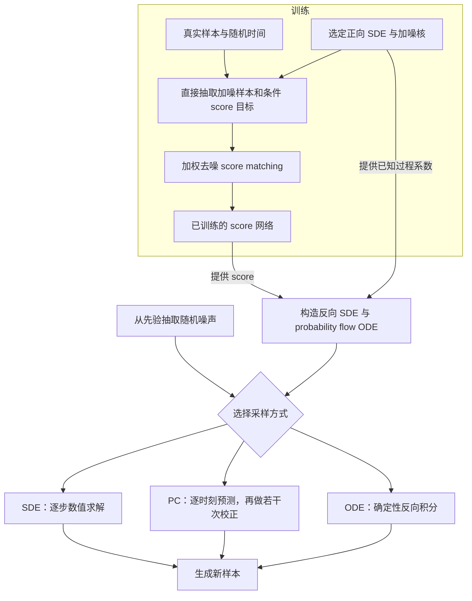

# Score SDE · 随机微分方程生成模型

%% learning-vault-navigation:v1 %%
> [!abstract]- 笔记导航
> 目录：[[Paper/GLM/README|生成模型 · 论文索引]]
> 相关：[[Paper/Generative Adversarial Nets/GAN|GAN · 生成对抗网络]] · [[Math Learning/Probability and Stochastic Processes/6.041SC/U3/README|MIT 6.041SC U3 · Random Processes]]

# First Time

## 1.Abstract
问题：统一 SMLD 与 DDPM，扩展采样、密度计算和条件生成能力。
方法：用正向 SDE 加噪，学习时间相关的 score，再构造反向 SDE、Predictor-Corrector（PC）采样和 probability flow ODE。
结果：CIFAR-10 无条件生成达到 FID $2.20$、IS $9.89$；另一配置在均匀去量化测试数据上达到 NLL $2.99\,\text{bits/dim}$；展示 CelebA-HQ 的 $1024\times1024$ 生成。
意义：把生成过程、网络训练与数值求解连接成统一框架。

## 2.Conclusion
支持新采样器、模型似然计算、潜空间操作和条件生成。作者承认采样仍慢于 GAN，采样器选择引入较多超参数；快速采样与自动调参属于未来方向。

## 3.Figure & Table
#### Fig1:
正向加噪与反向生成；已知正向系数后，额外需要估计各时刻的 score（§1、公式 (6)）。
#### Fig2:
核心图：数据分布与先验之间的 SDE、ODE 演化。真实 score 下两者边缘分布相同、轨迹不同，连接 §3 与 §4.3。
#### Table1:
同网络调用预算下，PC 常优于仅预测或仅校正；VE reverse diffusion 的 FID 从 P2000 的 $4.74$ 降到 PC1000 的 $3.60$。均值与标准差来自五次采样运行。
#### Table2:
ODE 采样、最后检查点：深层 sub-VP 的 NLL 为 $2.99\,\text{bits/dim}$、FID 为 $2.92$。旧 DDPM 的离散数据变分界与去量化似然协议有区别。
#### Table3:
PC 采样、最佳 FID 检查点：深层连续 VE 达到 FID $2.20$、IS $9.89$；质量提升结合架构、连续训练与深度。
#### Fig3:
ODE 自适应步长与潜空间插值；NFE $86$、$548$ 的示例较清晰，$14$ 次有伪影，视觉接近不代表定量指标相同。
#### Fig4:
类别条件生成、LSUN 补全与上色；类别生成使用辅助分类器，其余展示同一观测下的多个可能答案。
#### Fig5:
三个子图比较 SMLD/VE 的加噪方差、DDPM/VP 的均值缩放与加噪方差，验证离散与连续正向过程的对应。
#### Fig6:
VP 的 ODE 潜空间操作：上部球面插值，下部改变潜变量范数；支持可编辑表示，不保证属性解耦。
#### Fig7:
不同深度模型对同一 CIFAR-10 图像的前 $100$ 维编码接近，是可辨识编码的示例检查。
#### Fig8:
在 $16$ 张图像上比较编码差异、打乱基线及逐维相关性；支持一致性，但不是一般证明。
#### Fig9:
LSUN 卧室与教堂：固定总调用预算，比较预测/校正分配；混合使用可改善定性结果，校正步数并非越多越好。
#### Table4:
更换 P2000 插值策略后，部分 VP 配置仅预测优于 PC；采样器排序依赖具体数值设置。
#### Table5:
最佳校正信噪比随配置变化：PC 的 VE 为 $0.16$–$0.17$，VP 为 $0.01$–$0.04$，需要调参。
#### Fig10:
五类组件比较：FIR、跳连缩放、残差块类型、块数、渐进结构。箱图汇总配置表现，不是固定模型的随机种子置信区间。
#### Fig11:
最佳质量模型的无条件 CIFAR-10 样本，展示多样性和可辨识结构；拼图不足以验证完整分布覆盖。
#### Fig12:
修改后的 VE 模型生成 $1024\times1024$ 人脸；证明任务可行性，作者承认对称性等缺陷，没有同任务定量比较。
#### Fig13:
十类条件生成及分类器曲线：噪声增大后识别准确率趋近 $0.1$；曲线不是生成样本的类别满足率。
#### Fig14:
卧室的成对互补遮挡与多次补全：已知信息少时变化更大，合理答案不必等于原图。
#### Fig15:
教堂的相同补全设置，部分结果仍有建筑几何或衔接问题；缺少定量重建评价。
#### Fig16:
卧室灰度输入对应多种颜色方案，展示条件上色能力；原始颜色通常无法由灰度唯一确定。
#### Fig17:
教堂的多次上色，建筑结构总体相近、色调变化；自然程度和精确观测一致性未被量化。
# Second Time

## 1.Introduction
研究缺口：已有方法按有限噪声尺度训练和采样。连续时间框架揭示共同结构，并提供更灵活的生成与评估工具（§1）。

## 2.Background
SMLD 学习多噪声尺度的 score，用退火 Langevin 动力学采样；DDPM 的加权训练目标也可写成去噪 score matching，生成采用反向转移采样（§2）。

## 3.Score-Based Generative Modeling with SDEs
选择正向系数 $\mathbf{f}$、$g$，令数据逐渐接近易采样先验。VE 对应 SMLD，VP 对应 DDPM；sub-VP 保留 VP 漂移、降低扩散强度（§3.1、§3.4）。
网络输入为加噪样本与时间，输出同维向量。高斯加噪核可直接抽样；监督目标为条件 score，均方回归的条件平均使理想网络得到边缘 score（§3.3、公式 (7)）。
反向 SDE（公式 (6)）：
$$
\mathrm{d}\mathbf{x}=
\left[\mathbf{f}(\mathbf{x},t)-g(t)^2\nabla_{\mathbf{x}}\log p_t(\mathbf{x})\right]\mathrm{d}t
+g(t)\mathrm{d}\bar{\mathbf{w}}.
$$
采样从 $T$ 走向 $0$，$\mathrm{d}t<0$；实际用 $s_\theta$ 替代真实 score，仍有网络、先验与数值误差。

## 4.Solving the Reverse SDE
通用数值求解器沿时间推进；PC 在每次预测后于固定时刻做 MCMC 校正，复用已训练网络。SMLD、DDPM 分别是以校正、预测为主的特殊情况（§4.1–4.2）。
Probability flow ODE（公式 (13)）：
$$
\mathrm{d}\mathbf{x}=
\left[\mathbf{f}(\mathbf{x},t)-\frac12g(t)^2\nabla_{\mathbf{x}}\log p_t(\mathbf{x})\right]\mathrm{d}t.
$$
真实 score 下边缘分布与 SDE 相同；确定性流支持自适应采样、同维潜空间操作及似然计算。密度由先验密度和散度积分求得，实际使用随机迹估计与数值积分（§4.3、Appendix D）。

图概括高斯加噪核下的训练与无条件生成，三个采样分支任选其一。生成时网络参数固定、反复评估 score；省略网络内部结构、末端去噪和具体步长，条件处理见 Controllable Generation。

## 5.Architecture Improvements
改进架构得到 NCSN++、DDPM++，再采用连续训练与更深网络。VE 的最佳样本质量与 sub-VP 的最佳似然来自不同配置，Table2/3 的协议不同（§4.4、Appendix H）。

## 6.Controllable Generation
条件 score 等于无条件 score 加观测相容性梯度。类别条件使用噪声条件分类器；补全使用已知区域约束；上色通过正交变换补全颜色通道（§5、公式 (14)、Appendix I）。
一般逆问题仍需估计各噪声水平的条件项；补全等推导包含近似，不能直接推断任意后验都能精确采样。

# Overall Review

- **贡献：** 以 SDE 统一已有 score/扩散方法，并导出 PC、probability flow ODE 及条件生成途径。
- **优点：** 可计算的加噪监督与灵活数值采样相连接；同一 score 网络可服务多种生成和评估方式。
- **不足：** 原文承认速度与调参问题；理论理想条件与实际误差有距离，条件任务和高分辨率展示主要是定性证据。
- **定位：** 继承去噪 score matching、扩散建模与已有时间反演结果，贡献在于统一关系及新增采样和建模能力。
- **延伸：** 待验证方向是按相同调用预算自动分配预测/校正步骤，并量化条件梯度近似误差对后验采样的影响。
- **适合：** 希望理解扩散生成数学基础、训练与采样关系的读者；需要概率密度、梯度和数值微分方程基础。
