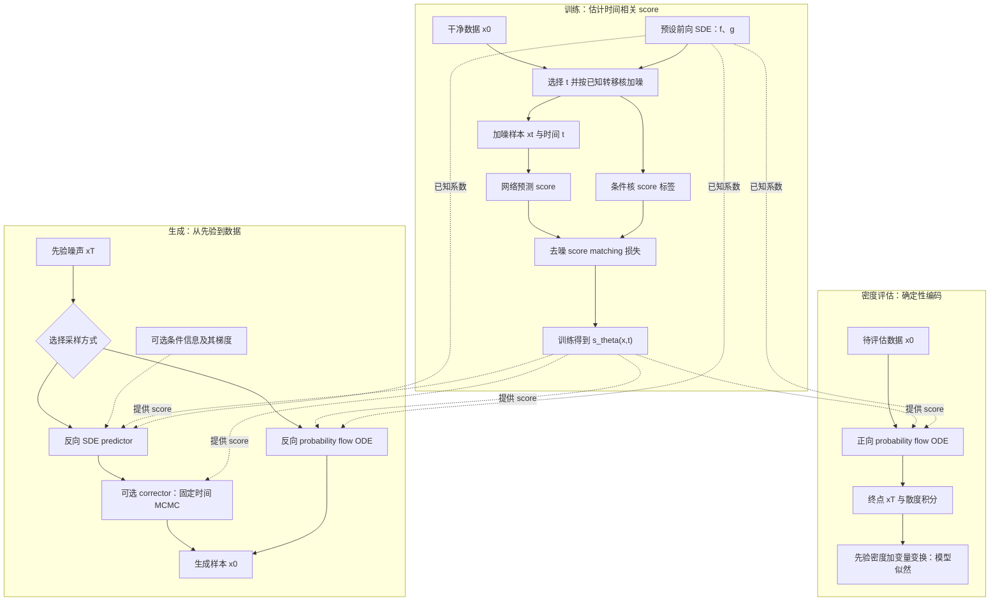

# Score-Based Generative Modeling through Stochastic Differential Equations

# First Time

## 1.Title & Authors
**原标题：** Score-Based Generative Modeling through Stochastic Differential Equations。
**中文译法：**《通过随机微分方程实现基于分数的生成建模》。
标题可以拆成三个关键词来理解。
- **Generative Modeling：生成建模。** 学习真实数据的分布，再产生服从这一分布的新样本。例如，学习照片的统计规律，生成新的照片。
- **Score-Based：基于分数。** score 是数学量 $s_t(x)=\nabla_x\log p_t(x)$。$p_t(x)$ 是噪声程度对应时刻 $t$ 的数据密度；梯度描述在当前位置朝哪个方向移动，会让对数密度增长最快。它是方向向量，可理解为生成过程需要的局部导航信息。
- **Stochastic Differential Equations：随机微分方程，简称 SDE。** 描述状态随连续时间变化的过程，其中既有有规律的变化，也有随机扰动。论文用它表达数据逐渐变成噪声，以及噪声逐渐生成数据。
**标题的核心主张：** 把已有 score-based 方法放进连续时间 SDE 框架，解释已有方法并发展新采样和生成能力。重要性既在具体算法，也在统一的理论视角。
**作者：** Yang Song、Jascha Sohl-Dickstein、Diederik P. Kingma、Abhishek Kumar、Stefano Ermon、Ben Poole。Yang Song 姓名旁的脚注表示部分工作在 Google Brain 实习期间完成，不能据此推断等贡献关系。
本文 Introduction 和参考文献可核对的研究脉络是：Song 与 Ermon 的 2019、2020 年工作发展基于 score 的生成方法；Sohl-Dickstein 等人的 2015 年工作是本文讨论扩散概率模型的重要前身。它们说明作者为何要统一两条路线。

## 2.Abstract
摘要共九个句子，按原文顺序精读。
**第一句：从数据制造噪声容易，从噪声制造数据就是生成建模。**
这建立整篇论文的问题：给照片添加随机噪声容易，让随机噪声变成符合真实照片规律的样本，则需要学习数据分布。
如果理解数据如何逐渐被噪声破坏，就可以研究对应的反向生成过程。
**第二句：提出前向 SDE 和对应的反向时间 SDE。**
前向过程通过缓慢注入噪声，把复杂数据分布变成已知先验，例如设定好均值和方差的高斯分布；反向过程从先验出发，逐渐生成数据。
论文讨论分布如何演化，训练目标是产生符合数据分布的新样本。“连续、平滑地变换”是连续时间表达，实际计算仍使用有限步数值方法。
**第三句：反向 SDE 所需的未知分布信息，通过随时间变化的 score 表达。**
这句话是摘要核心。数据密度 $p_t(x)$ 通常难以求出，但关键学习对象是 $\nabla_x\log p_t(x)$。
结合 Section 3.2 的公式（6），准确理解是：给定前向 SDE 系数后，反向过程还需要各时刻 score。前向系数仍参与方程，未知数据分布信息由 score 提供。
因此生成问题变为：能否学到不同噪声程度下的方向向量？
**第四句：神经网络估计 score，数值 SDE 求解器生成样本。**
网络 $s_\theta(x,t)$ 同时接收样本和时间信息，近似对应时刻 score。把它用于反向方程，再通过数值求解获得样本。
训练负责估计 score，采样负责利用 score 演化样本。网络估计与数值求解都会引入误差，理论框架不表示有限计算下完全恢复真实分布。
**第五句：框架包含此前 score-based 方法和扩散概率模型。**
“包含”表示已有方法可以看作连续时间框架中的特例或离散化形式。Background 对应 SMLD 与 DDPM，Section 3.4 建立它们与不同 SDE 的联系。
统一后，可以在共同框架中讨论前向过程、训练与采样，发展原先不易看出的组合和能力。
**第六句：Predictor-Corrector 改善反向 SDE 离散求解误差。**
Predictor 沿反向过程推进；Corrector 利用 score-based MCMC 调整当前噪声等级下的样本分布。先推进，再改善其分布状态。
“纠正误差”应理解为改善近似，效果和成本需要结合采样设置与实验判断；有限步不保证消除全部误差。
**第七句：神经 ODE 支持同分布采样、似然计算及更高采样效率。**
ODE 是常微分方程。probability flow ODE 在理论条件与准确 score 下，和相应 SDE 具有相同的各时刻边缘分布；不要求逐条轨迹相同。
方程使用网络 score，因此是神经 ODE。生成仍有多样性，因为初始噪声随机。
它利用变量变换计算模型密度。摘要的“精确似然”在 Section 4.3 与变分下界区分；实际数值计算仍受求解和估计误差影响。这把用途从样本生成扩展到密度评估。
**第八句：用 score-based 模型解决逆问题，展示条件生成、修复和上色。**
逆问题根据有限或被破坏的观测推断完整数据，例如根据部分像素生成一致的完整图像。
三项应用都要求生成满足额外条件。Section 5 仍需要相应条件信息或梯度能够获得、估计；具体任务可能涉及辅助分类器或近似，不能由摘要推断所有任务无需额外信息。
**第九句：结合架构改进，报告质量、似然和高分辨率结果。**
关键数字和适用范围如下：

| 摘要结果 | 含义 | 原文定位与条件 |
|---|---|---|
| CIFAR-10 IS 9.89 | 本文比较中越大越好，仍需结合其他指标 | Table3，无条件生成 |
| CIFAR-10 FID 2.20 | 特征分布差异，越小越好 | Table3，NCSN++ cont.（deep, VE） |
| CIFAR-10 2.99 bits/dim | 按维度归一的负对数似然，越低越好 | Table2，均匀去量化，DDPM++ cont.（deep, sub-VP） |
| $1024\times1024$ 图像生成 | 高分辨率可扩展性 | Section 4.4、Appendix H.3，CelebA-HQ |

FID 2.20 与 2.99 bits/dim 来自不同模型和评估设置，不能合成一个统一配置的性能。 正文还区分采样器和检查点。最终结果同时包含架构、采样与训练改进。
“纪录”和“首次”是该版本发表时作者的报告，需要保留当时的任务和比较范围。
**图表对应：** [[#^table2|Table2 精读]]、[[#^table3|Table3 精读]]、[[#^fig4|Fig4 精读]]。
**摘要的四要素：**

| 要素 | 内容 |
|---|---|
| 问题 | 如何统一加噪—反向生成方法，扩展采样、密度评估与条件生成？ |
| 方法 | 前向/反向 SDE、时间相关 score、PC 与 probability flow ODE |
| 结果 | CIFAR-10 质量和似然，以及条件任务和高分辨率生成 |
| 意义 | 共同理论表达与新设计空间，具体优势依模型和计算设置 |

## 3.Conclusion
原文有独立 Section 6 Conclusion，包含两个段落。
**第一段：统一框架带来的能力。**
作者重申基于 SDE 的 score-based 框架，列出新采样算法、似然计算、可唯一确定的编码、潜变量操作和条件生成能力。
贡献归纳为更清楚地理解已有方法，以及从统一表达发展新功能。与摘要一致，同时更明确强调编码和潜变量操作。
“可唯一确定的编码”需保留 Section 4.3 的条件：固定前向 SDE，充分训练数据、容量和优化准确性；任意有限训练网络不自动得到完全相同编码。
潜变量操作来自确定性映射，例如编码后插值；这些能力对应不同条件与设置，不能推出一个配置在所有任务上最优。
**第二段前半：采样仍慢于 GAN。**
采样方法改善结果并提高效率，但在相同数据集上仍慢于 GAN。“更高效”要放在所比较的采样方式内理解。
结合 score-based 模型稳定学习与 GAN 等隐式模型快速采样，是作者提出的未来研究方向，并非已完成方案。
**第二段后半：采样灵活性带来超参数负担。**
采样器丰富，步数、步长和预测/校正组合等选择也更多。作者提出自动选择与调参，以及更充分调查不同采样器的优点和限制。
这是结论明确承认的问题；其他不足需后续证据支持，不能直接归为作者承认的限制。

## 4.Analogy
可以想成学习在不同雾浓度下导航。真实图像像结构清楚的城市，前向加噪让雾逐渐加重；生成从随机起点出发，走向符合真实数据规律的状态。
score 网络提供当前雾浓度与当前位置下的局部方向，求解器决定怎样移动，PC 先推进再校正。
实际算法在高维空间工作，score 是对数密度梯度。类比不能代替数学定义，也不保证每一步直接得到更清楚的图像。

# Second Time

## 1.Notation & Parameters
同形记号按用途分开，原文与讲解辅助命名分开；取值、约束和位置按当前论文核对。附录项在这里只解释记号，未因此将附录逐节阅读或推导标记为已完成。
**状态、时间、概率与通用算子**

| 符号/参数                                                   | 含义与作用                                 | 类型/形状/单位                  | 取值或约束                                        | 原文位置                     |
| ------------------------------------------------------- | ------------------------------------- | ------------------------- | -------------------------------------------- | ------------------------ |
| $x$                                                     | 数据或过程状态                               | 向量，$d$ 维；单位依输入表示          | 原文未给物理单位                                     | 正文 Section 1–5           |
| $x_0,\ x(0)$                                            | 干净初始数据；反向生成的目标终点                      | $d$ 维随机向量                 | $x(0)\sim p_0$                               | 正文 Section 2–3           |
| $x_i,\ x(t),\ x_t$                                      | 离散噪声等级或连续时刻的状态；$x_t$ 为讲解简写            | $d$ 维随机向量                 | 对应时间/等级的边缘分布                                 | 正文 Section 2–3           |
| $\widetilde x$                                          | 由干净数据生成的加噪训练样本                        | $d$ 维向量                   | 服从对应条件噪声核                                    | 正文公式（1）、（3）              |
| $x_i^m,\ x_i^j,\ x_i^0,\ x_i^M$                         | 等级 $i$ 内第 $m/j$ 次更新、该等级初值与末状态         | $d$ 维；上标是迭代索引，不是幂         | 用于各等级间衔接                                     | 正文公式（2）；附录 G 算法 4–5      |
| $x_i'$                                                  | predictor 完成确定性漂移后的中间状态               | $d$ 维；撇号不是求导              | 之后再加入 predictor 噪声                           | 附录 G 算法 2–3              |
| $d$                                                     | 数据或噪声向量维度                             | 正整数                       | 随数据表示变化                                      | 正文 Section 3.1；附录 G      |
| $I$                                                     | 单位矩阵                                  | $d\times d$；受限子空间时维度相应缩小  | 高斯协方差与矩阵方差式                                  | 正文及附录 A–I                |
| $t,\ s$                                                 | 连续时间与较早的转移起点                          | 实标量；非物理时钟                 | $0\le s<t\le T$；示例常归一到 1                     | 正文 Section 3.1           |
| $T$（时间）                                                 | 扩散终止时刻                                | 正标量                       | 实验示例终点 1；一般框架不固定为 1                          | 正文 Section 3             |
| $i$（噪声/时间等级）                                            | 离散链或采样时间索引                            | 整数                        | 正反向遍历顺序依公式/算法                                | 正文 Section 2；附录 B、G      |
| $i,j,k$（坐标）                                             | 向量坐标及扩散矩阵求和索引                         | 整数                        | 通常在 $1,\ldots,d$ 内                           | 附录 D.1 公式（35）–（37）       |
| $m,j$（内循环）                                              | 固定噪声等级内的 MCMC/校正次数索引                  | 整数；不与坐标索引混用               | 对应 $1,\ldots,M$ 或前次状态                        | 正文公式（2）；附录 G             |
| $N$                                                     | 离散噪声等级或时间步总数                          | 正整数                       | 训练对比使用 1000；采样预算也可改为 2000                    | 正文 Section 2；附录 C、G      |
| $M$                                                     | 每个噪声等级的 Langevin/校正更新次数               | 正整数；具体算法可用恒等 corrector 省略 | 不同采样配置取值不同                                   | 正文公式（2）；附录 G 算法 1–5      |
| $p_{\mathrm{data}},\ p_0$                               | 真实数据分布/密度与前向初始分布                      | 概率密度或对应分布                 | 数据分布一般无法直接计算                                 | 正文 Section 2–3           |
| $p_t,\ p_T$                                             | 时刻 $t$ 的边缘密度与终点先验                     | 密度/分布                     | 先验易采样；有限噪声时终点可能仅近似匹配                         | 正文 Section 3             |
| $p_\sigma(\widetilde x\mid x),\ p_\sigma(\widetilde x)$ | SMLD 条件加噪核及积分混合得到的边缘密度                | 高斯核/一般混合密度                | 条件方差 $\sigma^2I$                             | 正文 Section 2.1           |
| $p_{\alpha_i}(x_i\mid x_0),\ p_{\alpha_i}(x_i)$         | DDPM 多步条件核与加噪边缘密度                     | 高斯核/积分混合密度                | 条件均值 $\sqrt{\alpha_i}x_0$、方差 $(1-\alpha_i)I$ | 正文 Section 2.2           |
| $p_{st}(x(t)\mid x(s)),\ p_{0t}$                        | SDE 从 $s$ 到 $t$ 的转移核；$p_{0t}$ 从干净初值出发 | 条件密度                      | 闭式可计算性取决于过程                                  | 正文 Section 3.1、3.3；附录 B  |
| $\mathcal N,\ \mathcal U$                               | 高斯分布与均匀分布                             | 分布族                       | 均值、协方差或区间由上下文给定                              | 正文；附录 A                  |
| $\mathbb E,\ \operatorname{Cov}$                        | 期望与协方差                                | 统计算子                      | 下标说明取哪个分布的期望                                 | 正文及附录                    |
| $\nabla_x,\ \partial_t,\ \nabla\cdot,\ \Delta$          | 对状态求梯度、时间偏导、散度、Laplacian              | 微分算子；$\Delta$ 的此用法为讲解辅助   | 密度/函数需满足相应可微条件                               | 正文 Section 3–4；附录 D；补充推导 |
| $\nabla s_\theta,\ \nabla\widetilde f_\theta$           | 向量场关于状态的 Jacobian                     | $d\times d$ 矩阵            | 不与对参数 $\theta$ 的导数混淆                         | 附录 A、D.2                 |
| $\lVert\cdot\rVert_2,\ \lVert\cdot\rVert_2^2$           | 欧氏范数及其平方                              | 标量输出                      | 平方损失与采样步长估计                                  | 正文公式（1）–（3）、（7）；附录 G     |
| $(\cdot)^{\mathsf T}$                                   | 向量/矩阵转置                               | 线性代数操作                    | 不是终止时刻 $T$                                   | 附录 A、D                   |
| $\Delta t$                                              | 离散时间步长                                | 正标量                       | 附录 B 使用 $1/N$；正文讲解也用正反向步长                    | 附录 B、D.3、E               |
| $o(\beta_i),\ O(\beta_i^2)$                             | 小量展开的余项阶数                             | 渐近记号；$O$ 为讲解补充            | 仅在对应小步极限适用                                   | 附录 E；正文公式（11）补充推导        |

**噪声日程、学习对象与采样参数**

| 符号/参数 | 含义与作用 | 类型/形状/单位 | 取值或约束 | 原文位置 |
|---|---|---|---|---|
| $\sigma_i,\ \sigma(t)$ | 离散/连续噪声标准差日程 | 非负标量 | 不同 SDE 日程不同；标准差不是方差 | 正文 Section 2.1、3.4；附录 B、C |
| $\sigma_0$ | 离散链的起始噪声约定 | 标量 | 设为 0 以便推导；不要与右极限混同 | 正文公式（8）；附录 B、C |
| $\sigma_{\min},\ \sigma_{\max}$ | SMLD/VE 的最小与最大噪声尺度 | 正标量 | 附录 C 常用最小值 0.01；最大值依数据选择 | 正文 Section 2.1；附录 C |
| $\sigma(0^+)$ | 连续几何日程在零点的右极限 | 标量 | 附录 C 为 $\sigma_{\min}$，与约定 $\sigma(0)=0$ 不同 | 附录 C |
| $\beta_i$ | DDPM 单步噪声方差系数 | 标量 | $0<\beta_i<1$；连续极限按步长缩放 | 正文 Section 2.2；附录 B |
| $\alpha_i$ | DDPM 累计信号保留量 | 标量 | 本文为 $\prod_{j=1}^i(1-\beta_j)$，不是单步量 | 正文 Section 2.2；附录 G 算法 5 |
| $\bar\beta_i$ | 连续极限前的放大噪声参数 | 标量 | 附录 B 定义 $N\beta_i$ | 附录 B 公式（23）–（24） |
| $\beta(t)$ | VP/sub-VP 连续噪声速率 | 非负函数 | 对应 $\beta_i\approx\beta(t_i)\Delta t$ | 正文公式（11）–（12）；附录 B、C |
| $\bar\beta_{\min},\ \bar\beta_{\max}$ | 连续线性速率日程端点 | 正标量 | 附录 C 实验设 0.1、20 | 附录 C 公式（32）–（34） |
| $\beta_{\min},\ \beta_{\max}$（离散插值语境） | 离散噪声日程端点 | 标量 | 附录 G 倍增时间步时调整；不直接当连续端点 | 附录 G 的插值讨论 |
| $\theta,\ \theta^*$ | 网络可训练参数及理想最优参数 | 参数集合；实际形状依架构 | $\theta^*$ 依数据、容量和优化条件 | 正文公式（1）、（3）、（7） |
| $s_\theta(x,t),\ s_\theta(x,\sigma),\ s_\theta(x,i)$ | 时间/噪声等级相关 score 网络 | 输入状态与条件，输出 $d$ 维向量 | 近似边缘对数密度梯度 | 正文 Section 2–3 |
| $s_{\theta^*}$ | 理想最优 score 网络 | $d$ 维向量场 | 理论等式与实际估计需区分 | 正文及附录 |
| $\nabla_x\log p_t(x)$ | 真实边缘 score | $d$ 维方向场 | 需密度正、可微；一般未知 | 正文 Section 1、3 |
| $\lambda(t)$ | 连续训练损失的正权重 | 正标量函数 | 可按条件 score 平方范数期望的倒数选择 | 正文公式（7）；附录 A 公式（19） |
| $f(x,t)$ | 前向漂移 | $d$ 维向量场 | 预设系数；适当正则保证解存在/唯一 | 正文公式（5） |
| $g(t)$（扩散） | 正文空间无关的标量扩散系数 | 标量；对应噪声协方差率 $g(t)^2I$ | 不能与校正算法的向量 $g$ 混同 | 正文公式（5）–（14） |
| $w,\ \bar w$ | 前向与反向时间中的标准布朗运动 | $d$ 维随机过程 | 增量协方差随时间步绝对值缩放 | 正文 Section 3.1–3.2 |
| $z,\ z_i,\ z_i^m,\ z(t)$（高斯噪声） | 离散更新或连续极限表达中的标准高斯随机向量 | $d$ 维；各次更新按设定独立采样 | $\mathcal N(0,I)$；不与补全状态 $z(t)$ 混同 | 正文 Section 2、3.4；附录 B、G |
| $\epsilon_i,\ \epsilon$（Langevin 步长） | 固定噪声等级内的校正步长 | 正标量 | 依日程或信噪比自适应设置 | 正文公式（2）；附录 G 算法 2–5 |
| $g$（校正算法） | 当前 score 网络输出的临时变量 | $d$ 维向量 | 用于范数和步长计算；不是扩散 $g(t)$ | 附录 G 算法 4–5 |
| $r$（信噪比） | 校正步长的调节参数 | 正标量 | 随采样器/数据集调节，附录 G 给具体设置 | 附录 G；Table5 |
| $\epsilon$（端点截断） | 数值计算避开零噪声端点的最小时间 | 正实标量 | VE 用 $10^{-5}$；VP 采样 $10^{-3}$，训练/似然 $10^{-5}$ | 附录 C、D.2–D.4 |
| $s'_\theta$ | 将原网络时间等级插值到更密网格后的模型 | $d$ 维向量场；撇号为新插值模型 | 线性与取整插值规则不同 | 附录 G |
| $\mathrm{P1000},\ \mathrm{P2000},\ \mathrm{C2000},\ \mathrm{PC1000}$ | 采样配置/计算预算标签 | 步数与 score 调用预算 | PC1000 为 1000 predictor 加 1000 corrector | Table1；附录 G |
| $\mathrm{atol},\ \mathrm{rtol}$ | ODE 求解器绝对与相对误差容差 | 非负数值参数 | 似然与 Table2 ODE 实验使用 $10^{-5}$ | 附录 D.2、D.4 |

**附录的矩阵过程、似然和祖先采样记号**

| 符号/参数                                                          | 含义与作用                                       | 类型/形状/单位                 | 取值或约束                        | 原文位置                       |
| -------------------------------------------------------------- | ------------------------------------------- | ------------------------ | ---------------------------- | -------------------------- |
| $G(x,t),\ G(t)$                                                | 一般矩阵扩散系数；空间依赖与独立情形                          | $d\times d$ 矩阵           | 正文标量情形相当于 $g(t)I$            | 附录 A、D、E、I                 |
| $GG^{\mathsf T}$                                               | 扩散协方差率矩阵                                    | $d\times d$ 半正定矩阵        | 空间依赖时其散度项不可直接丢掉              | 附录 A 公式（16）–（18）           |
| $F,\ f^1,\ldots,f^d$                                           | 矩阵散度定义中的矩阵及其行向量函数                           | 矩阵/行向量；此 $f^i$ 不自动等于漂移   | $\nabla\cdot F$ 按原文行散度组成向量   | 附录 A                       |
| $f_i(x,t),\ G_{ik},\ G_{jk}$（分量）                               | 漂移分量与扩散矩阵元素                                 | 标量函数/标量                  | 用于坐标展开的求和                    | 附录 D.1 公式（35）–（37）         |
| $f_i(x),\ G_i$（离散增量）                                           | 吸收时间步后的漂移增量和噪声系数                            | 向量函数/矩阵                  | 已吸收 $\Delta t$，不同于未经缩放的连续系数  | 附录 D.3、E 公式（41）、（45）       |
| $v$（随机投影）                                                      | sliced score matching 的随机方向                 | $d$ 维随机向量                | 均值 0、协方差 $I$                 | 附录 A 公式（19）                |
| $\Sigma_{\mathrm{VP}}(t),\ \Sigma_{\mathrm{sub\text{-}VP}}(t)$ | 相应过程的总体协方差                                  | $d\times d$ 矩阵           | 不是给定 $x_0$ 的条件核噪声方差          | 附录 B 公式（26）–（28）           |
| $\widetilde f,\ \widetilde f_\theta$                           | 真实 score 或网络 score 定义的 probability flow 速度场 | $d$ 维向量场                 | 一般情形含矩阵散度修正                  | 附录 D.1–D.2                 |
| $\widetilde G$                                                 | 为表示确定性过程而引入的扩散系数                            | 矩阵                       | 附录 D.1 设为零                   | 附录 D.1                     |
| $\epsilon$（Hutchinson 向量）                                      | 随机迹估计使用的探针                                  | $d$ 维随机向量                | 均值 0、协方差 $I$；不同于标量截断/步长      | 附录 D.2 公式（40）              |
| $p(\epsilon)$                                                  | 随机迹探针的采样分布                                  | 分布                       | 满足所需均值与协方差条件                 | 附录 D.2                     |
| $q(x_{i-1}\mid x_i,x_0),\ \mathbb E_q$                         | 给定干净初值的前向链反向后验及对应期望                         | 条件高斯核/统计期望               | 与学习反向核 $p_\theta$ 区分         | 附录 F                       |
| $p_\theta(x_{i-1}\mid x_i)$                                    | 学习的反向条件核                                    | 高斯模型核                    | 均值和方差依模型设定                   | 正文 Section 2.2；附录 F        |
| $\mu_\theta(x_i,i)$                                            | 反向高斯均值                                      | $d$ 维可训练向量函数             | 由 score 参数化                  | 附录 F                       |
| $\tau_i,\ \tau_i^2 I$                                          | 反向高斯标准差与协方差                                 | 标量/矩阵                    | 附录 F 按其条件后验方差设置              | 附录 F                       |
| $L_{t-1}$                                                      | 原文写出的一个 ELBO 单项                             | 标量目标；下标沿用原文              | 用于推导 SMLD 祖先采样               | 附录 F                       |
| $D_{\mathrm{KL}}(q\Vert p)$                                    | 两分布间 KL 散度                                  | 非负标量                     | 方向由 $q$ 与 $p$ 的顺序确定          | 附录 F                       |
| $C$（ELBO 常数）                                                   | 与网络参数无关的项                                   | 标量                       | 对 $\theta$ 优化时可忽略；不等于附录 C 标题 | 附录 F                       |
| $x_i(x_0,z)$                                                   | 用干净样本与噪声表示的加噪样本                             | $d$ 维确定性重参数化函数           | 该处为 $x_0+\sigma_i z$         | 附录 F                       |
| $r$（相关系数）                                                      | 两模型编码的相关程度                                  | 统计标量                     | 与采样信噪比 $r$ 是不同含义             | 附录 D.5；Fig8                |
| $\mathrm{NFE},\ \mathrm{FID},\ \mathrm{IS},\ \mathrm{NLL}$     | 网络评估次数、分布差异指标、Inception Score、负对数似然         | 计数/评估指标；NLL 此处用 bits/dim | FID/NLL 低好、IS 高好；NFE 是调用计数   | 正文 Section 4；Table1–3、Fig3 |

**条件生成、补全与逆问题**

| 符号/参数                                | 含义与作用                             | 类型/形状/单位        | 取值或约束                                | 原文位置                |
| ------------------------------------ | --------------------------------- | --------------- | ------------------------------------ | ------------------- |
| $y$                                  | 条件信息：类别、已知观测或其他测量                 | 类型随任务变化；可离散或向量  | 不等同于过程状态 $x$                         | 正文 Section 5；附录 I   |
| $p_t(y\mid x),\ p_t(x\mid y)$        | 噪声时刻的条件似然/分类概率与条件状态密度             | 条件概率或密度         | 决定条件梯度与生成目标                          | 正文公式（14）；附录 I       |
| $p(y\mid x)$                         | 由真实数据生成观测的前向观测模型                  | 条件概率/密度         | 与 SDE 的时间转移核是两个不同对象                  | 附录 I.4              |
| $\Omega,\ \bar\Omega$                | 已知与未知维度的选择操作                      | 选择映射；维度依掩码      | 按指定已知部分条件采样                          | 正文 Section 5；附录 I.2 |
| $f_{\bar\Omega},\ G_{\bar\Omega}$    | 漂移/扩散限制到未知维度的对应部分                 | 受限向量场/矩阵        | 附录 I.2 利用逐元素漂移与对角扩散                  | 附录 I.2              |
| $z(t)$（补全状态）                         | 未知维度组成的过程，$z(t)=\bar\Omega(x(t))$ | 未知子空间中的随机向量     | 不是高斯噪声 $z$                           | 附录 I.2              |
| $A$（事件）                              | 已知初始观测满足 $\Omega(x(0))=y$ 的条件事件   | 事件              | 用于条件密度分解；不是 Model A 名称               | 附录 I.2              |
| $\widehat\Omega(x(t))$               | 给定观测后随机生成的已知维度噪声状态                | 已知子空间向量         | 从条件已知部分分布采样                          | 附录 I.2              |
| $u(t),\ [z(t);\widehat\Omega(x(t))]$ | 将未知状态与已知噪声部分重新组合的完整状态             | $d$ 维向量         | 按原已知/未知位置重组，不必是简单连续堆叠                | 附录 I.2              |
| 上色正交矩阵（原文未命名）                        | 分离灰度信息与剩余颜色维度                     | $3\times3$ 变换矩阵 | 原文给近似系数；正交变换保持标准布朗性质                 | 附录 I.3              |
| $y(t),\ \widehat y(t)$               | 噪声时刻的观测变量与给定原观测后抽到的样本             | 类型/维度由观测模型决定    | $\widehat y(t)$ 从 $p(y(t)\mid y)$ 采样 | 附录 I.4 公式（50）       |

**本次讲解引入的辅助记号**

| 符号/参数                                 | 含义与作用                   | 类型/形状/单位 | 取值或约束                                           | 原文位置                  |
| ------------------------------------- | ----------------------- | -------- | ----------------------------------------------- | --------------------- |
| $s_t^*$                               | 真实时间相关 score 的简写        | $d$ 维向量场 | 等于 $\nabla_x\log p_t$                           | 讲解辅助：Introduction     |
| $Z_t,\ \widetilde p_t$                | 密度归一化常数与未归一化密度          | 正标量/密度函数 | $Z_t$ 不随 $x$ 变化                                 | 讲解辅助：Introduction     |
| $a(x,\widetilde x)$                   | 条件核 score 标签的简写         | $d$ 维向量  | 用于条件期望恒等式                                       | 讲解辅助：SMLD             |
| $C$（平方误差分解常数）                         | 标签条件方差对应的参数无关项          | 标量       | 不是 ELBO 常数的同一个数值                                | 讲解辅助：SMLD             |
| $\varepsilon_\theta$                  | 与 score 参数化等价的噪声预测输出    | $d$ 维向量  | 本文讲解定义为 $-\sqrt{1-\alpha_i}s_\theta$            | 讲解辅助：DDPM             |
| $h,\ t_i$                             | 反向正步长与离散时刻              | 正标量/时间网格 | $h=-\Delta t$；示例 $t_i=i/N$                      | 讲解辅助：时间方向与连续极限        |
| $\rho,\ \tau$（MCMC 时间）                | Langevin 采样的演化密度与辅助运行时间 | 密度/非负时间  | 不同于数据加噪时间和反向标准差 $\tau_i$                        | 讲解辅助：SMLD             |
| $L,\ L^*,\ \widetilde L_t$（生成元）       | 前向生成元、密度伴随算子与反向生成元      | 微分算子     | 不同于 ELBO 项 $L_{t-1}$                            | 讲解辅助：反向 SDE           |
| $D(t)$                                | 正文标量扩散方差率简写             | 非负标量     | 定义为 $g(t)^2$                                    | 讲解辅助：反向 SDE           |
| $\mu_t,\ v_t,\ \Sigma_t$（条件核）         | 高斯条件均值、各向同性噪声方差与一般协方差   | 向量/标量/矩阵 | 一般 $\Sigma_t$ 求逆需非奇异                            | 讲解辅助：score 训练         |
| $B(t)$                                | 连续 VP 日程速率的累计积分         | 非负标量     | $\int_0^t\beta(s)\,\mathrm ds$；不是附录 B 名称        | 讲解辅助：VE/VP/sub-VP     |
| $v_0,\ v_{\mathrm{VP}}(t),\ v(t)$（方差） | 初始总体每维方差与条件噪声方差         | 非负标量     | 总体与条件方差分别说明                                     | 讲解辅助：VE/VP/sub-VP     |
| $a$（方差比较）                             | 用于比较的标量 $1-e^{-B(t)}$   | 标量       | $0\le a\le1$；不同于条件 score 标签 $a(x,\widetilde x)$ | 讲解辅助：sub-VP           |
| $v(x,t)$（ODE 速度）                      | probability flow 的速度场简写 | $d$ 维向量场 | $f-(g^2/2)\nabla\log p_t$；不同于方差与随机投影          | 讲解辅助：probability flow |

## 2.Introduction
原文 Section 1 从两种成功路线出发：SMLD 在多个噪声等级估计 score，并使用 Langevin dynamics 生成；DDPM 构造逐步加噪的马尔可夫链，再学习反向条件分布。
两者表面上的区别是“学习方向场”与“学习反向分布”。作者指出，连续状态空间中的 DDPM 简化训练目标也在隐式学习 score，因此可以把两者放进共同框架。
这里的 score 定义为 $s_t^*(x)=\nabla_x\log p_t(x)$。它是对样本 $x$ 求梯度，而不是对参数 $\theta$ 求梯度。若 $p_t(x)=\widetilde p_t(x)/Z_t$，且 $Z_t$ 不随 $x$ 变化，则 $\nabla_x\log p_t(x)=\nabla_x\log\widetilde p_t(x)$：归一化常数在求导时消失。这解释了为什么局部方向信息可以比完整密度更容易学习；该恒等式是讲解补充。
作者把有限噪声等级推广到连续时间。前向 SDE 的系数由设计者指定，没有需要学习的网络参数；数据样本提供初始状态。反向过程需要的未知数据分布信息由时间相关 score 提供。
引言的三类贡献彼此相连：统一 SMLD/DDPM；发展数值采样、PC 采样和 probability flow ODE；借助条件 score 进行可控生成。架构改进则让这一框架在实际任务上取得更强结果。
阅读本节应抓住的因果链是：统一分布演化表达，使训练目标、前向噪声过程和采样器能够分开讨论，再研究不同组合。已有布朗运动、时间反演理论和 MCMC 是被利用的基础，并非本文全部新发明。
**图表对应：** [[#^fig1|Fig1 精读]]、[[#^fig2|Fig2 精读]]。

## 3.Background
为了看清数学关系，下文将原文粗体向量写作普通 $x$：它仍是 $d$ 维向量，图像可以展平为 $d$ 个数。$I$ 是 $d\times d$ 单位矩阵，$\theta$ 是网络参数，$z\sim\mathcal N(0,I)$ 表示独立标准高斯噪声。
原文 Section 2 的任务是把 SMLD 和 DDPM 写成便于比较的数学形式。两条路线都用已知加噪机制制造训练对，并通过平方误差学习加噪分布的 score。
需要区分三个对象：真实但未知的数据密度 $p_{\mathrm{data}}$；给定干净样本后可计算的噪声核；对所有干净样本混合得到的加噪边缘密度。后者通常仍未知，但前者样本和噪声核允许我们训练其 score。

## 4.Denoising Score Matching with Langevin Dynamics (SMLD)
对应原文 Section 2.1。SMLD 先学习多个噪声等级的 score，再从大噪声向小噪声依次采样。
**未编号关系：噪声核与边缘分布。** 原文定义 $p_\sigma(\widetilde x\mid x)=\mathcal N(\widetilde x;x,\sigma^2I)$。等价的采样方式是 $\widetilde x=x+\sigma z$。对干净样本混合后，
$$
p_\sigma(\widetilde x)=\int p_{\mathrm{data}}(x)\,p_\sigma(\widetilde x\mid x)\,\mathrm dx.
$$
条件密度描述一个干净样本周围的噪声云；边缘密度描述所有样本的噪声云叠加。原文的噪声等级满足 $\sigma_{\min}=\sigma_1<\cdots<\sigma_N=\sigma_{\max}$。小噪声时 $p_{\sigma_{\min}}\approx p_{\mathrm{data}}$；噪声足够大时 $p_{\sigma_{\max}}\approx\mathcal N(0,\sigma_{\max}^2I)$。这两处是近似，依赖噪声尺度与数据尺度，有限噪声不保证精确成立。
**公式（1）：训练目标。**
$$
\theta^*=\arg\min_\theta
\sum_{i=1}^N\sigma_i^2
\mathbb E_{x\sim p_{\mathrm{data}}}
\mathbb E_{\widetilde x\sim p_{\sigma_i}(\cdot\mid x)}
\left\|s_\theta(\widetilde x,\sigma_i)
-\nabla_{\widetilde x}\log p_{\sigma_i}(\widetilde x\mid x)\right\|_2^2.
\tag{1}
$$
这是设计的去噪 score matching 目标，不能说成唯一必然的损失。它的关键是：监督目标使用可求导的条件核，但最优网络学习到边缘 score。
**推导监督目标。** 高斯对数密度中，与 $\widetilde x$ 有关的部分为 $-\|\widetilde x-x\|^2/(2\sigma_i^2)$，故 $\nabla_{\widetilde x}\log p_{\sigma_i}(\widetilde x\mid x)=-(\widetilde x-x)/\sigma_i^2=-z/\sigma_i$。无需知道真实数据密度，就可以生成这一训练标签。
**补充推导：为什么条件目标得到边缘 score？** 记 $a(x,\widetilde x)=\nabla_{\widetilde x}\log p_\sigma(\widetilde x\mid x)$。在密度可微、可交换微分与积分且 $p_\sigma(\widetilde x)>0$ 的位置，
$$
\begin{aligned}
\mathbb E[a\mid\widetilde x]
&=\frac{\int p_{\mathrm{data}}(x)\,
p_\sigma(\widetilde x\mid x)\,
\nabla_{\widetilde x}\log p_\sigma(\widetilde x\mid x)\,\mathrm dx}
{p_\sigma(\widetilde x)}\\
&=\frac{\nabla_{\widetilde x}p_\sigma(\widetilde x)}
{p_\sigma(\widetilde x)}
=\nabla_{\widetilde x}\log p_\sigma(\widetilde x).
\end{aligned}
$$
平方误差的条件最优解是标签的条件期望。具体地，$\mathbb E\|s-a\|^2=\mathbb E\|s-\mathbb E[a\mid\widetilde x]\|^2+C$，其中 $C$ 与网络输出无关，因为交叉项的条件期望为零。因此在足够的数据、容量与优化条件下，原文的 $s_{\theta^*}(x,\sigma)=\nabla_x\log p_\sigma(x)$ 成立于适当的几乎处处意义。
**权重为什么是** $\sigma_i^2$？ 上述标签是 $-z/\sigma_i$，其平方范数期望为 $d/\sigma_i^2$。乘以 $\sigma_i^2$ 使不同等级的标签尺度得到平衡。这解释原文的未编号比例式 $\sigma_i^2\propto1/\mathbb E\|\nabla_{\widetilde x}\log p_{\sigma_i}(\widetilde x\mid x)\|^2$，比例中的维度常数可以吸收；不代表它是唯一可行权重。
**公式（2）：固定噪声等级的 Langevin 更新。**
$$
x_i^m=x_i^{m-1}
+\epsilon_i\,s_{\theta^*}(x_i^{m-1},\sigma_i)
+\sqrt{2\epsilon_i}\,z_i^m,
\qquad m=1,\ldots,M.
\tag{2}
$$
这里 $i$ 表示噪声等级，$m$ 表示该等级内的更新次数，$\epsilon_i>0$ 是步长。score 项引导样本，随机项保持分布中的探索。
**补充推导。** 固定 $i$，考虑辅助采样时间 $\tau$ 中的过程 $\mathrm dx=\nabla\log p_{\sigma_i}(x)\,\mathrm d\tau+\sqrt2\,\mathrm dW_\tau$。其密度 $\rho$ 满足 $\partial_\tau\rho=-\nabla\cdot(\rho\nabla\log p_{\sigma_i})+\Delta\rho$。代入 $\rho=p_{\sigma_i}$ 时，$\rho\nabla\log p_{\sigma_i}=\nabla p_{\sigma_i}$，两项抵消，故该密度是平稳解。对过程做 Euler–Maruyama 离散化，就得到（2）。
原文从 $x_N^0\sim\mathcal N(0,\sigma_{\max}^2I)$ 开始，按 $i=N,\ldots,1$ 降低噪声，并以 $x_i^0=x_{i+1}^M$ 衔接相邻等级。初值从易采样先验来，上一等级的末状态作为下一等级起点。
原文给出的极限说法需要正则与混合条件，并需要足够的有效运行时间。有限 $M$、有限步长和不准确 score 都会造成偏差；即使精确采到 $p_{\sigma_{\min}}$，它与真实数据分布之间仍存在小噪声近似。
**图表对应：** [[#^table1|Table1 精读]]。

## 5.Denoising Diffusion Probabilistic Models (DDPM)
对应原文 Section 2.2。DDPM 的前向过程一边衰减信号，一边加入噪声，反向模型学习逐步生成。
**未编号关系：单步与多步加噪。** 原文设 $0<\beta_i<1$，并定义
$$
p(x_i\mid x_{i-1})=
\mathcal N\!\left(x_i;\sqrt{1-\beta_i}\,x_{i-1},\beta_iI\right).
$$
令 $\alpha_i=\prod_{j=1}^i(1-\beta_j)$。注意，本文的 $\alpha_i$ 已是累计乘积，不能与其他论文的单步参数混用。连续展开递推，给定 $x_0$ 的均值满足 $\mu_i=\sqrt{1-\beta_i}\mu_{i-1}$，所以 $\mu_i=\sqrt{\alpha_i}x_0$。条件方差满足 $v_i=(1-\beta_i)v_{i-1}+\beta_i$、$v_0=0$，归纳得到 $v_i=1-\alpha_i$。于是原文的闭式核为
$$
p_{\alpha_i}(x_i\mid x_0)
=\mathcal N\!\left(x_i;\sqrt{\alpha_i}x_0,(1-\alpha_i)I\right).
$$
它允许直接从任意时间等级生成训练样本：$x_i=\sqrt{\alpha_i}x_0+\sqrt{1-\alpha_i}\,z$。原文的边缘密度仍通过积分混合定义，$p_{\alpha_i}(\widetilde x)=\int p_{\mathrm{data}}(x)p_{\alpha_i}(\widetilde x\mid x)\,\mathrm dx$。当 $\alpha_N$ 足够小时，终点近似标准高斯；生成用 $x_N\sim\mathcal N(0,I)$ 初始化。
**公式（3）：与噪声预测等价的简化目标。**
$$
\theta^*=\arg\min_\theta
\sum_{i=1}^N(1-\alpha_i)
\mathbb E_{x\sim p_{\mathrm{data}}}
\mathbb E_{\widetilde x\sim p_{\alpha_i}(\cdot\mid x)}
\left\|s_\theta(\widetilde x,i)
-\nabla_{\widetilde x}\log p_{\alpha_i}(\widetilde x\mid x)\right\|_2^2.
\tag{3}
$$
高斯核给出 $\nabla_{\widetilde x}\log p_{\alpha_i}(\widetilde x\mid x)=-(\widetilde x-\sqrt{\alpha_i}x)/(1-\alpha_i)=-z/\sqrt{1-\alpha_i}$。定义等价的噪声预测输出 $\varepsilon_\theta=-\sqrt{1-\alpha_i}\,s_\theta$，则
$$
(1-\alpha_i)
\left\|s_\theta+\frac{z}{\sqrt{1-\alpha_i}}\right\|^2
=\|\varepsilon_\theta-z\|^2.
$$
因此（3）就是原文指出的 $L_{\mathrm{simple}}$ 的另一种写法。它来自重新加权的训练选择，不应说成与完整 ELBO 的所有权重完全相同。利用上一节的条件期望恒等式，理想最优网络满足 $s_{\theta^*}(x,i)=\nabla_x\log p_{\alpha_i}(x)$。
原文另一条未编号比例式也由高斯核得到：标签平方范数期望为 $d/(1-\alpha_i)$，所以 $1-\alpha_i\propto1/\mathbb E\|\nabla_{\widetilde x}\log p_{\alpha_i}(\widetilde x\mid x)\|^2$。两条路线的损失权重遵循相同尺度逻辑。
**公式（4）：反向祖先采样。**
$$
x_{i-1}
=\frac{x_i+\beta_i s_{\theta^*}(x_i,i)}{\sqrt{1-\beta_i}}
+\sqrt{\beta_i}\,z_i,
\qquad i=N,\ldots,1.
\tag{4}
$$
原文先定义的反向高斯核为 $p_\theta(x_{i-1}\mid x_i)=\mathcal N((x_i+\beta_i s_\theta)/\sqrt{1-\beta_i},\beta_iI)$，所以从该高斯分布采样直接得到（4）。平方根分母与噪声项的系数必须保留。
**补充推导：反向均值为何出现 score？** 对前向核关于 $x_i$ 求导，并对 $x_{i-1}\mid x_i$ 取条件期望，
$$
\nabla_{x_i}\log p_i(x_i)
=-\frac{x_i-\sqrt{1-\beta_i}\,
\mathbb E[x_{i-1}\mid x_i]}{\beta_i}.
$$
整理得到 $\mathbb E[x_{i-1}\mid x_i]=(x_i+\beta_i\nabla\log p_i(x_i))/\sqrt{1-\beta_i}$。准确 score 可以给出这一条件均值，但一般真实反向条件分布并不完全是协方差为 $\beta_iI$ 的高斯；反向高斯形式与方差是模型设定。
“祖先采样”指依次从链式条件分布采样。完整模型的因子分解包含终点先验与原文展示的条件乘积，即 $p_T(x_N)\prod_{i=1}^Np_\theta(x_{i-1}\mid x_i)$。原文的乘积描述反向链结构，不能丢失初始化所需的先验。
**图表对应：** [[#^table1|Table1 精读]]、[[#^table2|Table2 精读]]、[[#^table3|Table3 精读]]。

## 6.Score-Based Generative Modeling with SDEs
对应原文 Section 3。作者把“多个噪声等级”推广为连续时间上的无限多等级，从而把两套离散方法放进一套分布演化机制。
连续时间并不意味着计算机执行无限步。它提供理论对象，实际训练随机抽取时间，实际生成由数值求解器选择有限计算步骤。
本节的顺序很重要：先指定前向过程，再得到反向方程，再训练其 score，最后举出可计算的 SDE 家族。这样，模型的学习对象与采样器的选择被分开。

图合并网络内部结构、时间循环和求解器参数；虚线提供已知系数或网络 score，条件分支与校正可省略，训练、生成和密度评估不是串行必经步骤。
**图表对应：** [[#^fig2|Fig2 精读]]。

## 7.Perturbing Data with SDEs
对应原文 Section 3.1。目标是构造 $t\in[0,T]$ 上的过程，初始状态 $x(0)\sim p_0$ 对应数据，终点 $x(T)\sim p_T$ 对应容易采样的先验。
**公式（5）：前向 Itô SDE。** 原式为 $\mathrm dx=f(x,t)\,\mathrm dt+g(t)\,\mathrm dw$。
这是过程的定义与设计，并非从其他公式唯一推导的结果。$f(x,t)$ 是 $d$ 维漂移，表示系统性变化；$w$ 是 $d$ 维标准布朗运动；正文的 $g(t)$ 是不依赖 $x$ 的标量扩散系数。小时间步中，噪声增量的协方差为 $g(t)^2\Delta t\,I$，其典型大小是 $\sqrt{\Delta t}$，不能把布朗增量当成普通的 $\Delta t$。
为理解（5），其离散近似是 $x_{k+1}=x_k+f(x_k,t_k)\Delta t+g(t_k)\sqrt{\Delta t}\,z_k$。这是讲解补充的 Euler–Maruyama 写法。
原文用 $p_t(x)$ 表示时刻 $t$ 的密度，用 $p_{st}(x(t)\mid x(s))$ 表示从 $s$ 到 $t$ 的转移核。设计要让终点接近预设先验；并非任何随意选择的 $f,g$ 都能做到。
原文提出全局 Lipschitz 条件下强解唯一这一标准充分条件。后面的时间反演、求导和密度计算还需对应的密度与正则条件，不能把“能写下 SDE”当成所有定理自动成立。
**图表对应：** [[#^fig1|Fig1 精读]]、[[#^fig2|Fig2 精读]]。

## 8.Generating Samples by Reversing the SDE
对应原文 Section 3.2。核心问题是：给定前向 SDE，如何构造从终点回到数据分布的反向过程？
**公式（6）：反向时间 SDE。**
$$
\mathrm dx=
\left[f(x,t)-g(t)^2\nabla_x\log p_t(x)\right]\mathrm dt
+g(t)\,\mathrm d\bar w.
\tag{6}
$$
这里时间从 $T$ 降到 0，$\mathrm dt<0$，$\bar w$ 是反向时间中的布朗运动。只改漂移符号会遗漏密度信息，score 修正正是关键。
**讲解补充的推导。** 以下在正文采用的、空间无关标量扩散条件下说明。记 $D(t)=g(t)^2$，前向生成元为 $L\phi=f\cdot\nabla\phi+(D/2)\Delta\phi$，其密度演化算子为 $L^*p=-\nabla\cdot(fp)+(D/2)\Delta p$。
令 $Y_\tau=x(T-\tau)$，让反向时钟 $\tau$ 正向增加。通过前向短时间转移核的贝叶斯反演，在 $p_t>0$、密度与系数足够光滑的条件下，反向生成元可写作
$$
\widetilde L_t\phi=
\frac{L_t^*(p_t\phi)-\phi L_t^*p_t}{p_t}.
$$
展开乘积求导，
$$
L_t^*(p_t\phi)-\phi L_t^*p_t
=-p_t f\cdot\nabla\phi
+D\nabla p_t\cdot\nabla\phi
+\frac D2p_t\Delta\phi.
$$
除以 $p_t$，得到反向时钟下的漂移 $-f+D\nabla\log p_t$，扩散系数仍为 $g$。再用 $\mathrm dt=-\mathrm d\tau$ 改回下降的原时钟，就得到（6）。这是对正文所引用时间反演结果的推导说明；完整的定理还需要保证转移密度和反向过程存在的技术条件。
一个实用符号核对是：令正数 $h=-\Delta t$，漂移更新为 $-hf+hg^2s_t^*$，score 的推动方向是正的。
生成时用 $s_\theta(x,t)$ 替代真实 score。理论时间反演准确性依赖准确 score 与正确终点分布；网络误差、终点近似和有限步求解都会影响最终分布。
**图表对应：** [[#^fig1|Fig1 精读]]、[[#^fig2|Fig2 精读]]。

## 9.Estimating Scores for the SDE
对应原文 Section 3.3。需要估计整条时间轴上的 $\nabla_x\log p_t(x)$，而不只估计干净数据的 score。
**公式（7）：连续时间去噪 score matching。**
$$
\theta^*=\arg\min_\theta
\mathbb E_t\left[
\lambda(t)\,
\mathbb E_{x(0)\sim p_0}
\mathbb E_{x(t)\sim p_{0t}(\cdot\mid x(0))}
\left\|s_\theta(x(t),t)
-\nabla_{x(t)}\log p_{0t}(x(t)\mid x(0))\right\|_2^2
\right].
\tag{7}
$$
原文令 $t$ 在 $[0,T]$ 上均匀采样，$\lambda(t)>0$。这把（1）、（3）的有限加权和推广为时间积分对应的随机期望。
训练流程是：取干净数据；抽时间；按已知转移核生成该时间的加噪数据；计算核的条件 score；用平方误差更新网络。生成时只调用训练好的网络，不需要为生成样本找到对应干净训练图像。
前面的条件期望推导逐个时间成立，因此理想最优解为原文的 $s_{\theta^*}(x,t)=\nabla_x\log p_t(x)$。这不是说网络直接拿到了未知的边缘 score 标签，而是平方误差最优性将可计算条件标签连接到了它。
原文建议 $\lambda(t)\propto1/\mathbb E\|\nabla_{x(t)}\log p_{0t}(x(t)\mid x(0))\|^2$。若核为 $\mathcal N(\mu_t(x_0),v_tI)$，目标为 $-(x_t-\mu_t(x_0))/v_t$，期望平方范数为 $d/v_t$，因此该权重与 $v_t$ 成比例。
正权重在理想逐时间拟合条件下不改变每个时间的最优 score，但会影响有限网络与优化中不同时间的训练侧重。零噪声端点可能有奇异 score，实际端点处理是实现条件，不能从这一理想积分式猜出具体实现。
为什么强调仿射漂移？仿射 $f$ 与空间无关扩散形成线性高斯条件过程，转移核可计算，去噪目标也容易计算。一般核若协方差为 $\Sigma_t$，其 score 是 $-\Sigma_t^{-1}(x_t-\mu_t)$，需要协方差可逆。
对更一般 SDE，正文提出求解 Kolmogorov 前向方程，或模拟轨迹并改用 sliced score matching 等替代目标。后者避免必须显式得到条件核 score。不是每个前向过程都能同样廉价地训练。
**图表对应：** [[#^fig2|Fig2 精读]]。

## 10.Examples: VE, VP SDEs and Beyond
对应原文 Section 3.4。这里连接离散 SMLD/DDPM 与连续 SDE，并提出 sub-VP。以下过程推导是对正文公式的补充说明，附录尚未逐节展开。
**公式（8）：累加噪声的离散链。** 原式为 $x_i=x_{i-1}+\sqrt{\sigma_i^2-\sigma_{i-1}^2}\,z_{i-1}$，$i=1,\ldots,N$，并设 $\sigma_0=0$。
独立高斯增量的协方差可相加：从 $x_0$ 出发，累计条件协方差为 $\sum_{j=1}^i(\sigma_j^2-\sigma_{j-1}^2)I=\sigma_i^2I$。因此每个等级与 SMLD 的 $\mathcal N(x_0,\sigma_i^2I)$ 核相符。需要 $\sigma_i^2$ 单调不减，平方根才有意义。
**公式（9）：VE SDE。** 原式为 $\mathrm dx=\sqrt{\mathrm d[\sigma^2(t)]/\mathrm dt}\,\mathrm dw$。
令 $t_i=i/N$，则 $\sigma^2(t_i)-\sigma^2(t_{i-1})\approx(\sigma^2)'(t_i)\Delta t$；布朗增量为 $\sqrt{\Delta t}\,z$，与（8）的噪声幅度吻合。
积分后的精确条件核为 $\mathcal N(x_0,[\sigma^2(t)-\sigma^2(0)]I)$。在 $\sigma(0)=0$ 的理想衔接下，它就是原 SMLD 的方差；若初始噪声尺度非零，不能把这个差值无条件写成 $\sigma^2(t)$。
数据本身的每维方差 $v_0$ 会变成 $v_0+\sigma^2(t)-\sigma^2(0)$。因此方差随噪声注入增长，作者称它为 Variance Exploding。名字描述噪声增长机制，不要求有限生成时段真的达到无限方差。
**公式（10）：DDPM 前向链。** 原式为 $x_i=\sqrt{1-\beta_i}\,x_{i-1}+\sqrt{\beta_i}\,z_{i-1}$。它直接来自 Section 2.2 的单步高斯核：均值是衰减后的前状态，方差是 $\beta_iI$。
**公式（11）：VP SDE。** 原式为 $\mathrm dx=-\frac12\beta(t)x\,\mathrm dt+\sqrt{\beta(t)}\,\mathrm dw$。
连续极限需要令单步量按 $\beta_i\approx\beta(t_i)\Delta t$ 缩放，而不是在步长趋零时保持每步 $\beta_i$ 不变。利用 $\sqrt{1-\beta_i}=1-\beta_i/2+O(\beta_i^2)$，（10）的增量变成 $-\frac12\beta(t_i)x\,\Delta t+\sqrt{\beta(t_i)}\sqrt{\Delta t}\,z$，得到（11）。
记讲解辅助符号 $B(t)=\int_0^t\beta(s)\,\mathrm ds$。线性 SDE 解为
$$
x_t=e^{-B(t)/2}x_0+
\int_0^t e^{-[B(t)-B(s)]/2}\sqrt{\beta(s)}\,\mathrm dw_s.
$$
噪声条件方差为
$$
v_{\mathrm{VP}}(t)=
e^{-B(t)}\int_0^t e^{B(s)}\beta(s)\,\mathrm ds
=1-e^{-B(t)}.
$$
所以条件核的均值是 $e^{-B(t)/2}x_0$，方差是 $(1-e^{-B(t)})I$，对应离散的 $\alpha_i\approx e^{-B(t_i)}$。
若初始每维方差为 $v_0$，总体方差为 $e^{-B(t)}v_0+1-e^{-B(t)}$。原文“保方差”特指 $v_0=1$ 时总体方差始终为 1；不是说给定 $x_0$ 的条件噪声方差不增加。
**公式（12）：sub-VP SDE。**
$$
\mathrm dx=
-\frac12\beta(t)x\,\mathrm dt+
\sqrt{\beta(t)\left(1-e^{-2\int_0^t\beta(s)\,\mathrm ds}\right)}\,\mathrm dw.
\tag{12}
$$
这是作者提出的设计：保留 VP 漂移，减小扩散。不能把它说成由 VP 唯一推出的必然选择。
**补充推导其方差。** 条件噪声方差满足 $v'=-\beta v+\beta(1-e^{-2B})$，$v(0)=0$。乘以积分因子 $e^B$，
$$
(e^Bv)'=\beta(e^B-e^{-B}),
\qquad
v=e^{-B}(e^B+e^{-B}-2)=(1-e^{-B})^2.
$$
令 $a=1-e^{-B}\in[0,1]$，则 $a^2\le a$。因此 sub-VP 条件方差不超过 VP；若使用相同初始分布，其总体方差也因具有相同均值衰减而保持这一比较。这个结论要求非负 $\beta$ 及相同设置。
sub-VP 的更小方差本身不是“更高似然”的数学保证。正文通过实际结果报告似然优势，两者要分开理解。
这三种过程的共同优势是仿射漂移与可计算高斯核，使（7）的训练标签容易生成。不同过程可能在样本质量、似然和采样难度之间产生不同取舍。
**图表对应：** [[#^table1|Table1 精读]]、[[#^table2|Table2 精读]]。

## 11.Solving the Reverse SDE
对应原文 Section 4。学到 score 后，还要决定怎样积分反向过程。训练相同网络，也可以使用不同求解器，因此模型与采样器不是同一对象。
本节分别讨论一般 SDE 数值求解、利用 score 的 PC 校正、确定性 probability flow ODE，以及架构改进。前三者主要处理生成过程；架构改进影响学习到的方向场质量。
**图表对应：** [[#^table1|Table1 精读]]。

## 12.General-Purpose Numerical SDE Solvers
对应原文 Section 4.1。Euler–Maruyama、随机 Runge–Kutta 等求解器可以产生近似轨迹，但精度、成本与稳定性不同。
对（6），令步长 $h>0$，从 $t$ 向 $t-h$ 的简单更新可写为 $x_{t-h}\approx x_t-h[f(x_t,t)-g(t)^2s_\theta(x_t,t)]+g(t)\sqrt h\,z$。这是补充离散化说明，原文未把这一式作为新的编号公式。
作者指出，DDPM 祖先采样可从反向 VP 过程的特定离散化理解。对于新 SDE，直接照搬现成祖先公式未必方便，于是提出与前向离散化相对应的 reverse diffusion sampler。
二者不能因为都用了 score 就被视作同一个采样规则。它们如何近似反向过程，以及有限步误差，仍需通过方法推导与等计算量比较判断。
**图表对应：** [[#^table1|Table1 精读]]。

## 13.Predictor-Corrector Samplers
对应原文 Section 4.2。一般 SDE 求解器只利用方程，而生成问题还提供各时刻分布的 score。这使得在推进时间之外，还可以在固定时间使用 MCMC 调整分布。
Predictor 先估计下一时刻状态；Corrector 再用对应时刻 score 进行 Langevin MCMC 等校正。简单的补充写法是 $x\leftarrow x+\eta s_\theta(x,t)+\sqrt{2\eta}\,z$，依据与（2）相同，但此时作为固定 $t$ 的校正。
原文指出两种已有方法是特例：SMLD 使用恒等 predictor、退火 Langevin corrector；DDPM 使用祖先 predictor、恒等 corrector。恒等步骤表示该部分不更新状态。
增加校正会增加 score 调用次数，所以要比较同等计算预算，而不能只比较相同时间网格数。有限 corrector 步也不保证精确修复分布；效果与步长、混合程度、score 精度有关。
作者还验证了 PC 可用于按离散目标训练的已有模型，不要求一定重训连续目标模型。算法完整伪代码与超参数放在附录 G，当前不把未展开实现当成正文已交代的内容。
**图表对应：** [[#^table1|Table1 精读]]。

## 14.Probability Flow and Connection to Neural ODEs
对应原文 Section 4.3。作者为同一扩散过程构造一个确定性过程，使其各时刻边缘密度与 SDE 相同。
**公式（13）：probability flow ODE。**
$$
\mathrm dx=
\left[f(x,t)-\frac12g(t)^2\nabla_x\log p_t(x)\right]\mathrm dt.
\tag{13}
$$
与反向 SDE 相比，它没有随机项，score 系数也从 $g^2$ 变成 $g^2/2$。不能只删除（6）的噪声项，就宣称得到相同分布。
**补充推导。** 前向 SDE 的 Fokker–Planck 方程为
$$
\partial_t p_t=-\nabla\cdot(fp_t)+\frac12g(t)^2\Delta p_t.
$$
因 $g(t)$ 不依赖空间且 $\nabla p_t=p_t\nabla\log p_t$，可以整理为
$$
\partial_t p_t=
-\nabla\cdot\left[
p_t\left(f-\frac12g^2\nabla\log p_t\right)
\right].
$$
这正是速度场 $v=f-\frac12g^2\nabla\log p_t$ 的确定性连续性方程，得到（13）。在满足解存在、唯一性与正则条件且起始分布匹配时，两者具有相同边缘密度。它不要求 ODE 与 SDE 的单条路径相同；score 用网络近似后，也不能无条件宣称分布严格相等。
**密度计算的补充推导。** 沿 ODE 轨迹，链式法则与连续性方程给出 $\mathrm d\log p_t(x_t)/\mathrm dt=-\nabla\cdot v(x_t,t)$，因此
$$
\log p_0(x_0)=
\log p_T(x_T)+\int_0^T\nabla\cdot v(x_t,t)\,\mathrm dt.
$$
给定数据点，正向积分到先验空间，同时积累散度，就得到该 ODE 模型的密度；生成则从先验反向积分。实际评估使用网络定义的速度场和指定终点先验，模型密度可计算不代表它恰好等于真实数据密度。
“精确似然”区分的是这一变量变换关系与 ELBO 下界；数值积分、散度估计及训练近似仍影响实际精度。完整实现细节留在附录 D。
**潜变量与可识别编码。** 正向 ODE 将 $x_0$ 映射到 $x_T$，反向 ODE 解码。规则满足解唯一等条件时，这一映射可逆，所以可以研究潜变量插值、温度调整等操作。
原文的编码可唯一确定结论依赖固定前向 SDE，并假设数据、容量和优化准确性充分：准确 score 决定同一速度场。不同前向 SDE 或不充分训练不在这个保证中。
**自适应采样。** ODE 求解器可按局部误差选择步长。NFE 是 score 函数调用次数，涉及计算成本；它不必等于时间网格数，也不直接等于实际运行秒数。更宽容差通常降低成本，但需要检查生成质量，Fig3 就展示了这项取舍。
**图表对应：** [[#^fig2|Fig2 精读]]、[[#^table2|Table2 精读]]、[[#^fig3|Fig3 精读]]。

## 15.Architecture Improvements
对应原文 Section 4.4。作者先改变网络架构，再改变时间训练方式、增加深度，所以最终结果不能只归因于一个因素。
针对 VE 的架构命名为 NCSN++，针对 VP 的命名为 DDPM++；因 VP 与 sub-VP 的结构相近，作者将 VP 架构直接用于 sub-VP。“cont.” 表示使用连续时间目标（7），“deep” 表示本文相应加深配置。
正文报告离散训练的 NCSN++、DDPM++ 在 PC 下分别得到 FID 2.45、2.78；连续目标与更深网络进一步改善部分结果。
正文没有完整列出架构模块、超参数与所有消融，它们在附录 H。当前只能解释正文说明的改进层次，不能凭常见扩散实现把具体 U-Net、归一化或注意力设置补成本文事实。
有一个重要评估区别：Table3 使用训练过程中 FID 最小的检查点和 PC 框架采样（附录设置核对显示部分 VP 配置省去 corrector，因此也包含 predictor-only 特例）；Table2 使用最后训练检查点和黑盒 ODE 采样。因此跨表 FID 不能当作仅由某一个架构或 SDE 因素改变产生的差异。
作者观察 VE 的样本质量通常更好，而 VP/sub-VP 的似然表现更好；这提示需要按任务选过程。Table2 本身没有展示完整 VE 似然对照，不能仅凭这两张表重建全部比较。
最佳样本质量模型是 NCSN++ cont.（deep, VE），报告 FID 2.20、IS 9.89；最佳似然模型是 DDPM++ cont.（deep, sub-VP），报告 2.99 bits/dim。高分辨率 $1024\times1024$ CelebA-HQ 结果在附录 H.3，当前保留正文报告，不冒充已经详读其附录证据。
**图表对应：** [[#^table2|Table2 精读]]、[[#^table3|Table3 精读]]。

## 16.Controllable Generation
对应原文 Section 5。目标从生成 $p_0(x_0)$ 扩展到给定信息 $y$ 后生成 $p_0(x_0\mid y)$。$y$ 可以是类别、已知像素或其他观测。
**公式（14）：条件反向 SDE。**
$$
\mathrm dx=
\left\{f(x,t)-g(t)^2
\left[\nabla_x\log p_t(x)+\nabla_x\log p_t(y\mid x)\right]\right\}\mathrm dt
+g(t)\,\mathrm d\bar w.
\tag{14}
$$
**推导。** 贝叶斯公式给出 $p_t(x\mid y)=p_t(x)p_t(y\mid x)/p_t(y)$。对 $x$ 求对数梯度，因 $p_t(y)$ 与 $x$ 无关，
$$
\nabla_x\log p_t(x\mid y)=
\nabla_x\log p_t(x)+\nabla_x\log p_t(y\mid x).
$$
将这个条件 score 代入（6），得到（14）。第一项保持数据分布规律，第二项让演化满足条件。需要可计算或可估计的条件梯度、相应光滑密度，以及从正确条件终点 $p_T(x_T\mid y)$ 初始化；把终点近似成无条件先验需要额外近似依据。
**类别条件生成。** 当 $y$ 是类别标签时，正文训练时间相关分类器 $p_t(y\mid x_t)$。从数据中取 $(x_0,y)$，再采 $x_t\sim p_{0t}(\cdot\mid x_0)$，就可生成各种噪声等级的分类训练对。各时间的交叉熵混合是这一分类器的训练方法。无条件 score 网络可以复用，但这个例子仍需额外分类器。
**缺失补全。** 原文用 $\Omega(y)$ 表示已知部分，任务是从 $p(x_0\mid\Omega(y))$ 采样。该表达定义条件生成目标，不是一条能凭代数唯一解出图像的公式；未知区域通常存在多个合理答案。
**上色。** 灰度观测把多个颜色通道耦合起来。正文提出通过正交线性变换把已知信息转到可作为已知维度的表示，再在变换空间进行补全。具体变换和约束细节在附录 I.3，本轮不猜测其实现矩阵。
**一般逆问题。** 共同要求是得到 $\nabla_x\log p_t(y\mid x)$ 的估计。正文允许训练辅助模型，或利用启发式与领域知识；不同近似可能带来不同偏差。贝叶斯分解准确，不意味着任何经验估计都能保证精确条件采样。
**图表对应：** [[#^fig4|Fig4 精读]]。

## 17.Figure & Table
以下按正文实际出现顺序统一详解：Fig1 → Fig2 → Table1 → Table2 → Table3 → Fig3 → Fig4。Table2、Table3 并排，按从左到右处理。附录图表不在本清单。
#### Fig1:

**位置与目的：** Introduction，展示加噪与反向生成的核心想法。
**读法：** 上方箭头从 $x(0)$ 指向 $x(T)$，对应前向 SDE；中间图像从清晰逐渐变成噪声。下方箭头从噪声向数据，使用含 score 的反向 SDE。score function 标记连接了学习对象与反向过程。
**机制：** 前向系数预先指定，训练学习时间相关 score；推理时从先验采样并沿反向方程演化。这张图没有网络内部模块、层数、掩码或冻结设置，不能凭图补出它们。
**结论与边界：** 它说明框架结构，不是关于速度、质量或收敛的实验证据。图中的视觉去噪也不构成每条随机路径都还原某张训练图片的保证。 ^fig1

#### Fig2:

**位置与目的：** Section 3 的总体框架图，把前向 SDE、反向 SDE 与 probability flow ODE 放在同一张图中。
**读法：** 左侧从数据分布走向先验，右侧从先验回到数据。背景与边缘曲线示意不同时刻的密度；带扰动的路径表示 SDE，平滑路径表示 probability flow ODE。它是低维示意，不是图像模型完整高维空间的投影验证。
**逐项理解：** 前向 SDE 注入噪声；反向 SDE 依赖 score 并保留随机性；ODE 通过不同的漂移系数确定性演化。对同一终点噪声，随机路径可以不同；确定性路径在正则条件下由初值决定。
**关键差别：** “同分布”指各时刻边缘密度匹配，不能等同于轨迹相同。反向 SDE 中 score 系数是 $g^2$，ODE 中是 $g^2/2$，对应（6）、（13）的推导。
**最重要图：** 本轮选择 Fig2。它同时连接前向设计、score 学习、随机采样与确定性采样，是回看核心贡献时最有用的一张。回看时结合 Section 3.1–3.3 和 Section 4.3，重点检查两类生成过程的区别。 ^fig2

#### Table1:

**位置与目的：** Section 4，比较 CIFAR-10 上不同采样器，回答是否值得增加校正步骤。指标是 FID，越低越好。
**读法：** 左半是 VE/SMLD，右半是 VP/DDPM；每半有 P1000、P2000、C2000、PC1000 四种预算。P 是仅 predictor，C 是仅 corrector，PC1000 是 1000 次预测加 1000 次校正。灰色列用于等 score 调用预算比较；P1000 的成本更低，不能与 PC1000 当作等预算。数值是五次采样运行的均值±标准差。
**合并单元格：** C2000 的 VE 20.43±0.07、VP 19.06±0.06 跨 predictor 行显示；因为没有 predictor，它们不是三个不同 predictor 对应的独立结果。
**VE 三行：** ancestral 的 P1000/P2000/PC1000 为 4.98/4.88/3.62；reverse diffusion 为 4.79/4.74/3.60；probability flow 为 15.41/10.54/3.51。校正在此尤其改善 probability flow 的固定步采样，说明单独的这一 predictor 在该设置下较弱，组合后却有竞争力。
**VP 三行：** ancestral 为 3.24/3.24/3.21；reverse diffusion 为 3.21/3.19/3.18；probability flow 为 3.59/3.23/3.06。预算相同的 PC1000 在这些行均优于 P2000，但优势大小不同。
**主要结论：** reverse diffusion 在这张表中略优于 ancestral；仅校正的方法在这项预算下明显更差；预测与校正组合较有效。比如 VE reverse diffusion 的 P2000 4.74 与 PC1000 3.60 相差 1.14 个 FID 分数单位，不是 1.14 个百分点。
**边界：** 小差异如 VE 两种 PC 的 3.62 与 3.60，不能仅凭均值断言统计显著。表中五次采样运行也不是五次独立训练。其结论限于这些模型、噪声设置与计算预算。 ^table1

#### Table2:

**位置与目的：** Section 4.3 的似然与 ODE 采样比较，CIFAR-10 测试 NLL 以 bits/dim 表示，NLL 与 FID 都越小越好。
**读法：** 上半是已有方法，下半是本文配置；“–”表示该指标未报告，不能当作零。带星号的 DDPM 条目是离散数据上的 ELBO 对应 NLL 上界；其余本文结果按均匀去量化评估，星号条目不是同口径的精确连续似然。
**既有模型组：** RealNVP 3.49、iResNet 3.45、Glow 3.35、MintNet 3.32、Residual Flow 3.28、FFJORD 3.40、Flow++ 3.29。Residual Flow 同时给出 FID 46.37，展示似然与样本质量指标可以有不同排序。两种既有 DDPM 目标的界分别是 ≤3.70、≤3.75，FID 分别 13.51、3.17。
**本文组：** DDPM 为 3.28/3.37（NLL/FID）；连续 VP 为 3.21/3.69，连续 sub-VP 为 3.05/3.56；DDPM++ 连续 VP 为 3.16/3.93，sub-VP 为 3.02/3.16；加深后 VP 为 3.13/3.08，sub-VP 为 2.99/2.92。按同一架构层级看，sub-VP 的 NLL 更低；增加架构与深度后最佳 NLL 是 2.99。
**差距与例外：** 连续 VP 的 NLL 比 DDPM 更好，但 FID 从 3.37 变成 3.69；所以“似然改善”不能直接等同于“生成质量改善”。从 3.05 到 2.99 是 0.06 bits/dim 的差值，不是准确率百分点。
**边界：** 使用最后训练检查点及黑盒 ODE 采样，不能与 Table3 最佳 FID 检查点和 PC 的分数作单因素比较。很多条目没有重复训练的不确定性报告，不能把每个小差异断言为显著。 ^table2

#### Table3:

**位置与目的：** Section 4 的 CIFAR-10 样本质量比较。FID 越低越好，IS 越高越好；Conditional 与 Unconditional 分组必须分开看。
**条件模型组：** BigGAN 为 FID 14.73、IS 9.22；StyleGAN2-ADA 为 2.42、10.14。条件模型利用标签，不能不加说明地与无条件模型当作同一训练条件。
**无条件既有模型组：** StyleGAN2-ADA 为 2.92、9.83；NCSN 为 25.32、8.87±0.12；NCSNv2 为 10.87、8.40±0.07；DDPM 为 3.17、9.46±0.11。这些值体现不同方法的指标排序，并不构成仅改变一个变量的消融。
**本文 DDPM++ 组：** 离散配置 2.78、9.64；连续 VP 2.55、9.58；连续 sub-VP 2.61、9.56；加深 VP 2.41、9.68；加深 sub-VP 2.41、9.57。FID 改善时 IS 并非总同步提高。
**本文 NCSN++ 组：** 离散配置 2.45、9.73；连续 VE 2.38、9.83；加深连续 VE 2.20、9.89。这支持该组合在表中取得最好的无条件 FID；其中架构、训练和采样都有影响。
**与条件结果的关系：** 2.20 低于条件 StyleGAN2-ADA 的 2.42，但 IS 9.89 低于它的 10.14。因此“超过条件模型”必须指明是哪个指标。
**边界：** 本文配置使用 PC 框架（包含省去 corrector 的特例）与训练中 FID 最小的检查点，存在与最后检查点评估不同的选择口径。多行没有误差条或标准差，0.01 等差距不能被写成确定的统计优势。 ^table3

#### Fig3:

**位置与目的：** Section 4.3，分为左、中、右三个面板，展示 ODE 容差、计算量、视觉样本及潜变量插值。
**左图：** 横轴是累计函数评估次数，采用对数刻度；纵轴是评估时间，从接近 1 走向 0。蓝、橙、绿对应精度/容差 $10^{-1}$、$10^{-3}$、$10^{-5}$。更严格容差通常要求更多评估；曲线展示自适应求解在不同时间区域的计算分配。
**中图：** 同类样本在 NFE=14、86、548 下比较。14 次时脸部和背景明显残留噪声；86 与 548 的图像较接近。这里存在直观的计算量—质量取舍，不能把宽容差下的结果统称为“质量不变”。
**数值边界：** 548 到 86 减少约 84.3% 调用；548 到 14 减少约 97.4%，但展示的质量明显降低。正文“减少 90% 以上而不损害视觉质量”的报告需结合其具体比较基准；这几个面板本身不足以证明任意超过 90% 的减少都不影响质量。
**右图：** 两组人脸沿潜变量插值渐变，展示编码—解码映射的操作能力。它是定性示例，不能单独证明插值在所有潜空间区域都保持真实、身份或语义线性。
**总体结论：** probability flow ODE 提供可调节的数值采样与可操作的潜变量映射；图中没有系统 FID 曲线或统计区间，不能由两组样本推断整体分布质量完全相同。 ^fig3

#### Fig4:

**位置与目的：** Section 5 的可控生成示例，包括左侧类别生成，以及右侧修复和上色。
**左侧：** $32\times32$ CIFAR-10，前四行汽车、后四行马。它展示类别条件对生成结果的引导；条件分类器的梯度对应（14）。类别符合的视觉样本不代替系统条件准确率与多样性评估。
**右侧上两行：** $256\times256$ LSUN 的修复例子。第一列原图，第二列遮挡观测，后续列是不同补全。要看已知区域与补全结构是否协调，以及多个合理答案的变化。
**右侧下两行：** 上色例子。第一列原图，第二列灰度观测，后续列展示可能的颜色恢复。灰度本身无法唯一确定原始颜色，多解正是条件采样的合理表现。
**与模型关系：** 修复和上色例子复用无条件时间相关 score 模型，并通过各自观测处理实现条件生成；不能因这些例子而把左侧需要额外分类器的类别生成也说成无需任何辅助模型。
**边界：** 这是选定样本的定性展示，没有在图中给出误差、约束违背率或统计不确定性；它支持可行性展示，不能单独证明所有逆问题的可靠性。 ^fig4

# Overall Review
这篇论文的核心价值是：用连续时间 SDE 统一两类生成方法，并把 score 学习连接到采样、似然计算和条件生成。
1. **主要贡献：** 将 SMLD、DDPM 解释为不同 SDE 的离散化，发展 PC 与 probability flow ODE。共同表达使已有方法的联系更清楚，也带来新组合。
2. **技术优点：** 条件噪声核提供可计算标签，训练网络可搭配不同求解器；ODE 支持密度评估和潜变量操作。理论条件与实际近似需分别保留。
3. **潜在不足：** 多次网络评估导致采样仍慢于 GAN；score、数值误差、超参数和检查点都会影响结果。最佳质量与最佳似然分属不同配置，高分辨率与部分条件任务主要为定性展示。
4. **相关工作定位：** 延续 score matching、扩散模型、时间反演和数值方法，创新主要是统一表达及衍生能力，而非所有已有组件都为新发明。
5. **启发与延伸：** 固定架构、训练预算、检查点和计算量比较不同过程与采样器，分别测质量、似然与条件约束；少步生成与自动调参是待验证方向。
6. **适合谁读：** 有概率、梯度与神经网络基础，希望理解扩散生成理论的人；完整推导还需 Itô SDE、Fokker–Planck、ODE 密度变换与数值方法。
**证据对应：** 样本质量与似然比较见 [[#^table2|Table2 精读]]、[[#^table3|Table3 精读]]，计算量—质量取舍见 [[#^fig3|Fig3 精读]]，条件任务边界见 [[#^fig4|Fig4 精读]]。
