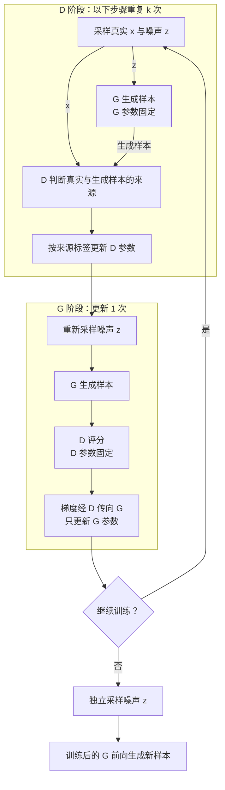

# GAN · 生成对抗网络

%% learning-vault-navigation:v1 %%
> [!abstract]- 笔记导航
> 目录：[[Paper/README|论文阅读 · 索引]]
> 相关：[[Paper/GLM/Score-Based Generative Modeling through Stochastic Differential Equations/Note|Score SDE · 随机微分方程生成模型]]

# First Time

## 1.Abstract
- **问题：** 如何学习能够生成合理样本、匹配真实数据分布的生成模型？
- **动机：** 部分深度生成模型的最大似然训练涉及难算的概率、配分函数或潜变量推断。
- **方法：** 生成器 G 把噪声变成样本；判别器 D 学习判断来源，生成器通过判别器的梯度改善输出。
- **结果：** 在理想函数空间中，最优生成分布等于真实分布，最优判别器输出 1/2；定性与定量实验展示框架潜力。摘要未列实验数字。
- **意义：** 建立可用反向传播训练、基本训练与采样均无需马尔可夫链的生成建模框架。

## 2.Conclusion
- **贡献与结果：** 展示对抗建模的可行性；没有声称生成样本全面优于已有方法。
- **展望：** 条件生成；辅助网络从 x 推断 z；共享参数的条件补全；半监督特征学习；改善 G/D 协调与噪声采样。这些是建议，不能当作已完成验证。
- **边界：** 第 6 节明确指出缺少显式生成密度，并需避免训练失衡造成输出多样性不足。

## 3.Figure & Table
#### Fig1:
-  黑点线为真实密度，绿线为生成密度，蓝虚线为来源概率 D(x)；(a) 尚有差异，(b) 固定 G 改善 D，(c) 固定 D 更新 G，(d) 理想分布匹配。下方箭头表示 z 到 x 的映射。此图是机制示意，不是实测收敛曲线。
- **Algorithm 1（补充）：** 每轮更新 D 共 k 步，再更新 G 一步；实验 k=1，使用动量。算法框的噪声先验写作 p_g(z)，对照第 3 节应理解为 p_z(z)。
#### Table1:
- Parzen 近似平均对数似然越大越好。实数像素 MNIST：GAN 225±2，高于 Deep GSN 214±1.1；TFD：GAN 2057±26，低于 Stacked CAE 2110±50。核宽度用验证集选择；标准误分别跨 MNIST 测试样本、TFD 数据折计算。不是精确 GAN 似然或准确率。
#### Fig2:
- (a) MNIST，(b) TFD，(c) 全连接 CIFAR-10，(d) 卷积判别器与“反卷积”生成器的 CIFAR-10。黄色最右列是训练集最近邻，其余为随机生成样本；少量最近邻展示不足以严格排除记忆，也不是架构优劣的定量比较。
#### Fig3:
- 左右两组潜变量线性插值形成逐渐变化的数字。变化发生在 z 空间，图像经 G 非线性生成；局部例子不能证明所有路径都合理或潜变量已解耦。
#### Table2:
- 从训练、推断、采样、密度评价和模型设计比较四类框架。GAN 可直接采样，但仍需额外密度估计；从 x 推断 z 是辅助任务。比较应按本文讨论范围理解。
# Second Time

## 1.Introduction / Related work
- 本文借助可学习的来源分类信号训练采样器，绕开部分显式概率计算。网络、反向传播和分类训练本身都有先行工作。
- RBM/DBM 涉及配分函数与 MCMC；DBN 结合有向、无向结构；score matching/NCE 需要可计算的未归一化密度；GSN 等学习生成链的一步转移。本文还提及变分自编码与随机反向传播。
- NCE 的固定噪声用于数据空间中的来源分类。GAN 的输入噪声先验可以固定，但经可学习 G 得到的输出分布会变化；另有独立学习的 D。

## 2.Adversarial nets
G 接收噪声 z，输出样本；D 接收真实或生成样本，输出一个来源概率。真实标签为 1，生成标签为 0。原始目标为：（公式 1）
$$
\min_G\max_D V(D,G)=\mathbb E_{x\sim p_{\mathrm{data}}}[\log D(x)]+\mathbb E_{z\sim p_z}[\log(1-D(G(z)))].
$$
p_z 是输入噪声分布，p_g 是 G 的输出分布，p_data 是真实数据分布；期望表示相应分布下的平均。
- 实际交替更新：D 学会正确判断来源，G 使生成样本获得更高真实概率。每阶段只更新对应网络参数。
- 更新 G 时固定 D 参数，仍保留经过 D 传向 G 的梯度。早期 D 容易拒绝假样本，原始生成器目标梯度可能较弱；作者改用最大化生成样本的对数真实概率，即非饱和目标。两种目标的梯度不同。

重复出现的 G/D 代表同一网络在不同阶段的使用。箭头包含数据流与阶段先后，更新节点合并损失和反向传播；省略具体层数、批量大小及优化器。基本采样阶段只使用 G。（第 3 节、算法 1）

## 3.Theoretical Results
固定 G，在两种密度之和大于零的位置，最优判别器为：（公式 2）$D_G^*(x)=\frac{p_{\mathrm{data}}(x)}{p_{\mathrm{data}}(x)+p_g(x)}.$
代入原始目标后：（公式 6）
$$
C(G)=\max_D V(D,G)=-\log4+2\,\mathrm{JSD}(p_{\mathrm{data}}\|p_g).
$$
- JSD 非负，且仅在两个分布相同时为零。因此分布层面的唯一最优解是 p_g=p_data，最小值为 −log4，此时最优 D=1/2；网络参数不必唯一。（4.1）
- 收敛论证采用非参数分布空间、足够容量、每轮最优 D 和适当的小幅分布更新；有限网络参数训练存在多个临界点。原文没有给出有限网络 SGD 的普遍保证或具体收敛速率。（4.2）
- JSD 等式针对最优 D 下的原始准则；实际未充分训练的 D 损失不能直接当作准确 JSD。单看 D≈1/2 也不足以判断成功。

# Overall Review

- **贡献：** 提出对抗生成训练框架，并用最优判别器与 JSD 分析解释理想分布匹配解。
- **优点：** 可微反馈可用于多种网络，基本训练与采样无需生成马尔可夫链；非饱和目标改善早期损失梯度信号。
- **不足：** 协调训练困难、可能产生多样性坍塌；密度无显式表示，Parzen 评价有高方差和高维局限；理想理论不能直接覆盖有限网络训练。样本与插值证据有限。
- **定位：** 与 NCE 共享分类学习思路，但单独学习判别器并训练隐式采样器；相较 GSN 等，直接生成样本；不应将反向传播本身归为本文发明。
- **延伸：** 作者提出五类扩展。一个待验证的小问题是：相同模型、数据和训练预算下，两种生成器目标对早期梯度与样本覆盖度的影响；本文未给系统对照。
- **适合：** 已理解 MLP、反向传播和交叉熵，想学习生成模型、极小极大训练及理论条件的人。读懂本文不等于已经完成实现或实验。
