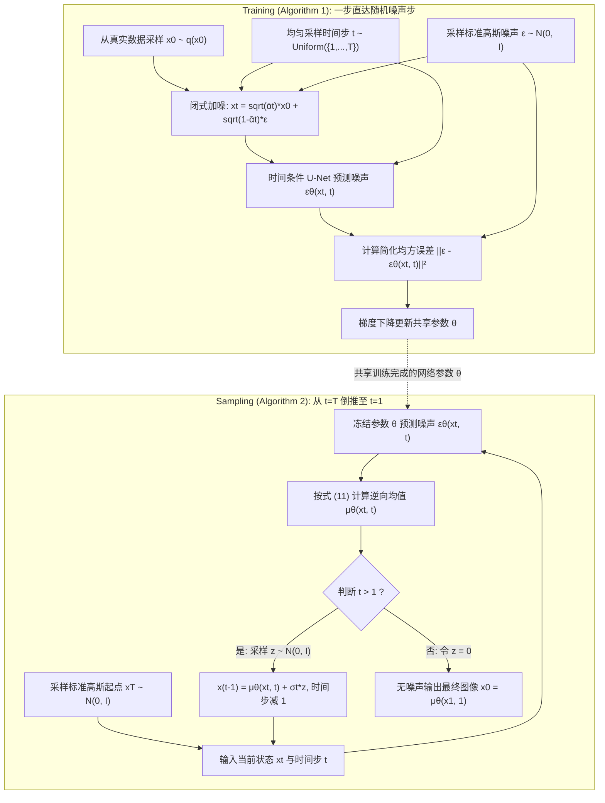

# Denoising Diffusion Probabilistic Models

# First Time

## 1.Title & Authors
论文原标题：Denoising Diffusion Probabilistic Models。
自然中文译法：去噪扩散概率模型（通常简称 DDPM）。
拆解标题中的三个核心词，整篇论文的骨架立刻清晰：
- Denoising（去噪）：模型接收被噪声污染的图像，学习如何剥离噪声、向更清晰的分布状态前进一步。这一步既是训练时的监督信号，也是生成时的推进引擎。
- Diffusion（扩散）：正向过程像墨滴在清水中散开一样，沿着马尔可夫链逐步往图像里注入微小高斯噪声，直到信号彻底融化成纯高斯白噪声；生成过程则反过来沿着学到的逆向链，把一团随机噪声一步步“凝聚”成自然图像。
- Probabilistic Models（概率模型）：整套系统不是临时拼凑的去噪滤波器，而是严格定义了潜变量联合分布 $p_\theta(\mathbf{x}_{0:T})$ 的概率生成模型；其中每一层中间状态 $\mathbf{x}_1,\dots,\mathbf{x}_T$ 都与原始图像 $\mathbf{x}_0$ 维度相同，通过变分推断推导出的负对数似然上界进行训练。
标题表达的核心主张是：把“从零画一张逼真图片”的难题，拆解为沿着时间链学习一系列微小高斯去噪转移，并通过恰当的参数化与加权变分目标，让扩散概率模型首次在高质量图像合成上追平甚至媲美顶级 GAN。
作者按原文署名顺序列出：Jonathan Ho、Ajay Jain、Pieter Abbeel，三人均来自 UC Berkeley（原文未标注共同第一作者或任务分工）。从论文参考文献的直接关联可以看到团队深厚的生成模型积淀：Jonathan Ho 与 Pieter Abbeel 共同发表过流模型代表作 Flow++（文献 [23]），Pieter Abbeel 也是自回归图像生成代表作 PixelSNAIL（文献 [6]）的共同作者。DDPM（NeurIPS 2020）正是在流、自回归、VAE、GAN 与得分匹配百花齐放的背景下，一举把扩散概率模型推上主流生成范式舞台的奠基之作。

## 2.Abstract
摘要非常紧凑，按“核心成果 → 训练机理与理论桥梁 → 渐进解码视角 → 定量成绩单 → 开源信息”五个语义单元展开，下面逐句讲透。
1. 核心成果与模型定位：作者使用扩散概率模型（diffusion probabilistic models）取得了高质量图像合成结果，并指出这是一类受非平衡热力学启发的潜变量模型。
   直观上，热力学里系统自发走向无序（正向加噪），而逆转这一过程需要做功（逆向去噪）。在概率建模中，这对应着把图像数据 $\mathbf{x}_0$ 逐步推向纯噪声 $\mathbf{x}_T$，再训练神经网络学会一步步逆转这个破坏过程。
2. 关键训练设计与理论桥梁：最好结果来自在一个“加权变分界”（weighted variational bound）上训练，而这个目标的设计源于作者发现的一条新联系——扩散概率模型在训练上关联多噪声尺度的去噪得分匹配（denoising score matching），在采样上关联 Langevin 动力学（Langevin dynamics）。
   这里有两个极关键的概念：
   - 得分（score）不是图像打分，而是含噪分布对数密度关于输入的梯度 $\nabla_{\mathbf{x}_t}\log q(\mathbf{x}_t)$，指向概率密度更高的方向。
   - 变分界（式 (3)）是负对数似然的上界；当网络从“直接预测逆向均值”改成“预测注入的高斯噪声 $\boldsymbol{\epsilon}$”并去掉式 (12) 中随时间剧烈变化的前置权重后，训练目标简化为一个极其干净的均方误差（式 (14)）。相对原始变分界，这相当于重新调整了各噪声阶段的学习权重，把模型精力从极低噪声的微调转移到了更难、更决定整体画质的中高噪声阶段。
3. 信息论视角（渐进式有损解压）：作者指出，扩散模型天然支持渐进式有损解压（progressive lossy decompression），并可理解为自回归解码（autoregressive decoding）的广义形式。
   普通自回归模型通常按光栅顺序逐像素生成；而扩散模型在逆向生成时，先用极少的信息量勾勒出物体的整体轮廓与布局，再随着时间推进补齐局部纹理与高频细节。这种“从粗到细”的信息组织方式，把生成过程、变分码长与率失真分析自然连在了一起。
4. 定量成绩单：在无条件 CIFAR10 上取得 Inception Score（IS）9.46 和当时最优的 FID 3.17；在 $256\times 256$ 分辨率的 LSUN 上取得与 ProgressiveGAN 相近的样本质量。
   结合正文第 4.1 节与 Table 1 核对两个重要口径：第一，CIFAR10 的 FID 3.17 是按惯例相对训练集计算的（相对测试集为 5.24），Table 1 报告的 IS 完整写为 $9.46\pm 0.11$，且该领先处于无条件生成比较范围（同表中带类别条件的 StyleGAN2 + ADA (v1) FID 为 2.67）；第二，高样本质量伴随无损码长权衡——简化目标的测试负对数似然上界为 3.75 bits/dim，略高于原始变分界训练的 3.70 bits/dim，也高于专门的似然模型（如 Sparse Transformer 的 2.80 bits/dim）。
5. 开源实现：作者公开了完整代码仓库（`https://github.com/hojonathanho/diffusion`），大幅推动了后续整个扩散模型社区的爆发。
把摘要提炼成四个核心要素：

| 要素 | 本文核心内容 |
|---|---|
| 问题 | 扩散概率模型定义清晰、训练高效，但此前尚未展现与 GAN、自回归等模型竞争的高质量图像生成能力；如何设计逆向参数化与训练目标是发挥其潜力的关键。 |
| 方法 | 固定正向高斯加噪链与逆向方差，将逆向均值重参数化为噪声预测网络 $\boldsymbol{\epsilon}_\theta(\mathbf{x}_t, t)$，以重加权后的简化均方误差目标 $L_{\mathrm{simple}}$ 训练，从而接通去噪得分匹配与类 Langevin 采样。 |
| 结果 | 无条件 CIFAR10 取得 IS $9.46\pm 0.11$、训练集参照 FID 3.17（测试集参照 5.24）；$256\times 256$ LSUN Bedroom（大模型）与 Church 分别达到 FID 4.90 与 7.89，视觉质量接近 ProgressiveGAN。 |
| 意义 | 确立了现代扩散模型的核心训练与采样范式，用同一概率框架打通了变分马尔可夫链、得分匹配、能量模型、渐进有损压缩与广义自回归解码。 |

## 3.Conclusion
原文 Section 6 为独立的 Conclusion，篇幅精炼（单段两句话），第一句收束全篇成果与理论版图，第二句点明未来方向。
1. 第一句——实证突破与五条理论连接：
   - 实证结果：用扩散模型生成了高质量图像样本（对应 Section 4.1–4.2、Table 1、Table 2 与 Figs. 1, 3, 4）。
   - 连接一（变分推断训练马尔可夫链）：正向加噪与逆向去噪构成同一概率模型的联合分布，变分上界（式 (3)、式 (5)）把长链生成直接转化为各步高斯后验匹配。
   - 连接二（去噪得分匹配、退火 Langevin 动力学与能量模型）：通过噪声预测参数化（式 (11)、式 (12)），逆向均值回归等价于多噪声尺度的加权去噪得分匹配，采样链（Algorithm 2）呈现类退火 Langevin 动力学形态；再由得分与能量梯度的经典关系，自然延伸至能量模型家族（Section 3.2、Section 5）。
   - 连接三（自回归模型与渐进式有损压缩）：式 (5) 的各分项对应逐步发送与接收的渐进编码代价（Algorithms 3–4），式 (15) 与 Fig. 5–Fig. 7 展现“先大尺度结构、后细微像素”的率失真与渐进生成特性；式 (16) 与逐坐标掩蔽思想实验进一步说明自回归解码是广义扩散过程的特例（Section 4.3）。
2. 第二句——归纳偏置判断与未来展望：
   - 归纳偏置观察：结合高画质与低码率区陡降的率失真曲线，作者判断高斯扩散对图像数据具有非常有利的归纳偏置（inductive bias），即把模型容量优先花在人眼敏感的全局结构上，而非不可察觉的微末像素细节。
   - 未来方向：将扩散模型拓展到图像以外的其他数据模态（如音频、文本等），以及把扩散模型作为模块嵌入其他生成模型和机器学习系统中。
3. 与正文边界的对照：Conclusion 本身没有单独列出限制清单，但正文与补充信息清楚交代了三处实际边界——采样需要 $T=1000$ 步顺序网络评估，推理开销较大（Appendix B）；最佳样本质量模型的无损似然上界（3.75 bits/dim）不如自回归似然模型（Section 1、Section 4.3）；渐进压缩算法依赖高维不可行的 minimal random coding，现阶段是解释变分界的概念验证（Extra information）。

## 4.Analogy
可以把 DDPM 想象成“教一位雕塑大师在浓雾里一点点把石块雕成栩栩如生的人像”。
- 正向扩散过程 $q$ 就像把一座完工的精美雕塑放进一台“均匀风化机”里：每隔一秒吹起一点极细的随机风沙（微小高斯噪声 $\beta_t$），同时把原石轮廓略微缩淡一点（$\sqrt{1-\beta_t}$）。吹上 1000 秒后，不管原本是人脸、教堂还是猫咪，雕塑都会彻底风化成一堆毫无特征的匀质沙砾（标准高斯 $\mathbf{x}_T \sim \mathcal{N}(\mathbf{0}, \mathbf{I})$）。
- 神奇的闭式捷径（式 (4)）意味着：训练时我们完全不用傻傻地等风化机吹满 500 秒，而是直接用公式算出第 $t$ 秒时原石剩下多少比例（$\sqrt{\bar{\alpha}_t}$）、总共蒙了多厚一层沙尘（$\sqrt{1-\bar{\alpha}_t}\boldsymbol{\epsilon}$），一瞬间造出任意风化程度的样本。
- DDPM 的神来之笔——预测噪声 $\boldsymbol{\epsilon}_\theta$ 究竟妙在哪儿？以前的做法是给大师看一堆半风化的石块，让他直接猜“下一秒稍微清晰一点的石块长什么样”（预测均值 $\tilde{\boldsymbol{\mu}}_t$）；Ho 等人换了个更顺手的考题——直接问大师：“告诉我，眼前这块石头上蒙着的那层随机沙尘 $\boldsymbol{\epsilon}$ 长什么样？”一旦大师精准指出沙尘在哪儿，按照精确的代数配方把对应比例的沙尘拂去一小层，再轻轻抖落一点随机微尘保持自然变化（$\sigma_t \mathbf{z}$），就稳稳退回到了第 $t-1$ 秒！
- 简化目标 $L_{\mathrm{simple}}$（式 (14)）则像调整练习题的比重：原始概率公式（式 (12)）会把绝大部分分数压在 $t=1,2$ 这种“雕塑已经几乎完工、只剩几粒灰尘”的微调题上，导致大师在浓雾里连五官轮廓都还没拿捏稳；去掉这个不均衡权重后，大师把精力均匀投向所有风化阶段，从浓雾里起稿塑形的能力突飞猛进。
- 生成采样（Algorithm 2）就是给大师一团完全随机的沙砾 $\mathbf{x}_T$，从第 1000 秒倒数到第 1 秒，每一步拂去一点沙尘、保留一点微扰：先在浓雾里定出头型与光影（低码率粗结构），再慢慢刻出眼神、发丝与皮肤纹理（高码率细微细节）。
这个比喻的边界同样清晰：高风化状态对应的并非唯一一座真实雕塑，而是一整族可能的合理解，因此逆向过程是带随机性的分布采样而非把某张训练图倒放还原；此外，正向风化步数固定为 $T=1000$，生成时必须顺序走完，不能像训练那样一步直达。

# Second Time

## 1.Notation & Parameters
正文公式围绕“前向加噪 → 变分上界拆解 → 噪声预测与简化损失 → 渐进编码与插值”四条线展开。下表保留论文原版粗体与正斜体规范（向量、矩阵为粗体，标量为常规斜体），汇总理解全文主线必需的重点符号。

| 符号/参数 | 含义与作用 | 关键设定/约束 |
|---|---|---|
| $\mathbf{x}_0$、$q(\mathbf{x}_0)$ | 真实原始图像数据及其未知数据分布 | 整数像素 $\{0,1,\dots,255\}$ 线性缩放到 $[-1,1]$，维度为 $D$ |
| $\mathbf{x}_t$、$\mathbf{x}_{1:T}$ | 第 $t$ 步的含噪潜变量及全部潜变量序列 | 与 $\mathbf{x}_0$ 同维；正向加噪 $t$ 增大，逆向生成 $t$ 减小 |
| $t$、$T$ | 离散时间步索引、总扩散步数 | 实验统一设 $T=1000$；训练时均匀抽取 $t\sim\mathrm{Uniform}(\{1,\dots,T\})$ |
| $\beta_t$ | 正向过程第 $t$ 步的高斯噪声方差日程 | 固定为常数超参数，从 $\beta_1=10^{-4}$ 线性增至 $\beta_T=0.02$ |
| $\alpha_t$、$\bar{\alpha}_t$ | 单步信号方差保留系数及其累计乘积 | $\alpha_t := 1-\beta_t$，$\bar{\alpha}_t := \prod_{s=1}^{t}\alpha_s$；推导边界对应 $\bar{\alpha}_0=1$ |
| $q(\mathbf{x}_t\mid \mathbf{x}_{t-1})$、$q(\mathbf{x}_t\mid \mathbf{x}_0)$ | 正向单步高斯转移、任意时刻闭式加噪边缘 | 均无学习参数；后者允许训练时直接一步采样 $\mathbf{x}_t$ |
| $q(\mathbf{x}_{t-1}\mid \mathbf{x}_t,\mathbf{x}_0)$ | 给定原图 $\mathbf{x}_0$ 时的正向过程真实后验 | $t>1$ 时为可解析计算的精确高斯，作为训练逆向转移的靶子 |
| $\tilde{\boldsymbol{\mu}}_t(\mathbf{x}_t,\mathbf{x}_0)$、$\tilde{\beta}_t$ | 上述条件后验的均值向量与标量方差 | 由日程和 $(\mathbf{x}_t,\mathbf{x}_0)$ 闭式决定（式 (7)），非神经网络 |
| $p(\mathbf{x}_T)$ | 逆向生成链起点的先验分布 | 固定为标准高斯 $\mathcal{N}(\mathbf{x}_T;\mathbf{0},\mathbf{I})$ |
| $p_\theta(\mathbf{x}_{t-1}\mid \mathbf{x}_t)$、$p_\theta(\mathbf{x}_0)$ | 参数化逆向单步转移、边缘生成分布 | $1<t\le T$ 取高斯转移；$t=1$ 的 $p_\theta(\mathbf{x}_0\mid \mathbf{x}_1)$ 取独立离散解码器 |
| $\boldsymbol{\mu}_\theta(\mathbf{x}_t,t)$、$\boldsymbol{\Sigma}_\theta(\mathbf{x}_t,t)$ | 逆向高斯转移的均值与协方差矩阵 | 本文固定 $\boldsymbol{\Sigma}_\theta(\mathbf{x}_t,t)=\sigma_t^2\mathbf{I}$，均值由噪声网络参数化（式 (11)） |
| $\sigma_t^2$ | 逆向采样步的固定各向同性方差 | 实验对比 $\sigma_t^2=\beta_t$ 与 $\sigma_t^2=\tilde{\beta}_t$，二者表现相近 |
| $\boldsymbol{\epsilon}$、$\mathbf{z}$ | 标准高斯随机向量（均服从 $\mathcal{N}(\mathbf{0},\mathbf{I})$） | $\boldsymbol{\epsilon}$ 用于前向重参数化造含噪图；$\mathbf{z}$ 用于逆向随机采样，$t=1$ 设 $\mathbf{z}=\mathbf{0}$ |
| $\boldsymbol{\epsilon}_\theta(\mathbf{x}_t,t)$、$\theta$ | 噪声预测神经网络及其可训练参数 | 跨时间共享参数的 U-Net，输入 $(\mathbf{x}_t,t)$，输出同维噪声预测 |
| $L$、$L_T$、$L_{t-1}$、$L_0$ | 负对数似然变分上界及其三类分项 | $L_T$ 为终点先验匹配，$L_{t-1}$ 为后验匹配（$t>1$），$L_0$ 为末步重建 |
| $L_{\mathrm{simple}}(\theta)$ | 简化后的无权重噪声预测均方误差目标 | 式 (14)，舍弃式 (12) 的时间权重，大幅提升样本质量 |
| $D_{\mathrm{KL}}(\cdot\,\Vert\,\cdot)$、$H(\mathbf{x}_0)$ | KL 散度、数据分布的熵 | 式 (5) 与式 (16) 的信息论度量；换算 bits/dim 需除以 $D\ln 2$ |
| $D$、$i$ | 图像总维度、单个像素通道坐标索引 | 含空间高宽与 RGB 通道（CIFAR10 为 $32\times 32\times 3=3072$） |
| $\hat{\mathbf{x}}_0$ | 由当前 $\mathbf{x}_t$ 一步直接估计的干净图像 | 式 (15)，用于率失真分析与渐进生成可视化 |
| $\lambda$ | 潜空间线性插值权重系数 | 位于 $[0,1]$ 区间，用于混合两张含噪源状态（Section 4.4） |

两个初读极易混淆的细节提前拎清：第一，$\boldsymbol{\epsilon}$ 是从原图 $\mathbf{x}_0$ 一步跳到 $\mathbf{x}_t$ 的“累计等效高斯噪声”，而不是第 $t$ 步单独加入的那一小份增量噪声；第二，式 (5) 中第 $t$ 次逆向转移 $p_\theta(\mathbf{x}_{t-1}\mid \mathbf{x}_t)$ 对应的损失项下标带一位偏移，记为 $L_{t-1}$（因此 $t=2,\dots,T$ 对应 $L_1,\dots,L_{T-1}$）。

## 2.Introduction
对应原文 Section 1。引言开门见山，先画出当时深度生成模型的全景图（GAN、自回归、流模型、VAE、能量模型与得分匹配均已产出惊艳的图像或音频），再迅速切入扩散概率模型面临的核心空白与本文的三大推进。
1. 扩散模型的简洁直觉与历史空白：
   扩散模型是一条由变分推断训练的参数化马尔可夫链，通过学习逆转一条“不断向数据注入高斯噪声直至摧毁信号”的前向扩散链，在有限步内从噪声生成符合数据分布的样本（图示见 [Fig2 精读](#fig2)）。当每步加入的高斯噪声足够小时，逆向转移也可以采用条件高斯分布，从而让神经网络参数化异常简洁。然而，自 Sohl-Dickstein 等人（2015，文献 [53]）提出以来，扩散模型一直停留在理论框架与简单测试阶段，从未证明自己能生成真正高质量的自然图像。
2. 推进一（高质量样本与等价桥梁）：
   作者首先展示扩散模型确实能够生成高保真图像（开篇即亮出 CelebA-HQ 与 CIFAR10 样本 [Fig1 精读](#fig1)），在部分指标上超过其他生成模型家族的已发表结果。紧接着，作者亮出全篇最核心的理论贡献：将逆向高斯均值重参数化为噪声预测后，扩散模型在训练上等价于多噪声尺度的去噪得分匹配，在采样上呈现出类似退火 Langevin 动力学的更新形式（Section 3.2）。最好的生成质量正是由这套参数化与配套简化目标实现的（消融证据见 [Table2 精读](#table2)）。
3. 推进二（解开“画质极强但似然不高”之谜）：
   作者直面一个看似矛盾的实验现象：DDPM 生成的图片赏心悦目，但它的对数似然（无损码长）不如专门的似然型模型（尽管仍优于此前能量模型和得分匹配用退火重要性采样估计出的较大码长）。作者通过 Section 4.3 的分析发现，模型超过一半的无损码长都被花在了人眼几乎察觉不到的细微像素差异上。借用有损压缩语言，作者把扩散采样阐释为一种渐进解码过程——它像自回归解码一样逐步吐出信息，却突破了固定像素顺序的枷锁，沿着一种广义的“由粗到细”比特顺序构建图像。

## 3.Background
对应原文 Section 2。这一章用 7 个核心公式搭起扩散概率模型的全部数学地基。先建立一条清晰的空间地图：整套模型涉及三个分布——未知的真实数据分布 $q(\mathbf{x}_0)$、人为固定且无参数的“加噪破坏”前向过程 $q(\mathbf{x}_{1:T}\mid \mathbf{x}_0)$、以及带神经网络参数 $\theta$ 的“去噪重建”逆向生成过程 $p_\theta(\mathbf{x}_{0:T})$（图形化对应 [Fig2 精读](#fig2)）。下面逐式完整推导。
1. 边缘数据分布（无编号定义）：
$$
p_\theta(\mathbf{x}_0) := \int p_\theta(\mathbf{x}_{0:T})\,d\mathbf{x}_{1:T}.
$$
这里 $\mathbf{x}_1,\dots,\mathbf{x}_T$ 是与数据 $\mathbf{x}_0 \sim q(\mathbf{x}_0)$ 同维的潜变量。这个积分把所有中间含噪路径全积分掉，只留最终图像的概率密度。由于路径维度极高且每步经过非线性神经网络，该边缘积分无法解析求值，因此必须借助变分推断构造可计算的训练目标。
2. 逆向过程（Reverse process）——公式（1）：
$$
p_\theta(\mathbf{x}_{0:T}) := p(\mathbf{x}_T)\prod_{t=1}^{T} p_\theta(\mathbf{x}_{t-1}\mid \mathbf{x}_t),
\qquad
p_\theta(\mathbf{x}_{t-1}\mid \mathbf{x}_t) := \mathcal{N}\bigl(\mathbf{x}_{t-1};\boldsymbol{\mu}_\theta(\mathbf{x}_t,t),\boldsymbol{\Sigma}_\theta(\mathbf{x}_t,t)\bigr).
$$
物理画面非常直观：从标准高斯先验 $p(\mathbf{x}_T)=\mathcal{N}(\mathbf{x}_T;\mathbf{0},\mathbf{I})$ 抽出一团纯噪声，再沿着马尔可夫链倒着走 $t=T, T-1, \dots, 1$，每一步只看当前含噪图 $\mathbf{x}_t$ 和当前步数 $t$，由神经网络给出高斯分布的均值 $\boldsymbol{\mu}_\theta(\mathbf{x}_t,t)$ 与协方差 $\boldsymbol{\Sigma}_\theta(\mathbf{x}_t,t)$，从中采样出更清晰一点的 $\mathbf{x}_{t-1}$。最后一步 $p_\theta(\mathbf{x}_0\mid \mathbf{x}_1)$ 将在 Section 3.3 细化为面向整数像素的离散解码器。
3. 前向扩散过程（Forward / Diffusion process）——公式（2）：
$$
q(\mathbf{x}_{1:T}\mid \mathbf{x}_0) := \prod_{t=1}^{T} q(\mathbf{x}_t\mid \mathbf{x}_{t-1}),
\qquad
q(\mathbf{x}_t\mid \mathbf{x}_{t-1}) := \mathcal{N}\bigl(\mathbf{x}_t;\sqrt{1-\beta_t}\mathbf{x}_{t-1},\beta_t\mathbf{I}\bigr).
$$
这是扩散模型区别于普通 VAE 的最大特征：近似后验 $q(\mathbf{x}_{1:T}\mid \mathbf{x}_0)$ 不是学出来的编码器，而是按照预设方差日程 $\beta_1,\dots,\beta_T \in (0,1)$ 逐步往图像里加高斯噪声的固定马尔可夫链。
为什么信号前面要乘一个看起来多余的 $\sqrt{1-\beta_t}$？这正是“保方差缩放”的精妙之处：如果 $\mathbf{x}_{t-1}$ 的坐标方差为 1，乘上 $\sqrt{1-\beta_t}$ 后方差变成 $1-\beta_t$，再叠加上方差为 $\beta_t$ 的独立高斯噪声，总方差恰好保持 $(1-\beta_t)+\beta_t = 1$！这样整个链条不会越加噪方差越爆炸，而是平滑地把原图信号衰减到 0、把分布推向标准高斯 $\mathcal{N}(\mathbf{0},\mathbf{I})$。同时，只要每步的 $\beta_t$ 足够小，真实逆向转移也近似为条件高斯，确保了式 (1) 的表达能力（文献 [53]）。
4. 负对数似然的变分上界（ELBO）——公式（3）：
$$
\mathbb{E}[-\log p_\theta(\mathbf{x}_0)]
\le \mathbb{E}_q\!\left[-\log\frac{p_\theta(\mathbf{x}_{0:T})}{q(\mathbf{x}_{1:T}\mid \mathbf{x}_0)}\right]
= \mathbb{E}_q\!\left[-\log p(\mathbf{x}_T)-\sum_{t\ge 1}\log\frac{p_\theta(\mathbf{x}_{t-1}\mid \mathbf{x}_t)}{q(\mathbf{x}_t\mid \mathbf{x}_{t-1})}\right]
=: L.
$$
逐行推导非常利落：
- 第一步（乘除近似后验）：把边缘分布写为关于 $q(\mathbf{x}_{1:T}\mid \mathbf{x}_0)$ 的期望：
$$
p_\theta(\mathbf{x}_0)
=\int q(\mathbf{x}_{1:T}\mid \mathbf{x}_0)\frac{p_\theta(\mathbf{x}_{0:T})}{q(\mathbf{x}_{1:T}\mid \mathbf{x}_0)}\,d\mathbf{x}_{1:T}
=\mathbb{E}_{q(\mathbf{x}_{1:T}\mid \mathbf{x}_0)}\!\left[\frac{p_\theta(\mathbf{x}_{0:T})}{q(\mathbf{x}_{1:T}\mid \mathbf{x}_0)}\right].
$$
- 第二步（Jensen 不等式）：因为函数 $-\log(\cdot)$ 是凸函数，把 $-\log$ 塞进期望内部数值只会变大或不变：
$$
-\log p_\theta(\mathbf{x}_0)
=-\log \mathbb{E}_{q(\mathbf{x}_{1:T}\mid \mathbf{x}_0)}\!\left[\frac{p_\theta(\mathbf{x}_{0:T})}{q(\mathbf{x}_{1:T}\mid \mathbf{x}_0)}\right]
\le \mathbb{E}_{q(\mathbf{x}_{1:T}\mid \mathbf{x}_0)}\!\left[-\log\frac{p_\theta(\mathbf{x}_{0:T})}{q(\mathbf{x}_{1:T}\mid \mathbf{x}_0)}\right].
$$
  顺手核对一下这个不等式的松紧间隙：对任意给定 $\mathbf{x}_0$，用右端减去左端 $-\log p_\theta(\mathbf{x}_0)$，利用 $p_\theta(\mathbf{x}_{0:T}) = p_\theta(\mathbf{x}_0)\,p_\theta(\mathbf{x}_{1:T}\mid \mathbf{x}_0)$ 立刻得到：
$$
\mathbb{E}_{q(\mathbf{x}_{1:T}\mid \mathbf{x}_0)}\!\left[-\log\frac{p_\theta(\mathbf{x}_{0:T})}{q(\mathbf{x}_{1:T}\mid \mathbf{x}_0)}\right] - \bigl(-\log p_\theta(\mathbf{x}_0)\bigr)
=\mathbb{E}_{q(\mathbf{x}_{1:T}\mid \mathbf{x}_0)}\!\left[\log\frac{q(\mathbf{x}_{1:T}\mid \mathbf{x}_0)}{p_\theta(\mathbf{x}_{1:T}\mid \mathbf{x}_0)}\right]
=D_{\mathrm{KL}}\bigl(q(\mathbf{x}_{1:T}\mid \mathbf{x}_0)\,\|\,p_\theta(\mathbf{x}_{1:T}\mid \mathbf{x}_0)\bigr)\ge 0.
$$
  当且仅当学到的逆向路径条件分布与前向链完全一致时取等号。
- 第三步（代入马尔可夫分解）：对上式两端再关于数据分布 $q(\mathbf{x}_0)$ 取期望（联合期望简记为 $\mathbb{E}_q$），把式 (1) 和式 (2) 的连乘积代进去，对数把乘积化为求和，直接得出式 (3) 最右端的 $L$。
5. 任意时刻一步直达的闭式加噪——公式（4）：
令 $\alpha_t := 1-\beta_t$，累计乘积 $\bar{\alpha}_t := \prod_{s=1}^{t}\alpha_s$，前向过程有一个极为好用的性质——无需跑完前 $t-1$ 步，就能一步直接从 $\mathbf{x}_0$ 采出任意时刻 $t$ 的 $\mathbf{x}_t$：
$$
q(\mathbf{x}_t\mid \mathbf{x}_0) = \mathcal{N}\bigl(\mathbf{x}_t;\sqrt{\bar{\alpha}_t}\mathbf{x}_0,(1-\bar{\alpha}_t)\mathbf{I}\bigr).
$$
用数学归纳法两步就能证完，清晰直观：
- 起点 $t=1$：$\bar{\alpha}_1 = \alpha_1 = 1-\beta_1$，式 (2) 本身就是 $q(\mathbf{x}_1\mid \mathbf{x}_0) = \mathcal{N}(\mathbf{x}_1;\sqrt{\bar{\alpha}_1}\mathbf{x}_0,(1-\bar{\alpha}_1)\mathbf{I})$。
- 归纳递推：假设 $q(\mathbf{x}_{t-1}\mid \mathbf{x}_0) = \mathcal{N}(\mathbf{x}_{t-1};\sqrt{\bar{\alpha}_{t-1}}\mathbf{x}_0,(1-\bar{\alpha}_{t-1})\mathbf{I})$ 成立。由式 (2)，$\mathbf{x}_t$ 是在 $\mathbf{x}_{t-1}$ 乘以 $\sqrt{\alpha_t}$ 后，叠加一个均值为 $\mathbf{0}$、协方差为 $\beta_t\mathbf{I}=(1-\alpha_t)\mathbf{I}$ 的独立高斯噪声。独立高斯变量的线性组合仍为高斯分布，只需直接算其均值与协方差：
  - 均值：$\sqrt{\alpha_t}\cdot\sqrt{\bar{\alpha}_{t-1}}\mathbf{x}_0 = \sqrt{\alpha_t\bar{\alpha}_{t-1}}\mathbf{x}_0 = \sqrt{\bar{\alpha}_t}\mathbf{x}_0$。
  - 协方差：上一步方差被乘以 $\alpha_t$，加上本步独立噪声方差 $(1-\alpha_t)\mathbf{I}$：
$$
\alpha_t(1-\bar{\alpha}_{t-1})\mathbf{I}+(1-\alpha_t)\mathbf{I}
=(\alpha_t-\alpha_t\bar{\alpha}_{t-1}+1-\alpha_t)\mathbf{I}
=(1-\bar{\alpha}_t)\mathbf{I}.
$$
归纳完成！写成重参数化采样形式就是 $\mathbf{x}_t(\mathbf{x}_0,\boldsymbol{\epsilon}) = \sqrt{\bar{\alpha}_t}\mathbf{x}_0 + \sqrt{1-\bar{\alpha}_t}\boldsymbol{\epsilon}$，其中 $\boldsymbol{\epsilon}\sim\mathcal{N}(\mathbf{0},\mathbf{I})$。这条性质让训练时可以随机抽一个时刻 $t$ 直接优化对应单项，极大加速了随机梯度下降。
6. 降方差的 ELBO 拆解——公式（5）：
直接拿式 (3) 做蒙特卡洛采样估计梯度，方差会很大。作者沿用文献 [53] 的变形（完整步骤列于 Appendix A 式 (17)–(22)），把 $L$ 重写为三类可解析处理的分项：
$$
L=\mathbb{E}_q\!\left[
\underbrace{D_{\mathrm{KL}}\bigl(q(\mathbf{x}_T\mid \mathbf{x}_0)\,\|\,p(\mathbf{x}_T)\bigr)}_{L_T}
+\sum_{t>1}\underbrace{D_{\mathrm{KL}}\bigl(q(\mathbf{x}_{t-1}\mid \mathbf{x}_t,\mathbf{x}_0)\,\|\,p_\theta(\mathbf{x}_{t-1}\mid \mathbf{x}_t)\bigr)}_{L_{t-1}}
\underbrace{-\log p_\theta(\mathbf{x}_0\mid \mathbf{x}_1)}_{L_0}
\right].
$$
关键一步的推导非常优雅（望远镜相消）：
- 第一步，把式 (3) 求和中 $t=1$ 的那一项单独拆出来：
$$
L=\mathbb{E}_q\!\left[-\log p(\mathbf{x}_T)-\sum_{t>1}\log\frac{p_\theta(\mathbf{x}_{t-1}\mid \mathbf{x}_t)}{q(\mathbf{x}_t\mid \mathbf{x}_{t-1})}-\log\frac{p_\theta(\mathbf{x}_0\mid \mathbf{x}_1)}{q(\mathbf{x}_1\mid \mathbf{x}_0)}\right].
$$
- 第二步，对所有 $t>1$，利用前向链马尔可夫性 $q(\mathbf{x}_t\mid \mathbf{x}_{t-1}) = q(\mathbf{x}_t\mid \mathbf{x}_{t-1},\mathbf{x}_0)$，再套条件于 $\mathbf{x}_0$ 的贝叶斯公式把前向转移“翻面”成后验：
$$
q(\mathbf{x}_t\mid \mathbf{x}_{t-1})
=q(\mathbf{x}_t\mid \mathbf{x}_{t-1},\mathbf{x}_0)
=\frac{q(\mathbf{x}_{t-1}\mid \mathbf{x}_t,\mathbf{x}_0)\,q(\mathbf{x}_t\mid \mathbf{x}_0)}{q(\mathbf{x}_{t-1}\mid \mathbf{x}_0)}.
$$
- 第三步，代回求和中，对数拆开后出现一串首尾相消的望远镜级数：
$$
L=\mathbb{E}_q\!\left[
-\log p(\mathbf{x}_T)
-\sum_{t>1}\log\frac{p_\theta(\mathbf{x}_{t-1}\mid \mathbf{x}_t)}{q(\mathbf{x}_{t-1}\mid \mathbf{x}_t,\mathbf{x}_0)}
-\sum_{t=2}^{T}\log\frac{q(\mathbf{x}_{t-1}\mid \mathbf{x}_0)}{q(\mathbf{x}_t\mid \mathbf{x}_0)}
-\log\frac{p_\theta(\mathbf{x}_0\mid \mathbf{x}_1)}{q(\mathbf{x}_1\mid \mathbf{x}_0)}
\right].
$$
  中间那串求和展开后，中间项 $\log q(\mathbf{x}_2\mid \mathbf{x}_0),\dots,\log q(\mathbf{x}_{T-1}\mid \mathbf{x}_0)$ 全部抵消，只剩头尾两项：
$$
-\sum_{t=2}^{T}\log\frac{q(\mathbf{x}_{t-1}\mid \mathbf{x}_0)}{q(\mathbf{x}_t\mid \mathbf{x}_0)}
=\log q(\mathbf{x}_T\mid \mathbf{x}_0)-\log q(\mathbf{x}_1\mid \mathbf{x}_0).
$$
  其中 $-\log q(\mathbf{x}_1\mid \mathbf{x}_0)$ 恰好消掉末项分母带来的 $+\log q(\mathbf{x}_1\mid \mathbf{x}_0)$，而 $+\log q(\mathbf{x}_T\mid \mathbf{x}_0)$ 恰好与 $-\log p(\mathbf{x}_T)$ 合并成 $-\log\frac{p(\mathbf{x}_T)}{q(\mathbf{x}_T\mid \mathbf{x}_0)}$，整理得：
$$
L=\mathbb{E}_q\!\left[
-\log\frac{p(\mathbf{x}_T)}{q(\mathbf{x}_T\mid \mathbf{x}_0)}
-\sum_{t>1}\log\frac{p_\theta(\mathbf{x}_{t-1}\mid \mathbf{x}_t)}{q(\mathbf{x}_{t-1}\mid \mathbf{x}_t,\mathbf{x}_0)}
-\log p_\theta(\mathbf{x}_0\mid \mathbf{x}_1)
\right].
$$
- 第四步，分别对 $\mathbf{x}_T\sim q(\mathbf{x}_T\mid \mathbf{x}_0)$ 以及（在给定 $\mathbf{x}_t,\mathbf{x}_0$ 下）对 $\mathbf{x}_{t-1}\sim q(\mathbf{x}_{t-1}\mid \mathbf{x}_t,\mathbf{x}_0)$ 取内层条件期望，前两类对数比正好化为 KL 散度，即得到式 (5)！
为什么这步拆解是神来之笔？因为不给 $\mathbf{x}_0$ 时，真实逆向分布 $q(\mathbf{x}_{t-1}\mid \mathbf{x}_t)$ 是覆盖整张数据流形的复杂混合分布，根本算不出来；可一旦把 $\mathbf{x}_0$ 放进条件，前向后验 $q(\mathbf{x}_{t-1}\mid \mathbf{x}_t,\mathbf{x}_0)$ 瞬间变成一个有闭式解的高斯分布！于是式 (5) 里的每一个 KL 散度都是“两个高斯分布之间的 KL”，能直接用解析公式算出来（Rao-Blackwellization 降方差），彻底告别高方差的蒙特卡洛估计。
7. 给定原图时的精确后验——公式（6）与公式（7）：
$$
q(\mathbf{x}_{t-1}\mid \mathbf{x}_t,\mathbf{x}_0)
=\mathcal{N}\bigl(\mathbf{x}_{t-1};\tilde{\boldsymbol{\mu}}_t(\mathbf{x}_t,\mathbf{x}_0),\tilde{\beta}_t\mathbf{I}\bigr),
$$
$$
\tilde{\boldsymbol{\mu}}_t(\mathbf{x}_t,\mathbf{x}_0)
:=\frac{\sqrt{\bar{\alpha}_{t-1}}\beta_t}{1-\bar{\alpha}_t}\mathbf{x}_0
+\frac{\sqrt{\alpha_t}(1-\bar{\alpha}_{t-1})}{1-\bar{\alpha}_t}\mathbf{x}_t,
\qquad
\tilde{\beta}_t
:=\frac{1-\bar{\alpha}_{t-1}}{1-\bar{\alpha}_t}\beta_t.
$$
下面全程使用原文符号，一步步配方推出来：
- 第一步，套贝叶斯公式与前向马尔可夫性，扔掉与自变量 $\mathbf{x}_{t-1}$ 无关的分母 $q(\mathbf{x}_t\mid \mathbf{x}_0)$：
$$
q(\mathbf{x}_{t-1}\mid \mathbf{x}_t,\mathbf{x}_0)
=q(\mathbf{x}_t\mid \mathbf{x}_{t-1},\mathbf{x}_0)\frac{q(\mathbf{x}_{t-1}\mid \mathbf{x}_0)}{q(\mathbf{x}_t\mid \mathbf{x}_0)}
\propto q(\mathbf{x}_t\mid \mathbf{x}_{t-1})\,q(\mathbf{x}_{t-1}\mid \mathbf{x}_0).
$$
- 第二步，代入式 (2) 和式 (4) 的高斯密度，只保留指数上与 $\mathbf{x}_{t-1}$ 有关的二次型：
$$
q(\mathbf{x}_{t-1}\mid \mathbf{x}_t,\mathbf{x}_0)
\propto\exp\!\left(
-\frac{1}{2}\left[
\frac{\|\mathbf{x}_t-\sqrt{\alpha_t}\mathbf{x}_{t-1}\|^2}{\beta_t}
+\frac{\|\mathbf{x}_{t-1}-\sqrt{\bar{\alpha}_{t-1}}\mathbf{x}_0\|^2}{1-\bar{\alpha}_{t-1}}
\right]
\right).
$$
- 第三步，展开两个平方项，把含 $\|\mathbf{x}_{t-1}\|^2$ 的二次项和含 $\mathbf{x}_{t-1}$ 的一次项合并，去掉与 $\mathbf{x}_{t-1}$ 无关的项：
$$
\frac{\|\mathbf{x}_t-\sqrt{\alpha_t}\mathbf{x}_{t-1}\|^2}{\beta_t}
+\frac{\|\mathbf{x}_{t-1}-\sqrt{\bar{\alpha}_{t-1}}\mathbf{x}_0\|^2}{1-\bar{\alpha}_{t-1}}
=\left(\frac{\alpha_t}{\beta_t}+\frac{1}{1-\bar{\alpha}_{t-1}}\right)\|\mathbf{x}_{t-1}\|^2
-2\left(\frac{\sqrt{\alpha_t}}{\beta_t}\mathbf{x}_t+\frac{\sqrt{\bar{\alpha}_{t-1}}}{1-\bar{\alpha}_{t-1}}\mathbf{x}_0\right)^{\top}\mathbf{x}_{t-1}
+\text{无关常数}.
$$
- 第四步，对照各向同性高斯分布 $\mathcal{N}(\mathbf{x}_{t-1};\tilde{\boldsymbol{\mu}}_t(\mathbf{x}_t,\mathbf{x}_0),\tilde{\beta}_t\mathbf{I})$ 的标准指数项 $\frac{1}{\tilde{\beta}_t}\|\mathbf{x}_{t-1}\|^2-\frac{2}{\tilde{\beta}_t}\tilde{\boldsymbol{\mu}}_t(\mathbf{x}_t,\mathbf{x}_0)^{\top}\mathbf{x}_{t-1}+\frac{1}{\tilde{\beta}_t}\|\tilde{\boldsymbol{\mu}}_t(\mathbf{x}_t,\mathbf{x}_0)\|^2$，对应系数立刻读出精度与均值：
  - 先算精度 $1/\tilde{\beta}_t$，利用 $\alpha_t+\beta_t=1$ 与 $\alpha_t\bar{\alpha}_{t-1}=\bar{\alpha}_t$：
$$
\frac{1}{\tilde{\beta}_t}
=\frac{\alpha_t}{\beta_t}+\frac{1}{1-\bar{\alpha}_{t-1}}
=\frac{\alpha_t(1-\bar{\alpha}_{t-1})+\beta_t}{\beta_t(1-\bar{\alpha}_{t-1})}
=\frac{\alpha_t-\bar{\alpha}_t+1-\alpha_t}{\beta_t(1-\bar{\alpha}_{t-1})}
=\frac{1-\bar{\alpha}_t}{\beta_t(1-\bar{\alpha}_{t-1})},
$$
    取倒数即得 $\tilde{\beta}_t = \frac{1-\bar{\alpha}_{t-1}}{1-\bar{\alpha}_t}\beta_t$！
  - 再把一次项系数乘上 $\tilde{\beta}_t$ 得到后验均值：
$$
\tilde{\boldsymbol{\mu}}_t(\mathbf{x}_t,\mathbf{x}_0)
=\tilde{\beta}_t\left(\frac{\sqrt{\alpha_t}}{\beta_t}\mathbf{x}_t+\frac{\sqrt{\bar{\alpha}_{t-1}}}{1-\bar{\alpha}_{t-1}}\mathbf{x}_0\right)
=\frac{\sqrt{\bar{\alpha}_{t-1}}\beta_t}{1-\bar{\alpha}_t}\mathbf{x}_0
+\frac{\sqrt{\alpha_t}(1-\bar{\alpha}_{t-1})}{1-\bar{\alpha}_t}\mathbf{x}_t.
$$
几何画面清晰得像画出来一样：已知起点原图 $\mathbf{x}_0$ 和当前带噪图 $\mathbf{x}_t$ 时，前一步状态 $\mathbf{x}_{t-1}$ 的最优中心 $\tilde{\boldsymbol{\mu}}_t$ 正是 $\mathbf{x}_0$ 与 $\mathbf{x}_t$ 的加权组合，而方差 $\tilde{\beta}_t$ 严格小于单步噪声 $\beta_t$ 且完全不依赖图像内容。边界上，若令 $\bar{\alpha}_0=1$，则 $t=1$ 时 $\tilde{\beta}_1=0$，退化为确定指向 $\mathbf{x}_0$ 的点分布，这也解释了式 (5) 为何把 $L_0=-\log p_\theta(\mathbf{x}_0\mid \mathbf{x}_1)$ 单独列出。

## 4.Diffusion models and denoising autoencoders
对应原文 Section 3 总论。搭完 Section 2 的通用概率骨架后，真正决定模型成败的自由度还有一大堆：前向方差日程 $\beta_t$ 学不学？逆向协方差 $\boldsymbol{\Sigma}_\theta$ 怎么设？逆向均值 $\boldsymbol{\mu}_\theta$ 让神经网络直接预测什么？损失各项怎么加权？
作者按照式 (5) 的三块拼图——$L_T$（Section 3.1）、$L_{1:T-1}$（Section 3.2）、$L_0$（Section 3.3）——逐一锁定每个设计选择，最后在 Section 3.4 给出惊艳的简化训练目标。其指导思想非常明确：用与去噪得分匹配的显式数学联系引导参数化方向，再用简洁性与实证消融敲定最终方案。

## 5.Forward process and $L_T$
对应原文 Section 3.1。前向过程虽然理论上可以通过重参数化把 $\beta_t$ 设成可训练参数，但作者干脆把 $\beta_1,\dots,\beta_T$ 全部固定为预设超参数。
这一决策立刻带来一个干脆的简化：前向近似后验 $q$ 彻底不含任何可训练参数，因此式 (5) 里的终点先验匹配项 $L_T = D_{\mathrm{KL}}\bigl(q(\mathbf{x}_T\mid \mathbf{x}_0)\,\|\,p(\mathbf{x}_T)\bigr)$ 关于网络参数 $\theta$ 的梯度恒为零，训练时可以直接略去。
把式 (4) 的 $q(\mathbf{x}_T\mid \mathbf{x}_0)=\mathcal{N}(\mathbf{x}_T;\sqrt{\bar{\alpha}_T}\mathbf{x}_0,(1-\bar{\alpha}_T)\mathbf{I})$ 与标准高斯 $p(\mathbf{x}_T)=\mathcal{N}(\mathbf{x}_T;\mathbf{0},\mathbf{I})$ 代入多维高斯 KL 解析式，可以显式看出它的数值结构：
$$
D_{\mathrm{KL}}\bigl(q(\mathbf{x}_T\mid \mathbf{x}_0)\,\|\,p(\mathbf{x}_T)\bigr)
=\frac{1}{2}\Bigl(\bar{\alpha}_T\|\mathbf{x}_0\|^2 - D\bar{\alpha}_T - D\log(1-\bar{\alpha}_T)\Bigr).
$$
当总步数与日程选得足够充分、使 $\bar{\alpha}_T \to 0$ 时，这一项在实验里小到约 $10^{-5}$ bits/dim（除以 $D\ln 2$ 换算为每维比特数）；训练阶段忽略其梯度，但在评估完整变分码长时仍需照常计入。

## 6.Reverse process
对应原文 Section 3.2（Reverse process and $L_{1:T-1}$）。这是全篇最精彩、最具革命性的核心章节：作者将逆向高斯转移的协方差固定、把均值匹配一步步化简为噪声预测，最终推导出扩散模型与去噪得分匹配、Langevin 动力学之间的等价桥梁。
1. 协方差选择——固定为随时间变化的各向同性常数：
对于 $1 < t \le T$，作者直接设 $\boldsymbol{\Sigma}_\theta(\mathbf{x}_t,t) = \sigma_t^2\mathbf{I}$，不让网络去学协方差（后文 [Table2 精读](#table2) 消融证实学习对角协方差容易导致训练不稳定、画质下降）。
作者实测了两种固定日程：$\sigma_t^2 = \beta_t$ 与 $\sigma_t^2 = \tilde{\beta}_t = \frac{1-\bar{\alpha}_{t-1}}{1-\bar{\alpha}_t}\beta_t$，发现二者样本质量相近。为什么恰好挑这两个值？它们对应真实数据分布的两个数学极端：
- 极端一（$\mathbf{x}_0 \sim \mathcal{N}(\mathbf{0},\mathbf{I})$）：按式 (2) 保方差递推，每步边缘分布都是 $\mathcal{N}(\mathbf{0},\mathbf{I})$，相邻两步的交叉协方差为 $\sqrt{\alpha_t}\mathbf{I}$；由联合高斯条件方差公式，给定 $\mathbf{x}_t$ 时 $\mathbf{x}_{t-1}$ 的真实逆向条件协方差恰好是 $(1-\alpha_t)\mathbf{I} = \beta_t\mathbf{I}$。
- 极端二（$\mathbf{x}_0$ 退化为确定单点）：此时 $\mathbf{x}_0$ 没有任何不确定性，真实逆向条件分布直接就是式 (6) 的后验 $q(\mathbf{x}_{t-1}\mid \mathbf{x}_t,\mathbf{x}_0)$，其精确协方差恰好是 $\tilde{\beta}_t\mathbf{I}$。
对于坐标方差为单位 1 的一般数据分布，这两个极端正好夹住了逆过程熵的上界与下界（文献 [53]）。
2. 高斯 KL 化为均值均方误差——公式（8）：
固定 $\boldsymbol{\Sigma}_\theta(\mathbf{x}_t,t) = \sigma_t^2\mathbf{I}$ 后，对 $t>1$ 直接套用 $D$ 维各向同性高斯分布的 KL 解析式：
$$
D_{\mathrm{KL}}\!\left(\mathcal{N}\bigl(\mathbf{x}_{t-1};\tilde{\boldsymbol{\mu}}_t(\mathbf{x}_t,\mathbf{x}_0),\tilde{\beta}_t\mathbf{I}\bigr)\,\Big\|\,\mathcal{N}\bigl(\mathbf{x}_{t-1};\boldsymbol{\mu}_\theta(\mathbf{x}_t,t),\sigma_t^2\mathbf{I}\bigr)\right)
=\frac{1}{2\sigma_t^2}\|\tilde{\boldsymbol{\mu}}_t(\mathbf{x}_t,\mathbf{x}_0)-\boldsymbol{\mu}_\theta(\mathbf{x}_t,t)\|^2
+\frac{D}{2}\left(\frac{\tilde{\beta}_t}{\sigma_t^2}-1+\log\frac{\sigma_t^2}{\tilde{\beta}_t}\right).
$$
取期望 $\mathbb{E}_q[\cdot]$ 后，右边第二项只含固定常量 $\tilde{\beta}_t$ 与 $\sigma_t^2$，完全不依赖可训练参数 $\theta$，并入常数 $C$，即得公式（8）：
$$
L_{t-1} = \mathbb{E}_q\!\left[\frac{1}{2\sigma_t^2}\|\tilde{\boldsymbol{\mu}}_t(\mathbf{x}_t,\mathbf{x}_0)-\boldsymbol{\mu}_\theta(\mathbf{x}_t,t)\|^2\right] + C.
$$
到这里，最直觉的做法就是让网络 $\boldsymbol{\mu}_\theta(\mathbf{x}_t,t)$ 直接回归后验均值 $\tilde{\boldsymbol{\mu}}_t(\mathbf{x}_t,\mathbf{x}_0)$。但作者没有停在这里，而是继续往里挖了一层，挖出了全篇的金矿。
3. 重参数化消去 $\mathbf{x}_0$，逼出噪声 $\boldsymbol{\epsilon}$——公式（9）与公式（10）：
利用式 (4) 的重参数化 $\mathbf{x}_t(\mathbf{x}_0,\boldsymbol{\epsilon}) = \sqrt{\bar{\alpha}_t}\mathbf{x}_0 + \sqrt{1-\bar{\alpha}_t}\boldsymbol{\epsilon}$（其中 $\boldsymbol{\epsilon}\sim\mathcal{N}(\mathbf{0},\mathbf{I})$），反解出原图：
$$
\mathbf{x}_0 = \frac{1}{\sqrt{\bar{\alpha}_t}}\bigl(\mathbf{x}_t(\mathbf{x}_0,\boldsymbol{\epsilon})-\sqrt{1-\bar{\alpha}_t}\boldsymbol{\epsilon}\bigr).
$$
代入式 (8)，立刻得到公式（9）：
$$
L_{t-1}-C
=\mathbb{E}_{\mathbf{x}_0,\boldsymbol{\epsilon}}\!\left[
\frac{1}{2\sigma_t^2}\left\|
\tilde{\boldsymbol{\mu}}_t\!\left(\mathbf{x}_t(\mathbf{x}_0,\boldsymbol{\epsilon}),\frac{1}{\sqrt{\bar{\alpha}_t}}\bigl(\mathbf{x}_t(\mathbf{x}_0,\boldsymbol{\epsilon})-\sqrt{1-\bar{\alpha}_t}\boldsymbol{\epsilon}\bigr)\right)
-\boldsymbol{\mu}_\theta(\mathbf{x}_t(\mathbf{x}_0,\boldsymbol{\epsilon}),t)
\right\|^2
\right].
$$
现在把式 (7) 的精确表达式 $\tilde{\boldsymbol{\mu}}_t(\mathbf{x}_t,\mathbf{x}_0) = \frac{\sqrt{\bar{\alpha}_{t-1}}\beta_t}{1-\bar{\alpha}_t}\mathbf{x}_0 + \frac{\sqrt{\alpha_t}(1-\bar{\alpha}_{t-1})}{1-\bar{\alpha}_t}\mathbf{x}_t$ 展开，把刚解出来的 $\mathbf{x}_0$ 塞进去，全程不用任何额外别名，直接合并同类项：
$$
\tilde{\boldsymbol{\mu}}_t\!\left(\mathbf{x}_t(\mathbf{x}_0,\boldsymbol{\epsilon}),\frac{1}{\sqrt{\bar{\alpha}_t}}\bigl(\mathbf{x}_t(\mathbf{x}_0,\boldsymbol{\epsilon})-\sqrt{1-\bar{\alpha}_t}\boldsymbol{\epsilon}\bigr)\right)
=\frac{\sqrt{\bar{\alpha}_{t-1}}\beta_t}{(1-\bar{\alpha}_t)\sqrt{\bar{\alpha}_t}}\bigl(\mathbf{x}_t(\mathbf{x}_0,\boldsymbol{\epsilon})-\sqrt{1-\bar{\alpha}_t}\boldsymbol{\epsilon}\bigr)
+\frac{\sqrt{\alpha_t}(1-\bar{\alpha}_{t-1})}{1-\bar{\alpha}_t}\mathbf{x}_t(\mathbf{x}_0,\boldsymbol{\epsilon}).
$$
利用 $\frac{\sqrt{\bar{\alpha}_{t-1}}}{\sqrt{\bar{\alpha}_t}} = \frac{1}{\sqrt{\alpha_t}}$，分别化简两个系数：
- $\mathbf{x}_t(\mathbf{x}_0,\boldsymbol{\epsilon})$ 的总系数（利用 $\beta_t = 1-\alpha_t$ 与 $\alpha_t\bar{\alpha}_{t-1}=\bar{\alpha}_t$）：
$$
\frac{\beta_t}{(1-\bar{\alpha}_t)\sqrt{\alpha_t}}+\frac{\sqrt{\alpha_t}(1-\bar{\alpha}_{t-1})}{1-\bar{\alpha}_t}
=\frac{\beta_t+\alpha_t(1-\bar{\alpha}_{t-1})}{\sqrt{\alpha_t}(1-\bar{\alpha}_t)}
=\frac{(1-\alpha_t)+\alpha_t-\bar{\alpha}_t}{\sqrt{\alpha_t}(1-\bar{\alpha}_t)}
=\frac{1-\bar{\alpha}_t}{\sqrt{\alpha_t}(1-\bar{\alpha}_t)}
=\frac{1}{\sqrt{\alpha_t}}.
$$
- $-\boldsymbol{\epsilon}$ 的总系数：
$$
\frac{\beta_t\sqrt{1-\bar{\alpha}_t}}{\sqrt{\alpha_t}(1-\bar{\alpha}_t)}
=\frac{1}{\sqrt{\alpha_t}}\cdot\frac{\beta_t}{\sqrt{1-\bar{\alpha}_t}}.
$$
分子分母的 $1-\bar{\alpha}_t$ 奇迹般地干净消去！代回式 (9)，直接得到公式（10）：
$$
L_{t-1}-C
=\mathbb{E}_{\mathbf{x}_0,\boldsymbol{\epsilon}}\!\left[
\frac{1}{2\sigma_t^2}\left\|
\frac{1}{\sqrt{\alpha_t}}\left(\mathbf{x}_t(\mathbf{x}_0,\boldsymbol{\epsilon})-\frac{\beta_t}{\sqrt{1-\bar{\alpha}_t}}\boldsymbol{\epsilon}\right)
-\boldsymbol{\mu}_\theta(\mathbf{x}_t(\mathbf{x}_0,\boldsymbol{\epsilon}),t)
\right\|^2
\right].
$$
4. 噪声预测参数化与单步采样公式——公式（11）：
盯着式 (10) 看一眼，灵感立刻炸开：$\boldsymbol{\mu}_\theta$ 已知输入 $\mathbf{x}_t$，它真正要预测的目标是 $\frac{1}{\sqrt{\alpha_t}}\bigl(\mathbf{x}_t - \frac{\beta_t}{\sqrt{1-\bar{\alpha}_t}}\boldsymbol{\epsilon}\bigr)$，里面唯一未知的量就是那份高斯噪声 $\boldsymbol{\epsilon}$！因此，不如直接让神经网络 $\boldsymbol{\epsilon}_\theta(\mathbf{x}_t,t)$ 专心预测 $\boldsymbol{\epsilon}$，再照着完全相同的代数结构拼出均值——这就是公式（11）：
$$
\boldsymbol{\mu}_\theta(\mathbf{x}_t,t)
=\tilde{\boldsymbol{\mu}}_t\!\left(\mathbf{x}_t,\frac{1}{\sqrt{\bar{\alpha}_t}}\bigl(\mathbf{x}_t-\sqrt{1-\bar{\alpha}_t}\boldsymbol{\epsilon}_\theta(\mathbf{x}_t)\bigr)\right)
=\frac{1}{\sqrt{\alpha_t}}\left(\mathbf{x}_t-\frac{\beta_t}{\sqrt{1-\bar{\alpha}_t}}\boldsymbol{\epsilon}_\theta(\mathbf{x}_t,t)\right).
$$
（原文在式 (11) 中间写法略去了时间参数 $t$，右端及算法中完整写出 $\boldsymbol{\epsilon}_\theta(\mathbf{x}_t,t)$。）
由此，从逆向高斯转移 $p_\theta(\mathbf{x}_{t-1}\mid \mathbf{x}_t)$ 采样一步就对应无编号采样式：
$$
\mathbf{x}_{t-1}
=\frac{1}{\sqrt{\alpha_t}}\left(\mathbf{x}_t-\frac{\beta_t}{\sqrt{1-\bar{\alpha}_t}}\boldsymbol{\epsilon}_\theta(\mathbf{x}_t,t)\right)
+\sigma_t\mathbf{z},
\qquad
\mathbf{z}\sim\mathcal{N}(\mathbf{0},\mathbf{I}).
$$
一步的物理动作非常清晰：从当前含噪图 $\mathbf{x}_t$ 里按比例减去模型猜出的噪声分量，乘以 $1/\sqrt{\alpha_t}$ 恢复信号尺度，再补上一小份随机探索噪声 $\sigma_t\mathbf{z}$。反复从 $t=T$ 走到 $t=1$ 即构成完整采样流程（详见 [Algorithm2 精读](#algorithm2)）。
5. 变分项化简为加权噪声均方误差——公式（12）：
把式 (11) 代入式 (10)，公共项 $\frac{1}{\sqrt{\alpha_t}}\mathbf{x}_t(\mathbf{x}_0,\boldsymbol{\epsilon})$ 迎面抵消，括号内只剩 $\frac{\beta_t}{\sqrt{\alpha_t}\sqrt{1-\bar{\alpha}_t}}\bigl(\boldsymbol{\epsilon}_\theta(\mathbf{x}_t(\mathbf{x}_0,\boldsymbol{\epsilon}),t)-\boldsymbol{\epsilon}\bigr)$。把正标量系数平方提出范数外，乘以 $\frac{1}{2\sigma_t^2}$，立刻得到公式（12）：
$$
L_{t-1}-C
=\mathbb{E}_{\mathbf{x}_0,\boldsymbol{\epsilon}}\!\left[
\frac{\beta_t^2}{2\sigma_t^2\alpha_t(1-\bar{\alpha}_t)}
\left\|\boldsymbol{\epsilon}-\boldsymbol{\epsilon}_\theta(\sqrt{\bar{\alpha}_t}\mathbf{x}_0+\sqrt{1-\bar{\alpha}_t}\boldsymbol{\epsilon},t)\right\|^2
\right].
$$
6. 为什么这接通了去噪得分匹配与退火 Langevin 动力学？
直接用原文符号走两行微积分，答案清澈见底。由式 (4) 的高斯密度 $q(\mathbf{x}_t\mid \mathbf{x}_0) = \mathcal{N}(\mathbf{x}_t;\sqrt{\bar{\alpha}_t}\mathbf{x}_0,(1-\bar{\alpha}_t)\mathbf{I})$，对 $\mathbf{x}_t$ 求对数梯度得条件得分：
$$
\nabla_{\mathbf{x}_t}\log q(\mathbf{x}_t\mid \mathbf{x}_0)
=-\frac{\mathbf{x}_t-\sqrt{\bar{\alpha}_t}\mathbf{x}_0}{1-\bar{\alpha}_t}
=-\frac{\boldsymbol{\epsilon}}{\sqrt{1-\bar{\alpha}_t}}.
$$
再对第 $t$ 步的边缘分布 $q(\mathbf{x}_t)=\int q(\mathbf{x}_0)q(\mathbf{x}_t\mid \mathbf{x}_0)\,d\mathbf{x}_0$ 求对数梯度（在可交换求导与积分的常规条件下）：
$$
\nabla_{\mathbf{x}_t}\log q(\mathbf{x}_t)
=\frac{1}{q(\mathbf{x}_t)}\int q(\mathbf{x}_0)\nabla_{\mathbf{x}_t}q(\mathbf{x}_t\mid \mathbf{x}_0)\,d\mathbf{x}_0
=\int q(\mathbf{x}_0\mid \mathbf{x}_t)\nabla_{\mathbf{x}_t}\log q(\mathbf{x}_t\mid \mathbf{x}_0)\,d\mathbf{x}_0
=-\frac{\mathbb{E}_{q(\mathbf{x}_0\mid \mathbf{x}_t)}[\boldsymbol{\epsilon}]}{\sqrt{1-\bar{\alpha}_t}}.
$$
最小化式 (12) 平方损失的理论最优解正是条件期望 $\mathbb{E}_{q(\mathbf{x}_0\mid \mathbf{x}_t)}[\boldsymbol{\epsilon}]$，因此训练好的噪声网络满足：
$$
-\frac{\boldsymbol{\epsilon}_\theta(\mathbf{x}_t,t)}{\sqrt{1-\bar{\alpha}_t}}
\approx \nabla_{\mathbf{x}_t}\log q(\mathbf{x}_t).
$$
这就是“预测噪声”与“预测多尺度去噪得分”只差一个已知负缩放因子的本质！把它放回刚才的采样更新式里看一眼：
$$
\mathbf{x}_{t-1}
=\frac{1}{\sqrt{\alpha_t}}\left(\mathbf{x}_t+\beta_t\left(-\frac{\boldsymbol{\epsilon}_\theta(\mathbf{x}_t,t)}{\sqrt{1-\bar{\alpha}_t}}\right)\right)+\sigma_t\mathbf{z}.
$$
当前状态加上步长 $\beta_t$ 乘以学到的得分方向，再叠加高斯随机噪声 $\sigma_t\mathbf{z}$，并在随时间退火递减的噪声尺度上逐步推进——这正是类退火 Langevin 动力学！而更深一层的理论意义在于：式 (12) 是变分上界的精确分项，意味着优化这种加权去噪得分匹配目标，等价于用变分推断直接拟合一条有限步类 Langevin 采样链的边缘分布。
作者同时诚实补充：除了预测 $\tilde{\boldsymbol{\mu}}_t$ 和预测 $\boldsymbol{\epsilon}$，理论上也可以让网络直接预测干净图 $\mathbf{x}_0$，但团队早期实验发现预测 $\mathbf{x}_0$ 的样本质量更差；至于预测 $\boldsymbol{\epsilon}$ 相对预测 $\tilde{\boldsymbol{\mu}}_t$ 的实际优势，则交由第 4.2 节的受控消融（[Table2 精读](#table2)）来裁决。

## 7.Data scaling, reverse process decoder, and $L_0$
对应原文 Section 3.3。前面的推导都在连续向量空间里进行，但真实图像像素是 $\{0,1,\dots,255\}$ 的离散整数。这一节用两个利落的操作，把连续潜变量链无缝接到离散图像像素上。
1. 数据线性缩放：
把 $\{0,1,\dots,255\}$ 里的每个整数像素线性映射到 $[-1,1]$（即相邻两个量化像素点之间的格距为 $2/255$）。这样输入数据与标准高斯先验 $p(\mathbf{x}_T)=\mathcal{N}(\mathbf{0},\mathbf{I})$ 处在一致的零中心数值尺度上，神经网络在整条链条上都工作在稳定区间内。
2. 独立离散高斯解码器——公式（13）：
为了给离散整数图像赋予严格合法的概率质量（从而算出无损离散对数似然），作者将逆向链最后一步 $p_\theta(\mathbf{x}_0\mid \mathbf{x}_1)$ 定义为各像素通道坐标条件独立的离散化高斯分布：
$$
p_\theta(\mathbf{x}_0\mid \mathbf{x}_1)
=\prod_{i=1}^{D}\int_{\delta_-(x_0^i)}^{\delta_+(x_0^i)}\mathcal{N}\bigl(x;\mu_\theta^i(\mathbf{x}_1,1),\sigma_1^2\bigr)\,dx,
$$
$$
\delta_+(x)=
\begin{cases}
\infty & \text{if } x=1\\
x+\frac{1}{255} & \text{if } x<1
\end{cases}
\qquad
\delta_-(x)=
\begin{cases}
-\infty & \text{if } x=-1\\
x-\frac{1}{255} & \text{if } x>-1
\end{cases}
$$
其中 $D$ 是图像总维度（高 $\times$ 宽 $\times$ 通道数），上标 $i$ 提取第 $i$ 个坐标，$x$ 是单坐标积分变量。
这套边界区间设得极为讲究：
- 为什么内部像素左右各扩 $1/255$？因为 $[-1,1]$ 上 256 个离散像素均匀分布，相邻像素间距恰好为 $2/255$，左右各取半格 $1/255$，就给每个内部像素划出了紧挨着、互不重叠的专属小格子。
- 为什么两端（$x=-1$ 与 $x=1$）要拉到 $-\infty$ 和 $+\infty$？因为高斯分布的尾部一直延伸到无穷远，把左右两头所有尾巴概率分别并入最小像素 $-1$ 和最大像素 $1$，这 256 个区间就严丝合缝地拼满了整条实数轴 $(-\infty,+\infty)$，保证 $\sum_{x_0^i} p_\theta(x_0^i\mid \mathbf{x}_1)=1$ 严格成立！
- 信息论好处：像 PixelCNN++ 与 VAE 中的离散化连续解码器一样，这样做确保整个变分界 $L$ 直接对应离散像素的合法无损码长，无需先给整数图像人为添加去量化噪声（dequantization noise），也不用把缩放变换的雅可比行列式硬补进对数似然里。
- 推理展示约定：评估似然码长时使用式 (13) 计算 $L_0=-\log p_\theta(\mathbf{x}_0\mid \mathbf{x}_1)$；而在最终生成采样出图时，直接无噪声地展示均值 $\boldsymbol{\mu}_\theta(\mathbf{x}_1,1)$（对应 Algorithm 2 在 $t=1$ 时令 $\mathbf{z}=\mathbf{0}$）。作者也指出末步可以换成更强的条件自回归解码器，这一拓展留待未来工作。

## 8.Simplified training objective
对应原文 Section 3.4。式 (12) 和式 (13) 拼起来的完整变分界 $L$ 已经处处可微、可以直接拿去梯度下降。但作者发现了一个令人拍案叫绝的事实：把式 (12) 前面那坨复杂的时间权重干脆扔掉，不仅代码瞬间简单到发指，生成图像的质量竟然迎来断崖式飞跃！
1. 简化训练目标——公式（14）：
$$
L_{\mathrm{simple}}(\theta)
:=\mathbb{E}_{t,\mathbf{x}_0,\boldsymbol{\epsilon}}\!\left[
\left\|\boldsymbol{\epsilon}-\boldsymbol{\epsilon}_\theta(\sqrt{\bar{\alpha}_t}\mathbf{x}_0+\sqrt{1-\bar{\alpha}_t}\boldsymbol{\epsilon},t)\right\|^2
\right],
$$
其中 $t$ 在 $\{1,\dots,T\}$ 上均匀采样，$\mathbf{x}_0\sim q(\mathbf{x}_0)$，$\boldsymbol{\epsilon}\sim\mathcal{N}(\mathbf{0},\mathbf{I})$。由于前向方差固定，$L_T$ 仍是常数，不在损失中出现。
2. 逐项看清 $L_{\mathrm{simple}}$ 与原始变分界 $L$ 的关系：
- 对 $t>1$：式 (14) 直接去掉了式 (12) 中的时间权重 $\frac{\beta_t^2}{2\sigma_t^2\alpha_t(1-\bar{\alpha}_t)}$，这与 NCSN（文献 [55]）在多尺度去噪得分匹配中采用的损失重加权思路异曲同工。
- 对 $t=1$：它对应于离散解码项 $L_0 = -\log p_\theta(\mathbf{x}_0\mid \mathbf{x}_1)$ 的近似简化。具体来看，忽略边界像素的无穷尾效应，将式 (13) 中窄区间 $[x_0^i-\frac{1}{255}, x_0^i+\frac{1}{255}]$ 上的高斯积分近似为中心密度乘以格宽 $\frac{2}{255}$，取负对数后得到 $-\log p_\theta(\mathbf{x}_0\mid \mathbf{x}_1) \approx \frac{1}{2\sigma_1^2}\|\mathbf{x}_0-\boldsymbol{\mu}_\theta(\mathbf{x}_1,1)\|^2 + \text{与 }\theta\text{ 无关常数}$。再把 $\bar{\alpha}_1=\alpha_1=1-\beta_1$ 和式 (11) 代入，得：
$$
\mathbf{x}_0-\boldsymbol{\mu}_\theta(\mathbf{x}_1,1)
=\frac{1}{\sqrt{\alpha_1}}\bigl(\mathbf{x}_1-\sqrt{\beta_1}\boldsymbol{\epsilon}\bigr)
-\frac{1}{\sqrt{\alpha_1}}\left(\mathbf{x}_1-\frac{\beta_1}{\sqrt{\beta_1}}\boldsymbol{\epsilon}_\theta(\mathbf{x}_1,1)\right)
=\sqrt{\frac{\beta_1}{\alpha_1}}\bigl(\boldsymbol{\epsilon}_\theta(\mathbf{x}_1,1)-\boldsymbol{\epsilon}\bigr).
$$
  扔掉前置常数因子 $\frac{\beta_1}{2\sigma_1^2\alpha_1}$，末步 $t=1$ 也无缝融入了同一个无权重噪声均方误差！
3. 为什么扔掉原权重反而让画质暴涨（从 FID 13.51 降到 3.17）？
算一笔简单的数量级账就豁然开朗！以 $\sigma_t^2=\beta_t$ 为例，式 (12) 的原始变分权重化简为 $\frac{\beta_t}{2\alpha_t(1-\bar{\alpha}_t)}$：
- 在极小时间步 $t=1$（$\beta_1=10^{-4},\ \alpha_1=0.9999,\ 1-\bar{\alpha}_1=10^{-4}$），分子分母的 $10^{-4}$ 互相抵消，原始权重高达约 $0.5$！
- 到了中高噪声步（如 $t=500$ 时 $\beta_t\approx 0.01,\ 1-\bar{\alpha}_t\approx 0.92$），原始权重骤降到约 $0.0055$，比 $t=1$ 小了将近 100 倍！
也就是说，按原始变分界训练时，神经网络把绝大部分梯度预算都消耗在了 $t$ 极小、图像已经几乎清晰、只需修补肉眼看不出的微末噪点的简单任务上；而简化目标 $L_{\mathrm{simple}}$ 等价于对原始变分界做了一次重加权——大幅压低小 $t$ 项的相对权重，逼着网络把容量集中在更大 $t$ 的高难度去噪任务上（即真正决定物体轮廓、光影和语义结构的阶段）。完整训练和采样伪代码详见 [Algorithm1 精读](#algorithm1) 与 [Algorithm2 精读](#algorithm2)。
下面用一张可编辑 Mermaid 图把 DDPM 的训练与推理闭环一目了然地串起来（图中省略小批量并行、EMA 权衡、Adam 优化器、U-Net 内部残差与 $16\times 16$ 自注意力细节，以及似然评估专用的离散解码积分式 (13)；上下两个模块共用同一组训练得到的网络参数 $\theta$）：

## 9.Progressive coding
对应原文 Section 4.3。这一节虽然排在实验章里，却承载了论文另一半极其深刻的理论贡献——从有损压缩、渐进解码和广义自回归的视角，彻底讲清“DDPM 为什么似然不拔尖、画质却极强”。
1. 泛化核查与率失真拆分：
在 Table 1（[Table1 精读](#table1)）上，DDPM 的训练集与测试集无损码长上界差值最多只有 0.03 bits/dim（原始变分界模型 3.69 vs 3.70，简化目标模型 3.72 vs 3.75），结合附录最近邻检查（Figs. 12, 15），说明模型没有发生严重过拟合。不过 3.75 bits/dim 的无损码长仍不如 Sparse Transformer（2.80）或 Gated PixelCNN（3.03）等似然模型。
原因何在？作者把式 (5) 的变分界一分为二：
- 把潜变量传输项 $L_1 + \dots + L_T$ 视作码率（rate）；
- 把最终离散重建项 $L_0$ 视作失真（distortion）。
把 CIFAR10 上样本质量最高的 $L_{\mathrm{simple}}$ 模型换算成 bits/dim（除以 $D\ln 2$）后，数字令人吃惊：
- 码率 $L_1 + \dots + L_T$ 仅占 1.78 bits/dim；
- 最终失真项 $L_0$ 竟然高达 1.97 bits/dim（合计 3.75 bits/dim），可这 1.97 bits/dim 在 $[0,255]$ 像素尺度上对应的均方根误差（RMSE）却只有微乎其微的 0.95！
换句话说，超过一半的无损码长都被花在了“像素值相差不到 1 个灰度级”的肉眼不可察觉细节上。这证明扩散模型天然具备极佳的有损压缩归纳偏置：把核心建模能力倾注在感知关键结构上，而非抠死无损编码的最后小数位。
2. 渐进有损压缩（Progressive lossy compression）：
为了更细粒度地追踪每一步花费了多少比特、换回了多少清晰度，作者构造了与式 (5) 严格镜像的一对理想化收发协议（详见 [Algorithm3 精读](#algorithm3) 与 [Algorithm4 精读](#algorithm4)）。假设系统能调用类似 minimal random coding（文献 [19, 20]）的随机编码原语：只要接收方预先知道分布 $p(\mathbf{x})$，发送方就能平均花费约 $D_{\mathrm{KL}}(q(\mathbf{x})\,\|\,p(\mathbf{x}))$ 比特，把一个按 $q(\mathbf{x})$ 抽样的样本 $\mathbf{x}$ 传给接收方。
顺着式 (5) 从 $T$ 到 $0$ 依次传输 $\mathbf{x}_T, \mathbf{x}_{T-1}, \dots, \mathbf{x}_0$：每步的期望传输代价恰好对应 $L_T, L_{T-1}, \dots, L_0$，总期望码长严格等于变分界 $L$（按对数底为 2 计量）。正如作者在 Extra information 中坦承的，minimal random coding 在高维图像空间尚不可直接运行，这套算法是用来剖析变分界信息分配的概念验证，而非现成压缩软件。
3. 一步原图预测与率失真曲线——公式（15）：
在传输进行到任意中间时刻 $t$ 时，接收方手里已经完整拿到了 $\mathbf{x}_t$，无需等到最后就能由式 (4) 反解出一个即时的干净图像估计——公式（15）：
$$
\mathbf{x}_0 \approx \hat{\mathbf{x}}_0 = \bigl(\mathbf{x}_t - \sqrt{1-\bar{\alpha}_t}\boldsymbol{\epsilon}_\theta(\mathbf{x}_t)\bigr)/\sqrt{\bar{\alpha}_t}.
$$
（原文此处简记 $\boldsymbol{\epsilon}_\theta(\mathbf{x}_t)$，实际仍以时间 $t$ 为条件。）推导直接来自把真实关系 $\mathbf{x}_0 = (\mathbf{x}_t - \sqrt{1-\bar{\alpha}_t}\boldsymbol{\epsilon})/\sqrt{\bar{\alpha}_t}$ 中的未知噪声 $\boldsymbol{\epsilon}$ 替换成网络预测 $\boldsymbol{\epsilon}_\theta(\mathbf{x}_t,t)$。把两式相减，还能立刻看出该估计的误差放大因子：
$$
\hat{\mathbf{x}}_0 - \mathbf{x}_0 = \sqrt{\frac{1-\bar{\alpha}_t}{\bar{\alpha}_t}}\bigl(\boldsymbol{\epsilon}-\boldsymbol{\epsilon}_\theta(\mathbf{x}_t,t)\bigr).
$$
当 $t$ 很大时 $\bar{\alpha}_t$ 极小，系数 $\sqrt{(1-\bar{\alpha}_t)/\bar{\alpha}_t}$ 很大，因此前期 $\hat{\mathbf{x}}_0$ 模糊粗糙（趋近条件期望 $\mathbb{E}[\mathbf{x}_0\mid \mathbf{x}_t]$），随着 $t$ 减小迅速锐化。作者也可选择从 $p_\theta(\mathbf{x}_0\mid \mathbf{x}_t)$ 随机续采，但为了方便稳定度量失真，采用了确定性的 $\hat{\mathbf{x}}_0$，并以像素均方根误差（无编号定义）度量失真：
$$
\sqrt{\|\mathbf{x}_0 - \hat{\mathbf{x}}_0\|^2 / D}.
$$
将每个时刻 $t$ 截至当前累计收到的期望比特数（即 $L_T$ 加上从 $T$ 递减到 $t+1$ 各步的 $L_{s-1}$，换算成 bits/dim）与上述 RMSE 绘成三联图（[Fig5 精读](#fig5)），可以清楚看到：在极低的码率区（不到 0.2 bits/dim），失真曲线就已经断崖式暴跌，证实绝大部分视觉结构只需极少比特即可建立。
4. 渐进生成（Progressive generation）：
把同一思想搬到无条件生成（从纯噪声跑 [Algorithm2 精读](#algorithm2)）：一边运行逆向链，一边在每个时刻 $t$ 用式 (15) 偷看当前的 $\hat{\mathbf{x}}_0$（[Fig6 精读](#fig6)），可以看到画面先浮现全局色块与大尺度物体轮廓，最后才补齐清晰纹理。再把同一条逆向链在中间时刻 $t\in\{1000,750,500,250,0\}$ 冻结 $\mathbf{x}_t$ 后分叉出多条随机续采轨迹（[Fig7 精读](#fig7)），发现共享 $\mathbf{x}_{750}$ 就已经锁定了性别、姿态、墨镜等高层属性，到 $\mathbf{x}_{250}$ 则几乎只剩局部微调——作者将其视为概念压缩（conceptual compression，文献 [18]）的生动线索。
5. 与自回归解码的深刻统一——公式（16）：
最后，作者亮出变分界 $L$ 的另一种精确等价写法（完整推导见 Appendix A 式 (23)–(26)）：
$$
L = D_{\mathrm{KL}}\bigl(q(\mathbf{x}_T)\,\|\,p(\mathbf{x}_T)\bigr)
+ \mathbb{E}_q\!\left[\sum_{t\ge 1} D_{\mathrm{KL}}\bigl(q(\mathbf{x}_{t-1}\mid \mathbf{x}_t)\,\|\,p_\theta(\mathbf{x}_{t-1}\mid \mathbf{x}_t)\bigr)\right]
+ H(\mathbf{x}_0).
$$
推导方式与式 (5) 完全平行，只是这一次不在贝叶斯公式里条件于 $\mathbf{x}_0$，而是直接写边缘逆向条件 $q(\mathbf{x}_t\mid \mathbf{x}_{t-1}) = q(\mathbf{x}_{t-1}\mid \mathbf{x}_t)\frac{q(\mathbf{x}_t)}{q(\mathbf{x}_{t-1})}$。代入式 (3) 后，$\frac{q(\mathbf{x}_{t-1})}{q(\mathbf{x}_t)}$ 从 $t=1$ 到 $T$ 同样发生望远镜相消，只剩 $\log q(\mathbf{x}_T) - \log q(\mathbf{x}_0)$：其中 $\log q(\mathbf{x}_T)$ 与 $-\log p(\mathbf{x}_T)$ 合成 $D_{\mathrm{KL}}(q(\mathbf{x}_T)\,\|\,p(\mathbf{x}_T))$，而 $\mathbb{E}_q[-\log q(\mathbf{x}_0)]$ 正是数据分布的熵 $H(\mathbf{x}_0)$！
式 (16) 因为包含未知数据的边缘逆向分布 $q(\mathbf{x}_{t-1}\mid \mathbf{x}_t)$ 而无法直接拿来训练，却极其适合做一个绝妙的思想实验：
- 令总步数等于数据维度 $T=D$；
- 规定前向过程 $q(\mathbf{x}_t\mid \mathbf{x}_{t-1})$ 第 $t$ 步把第 $t$ 个像素坐标掩蔽掉（因此 $\mathbf{x}_t$ 保留坐标 $t+1,\dots,T$，掩蔽前 $t$ 个坐标），先验 $p(\mathbf{x}_T)$ 把全部概率质量放在空白图像上；
- 假设 $p_\theta(\mathbf{x}_{t-1}\mid \mathbf{x}_t)$ 表达能力足够强。
此时 $q(\mathbf{x}_T)=p(\mathbf{x}_T)$，第一项 KL 恒为零；而最小化每一步的 $D_{\mathrm{KL}}(q(\mathbf{x}_{t-1}\mid \mathbf{x}_t)\,\|\,p_\theta(\mathbf{x}_{t-1}\mid \mathbf{x}_t))$，会驱使模型原样抄写已知的坐标 $t+1,\dots,T$，并根据它们预测第 $t$ 个坐标——这恰恰就是一个标准的自回归生成模型！
由此，高斯扩散（式 (2)）可以被看成一种广义自回归模型：它的信息恢复顺序不再受限于任何像素坐标排列，而是以更契合自然图像的高斯噪声尺度逐步展开；同时步数 $T$ 也摆脱了必须等于像素维度 $D$ 的束缚（本文 $T=1000$，远小于 $32\times 32\times 3=3072$ 或 $256\times 256\times 3=196608$），可以在采样速度（步数更短）与模型表达力（步数更长）之间灵活权衡。

## 10.Interpolation
对应原文 Section 4.4。由于前向过程 $q$ 本身就是一个免训练的随机编码器，作者测试了直接在含噪潜空间对两张真实人脸做线性插值，再交给逆向去噪链“修平伪影、拉回自然图像流形”。
1. 插值操作与原文印刷笔误核对：
取两张真实源图像 $\mathbf{x}_0, \mathbf{x}_0' \sim q(\mathbf{x}_0)$，先分别通过前向过程加噪到同一时间步 $t$，在潜空间按权重 $\lambda\in[0,1]$ 线性混合，再从混合状态跑完剩余逆向链解码回图像空间。
核对原文印刷公式时需留心一处明显笔误：PDF 原文排印为 $\mathbf{x}_t, \mathbf{x}_t' \sim q(\mathbf{x}_t\mid \mathbf{x}_0)$、$\bar{\mathbf{x}}_t = (1-\lambda)\mathbf{x}_0 + \lambda\mathbf{x}_0'$、$\bar{\mathbf{x}}_0 \sim p(\mathbf{x}_0\mid \bar{\mathbf{x}}_t)$，把右侧混成了原图下标 $0$ 且省去了第二张图的条件撇号与参数下标 $\theta$。对照同段正文文字“decoding the linearly interpolated latent”以及示意图（[Fig8 精读](#fig8)），实际执行的完整操作为：
$$
\mathbf{x}_t \sim q(\mathbf{x}_t\mid \mathbf{x}_0),\quad
\mathbf{x}_t' \sim q(\mathbf{x}_t'\mid \mathbf{x}_0'),\qquad
\bar{\mathbf{x}}_t = (1-\lambda)\mathbf{x}_t + \lambda\mathbf{x}_t',\qquad
\bar{\mathbf{x}}_0 \sim p_\theta(\mathbf{x}_0\mid \bar{\mathbf{x}}_t).
$$
2. 机制与实验观察：
如果直接在像素空间把两张人脸叠加，结果只会是一团半透明鬼影（偏离自然图像流形）；而在中间噪声步（主实验取 $t=500$）混合后，原本的冲突细节已被高斯噪声柔和模糊，逆向去噪过程相当于一边去噪、一边顺理成章地把过渡区域修补成合理的人脸结构。
实验中对整行不同 $\lambda$ 固定端点的加噪结果，使 $\mathbf{x}_t$ 和 $\mathbf{x}_t'$ 保持一致。在 CelebA-HQ $256\times 256$ 上（[Fig8 精读](#fig8)），$t=500$ 既能高保真重建两端源图，又能产出姿态、肤色、发型、表情和背景平滑过渡的自然插值；不过作者也如实指出眼镜（eyewear）是例外，无法平滑过渡。扩散步数 $t$ 越大，保留的源图约束越少、插值变化越粗犷自由，走到 $t=1000$ 时源信息耗尽，解码结果变为全新生成的独立样本（详见附录 Fig. 9）。

## 11.Related Work
对应原文 Section 5，位于实验章之后，系统梳理了 DDPM 在整个深度生成模型谱系中的精确坐标。
1. 与流模型（Flows）和 VAE 的关系：
   三者都属于潜变量概率生成模型，但 DDPM 的关键特色在于：前向近似后验 $q$ 完全没有可学习参数，且最顶层潜变量 $\mathbf{x}_T$ 经过充分加噪后，与原始数据 $\mathbf{x}_0$ 的互信息几乎为零，从而省去了流模型可逆架构约束与 VAE 编码器训练开销。
2. 与多尺度去噪得分匹配及退火 Langevin 采样（NCSN / NCSNv2，文献 [55, 56]）的关系：
   这是与本文血缘最近的一条主线。噪声预测参数化建立了两者之间的显式桥梁，而 DDPM 的独特优势有二：其一，它属于完整定义的潜变量概率模型，可以直接评估对数似然变分上界；其二，DDPM 的训练目标直接用变分推断去拟合整个有限步类 Langevin 采样链，而不是训练完得分网络后再事后手调采样器步长（更多架构与缩放细节对比见 Appendix C）。反过来，这一联系也给出了反向启示：特定加权形式的去噪得分匹配，本质上就是在用变分推断训练一个类 Langevin 采样器。
3. 与马尔可夫转移学习及能量模型的关系：
   学习马尔可夫链转移算子的先驱包括 infusion training、variational walkback、generative stochastic networks（GSN）等（文献 [1, 2, 15] 等）。同时，由于得分匹配与能量模型（EBM）之间存在已知等价关系，本文的训练与采样技巧对能量模型研究同样具有直接借鉴价值。
4. 与压缩率失真分析及自回归顺序的关系：
   本文在单次变分界评估中同时拉出整条随时间演化的率失真曲线，与前人用单次退火重要性采样计算不同失真惩罚下率失真曲线的思路遥相呼应（文献 [24]）；而“由粗到细”的渐进解码视角则呼应了 convolutional DRAW、VQ-DRAW（文献 [18, 40]），并可能启发自回归模型设计更通用的子尺度排序或预测采样策略（文献 [38, 64]）。

## 12.Conclusion
对应原文 Section 6。该章已在 First Time 的 Conclusion 逐句精读完毕；经正文公式与实验核对后，其核心脉络完全落到了实处：高质量样本由 [Table1 精读](#table1) 与 [Table2 精读](#table2) 验证；与变分马尔可夫链、去噪得分匹配及类 Langevin 动力学的联系由式 (5) 与式 (11)–(14) 精确打通；与渐进有损压缩和自回归解码的联系则由式 (15)–(16)、[Fig5 精读](#fig5)–[Fig7 精读](#fig7) 及 Algorithms 3–4 共同支撑。

## 13.Broader Impact
对应原文 Conclusion 之后的独立社会影响讨论（NeurIPS 2020 规定议题），共三段，客观权衡了扩散模型走向实用化带来的双面影响。
1. 总体定位：DDPM 让扩散模型成为继 GAN、流模型、自回归模型之后又一类真正可用的高质量生成工具，因而会放大深度生成技术既有的正向与负向社会影响。
2. 潜在风险（伪造内容与数据偏见）：
   - 恶意伪造：高保真合成能力降低了伪造公众人物图像或视频用于政治误导的门槛；作者提到当时 CNN 生成图像尚留有可被检测的细微破绽（文献 [62]），但随着生成模型继续进步，伪造检测会愈发困难。
   - 偏见放大：大规模互联网自动抓取的无标签数据集不可避免地内含社会偏见，生成模型会忠实复制这些偏见，若合成样本回流并扩散到互联网，原有偏见将被进一步固化。
3. 潜在正向价值：
   - 高效数据压缩：随着高分辨率内容与全球网络流量激增，基于扩散先验的有损压缩思路有望改善信息传输与可及性；
   - 无监督表征学习与创意应用：从海量无标签原始数据中学到的多尺度潜表示可用于图像分类、强化学习等下游任务，同时也能赋能艺术、摄影与音乐等创意领域。

## 14.Figure & Table
正文共有 8 张图、2 张表，合计 10 项，下面严格按照正文版面出现顺序逐项精读。

#### Fig1:
位置与目的：位于 Section 1 开篇，充当全篇第一眼“定心丸”——直接用肉眼可见的高保真图像宣告扩散概率模型已经走出玩具阶段。
画面布局：左右两块并置。左侧是 4 张 $256\times 256$ 的 CelebA-HQ 生成人脸大图，分别呈现不同肤色、性别、发型、表情与背景光线，五官对称、眼神自然、发丝与阴影连贯；右侧是一整面密集的无条件 CIFAR10（$32\times 32$）样本网格，涵盖汽车、青蛙、飞机、马匹、鸟类、轮船、卡车等多种自然类别与色彩布局。
与正文联系及边界：服务于 Abstract 和 Introduction 的高质量图像合成主张，展示视觉多样性与清晰度；整体分布精度和与 GAN 的定量拉锯则交由后续 Table 1 和 Table 2 判定。

#### Fig2:
这是全篇最重要的一张正文图，因为它一图把扩散模型最核心、也最容易搞混的两个相反概率方向刻在了一起，回看式 (1)–式 (7) 时只要盯着这张有向图模型，所有上下标都不会错。
怎么读图：横向从左到右排列着随机变量节点 $\mathbf{x}_T \to \dots \to \mathbf{x}_t \to \mathbf{x}_{t-1} \to \dots \to \mathbf{x}_0$。左侧到中间的灰色实心圆节点代表潜变量 $\mathbf{x}_T,\dots,\mathbf{x}_1$，最右端白色圆节点代表观测数据 $\mathbf{x}_0$；下方配了三张示意小图——$\mathbf{x}_T$ 是一团纯雪花噪点，$\mathbf{x}_{t-1}$ 是隐约浮现人脸轮廓的半噪图，$\mathbf{x}_0$ 是清晰人像。注意所有潜节点与图像同维，并非低维压缩瓶颈。
两条核心箭头：
- 上方实线箭头（从左向右，时间索引从大到小）：标作 $p_\theta(\mathbf{x}_{t-1}\mid \mathbf{x}_t)$，对应式 (1) 的可学习逆向生成过程——从纯噪声先验出发，逐步去噪生成图像。
- 下方虚线箭头（从右向左，时间索引从小到大）：标作 $q(\mathbf{x}_t\mid \mathbf{x}_{t-1})$，对应式 (2) 的固定前向扩散过程——从真实图像出发，按方差日程 $\beta_t$ 逐步加噪。
与正文联系：图中省略号代表总计 $T=1000$ 步的细粒度链条；训练时依靠式 (4) 可以直接从右端 $\mathbf{x}_0$ 一步跳到任意中间节点 $\mathbf{x}_t$，再利用已知的 $\mathbf{x}_0$ 算出式 (6)–(7) 的精确后验来监督实线箭头 $p_\theta$；而推理采样时没有 $\mathbf{x}_0$，只能从最左端 $\mathbf{x}_T$ 顺着实线箭头老老实实一步步走到最右端。

#### Table1:
位置与目的：位于 Section 3.4 与 Section 4 交界版面，是无条件 CIFAR10 上的核心跨模型成绩单。横向列为 IS（越高越好）、FID（越低越好）、NLL Test (Train)（越低越好，单位 bits/dim，括号外为测试集、括号内为训练集，带 $\le$ 表示变分上界而非精确似然）；纵向分为 Conditional（类别条件）和 Unconditional（无条件）两大组。
逐组读出核心信息：
- Conditional 参照组：包含 EBM（IS 8.30, FID 37.9）、JEM（8.76, 38.4）、BigGAN（9.22, 14.73）以及最强的 StyleGAN2 + ADA (v1)（IS 10.06, FID 2.67）。
- Unconditional 似然/早期扩散组：原始 Diffusion（文献 [53]）仅报告 NLL 上界 $\le 5.40$；自回归模型在似然上占优——Sparse Transformer 达 2.80、Gated PixelCNN 为 3.03 (2.90)，但 Gated PixelCNN 的 FID 高达 65.93（IS 4.60），直观印证了似然指标与视觉画质的明显分离。
- Unconditional 得分/能量组：EBM（FID 38.2）、NCSNv2（31.75）、NCSN（IS $8.87\pm 0.12$, FID 25.32）。DDPM 把得分匹配家族的图像画质整整推进了一个档次。
- Unconditional GAN 组与本文两行：SNGAN（FID 21.7）、SNGAN-DDLS（15.42）、StyleGAN2 + ADA (v1)（IS $9.74\pm 0.05$, FID 3.26）。本文两行给出极清晰的对比：
  - Ours ($L$, fixed isotropic $\boldsymbol{\Sigma}$)：IS $7.67\pm 0.13$，FID 13.51，NLL $\le 3.70\ (3.69)$；
  - Ours ($L_{\mathrm{simple}}$)：IS $9.46\pm 0.11$，FID 3.17（全无条件组第一，甚至超过多数条件模型），NLL $\le 3.75\ (3.72)$。
协议与权衡边界：FID 3.17 相对训练集计算（相对测试集为 5.24），测试集与训练集码长差仅 0.01–0.03 bits/dim；对比 Ours ($L$) 与 Ours ($L_{\mathrm{simple}}$) 可以清楚看到简化目标牺牲了 0.05 bits/dim 的码长上界，却换来了 FID 从 13.51 暴降至 3.17 的飞跃；同时与无条件 StyleGAN2 + ADA 的 3.26 仅差 0.09（且对方 IS 9.74 更高、有条件版本 FID 2.67 更低）。

#### Table2:
位置与目的：紧邻 Table 1，对应 Section 4.2 的核心消融实验，在无条件 CIFAR10 上严格拆解“网络预测什么（$\tilde{\boldsymbol{\mu}}$ 还是 $\boldsymbol{\epsilon}$）”、“方差怎么处理（学对角还是固定各向同性）”以及“损失加不加原变分权重”三大变量的独立作用。表中破折号“–”按表题说明代表训练发散不稳定、生成极差且指标超出范围。
逐行看清因果链：
- $\tilde{\boldsymbol{\mu}}$ prediction（直接预测后验均值基线）：
  - $L$, learned diagonal $\boldsymbol{\Sigma}$：IS $7.28\pm 0.10$，FID 23.69；
  - $L$, fixed isotropic $\boldsymbol{\Sigma}$：IS $8.06\pm 0.09$，FID 13.22（固定方差反而大幅稳住训练、FID 降了 10.47）；
  - $\|\tilde{\boldsymbol{\mu}}-\tilde{\boldsymbol{\mu}}_\theta\|^2$（直接去掉变分权重做无权重均值 MSE）：训练崩溃（–）。
- $\boldsymbol{\epsilon}$ prediction（本文噪声预测参数化）：
  - $L$, learned diagonal $\boldsymbol{\Sigma}$：训练崩溃（–）；
  - $L$, fixed isotropic $\boldsymbol{\Sigma}$：IS $7.67\pm 0.13$，FID 13.51（与均值预测配固定方差的 13.22 旗鼓相当）；
  - $\|\tilde{\boldsymbol{\epsilon}}-\boldsymbol{\epsilon}_\theta\|^2$ ($L_{\mathrm{simple}}$)（注意原表印刷中给 $\boldsymbol{\epsilon}$ 多印了一个波浪号 $\tilde{\boldsymbol{\epsilon}}$，实指式 (14) 的 $\boldsymbol{\epsilon}$）：IS 飙升至 $9.46\pm 0.11$，FID 断崖降至 3.17！
核心洞察：单靠“把输出改成预测 $\boldsymbol{\epsilon}$”并不足以起飞（用原变分界 $L$ 时 FID 13.51 与基线 13.22 基本打平）；真正引爆画质的是“预测 $\boldsymbol{\epsilon}$ + 去掉变分权重 $L_{\mathrm{simple}}$”的组合拳！原因从式 (10)–(12) 一目了然：均值差与噪声差之间隔着一个随时间剧烈变化的系数 $\frac{\beta_t}{\sqrt{\alpha_t}\sqrt{1-\bar{\alpha}_t}}$，因此对 $\boldsymbol{\epsilon}$ 做无权重 MSE 与对 $\tilde{\boldsymbol{\mu}}$ 做无权重 MSE 给各时间步分配的权重截然不同——前者恰好压低小 $t$ 微调、强化大 $t$ 塑形，后者则会失稳崩溃。

#### Fig3:
位置与目的：位于 Section 4.1（与 Fig. 4 并排），展示 $256\times 256$ 分辨率 LSUN Church 无条件生成样例，图注标明 FID = 7.89。
画面观察：拼图由左侧两张较大样例与右侧多张小图组成，涵盖圆顶教堂、尖塔教堂、石砌立面、树木绿化与不同晴阴光线，建筑整体比例、屋顶轮廓和透视结构自然连贯。有趣且真实的一个视觉细节是，左上角那张生成教堂上甚至复现出了类似“shutterstock”的水印文字纹理——这侧面反映出 LSUN 训练集本身带有大量图库水印，高容量生成模型忠实学到了数据分布里的全部统计特征。与附录 Table 3 对照，7.89 略逊于 ProgressiveGAN（6.42）和 StyleGAN2（3.86），但视觉保真度已相当扎实。

#### Fig4:
位置与目的：紧邻 Fig. 3，展示 $256\times 256$ LSUN Bedroom 大模型（约 256M 参数，见 Appendix B 与 Table 3）的无条件生成样例，图注标明 FID = 4.90。
画面观察：包含多张大小不一的室内卧室场景，床铺、枕被褶皱、床头柜、台灯、窗户采光与墙面装饰的室内透视合理，风格与色调跨度丰富（局部细看仍偶尔存在家具边缘轻微扭曲）。结合附录 Table 3 可知，普通规模卧室模型 FID 为 6.36，大模型降至 4.90，两者均显著优于 ProgressiveGAN（8.34），而次于 StyleGAN（2.65）。

#### Fig5:
位置与目的：位于 Section 4.3，展示无条件 CIFAR10 测试集上随逆过程推进的率失真分析（数值细节配套附录 Table 4），直接支撑“超过一半无损码长用于不可察觉细节”的核心论点。所有失真均以 $[0,255]$ 像素尺度下的 RMSE 度量，码率以 bits/dim 度量，对应式 (15) 的确定性估计 $\hat{\mathbf{x}}_0$。
三幅面板逐一拆解：
- 左图（Reverse process steps $T-t$ vs. Distortion RMSE）：横轴从 0 走到 1,000，纵轴 RMSE 从约 80 以上一路单调下滑，到末尾贴近 0（Table 4 给出最终点 0.95136）。
- 中图（Reverse process steps $T-t$ vs. Rate bits/dim）：曲线呈惊人的“贴地长跑 + 末段垂直飙升”形状！前 800 步累计码率几乎贴近零（到第 800 步仅 0.054 bits/dim，第 900 步也才 0.120 bits/dim），绝大部分码率都在最后 100 步里陡然攀升至 1.78 bits/dim（不含最终离散项 $L_0$ 的 1.97 bits/dim）。
- 右图（Rate bits/dim vs. Distortion RMSE）：把前两图合成经典率失真曲线——在横轴 0 到 0.2 bits/dim 的极低码率区间内，RMSE 就从 80 多断崖式坠落到 10 左右；随后码率一路加到 1.78 bits/dim，RMSE 却只在个位数区间缓慢磨平。这条陡峭的“L 形”曲线，用最硬核的数据解释了扩散模型为何天生擅长有损结构建模。

#### Fig6:
位置与目的：位于 Section 4.3，直观展示无条件 CIFAR10 渐进生成过程中式 (15) 的一步原图预测 $\hat{\mathbf{x}}_0$ 如何随时间演化（从左到右对应逆过程不断推进）。
逐行观察四条独立轨迹：最左端几列是灰暗难辨的均值糊块，随后迅速定出主色块与物体大体轮廓，中后段依次长出清晰几何与局部纹理——第一行逐渐显现蓝天背景中的飞机，第二行演化出草地上站立的四足动物（马/鹿轮廓），第三行勾勒出亮色背景下的黄色飞机，第四行则成形为一只青蛙。它与 Fig. 5 形成完美互证：人眼最先看清的“这是什么物体、在哪儿”早在低码率中前期就已成型，后半程主要负责锐化边缘和微调纹理（扩展大网格及全程 IS/FID 曲线见附录 Figs. 10, 14）。

#### Fig7:
位置与目的：位于 Section 4.3，用来检验“中间含噪状态 $\mathbf{x}_t$ 究竟编码了多少语义信息”。实验在 CelebA-HQ $256\times 256$ 上先跑出一条单链，再分别在 $t\in\{1000,750,500,250,0\}$ 处冻结 $\mathbf{x}_t$ 并多次独立分叉跑完剩余逆向链（对应 Appendix D 说明）。
怎么读五组四象限图：从左到右依次标注 Share $\mathbf{x}_{1000}$、Share $\mathbf{x}_{750}$、Share $\mathbf{x}_{500}$、Share $\mathbf{x}_{250}$、Share $\mathbf{x}_0$。每组右下角都是被冻结共享的状态 $\mathbf{x}_t$，其余三个象限是从该状态独立采样出的最终人脸 $\mathbf{x}_0 \sim p_\theta(\mathbf{x}_0\mid \mathbf{x}_t)$：
- Share $\mathbf{x}_{1000}$：右下是一团纯雪花噪声，另外三张生成人脸的性别、朝向、发型与背景南辕北辙，说明 $t=1000$ 几乎不包含任何图像内容约束。
- Share $\mathbf{x}_{750}$：右下肉眼看去依然几乎全是雪花噪声，但神奇的事情发生了——三张续采样本已经共享了明显的宏观属性（都戴着墨镜、相近的头部朝向、肤色基调与整体构图），证明高层语义早已隐含在人眼不可见的 $\mathbf{x}_{750}$ 中！
- Share $\mathbf{x}_{500}$：三张人脸的发型、墨镜形态、光照和面部轮廓高度趋同，仅在具体身份相貌和局部细节上存在差异。
- Share $\mathbf{x}_{250}$：右下已能隐约看清人脸轮廓，另外三张生成图几乎一模一样，随机变化收敛到极细微的发丝、皮肤反光与表情细节。
- Share $\mathbf{x}_0$：右下已是完整干净图，无剩余逆向步，四个象限完全一致。
这张图极有力地印证了 DDPM 的层次化“概念压缩”特性：高噪声层掌控高层语义，低噪声层掌控细微像素。

#### Fig8:
位置与目的：位于 Section 4.4，展示 CelebA-HQ $256\times 256$ 在扩散深度 $t=500$ 下的潜空间插值效果与几何原理。
- 左面板（流形示意漫画）：黑色弯曲线代表自然图像流形，两张源图 $\mathbf{x}_0, \mathbf{x}_0'$ 位于流形上。若直接在像素空间线性插值（下方红色虚线），中点会跌出自然图像流形、产生两张脸重叠的鬼影；而先用前向过程 $q(\mathbf{x}_t\mid \mathbf{x}_0)$ 把两张图送入含噪空间、在含噪空间线性混合、再用逆向去噪链拉回流形（上方绿色实线），就能得到清晰的自然过渡人脸。
- 右面板（三行真实插值结果）：每行最左和最右是两端原始图像 `Source`，紧挨着的是各自加噪到 $t=500$ 后经逆链还原的重建图 `Rec.`，中间 9 列对应插值系数 $\lambda=0.1,0.2,\dots,0.9$。三行都呈现出高保真端点重建与极其自然的过渡：第一行男女混合中脸部朝向、肤色、发型、光照和背景丝滑演变；第二行两位女性之间的发色、微笑表情和面部轮廓平滑融合；第三行从戴墨镜人物过渡到灰发人物时，肤色、发型与朝向过渡自然，但墨镜的消失显得突兀生硬——直观印证了正文坦承的眼镜属性例外。
## 15.Algorithms
正文共包含 4 个算法框：Section 3 中的训练与采样主算法（Algorithm 1、Algorithm 2），以及 Section 4.3 中用于渐进有损压缩分析的收发算法（Algorithm 3、Algorithm 4）。下面逐行拆解输入、输出、状态更新与终止条件。

#### Algorithm1:
原题名为 `Training`，位于 Section 3.2 与 Section 3.4 之间，给出简化目标 $L_{\mathrm{simple}}(\theta)$（式 (14)）的完整随机梯度训练流程。
- 输入与输出：输入为真实数据分布 $q(\mathbf{x}_0)$（实际对应训练集）、总步数 $T$、固定噪声日程衍生量 $\bar{\alpha}_1,\dots,\bar{\alpha}_T$ 以及待训练噪声预测网络 $\boldsymbol{\epsilon}_\theta$；输出为收敛后的模型参数 $\theta$。
- 逐行步骤拆解：
  - 第 1 行 `repeat`：开启训练迭代循环，直至满足第 6 行 `until converged` 终止条件（实验中按预设步数跑满并配合 EMA，如 CIFAR10 为 800k 步，详见 Appendix B）。
  - 第 2 行 $\mathbf{x}_0 \sim q(\mathbf{x}_0)$：从训练集中随机抽取一张（实际按 batch 抽取一批）缩放到 $[-1,1]$ 的干净图像。
  - 第 3 行 $t \sim \mathrm{Uniform}(\{1,\dots,T\})$：在全部时间步中均匀随机抽一个整数时刻 $t$，无需顺序遍历前 $t-1$ 步。
  - 第 4 行 $\boldsymbol{\epsilon} \sim \mathcal{N}(\mathbf{0},\mathbf{I})$：采样一份与图像同维的标准高斯噪声作为本次的真实监督标签。
  - 第 5 行 `Take gradient descent step on` $\nabla_\theta \|\boldsymbol{\epsilon}-\boldsymbol{\epsilon}_\theta(\sqrt{\bar{\alpha}_t}\mathbf{x}_0+\sqrt{1-\bar{\alpha}_t}\boldsymbol{\epsilon},t)\|^2$：利用式 (4) 闭式构造含噪图 $\mathbf{x}_t = \sqrt{\bar{\alpha}_t}\mathbf{x}_0+\sqrt{1-\bar{\alpha}_t}\boldsymbol{\epsilon}$，送入共享网络预测噪声，对真实噪声与预测噪声的欧氏平方误差求关于 $\theta$ 的梯度并执行一步梯度下降（实现中采用 Adam 优化器与 0.9999 EMA）。
  - 第 6 行 `until converged`：循环终止。
- 核心作用：把长达千步的马尔可夫链变分训练，压缩成每个样本只需一次网络前向与反向传播的极简去噪回归任务，训练高效且稳定。

#### Algorithm2:
原题名为 `Sampling`，与 Algorithm 1 并排展示，给出从纯噪声生成新图像的完整逆向推理流程。
- 输入与输出：输入为训练好的噪声预测网络 $\boldsymbol{\epsilon}_\theta$、总步数 $T$、日程系数 $\alpha_t, \bar{\alpha}_t$ 及固定逆向标准差 $\sigma_t$（取 $\sqrt{\beta_t}$ 或 $\sqrt{\tilde{\beta}_t}$）；输出为最终生成图像 $\mathbf{x}_0$。
- 逐行步骤拆解：
  - 第 1 行 $\mathbf{x}_T \sim \mathcal{N}(\mathbf{0},\mathbf{I})$：初始化起点，从标准高斯先验中随机抽出一张纯噪点图。
  - 第 2 行 `for` $t = T,\dots,1$ `do`：开启固定 $T$ 步的严格顺序倒计时循环，无自适应提前退出分支。
  - 第 3 行 $\mathbf{z} \sim \mathcal{N}(\mathbf{0},\mathbf{I})$ `if` $t>1$, `else` $\mathbf{z}=\mathbf{0}$：分支控制随机性——前 $T-1$ 步每步独立抽取标准高斯随机向量 $\mathbf{z}$ 维持逆向转移的随机探索；到最后一步 $t=1$ 时强制令 $\mathbf{z}=\mathbf{0}$，对应 Section 3.3 中“末步无噪声输出均值 $\boldsymbol{\mu}_\theta(\mathbf{x}_1,1)$”的约定。
  - 第 4 行 $\mathbf{x}_{t-1} = \frac{1}{\sqrt{\alpha_t}}\bigl(\mathbf{x}_t - \frac{1-\alpha_t}{\sqrt{1-\bar{\alpha}_t}}\boldsymbol{\epsilon}_\theta(\mathbf{x}_t,t)\bigr) + \sigma_t\mathbf{z}$：调用式 (11) 计算逆向高斯均值（此处把 $\beta_t$ 等价写作 $1-\alpha_t$），加上随机扰动项 $\sigma_t\mathbf{z}$，将状态推进到更低噪声的 $\mathbf{x}_{t-1}$。
  - 第 5–6 行 `end for` 与 `return` $\mathbf{x}_0$：跑完全部 $T$ 次顺序网络评估后返回生成图像 $\mathbf{x}_0$。
- 核心作用：与训练时“单步随机抽 $t$”形成鲜明对比，采样必须串行跑满 $T=1000$ 步网络推理，这也是原始 DDPM 生成速度较慢的直接根源。

#### Algorithm3:
原题名为 `Sending` $\mathbf{x}_0$，位于 Section 4.3，与 Algorithm 4 配对构成对应变分界式 (5) 的概念性渐进有损压缩发送端协议。
- 输入与输出：输入为发送方持有的真实图像 $\mathbf{x}_0$、前向分布 $q$、收发双方共享的先验 $p(\mathbf{x}_T)$ 与训练好的逆向模型 $p_\theta$，以及能够以约 $D_{\mathrm{KL}}(q\,\|\,p)$ 比特发送样本的随机编码原语（如 minimal random coding）；输出为按粗到细顺序发出的比特流序列（编码了 $\mathbf{x}_T,\dots,\mathbf{x}_0$）。
- 逐行步骤拆解：
  - 第 1 行 `Send` $\mathbf{x}_T \sim q(\mathbf{x}_T\mid \mathbf{x}_0)$ `using` $p(\mathbf{x}_T)$：先从终点前向分布采出 $\mathbf{x}_T$，以双方已知先验 $p(\mathbf{x}_T)$ 为参照发送，平均耗费约 $L_T = D_{\mathrm{KL}}(q(\mathbf{x}_T\mid \mathbf{x}_0)\,\|\,p(\mathbf{x}_T))$ 比特。
  - 第 2–4 行 `for` $t = T-1,\dots,2,1$ `do` / `Send` $\mathbf{x}_t \sim q(\mathbf{x}_t\mid \mathbf{x}_{t+1},\mathbf{x}_0)$ `using` $p_\theta(\mathbf{x}_t\mid \mathbf{x}_{t+1})$：沿时间倒推循环，发送方利用已知的 $\mathbf{x}_0$ 和刚发出的 $\mathbf{x}_{t+1}$ 从精确后验采出更清晰一步的 $\mathbf{x}_t$，并以接收方已知的模型预测分布 $p_\theta(\mathbf{x}_t\mid \mathbf{x}_{t+1})$ 为参照发出，单步平均耗费约 $L_t = D_{\mathrm{KL}}(q(\mathbf{x}_t\mid \mathbf{x}_{t+1},\mathbf{x}_0)\,\|\,p_\theta(\mathbf{x}_t\mid \mathbf{x}_{t+1}))$ 比特。
  - 第 5 行 `Send` $\mathbf{x}_0$ `using` $p_\theta(\mathbf{x}_0\mid \mathbf{x}_1)$：循环结束后，利用离散解码分布 $p_\theta(\mathbf{x}_0\mid \mathbf{x}_1)$ 熵编码发送精确原图 $\mathbf{x}_0$，平均耗费 $L_0 = -\log_2 p_\theta(\mathbf{x}_0\mid \mathbf{x}_1)$ 比特。
- 核心作用：精确对应式 (5) 全部三类分项的物理信息量，说明变分上界 $L$ 本质上就是一条渐进传输原图的期望总比特数。

#### Algorithm4:
原题名为 `Receiving`，紧邻 Algorithm 3，是上述渐进编码协议的接收端解码流程。
- 输入与输出：输入为发送方传来的比特流以及本地共享的先验 $p(\mathbf{x}_T)$ 与逆向模型 $p_\theta$；输出为无损恢复的原图 $\mathbf{x}_0$（中途任意时刻 $t$ 均可由当前收到的 $\mathbf{x}_t$ 用式 (15) 产出有损预览 $\hat{\mathbf{x}}_0$）。
- 逐行步骤拆解：
  - 第 1 行 `Receive` $\mathbf{x}_T$ `using` $p(\mathbf{x}_T)$：结合先验 $p(\mathbf{x}_T)$ 从比特流中解码恢复发送方选定的 $\mathbf{x}_T$（这是解码指定样本，而非接收方自己随便重新抽一张噪声）。
  - 第 2–4 行 `for` $t = T-1,\dots,1,0$ `do` / `Receive` $\mathbf{x}_t$ `using` $p_\theta(\mathbf{x}_t\mid \mathbf{x}_{t+1})$：统一在一个循环里覆盖中间潜变量（$t=T-1,\dots,1$）和最终离散图像（$t=0$），每一步基于刚收到的 $\mathbf{x}_{t+1}$ 算出条件分布 $p_\theta(\mathbf{x}_t\mid \mathbf{x}_{t+1})$，从比特流中解码出发送方传来的 $\mathbf{x}_t$。
  - 第 5 行 `return` $\mathbf{x}_0$：当 $t=0$ 解码完毕，精确还原出原图 $\mathbf{x}_0$ 并返回。
- 核心作用：与 Algorithm 3 共同构筑“渐进有损预览 + 终点无损还原”的理论闭环，为 Fig. 5 的率失真曲线提供严格操作定义。
## 16.Experiments
对应原文 Section 4 开篇的总实验设置。以下对尚未展开的实验小节与全部附录（Extra information、Appendix A–D）做结构化速读。
所有实验统一设 $T=1000$（以使生成时的网络评估次数与前人工作 [53, 55] 对齐），前向方差日程设为从 $\beta_1 = 10^{-4}$ 线性递增至 $\beta_T = 0.02$ 的常数。这一小方差日程相对缩放到 $[-1,1]$ 的图像足够平缓，既保证逆过程能用高斯转移精准近似，又把终点信噪比压到极低——实测终点 $L_T = D_{\mathrm{KL}}(q(\mathbf{x}_T\mid \mathbf{x}_0)\,\|\,\mathcal{N}(\mathbf{0},\mathbf{I})) \approx 10^{-5}$ bits/dim。骨干网络采用类似无掩码 PixelCNN++ 的 U-Net，全网使用 Group Normalization，跨全部时间步共享参数，通过 Transformer 正弦位置编码注入时间步 $t$，并在 $16\times 16$ 特征图尺度加入自注意力层。

## 17.Sample quality
对应原文 Section 4.1。核心目的是验证 DDPM 在标准图像基准上的生成质量与跨分辨率可扩展性：
- 无条件 CIFAR10（[Table1 精读](#table1)）：简化目标 $L_{\mathrm{simple}}$ 取得 IS $9.46\pm 0.11$ 与训练集参照 FID 3.17，超越表中所有无条件模型（包括 StyleGAN2 + ADA 的 3.26）以及除条件 StyleGAN2 + ADA（2.67）外的大多数类别条件模型；按测试集参照计算 FID 为 5.24，仍优于许多文献中的训练集 FID。与原始变分界训练对比可见明确分工：原始变分界带来更优的无损码长（3.70 vs 3.75 bits/dim），简化目标带来压倒性的样本画质优势（FID 3.17 vs 13.51）。
- $256\times 256$ 高分辨率视觉与定量证据：展示 CelebA-HQ（[Fig1 精读](#fig1)）、LSUN Church（[Fig3 精读](#fig3)，FID 7.89）与 LSUN Bedroom（[Fig4 精读](#fig4)，大模型 FID 4.90），样本细节与全局布局均达到与 ProgressiveGAN 相近的高水准。

## 18.Reverse process parameterization and training objective ablation
对应原文 Section 4.2，直接由 [Table2 精读](#table2) 支撑。实验围绕“均值预测 vs 噪声预测”、“学习对角协方差 vs 固定各向同性协方差”与“变分目标 $L$ vs 无权重 MSE”三个维度做交叉对照，得出三条清晰结论：第一，基线预测 $\tilde{\boldsymbol{\mu}}$ 只有在完整变分界 $L$ 下能正常工作，去掉权重改成无权重均值 MSE 会直接崩溃；第二，将对角协方差 $\boldsymbol{\Sigma}_\theta(\mathbf{x}_t)$ 纳入变分界联合学习会导致训练不稳、画质大幅下滑，固定各向同性方差稳健得多；第三，预测 $\boldsymbol{\epsilon}$ 配合原始变分界 $L$ 时与预测 $\tilde{\boldsymbol{\mu}}$ 表现相当（13.51 vs 13.22），唯有配合简化目标 $L_{\mathrm{simple}}$ 才激发出 FID 3.17 的全部潜能。

## 19.Extra information
对应原文参考文献之后的补充信息段（含 Table 3 与 Table 4），补齐了正文省略的两块关键基准信息：
1. LSUN $256\times 256$ 全量 FID 对比（Table 3）：在 Bedroom、Church、Cat 三个 $256\times 256$ 场景上，普通版 DDPM（$L_{\mathrm{simple}}$）分别取得 FID 6.36、7.89、19.75，加大容量的 Bedroom 模型进一步降至 4.90。参照组 ProgressiveGAN 分别为 8.34、6.42、37.52，因此 DDPM 在 Bedroom 和 Cat 上显著胜出、在 Church 上略逊；而更强的 StyleGAN（Bedroom 2.65、Church 4.21、Cat 8.53，其中 Church 与 Cat 数值由 StyleGAN2 论文作为基线报告）与 StyleGAN2（Church 3.86、Cat 6.93）在三项场景上仍保持领先，客观划定了 DDPM 当时在高分辨率场景上的真实位置。
2. 渐进压缩定位声明与率失真数据表（Table 4）：作者明确说明 Section 4.3 的渐进有损压缩（[Algorithm3 精读](#algorithm3)、[Algorithm4 精读](#algorithm4)）属于概念验证，因为依赖的 minimal random coding 在高维图像上不可实际计算。Table 4 给出 [Fig5 精读](#fig5) 对应的精确采样点（按逆过程时刻 $T-t+1$ 从 100 每隔 100 列至 1000）：在 500 步时累计码率仅 0.00716 bits/dim（RMSE 38.03236），到 900 步仅 0.11994 bits/dim（RMSE 12.02277），最后 100 步码率跳升至 1.77581 bits/dim（RMSE 0.95136），用精确数字锁定了“低码率建结构、高码率磨微差”的曲线形态。

## 20.Extended derivations
对应原文 Appendix A，提供正文两条核心变分拆解式（式 (5) 与式 (16)）的完整代数推导：
- 式 (17)–(22) 推导式 (5)：作者注明推导沿用 Sohl-Dickstein 等人（文献 [53]）。核心步骤是拆分 $t=1$ 项、对 $t>1$ 套用条件于 $\mathbf{x}_0$ 的贝叶斯公式 $q(\mathbf{x}_t\mid \mathbf{x}_{t-1}) = q(\mathbf{x}_{t-1}\mid \mathbf{x}_t,\mathbf{x}_0)\frac{q(\mathbf{x}_t\mid \mathbf{x}_0)}{q(\mathbf{x}_{t-1}\mid \mathbf{x}_0)}$，通过望远镜相消导出闭式可算的高斯 KL 之和。
- 式 (23)–(26) 推导式 (16)：改用不条件于 $\mathbf{x}_0$ 的边缘贝叶斯公式 $q(\mathbf{x}_t\mid \mathbf{x}_{t-1}) = q(\mathbf{x}_{t-1}\mid \mathbf{x}_t)\frac{q(\mathbf{x}_t)}{q(\mathbf{x}_{t-1})}$，经同样的望远镜相消保留数据熵 $H(\mathbf{x}_0)$ 与边缘逆向 KL 之和。附录指出该形式虽不可直接估计训练，却为 Section 4.3 沟通自回归解码提供了精确理论跳板。上述全部关键步骤已完整融入前文第 3 节与第 9 节推导。

## 21.Experimental details
对应原文 Appendix B，完整披露网络结构、算力耗时、超参数筛选与评测协议，是复现 DDPM 的关键手册：
1. 网络架构与参数量：沿用基于 Wide ResNet 的 PixelCNN++ U-Net 骨架，将 weight normalization 替换为更简洁的 group normalization。$32\times 32$ 模型含 4 个分辨率层级（$32\times 32$ 至 $4\times 4$），$256\times 256$ 模型含 6 个层级；每层级配 2 个卷积残差块，在 $16\times 16$ 层级的卷积块之间插入自注意力块，并将时间步 $t$ 的 Transformer 正弦位置编码加进每个残差块。参数量：CIFAR10 为 35.7M，CelebA-HQ 与普通 LSUN 为 114M，扩大通道数的 LSUN Bedroom 大模型约 256M。
2. 硬件与吞吐成本：全实验在 TPU v3-8（约相当于 8 张 V100 GPU）上运行。CIFAR10 以 batch size 128 训练速度为 21 步/秒，跑满 800k 步耗时约 10.6 小时，采样 256 张图需 17 秒；$256\times 256$ 模型以 batch size 64 训练速度为 2.2 步/秒，采样 128 张图需 300 秒（直观暴露千步采样的推理开销）。各高分辨率训练步数分别为：CelebA-HQ 0.5M 步、LSUN Bedroom 2.4M 步、LSUN Cat 1.8M 步、LSUN Church 1.2M 步、LSUN Bedroom 大模型 1.15M 步。
3. 超参数搜索边界与单次评估规则：大部分调参在 CIFAR10 上完成并直接迁移到其他数据集——$\beta_t$ 在常数、线性、二次三种满足 $L_T\approx 0$ 的日程中选定线性（$T=1000$ 未做网格搜索）；CIFAR10 在 $\{0.1,0.2,0.3,0.4\}$ 中选定 dropout 0.1（无 dropout 会出现类似未正则 PixelCNN++ 的过拟合伪影），其余大数据集直接设 0；除 LSUN Bedroom 外均使用随机水平翻转；优化器对比 Adam 与 RMSProp 后选标准 Adam，学习率 CIFAR10 为 $2\times 10^{-4}$、$256\times 256$ 降至 $2\times 10^{-5}$ 以稳住训练；EMA 衰减率固定 0.9999（未搜索）。所有最终模型仅训练一次，全程定期评估并报告最低 FID 检查点的各项分数与似然。
4. 评测实现：CIFAR10 基于 50,000 张生成样本，分别调用 OpenAI 原始代码算 IS、TTUR 原始代码算 FID；LSUN 基于 50,000 张样本，调用 StyleGAN2 官方代码算 FID。

## 22.Discussion on related work
对应原文 Appendix C，用四条精准对比拆清“DDPM 和同样基于去噪得分的 NCSN（文献 [55, 56]）到底差在哪儿”：
1. 架构与时间注入方式：DDPM 采用带自注意力的 U-Net，把正弦时间编码加进网络每一层的残差块；NCSN 采用带空洞卷积的 RefineNet，且时间/噪声条件仅注入归一化层（NCSNv1）或仅作用于输出端（NCSNv2）。
2. 前向保方差缩放：DDPM 每步先乘 $\sqrt{1-\beta_t}$ 压低原信号再加噪，确保输入网络的状态方差恒定不发散；NCSN 直接累加噪声、缺少该缩放因子。
3. 先验对齐与小步可逆性：DDPM 将终点信号几乎彻底摧毁（$D_{\mathrm{KL}}(q(\mathbf{x}_T\mid \mathbf{x}_0)\,\|\,\mathcal{N}(\mathbf{0},\mathbf{I}))\approx 0$）以消除训练终点与采样起点先验之间的分布偏移，同时采用极小步长 $\beta_t$ 保证条件高斯可逆性；NCSN 两项均不具备。
4. 采样器即被直接训练的概率模型：DDPM 类 Langevin 采样器的全部步长和噪声系数均由前向日程 $\beta_t$ 严格导出，变分训练过程直接优化这条 $T$ 步采样链的终态分布；而 NCSN 的退火 Langevin 采样超参是在训练结束后事后手工设定的。

## 23.Samples
对应原文 Appendix D（包含 Figs. 9–19），补充了四类关键视觉与曲线证据：
1. 不同加噪深度的由粗到细插值（Fig. 9）：在同一对 CelebA-HQ 人脸上把扩散深度从 0 步每隔 125 步扫到 1000 步。0 步退化为硬生生的像素叠影；125–375 步忠实保留原图细节、微调过渡；500–750 步给出姿态和身份自然融合的创意插值；到了 875–1000 步原图信息基本耗尽，整行变成全新的随机人脸样本。
2. 渐进生成的群体质量曲线（Fig. 10）：追踪无条件 CIFAR10 上中途一步预测 $\hat{\mathbf{x}}_0$ 随逆过程步数 $T-t$ 推进的 IS 与 FID。IS 从约 1 附近一路攀升至接近 9.5，FID 从 300 以上在 400–600 步间断崖跌破 100，并持续下降到终点的 3.17，从群体分布角度补齐了 [Fig6 精读](#fig6) 的单样本观察。
3. 训练集最近邻泛化检查（Fig. 12 与 Fig. 15）：分别在 CelebA-HQ（人脸中心 $100\times 100$ 裁剪）和 CIFAR10 上，按像素距离和 Inception 特征距离检索生成样本的训练集最近邻。生成图与最近邻仅在朝向、色调或大类外观上相近，并未出现逐像素抄袭原图，与极小的训练/测试码长差相互印证。
4. 大批量未筛选生成样本（Figs. 11, 13, 14, 16, 17, 18, 19）：依次展示 CelebA-HQ、CIFAR10、CIFAR10 扩展渐进轨迹、LSUN Church（FID 7.89）、LSUN Bedroom 大模型（4.90）与小模型（6.36）以及 LSUN Cat（19.75）。其中 LSUN Cat 相比人脸和卧室出现更多局部形变，忠实反映出不同数据域的建模难度差异；本节文字同时也补全了正文 [Fig7 精读](#fig7)“单链分叉”的具体构造流程。

# Overall Review

- 主要贡献： 全篇最深远的两大贡献直接奠定了现代扩散模型大厦的基石。第一，把沉寂多年的扩散概率模型打磨成了能与顶级 GAN 正面交锋的高质量图像生成方案：固定前向保方差高斯日程与逆向方差，将逆向均值重参数化为噪声预测网络 $\boldsymbol{\epsilon}_\theta(\mathbf{x}_t,t)$，并提出舍弃原变分权重的简化目标 $L_{\mathrm{simple}}$，一举将无条件 CIFAR10 的 FID 从直接优化变分界的 13.51 压低至 3.17（[Table1 精读](#table1)、[Table2 精读](#table2)），并在 $256\times 256$ CelebA-HQ 与 LSUN 上展现出逼真画质。第二，用严密且优美的数学推导打通了四大生成范式——证明噪声预测参数化在训练上接通多尺度去噪得分匹配、在采样上呈现出类退火 Langevin 动力学（式 (11)–(12)），并通过渐进编码协议（[Algorithm3 精读](#algorithm3)、[Algorithm4 精读](#algorithm4)）、率失真分析（式 (15)、[Fig5 精读](#fig5)）和边缘逆向分解（式 (16)）把高斯扩散统一进有损压缩与广义自回归解码框架。
- 技术优点： 整套方法兼具极致的工程简洁度与透明的理论可追溯性。第一，训练极简高效：闭式加噪性质（式 (4)）让训练无需展开千步链条，[Algorithm1 精读](#algorithm1) 核心只需五六行代码，规避了 GAN 的对抗博弈不稳定性与流模型的可逆架构束缚。第二，消融设计直击本质：[Table2 精读](#table2) 干净地证明了画质飞跃并非单靠换个输出名字，而是来自“噪声预测 + 固定方差 + 重加权简化目标”的协同效应——把容量从无意义的小 $t$ 微调解放出来，投入决定整体结构的大 $t$ 去噪。第三，中间状态高度可解释：多层级潜变量天然呈现从粗到细的层次化结构（[Fig6 精读](#fig6)、[Fig7 精读](#fig7)），连最直接的含噪潜空间线性插值就能产出自然过渡的人脸（[Fig8 精读](#fig8)），同时训练测试码长差仅 0.03 bits/dim，泛化稳健。
- 潜在不足： 原始 DDPM 的核心短板与实验边界同样非常鲜明。第一，推理采样极慢：[Algorithm2 精读](#algorithm2) 必须顺序执行 $T=1000$ 次神经网络评估，TPU v3-8 上生成 128 张 $256\times 256$ 图像需要整整 300 秒，与 GAN 的单步出图相距甚远。第二，感知质量与对数似然存在明确权衡：简化目标取得最佳 FID 3.17 的同时，测试负对数似然上界为 3.75 bits/dim，弱于原始变分界的 3.70 bits/dim，也明显落后于 Sparse Transformer（2.80）等专门似然模型。第三，高分辨率复杂场景尚未全面超越顶配 GAN：在 LSUN $256\times 256$ 的 Bedroom、Church、Cat 三个域上，DDPM 虽整体媲美 ProgressiveGAN，但均落后于 StyleGAN / StyleGAN2（如 Cat 为 19.75 对 StyleGAN2 的 6.93）；且实验全部为单次训练取最低 FID 检查点报告，缺少跨随机种子的方差统计。第四，渐进压缩仅停留在概念验证（依赖高维不可行的 minimal random coding），潜空间插值对眼镜等离散语义属性仍无法平滑控制，且本文仅验证了无条件图像生成，尚未涉及文本/类别条件可控生成或非图像模态。
- 相关工作定位： DDPM 站在 Sohl-Dickstein 等人（2015）的非平衡热力学扩散模型与 Song & Ermon（2019）的噪声条件得分网络（NCSN）的交汇点上，完成了关键的“临门一脚”。相比 2015 原版扩散模型，DDPM 借噪声预测和 $L_{\mathrm{simple}}$ 重加权彻底释放了图像生成潜力；相比 NCSN，DDPM 保留了保方差前向缩放、充分消噪先验对齐与严格由前向日程导出的可训练采样链（Appendix C），直接化解了事后手调退火 Langevin 步长的痛点。此后几乎整个现代扩散与流匹配家族——从加速采样的 DDIM、改进似然的 Improved DDPM、统一连续时间 SDE/ODE 的 Score SDE、搬进低维潜空间的 Latent Diffusion，到走直线轨迹的 Flow Matching——全都是顺着 DDPM 铺下的这几条主线生长出来的。
- 启发与延伸： 读透 DDPM 后，最值得顺着它的瓶颈向四个方向延伸思考：第一，采样加速——能否打破马尔可夫链限制构造非马尔可夫确定性跳步（如 DDIM）或把离散链写成连续时间概率流 ODE 配合高阶数值求解器，将 1000 步压缩到 10–50 步？第二，兼顾画质与似然——通过改进噪声日程（如余弦日程）与合理学习逆向方差 $\boldsymbol{\Sigma}_\theta$，能否同时把 FID 和 bits/dim 推向极致？第三，条件控制与高分辨率扩展——如何通过分类器引导、无分类器引导（CFG）以及在预训练 VAE 潜空间里跑扩散，把无条件生成扩展到可控文生图与高清视频？第四，逆问题求解——既然训练好的 $\boldsymbol{\epsilon}_\theta$ 精准刻画了自然图像的多尺度得分先验，它就能直接接入观测似然梯度，成为去模糊、超分与图像修复的强大免训练后验采样底座。
- 适合谁读： 这是所有学习生成模型、扩散模型与 Flow Matching 的必读开山第一篇，适合具备基础概率论（高斯分布、贝叶斯公式、KL 散度、Jensen 不等式）和深度学习常识的本科生、研究生与算法工程师精读。想快速吃透核心数学的读者，顺着符号表、第 3 节、第 6 节、第 8 节配合 [Fig2 精读](#fig2) 与 [Algorithm1 精读](#algorithm1)、[Algorithm2 精读](#algorithm2) 亲手推一遍式 (4)–(14)，整个扩散模型家族 80% 的底座就稳稳拿下了；关注信息论与生成机理的读者，则重点细读第 9 节与 [Fig5 精读](#fig5)–[Fig7 精读](#fig7)，体会“高斯扩散为何是广义渐进解压”的深刻直觉。
