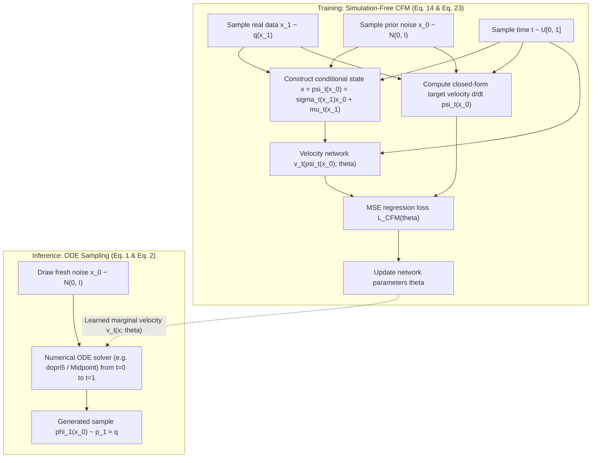

# Flow Matching for Generative Modeling

# First Time

## 1.Title & Authors
论文原标题：Flow Matching for Generative Modeling。
自然中文译法：用于生成建模的流匹配。
先拆解标题里的三个核心词，整篇论文的骨架立刻清晰：
- Generative Modeling（生成建模）：给定一堆来自未知复杂分布的数据样本（比如自然图像），让模型既能从零生成逼真的新样本，又能算出一张给定图像的概率密度（似然）。
- Flow（流）：指连续归一化流（Continuous Normalizing Flow, CNF）。把一团简单的标准高斯噪声想象成弥散在空间里的流体粒子，流就是一个随时间演化的“速度场”——告诉每个时间点、每个空间位置的粒子该往哪儿走、走多快。粒子沿着速度场平滑漂移，整团高斯噪声就能连续变形成复杂的数据分布。
- Matching（匹配）：直接训练神经网络输出速度场，去拟合预先设计好的目标速度场。标题的核心主张是提出一种全新的生成模型训练范式：不必再绕道随机扩散过程，也不必在训练时痛苦地反复解微分方程，只要直接回归速度场，就能把连续归一化流扩展到大尺度图像生成任务上。
作者按原文顺序列出：Yaron Lipman、Ricky T. Q. Chen、Heli Ben-Hamu、Maximilian Nickel、Matt Le。署名机构中，Yaron Lipman 同时隶属 Meta AI (FAIR) 与 Weizmann Institute of Science，Heli Ben-Hamu 隶属 Weizmann Institute of Science，其余三位均隶属 Meta AI (FAIR)。原文未标注共同第一作者或特殊排序说明。从论文参考文献可以直接看到团队深厚的连续流脉络：Ricky T. Q. Chen 是神经常微分方程（Neural ODE，NeurIPS 2018）及 `torchdiffeq` 库的第一作者，亲手开创了 CNF 方向；Yaron Lipman、Heli Ben-Hamu、Maximilian Nickel 与 Ricky T. Q. Chen 此前还接连发表了 Moser Flow（2021）与流形概率路径匹配（2022），本篇论文正是沿着“免模拟训练 CNF”主线交出的里程碑之作。

## 2.Abstract
摘要一口气讲清了整篇论文的六层递进：提出新范式 → 给出训练机制 → 统一扩散路径 → 打开非扩散新大门 → 推出最优传输直线路径 → 报告高维实验战果。下面按语义单元逐句拆解。
1. 新范式与规模突破：作者基于连续归一化流（CNF）提出了一套新的生成建模范式，使 CNF 得以在以往难以企及的规模上完成训练。
   直觉上看，传统 CNF 就像“每次微调导航算法，都得把车从起点完整开到终点再反向算梯度”，训练时反复调用 ODE 数值求解器，算力一遇到高分辨率图像立刻吃紧。本文要打破的正是这道训练瓶颈。
2. 核心方法（Flow Matching）：提出流匹配（FM），一种免模拟（simulation-free）的 CNF 训练方法，核心动作是对固定条件概率路径所对应的向量场做直接回归。
   - 这里最关键的限定是“训练免模拟”：训练每一步只需随机挑一个时刻、造一个中间带噪状态和目标速度，直接算均方误差反向传播，完全不用跑 ODE 求解器；而真正推理采样画图时，依然要用 ODE 求解器把噪声沿着学好的速度场一步步积出来。
   - “条件概率路径”指的是先挑出一张真实训练图像，单独围绕它设计一条从纯噪声过渡到该图像的简单分布演化路径，完全不要求图像自带类别标签。
3. 兼容高斯路径家族并囊括扩散：FM 天然兼容一大类把噪声变换到数据的高斯条件概率路径，把现有的扩散模型路径作为特例囊括其中。
   很多人第一反应会问：“每个条件路径都是高斯，最后拼出来的难道不是大高斯吗？”恰恰相反——每张训练图像各自对应一条高斯路径，把成千上万张真实图像的高斯路径混合在一起，就像无数个小山包拼出连绵起伏的复杂山脉，足以表达高度多模态的真实图像分布。
4. 即使沿用扩散路径也更稳：作者在实验中发现，哪怕继续使用扩散模型原本的概率路径，只要把训练目标从 score matching 换成 FM 直接回归速度场，训练就变得更稳健、更平滑。
   这相当于把生成模型的两大组件彻底拆开了：“中间走什么概率路径”是一回事，“用什么目标函数学这条路径的动力学”是另一回事。
5. 跳出扩散框架的自由度：FM 打开了用非扩散概率路径训练 CNF 的大门。
   过去设计扩散模型，必须先构造满足解析转移核的随机微分方程（SDE），再费劲推导逆过程，路径选择被死死框住；有了 FM，研究者可以直接盯着“分布从噪声变成数据的路径”本身来做设计。
6. 明星实例——最优传输（OT）位移插值路径：作者重点选用了 Wasserstein-2 最优传输位移插值来定义条件概率路径，其粒子轨迹笔直且匀速。
   一个需要牢记的几何边界：这里的最优性是针对“标准高斯噪声”到“围绕单张样本 $x_1$ 的小高斯”之间的条件传输；把所有样本混合后的边缘生成流并不保证全局最优传输，但笔直简洁的条件路径已经让整个学习问题清爽得多。
7. OT 路径的经验收益：作者报告，相比扩散路径，OT 条件路径更高效，带来更快的训练收敛、更省步数的采样以及更好的泛化表现。
8. ImageNet 实验结果：在 ImageNet 上用 FM 训练的 CNF，在似然（概率密度建模）和样本质量（FID）两项核心维度上持续优于对比的扩散基线，并且能直接配合现成的数值 ODE 求解器快速可靠地出图。
将摘要凝练成四要素总表：

| 要素 | 本文核心内容 |
|---|---|
| 问题 | 传统 CNF 最大似然训练依赖昂贵的 ODE 数值模拟，难以扩展到高维图像；而扩散模型虽易训练，却将概率路径限制在窄小的随机扩散家族内，训练周期长且采样路径弯曲。 |
| 方法 | 提出 Flow Matching（FM）与等价的 Conditional Flow Matching（CFM），通过回归单样本条件概率路径的闭式速度场免模拟训练 CNF，并提出直线匀速的高斯最优传输（OT）条件路径。 |
| 结果 | 在 CIFAR-10 与 ImageNet（$32\times 32$ 至 $256\times 256$）上，FM-OT 在 NLL（BPD）、FID 与采样 NFE 上全面领先同架构扩散基线（如 ImageNet-64 上 FID 14.45、NFE 138 对比 DDPM 的 17.36、264），ImageNet-128 取得 FID 20.9 与 2.90 BPD，训练图像吞吐量更少，低步数采样误差更低。 |
| 意义 | 将“概率路径设计”从随机扩散过程中彻底解放出来，奠定了现代流匹配大模型（如 Stable Diffusion 3、FLUX）的理论基石与统一训练接口。 |

读完摘要，带着一个核心问题进入正文：训练时每次只盯着单张样本的简单条件速度教网络，为什么学出来的全局速度场竟然恰好能推动整团噪声变成复杂的真实数据分布？正文 Section 3 的 Theorem 1 与 Theorem 2 会给出干净利落的数学答案。

## 3.Conclusion
原文 Section 7 为独立的一段式 Conclusion，紧凑总结了三层收获与一个前瞻方向：
1. 框架闭环与高维可扩展性：论文提出了一套免模拟训练 CNF 的新框架 Flow Matching，借助逐样本的条件构造，毫不费力地扩展到了高维图像生成任务。核心杠杆正是把“不可算的全局边缘速度”拆解成“闭式可算的单样本条件速度”。
2. 思维范式的转变：FM 给扩散模型提供了一个全新的连续流视角，更重要的是建议研究者跳出“先设随机扩散过程、再推反向动力学”的绕路思维，直接设计从噪声到数据的概率路径。一旦路径本身成为一等公民，就能针对性构造出采样更快、生成质量更高的路径（原文严谨表述为 faster sampling and/or improve generation，保留了速度与画质按需侧重的空间）。
3. 实验验证与未来方向：实验验证了 FM 在训练和采样两端的简洁高效；面向未来，作者期待 FM 开启更丰富的概率路径探索，比如不再局限于各向同性高斯，而是引入非各向同性高斯（不同方向拥有不同方差结构）乃至更一般的概率核（kernels，指构造条件分布的概率核函数）。
全文结论与摘要首尾严丝合缝，没有夸大成“单步免 ODE 采样”，也没有把条件 OT 拔高成全局最优传输。

## 4.Analogy
可以把 Flow Matching 想象成“训练一位海面交通总调度员，把漫无目的漂浮的大批救生筏（标准高斯噪声）平稳引导到几座岛屿组成的复杂港口群（真实数据分布）”。
- 概率路径 $p_t(x)$ 就是每个整点从卫星俯拍到的“船群整体密度热力图”：0 点钟均匀散在公海，1 点钟严丝合缝停满各个港口。
- 速度场 $v_t(x;\theta)$ 是调度员给海面上每一个坐标点贴的“风向风速牌”：任何一条船只要漂到这个坐标，就按牌子上的箭头开，汇在一起就形成整套连续流 $\phi_t$。
- 传统 CNF 最大似然训练像“盲猜式模拟”：每次微调风向牌，都得让船队完整航行一整天看最终停靠误差，再一路倒推怎么改牌子，耗时极高。
- Flow Matching（CFM）怎么破局？它完全不用等船队跑完全程！训练时，随机挑一个具体港口（真实数据样本 $x_1$）和一条从公海随机出发的小船（噪声 $x_0$），直接画一条笔直匀速的航线连过去（OT 条件路径）。然后随机抽查航行中途的一个时刻 $t$，看小船此刻在什么位置，直接把这条直航线的速度拍到调度员脸上让他记住：“船到这儿就该朝这个方向开！”
- 神奇的事情发生了：当无数条飞往不同港口的直航线在海面某个路口交叉时，调度员同时收到几份不同方向的指令。在均方误差回归下，调度员自然学会了把经过该路口的所有可能航线按概率取平均（Theorem 1 与 Theorem 2 证明的边缘速度场）——最终真到了推理出航那天，只要把新船放进公海、按调度员的风向牌一步步航行，整个船群就会分毫不差地停满所有复杂港口！
- 比喻的边界也很清晰：训练时能直接抽查中途瞬间（免模拟），但真要把船开进港口（生成图像）仍然要一步步沿风向牌积分（ODE 求解）；而且直航线只是给单艘船和单个港口设计的教学方案，多条航线在路口汇合平均之后，真实出航的边缘航线依然可能平滑拐弯，也并非全局所有船只与所有港口之间的最小总油耗配对。

# Second Time

## 1.Notation & Parameters
全文数学记号极其精炼，核心就是把“条件层（好设计、好计算）”、“边缘层（理论上想要、但积分算不动）”和“神经网络层（实际训练与推理调用）”三层对象清清楚楚地分开。下表整理了读懂全文主线必需的重点符号，全部保留论文原记号。

| 符号/参数 | 含义与作用 | 关键设定/约束 |
|---|---|---|
| $t$ | 连续生成时间参数 | $t\in[0,1]$；$t=0$ 为噪声端，$t=1$ 为数据端；训练时 $t\sim\mathcal{U}[0,1]$ |
| $x\in\mathbb{R}^d$ | 数据空间中的点或状态坐标，写作 $x=(x^1,\dots,x^d)$ | 上标为坐标分量索引，$d$ 为数据维度；在流映射中既可表起点也可表当前状态 |
| $x_0$、$p$ | 初始噪声样本及其简单先验分布 | $p_0=p$，典型选择为标准高斯 $p(x)=\mathcal{N}(x\mid 0, I)$ |
| $x_1$、$q$ | 真实数据样本及未知的真实数据分布 | 仅能从 $q(x_1)$ 采样，无法直接求密度值 $q(x_1)$ |
| $p_t(x)$ | 时刻 $t$ 的边缘概率密度路径 | 满足 $\int p_t(x)\,dx=1$ 且 $p_t(x)>0$；目标 $p_0=p$、$p_1\approx q$ |
| $p_t(x\mid x_1)$ | 固定单张真实样本 $x_1$ 后的条件概率密度路径 | $p_0(x\mid x_1)=p(x)$，$p_1(x\mid x_1)$ 紧缩在 $x_1$ 附近；积分混合得 $p_t(x)$ |
| $u_t(x)$ | 生成边缘概率路径 $p_t(x)$ 的理想边缘向量场（速度场） | 由条件速度场按后验加权积分得到（式 8），高维下难以直接计算 |
| $u_t(x\mid x_1)$ | 生成条件概率路径 $p_t(x\mid x_1)$ 的条件向量场 | 仅依赖单张样本 $x_1$，高斯路径下有简单闭式解（式 15） |
| $v_t(x;\theta)$、$\theta$ | 神经网络参数化的速度场及其可学习参数 | 常简写为 $v_t(x)$；$\theta\in\mathbb{R}^p$，输入 $(t,x)$ 输出同维速度向量 $\mathbb{R}^d$ |
| $\phi_t$ | 由网络速度场 $v_t$ 经 ODE 定义的连续归一化流（CNF）映射 | $\phi:[0,1]\times\mathbb{R}^d\to\mathbb{R}^d$，初值 $\phi_0(x)=x$，推理生成 $\phi_1(x_0)$ |
| $\psi_t$ | 高斯条件概率路径对应的仿射条件流映射 | 隐含依赖 $x_1$，$\psi_t(x)=\sigma_t(x_1)x+\mu_t(x_1)$；在式（24）中 $\psi$ 特指端点 OT 映射 |
| $[\phi_t]_* p_0$ | 推前（push-forward）分布算子（式 24 写作 $[\cdot]_\star$） | 将 $p_0$ 经光滑可逆映射 $\phi_t$ 变换后的密度，由变量替换公式（式 4）给出 |
| $\operatorname{div}$ | 关于空间坐标 $x$ 的散度算子 | $\operatorname{div}=\sum_{i=1}^d \frac{\partial}{\partial x^i}$，用于连续性方程（式 26）与瞬时密度变化 |
| $\mu_t(x_1)$、$\sigma_t(x_1)$ | 高斯条件路径的时变均值向量与正标量标准差 | 边界设定 $\mu_0(x_1)=0, \sigma_0(x_1)=1, \mu_1(x_1)=x_1, \sigma_1(x_1)=\sigma_{\min}$ |
| $\sigma_{\min}$ | 数据端 $t=1$ 保留的极小正高斯标准差 | 保证整个闭区间 $[0,1]$ 上 $\sigma_t(x_1)>0$，条件流处处可逆、无奇异除零 |
| $\mathcal{L}_{\mathrm{FM}}$、$\mathcal{L}_{\mathrm{CFM}}$ | 边缘流匹配损失、条件流匹配损失 | Theorem 2 证明二者相差与 $\theta$ 无关的常数，参数梯度完全相等 |
| $f'$ | 对函数自身时间自变量的导数 | $f'=\frac{d}{dt}f$；复合时间 $1-t$ 求导时需按链式法则额外乘 $-1$ |
| $\sigma_t$（VE）、$\beta(s)$、$T(t)$、$\alpha_t$（VP） | 扩散模型噪声日程与信号衰减系数 | VE 中 $\sigma_0=0, \sigma_1\gg 1$ 递增；VP 中 $T(t)=\int_0^t \beta(s)\,ds$、$\alpha_t=e^{-\frac{1}{2}T(t)}$ |

看公式前先记住两个易混淆的记号细节：第一，扩散模型传统时间习惯是“0 为数据、1 为噪声”，而本文统一反过来采用“$t=0$ 为噪声、$t=1$ 为数据”，所以把扩散路径写成本文时间时全都要把原日程时间替换成 $1-t$；第二，式（11）的 $\psi_t(x)$ 是随时间变化的条件流，而式（24）里不带下标的 $\psi$ 指的是把起点分布直接推到终点分布的端点 OT 映射，按是否带下标 $t$ 区分即可。

## 2.Introduction
对应原文 Section 1。引言只干一件事：把“扩散模型很好用，但为什么还要折腾连续归一化流（CNF）？”这个问题讲到让人心服口服。
1. 扩散模型的辉煌与枷锁：现代高分辨率图像生成（如 DALL-E 2、Latent Diffusion）的爆发，主要靠扩散模型（DDPM、Score SDE）可扩展、相对稳定的训练。然而，扩散模型必须先构造带闭式转移核的简单随机扩散过程，这把允许使用的“概率路径”锁死在一个极窄的圈子里——结果就是训练动辄数百万步，推理时路径弯曲，往往还要专门发明加速采样器（如 DDIM、指数积分器）才能少走几步。
2. CNF 的潜力与老毛病：连续归一化流（CNF，Chen et al., 2018）用确定性 ODE 搬运概率分布，表达能力极强，理论上能刻画任意概率路径，当然也包含扩散概率流 ODE（Song et al., 2021）的路径。可过去 CNF 一直做不大，原因出在训练上：
   - 经典最大似然训练（如 FFJORD）每次前向和反向传播都要跑一遍数值 ODE 求解器，串行计算极慢；
   - 早期的免模拟 CNF 训练方法各有硬伤：Moser Flow（Rozen et al., 2021）涉及高维难算积分，Ben-Hamu et al.（2022）在小批量随机梯度下有梯度偏差。
3. 本文的破局路线图：作者提出 Flow Matching（FM），彻底甩掉扩散随机过程的拐杖，直接面向“概率路径”本身做免模拟、无偏梯度训练：
   - 第 3 节先写下理想但算不动的边缘速度回归目标 $\mathcal{L}_{\mathrm{FM}}$，再借鉴去噪 score matching 的灵光一现，构造出逐样本的 Conditional Flow Matching（CFM）目标，证明二者梯度完全等价；
   - 第 4 节给出一大类高斯条件概率路径的闭式速度公式，既把扩散路径收编进来（并发现改用 FM 回归速度比 score matching 更稳更好），又直接构造出走笔直匀速轨迹的最优传输（OT）条件路径；
   - 第 6 节在 CIFAR-10 与 ImageNet 高维图像上全面验证，拿到更好的似然与样本质量，同时在计算成本与画质之间打出更优折中（无条件 ImageNet $128\times 128$ 样例见 [Fig1 精读](#fig1)，核心定量对比见 [Table1 精读](#table1) 与 [Fig7 精读](#fig7)）。
抓准全文真正的新意：论文并没有发明新的神经网络骨干（图像实验直接沿用 Dhariwal & Nichol 的标准 U-Net），全部威力都来自“简洁无偏的训练目标”与“笔直流畅的概率路径设计”。

## 3.Preliminaries: Continuous Normalizing Flows
对应原文 Section 2。这一节用四个短公式搭起连续归一化流的数学舞台。理解这一节最好的方式，是分清流体力学里的两个视角：欧拉视角（站在空间某一点看水流速度 $v_t(x)$）和拉格朗日视角（盯死一粒微尘看它的运动轨迹 $\phi_t(x)$）。
1. 两个核心数学对象（无编号定义）：
   - 概率密度路径（probability density path）$p:[0,1]\times\mathbb{R}^d\to\mathbb{R}_{>0}$：每个时刻 $t$ 都是数据空间 $\mathbb{R}^d$ 上处处为正的概率密度，满足归一化条件 $\int p_t(x)\,dx=1$。
   - 时变向量场（time-dependent vector field）$v:[0,1]\times\mathbb{R}^d\to\mathbb{R}^d$：给定时刻 $t$ 和空间位置 $x=(x^1,\dots,x^d)$，给出一个 $d$ 维速度向量。
2. 用速度场定义连续流——公式（1）与公式（2）：
$$
\frac{d}{dt}\phi_t(x)=v_t(\phi_t(x)),
$$
$$
\phi_0(x)=x.
$$
   把公式（1）和（2）翻译成大白话：一粒微尘在 $t=0$ 时刻从起点 $x$ 出发（式 2），此后在任意时刻 $t$，它当前所在位置 $\phi_t(x)$ 的瞬时移动速度，恰好等于速度场在那个位置、那个时刻给出的速度 $v_t(\phi_t(x))$（式 1）。把 $\phi_t$ 固定在时刻 $t$ 看作空间映射，它在足够光滑的条件下是一个微分同胚（diffeomorphism，光滑且存在光滑逆映射）。
   Chen et al.（2018）用神经网络 $v_t(x;\theta)$（参数 $\theta\in\mathbb{R}^p$）去建模这个速度场，由此通过 ODE 积分隐式定义出的流 $\phi_t$ 就叫连续归一化流（CNF）。
3. 推前分布与变量替换公式——公式（3）与公式（4）：
   如果把服从简单先验分布 $p_0$（例如标准高斯噪声）的所有初始粒子，统统放进流映射 $\phi_t$ 里漂移到时刻 $t$，它们的新分布记作推前分布（push-forward）：
$$
p_t=[\phi_t]_* p_0,
$$
   其精确概率密度由变量替换公式给出：
$$
[\phi_t]_* p_0(x)=p_0\bigl(\phi_t^{-1}(x)\bigr)\det\!\left[\frac{\partial \phi_t^{-1}}{\partial x}(x)\right].
$$
   一步推导就能看透公式（4）的物理来源：设时刻 $0$ 的粒子位置为 $x_0$，漂移到时刻 $t$ 变成 $x=\phi_t(x_0)$，于是反推起点就是 $x_0=\phi_t^{-1}(x)$。粒子移动过程中既不凭空产生也不凭空消失，因此微小体积块内的概率质量守恒：$p_t(x)\,dx=p_0(x_0)\,dx_0$。由多元微积分换元法，体积缩放倍数为雅可比行列式的绝对值 $dx_0=\left|\det\!\left[\frac{\partial \phi_t^{-1}}{\partial x}(x)\right]\right|dx$。因为流从恒等映射 $\phi_0(x)=x$（雅可比行列式等于 $+1$）随时间连续光滑演化，行列式永不跨过零点、始终保持正号，绝对值自然省去，立刻得到公式（4）！
   物理画面非常鲜活：某处流体如果被流映射“挤扁压缩”了，逆映射体积膨胀、行列式大于 1，密度 $p_t(x)$ 就成倍飙升；反之被“拉散稀释”，密度就成比例降低。
4. 检验“速度场是否生成概率路径”的试金石——连续性方程（Appendix B 公式 26）：
   如果由 $v_t$ 定义的流 $\phi_t$ 恰好满足式（3），我们就说向量场 $v_t$ 生成（generates）了概率路径 $p_t$。实际理论证明里，不可能每次都去硬解非线性的流 $\phi_t$，而是改用等价的偏微分方程——连续性方程来检验：
$$
\frac{d}{dt}p_t(x)+\operatorname{div}\bigl(p_t(x)v_t(x)\bigr)=0,
\qquad
\operatorname{div}=\sum_{i=1}^{d}\frac{\partial}{\partial x^i}.
$$
   它的物理直觉就是“质量守恒定律”：空间某点概率密度随时间的增长率 $\frac{d}{dt}p_t(x)$，恰好等于净流入该点的概率通量 $-\operatorname{div}(p_t(x)v_t(x))$。这套工具马上就会在下一节 Theorem 1 的四行神级证明里大显身手。

## 4.Flow Matching
对应原文 Section 3 开篇。现在正式进入造模型的环节：手里只有一批来自未知复杂数据分布 $q(x_1)$ 的样本（比如几百万张照片），算不出真实密度 $q(x_1)$。我们想找一条从简单先验 $p_0=p$（通常是标准高斯 $p(x)=\mathcal{N}(x\mid 0, I)$）出发、在 $t=1$ 时逼近数据分布 $p_1\approx q$ 的概率路径 $p_t(x)$，并让神经网络 $v_t(x;\theta)$ 学会生成它。
1. 理想中的 Flow Matching 目标——公式（5）：
   假设天上掉下来一条理想的目标概率路径 $p_t(x)$，以及恰好能生成它的真实目标速度场 $u_t(x)$。那么训练神经网络 $v_t(x)$（简写略去参数 $\theta$）最直白的想法，就是直接拿均方误差去回归它：
$$
\mathcal{L}_{\mathrm{FM}}(\theta)=\mathbb{E}_{t,p_t(x)}\bigl\|v_t(x)-u_t(x)\bigr\|^2,
$$
   其中时间均匀采样 $t\sim\mathcal{U}[0,1]$，空间状态按目标路径采样 $x\sim p_t(x)$。
   只要这个回归损失降到零，神经网络速度场 $v_t$ 就在所有有概率质量的位置和时刻上与理想速度场 $u_t$ 完全重合，于是沿 $v_t$ 积分就能精准生成整条路径 $p_t(x)$，在 $t=1$ 吐出逼真的真实数据分布。
2. 看似完美，却卡在“鸡生蛋”死胡同：
   公式（5）写起来只有一行，但直接用它根本没法写代码训练！因为对于复杂的真实数据分布 $q$，既不知道该怎么写一条解析的全局边缘路径 $p_t(x)$，更算不出生成它的全局边缘速度场 $u_t(x)$。
   接下来 3.1 和 3.2 两节完成了一次堪称教科书级的“化整为零”魔术：先用单张样本的简单路径拼出全局路径与全局速度（Theorem 1），再证明训练时干脆连拼都不用拼，直接回归单样本速度就行（Theorem 2）。

## 5.Constructing $p_t, u_t$ from Conditional Probability Paths and Vector Fields
对应原文 Section 3.1。既然直接盯着整个复杂数据集构造速度场无从下手，那就退一步——先只盯着其中一张孤零零的真实图片 $x_1$！
1. 构造单样本条件路径，再混合成全局边缘路径——公式（6）与公式（7）：
   固定一张真实数据样本 $x_1$，设计一条围绕它的条件概率路径 $p_t(x\mid x_1)$：
   - 起点（$t=0$）：不管 $x_1$ 是哪张图，大家都从同一团标准高斯噪声出发，即 $p_0(x\mid x_1)=p(x)$；
   - 终点（$t=1$）：收缩成紧贴在 $x_1$ 周围的一小团极窄高斯分布，例如 $p_1(x\mid x_1)=\mathcal{N}(x\mid x_1, \sigma^2 I)$（$\sigma>0$ 很小）。
   现在把所有数据样本 $x_1\sim q(x_1)$ 对应的条件路径按真实数据分布加权平均（边缘化），就拼出了全局边缘概率路径——公式（6）：
$$
p_t(x)=\int p_t(x\mid x_1)q(x_1)\,dx_1.
$$
   立刻核对两端：
   - 在 $t=0$：$p_0(x)=\int p(x)q(x_1)\,dx_1 = p(x)\int q(x_1)\,dx_1 = p(x)$，完美对上先验噪声！
   - 在 $t=1$，得到公式（7）：
$$
p_1(x)=\int p_1(x\mid x_1)q(x_1)\,dx_1 \approx q(x).
$$
   把数据分布 $q$ 与极小标准差的高斯核做卷积，相当于把每个真实数据点轻微抹开一点点，既无限贴近真实分布 $q$，又保证了密度处处光滑为正。
2. 拼出全局边缘速度场——公式（8）：
   假设对每一张样本 $x_1$，我们都已经知道怎么写出生成条件路径 $p_t(x\mid x_1)$ 的条件速度场 $u_t(x\mid x_1)$。那站在空间中某个具体路口 $x$、时刻 $t$，全局边缘速度场 $u_t(x)$ 应该怎么由所有单样本速度 $u_t(x\mid x_1)$ 合成呢？
   千万别简单按数据先验等权平均——而必须按“此刻走到当前位置的粒子，分别有多大可能源自哪个目标样本”的后验权重来加权！假设 $p_t(x)>0$ 对所有 $t,x$ 成立，作者写下公式（8）：
$$
u_t(x)=\int u_t(x\mid x_1)\frac{p_t(x\mid x_1)q(x_1)}{p_t(x)}\,dx_1.
$$
   一眼认出分式 $\frac{p_t(x\mid x_1)q(x_1)}{p_t(x)}$：由贝叶斯公式，它正是“已知粒子此刻位于 $x$，其背后对应目标样本为 $x_1$”的后验概率密度！离 $x$ 近、更可能经过 $x$ 的目标样本话语权更大，远在天边的目标样本权重几乎为零。
3. 核心定理——Theorem 1 及完整证明：
   Theorem 1 断言：只要每个 $u_t(x\mid x_1)$ 各自生成条件路径 $p_t(x\mid x_1)$，那么无论数据分布 $q(x_1)$ 多复杂，由公式（8）定义的边缘速度场 $u_t$ 必定精确生成由公式（6）定义的边缘概率路径 $p_t$。
   下面用 Appendix A 的原版四行推导直接验证连续性方程（式 26）：
   已知每条条件路径满足条件连续性方程 $\frac{d}{dt}p_t(x\mid x_1)=-\operatorname{div}\!\bigl(u_t(x\mid x_1)p_t(x\mid x_1)\bigr)$。对公式（6）两边关于时间 $t$ 求导：
$$
\begin{aligned}
\frac{d}{dt}p_t(x)
&=\int \left(\frac{d}{dt}p_t(x\mid x_1)\right)q(x_1)\,dx_1 \\
&=-\int \operatorname{div}\!\bigl(u_t(x\mid x_1)p_t(x\mid x_1)\bigr)q(x_1)\,dx_1 \\
&=-\operatorname{div}\!\left(\int u_t(x\mid x_1)p_t(x\mid x_1)q(x_1)\,dx_1\right) \\
&=-\operatorname{div}\!\bigl(u_t(x)p_t(x)\bigr).
\end{aligned}
$$
   逐行看清每一步的依据：
   - 第一步：代入公式（6），并在满足 Leibniz 积分求导法则的正则条件下把 $\frac{d}{dt}$ 推进积分号内部；
   - 第二步：直接套入每条条件路径各自满足的连续性方程；
   - 第三步：再次由 Leibniz 法则把空间散度 $\operatorname{div}$（对 $x$ 求导，与积分变量 $x_1$ 无关）提到积分号外；
   - 第四步：把公式（8）两边同乘 $p_t(x)$ 得 $\int u_t(x\mid x_1)p_t(x\mid x_1)q(x_1)\,dx_1 = u_t(x)p_t(x)$，往括号里一塞，大功告成！
   定理一证完，第一个心结解开了：边缘速度场 $u_t(x)$ 真的存在且由条件速度场严格决定。但第二个坎还在眼前——公式（8）里面藏着对整个未知数据分布 $q(x_1)$ 的积分，分母还藏着边缘密度 $p_t(x)$，训练时根本算不出 $u_t(x)$！下一节彻底跨过这道坎。

## 6.Conditional Flow Matching
对应原文 Section 3.2。既然全局边缘速度 $u_t(x)$ 算不出来，作者提出一个大胆的替代方案：训练时干脆不求全局平均，直接抽一张真实样本 $x_1$、从它的条件分布里抽一个状态 $x$，拿单样本条件速度 $u_t(x\mid x_1)$ 当回归标签去训练网络！
1. 条件流匹配（CFM）目标——公式（9）：
$$
\mathcal{L}_{\mathrm{CFM}}(\theta)=\mathbb{E}_{t,q(x_1),p_t(x\mid x_1)}\bigl\|v_t(x)-u_t(x\mid x_1)\bigr\|^2,
$$
   其中 $t\sim\mathcal{U}[0,1]$，$x_1\sim q(x_1)$，$x\sim p_t(x\mid x_1)$。
   注意神经网络的输入：$v_t(x)$ 只看时间 $t$ 和带噪状态 $x$，绝对不能把答案 $x_1$ 喂给网络！只要单样本的 $p_t(x\mid x_1)$ 好采样、$u_t(x\mid x_1)$ 好计算，小批量随机梯度立刻就能无偏算出来，完全不用碰公式（6）和（8）里那两个算不动的积分。
2. 点睛之笔——Theorem 2（梯度完全等价）与完整推导：
   Theorem 2 断言：只要对所有 $x\in\mathbb{R}^d$ 和 $t\in[0,1]$ 有 $p_t(x)>0$（配合 Appendix A 的积分衰减与有界性正则条件，保证 Fubini 定理交换积分顺序合法），$\mathcal{L}_{\mathrm{CFM}}(\theta)$ 与 $\mathcal{L}_{\mathrm{FM}}(\theta)$ 之间只差一个与参数 $\theta$ 无关的常数，因此二者对网络参数的梯度完全相等：
$$
\nabla_\theta \mathcal{L}_{\mathrm{FM}}(\theta)=\nabla_\theta \mathcal{L}_{\mathrm{CFM}}(\theta).
$$
   下面严格沿着原文 Appendix A 的二次展开路线，用原始符号逐行推完：
   - 第一步，利用欧氏二范数的双线性展开两个损失内部的平方项：
$$
\bigl\|v_t(x)-u_t(x)\bigr\|^2=\bigl\|v_t(x)\bigr\|^2-2\bigl\langle v_t(x),u_t(x)\bigr\rangle+\bigl\|u_t(x)\bigr\|^2,
$$
$$
\bigl\|v_t(x)-u_t(x\mid x_1)\bigr\|^2=\bigl\|v_t(x)\bigr\|^2-2\bigl\langle v_t(x),u_t(x\mid x_1)\bigr\rangle+\bigl\|u_t(x\mid x_1)\bigr\|^2.
$$
   - 第二步，先看各自最后一项 $\|u_t(x)\|^2$ 和 $\|u_t(x\mid x_1)\|^2$：两者都是预先指定的目标速度，完全不含网络参数 $\theta$，取完期望后就是两个固定常数，对 $\theta$ 求导直接归零。
   - 第三步，核对各自第一项 $\|v_t(x)\|^2$ 的期望（固定任意时刻 $t$）：把公式（6）代入边缘密度 $p_t(x)$，再由 Fubini 定理交换积分次序：
$$
\begin{aligned}
\mathbb{E}_{p_t(x)}\bigl\|v_t(x)\bigr\|^2
&=\int \bigl\|v_t(x)\bigr\|^2 p_t(x)\,dx \\
&=\iint \bigl\|v_t(x)\bigr\|^2 p_t(x\mid x_1)q(x_1)\,dx_1\,dx \\
&=\mathbb{E}_{q(x_1),p_t(x\mid x_1)}\bigl\|v_t(x)\bigr\|^2.
\end{aligned}
$$
     两边的第一项一模一样！
   - 第四步，核对最关键的交叉内积项（固定任意时刻 $t$）：把公式（8）的边缘速度 $u_t(x)$ 代入，神奇的约分立刻发生——公式（8）分母上的 $p_t(x)$ 与积分测度里的 $p_t(x)$ 刚好对消！随后利用内积线性性与 Fubini 定理：
$$
\begin{aligned}
\mathbb{E}_{p_t(x)}\bigl\langle v_t(x),u_t(x)\bigr\rangle
&=\int \left\langle v_t(x),\frac{\int u_t(x\mid x_1)p_t(x\mid x_1)q(x_1)\,dx_1}{p_t(x)}\right\rangle p_t(x)\,dx \\
&=\int \left\langle v_t(x),\int u_t(x\mid x_1)p_t(x\mid x_1)q(x_1)\,dx_1\right\rangle dx \\
&=\iint \bigl\langle v_t(x),u_t(x\mid x_1)\bigr\rangle p_t(x\mid x_1)q(x_1)\,dx_1\,dx \\
&=\mathbb{E}_{q(x_1),p_t(x\mid x_1)}\bigl\langle v_t(x),u_t(x\mid x_1)\bigr\rangle.
\end{aligned}
$$
     两边的交叉项也分毫不差！
   - 第五步，对 $t\sim\mathcal{U}[0,1]$ 取平均，立刻得出：
$$
\mathcal{L}_{\mathrm{CFM}}(\theta)-\mathcal{L}_{\mathrm{FM}}(\theta)
=\mathbb{E}_{t,q(x_1),p_t(x\mid x_1)}\bigl\|u_t(x\mid x_1)\bigr\|^2-\mathbb{E}_{t,p_t(x)}\bigl\|u_t(x)\bigr\|^2,
$$
     右边完全与 $\theta$ 无关！两边对 $\theta$ 求梯度，常数项消失，即证 $\nabla_\theta\mathcal{L}_{\mathrm{FM}}(\theta)=\nabla_\theta\mathcal{L}_{\mathrm{CFM}}(\theta)$。
3. 补一眼极有价值的几何直觉：
   把上面这个差值常数用同样的展开整理一下，恰好等于 $\mathbb{E}_{t,q(x_1),p_t(x\mid x_1)}\bigl\|u_t(x\mid x_1)-u_t(x)\bigr\|^2 \ge 0$。它衡量的是“在同一个空间路口 $x$ 上，来自不同目标样本 $x_1$ 的条件速度究竟有多分歧”。这顺手解释了两个实战现象：第一，训练 CFM 时，损失函数永远降不到真正的零，因为它自带一个不可约的条件方差底噪；第二，梯度等价成立在期望意义下，单次随机小批量的梯度仍然带着条件分歧带来的方差——而这也正是为什么后面选择“更笔直、交叉更少”的 OT 条件路径能够显著稳住训练的原因！

## 7.Conditional Probability Paths and Vector Fields
对应原文 Section 4。现在理论地基已经焊死：只要挑好一套好采样、好算速度的条件路径 $p_t(x\mid x_1)$ 和 $u_t(x\mid x_1)$，立马就能开跑训练。这一节作者把视野聚焦到一大类无比好用、又有显式闭式解的家族——各向同性高斯条件概率路径。
1. 一般高斯条件路径定义——公式（10）：
$$
p_t(x\mid x_1)=\mathcal{N}\bigl(x\mid \mu_t(x_1),\sigma_t(x_1)^2 I\bigr),
$$
   其中 $\mu:[0,1]\times\mathbb{R}^d\to\mathbb{R}^d$ 是随时间移动的均值向量，$\sigma:[0,1]\times\mathbb{R}^d\to\mathbb{R}_{>0}$ 是随时间缩放的正标量标准差（原文此处印成 $[0,1]\times\mathbb{R}\to\mathbb{R}_{>0}$，按上下文输入实为数据点 $x_1\in\mathbb{R}^d$）。
   设好两头边界：
   - 起点（$t=0$）：$\mu_0(x_1)=0$，$\sigma_0(x_1)=1$，让所有样本的条件路径都精确对齐到同一个标准高斯噪声 $p(x)=\mathcal{N}(x\mid 0, I)$；
   - 终点（$t=1$）：$\mu_1(x_1)=x_1$，$\sigma_1(x_1)=\sigma_{\min}$，收缩成以 $x_1$ 为中心、极窄标准差 $\sigma_{\min}>0$ 的小高斯。
2. 选出最简仿射条件流——公式（11）与公式（12）：
   同一条高斯概率路径其实对应无穷多个速度场——比如把一个各向同性的高斯球绕着球心原地旋转，球本身的密度分布纹丝不动，却白白增加了算力和轨迹弯绕。作者干净利落地砍掉所有多余旋转，直接选最简单的“先缩放、再平移”仿射变换作为条件流（隐含以 $x_1$ 为条件）——公式（11）：
$$
\psi_t(x)=\sigma_t(x_1)x+\mu_t(x_1).
$$
   验证它把标准高斯精确推前到式（10）——公式（12）：
$$
[\psi_t]_* p(x)=p_t(x\mid x_1).
$$
   直接用变量替换公式（式 4）验证，一目了然：因为 $\sigma_t(x_1)>0$，仿射映射可逆，逆映射为 $\psi_t^{-1}(x)=\frac{x-\mu_t(x_1)}{\sigma_t(x_1)}$，雅可比矩阵为 $\frac{\partial \psi_t^{-1}}{\partial x}(x)=\frac{1}{\sigma_t(x_1)}I$，行列式为 $\sigma_t(x_1)^{-d}$。把 $p(x)=(2\pi)^{-d/2}\exp\!\bigl(-\frac{1}{2}\|x\|^2\bigr)$ 代入式（4）：
$$
[\psi_t]_* p(x)
=(2\pi)^{-d/2}\sigma_t(x_1)^{-d}\exp\!\left(-\frac{\|x-\mu_t(x_1)\|^2}{2\sigma_t(x_1)^2}\right)
=\mathcal{N}\bigl(x\mid \mu_t(x_1),\sigma_t(x_1)^2 I\bigr)
=p_t(x\mid x_1).
$$
3. 用流导数重写 CFM 损失——公式（13）与公式（14）：
   由 ODE 定义（式 1），条件流 $\psi_t$ 与其对应的条件速度场 $u_t(\cdot\mid x_1)$ 满足公式（13）：
$$
\frac{d}{dt}\psi_t(x)=u_t\bigl(\psi_t(x)\mid x_1\bigr).
$$
   这一步带来一个极其好用的重参数化技巧：在公式（9）中，按 $x\sim p_t(x\mid x_1)$ 采样等价于先抽标准高斯噪声 $x_0\sim p(x_0)$，再算 $x=\psi_t(x_0)$（由式 12）；把目标速度 $u_t(\psi_t(x_0)\mid x_1)$ 直接换成 $\frac{d}{dt}\psi_t(x_0)$（由式 13），立刻得到公式（14）：
$$
\mathcal{L}_{\mathrm{CFM}}(\theta)=\mathbb{E}_{t,q(x_1),p(x_0)}\left\|v_t\bigl(\psi_t(x_0)\bigr)-\frac{d}{dt}\psi_t(x_0)\right\|^2.
$$
   公式（14）简直是工程实现的梦中情式：连条件速度场的欧拉表达式都不用费劲反解，只要写出仿射流 $\psi_t(x_0)$，对 $t$ 求导就是训练标签！
4. Theorem 3（一般高斯条件速度闭式公式）——公式（15）及完整推导：
   为了方便分析速度场的空间几何（并直接对接扩散路径），作者同样反解出了位置坐标 $x$ 下的闭式条件速度。记时间导数 $f'=\frac{d}{dt}f$，Theorem 3 指出，定义仿射流 $\psi_t$（式 11）的唯一向量场为公式（15）：
$$
u_t(x\mid x_1)=\frac{\sigma_t'(x_1)}{\sigma_t(x_1)}\bigl(x-\mu_t(x_1)\bigr)+\mu_t'(x_1),
$$
   它必然生成高斯条件路径 $p_t(x\mid x_1)$。
   三步推导出公式（15）（严格使用原始符号）：
   - 第一步：对式（11）$\psi_t(x_0)=\sigma_t(x_1)x_0+\mu_t(x_1)$ 关于时间 $t$ 求导，得轨迹速度 $\psi_t'(x_0)=\sigma_t'(x_1)x_0+\mu_t'(x_1)$；
   - 第二步：设时刻 $t$ 粒子到达位置 $x=\psi_t(x_0)$，利用 $\sigma_t(x_1)>0$ 求逆映射反解起点噪声 $x_0=\psi_t^{-1}(x)=\frac{x-\mu_t(x_1)}{\sigma_t(x_1)}$；
   - 第三步：将 $x_0=\psi_t^{-1}(x)$ 代入式（13）的 $u_t(x\mid x_1)=\psi_t'(\psi_t^{-1}(x))$，立得：
$$
u_t(x\mid x_1)=\sigma_t'(x_1)\frac{x-\mu_t(x_1)}{\sigma_t(x_1)}+\mu_t'(x_1)=\frac{\sigma_t'(x_1)}{\sigma_t(x_1)}\bigl(x-\mu_t(x_1)\bigr)+\mu_t'(x_1).
$$
   物理画面清晰得像在眼前放电影：条件速度由两股力合成——第一项 $\frac{\sigma_t'(x_1)}{\sigma_t(x_1)}(x-\mu_t(x_1))$ 是以当前均值 $\mu_t(x_1)$ 为中心的“径向呼吸收缩/膨胀”（$\sigma_t'<0$ 时把粒子往均值中心收拢）；第二项 $\mu_t'(x_1)$ 是整团高斯的“整体平移搬运”。另外，这里的“唯一”指的是给定仿射流 $\psi_t$ 之后对应的速度场唯一，同一密度路径仍可由带旋转分量的其他流生成。
下面用 Mermaid 流程图把整套 Flow Matching 的训练（免模拟）与推理采样（ODE 积分）全景串起来（省略具体 U-Net 内部层结构、优化器细节以及附录 C 反向 ODE 似然计算支路）：

## 8.Special Instances of Gaussian Conditional Probability Paths
对应原文 Section 4.1。手握公式（15）这把万能钥匙后，作者顺手开了两扇门：第一扇门把经典扩散模型（VE、VP）统统收编进来，第二扇门直接推开了直线匀速的最优传输（OT）新世界。
1. Example I：扩散条件向量场（Diffusion conditional VFs）
   扩散模型原本按“数据 $\to$ 噪声”加噪，而本文时间方向是“$t=0$ 噪声 $\to t=1$ 数据”，因此把扩散原日程的时间自变量写成 $1-t$。注意微分细节：文中撇号 $\sigma_{1-t}'$、$\alpha_{1-t}'$、$T'(1-t)$ 都表示函数关于其自身括号内自变量的导数，真正对生成时间 $t$ 求导时，由链式法则 $\frac{d(1-t)}{dt}=-1$ 会翻出一个负号！
   - 反向方差爆炸（Variance Exploding, VE）路径——公式（16）与公式（17）：
$$
p_t(x)=\mathcal{N}\bigl(x\mid x_1,\sigma_{1-t}^2 I\bigr),
$$
     其中原扩散标准差日程 $\sigma_t$ 递增，满足 $\sigma_0=0$、$\sigma_1\gg 1$（原文式 16 左侧简写为 $p_t(x)$，由右侧依赖 $x_1$ 可知语义为条件路径 $p_t(x\mid x_1)$）。
     与式（10）对照，得 $\mu_t(x_1)=x_1$、$\sigma_t(x_1)=\sigma_{1-t}$。求关于 $t$ 的导数：均值恒定故 $\mu_t'(x_1)=0$；标准差由链式法则得 $\frac{d}{dt}\sigma_{1-t}=-\sigma_{1-t}'$。代入公式（15），立刻得到公式（17）：
$$
u_t(x\mid x_1)=-\frac{\sigma_{1-t}'}{\sigma_{1-t}}(x-x_1).
$$
     因为 $\sigma$ 递增（导数为正），系数为负，速度笔直指向数据点 $x_1$；但在 $t=1$ 处 $\sigma_0=0$ 会出现除零奇异性，实际需要时间截断。
   - 反向方差保持（Variance Preserving, VP）路径——公式（18）与公式（19）：
$$
p_t(x\mid x_1)=\mathcal{N}\!\left(x\mid \alpha_{1-t}x_1,\bigl(1-\alpha_{1-t}^2\bigr)I\right),
\qquad
\alpha_t=e^{-\frac{1}{2}T(t)},
\qquad
T(t)=\int_0^t \beta(s)\,ds,
$$
     其中 $\beta$ 是噪声速率函数。与式（10）对照，得 $\mu_t(x_1)=\alpha_{1-t}x_1$，$\sigma_t(x_1)=\sqrt{1-\alpha_{1-t}^2}$。
     逐行代入公式（15）推导公式（19），全程不换任何新字母：
     - 先求均值导数：$\mu_t'(x_1)=\frac{d}{dt}(\alpha_{1-t}x_1)=-\alpha_{1-t}' x_1$；
     - 再求标准差导数：$\sigma_t'(x_1)=\frac{d}{dt}\sqrt{1-\alpha_{1-t}^2}=\frac{-2\alpha_{1-t}(-\alpha_{1-t}')}{2\sqrt{1-\alpha_{1-t}^2}}=\frac{\alpha_{1-t}\alpha_{1-t}'}{\sqrt{1-\alpha_{1-t}^2}}$，于是 $\frac{\sigma_t'(x_1)}{\sigma_t(x_1)}=\frac{\alpha_{1-t}\alpha_{1-t}'}{1-\alpha_{1-t}^2}$；
     - 代入公式（15）并通分合并 $x_1$ 项：
$$
\begin{aligned}
u_t(x\mid x_1)
&=\frac{\alpha_{1-t}\alpha_{1-t}'}{1-\alpha_{1-t}^2}(x-\alpha_{1-t}x_1)-\alpha_{1-t}' x_1 \\
&=\frac{\alpha_{1-t}'}{1-\alpha_{1-t}^2}\Bigl[\alpha_{1-t}x-\alpha_{1-t}^2 x_1-(1-\alpha_{1-t}^2)x_1\Bigr] \\
&=\frac{\alpha_{1-t}'}{1-\alpha_{1-t}^2}(\alpha_{1-t}x-x_1).
\end{aligned}
$$
     - 最后把 $\alpha_{1-t}=e^{-\frac{1}{2}T(1-t)}$ 与其导数 $\alpha_{1-t}'=-\frac{1}{2}T'(1-t)e^{-\frac{1}{2}T(1-t)}$ 代入，得到公式（19）的第二个等价形式：
$$
u_t(x\mid x_1)
=-\frac{T'(1-t)}{2}\left[\frac{e^{-T(1-t)}x-e^{-\frac{1}{2}T(1-t)}x_1}{1-e^{-T(1-t)}}\right].
$$
   作者在 Appendix D 中证明，公式（17）和（19）恰好与 Song et al.（2020b）推导的扩散确定性概率流 ODE 条件速度完全重合！但两件事让 FM 立刻拉开优势：第一，即使走同一条 VP 扩散路径，改用 FM 目标直接回归速度也比 score matching 训练更稳（后文实验验证）；第二，传统扩散是无限时间才收敛到纯噪声的随机过程，有限时间 $t=0$ 处其实没完全变成标准高斯（残余一点信号偏移），而 FM 让我们拥有 100% 的路径掌控权，想把两端对齐得多完美就对齐得多完美。
2. Example II：最优传输条件向量场（Optimal Transport conditional VFs）
   既然可以自由指定 $\mu_t$ 和 $\sigma_t$，最自然、最清爽的想法是什么？让均值和标准差都随时间做最简单的线性变化！这就是公式（20）：
$$
\mu_t(x)=t x_1,
\qquad
\sigma_t(x)=1-(1-\sigma_{\min})t.
$$
   （原文式 20 把自变量印成了 $x$，语义即式 10 中的 $\mu_t(x_1)$ 与 $\sigma_t(x_1)$。）检查边界：$t=0$ 时 $\mu_0=0, \sigma_0=1$，精确等于标准高斯；$t=1$ 时 $\mu_1=x_1, \sigma_1=\sigma_{\min}$，精确落在目标样本小邻域内。
   - 推导 OT 条件速度场——公式（21）：
     求时间导数得 $\mu_t'(x_1)=x_1$、$\sigma_t'(x_1)=-(1-\sigma_{\min})$。直接代入公式（15）通分：
$$
\begin{aligned}
u_t(x\mid x_1)
&=\frac{-(1-\sigma_{\min})}{1-(1-\sigma_{\min})t}(x-t x_1)+x_1 \\
&=\frac{-(1-\sigma_{\min})x+(1-\sigma_{\min})t x_1+\bigl(1-(1-\sigma_{\min})t\bigr)x_1}{1-(1-\sigma_{\min})t} \\
&=\frac{x_1-(1-\sigma_{\min})x}{1-(1-\sigma_{\min})t}.
\end{aligned}
$$
     分子里 $(1-\sigma_{\min})t x_1$ 干脆利落地正负抵消！而且因为 $\sigma_{\min}>0$，分母 $1-(1-\sigma_{\min})t\ge \sigma_{\min}>0$ 在整个闭区间 $t\in[0,1]$ 上永不为零，彻底告别扩散模型端点除零的烦恼。
   - 写出 OT 条件流与最终训练损失——公式（22）与公式（23）：
     把式（20）代入式（11），立刻得条件流公式（22）：
$$
\psi_t(x)=\bigl(1-(1-\sigma_{\min})t\bigr)x+t x_1.
$$
     对 $t$ 求个导：$\frac{d}{dt}\psi_t(x)=x_1-(1-\sigma_{\min})x$——时间变量竟然彻底消失了！这意味着在 OT 条件流里，每一粒出发的粒子都沿着一条笔直的线段、以恒定不变的速度直奔终点，绝不拐弯、绝不加速刹车！
     把式（22）及其导数代入公式（14），就得到了全篇最经典、几行代码就能写出来的 OT-CFM 终极训练目标——公式（23）：
$$
\mathcal{L}_{\mathrm{CFM}}(\theta)=\mathbb{E}_{t,q(x_1),p(x_0)}\Bigl\|v_t\bigl(\psi_t(x_0)\bigr)-\bigl(x_1-(1-\sigma_{\min})x_0\bigr)\Bigr\|^2.
$$
   - 为什么叫“最优传输（OT）位移插值”？——公式（24）：
     按照 McCann（1997）的定义，若 $\psi:\mathbb{R}^d\to\mathbb{R}^d$ 是把分布 $p_0$ 推到 $p_1$ 的 Wasserstein-2 最优传输映射，那么对应的 OT 位移插值概率路径定义为公式（24）：
$$
p_t=\bigl[(1-t)\mathrm{id}+t\psi\bigr]_\star p_0,
\qquad
\mathrm{id}(x)=x.
$$
     对于两个各向同性高斯分布 $p_0(x\mid x_1)=\mathcal{N}(x\mid 0, I)$ 和 $p_1(x\mid x_1)=\mathcal{N}(x\mid x_1, \sigma_{\min}^2 I)$，将前者以最小平方位移代价推到后者的唯一 OT 映射就是纯缩放加平移 $\psi(x)=\sigma_{\min}x+x_1$。代入位移插值映射 $(1-t)\mathrm{id}(x)+t\psi(x)$：
$$
(1-t)x+t(\sigma_{\min}x+x_1)=\bigl(1-(1-\sigma_{\min})t\bigr)x+t x_1=\psi_t(x),
$$
     分毫不差地还原出公式（22）！
3. 两大直观几何优势与一个关键理论边界：
   - 轨迹笔直不绕远（[Fig3 精读](#fig3)）：扩散路径的粒子常常先冲过目标点再折返（overshoot & backtracking），浪费 ODE 步数；而 OT 条件路径保证每一条都是直达线段。
   - 固定空间位置方向恒定（[Fig2 精读](#fig2)）：对比扩散回归目标——高斯条件 score $\nabla\log p_t(x\mid x_1)=-\frac{x-\mu_t(x_1)}{\sigma_t(x_1)^2}$（方向和大小随时间剧烈扭转）——观察公式（21），OT 条件速度场可以完美因式分解为时间标量与空间向量的乘积（无编号关系）：
$$
u_t(x\mid x_1)=g(t)h(x\mid x_1),
\qquad
g(t)=\frac{1}{1-(1-\sigma_{\min})t},
\qquad
h(x\mid x_1)=x_1-(1-\sigma_{\min})x.
$$
     只要空间位置 $x$ 固定，由于 $g(t)>0$，整个 $[0,1]$ 时间内该点箭头永远指向同一个方向，只改变长度，对神经网络而言自然好拟合得多！
   - 牢记作者在段尾明确划出的关键边界：虽然每个单样本条件流 $\psi_t$ 是最优传输解，但把所有 $x_1$ 按后验混合后的边缘速度场 $u_t(x)$ 并不保证是噪声分布 $p_0$ 到整套数据分布 $q$ 的全局最优传输解（因为训练时 $x_0$ 和 $x_1$ 是独立随机配对的）。不过，极简的直线条件构造依然让学到的边缘速度场平顺好解得多。

## 9.Related Work
对应原文 Section 5。作者沿着四条研究脉络，把 Flow Matching 精准定位在连续生成模型版图上：
1. 传统 CNF 与 ODE 正则化：CNF 源自 Neural ODE（Chen et al., 2018），经典最大似然训练（如 FFJORD）需要顺着 ODE 前向、反向串行求解，高维图像算力吃紧。后续很多工作通过增广状态维度、加动力学/雅可比正则项或随机采样积分区间让 ODE 好解一点，但都没改掉“训练时必须解 ODE”的根本瓶颈；FM 则直接换掉了训练范式本身。
2. 早期免模拟 CNF 训练：此前已有尝试显式设计概率路径跳过模拟的工作——Moser Flow（Rozen et al., 2021）在先验与目标密度间线性插值，但涉及高维难算积分；Ben-Hamu et al.（2022）考虑一般概率路径，但在随机小批量训练时存在有偏梯度。FM 借助条件分解与 Theorem 2，兼得了“免模拟”与“无偏随机梯度”。
3. 扩散模型、去噪 Score Matching 与有限时间扩散桥：Song et al.（2020b）指出扩散模型靠去噪 score matching（Vincent, 2011）用条件目标获得边缘 score 的无偏梯度。CFM 正是受这一思想启发，把条件回归推广到直接匹配向量场。虽然扩散领域衍生了损失重加权（ScoreFlow）、分类器引导、学习噪声日程（Improved DDPM、VDM）等技术，但后者仍局限于单参数扩散过程家族，无法包含本文的 OT 条件路径；扩散桥（Schrödinger Bridge 等）虽解决了无限时间扩散的端点误差，FM 则更进一步，彻底绕开随机过程建模，直接从概率路径出发，同时保留快速训练与精确似然计算能力。二维对比直观见 [Fig4 精读](#fig4)。
4. 同期独立工作：作者坦诚并列了同期得到相似免模拟条件回归目标的工作——Liu et al.（2022，Rectified Flow）与 Albergo & Vanden-Eijnden（2022，Stochastic Interpolants），以及在速度场为梯度场假设下推导隐式目标的 Action Matching（Neklyudov et al., 2023）。这让我们清晰看到：2022 年底三篇里程碑论文不约而同把连续流拉进了“免模拟直线插值”的新时代。

## 10.Conclusion
对应原文 Section 7（完整逐段精读已放在 First Time 第 3 节）。走完 Second Time 的完整公式链条再回看结论，每一句话都有了严丝合缝的数学支撑：公式（6）–（8）与 Theorem 1 把单样本条件路径严密焊到全局边缘路径上；公式（9）与 Theorem 2 用四行二次展开证明条件回归梯度无偏等价；公式（10）–（15）与 Theorem 3 给出任意高斯路径的闭式速度；公式（20）–（24）落到笔直匀速的 OT 实例，并经 Section 6 的高维图像实验验证落地。未来把条件路径推广到非各向同性高斯与更一般概率核，直接沿用 Theorem 1 与 Theorem 2 的通用地基即可展开。

## 11.Social Responsibility
对应原文 Section 8，属于结论后的正文非实验部分。作者简短讨论了两项社会影响：
1. 生成滥用风险与缓解思路：图像生成技术既有积极应用，也可能被用于有害伪造；作者建议借助内容受控的训练集以及图像验证/分类机制来降低滥用风险。
2. 大模型训练的能源与碳排动机：大模型训练的能耗正在飞速攀升，研发能用更少梯度更新和更低图像吞吐量收敛的方法（呼应 FM-OT 在 ImageNet-128 上少用约三分之一图像吞吐量的实验结果）有助于节省时间与能源。

## 12.Figure & Table
正文共有 7 张图、2 张表，合计 9 项（正文无 Algorithm 伪代码框），下面严格按原文版面实际出现顺序逐项精读（注意 Fig6 在版面上排在 Fig5 之前，保留原编号与实际出现顺序）。

#### Fig1:
位置与目的：位于第 1 节引言，展示用 FM-OT 训练的无条件 ImageNet $128\times 128$ CNF 生成样例，直观证明免模拟训练终于把 CNF 推上了高多样性、高分辨率真实图像舞台。
画面内容：一张 $5\times 6$ 共 30 幅彩色生成图的样例墙，题材横跨自然风景、热气球、食物、大象、蝴蝶、鹦鹉、犬类、公鸡、汽车与飞鸟等。主体轮廓清楚、纹理自然且类别跨度很大。
读图边界：这是一组精选（selected）的无条件定性展示，直观体现生成多样性与视觉真实感；整体的分布覆盖度、似然和 FID 定量表现则由 [Table1 精读](#table1) 和附录中未精选的 Fig11–13 补充验证。

#### Fig2:
位置与目的：位于第 4.1 节，并排对比扩散路径的条件 score 函数与 OT 路径的条件向量场，直观解释“为什么 OT 的回归目标对神经网络更友好”。
读图方法：最左侧小方块标明共同的起点标准高斯 $p_0$（中心在 $0$）和目标点 $x_1$（右上角黑点）。随后左右各排四帧，时间从左到右依次为 $t=0.0, 1/3, 2/3, 1.0$。箭头代表向量方向，底色编码向量幅值——特别注意颜色约定：蓝色表示幅值更大，红色表示幅值更小（与常见热力图习惯相反）。
核心对比：
- 左组（Diffusion path – conditional score function，$\nabla\log p_t(x\mid x_1)$，VP 路径式 18）：由于均值从 $0$ 滑向 $x_1$ 且方差非线性收缩，箭头指向和强弱分布随时间剧烈翻滚——$t=0$ 时指向原点附近，随后中心一路偏移并急剧增强（$t=1.0$ 整片变深蓝，因为分母 $\sigma_t^2\to 0$ 导致 score 爆炸）。
- 右组（OT path – conditional vector field，式 21）：四张图里的箭头指向纹丝不动，永远朝向同一个空间方向，只有背景色随时间均匀从红黄过渡到蓝（幅值整体放大）。这正是公式（21）因式分解 $u_t(x\mid x_1)=g(t)h(x\mid x_1)$ 的几何奇观——时间只调标量倍率，不改方向。
对照说明：本图比较的是“典型扩散训练回归的对象（条件 score）”与“OT-FM 回归的对象（条件速度）”；若想看 VP 扩散自身的条件速度场，作者在 Appendix D 的 Fig8 单独补画了对照。

#### Fig3:
位置与目的：位于第 4.1 节，并排对比 Diffusion 与 OT 条件向量场驱动下的粒子运动轨迹。
画面对比：两幅方框内，蓝色方块标记起点先验中心，红点标记数据目标 $x_1$，多条彩色曲线代表从不同随机噪声出发的条件粒子轨迹。
- 左图（Diffusion）：不少粒子先大幅拐弯，甚至一头冲过红点 $x_1$（overshoot）再绕大圈折返（backtracking），路线冗余弯曲，数值 ODE 求解器必须迈极小步长才能跟紧这些急转弯。
- 右图（OT）：所有彩色轨迹都是笔直的放射状线段，从各自起点匀速直扑目标邻域，对应公式（22）$\psi_t(x)=(1-(1-\sigma_{\min})t)x+t x_1$ 的线性常数速度特性。
理解要点：图中画的是固定单个 $x_1$ 时的条件粒子轨迹；实际训练好的边缘生成模型轨迹会因多目标后验混合而带有一点平滑弯曲，但仍远比扩散轨迹平顺。

#### Fig4:
这是全篇最重要的一张正文图，因为它在一个干净的二维棋盘实验里，同时拆解了全文最核心的两大变量——“换训练目标（SM $\to$ FM）”和“换概率路径（Diffusion $\to$ OT）”——还顺手把低成本采样的差距拍在了同一张画面上。
画面分左右两块，纵向均按三行排布：第一行 Score matching w/ Diffusion，第二行 Flow Matching w/ Diffusion，第三行 Flow Matching w/ OT。
- 左侧面板（生成时间上的概率密度演化，每行 9 帧从 $t=0$ 高斯团过渡到 $t=1$ 二维棋盘）：
  - 先对比前两行（路径同为扩散，仅把训练目标从 SM 换成 FM）：第二行中间过渡形态更干净规整、最终棋盘格边界更利落，直观体现 FM 直接回归速度场带来的训练稳定性优势。
  - 再对比后两行（目标同为 FM，仅把路径从扩散换成 OT）：扩散路径前一半时间几乎还是一团圆模糊，直到最后几帧才匆忙裂出棋盘；而 OT 路径早早从中间阶段就显现出清晰的棋盘网格，粒子沿直线稳步各就各位。
- 右侧面板（固定低预算采样，采用 midpoint 求解器，四列分别为 NFE $=4, 8, 10, 20$）：
  - 注意 midpoint 每步需要评估 2 次网络，所以 NFE $=4$ 仅相当于走了 2 步！
  - 在 NFE $=4, 8, 10$ 极低预算下，前两行扩散模型画出来的要么是发糊的菱形框、要么格子严重扭曲变形，直到 NFE $=20$ 才勉强成型；而第三行 FM w/ OT 在 NFE $=8$ 就已经把棋盘格大致铺了出来，到 NFE $=10$ 已经相当工整清晰！
回看定位：这张二维图堪称整篇论文直觉的浓缩精华，对应高维图像上的定量印证见 [Table1 精读](#table1)、[Fig6 精读](#fig6) 与 [Fig7 精读](#fig7)。

#### Table1:
位置与评测协议：位于第 6.1 节，是全篇的核心定量成绩单，全部为无条件生成模型，默认采用自适应 `dopri5` 求解器（绝对与相对容差 $10^{-5}$），NFE 在 50,000 张生成样本上取平均。三项指标 NLL（单位 BPD）、FID、NFE 均为越低越好。
- 左侧同架构消融块（CIFAR-10、ImageNet $32\times 32$、ImageNet $64\times 64$，共享相同 U-Net 骨干与主超参，基线允许更多迭代以确保收敛，对比 DDPM、Score Matching、ScoreFlow、FM w/ Diffusion、FM w/ OT）：
  - FM w/ OT 横扫全部 9 列第一名：
    - CIFAR-10：FM w/ OT 取得 NLL 2.99 BPD、FID 6.35、NFE 142；对比最强扩散基线 DDPM（3.12 / 7.48 / 274），NFE 直接砍掉近一半！（作者坦承该 U-Net 未专门针对 CIFAR-10 调优，故整体 FID 高于专门调优文献。）
    - ImageNet $32\times 32$：FM w/ OT 取得 3.53 BPD、FID 5.02、NFE 122；对比 DDPM（3.54 / 6.99 / 262）和 Score Matching（3.56 / 5.68 / 178）全面领先。
    - ImageNet $64\times 64$：FM w/ OT 取得 3.31 BPD、FID 14.45、NFE 138；相比 FM w/ Diffusion（3.33 / 16.88 / 187）再省约 26.2% 的 NFE，相比 DDPM（3.32 / 17.36 / 264）和 Score Matching（3.40 / 19.74 / 441）优势更为悬殊。
  - 细看 FM w/ Diffusion 的微妙表现：改用 FM 训练扩散路径确实大幅压低了大多数任务的 NFE（如 ImageNet-64 从 SM 的 441 降到 187）和 CIFAR-10/ImageNet-64 的 FID，但在 ImageNet-32 上它的 FID（6.37）与 NFE（193）反而略逊于 Score Matching（5.68 / 178），ImageNet-64 的 NLL（3.33）略逊于 DDPM（3.32）。这说明“FM 目标 + OT 路径”双剑合璧才是全面稳赢的真正功臣。
- 右侧高分辨率对比块（ImageNet $128\times 128$）：
  - 与一众经典无条件 GAN（MGAN 58.9、PacGAN2 57.5、Logo-GAN-AE 50.9、Self-cond. GAN 41.7、Uncond. BigGAN 25.3、PGMGAN 21.7）相比，FM w/ OT 一举将 FID 压至 20.9，同时还能算得精确似然 2.90 BPD（所有 GAN 行该项均为横杠不适用）。作者主动说明排除了依赖额外自监督 ResNet50 表征条件的 IC-GAN，保持无条件对比口径干净。

#### Fig6:
位置与目的：排在第 6.1 节前方的版面中（正文第 6.2 节讨论），把 [Fig4 精读](#fig4) 里的二维演化搬到了真实的 ImageNet $64\times 64$ 高维图像上。
读图方法：三组横向排列依次为 Score Matching w/ Diffusion、Flow Matching w/ Diffusion、Flow Matching w/ OT；每组有 4 行不同样本，从左到右展示 6 个均匀时间截面的去噪画面。同一行里三个模型严格使用完全相同的初始随机噪声种子。
核心现象：
- 左边两组扩散模型在前四帧几乎全是密密麻麻的雪花噪点，直到最末尾一两帧才猛地显出图像轮廓；
- 最右侧的 FM w/ OT 从中段甚至偏早阶段就开始浮现清晰的色块、构图和物体轮廓，视觉噪点近乎线性地平稳褪去，与线性日程公式（20）高度吻合。
有趣细节：同样一粒初始噪声种子，经过三种不同速度场会漂向不同的自然物体（例如不同的动物或水果），这是正常现象——生成模型学习的是整体数据分布的映射，并非把固定噪声钉死到同一张图上。

#### Fig5:
位置与目的：位于第 6.1 节，追踪 ImageNet $64\times 64$ 训练过程中 FID 随 Epoch 的变化，直接回应“FM 到底收敛得多快、多稳”。
坐标与曲线：横轴为训练 Epoch（50 到 250），纵轴为 FID（15 到 40，越低越好）。五条曲线依次为 FM OT（青蓝色实线）、FM Dif（橙色实线）、SM Dif（红色虚线）、DDPM（绿色虚线）、ScoreFlow（紫色虚线）。
核心趋势：
- 两条 FM 实线（青蓝 FM OT 与橙色 FM Dif）全程平滑单调下行，毫无剧烈抖动；其中 FM OT 自 50 epoch 起就稳居最底端，一路丝滑压到约 14.5，用更少遍历就到达基线跑完都够不到的画质。
- 反观扩散基线：SM Dif 在 100 到 150 epoch 间出现明显反弹飙升（FID 冲破 32），DDPM 在 200 epoch 附近也有波动，ScoreFlow 更是在 150–200 epoch 之间冲出纵轴 40 的显示天花板后才回落至约 25。这张图非常扎实地给出了“FM 训练更稳、收敛更快”的实证支撑。

#### Fig7:
位置与目的：位于第 6.2 节，在 ImageNet $32\times 32$ 上使用固定步长 ODE 求解器、限定低计算预算（NFE $\le 100$），定量评测“数值求解准不准”与“少步出图好不好看”。
四个面板从左到右逐一拆解：
- 最左面板（Error of ODE solution，数值积分误差）：固定使用 midpoint 求解器，取 256 个随机噪声种子，计算低 NFE 解与同一模型 1000 NFE 高精度参照解之间的逐像素 MSE（纵轴对数刻度 $10^{-2}$ 至 $10^{-1}$）。三条曲线（蓝 SM-Dif、橙 FM-Dif、绿 FM-OT）里，FM-OT 全程牢牢压在最下方，达到相同数值误差门槛大约只需扩散模型 60% 的 NFE！这直接证实 OT 路径学出来的边缘速度场曲率更小、更容易被低阶求解器精准积分。
- 右侧三个面板（分别对应 Flow matching w/ OT、Flow matching w/ Diffusion、Score matching w/ Diffusion）：纵轴均为 FID（0 到 50），各自比较 Euler（绿）、Midpoint（橙）、RK4（蓝）三种经典固定步长求解器。
  - FM w/ OT：极其抗低步数！Midpoint 在 NFE $=20$ 就已经拿到接近 10 的可用 FID，NFE $=40$ 之后 Euler、Midpoint、RK4 三条线几乎全部稳稳贴近 5–7 的低位。
  - FM w/ Diffusion：Midpoint 在低步数表现不错，但一阶 Euler 即使走到 NFE $=100$ 仍高达十余点，四阶 RK4 在 NFE $=20$（仅 5 步）直接冲出纵轴上限。
  - SM w/ Diffusion：三种求解器整体最吃力，Midpoint 停在约 18–20，Euler 与 RK4 在低预算下崩得更惨。
核心结论：左侧看“动力学好不好算”，右侧看“算出来的图好不好看”，FM-OT 在几乎所有主流固定步长求解器下都打出了最好的成本—画质帕累托前沿。

#### Table2:
位置与目的：位于第 6.3 节，评测条件图像生成——在 ImageNet 验证集上做 $64\times 64 \to 256\times 256$ 四倍超分辨率，沿用 SR3（Saharia et al., 2022）的评估协议。
指标与成绩单（FID 越低越好，IS、PSNR、SSIM 越高越好）：
- Reference（真实高清验证集参照）：FID 1.9，IS 240.8（PSNR/SSIM 不适用）。
- Regression（均方回归基线）：PSNR 27.9、SSIM 0.801 全场最高，但 FID 高达 15.2、IS 仅 121.1——经典的“像素平均糊一片，数字好看但人眼显假”。
- SR3（扩散超分标杆）：FID 5.2，IS 180.1，PSNR 26.4，SSIM 0.762。
- FM w/ OT：FID 一举压低至 3.4（比 SR3 降了 1.8，逼近真值 1.9），IS 飙升至 200.8（高出 SR3 20.7 分）；与此同时，像素误差指标有所回落，PSNR 为 24.7（低 1.7 dB），SSIM 为 0.747（低 0.015）。
精准把握这个权衡：Table2 清晰呈现了超分辨率领域经典的“感知逼真度 vs 逐像素失真”权衡——FM-OT 生成的高频细节明显更自然锐利（FID、IS 大幅胜出），代价是生成的具体纹理与单张参考真值逐像素对齐的 PSNR/SSIM 稍低。
## 13.Experiments
对应原文 Section 6 总述。实验部分围绕三个核心问题展开：第一，同样架构下，FM 与 OT 路径能否同时打赢扩散模型的密度建模与生成画质（Section 6.1）；第二，笔直的 OT 路径能不能省下大量 ODE 采样步数（Section 6.2）；第三，能否顺畅拓展到条件图像超分辨率（Section 6.3）。实验覆盖 CIFAR-10 以及分辨率 32、64、128、256 的 ImageNet；除非特别说明，默认采用 `dopri5` 自适应求解器（绝对和相对容差均为 $10^{-5}$），扩散基线统一走 VP 扩散路径。

## 14.Density Modeling and Sample Quality on ImageNet
对应原文 Section 6.1。在 CIFAR-10、ImageNet-32 与 ImageNet-64 上，所有方法共用几乎相同的 U-Net 骨干（源自 Dhariwal & Nichol, 2021）对比 DDPM、Score Matching、ScoreFlow、FM-Diffusion 与 FM-OT（详细数据见 [Table1 精读](#table1)）。FM-OT 在全部 9 项指标中全线拔得头筹，ImageNet-128 上则以 20.9 FID、2.90 BPD 领先经典无条件 GAN。
在训练效率上，除了 ImageNet-64 上更平滑迅速下降的 FID 曲线（[Fig5 精读](#fig5)），作者还给出了直观的吞吐量对比：ImageNet-128 上 Dhariwal & Nichol（2021）以 256 批量训了 436 万步（约 11.16 亿张图次），而 FM-OT 虽把模型放大了 25%，却只以 1,536 有效批量训了 50 万步（约 7.68 亿张图次，原文按 1.5k 批量约计为少用 33% 图像吞吐量；按精确数算约少 31.2%）。此外，附录 Fig10 显示训练过程中 FM 模型的采样 NFE 始终平稳，而 Score Matching 中途会出现成本飙升。

## 15.Sampling Efficiency
对应原文 Section 6.2。推理采样的数学动作极其干净：先抽一团标准高斯噪声 $x_0\sim\mathcal{N}(0, I)$，再把训练好的速度场 $v_t$ 代入公式（1）的 ODE，在 $t\in[0,1]$ 上用数值求解器积分算出 $\phi_1(x_0)$。作者强调扩散模型同样可以转成确定性概率流 ODE 采样，因此本节是在公平的 ODE 框架下比拼“谁学出来的动力学更好解”。
定性上，二维棋盘（[Fig4 精读](#fig4)）与 ImageNet-64（[Fig6 精读](#fig6)）都显示 FM-OT 远早于扩散路径浮现清晰结构；定量上，ImageNet-32 固定步长低预算实验（[Fig7 精读](#fig7)）表明，FM-OT 达到同等数值积分误差大约只需扩散模型 60% 的 NFE，且在 Euler、Midpoint、RK4 三种求解器上都能在极低步数下交出更好的 FID。

## 16.Conditional Sampling from Low-Resolution Images
对应原文 Section 6.3。将低分辨率 $64\times 64$ 图像作为外部条件输入网络，生成 $256\times 256$ 高清图（这里的外部图像条件是下游任务设定，与训练理论里用于构造监督的真实样本条件 $x_1$ 区分理解）。按 SR3 评估协议在 ImageNet 验证集评测（详细数值见 [Table2 精读](#table2)，视觉示例见附录 Fig14、Fig15），FM-OT 把 FID 从 SR3 的 5.2 压到 3.4、IS 从 180.1 提到 200.8，生成视觉逼真度大幅提升，而逐像素指标 PSNR（24.7 对 26.4）与 SSIM（0.747 对 0.762）则略低于 SR3。

## 17.Theorem Proofs
对应原文 Appendix A。完整给出正文三大定理的严格证明：
- Theorem 1：对边缘密度定义（式 6）求时间导数，套用条件连续性方程并两次借助 Leibniz 法则交换积分与微分/散度，最后代入式（8）证得边缘连续性方程（已完整融入正文第 5 节）。
- Theorem 2：在 $q(x), p_t(x\mid x_1)$ 充分快衰减与 $u_t, v_t, \nabla_\theta v_t$ 有界等保证 Fubini 换序合法的充分条件下，展开两个平方误差，证明 $\|v_t(x)\|^2$ 项与交叉内积项的期望完全相等（已完整融入正文第 6 节）。
- Theorem 3：令 $w_t(x)=u_t(x\mid x_1)$，利用 $\sigma_t(x_1)>0$ 时仿射流 $\psi_t$ 可逆，将 $x=\psi_t^{-1}(y)$ 代入 ODE 得式（25）$\psi_t'(\psi_t^{-1}(y))=w_t(y)$，进而直接写出公式（15）（推导逻辑已完整融入正文第 7 节）。

## 18.The Continuity Equation
对应原文 Appendix B。写出检验向量场 $v_t$ 生成概率路径 $p_t$ 的充要条件——连续性方程公式（26）：$\frac{d}{dt}p_t(x)+\operatorname{div}(p_t(x)v_t(x))=0$，其中 $\operatorname{div}=\sum_{i=1}^d \frac{\partial}{\partial x^i}$。它把流体概率守恒写成了局部偏微分方程，是串联 Theorem 1、瞬时变量替换与 Fokker–Planck 方程转换的公共枢纽。

## 19.Computing Probabilities of the CNF Model
对应原文 Appendix C。回答一个极其关键的问题：“FM 训练时压根没优化似然，为什么 Table 1 里还能算出那么精准的 NLL（BPD）？”答案是 CNF 保留了精确的瞬时变量替换公式！
1. 联合反向 ODE 算对数似然（式 27–33）：由连续性方程与式（1）推得沿轨迹对数密度变化率 $\frac{d}{dt}\log p_t(\phi_t(x))=-\operatorname{div}(v_t(\phi_t(x)))$。给定待评测数据点 $x_1$，将状态与累计对数密度变化打包成联合 ODE（式 31），从 $s=0$ 的初值 $[\phi_1(x), f(1)]^\top=[x_1, 0]^\top$（式 32）反向积分到先验噪声端 $x_0$，立刻由式（33）读出精确对数密度 $\log p_1(x_1)=\log p_0(x_0)-f(0)$。可见训练免模拟，但评估似然仍需反向解 ODE。
2. Hutchinson 随机迹估计加速散度（式 34–35）：高维图像逐维求精确散度太慢，因此按 FFJORD（Grathwohl et al., 2018）用随机向量 $z\in\mathbb{R}^d$（满足 $\mathbb{E}zz^\top=I$）把散度换成二次型 $z^\top Dv_{1-s}(\phi_{1-s}(x))z$（式 34），单次向量-雅可比积即可算完。作者用 Fubini 定理证明了 $\log p_0(x_0)-\tilde{f}(0)$（式 35）是 $\log p_1(x_1)$ 的无偏估计（注意严格无偏的对象是对数密度 $\log p_1$，取指数后的密度本身并非无偏）。
3. 数据缩放雅可比修正与 BPD 换算（式 36–37）：图像像素先经 $\varphi^{-1}(x)=2^{-7}x-1$ 从 $[0,256]$ 缩放到模型工作的 $[-1,1]$（原文该段文字处偶把 $\varphi$ 误印为 $\phi$），变量替换的对数雅可比常数带来 $-7d\log 2$ 偏移（式 36）。除以 $-d\log 2$ 换成以 2 为底的每维比特数（式 37），最终得 $\mathrm{BPD}=-\frac{\log \phi_* p_0(\varphi^{-1}(x))}{d\log 2}+7$。

## 20.Diffusion Conditional Vector Fields
对应原文 Appendix D。架起“随机扩散 SDE”与“正文高斯条件速度场”之间的严格桥梁：
1. 时间反转引理（Lemma 1）：若 $u_t(x)$ 生成 $p_t(x)$，则反演速度 $\tilde{u}_t(x)=-u_{1-t}(x)$ 生成反演路径 $\tilde{p}_t(x)=p_{1-t}(x)$（由连续性方程三行证毕，这正是正文 VE、VP 推导负号的来源）。
2. Fokker–Planck 改写为连续性方程（式 38–40）：对标准 SDE $dy=f_t dt+g_t dw$（式 38），其密度满足 Fokker–Planck 方程 $\frac{dp_t}{dt}=-\operatorname{div}(f_t p_t)+\frac{g_t^2}{2}\Delta p_t$（式 39）。利用 $\Delta p_t=\operatorname{div}(\nabla p_t)=\operatorname{div}(p_t\nabla\log p_t)$ 合并散度，直接抽出确定性概率流速度场 $w_t=f_t-\frac{g_t^2}{2}\nabla\log p_t$（式 40）。
3. 验证重合：把 VE 与 VP 的漂移、扩散系数和高斯条件 score 代入式（40），再经 Lemma 1 反转时间，精准复现正文公式（17）与（19）（注：附录开头引言句将“17 和 19”笔误印成了“16 和 19”）。
4. 补充附图：Fig8 补画了 VP 扩散路径的条件速度场（可与正文 Fig2 的条件 score 直接对照，看清两者几何差别）；Fig9 补画了 ScoreFlow 与 DDPM 在二维棋盘上的演化轨迹（使用与 Fig4 相同的超参数）。

## 21.Implementation Details
对应原文 Appendix E 总述。二维棋盘实验采用 5 层、每层 512 神经元的 MLP；图像实验统一采用 Dhariwal & Nichol（2021）的 U-Net 架构。数据预处理采用中心裁剪并缩放到目标分辨率（ImageNet-32/64 沿用 Chrabaszcz et al., 2017）。作者强调，核心消融三组模型（FM-OT、FM-Diffusion、SM-Diffusion）始终在完全相同的架构、超参数与训练轮数下公平训练。

## 22.Diffusion Baselines
对应原文 Appendix E.1。详细列出三大扩散基线的损失与采样设置：
- 损失公式（式 42–45）：Score Matching（式 42–43）按权重 $\lambda(t)$ 区分原版 SM（$\lambda(t)=\sigma_t^2(x_1)$）与追求 NLL 上界的 ScoreFlow（$\lambda(t)=\beta(1-t)$）；DDPM 噪声匹配（式 44–45）直接回归标准高斯噪声 $x_0$。
- VP 扩散日程：线性噪声率 $\beta(s)=\beta_{\min}+s(\beta_{\max}-\beta_{\min})$（$\beta_{\min}=0.1, \beta_{\max}=20$），累积日程为二次多项式 $T(s)=s\beta_{\min}+\frac{1}{2}s^2(\beta_{\max}-\beta_{\min})$；为避开 $t=1$ 的零方差奇异点，训练、似然与采样均在截断区间 $[0, 1-\epsilon]$（$\epsilon=10^{-5}$）上运行。
- 复现时必须核对的原文符号笔误：公式（42）将 $s_t(x)$ 写为拟合通常意义的 score $\nabla\log p_t(x\mid x_1)$，而紧接着的公式（43）把高斯 score 展开成了正号 $+\frac{x-\mu_t(x_1)}{\sigma_t^2(x_1)}$（漏掉负号，即实际拟合的是负 score）；后面的采样 ODE 公式（46）$u_t(x)=-\frac{T'(1-t)}{2}[s_t(x)-x]$ 及 DDPM 换算 $s_t(x)=\epsilon_t(x)/\sigma_t$ 均与式（43）的负 score 约定自洽。动手复现代码时，务必保证训练标签符号与采样 ODE 里的加减号严格配对。

## 23.Training & Evaluation Details
对应原文 Appendix E.2。汇总全部工程超参数与评估口径：
- Table 3（完整训练配置）：CIFAR-10 用 2 GPU、批量 256、1000 epoch（391k 步）、学习率 $5\times 10^{-4}$；ImageNet-32 用 4 GPU、批量 1024、200 epoch（250k 步）、学习率 $10^{-4}$；ImageNet-64 用 16 GPU、批量 2048、250 epoch（157k 步）、恒定学习率 $10^{-4}$；ImageNet-128 用 32 GPU、批量 1536、571 epoch（500k 步）、学习率 $10^{-4}$。前两者用 FP32 全精度，64/128/256 分辨率用 FP16 混合精度；统一采用 Adam（$\beta_1=0.9, \beta_2=0.999$，无权重衰减，$\epsilon=10^{-8}$），表中所称 Polynomial Decay 实际实现为线性预热（从 $10^{-8}$ 升至峰值）后线性衰减回 $10^{-8}$。
- 均匀去量化与重要性加权 NLL（式 47 与 Table 4）：离散像素 $x\in\{0,\dots,255\}$ 加均匀噪声 $u_k\sim\mathcal{U}(0,1)$，取 $K$ 次去量化平均密度再取对数 $\log\frac{1}{K}\sum_{k=1}^K p_t(x+u_k)$，经 `torchdiffeq` 的 `dopri5`（`atol=rtol=1e-5`）计算。Table 4 展示了 $K$ 增大带来的估计收紧（如 CIFAR-10 FM-OT 从 $K=1$ 的 3.11 降到 $K=50$ 的 2.99 BPD）。顺带核对出一个微小版本数字差异：ImageNet-32 在最大去量化数 $K=15$ 下，Table 4 报告 SM 为 3.57、FM-Diffusion 为 3.56，与正文 Table 1 的 3.56、3.54 略有末位出入，交叉引用时以各自表格口径为准。
- Fig10（CIFAR-10 训练全程采样 NFE 曲线，纵轴对数刻度）：SM-Diffusion 在训练前期采样步数剧烈冲高（一度直逼近千次评估），而 FM-Diffusion 与 FM-OT 全程保持低位平稳，FM-OT 始终最省步数。
- FID/IS 评估代码口径：CIFAR-10 与 ImageNet-32/64 使用 TensorFlow GAN 评估库，ImageNet-128 使用 Dhariwal & Nichol 官方 `guided-diffusion` 脚本保持可比。

## 24.Additional Tables and Figures
对应原文 Appendix F，集中呈现大量无筛选与多预算高清生成图，让读者用肉眼检验模型真实水准：
- Fig11、Fig12、Fig13：分别为 ImageNet $32\times 32$、$64\times 64$、$128\times 128$ 上无条件 FM-OT 的非精选（non-curated）生成网格。相比引言精选图，能看到真实分布里的各种普通构图以及偶尔出现的局部模糊或怪异结构，整体多样性和可辨识度很扎实。
- Fig14、Fig15：验证集上的 $64\times 64 \to 256\times 256$ 条件超分辨率成对示例（左低清输入、右 FM-OT 超分输出），在动物毛发、物体边缘和自然纹理上清晰补出了丰富高频细节。
- Fig16、Fig17：分别在 ImageNet $128\times 128$（NFE $=10, 20, 40, 100$）与 ImageNet $256\times 256$（NFE $=10, 20, 40, 60, 100$）上，固定同一初始噪声种子观察步数增加对成图的影响。多数样例在 20–40 NFE 时主体已经成型，而部分样例在极低 10 NFE 下不仅偏糊甚至发生物体内容偏移，直观展示了高分辨率下数值积分误差对语义结构的影响。

# Overall Review

- 主要贡献： 整篇论文用极其干净的数学完成了两件改写生成模型格局的事。第一，提出 Conditional Flow Matching（CFM）框架（Theorem 1 与 Theorem 2）：把高维下根本算不动的全局边缘速度场回归，等价转化为逐样本的简单条件速度场回归，让连续归一化流（CNF）彻底摆脱训练期的 ODE 数值模拟，同时拿到无偏随机梯度，正式跨入大规模高分辨率图像建模时代。第二，把“概率路径”从随机扩散过程里彻底解放出来：给出一般高斯条件路径的闭式速度通式（Theorem 3，式 15），既无缝收编 VE/VP 扩散路径并改善其训练稳定性，又提出笔直匀速的最优传输（OT）条件路径（式 20–24），在训练速度、低步数采样效率、似然与样本质量上全面胜出。
- 技术优点： 设计简洁得近乎艺术品，直击工程与理论痛点。第一，实现接口极度轻巧：OT-CFM 只需对数据 $x_1$ 和标准高斯 $x_0$ 做一行线性插值、以常数向量 $x_1-(1-\sigma_{\min})x_0$ 当标签算 MSE，几行代码即可替代繁琐的扩散日程和噪声重加权。第二，目标与路径彻底解耦：在同一框架下拆开“用什么损失学”与“走哪条路径”，配合 [Fig4 精读](#fig4)、[Table1 精读](#table1) 和 [Fig5 精读](#fig5) 清晰验证了两者各自的贡献。第三，直线条件轨迹和方向恒定的条件场（[Fig2 精读](#fig2)、[Fig3 精读](#fig3)）直接转化成了低曲率边缘 ODE，使通用固定步长求解器（Euler、Midpoint、RK4）在极低 NFE 下也能稳健出图（[Fig7 精读](#fig7)）。第四，训练不直接优化似然，却依然完整保留了 CNF 通过瞬时变量替换与 Hutchinson 迹估计精确评估 BPD 的能力（Appendix C）。
- 潜在不足： 理论边界与实验细节上存在几处值得清醒看待的局限。第一，条件 OT 不等于全局边缘 OT：训练时独立随机配对 $x_0$ 与 $x_1$，多条直线路径在中间空间交叉叠加后的边缘轨迹依然会弯曲，这也是后续 Minibatch OT-CFM、Rectified Flow 重拉直（Reflow）着重解决的核心缺口。第二，训练免模拟但推理与似然评估仍需多步 ODE 积分，在极低步数（如 ImageNet-128/256 的 10 NFE，附录 Fig16–17）下数值误差仍可能导致物体语义漂移。第三，实验表现存在合理权衡与局部例外：在 ImageNet-32 上 FM-Diffusion 的 FID 和 NFE 略逊于原版 Score Matching（[Table1 精读](#table1)）；在 $64\times 64\to 256\times 256$ 超分上，FM-OT 大幅改善 FID 与 IS 的同时，PSNR 与 SSIM 低于 SR3（[Table2 精读](#table2)）。第四，文稿中存在两处复现需核对的小瑕疵：Appendix E.1 的式（42）与式（43）/（46）在 score 正负号约定上不一致，且 Table 1 与 Appendix Table 4 在 ImageNet-32 上个别 BPD 末位数字略有出入。
- 相关工作定位： 本文站在“神经 ODE / 连续归一化流（Chen et al., 2018; FFJORD）”与“扩散模型 / 去噪 Score Matching（Ho et al., 2020; Song et al., 2020b）”两大流派的黄金交汇点。它吸收了扩散模型逐样本去噪回归的高可扩展性，又恢复了 CNF 确定性流和任意概率路径建模的几何自由度。在历史坐标上，它与同期的 Rectified Flow（Liu et al., 2022）和 Stochastic Interpolants（Albergo & Vanden-Eijnden, 2022）共同开启了流匹配时代，直接孕育了 Stable Diffusion 3、FLUX、Movie Gen 等新一代文生图与文生视频大模型底座。
- 启发与延伸： 本文最宝贵的研究视角是：生成模型的天花板不只取决于网络参数量，同样深刻取决于“你给模型设计了一条多好学、多好积分的分布搬运路径”。沿着这篇论文极易切入的后续方向包括：通过小批量最优传输配对（Minibatch OT-CFM）或迭代轨迹拉直（Reflow）进一步缩小“条件直”与“边缘弯”的鸿沟，逼近一步/几步高质量生成；将欧氏空间线性路径推广到非欧几何流形（Riemannian Flow Matching）和离散模态（Discrete Flow Matching，用于文本与分子生成）；把本文的潜空间流匹配与后验采样结合，服务高分辨率逆问题恢复（如 HDPS、FLAIR、FlowDPS）与可控编辑。
- 适合谁读： 这是所有学习或研究现代生成模型（扩散模型、流模型、SD3/FLUX 架构、视觉/多模态生成与逆问题求解）的同学都应该精读一遍的必读奠基文献。只需具备基础多元微积分（链式法则、散度、换元积分）、概率期望与常微分方程常识，就能顺畅通读全文。如果目标是以最快速度吃透核心数学，重点精读 Second Time 第 5–8 节的三大定理推导与公式（20）–（24）；如果要做科研对比或工程复现，重点对照 [Fig4 精读](#fig4)、[Table1 精读](#table1)、[Fig7 精读](#fig7) 以及 Appendix C（似然计算）与 Appendix E（超参数与 score 符号约定）。
