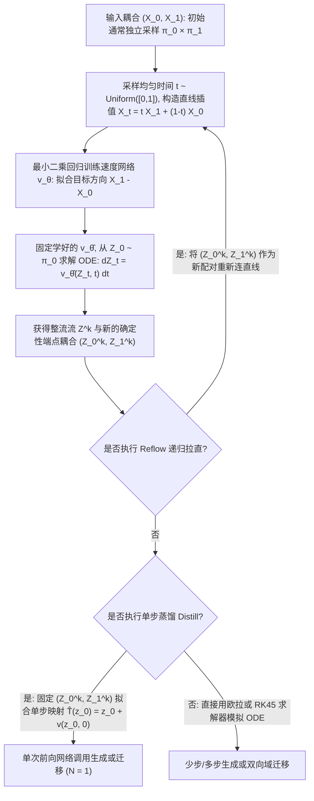

# Flow Straight and Fast: Learning to Generate and Transfer Data with Rectified Flow

# First Time

## 1.Title & Authors
论文原标题：Flow Straight and Fast: Learning to Generate and Transfer Data with Rectified Flow。
自然中文译法：《笔直且飞快地流动：用整流流学习数据生成与迁移》。习惯上也直接把 Rectified Flow 称为“整流流”或简称 Reflow。
先拆解标题里的四个核心词，立刻就能抓住全篇脉络：
- Flow（流）：指由常微分方程（ODE）驱动的连续时间演化过程。样本粒子从起点分布 $\pi_0$ 出发，一路听从速度场 $v(Z_t, t)$ 的指挥，在时间 $t \in [0, 1]$ 内平滑运动到终点分布 $\pi_1$。
- Straight & Fast（直与快）：全篇最迷人的核心主张就是“轨迹越笔直匀速，推理就越飞快”。传统扩散模型沿着弯弯曲曲的曲线慢慢去噪，不得不切几百上千个小步反复调用神经网络；如果粒子能沿笔直的线段匀速奔向终点，理论上只要在起点按速度推一次（单步欧拉更新），就能一步到位！
- Generate and Transfer（生成与迁移）：把看起来风马牛不相及的两大任务统一进同一个框架——起点 $\pi_0$ 选高斯噪声、终点 $\pi_1$ 选真实图像，就是图像生成；起点 $\pi_0$ 选源域数据（如人脸）、终点 $\pi_1$ 选目标域数据（如猫脸），就是无配对的域迁移。
- Rectified Flow（整流流）：通过极简的直线回归训练 ODE，把原本交错杂乱的起终点配对“理顺、拉直”，再递归重复这一过程（Reflow）让轨迹越来越直。
作者按原文顺序列出：Xingchao Liu、Chengyue Gong、Qiang Liu，三人均来自得克萨斯大学奥斯汀分校（University of Texas at Austin）。首页脚注写明 Xingchao Liu 与 Chengyue Gong 共同第一作者（Equal contribution）。从本文参考文献 [44]（《Let us build bridges: Understanding and extending diffusion generative models》）和 [90]（《Diffusion-based molecule generation with informative prior bridges》）可以看到，Qiang Liu 团队在扩散桥与分布运输方向有连续深耕，而本篇 Rectified Flow 正是他们把随机扩散剥离干净、直接以极简 ODE 直切分布运输本质的代表作。

## 2.Abstract
摘要的行文干净利落，按“统一框架 → 核心直觉 → 训练方法 → 直线优势 → 两大理论支柱 → 递归拉直 → 实验战绩”七步一气呵成。下面按原文语义单元逐句拆解。
1. 提出统一框架：作者提出 Rectified Flow，一种出奇简单的神经常微分方程（neural ODE）学习方法，用来在两个只观测到经验样本的分布 $\pi_0$ 与 $\pi_1$ 之间搬运概率质量，从而统一解决生成建模、域迁移以及各类分布运输问题。
   直觉上非常好懂：只手里有两堆样本，无需知道它们的解析概率密度，就能学出一个确定性速度场 $\mathrm{d}Z_t = v(Z_t, t)\mathrm{d}t$，把左边这堆样本平滑运成右边那堆样本。两端放在同一状态空间 $\mathbb{R}^d$ 中即可统一建模。
2. 核心几何直觉（尽量贴着直线走）：Rectified Flow 的想法简单到极致——从 $\pi_0$ 和 $\pi_1$ 里各抽一个点 $X_0$ 和 $X_1$，在两点间连一条笔直的线段 $X_t = tX_1 + (1-t)X_0$，然后让 ODE 速度场尽可能跟着这些直线方向走。
   这里藏着整篇论文最精妙的转折：训练时同时握着两端样本 $(X_0, X_1)$，连直线轻而易举；但推理时只拿到一个起点 $Z_0$，根本不知道终点在哪儿，而且不同样本对画出的直线会在半路撞车交叉。所以速度场必须学会“只看当前位置和时刻”做决定，在交叉口自动取平均并理顺方向。
3. 极简的最小二乘训练：上述目标直接化为一个普通的非线性最小二乘回归问题（拿网络预测的速度去拟合直线方向 $X_1 - X_0$），天然适配大规模深度学习，而且完全像标准监督学习一样直接优化，无需对抗博弈、似然近似或扩散模型里繁琐的噪声设计。
4. 为什么要执着于直线路径？作者给出两条过硬理由：几何上，两点之间直线最短；计算上，严格恒速的直线运动完全没有弯曲，不需要切成细碎的时间步去数值逼近，一步就能精确抵达终点，直接打通“连续时间模型”和“单步极速生成”之间的壁垒。
5. 理论支柱一（整流与凸代价下降）：从数据学习一条整流流的过程叫作 rectification（整流）。作者证明，它能把任意起终点配对（哪怕最初完全随机乱配）转化为一个新的确定性耦合，且同时保证对所有凸运输代价的期望都不会增加。
6. 理论支柱二（递归整流拉直轨迹）：把整流流程递归套在自己身上（Reflow）——用上一轮学好的流生成新的起终点配对，再在新配对之间重新拉直线训练——就能得到一串轨迹越来越笔直的流，推理时只需极粗的时间步就能准确模拟。
7. 实证表现与单步亮点：作者在图像生成、图像到图像翻译和域适应三类任务上检验了该方法；特别在图像生成与图像翻译上，经过一次 Reflow 就能获得近乎笔直的流，哪怕只用一次欧拉更新（$N=1$）也能生成高质量图像。结合正文 [Table1 精读](#table1) 可知，CIFAR-10 上单步蒸馏后的 2-Rectified Flow 取得 FID 4.85、Recall 0.50，3-Rectified Flow 取得 FID 5.21、Recall 0.51。
把摘要浓缩为四要素总览：

| 要素 | 本文核心内容 |
|---|---|
| 问题 | 如何用同一套简单可扩展的算法解决生成建模与域迁移等分布运输任务，同时克服连续时间 ODE/SDE 模型推理必须迭代几十上千步的速度瓶颈。 |
| 方法 | 用两端样本的直线插值 $X_t=tX_1+(1-t)X_0$ 构造速度最小二乘回归学出 Rectified Flow；再用模型生成的端点对递归执行 Reflow 拉直轨迹，最终可配合一步蒸馏压缩到单次前向推理。 |
| 结果 | 理论上严格证明边缘保持、所有凸运输代价非增及 $O(1/K)$ 平直化收敛；实验上在 CIFAR-10（单步蒸馏 FID 4.85 / Recall 0.51；完整 RK45 求解 FID 2.58 / Recall 0.57）、高分辨率图像生成、无配对图像翻译及域适应（OfficeHome 69.2、DomainNet 41.4）上均表现出色。 |
| 意义 | 证明了完全可以绕开复杂的 SDE 扩散推导与高维精确最优传输求解，直接以“直线回归 + 递归整流”同时拿到稳定的训练与极速的少步/单步推理。 |

## 3.Related Works and Discussion
本稿没有单设 Conclusion 章节，整篇论文的收束思考、方法立场与设计边界集中在第 4 节（Related Works and Discussion）末尾的两个讨论小节：`Re-thinking the role of diffusion noise` 与 `Optimal vs. straight transport`。精读这两节就能彻底看懂作者为什么要“甩掉随机扩散”以及为什么“选直线耦合而不是死磕最优传输”。
1. 重新思考扩散噪声的作用（Re-thinking the role of diffusion noise）：
   - 核心追问：既然 Rectified Flow 干干净净只用确定性 ODE，就在生成与迁移上拿到了媲美甚至超越扩散模型的结果，那随机扩散噪声到底是不是扩散模型成功的真正原因？作者提出一个极具洞察力的判断：扩散模型横扫 GAN 的真正功臣，很可能是“简单、稳定、可扩展的回归式优化训练”，而非生成过程中持续注入的布朗运动噪声 $\mathrm{d}W_t$。
   - 当任务只需把起点分布运到目标分布时，作者系统列举了 ODE 相对 SDE 的六大优势与适用边界：
     - 概念简洁与数值速度：ODE 只有确定性速度场，不含随机微分项，概念更清晰，配合笔直轨迹可用极少步数高速求解。
     - 时间可逆性：同一个 ODE 既能顺着时间从 $0 \to 1$ 生成，也能倒着时间从 $1 \to 0$ 编码还原，双向迁移天生对称；而 SDE 的时间反演依赖额外的 score 理论与更复杂的离散近似。
     - 潜在空间质量：ODE 建立的是起点 $Z_0$ 到终点 $Z_1$ 的确定性映射，加上整流降低运输代价的几何性质，使 $Z_0$ 成为可直接插值、编辑的优质潜在编码；SDE 沿途不断注入随机噪声，起点与终点之间的对应被冲散，很难直接拿来做潜在空间操控。
     - 训练难度：在扩散设定下，ODE 与同边缘 SDE 共享完全相同的输入分布，训练目标（式 15 与式 18）仅相差一个线性重参数化，训练 ODE 并不会更难。
     - 表达能力：由概率流 ODE 理论可知，任何 SDE 都能转成具有相同每一时刻边缘分布 $\operatorname{Law}(Z_t)$ 的 ODE。因此只要目标是匹配终点分布，ODE 的表达力毫不逊色；但如果任务本身关心跨时间的丰富随机相关结构，SDE 更合适。
     - 流形数据结构：神经网络驱动的确定性 ODE 天然偏好将输出映射到平滑的低维流形，契合图像、文本等结构化 AI 数据；SDE 在末端则必须小心退火降低噪声才能得到干净样本。反过来，金融经济等高噪声数据或分子动力学等物理扩散场景仍是 SDE 的主场。
2. 最优运输 vs. 直线运输（Optimal vs. straight transport）：
   - 最优运输（OT）的目标是在所有保持两端边缘分布合法的耦合中，找到使给定代价 $\mathbb{E}[c(Z_1 - Z_0)]$ 达到全局最小的配对（最常见是平方代价 $c(\cdot)=\|\cdot\|^2$）。
   - 作者坦率说明为何不把“求精确最优耦合”当作主目标：一来高维连续分布的精确最优传输求解极难、算力昂贵；二来数学上的某一个固定几何代价未必与图像清晰度、语义自然度或下游分类精度完全一致，硬把代价压到最低并不总换来更好的生成质量。
   - Rectified Flow 的聪明取舍是把目标从“指定代价全局最优”放宽为“找到一个直线耦合（straight coupling）”。高维空间里直线耦合有很多个，它们未必达到某个具体 $c$ 的全局最小值，但从极速推理的视角看，每一个直线耦合都同样完美——只要粒子沿恒速直线运动，一步欧拉更新就能精确抵达终点！同时，整流还顺手附赠了“所有凸运输代价只降不升”的理论保证，在极低算法复杂度下兼得了几何规整与推理飞快。
合起来看，整篇论文的立场非常鲜明：面向生成与域迁移这类分布运输任务，直接用极简回归训练确定性 ODE，再靠 Reflow 把路径拉直，既甩掉了 GAN 的训练崩塌、MLE 的似然积分和 SDE 的随机拖累，也避开了高维精确最优传输的计算泥潭。同时作者也在正文明确提醒了核心权衡：Reflow 虽然让少步/单步效果暴涨，但过多轮次会累积速度估计误差，在充分步数求解下反而可能略微拉低上限。

## 4.Analogy
可以把 Rectified Flow 和 Reflow 想象成“给早高峰跨城通勤的十万名上班族重修直达高速”。
- 西城居民区是起点分布 $\pi_0$（比如高斯噪声，或者人脸照片），东城写字楼是终点分布 $\pi_1$（比如猫脸照片）。我们的目标是让十万名上班族每天按时到达东城，且每个写字楼刚好坐满，同时大家路上花的时间和转弯次数越少越好。
- 第零步（随机抽签画虚线 $X_t$）：一开始谁也不知道该去哪栋楼，干脆随机抽签把西城的人和东城的楼一对一配对，并在地图上连出十万条直虚线。问题有两个：第一，北边人去南楼、南边人去北楼，城中心瞬间挤成一团乱麻，无数虚线在半路交叉撞车；第二，这套虚线只能“上帝视角”看着用——如果你不提前发一张写明目标写字楼地址的秘密车票，站在路上的通勤者根本不知道该朝哪走（这就是原文说的 non-causal，非因果）。
- 第一步（1-Rectified Flow 整流学习 $v^{\boldsymbol{X}}$）：我们在全城每个路口、每个时刻派一位交通指挥员（神经网络 $v_\theta(x, t)$）。他记下此时此刻所有穿过这个路口的虚线方向，取个平均方向做成一块路牌。现在上班族再也不用拿秘密车票了，只要边走边看路牌就行（因果化）。最神奇的事情在十字路口发生了：由于同一时间、同一路口只能竖一块路牌（ODE 解的唯一性 / 轨迹不相交），原本打算交叉冲向对角线的两拨人，走到路口时被迫顺着路牌柔和地“拐弯互换目的地”——左上出发的人拐向右上的楼，左下出发的人拐向右下的楼！结果一举两得：第一，每个路口流进多少人就流出多少人，所以任意时刻全城的人群密度分布分毫不差（边缘保持 Theorem 3.3），最终所有写字楼依然严丝合缝坐满；第二，大家不再傻傻地交叉绕对角线，全城总通勤路程自然缩短了（凸运输代价下降 Theorem 3.5）！
- 第二步（Reflow 铺设直线高速）：虽然互换了目的地，但第一轮通勤路线在原来的十字路口还是拐了弯（呈“><”或双曲线状）。于是市政部门记录下第一轮结束时每个人的实际家门和实际到达的写字楼 $(Z_0^1, Z_1^1)$，把弯路拆掉，直接在这批“已经不再交叉”的新配对之间重铺笔直的线段，再训练第二代交通指挥员（2-Rectified Flow）。因为路线几乎不再撞车，路牌从头到尾都指向同一个固定方向，上班族在起点一脚油门定好方向（$N=1$ 步欧拉）就能直奔终点！
- 第三步（Distillation 单步蒸馏）：等高速几乎笔直了，干脆给每位居民发一张直达导航卡 $\hat{T}(z_0)$，直接按起点算出终点，连沿途看路牌的步骤都省掉。
- 类比边界：真实数据活在高维空间而非二维地图；数学上的“交叉”专指同一时刻经过同一空间位置却方向不同，二维投影看起来相交但错峰经过的路线并不冲突；神经网络对理想平均路牌的拟合存在有限误差，所以 Reflow 轮数过多会把前几轮的微小误差一层层放大；此外，在二维及以上空间里，“路线互不交叉且笔直”并不自动意味着全城总路程达到了所有配对方案里的全局最小值（比如让全体居民集体顺时针错开四分之一圈同样互不交叉，却比原地不动走得远得多），这正好对应正文第 3.4 节“直线耦合 vs. 最优耦合”的深刻区分。

# Second Time

## 1.Notation & Parameters
全文的符号体系围绕“参考插值过程 $\boldsymbol{X}$ → 整流 ODE 流 $\boldsymbol{Z}$ → 轨迹平直度与代价分析 → 扩散 SDE/PF-ODE 统一”四条主线展开。下表整理了理解主线所需的重点符号，严格沿用论文原记号。

| 符号/参数 | 含义与作用 | 关键设定/约束 |
|---|---|---|
| $\pi_0,\pi_1$；$d$ | 起点分布、终点分布；共同欧氏状态空间 $\mathbb{R}^d$ 的维度 | 生成建模常取 $\pi_0=\mathcal{N}(0,I)$；域迁移时两端均为数据分布 |
| $(X_0,X_1)$ | 输入端点耦合（起终点配对的联合分布） | 边缘分别服从 $\pi_0,\pi_1$；无配对任务默认独立采样 $(X_0,X_1)\sim\pi_0\times\pi_1$ |
| $X_t,\dot{X}_t,\boldsymbol{X}$ | 参考随机插值路径、时间导数及整条过程 $\boldsymbol{X}=\{X_t:t\in[0,1]\}$ | 标准线性设定为 $X_t=tX_1+(1-t)X_0$，$\dot{X}_t=X_1-X_0$；式 (6) 推广至一般可微曲线 |
| $Z_t,\dot{Z}_t,\boldsymbol{Z}$ | 整流 ODE 的状态、速度及整条流 $\boldsymbol{Z}=\{Z_t:t\in[0,1]\}$ | 满足 $\mathrm{d}Z_t=v(Z_t,t)\mathrm{d}t$，$Z_0\sim\pi_0$；与 $X_t$ 共享时刻边缘，但轨迹与联合分布不同 |
| $v,v_\theta,\theta,\hat{\theta}$ | 速度场（漂移力）函数、神经网络参数化、参数与最优估计 | 实际接收位置与时间 $(z,t)$ 输出 $\mathbb{R}^d$ 速度；算法框简写映射域为 $\mathbb{R}^d\to\mathbb{R}^d$ |
| $v^X,v^{\boldsymbol{X}},v_t^{\boldsymbol{X}}$ | 给定参考过程的条件期望速度场（式 2 与 Definition 3.1） | $v^{\boldsymbol{X}}(x,t)=\mathbb{E}[\dot{X}_t\mid X_t=x]$；第 2.2 节写 $v^X$，第 2.3 与第 3 节多写粗体上标 $v^{\boldsymbol{X}}$ |
| $\operatorname{RectFlow},\operatorname{Rectify}$ | 整流算子：前者返回整条流 $\boldsymbol{Z}$，后者返回端点耦合 $(Z_0,Z_1)$ | 要求输入过程或耦合满足 Definition 3.2/3.4 的可整流性（唯一解与局部有界） |
| $\boldsymbol{Z}^k,(Z_0^k,Z_1^k),k,K$ | 第 $k$ 轮整流得到的流及其端点耦合；整流轮次与总轮数 | 上标 $k$ 是轮数而非幂次；初始 $(Z_0^0,Z_1^0)=(X_0,X_1)$；附录 A 中 $k$ 另表目标推理步数 |
| $S(\boldsymbol{Z})$ | 流 $\boldsymbol{Z}$ 的平直度度量（式 3） | 衡量瞬时速度 $\dot{Z}_t$ 偏离端点平均位移 $Z_1-Z_0$ 的均方积分；$S(\boldsymbol{Z})=0$ 对应严格恒速直线 |
| $V((X_0,X_1))$ | 线性插值路径在中间状态处的条件速度方差积分（式 12） | 衡量路径交叉造成的速度方向歧义；$V=0$ 等价于线性插值路径几乎处处不相交 |
| $c$ | 端点位移运输代价函数 $c:\mathbb{R}^d\to\mathbb{R}$ | 凸代价在整流下期望非增；严格凸性用于固定点判别；典型取 $c(\cdot)=\lVert\cdot\rVert^\alpha$（$\alpha\ge 1$） |
| $T,\hat{T}$ | 分布运输映射；单步蒸馏网络 | 蒸馏常参数化为 $\hat{T}(z_0)=z_0+v(z_0,0)$，逼近固定教师耦合 $(Z_0^k,Z_1^k)$ |
| $\rho(x_0\mid x_1),\eta_t(X_1,z)$ | 给定终点时起点的条件密度；式 (4) 的归一化密度权重 | 此处的 $\eta_t(X_1,z)$ 含位置与终点参数，与第 3.5 节扩散漂移系数 $\eta_t$ 同名不同义 |
| $v^{X,h},\kappa_h,\omega_h,h$ | 式 (5) 的 Nadaraya–Watson 核速度估计、核函数、归一化核权重与带宽 | 高斯 RBF 核 $\kappa_h(x,z)=\exp(-\lVert x-z\rVert^2/(2h^2))$；第 3.1 节 $h$ 表测试函数，第 5.3 节 $h$ 表特征映射 |
| $\alpha_t,\beta_t,w_t$ | 一般插值 $X_t=\alpha_t X_1+\beta_t X_0$（或 $\beta_t\xi$）的时间系数；正时间权重 | 标准整流取 $\alpha_t=t,\beta_t=1-t,w_t=1$；(sub-)VP 用式 (7)–(8) 指数日程 |
| $U_t,b,\tilde{b},V_t,Y_t,\tilde{Y}_t$ | 第 3.5 节扩散 SDE 状态、漂移、同边缘 ODE 漂移、加噪状态与回归目标 | $\tilde{b}(z,t)=\frac{1}{2}(b(z,t)-\eta_t z)$；$Y_t$ 与 $\tilde{Y}_t$ 的噪声项仅差系数 $1/2$ |
| $\eta_t,\sigma_t,W_t,\xi,\xi_t$ | 扩散 OU 线性漂移系数、扩散系数、布朗运动、固定高斯噪声与高斯过程 | $\xi\sim\mathcal{N}(0,I)$；(sub-)VP 设 $a=19.9,b=0.1$，VE 设 $\sigma_{\min}=0.01,\sigma_{\max}=r\sigma_{\min}$ |
| $N,\mathrm{NFE}$ | 固定步长欧拉离散步数；推理时神经网络求值总次数 | 显式欧拉下 $\mathrm{NFE}=N$；自适应求解器 RK45 的 NFE 为总求值次数而非接受步数 |

四个同名不同义的符号提前点破，读公式绝不迷糊：第一，$\eta_t$ 在式 (4) 里是带参数的归一化密度权重 $\eta_t(X_1,z)$，在式 (15)–(18) 里是扩散 OU 过程的线性漂移系数 $\eta_t$；第二，$h$ 在式 (5) 里是核带宽标量，在式 (10) 里是测试函数 $h:\mathbb{R}^d\to\mathbb{R}$，在式 (20) 里是图像风格特征映射 $h(x)$；第三，$a,b$ 在式 (7) 里是 VP 日程常数 $19.9, 0.1$，而 $a$ 在第 2.2 节还作截断时间上界、$b(U_t,t)$ 在式 (14) 里是 SDE 漂移网络；第四，$k$ 在正文里始终是 Reflow 轮次，只在附录 A 少步微调那一段临时用来表示目标步数。

## 2.Introduction
对应原文 Section 1。引言开门见山，把无监督学习、生成建模、表示学习和域迁移全部放进同一把尺子下量了一遍：监督学习手里有配好的输入输出对，而无监督任务手里只有两堆孤立样本，本质都是在两个分布之间寻找有意义的对应关系。
1. 统一问题表述——运输映射问题（The Transport Mapping Problem，无编号定义）：
   给定 $\mathbb{R}^d$ 上两个分布的经验样本 $X_0\sim\pi_0$ 与 $X_1\sim\pi_1$，寻找一个运输映射 $T:\mathbb{R}^d\to\mathbb{R}^d$，使得当 $Z_0\sim\pi_0$ 时，输出 $Z_1 := T(Z_0)\sim\pi_1$，即 $(Z_0, Z_1)$ 构成 $\pi_0$ 与 $\pi_1$ 的一个合法耦合（coupling / transport plan）。
   这里要抓准目标：算法要求的是把起点整片概率分布精准运成终点分布，而不是把某个随机配给 $X_0$ 的 $X_1$ 死板地一一对应上。
2. 梳理现有三大技术路线的痛点：
   - 传统单步模型（GAN、VAE、Normalizing Flow）：直接用神经网络表示一步映射 $T$。GAN 生成画质高、推理快，但对抗极小极大优化极易训练不稳定和模式坍塌，调参极难跨架构迁移；VAE 和 Normalizing Flow 走最大似然估计（MLE）路线，但高维似然难算，前者不得不靠变分近似，后者必须设计特殊可逆网络与昂贵的雅可比行列式，在表达力与算力间左右为难。
   - 连续时间动力系统（Neural ODE、SDE 扩散模型 DDPM / Score-based Models）：不再直接硬学单步映射，而是学一个驱动粒子连续演化的神经漂移场，推理时用数值求解器积分。靠着简洁稳定的回归目标，扩散模型在画质与多样性上全面超越 GAN，彻底告别模式坍塌；通过 Probability Flow ODE（PF-ODE）和 DDIM 还能把 SDE 转成确定性 ODE 提速。但短板同样刺眼：推理阶段为了数值积分弯曲的轨迹，必须反复调用庞大的神经网络几十上千次，速度远慢于单步模型；且扩散模型的设计空间复杂、超参琐碎。
   - 最优传输（Optimal Transport, OT）：天然统一生成与域迁移，试图在所有合法耦合中最小化期望运输代价 $\mathbb{E}[c(Z_1 - Z_0)]$（针对给定代价函数 $c:\mathbb{R}^d\to\mathbb{R}$）。但高维大样本下的精确 OT 求解计算代价极高，且某个选定的几何代价未必与实际生成质量或下游任务指标严格对齐。
3. 呼之欲出的研究缺口：能不能造一种新框架，既像扩散模型一样用最简单稳定的回归轻松训练大模型，又像最优传输一样天然统一生成与域迁移，还能让流轨迹自己变直，做到像 GAN 一样一步或极少步高速推理？答案正是 Rectified Flow，引言先通过 [Fig1 精读](#fig1) 的猫脸生成与人猫转换直观展示“一次 Reflow 即可实现单步清晰出图”，并在 [Fig2 精读](#fig2) 中预告核心的“交叉重连”机制。

## 3.Contribution
对应原文 Section 1 末尾的 Contribution 小节。作者把贡献归纳为“方法、理论、实证”三块：
1. 极简的直线 ODE 学习框架：用无约束最小二乘直接拟合两端样本连线的方向，既避开 GAN 的对抗震荡、MLE 的似然难题，也甩开扩散模型的复杂超参设计，纯 ODE 路线即可统一处理生成与域迁移。
2. 两条过硬的理论保证：整流（Rectification）不仅保持任意时刻的边缘分布，还同时做到（1）对所有凸运输代价联合非增；（2）递归整流（Reflow）以 $O(1/K)$ 速率把流轨迹拉直，大幅削减数值离散误差，架起连续时间模型与单步模型之间的桥梁。
3. 强有力的跨任务实证：在无条件图像生成（CIFAR-10 及 $256\times 256$ 高分辨率数据集）、无配对图像翻译与域适应上全面验证。在 CIFAR-10 单步快速生成上，作者将两个最佳数字并列为亮点（FID 4.85、Recall 0.51）——对照正文 [Table1 精读](#table1) 核实，FID 4.85（Recall 0.50）来自蒸馏后的 2-Rectified Flow，而 Recall 0.51（FID 5.21）来自蒸馏后的 3-Rectified Flow，分别由两轮蒸馏模型取得。

## 4.Method
对应原文 Section 2。方法章三步递进：第 2.1 节给主算法与直觉画面；第 2.2 节深度剖析最优速度、边缘保持、代价下降、Reflow 拉直、蒸馏及非参数核估计；第 2.3 节把直线推广到任意可微曲线，一举把扩散模型的 PF-ODE 和 DDIM 收入囊中，点破它们“路径弯、速度不匀”的根源。
下面用一张可编辑 Mermaid 流程图把整套 Rectified Flow + Reflow + Distillation 流水线画清楚（对应 [Algorithm1 精读](#algorithm1)；省略具体 U-Net 架构、优化器与超参细节，核心展示数据流与耦合递推关系）：

看懂这张图的关键在于分清“回流的是什么”：Reflow 回流到下一轮训练的，是上一轮模型实际跑出来的端点配对 $(Z_0^k, Z_1^k)$，然后在这对新端点之间重新拉直线训练，而不是去模仿上一轮弯曲的中间轨迹。

## 5.Overview
对应原文 Section 2.1。这一节把 Rectified Flow 整套设计讲得像白开水一样清澈，读懂这里最关键的是时刻分清两个过程：训练时用来当参考的直线插值过程 $X_t$，和推理时真正由 ODE 跑出来的整流过程 $Z_t$。
1. 整流 ODE 与核心训练目标——公式（1）：
   给定经验样本 $X_0\sim\pi_0$ 与 $X_1\sim\pi_1$，Rectified Flow 定义在时间区间 $t\in[0,1]$ 上的常微分方程：
   $$
   \mathrm{d}Z_t = v(Z_t, t)\mathrm{d}t,
   $$
   目标是把起点 $Z_0\sim\pi_0$ 运送到服从 $\pi_1$ 的终点 $Z_1$。速度场（漂移力）$v$ 通过极简的最小二乘回归学得，即原文公式（1）：
   $$
   \min_v \int_0^1 \mathbb{E}\left[\left\lVert (X_1 - X_0) - v(X_t, t) \right\rVert^2\right]\mathrm{d}t,
   \qquad \text{with}\quad X_t = t X_1 + (1 - t) X_0.
   \tag{1}
   $$
   先看直觉再看细节：
   - 固定一对样本 $(X_0, X_1)$，让 $t$ 从 $0$ 走到 $1$，插值点 $X_t = t X_1 + (1-t) X_0$ 就沿连接两点的线段匀速前进，时间导数恒为 $\dot{X}_t = X_1 - X_0$。
   - 为什么不能直接拿 $\mathrm{d}X_t = (X_1 - X_0)\mathrm{d}t$ 来生成新样本？因为这条式子是“非因果的（non-causal / anticipating）”——你在 $t=0$ 迈第一步时就必须偷看终点 $X_1$ 在哪！推理时手里只有 $Z_0$，根本没见过 $X_1$。
   - 公式（1）的妙处就是“因果化（causalizing）”：强迫模型只看当前位置 $X_t$ 和当前时间 $t$ 来猜速度 $v(X_t, t)$，用平方误差去逼近直线方向 $X_1 - X_0$。由于 $[0,1]$ 区间长度为 $1$，把时间积分写成 $t\sim\operatorname{Uniform}([0,1])$ 的随机期望，就得到 [Algorithm1 精读](#algorithm1) 中的实用训练目标：
   $$
   \hat{\theta} = \arg\min_\theta \mathbb{E}\left[\left\lVert X_1 - X_0 - v_\theta\bigl(t X_1 + (1 - t) X_0, t\bigr)\right\rVert^2\right].
   $$
   每一步训练更新只需要抽一对样本、抽一个随机数 $t$、算一次线性加权、算一次前向均方误差、反向传播，全程不需要在训练循环里解 ODE，也不需要算任何雅可比行列式。
2. 正向、反向采样与时间对称性：
   学好速度场 $v$ 之后，从 $Z_0\sim\pi_0$ 正向积分即可完成 $\pi_0 \to \pi_1$ 运输；从 $Z_1\sim\pi_1$ 反向积分即可完成 $\pi_1 \to \pi_0$ 运输（既可用于图像逆向编码到噪声，也能用于双向域迁移）。
   若用重新计时的变量 $\tilde{X}_t = Z_{1-t}$（起点 $\tilde{X}_0 = Z_1 \sim \pi_1$）来表示反向过程，由链式法则求导可得：
   $$
   \frac{\mathrm{d}}{\mathrm{d}t}\tilde{X}_t
   = \frac{\mathrm{d}}{\mathrm{d}t}Z_{1-t}
   = -v(Z_{1-t}, 1-t)
   = -v(\tilde{X}_t, 1-t).
   $$
   （细心核对原稿：原文这一句把时间参数简印成了 $\mathrm{d}\tilde{X}_t = -v(\tilde{X}_t, t)\mathrm{d}t$，漏掉了对时间自变量的翻转；对一般随时间变化的速度场，必须保留 $1-t$，或者直接把求解器沿原时间从 $t=1$ 倒积回 $t=0$。）
   此外，公式（1）天然时间对称：把 $X_0$ 和 $X_1$ 对调、同时把时间换成 $1-t$，插值点集合完全不变，目标速度变成 $X_0 - X_1 = -(X_1 - X_0)$，因此正反两个方向在训练目标里地位完全平等。
3. 轨迹不相交与自动“重接线”（Flows avoid crossing）：
   理解 Rectified Flow 为什么会自动理顺配对，核心就五个字：流不能交叉。
   只要 ODE $\mathrm{d}Z_t = v(Z_t, t)\mathrm{d}t$ 存在唯一解，就不可能有两条轨迹在同一时刻 $t\in[0,1)$ 经过同一个空间点 $z$ 却朝不同方向分道扬镳（否则从 $(z,t)$ 出发就会冒出两条不同解，违背唯一性）。
   反观最初随机配对画出来的直线插值 $X_t$，大量线段会在中间时空位置相交撞车（[Fig2 精读](#fig2) 的面板 a）。当速度场 $v$ 强行把同一位置的不同方向揉成一个单值速度后，整流轨迹 $Z_t$ 到了交叉口就会像高速公路立交桥分流一样自动“重接线（rewiring）”——原本要交叉穿过对方的粒子各自拐弯、互换了目的地，避开了碰撞，却依然严丝合缝地走出和 $X_t$ 一模一样的密度演化（[Fig2 精读](#fig2) 面板 b）。作者给了一个极传神的比喻：线性插值 $X_t$ 负责在两城之间修路，而整流流 $Z_t$ 是沿着路网盲走且永不撞车的车流，它们抛弃了原本盲目抽签的全局配对，自发重组出一套更有序的确定性配对 $(Z_0, Z_1)$。
4. 两个算子与递归拉直（Reflow）：
   原文定义了两个紧凑记号：$\boldsymbol{Z} = \operatorname{RectFlow}((X_0, X_1))$ 输出整条整流轨迹，$(Z_0, Z_1) = \operatorname{Rectify}((X_0, X_1))$ 提取它的起终点确定性耦合。理想求解式（1）时，$(Z_0, Z_1)$ 不仅自动保持两端边缘分布（Theorem 3.3），而且对所有凸代价都比输入耦合 $(X_0, X_1)$ 的运输代价更低或持平（Theorem 3.5）。
   更妙的是把算子递归套在自己身上，这就是 Reflow：
   $$
   \boldsymbol{Z}^{k+1} = \operatorname{RectFlow}\bigl((Z_0^k, Z_1^k)\bigr),
   \qquad (Z_0^0, Z_1^0) = (X_0, X_1),
   $$
   其中 $\boldsymbol{Z}^k$ 称为第 $k$ 轮整流流（$k$-rectified flow）。每一轮都用上一轮实际跑出来的端点对 $(Z_0^k, Z_1^k)$ 重新连直线、重新回归速度。随着交叉越来越少，流轨迹越来越直（[Fig2 精读](#fig2) 面板 c–d 与 [Fig3 精读](#fig3)），一旦趋近恒速直线，推理时一步欧拉就能直达终点，彻底打破连续时间模型的速度魔咒。

## 6.Main Results and Properties
对应原文 Section 2.2。这一节把 Rectified Flow 背后的七块核心拼图全部用最直观的方式亮出来，严格定理证明留到 Section 3。
1. 最优速度场是条件平均速度——公式（2）：
   给定输入耦合 $(X_0, X_1)$，公式（1）的精确全局最优解是条件期望速度：
   $$
   v^X(x, t) = \mathbb{E}[X_1 - X_0 \mid X_t = x].
   \tag{2}
   $$
   为什么最小二乘的精确解一定是条件期望？固定任意时刻 $t$，在均方误差里一加一减 $\mathbb{E}[X_1 - X_0 \mid X_t]$ 并展开平方：
   $$
   \begin{aligned}
   \mathbb{E}\left[\left\lVert (X_1 - X_0) - v(X_t, t) \right\rVert^2\right]
   &= \mathbb{E}\left[\left\lVert (X_1 - X_0) - \mathbb{E}[X_1 - X_0 \mid X_t] \right\rVert^2\right] \\
   &\quad + \mathbb{E}\left[\left\lVert \mathbb{E}[X_1 - X_0 \mid X_t] - v(X_t, t) \right\rVert^2\right],
   \end{aligned}
   $$
   交叉项 $2\mathbb{E}\bigl[\bigl((X_1 - X_0) - \mathbb{E}[X_1 - X_0 \mid X_t]\bigr)^\top \bigl(\mathbb{E}[X_1 - X_0 \mid X_t] - v(X_t, t)\bigr)\bigr]$ 对 $X_t$ 取条件期望后立刻归零（因为第二项只依赖 $X_t$，第一项条件均值为零）。第一项是数据本身路径交叉带来的不可消除方差，与 $v$ 无关；第二项非负，当且仅当 $v(X_t, t) = \mathbb{E}[X_1 - X_0 \mid X_t]$ 时取零！
   几何含义极清晰：所有在时刻 $t$ 穿过点 $x$ 的参考直线方向，按概率加权求平均，就是最优速度 $v^X(x, t)$。
2. 边缘保持性质（Marginal preserving property，预告 Theorem 3.3）：
   只要由 $v^X$ 驱动的 ODE 存在唯一解且从 $Z_0\sim\pi_0$ 出发，那么在每一个时刻 $t\in[0,1]$，整流流的边缘分布与参考插值完全一致：
   $$
   \operatorname{Law}(Z_t) = \operatorname{Law}(X_t), \qquad \forall t \in [0, 1].
   $$
   特别地，取 $t=1$ 即得 $Z_1\sim\pi_1$，证明 $(Z_0, Z_1)$ 确实完成了从 $\pi_0$ 到 $\pi_1$ 的合法运输！
   原文在这里画了一幅极直观的“局部通量守恒”内嵌图示：在任意时空微元盒子里，虽然参考直线 $X_t$ 各走各的交叉穿过、而整流流 $Z_t$ 沿平均方向整齐穿过，但因为 $v^X$ 正是所有穿越速度的条件期望，单位时间内流入和流出该微元的总概率质量两者分毫不差，于是所有时刻的概率密度快照完全重合！
   牢记什么不变、什么变了：不变的是每个时刻的人群整体分布（边缘分布）；彻底改变的是整条轨迹的联合分布。原本的 $X_t$ 既非因果、又非马尔可夫、端点配对随机，而整流流 $Z_t$ 一步完成了三重净化——因果化（causalizes）、马尔可夫化（Markovianizes）和去随机化（derandomizes）。
3. 凸运输代价联合下降（Reducing transport costs，预告 Theorem 3.5）：
   对任意凸代价函数 $c:\mathbb{R}^d\to\mathbb{R}$（例如 $c(\cdot)=\|\cdot\|^\alpha,\ \alpha\ge 1$），整流后的耦合满足：
   $$
   \mathbb{E}[c(Z_1 - Z_0)] \le \mathbb{E}[c(X_1 - X_0)].
   $$
   原文称此为对全体凸代价的 Pareto descent：训练时根本没指定任何具体的 $c$，一次整流却让所有凸运输代价同时只降不升！
   为什么？原文针对欧氏距离 $c(\cdot)=\|\cdot\|$ 画了一幅令人拍案叫绝的三步图形证明（内嵌于正文的 `Length` 不等式）：
   - 第一步（三角不等式 $\le$）：新配对端点 $(Z_0, Z_1)$ 之间的直线距离，必然小于等于连接它们的弯曲整流轨迹 $Z_t$ 的总弧长；
   - 第二步（重接线保长 / 条件平均 $\le$）：整流轨迹 $Z_t$ 可以看成是把交叉直线 $X_t$ 在交点处剪断重接而成，总长度不超过原参考直线的总长度。
   用精确的积分与条件 Jensen 写出来，就是：
   $$
   \mathbb{E}[\lVert Z_1 - Z_0 \rVert]
   = \mathbb{E}\left[\left\lVert \int_0^1 v^{\boldsymbol{X}}(Z_t, t)\mathrm{d}t \right\rVert\right]
   \le \int_0^1 \mathbb{E}[\lVert v^{\boldsymbol{X}}(Z_t, t) \rVert]\mathrm{d}t
   = \int_0^1 \mathbb{E}[\lVert \mathbb{E}[X_1 - X_0 \mid X_t] \rVert]\mathrm{d}t
   \le \mathbb{E}[\lVert X_1 - X_0 \rVert].
   $$
   （注意一般连续情形下，由于方向平均会互相抵消，中间步的速度积分长度甚至比原直线更短，原文图示用等号“剪断重接”传达核心直觉，而 Section 3.2 给出了面向一切凸函数 $c$ 的一般双 Jensen 证明。）
   同时，因为整流不针对某一个特定 $c$ 优化，递归整流在高维下并不保证收敛到指定 $c$ 的全局最优耦合——唯有在一维空间 $\mathbb{R}$ 中，所有非负凸代价共享同一个唯一单调最优耦合，且恰好与整流固定点重合（详见第 13 节）。
4. 递归拉直、Burgers 方程与平直度度量——公式（3）：
   什么叫一条“笔直（straight）”的流？原文给的定义非常严格：不仅轨迹是直线，还必须匀速——几乎必然满足 $Z_t = t Z_1 + (1-t)Z_0\ (\forall t\in[0,1])$，等价于沿每条样本轨迹速度恒定 $v(Z_t, t) = Z_1 - Z_0 = \mathrm{const}$。
   一旦恒速直行，单步欧拉 $Z_1 = Z_0 + v(Z_0, 0)$ 直接算出精确终点！但让一条因果 ODE 恒速直行绝非易事：把沿轨迹的速度对时间求全导数：
   $$
   \frac{\mathrm{d}}{\mathrm{d}t}v(Z_t, t)
   = \partial_z v(Z_t, t)\dot{Z}_t + \partial_t v(Z_t, t)
   = \partial_z v(Z_t, t)v(Z_t, t) + \partial_t v(Z_t, t) = 0,
   $$
   这正是流体力学中大名鼎鼎的无黏 Burgers 方程 $\partial_t v + (\partial_z v)v = 0$！Rectified Flow 无需显式求解这个偏微分方程，光靠递归 Reflow 就能逼近它。
   为了定量刻画一条流距离“恒速直线”有多远，作者定义了平直度（Straightness）度量——公式（3）：
   $$
   S(\boldsymbol{Z}) = \int_0^1 \mathbb{E}\left[\left\lVert (Z_1 - Z_0) - \dot{Z}_t \right\rVert^2\right]\mathrm{d}t.
   \tag{3}
   $$
   把平方展开，并利用 $\int_0^1 \dot{Z}_t \mathrm{d}t = Z_1 - Z_0$，能得到一个后面证明 Theorem 3.7 极其好用的恒等式：
   $$
   \begin{aligned}
   S(\boldsymbol{Z})
   &= \int_0^1 \mathbb{E}\left[\lVert \dot{Z}_t \rVert^2\right]\mathrm{d}t
   - 2\mathbb{E}\left[(Z_1 - Z_0)^\top \int_0^1 \dot{Z}_t \mathrm{d}t\right]
   + \mathbb{E}\left[\lVert Z_1 - Z_0 \rVert^2\right] \\
   &= \int_0^1 \mathbb{E}\left[\lVert \dot{Z}_t \rVert^2\right]\mathrm{d}t
   - \mathbb{E}\left[\lVert Z_1 - Z_0 \rVert^2\right].
   \end{aligned}
   $$
   显然 $S(\boldsymbol{Z}) \ge 0$，且 $S(\boldsymbol{Z}) = 0$ 等价于严格恒速直行。作者随即预告 Theorem 3.7 的核心收敛界：
   $$
   \min_{k \in \{0,\dots,K\}} S(\boldsymbol{Z}^k) \le \frac{\mathbb{E}[\lVert X_1 - X_0 \rVert^2]}{K}.
   $$
   实操中（见 [Fig3 精读](#fig3)、[Fig8 精读](#fig8)、[Fig9 精读](#fig9)），仅仅做一轮 Reflow（得到 2-Rectified Flow）就能把路径拉得非常直；作者也直接给出工程忠告：实践中不要做太多轮 Reflow，因为每一轮神经网络对 $v^X$ 的拟合误差会层层累积。
5. 单步蒸馏（Distillation）与整流的本质区别：
   拿到已经近乎笔直的第 $k$ 轮流 $\boldsymbol{Z}^k$ 后，可以进一步把它的起终点对应关系 $(Z_0^k, Z_1^k)$ 蒸馏进一个单步网络 $\hat{T}$，直接由起点预测终点。若沿用原速度网络将其参数化为 $\hat{T}(z_0) = z_0 + v(z_0, 0)$，蒸馏的均方损失为：
   $$
   \mathbb{E}\left[\left\lVert (Z_1^k - Z_0^k) - v(Z_0^k, 0) \right\rVert^2\right],
   $$
   恰好就是公式（1）固定在起点时刻 $t=0$ 处的切片！（注意在 CIFAR-10 实际单步微调中，附录 A 用 LPIPS 感知损失替代了 L2 损失以获得更锐利的图像。）
   一定要把 Rectification（整流）和 Distillation（蒸馏）区分清楚：整流会改变耦合，把 $(Z_0^k, Z_1^k)$ 重接线成运输代价更低、路径更直的新耦合 $(Z_0^{k+1}, Z_1^{k+1})$；蒸馏则忠实拟合既有耦合 $(Z_0^k, Z_1^k)$，专注把多步数值积分压成一步映射。因此正确用法是先做 1–2 轮 Reflow 拉直轨迹，再在最后阶段收口做一次 Distillation。
6. 速度场 $v^X$ 的解析表达、正则性与高斯平滑——公式（4）：
   当给定 $X_1 = x_1$ 时起点 $X_0$ 拥有条件概率密度 $\rho(x_0 \mid x_1)$，最优速度场 $v^X$ 可以显式写成公式（4）：
   $$
   v^X(z, t) = \mathbb{E}\left[\frac{X_1 - z}{1 - t}\eta_t(X_1, z)\right],
   \qquad
   \eta_t(X_1, z) = \frac{\rho\left(\frac{z - t X_1}{1 - t} \;\middle|\; X_1\right)}{\mathbb{E}\left[\rho\left(\frac{z - t X_1}{1 - t} \;\middle|\; X_1\right)\right]},
   \tag{4}
   $$
   其中期望均对 $X_1\sim\pi_1$ 取，$t\in[0,1)$。推导分两步，非常漂亮：
   - 第一步（反解位移）：在条件 $X_t = t X_1 + (1-t)X_0 = z$ 下，直接解出 $X_0 = \frac{z - t X_1}{1 - t}$，于是连线方向立刻改写为：
     $$
     X_1 - X_0 = X_1 - \frac{z - t X_1}{1 - t} = \frac{X_1 - z}{1 - t}.
     $$
   - 第二步（贝叶斯重加权）：给定 $X_1 = x_1$ 时，$X_t$ 是 $X_0$ 的仿射缩放加平移，由变量替换公式得 $X_t$ 在 $z$ 处的条件密度为 $\frac{1}{(1-t)^d}\rho\left(\frac{z - t x_1}{1 - t} \mid x_1\right)$。按贝叶斯定理求给定 $X_t = z$ 时 $X_1$ 的后验分布，分母归一化恰好把公共系数 $\frac{1}{(1-t)^d}$ 约掉，剩下的密度比权重正是 $\eta_t(X_1, z)$（满足 $\mathbb{E}[\eta_t(X_1, z)] = 1$）。
   直觉一目了然：站在中间点 $z$ 环顾所有候选终点 $X_1$，哪一个终点反推出来的起点 $\frac{z-tX_1}{1-t}$ 在条件密度 $\rho$ 下越合理，就给它越高的方向权重 $\eta_t$！
   进一步，若 $\log\eta_t$ 对 $z$ 连续可微，利用乘积法则与对数求导恒等式 $\nabla_z \eta_t = \eta_t \nabla_z \log \eta_t$，对式（4）关于 $z$ 求导即得原文无编号空间导数式：
   $$
   \nabla_z v^X(z, t)
   = \frac{1}{1 - t}\mathbb{E}\left[\bigl((X_1 - z)\nabla_z \log \eta_t(X_1, z) - 1\bigr)\eta_t(X_1, z)\right].
   $$
   （多维向量形式下，$(X_1-z)\nabla_z\log\eta_t(X_1,z)$ 按外积理解，式中的 $1$ 代表 $d\times d$ 单位矩阵。）由此可知，只要 $v^X$ 在每个截断区间 $[0,a]$（$a<1$）上关于 $z$ 一致 Lipschitz 连续，ODE 就保证存在唯一解。
   如果 $X_0\mid X_1 = x_1$ 本身没有光滑条件密度（例如起点也是离散经验点集），$v^X$ 可能无定义或间断。作者给出了一个极简补丁：给起点加上独立小高斯噪声 $\xi\sim\mathcal{N}(0,\sigma^2 I)$ 得到平滑变量 $\tilde{X}_0 = X_0 + \xi$，再从 $\tilde{X}_0$ 整流到 $X_1$，相当于得到一个温和的随机化映射 $T(X_0 + \xi)$。
7. 为什么必须用平滑函数近似？兼谈核估计器——公式（5）：
   这里藏着一个极其深刻的生成模型洞见：如果起点是已知高斯、终点 $\pi_1$ 是有限训练集经验分布，式（4）其实可以精确闭式算出！但如果你真用精确解跑 ODE，所有粒子都会严丝合缝地落回那几个训练样本点上——100% 过拟合、完全背诵训练集，生成不出任何新样本！
   因此，用神经网络或平滑非参数模型来拟合 $v^X$ 不仅是高维算力的妥协，更是获得泛化与创造新样本的必要条件。在大规模图像任务中用深度神经网络；而在低维玩具实验中，作者提出了一个免密度、Nadaraya–Watson 风格的核平滑估计器——公式（5）：
   $$
   v^{X,h}(z, t) = \mathbb{E}\left[\frac{X_1 - z}{1 - t}\omega_h(X_t, z)\right],
   \qquad
   \omega_h(X_t, z) = \frac{\kappa_h(X_t, z)}{\mathbb{E}[\kappa_h(X_t, z)]},
   \tag{5}
   $$
   其中 $\kappa_h(x, z) = \exp\bigl(-\lVert x - z \rVert^2 / (2h^2)\bigr)$ 是带宽为 $h>0$ 的高斯 RBF 核。它不需要知道条件密度 $\rho$，而是直接按插值样本 $X_t$ 离当前位置 $z$ 的远近加权：离得越近权重越大。当 $h\to 0^+$ 时，核权重全部聚到 $X_t = z$ 处，收敛到精确条件期望 $v^X(z, t)$；而在参考分布未覆盖到的支撑外区域，有限带宽 $h$ 自动借用附近 $X_t$ 做平滑外推。另外，式（5）本质上是一堆指向目标样本支撑点的线性向量场的凸组合，实测表现非常稳健（对比见 [Fig7 精读](#fig7)）。

## 7.A Nonlinear Extension
对应原文 Section 2.3。前面一直用的是直线插值 $X_t = t X_1 + (1-t) X_0$，现在作者问了一个很有格局的问题：如果把连接 $X_0$ 和 $X_1$ 的参考路径换成任意光滑曲线，哪些性质会保留，哪些会消失？
1. 一般非线性整流流与加权目标——公式（6）：
   设 $\boldsymbol{X} = \{X_t: t\in[0,1]\}$ 是连接 $X_0$ 和 $X_1$ 的任意逐路径时间可微随机过程，时间导数为 $\dot{X}_t$。由它诱导的广义整流流定义为：
   $$
   \mathrm{d}Z_t = v^{\boldsymbol{X}}(Z_t, t)\mathrm{d}t,
   \qquad Z_0 = X_0,
   \qquad v^{\boldsymbol{X}}(z, t) = \mathbb{E}[\dot{X}_t \mid X_t = z].
   $$
   （核对原稿：原文第 2.3 节这一行将条件笔误印成了 $X_t = t$，随后 Definition 3.1 明确写为状态条件 $X_t = x$，上式已按正文定义修正为 $X_t = z$。）
   对应的训练目标推广为带正时间权重 $w_t:(0,1)\to(0,+\infty)$（默认 $w_t=1$）的最小二乘回归——公式（6）：
   $$
   \min_v \int_0^1 \mathbb{E}\left[w_t \left\lVert v(X_t, t) - \dot{X}_t \right\rVert^2\right]\mathrm{d}t.
   \tag{6}
   $$
   把直线插值 $X_t = t X_1 + (1-t) X_0$ 和 $w_t = 1$ 代回去，$\dot{X}_t = X_1 - X_0$，立刻无缝退化回公式（1）。
   权重 $w_t > 0$ 的作用很容易通过平方正交分解看清：
   $$
   \begin{aligned}
   \mathbb{E}\left[w_t \left\lVert v(X_t, t) - \dot{X}_t \right\rVert^2\right]
   &= w_t \mathbb{E}\left[\left\lVert \dot{X}_t - \mathbb{E}[\dot{X}_t \mid X_t] \right\rVert^2\right] \\
   &\quad + w_t \mathbb{E}\left[\left\lVert v(X_t, t) - \mathbb{E}[\dot{X}_t \mid X_t] \right\rVert^2\right].
   \end{aligned}
   $$
   在函数空间容量无限的理想总体优化中，任何严格为正的 $w_t$ 都不改变逐时刻最优解 $v^{\boldsymbol{X}}(z, t) = \mathbb{E}[\dot{X}_t \mid X_t = z]$；但在有限容量的神经网络里，$w_t$ 决定了优化器更看重哪些时间段的拟合精度。
2. 推广后“留下的”与“丢掉的”：
   - 保留的：边缘保持性质完全不受曲线形状影响！只要满足可整流性，Theorem 3.3 依然保证 $\operatorname{Law}(Z_t) = \operatorname{Law}(X_t)\ (\forall t\in[0,1])$，因此终点依然严格服从 $\pi_1$。
   - 失去的：一旦参考曲线 $X_t$ 弯了，绕路会破坏欧氏测地线结构，凸运输代价下降（Theorem 3.5）和 Reflow 拉直效应（Theorem 3.7）都将不再有保证！这一下子就把“边缘正确”与“路径笔直”清晰剥离开来。
3. 双系数线性组合插值：
   最常用的一族光滑插值是双系数形式：
   $$
   X_t = \alpha_t X_1 + \beta_t X_0,
   \qquad \alpha_1 = \beta_0 = 1, \quad \alpha_0 = \beta_1 = 0,
   $$
   对时间求导即得回归目标速度 $\dot{X}_t = \dot{\alpha}_t X_1 + \dot{\beta}_t X_0$。曲线几何完全由 $\alpha_t$ 与 $\beta_t$ 的关系决定：
   - 若 $\beta_t = 1 - \alpha_t$，则 $X_t = X_0 + \alpha_t (X_1 - X_0)$，$\dot{X}_t = \dot{\alpha}_t (X_1 - X_0)$，路径几何上仍是直线，只是行进速度随 $\dot{\alpha}_t$ 忽快忽慢（相当于标准匀速直线的时间重参数化）；只有取 $\alpha_t = t$ 才是恒速直线。
   - 若 $\beta_t \neq 1 - \alpha_t$，除非端点退化（如 $\dot{\alpha}_t X_1 = 0$、$\dot{\beta}_t X_0 = 0$ 或两端点共线；原文此处把共线条件笔误印成了自指式 $X_1 = a X_1$），否则参考路径一般都是弯曲的。

## 8.Probability Flow ODEs and DDIM
对应原文 Section 2.3.1。这一小节是全篇最具“降维打击”美感的部分之一：作者把扩散模型辛辛苦苦用随机微积分推出来的三大概率流 ODE（VE ODE、VP ODE / DDIM 连续极限、sub-VP ODE），全部一把装进了公式（6）的非线性插值框架里，一眼看穿它们为什么少步采样表现差！
1. 统一视角（预告 Proposition 3.11）：
   所有 PF-ODE 变体都可以写成公式（6）的特例，只需取参考过程：
   $$
   X_t = \alpha_t X_1 + \beta_t \xi,
   \qquad \xi \sim \mathcal{N}(0, I),
   \qquad \alpha_1 = 1, \quad \beta_1 = 0,
   $$
   其中 $\xi$ 是与数据 $X_1$ 独立的标准高斯噪声。为什么这里要引入 $\xi$ 而不是直接写 $X_0$？因为扩散模型从 SDE 反推出来的日程在 $t=0$ 处并没有精确满足 $\alpha_0 = 0,\ \beta_0 = 1$！真正的参考起点其实是混合了微量数据的 $X_0 = \alpha_0 X_1 + \beta_0 \xi$，扩散方法靠调大噪声让 $\alpha_0 X_1 \ll \beta_0 \xi$，从而近似取初始分布 $\pi_0 \approx \mathcal{N}(0, \beta_0^2 I)$。（注：原文紧随其后的一句将 $\xi$ 笔误写成 $\mathcal{N}(0,\beta_0^2 I)$，按定义 $\xi$ 为标准高斯，带尺度 $\beta_0$ 的是近似起点 $\beta_0\xi$。）站在 Rectified Flow 的视角，这种近似截断和绑定高斯起点完全是多此一举——直接设 $\alpha_0 = 0, \beta_0 = 1$ 既精确又自由！
2. VP ODE 与 sub-VP ODE 的系数日程——公式（7）、（8）：
   两者共享来自 Ornstein–Uhlenbeck（OU）过程的指数数据系数（公式 7）：
   $$
   \alpha_t = \exp\left(-\frac{1}{4}a(1-t)^2 - \frac{1}{2}b(1-t)\right),
   \qquad a = 19.9,\quad b = 0.1.
   \tag{7}
   $$
   直接对 $t$ 求导可得 $\dot{\alpha}_t = \frac{1}{2}[a(1-t)+b]\alpha_t > 0$。在终点 $\alpha_1 = 1$，在起点 $\alpha_0 = \exp(-19.9/4 - 0.1/2) \approx 0.00657$（很小但不为零）。两者的区别在于噪声系数 $\beta_t$（公式 8）：
   $$
   \text{VP ODE:}\quad \beta_t = \sqrt{1 - \alpha_t^2},
   \qquad
   \text{sub-VP ODE:}\quad \beta_t = 1 - \alpha_t^2.
   \tag{8}
   $$
   对 $t$ 求导分别得到 $\dot{\beta}_t = -\frac{\alpha_t\dot{\alpha}_t}{\sqrt{1-\alpha_t^2}}$（VP）和 $\dot{\beta}_t = -2\alpha_t\dot{\alpha}_t$（sub-VP）。在起点两者均有 $\beta_0 \approx 1$，所以均以标准高斯 $\mathcal{N}(0, I)$ 近似初始化。
3. 一针见血解剖 (sub-)VP ODE 的两大先天病根：
   - 病根一：路径天生弯曲（Non-straight paths）。无论是 $\sqrt{1-\alpha_t^2}$ 还是 $1-\alpha_t^2$，都不满足直线条件 $\beta_t = 1 - \alpha_t$（例如 VP 的系数落在单位四分之一圆弧上）。因此轨迹天生弯曲，而且就算套用原非线性日程去做 Reflow，也无法拉直！[Fig4 精读](#fig4) 将直线 Rectified Flow 与 VP/sub-VP 并排对比，一目了然：直线流经过一轮 Reflow 瞬间笔直，而 VP 和 sub-VP 第二轮依然画着大弧线。
   - 病根二：行进速度严重前慢后快（Non-uniform speed）。从 [Fig6 精读](#fig6) 的 $\alpha_t,\beta_t$ 曲线可以直观看到，式（7）的指数衰减导致整个前半程（$t \lesssim 0.5$）数据系数 $\alpha_t$ 贴着地面缓爬、噪声系数 $\beta_t$ 几乎停滞，大部分有效变化全都挤在后半程！当推理只给极少均匀欧拉步（比如 $N=1, 2, 5$）时，前几步几乎原地踏步，最后一步又跨得太猛直接飞偏。在 [Fig5 精读](#fig5) 里，哪怕只是把 VP ODE 的 $\alpha_t$ 改成线性 $\alpha_t = t$（保留圆弧 $\beta_t=\sqrt{1-\alpha_t^2}$），连续轨迹几何不变，但离散更新立刻均匀得多，大步长误差大幅缓解。
   顺手看透 [Fig5 精读](#fig5) 第一列一个非常漂亮的现象：1-Rectified Flow 在 $N=1$ 步时，所有点都笔直汇聚到了目标分布的均值 $\mathbb{E}[X_1]$！用式（2）一行就能证明：当初始配对独立时，
   $$
   v^X(z, 0) = \mathbb{E}[X_1 - X_0 \mid X_0 = z] = \mathbb{E}[X_1] - z
   \implies Z_0 + v^X(Z_0, 0) = \mathbb{E}[X_1].
   $$
   所以未经过 Reflow 的第一轮流在 $t=0$ 的初始速度天然指向目标全局均值；只有经过 Reflow 打破独立配对、让流变直之后，单步欧拉才能准确覆盖整个多峰分布。
4. VE ODE 的日程与特点（无编号公式）：
   Song 等人的方差爆炸（VE）ODE 取：
   $$
   \alpha_t = 1,
   \qquad
   \beta_t = \sigma_{\min}\sqrt{r^{2(1-t)} - 1},
   \qquad
   \sigma_{\max} := r \sigma_{\min},
   $$
   默认 $\sigma_{\min} = 0.01$，并将 $\sigma_{\max}$ 设为训练数据两两最大欧氏距离量级。此时 $X_t = X_1 + \beta_t \xi$，$\dot{X}_t = \dot{\beta}_t \xi$，其中：
   $$
   \dot{\beta}_t = -\frac{\sigma_{\min}(\log r) r^{2(1-t)}}{\sqrt{r^{2(1-t)} - 1}}.
   $$
   有意思的是，由于 $\dot{X}_t = \dot{\beta}_t \xi$ 方向始终平行于 $\xi$，VE ODE 的参考轨迹几何上其实是直线！但它仍然带着两个从 SDE 继承来的包袱：第一，起点 $X_0 = X_1 + \beta_0 \xi \approx \sigma_{\max}\xi$ 迫使初始分布必须是超大方差高斯 $\mathcal{N}(0, \sigma_{\max}^2 I)$（因此无法放进固定标准高斯起点的 [Fig4 精读](#fig4) 和 [Fig5 精读](#fig5)）；第二，$\dot{\beta}_t$ 的指数衰减导致速度同样高度不均匀。
5. 四条方法论总纲：
   通过公式（6）的统一透镜，作者给出四条清晰结论：（1）完全可以直接学习 ODE，无需绕道 SDE 再转换；（2）流的路径可通过任意光滑插值曲线 $X_t$ 显式定制；（3）起点分布 $\pi_0$ 与插值曲线彻底解耦、自由选择；（4）欧氏空间里最自然、最推荐的默认方案就是标准匀速直线插值 $X_t = t X_1 + (1-t) X_0$（非欧氏流形或带轨迹约束的场景可留待非线性插值探索）。

## 9.Theoretical Analysis
对应原文 Section 3。整章五个小节环环相扣，搭起一条滴水不漏的数学论证链：
- 第 3.1 节（边缘保持）：证明任意光滑插值（不论直或弯）诱导的整流流都严格保持每个时刻的边缘分布；
- 第 3.2 节（凸代价下降）：利用标准直线插值的测地线性质，两步 Jensen 证完所有凸运输代价非增；
- 第 3.3 节（平直化定理）：刻画直线耦合固定点，并由平方能量望远镜求和证出 Reflow 的 $O(1/K)$ 拉直速率；
- 第 3.4 节（直线 vs. 最优）：澄清直线耦合与最优传输耦合在一维重合、高维分道扬镳的精确关系；
- 第 3.5 节（扩散统一）：严格代数学证明 VE/VP/sub-VP PF-ODE 全是公式（6）的特例。
下文逐节完整推导每一条核心定理与公式（所有定理分析均在理想总体条件期望 $v^{\boldsymbol{X}}$ 与 ODE 适定性前提下成立）。

## 10.The Marginal Preserving Property
对应原文 Section 3.1。这一节证明整篇论文最基础的合法性定理：为什么丢掉秘密终点信息、只跟着平均速度跑，最后还是能精准还原出目标分布 $\pi_1$？
1. 两个前置定义——Definition 3.1 与 Definition 3.2（公式 9）：
   - Definition 3.1（期望速度场）：对逐路径连续可微的随机过程 $\boldsymbol{X}=\{X_t:t\in[0,1]\}$，在支撑点 $x\in\operatorname{supp}(X_t)$ 上定义 $v^{\boldsymbol{X}}(x,t) = \mathbb{E}[\dot{X}_t \mid X_t = x]$；支撑外可任意赋默认值（如 $v^{\boldsymbol{X}}(x,t)=0$）。
   - Definition 3.2（可整流性）：若 $v^{\boldsymbol{X}}$ 局部有界，且积分方程存在唯一解（原文公式 9；原稿被积变量与积分上限均印为 $t$，这里按标准积分变量 $s$ 清晰书写）：
     $$
     Z_t = Z_0 + \int_0^t v^{\boldsymbol{X}}(Z_s, s)\mathrm{d}s,
     \qquad \forall t \in [0, 1],
     \qquad Z_0 = X_0,
     \tag{9}
     $$
     则称 $\boldsymbol{X}$ 可整流（rectifiable），称 $\boldsymbol{Z}=\{Z_t:t\in[0,1]\}$ 为其诱导的整流流。
2. 核心定理——Theorem 3.3（边缘保持）与逐行证明：
   Theorem 3.3：设 $\boldsymbol{X}$ 可整流、$\boldsymbol{Z}$ 为其整流流，则对所有 $t\in[0,1]$ 均有 $\operatorname{Law}(Z_t) = \operatorname{Law}(X_t)$。
   证明思路像变魔术一样优雅——不直接硬算高维概率密度，而是拿任意一个光滑“探针函数（测试函数）”去测两者的平均变化率：
   - 第一步（对测试函数求导，公式 10）：任取紧支撑连续可微测试函数 $h:\mathbb{R}^d\to\mathbb{R}$，沿参考路径 $X_t$ 对 $\mathbb{E}[h(X_t)]$ 关于时间求导，用链式法则再对 $X_t$ 取条件期望：
     $$
     \frac{\mathrm{d}}{\mathrm{d}t}\mathbb{E}[h(X_t)]
     = \mathbb{E}\left[\nabla h(X_t)^\top \dot{X}_t\right]
     = \mathbb{E}\left[\nabla h(X_t)^\top \mathbb{E}[\dot{X}_t \mid X_t]\right]
     = \mathbb{E}\left[\nabla h(X_t)^\top v^{\boldsymbol{X}}(X_t, t)\right].
     \tag{10}
     $$
     核心魔法就在第二个等号：$\nabla h(X_t)$ 只依赖当前位置 $X_t$，可以直接提出条件期望外头，于是随机的瞬时导数 $\dot{X}_t$ 被悄无声息地换成了确定性速度场 $v^{\boldsymbol{X}}(X_t, t)$！
   - 第二步（化为连续性方程，公式 11）：记 $\pi_t := \operatorname{Law}(X_t)$、$v_t^{\boldsymbol{X}} := v^{\boldsymbol{X}}(\cdot, t)$。式（10）正是质量守恒连续性方程的弱形式（分布意义解）：
     $$
     \dot{\pi}_t + \nabla \cdot (v_t^{\boldsymbol{X}} \pi_t) = 0.
     \tag{11}
     $$
     验证等价性只需把式（11）两边乘上测试函数 $h$ 在全空间积分，再用分部积分（紧支撑使无穷远边界项为零，即 $\int h \nabla\cdot(v_t^{\boldsymbol{X}}\pi_t) = -\int \nabla h^\top (v_t^{\boldsymbol{X}}\pi_t)$）：
     $$
     0 = \int h\bigl(\dot{\pi}_t + \nabla\cdot(v_t^{\boldsymbol{X}}\pi_t)\bigr)
     = \int h\dot{\pi}_t - \nabla h^\top v_t^{\boldsymbol{X}}\pi_t
     = \frac{\mathrm{d}}{\mathrm{d}t}\mathbb{E}[h(X_t)] - \mathbb{E}\left[\nabla h(X_t)^\top v^{\boldsymbol{X}}(X_t, t)\right].
     $$
   - 第三步（同方程同初值 $\implies$ 同边缘）：整流流 $Z_t$ 由完全相同的速度场 $v^{\boldsymbol{X}}$ 驱动，因此 $\operatorname{Law}(Z_t)$ 天然满足一模一样的连续性方程（11），且起点相同 $Z_0 = X_0$。根据随机分析与输运方程的经典唯一性桥梁（Kurtz [37] Corollary 1.3 与 Ambrosio & Crippa [1] Theorem 4.1），在积分方程（9）解唯一的前提下，连续性方程（11）的测度解也唯一，故必有 $\operatorname{Law}(Z_t) = \operatorname{Law}(X_t)$！

## 11.Reducing Convex Transport Costs
对应原文 Section 3.2。边缘保住了，现在来看“重接线为什么一定省路费”。
1. 定义耦合可整流性（Definition 3.4）：如果端点耦合 $(X_0, X_1)$ 的标准线性插值 $\boldsymbol{X}=\{tX_1+(1-t)X_0:t\in[0,1]\}$ 可整流，则称该耦合可整流，记 $\boldsymbol{Z}=\operatorname{RectFlow}((X_0,X_1))$，$(Z_0,Z_1)=\operatorname{Rectify}((X_0,X_1))$。
2. 核心定理——Theorem 3.5（凸运输代价非增）与六行绝美证明：
   Theorem 3.5：设 $(X_0, X_1)$ 可整流，$(Z_0, Z_1)=\operatorname{Rectify}((X_0, X_1))$，则对任意凸函数 $c:\mathbb{R}^d\to\mathbb{R}$，均有
   $$
   \mathbb{E}[c(Z_1 - Z_0)] \le \mathbb{E}[c(X_1 - X_0)].
   $$
   整个证明堪称概率论极简美学的教科书——全程只需要两次 Jensen 不等式和一次边缘替换：
   $$
   \begin{aligned}
   \mathbb{E}[c(Z_1 - Z_0)]
   &= \mathbb{E}\left[c\left(\int_0^1 v^{\boldsymbol{X}}(Z_t, t)\mathrm{d}t\right)\right]
   && \text{（因为 }\mathrm{d}Z_t = v^{\boldsymbol{X}}(Z_t, t)\mathrm{d}t\text{）} \\
   &\le \mathbb{E}\left[\int_0^1 c\bigl(v^{\boldsymbol{X}}(Z_t, t)\bigr)\mathrm{d}t\right]
   && \text{（第一次 Jensen：对时间平均与凸函数 }c\text{）} \\
   &= \mathbb{E}\left[\int_0^1 c\bigl(v^{\boldsymbol{X}}(X_t, t)\bigr)\mathrm{d}t\right]
   && \text{（由 Theorem 3.3，}\operatorname{Law}(Z_t)=\operatorname{Law}(X_t)\text{）} \\
   &= \mathbb{E}\left[\int_0^1 c\bigl(\mathbb{E}[X_1 - X_0 \mid X_t]\bigr)\mathrm{d}t\right]
   && \text{（代入 }v^{\boldsymbol{X}}\text{ 的条件期望定义）} \\
   &\le \mathbb{E}\left[\int_0^1 \mathbb{E}[c(X_1 - X_0) \mid X_t]\mathrm{d}t\right]
   && \text{（第二次 Jensen：对条件期望与凸函数 }c\text{）} \\
   &= \int_0^1 \mathbb{E}[c(X_1 - X_0)]\mathrm{d}t
   = \mathbb{E}[c(X_1 - X_0)].
   && \text{（全期望公式 }\mathbb{E}[\mathbb{E}[\cdot\mid X_t]]=\mathbb{E}[\cdot]\text{）}
   \end{aligned}
   $$
   停下来品味这两次 Jensen 不等式背后的物理意义：
   - 第一次 Jensen 压掉的是轨迹弯曲和变速带来的浪费（沿一条路径走弯路或忽快忽慢的平均代价，总比直接沿起终点平均位移走直线大）；
   - 第二次 Jensen 压掉的是交叉口方向打架带来的浪费（把交叉口四面八方的冲突方向先平均成一个合力再算代价，总比分别算代价再平均更便宜）！
   正因为这两步同时把“弯曲浪费”和“交叉浪费”都压掉了，下一节把 $c(x)=\|x\|^2$ 代进去，差值就精准等于“弯曲度 + 交叉度”！
3. 非恒速直线的补充条件（无编号推论）：
   如果插值仍是直线但速度不恒定，即 $X_t = \alpha_t X_1 + (1-\alpha_t) X_0$ 且 $\dot{\alpha}_t \ge 0$（满足 $\alpha_0=0,\alpha_1=1$），那么当凸代价 $c$ 还满足 $m$-齐次性 $c(ax) = |a|^m c(x)$（$\forall a\in\mathbb{R}, x\in\mathbb{R}^d$，$m\in(0,1]$，且 $c\ge 0$）时，仍有 $\mathbb{E}[c(Z_1 - Z_0)] \le \mathbb{E}[c(X_1 - X_0)]$。
   验证很直接：此时 $\dot{X}_t = \dot{\alpha}_t(X_1 - X_0)$，按完全相同的双 Jensen 步走下来，最后多出一个因子 $\int_0^1 (\dot{\alpha}_t)^m \mathrm{d}t$；因为 $m\in(0,1]$ 时函数 $a\mapsto a^m$ 在 $[0,+\infty)$ 上是凹函数，由 Jensen 不等式有 $\int_0^1 (\dot{\alpha}_t)^m \mathrm{d}t \le \left(\int_0^1 \dot{\alpha}_t \mathrm{d}t\right)^m = (\alpha_1 - \alpha_0)^m = 1$！例如欧氏距离 $c(\cdot)=\|\cdot\|$ 对应 $m=1$，因子恰好等于 $1$。

## 12.The Straightening Effect
对应原文 Section 3.3。这是整篇论文理论皇冠上的明珠：回答“Reflow 凭什么一定能把弯路越拉越直，而且拉直得有多快？”
1. 直线耦合的四大等价刻画——Theorem 3.6 与公式（12）：
   定义：称一个耦合 $(X_0, X_1)$ 是直线耦合（straight / fully rectified），如果它是整流算子 $\operatorname{Rectify}(\cdot)$ 的固定点。
   Theorem 3.6：设 $(X_0, X_1)$ 可整流，$X_t = t X_1 + (1-t) X_0$，$\boldsymbol{Z} = \operatorname{RectFlow}((X_0, X_1))$，则以下四条完全等价：
   1. 存在某个严格凸函数 $c:\mathbb{R}^d\to\mathbb{R}$（期望有限），使整流前后代价取等：$\mathbb{E}[c(Z_1 - Z_0)] = \mathbb{E}[c(X_1 - X_0)]$；
   2. $(X_0, X_1)$ 是 $\operatorname{Rectify}(\cdot)$ 的固定点，即 $(X_0, X_1) = (Z_0, Z_1)$；
   3. 整流流与线性插值过程完全重合：$\boldsymbol{X} = \boldsymbol{Z}$；
   4. 线性插值路径几乎处处互不相交，即条件速度方差积分为零——公式（12）：
      $$
      V((X_0, X_1)) := \int_0^1 \mathbb{E}\left[\left\lVert X_1 - X_0 - \mathbb{E}[X_1 - X_0 \mid X_t] \right\rVert^2\right]\mathrm{d}t = 0.
      \tag{12}
      $$
   四条的循环证明极其利落：
   - $3 \implies 2 \implies 1$：整条过程相同，端点配对自然相同，代价自然相等，显然成立。
   - $1 \implies 4$：若对严格凸函数 $c$ 有 $\mathbb{E}[c(Z_1 - Z_0)] = \mathbb{E}[c(X_1 - X_0)]$，则 Theorem 3.5 证明里的两个 Jensen 不等式必须全部取等号！对严格凸函数而言，第二个条件 Jensen 取等号当且仅当随机变量 $X_1 - X_0$ 在给定 $X_t$ 后几乎处处为常数，即 $X_1 - X_0 = \mathbb{E}[X_1 - X_0 \mid X_t]$ 几乎必然成立（对 $\boldsymbol{X}$ 和 $t\sim\operatorname{Uniform}([0,1])$），立刻得到 $V((X_0, X_1)) = 0$。直观上就是：穿过每个中间点 $X_t$ 的参考直线方向是唯一的，没有撞车分歧！
   - $4 \implies 3$：若 $V((X_0, X_1)) = 0$，则 $X_1 - X_0 = \mathbb{E}[X_1 - X_0 \mid X_t] = v^{\boldsymbol{X}}(X_t, t)$ 几乎处处成立。从 $0$ 积分到 $t$ 即得：
     $$
     X_t = X_0 + \int_0^t (X_1 - X_0)\mathrm{d}s = X_0 + \int_0^t v^{\boldsymbol{X}}(X_s, s)\mathrm{d}s.
     $$
     参考过程 $\boldsymbol{X}$ 和整流流 $\boldsymbol{Z}$ 满足完全相同的积分方程（9）和同一起点，由解的唯一性必有 $\boldsymbol{X} = \boldsymbol{Z}$！
2. 能量守恒账本——公式（13）与 $O(1/K)$ 平直化收敛定理（Theorem 3.7）：
   把严格凸的平方代价 $c(x) = \|x\|^2$ 代入 Theorem 3.5 的证明链条，刚刚那两个不等号竟然能精确算出每一轮到底省下了多少能量！下面逐行推导原文公式（13）：
   - 第一步（由条件期望的正交分解拆开第二次 Jensen 的差值）：对任意时刻 $t$，由公式（2）的正交分解（见第 6 节），有
     $$
     \mathbb{E}\left[\lVert X_1 - X_0 \rVert^2\right]
     = \mathbb{E}\left[\lVert v^{\boldsymbol{X}}(X_t, t) \rVert^2\right]
     + \mathbb{E}\left[\lVert X_1 - X_0 - \mathbb{E}[X_1 - X_0 \mid X_t] \rVert^2\right].
     $$
     两边对 $t\in[0,1]$ 积分，右边第二项正好是 $V((X_0, X_1))$：
     $$
     \mathbb{E}\left[\lVert X_1 - X_0 \rVert^2\right]
     = \int_0^1 \mathbb{E}\left[\lVert v^{\boldsymbol{X}}(X_t, t) \rVert^2\right]\mathrm{d}t + V((X_0, X_1)).
     $$
   - 第二步（由边缘保持把 $X_t$ 换成 $Z_t$）：因为 $\operatorname{Law}(Z_t) = \operatorname{Law}(X_t)$ 且 $\dot{Z}_t = v^{\boldsymbol{X}}(Z_t, t)$，故
     $$
     \int_0^1 \mathbb{E}\left[\lVert v^{\boldsymbol{X}}(X_t, t) \rVert^2\right]\mathrm{d}t
     = \int_0^1 \mathbb{E}\left[\lVert \dot{Z}_t \rVert^2\right]\mathrm{d}t.
     $$
   - 第三步（代入公式 3 的展开式拆开第一次 Jensen 的差值）：前面已经展开过 $S(\boldsymbol{Z}) = \int_0^1 \mathbb{E}[\lVert \dot{Z}_t \rVert^2]\mathrm{d}t - \mathbb{E}[\lVert Z_1 - Z_0 \rVert^2]$。代入上式并移项，立刻得到极其对称的能量等式——公式（13）：
     $$
     \mathbb{E}\left[\lVert X_1 - X_0 \rVert^2\right] - \mathbb{E}\left[\lVert Z_1 - Z_0 \rVert^2\right]
     = S(\boldsymbol{Z}) + V((X_0, X_1)).
     \tag{13}
     $$
     （核对原稿：原文式 13 印刷时漏掉了左边两个范数上的平方符号 `^2`，但紧接着下一行逐轮递推式正确写出了平方；这里已补全为与推导、量纲和下式一致的精确平方形式。）
   式（13）的物理画面太震撼了：平方运输代价就像一座有限的能量蓄水池（因为代价非负，最多只能花光初始储量 $\mathbb{E}[\|X_1-X_0\|^2]$）。每一轮 Reflow 只要还有一点弯曲（$S(\boldsymbol{Z}^{k+1}) > 0$）或者一点交叉（$V((Z_0^k, Z_1^k)) > 0$），都必须实打实地从水池里扣掉等量的平方运输代价：
   $$
   \mathbb{E}\left[\lVert Z_1^k - Z_0^k \rVert^2\right] - \mathbb{E}\left[\lVert Z_1^{k+1} - Z_0^{k+1} \rVert^2\right]
   = S(\boldsymbol{Z}^{k+1}) + V((Z_0^k, Z_1^k)).
   $$
   将上式从 $k = 0$ 到 $K$ 累加，中间项像望远镜一样两两抵消，且末项非负：
   $$
   \sum_{k=0}^{K} \Bigl(S(\boldsymbol{Z}^{k+1}) + V((Z_0^k, Z_1^k))\Bigr)
   = \mathbb{E}\left[\lVert X_1 - X_0 \rVert^2\right] - \mathbb{E}\left[\lVert Z_1^{K+1} - Z_0^{K+1} \rVert^2\right]
   \le \mathbb{E}\left[\lVert X_1 - X_0 \rVert^2\right].
   $$
   这就是 Theorem 3.7！只要初始二阶矩有限（$\mathbb{E}[\|X_1-X_0\|^2] < +\infty$），$K+1$ 个非负项的总和被一个常数封死，它们的最小值必然以 $O(1/K)$ 的速率衰减趋零：
   $$
   \min_{0 \le k \le K} \Bigl(S(\boldsymbol{Z}^{k+1}) + V((Z_0^k, Z_1^k))\Bigr) \le \frac{\mathbb{E}\left[\lVert X_1 - X_0 \rVert^2\right]}{K + 1}.
   $$
   （原文陈述中将最小值的轮次索引简记为 $\min_{k\le K}(S(\boldsymbol{Z}^k) + V((Z_0^k, Z_1^k))) = O(1/K)$，按逐轮输入输出严格对齐即上面的 $S(\boldsymbol{Z}^{k+1}) + V((Z_0^k, Z_1^k))$。）由于这是望远镜求和给出的“最佳轮次/平均速率界”，在理想无穷递推下两者极限皆为零；而在实际深度学习里，每轮近似拟合与有限样本误差会逐渐破坏严格能量等式，所以通常做 1–2 轮 Reflow 就已直达甜点区。

## 13.Straight vs. Optimal Couplings
对应原文 Section 3.4。前面已经看到，Reflow 能把耦合拉成“直线耦合”，且一路压低所有凸运输代价。读者自然会追问：那它最后停下来的直线耦合，到底是不是最优传输（OT）的 $c$-optimal 耦合？本节给了一个分维度、极透彻的回答：
1. 最优必直线（必要条件）——Theorem 3.8：
   若一个耦合 $(X_0, X_1)$ 在固定两端边缘下最小化 $\mathbb{E}[c(X_1 - X_0)]$，称其为 $c$-optimal。
   Theorem 3.8：如果可整流耦合 $(X_0, X_1)$ 对某个严格凸代价 $c$ 是 $c$-optimal 的，则它必定是直线耦合。
   证明只需两句话：一方面整流不会增加代价 $\mathbb{E}[c(Z_1 - Z_0)] \le \mathbb{E}[c(X_1 - X_0)]$，另一方面 $(X_0, X_1)$ 已经是全局最小值不可能再变小，所以只能取等号；由 Theorem 3.6 的条件 1 立刻推出 $(X_0, X_1)$ 是直线耦合！
2. 一维情形（$\mathbb{R}$）：直线耦合与最优耦合完全重合——Lemma 3.9 & Theorem 3.10：
   在一维直线上，对任意 $\pi_0, \pi_1$，存在唯一的单调耦合 $(X_0^*, X_1^*)$（支撑内任意两点若 $x_0 < x'_0$ 则必有 $x_1 \le x'_1$），且它同时对所有非负凸代价 $c$ 都是最优的（Santambrogio [65]）。当 $\pi_0$ 相对勒贝格测度绝对连续（没有离散单点质量块）时，单调耦合必为确定性映射 $X_1^* = T(X_0^*)$。
   - Lemma 3.9：$\mathbb{R}$ 上的耦合是直线耦合，当且仅当它是确定性且单调的。
     - 必要性（直线 $\implies$ 确定且单调）：直线耦合等于自己的整流耦合 $(Z_0, Z_1)$，由 ODE 诱导故天然确定。若不单调，必存在 $z_0 < z'_0$ 却 $z_1 > z'_1$；两条连续轨迹在区间 $(0,1)$ 内必在某时刻 $t_0$ 相遇（$z_{t_0} = z'_{t_0}$），由 ODE 解唯一性，之后两条轨迹必须重合（即 $z_t = z'_t, \ \forall t \ge t_0$，原稿此处笔误印作 $z_t = z_t$），与 $z_1 > z'_1$ 矛盾！
     - 充分性（确定且单调 $\implies$ 直线）：若 $(X_0, X_1)$ 确定且单调，对任意两个不同起点 $x_0 < x'_0$，因为 $x_1 \le x'_1$，在任意内部时刻 $t_0 \in (0, 1)$ 都有 $(1-t_0)x_0 + t_0 x_1 < (1-t_0)x'_0 + t_0 x'_1$，线性插值路径绝对不会相遇！因此已知 $X_t$ 就能唯一反推出起点与速度，$X_1 - X_0 = \mathbb{E}[X_1 - X_0 \mid X_t] = v^X(X_t, t)$，且 $X_t$ 是该 ODE 唯一解，由 Theorem 3.6 条件 3 即得直线耦合。
   - Theorem 3.10：将 Lemma 3.9 与一维单调耦合的唯一性与联合最优性结合即得——在 $\mathbb{R}$ 上，要么不存在直线耦合（例如 $\pi_0$ 集中在单点而 $\pi_1$ 分散在两点，确定性映射无法把一个点劈成两半），要么存在唯一的直线耦合，且它同时对所有存在有限最优值的非负凸代价联合最优（原稿将一维代价定义域笔误印成 $\mathbb{R}^d$，实际针对 $\mathbb{R}$）。
3. 高维情形（$\mathbb{R}^d,\ d\ge 2$）：直线不再等于最优！
   一旦进入二维及以上，不同凸代价 $c$ 通常各有各的最优耦合，不存在“一招通吃”的通用最优配对；而且即使只看单个平方代价 $\|\cdot\|^2$，直线耦合也未必最优！
   用一个极好想的二维画面就能秒懂：设 $\pi_0$ 和 $\pi_1$ 都是二维标准高斯，让每个点绕原点逆时针旋转 90 度到达终点，再沿两点直线匀速前进。你会发现，在任意时刻 $t\in[0,1]$，整个平面只是在做刚体旋转加均匀缩放，没有任何两条轨迹会相交！所以它是一个地地道道的直线耦合，但每个点都白白跑了一大段旋转位移，平方运输代价远大于“原地不动”的恒等最优映射！
   作者顺便呼应了学界热议：此前 [30] 曾猜想 VP ODE / DDIM 诱导的是 L2 最优传输，已被 [39, 78] 证伪；而本文更进一步指出，连严格直线的耦合在高维下都未必最优，更遑论天生弯曲的 VP ODE。最后作者引述了后续独立工作 [42] 的精妙发现：如果想专门求平方代价 $\|\cdot\|^2$ 的最优耦合，只需在式（1）中把速度场限制为标量势函数的梯度场 $v(x, t) = \nabla f(x, t)$——因为梯度场天然无旋，恰好剔除了上面“90 度旋转”那种导致次优的旋转分量！

## 14.Denoising Diffusion Models and Probability Flow ODEs
对应原文 Section 3.5。这一节动用真刀真枪的代数推导，把扩散模型的 SDE、PF-ODE 和本文的非线性整流流（式 6）严丝合缝地焊在一起。注意本文的时间方向统一为 $t=0$ 是噪声、$t=1$ 是真实数据（与许多扩散论文相反）。
1. 去噪扩散 SDE 与训练目标——公式（14）、（15）、（16）：
   扩散生成模型先用一个加噪的 Ornstein–Uhlenbeck（OU）过程把数据慢慢毁成近似高斯噪声，再学它的时间反演 SDE 来生成数据——公式（14）：
   $$
   \mathrm{d}U_t = b(U_t, t)\mathrm{d}t + \sigma_t \mathrm{d}W_t,
   \qquad U_0 \sim \pi_0,
   \tag{14}
   $$
   其中 $W_t$ 是标准布朗运动，$\sigma_t\ge 0$ 是预设扩散系数，$b$ 是可训练漂移网络。VE、VP、sub-VP 三类 SDE 的训练目标可统一写成公式（15）：
   $$
   \min_v \int_0^1 \mathbb{E}\left[w_t \left\lVert v(V_t, t) - Y_t \right\rVert_2^2\right]\mathrm{d}t,
   \qquad V_t = \alpha_t X_1 + \beta_t \xi_t,
   \qquad Y_t = -\eta_t V_t - \frac{\sigma_t^2}{\beta_t}\xi_t,
   \tag{15}
   $$
   其中每个时刻 $\xi_t \sim \mathcal{N}(0, I)$ 且独立于数据 $X_1$，系数 $\alpha_t, \beta_t$ 由算法超参 $\eta_t, \sigma_t$ 通过公式（16）唯一决定：
   $$
   \alpha_t = \exp\left(\int_t^1 \eta_s \mathrm{d}s\right),
   \qquad
   \beta_t^2 = \int_t^1 \exp\left(2\int_t^s \eta_r \mathrm{d}r\right)\sigma_s^2 \mathrm{d}s.
   \tag{16}
   $$
   式（16）的来历很清楚：它恰好使倒放过程 $\tilde{V}_t = V_{1-t} = \alpha_{1-t}X_1 + \beta_{1-t}\xi_t$ 服从正向加噪 OU 过程 $\mathrm{d}\tilde{V}_t = \eta_{1-t}\tilde{V}_t\mathrm{d}t + \sigma_{1-t}\mathrm{d}W_t$。对式（16）直接关于 $t$ 求导，立刻得到后面最关键的三条恒等式：
   - 第一式对 $\alpha_t$ 求导（积分下限是 $t$，求导带负号）：
     $$
     \dot{\alpha}_t = -\eta_t \alpha_t
     \implies \eta_t = -\frac{\dot{\alpha}_t}{\alpha_t}.
     $$
   - 第二式先把 $\beta_t^2$ 里与 $s$ 无关的因子提出来：利用 $\int_t^s \eta_r\mathrm{d}r = \int_t^1 \eta_r\mathrm{d}r - \int_s^1 \eta_r\mathrm{d}r$，可得 $\exp\left(2\int_t^s \eta_r\mathrm{d}r\right) = \alpha_t^2 / \alpha_s^2$，于是 $\beta_t^2 = \alpha_t^2 \int_t^1 \frac{\sigma_s^2}{\alpha_s^2}\mathrm{d}s$。两边对 $t$ 求导：
     $$
     2\beta_t \dot{\beta}_t
     = 2\alpha_t \dot{\alpha}_t \int_t^1 \frac{\sigma_s^2}{\alpha_s^2}\mathrm{d}s - \alpha_t^2 \frac{\sigma_t^2}{\alpha_t^2}
     = 2\frac{\dot{\alpha}_t}{\alpha_t}\beta_t^2 - \sigma_t^2
     = -2\eta_t \beta_t^2 - \sigma_t^2.
     $$
   - 移项整理即得：
     $$
     \dot{\beta}_t = -\eta_t \beta_t - \frac{\sigma_t^2}{2\beta_t},
     \qquad
     \sigma_t^2 = 2\beta_t^2\left(\frac{\dot{\alpha}_t}{\alpha_t} - \frac{\dot{\beta}_t}{\beta_t}\right).
     $$
   把特例代进去立刻对得严丝合缝：VE SDE 取 $\eta_t = 0$，得 $\alpha_t = 1$；VP SDE（DDPM）取 $\eta_t = -\frac{1}{2}\sigma_t^2$，代入导数式得 $\frac{\mathrm{d}}{\mathrm{d}t}(\alpha_t^2 + \beta_t^2) = -2\eta_t\alpha_t^2 - 2\eta_t\beta_t^2 - \sigma_t^2 = \sigma_t^2(\alpha_t^2 + \beta_t^2 - 1)$，配合终点 $\alpha_1^2 + \beta_1^2 = 1$ 立刻验证 $\alpha_t^2 + \beta_t^2 \equiv 1$（正是式 8）！另外，DDPM 常用的噪声预测网络 $\epsilon(x,t)$ 只是对漂移做了一个线性重参数化 $b(x,t) = -\eta_t x - \frac{\sigma_t^2}{\beta_t}\epsilon(x,t)$，让 $\epsilon$ 直接预测 $\xi_t$。理论上，式（14）需从精确混合初值 $U_0 = \alpha_0 X_1 + \beta_0 \xi_0$ 启动才能保证 $\operatorname{Law}(U_1)=\pi_1$，实践中当 $\alpha_0 X_1 \ll \beta_0 \xi_0$ 时近似用 $U_0 \approx \beta_0 \xi_0$。
2. 从 SDE 转为同边缘 PF-ODE——公式（17）、（18）：
   由 Fokker–Planck 方程（$\dot{\pi}_t = -\nabla\cdot(b\pi_t) + \frac{\sigma_t^2}{2}\Delta\pi_t = -\nabla\cdot\bigl((b - \frac{\sigma_t^2}{2}\nabla\log\pi_t)\pi_t\bigr)$），把随机扩散项吸收进确定性漂移里，即可把式（14）的 SDE 转成每一时刻边缘分布完全相同的确定性 PF-ODE——公式（17）：
   $$
   \mathrm{d}Z_t = \tilde{b}(Z_t, t)\mathrm{d}t,
   \qquad \tilde{b}(z, t) = \frac{1}{2}\bigl(b(z, t) - \eta_t z\bigr),
   \qquad Z_0 = U_0 = \alpha_0 X_1 + \beta_0 \xi_0.
   \tag{17}
   $$
   为什么系数正好变成一半？因为对高斯加噪变量 $V_t = \alpha_t X_1 + \beta_t \xi_t$，得分函数满足 $\nabla\log\pi_t(z) = -\frac{1}{\beta_t}\mathbb{E}[\xi_t \mid V_t = z]$；而式（15）的最优 SDE 漂移是 $b(z,t) = -\eta_t z - \frac{\sigma_t^2}{\beta_t}\mathbb{E}[\xi_t \mid V_t = z]$。代入 $\tilde{b} = b - \frac{\sigma_t^2}{2}\nabla\log\pi_t$，噪声项系数恰好从 $-1$ 变成 $-\frac{1}{2}$，即 $\tilde{b}(z,t) = -\eta_t z - \frac{\sigma_t^2}{2\beta_t}\mathbb{E}[\xi_t \mid V_t = z] = \frac{1}{2}(b(z,t) - \eta_t z)$！
   因此，$\tilde{b}$ 等价于直接求解公式（18）的回归目标：
   $$
   \min_v \int_0^1 \mathbb{E}\left[w_t \left\lVert v(V_t, t) - \tilde{Y}_t \right\rVert_2^2\right]\mathrm{d}t,
   \qquad V_t = \alpha_t X_1 + \beta_t \xi_t,
   \qquad \tilde{Y}_t = -\eta_t V_t - \frac{\sigma_t^2}{2\beta_t}\xi_t.
   \tag{18}
   $$
   和式（15）相比，仅仅把回归目标第二项的噪声系数砍了一半！
3. 核心大一统——Proposition 3.11 及其清晰校正证明：
   Proposition 3.11：在关系（16）成立的前提下，PF-ODE 的回归目标（18）完全等价于非线性整流流目标（6），对应参考曲线为 $X_t = \alpha_t X_1 + \beta_t \xi$（$\xi\sim\mathcal{N}(0, I)$）。
   证明只需两步：
   - 第一步（把随时间变化的 $\xi_t$ 换成同一个固定噪声 $\xi$）：公式（18）是对时间积分的逐时刻期望，每个时刻 $t$ 的被积期望只取决于该时刻 $(X_1, \xi_t)$ 的联合分布，完全不依赖不同时刻 $\xi_t$ 之间的时间相关性！因此可以直接令 $\xi_t \equiv \xi$，此时 $V_t = X_t = \alpha_t X_1 + \beta_t \xi$。
   - 第二步（直接验证目标标签 $\tilde{Y}_t = \dot{X}_t$）：将 $V_t = X_t = \alpha_t X_1 + \beta_t \xi$ 代入式（18）的 $\tilde{Y}_t$，再把刚从式（16）求出的两条导数关系 $-\eta_t \alpha_t = \dot{\alpha}_t$ 和 $-\eta_t \beta_t - \frac{\sigma_t^2}{2\beta_t} = \dot{\beta}_t$ 直接代进去：
     $$
     \begin{aligned}
     \tilde{Y}_t
     &= -\eta_t (\alpha_t X_1 + \beta_t \xi) - \frac{\sigma_t^2}{2\beta_t}\xi \\
     &= (-\eta_t \alpha_t) X_1 + \left(-\eta_t \beta_t - \frac{\sigma_t^2}{2\beta_t}\right)\xi \\
     &= \dot{\alpha}_t X_1 + \dot{\beta}_t \xi
     = \dot{X}_t.
     \end{aligned}
     $$
   证毕！顺手标出一处原稿排版小笔误：原文在 Proposition 3.11 证明的第二、三行把 $\eta_t$ 误印成了带点的 $\dot{\eta}_t$，还把 $-\frac{\sigma_t^2}{2\beta_t}\xi$ 的负号误印成了正号（因为第一行写成 $+\frac{\sigma_t^2}{2\beta_t^2}(\alpha_t X_1 - X_t)$ 后，代入 $\alpha_t X_1 - X_t = -\beta_t\xi$ 时漏掉了负号）；按上述严密代数验证，结论本身 100% 成立！
   这一刻整个世界都清静了：原来费尽周折通过 Fokker–Planck 方程和时间反演推出来的整套 PF-ODE 与 DDIM，剥去随机微积分的外衣，不过是在一条弯曲又变速的曲线 $X_t = \alpha_t X_1 + \beta_t \xi$ 上做 Rectified Flow！

## 15.Related Works and Discussion
对应原文 Section 4。本节横向扫描生成模型全景，精确定位 Rectified Flow 的历史坐标（本节末尾的两个讨论小节已在 First Time 第 3 节精读，此处重点细读前三个技术对比板块，并与第 3 节的定理收束呼应）。
1. 学习单步模型（Learning one-step models）：
   GAN、VAE 和离散 Normalizing Flow 是三大传统单步生成范式，但各自带着硬伤：GAN 易受极小极大不稳定和模式坍塌折磨；VAE 需要变分近似和条件高斯假设；Normalizing Flow 强迫网络结构可逆且必须算昂贵的雅可比行列式。Reflow + Distillation 开辟了第四条路径：先用无痛的最小二乘回归学出近乎笔直的连续流，再把固定端点映射压成单步模型，推理同样一步到位，却绕开了对抗训练与似然难题（代价是把一部分算力转移到了多轮生成配对与再训练上）。
2. 学习神经 ODE：MLE vs. PF-ODE vs. Rectified Flow（Learning ODEs: MLE and PF-ODEs）：
   - 最大似然路线（MLE，Chen et al. [6]）：直接让 ODE 终点分布 $\rho^{v,\pi_0}$ 去贴近真实数据分布 $\pi_1$，原文记为公式（19）：
     $$
     \max_v \mathbb{D}(\pi_1;\ \rho^{v,\pi_0}).
     \tag{19}
     $$
     （核对原稿符号方向：正文紧接着说 $\mathbb{D}$ 表示 KL 散度或其他差异度量，而最大化数据对数似然 $\max_v \mathbb{E}_{\pi_1}[\log \rho^{v,\pi_0}(X)]$ 等价于最小化 KL 散度 $\min_v \operatorname{KL}(\pi_1 \parallel \rho^{v,\pi_0})$，因此式 19 中的 $\max_v$ 针对的是对数似然方向，若 $\mathbb{D}$ 取正散度应理解为 $\min_v$。）
     尽管瞬时变量替换公式（$\frac{\mathrm{d}}{\mathrm{d}t}\log\rho_t(Z_t) = -\nabla\cdot v(Z_t, t)$）放宽了离散流的网络架构限制，MLE 训练神经 ODE 仍有三大硬伤：（1）每步训练都要反复数值积分整条 ODE 并跨时间反向传播，算力吃紧且易梯度消失/爆炸；（2）理论欠定（under-specified）——只要终点分布对得上，中间有无穷多条弯弯曲曲的路径都能交差，单纯最大化终点似然根本不知道哪条路更直，只能额外加输运正则项（如 OT-Flow [55]）勉强约束。
   - PF-ODE 与 Rectified Flow 的破局之道：两者都彻底避开了训练期解 ODE 和跨时间反传。更深层的洞察在于：神经 ODE 作为生成模型高度过参数化，与其让 MLE 漫无目的地自己瞎摸一条路，不如像 Rectified Flow 这样预先把“路”修好（指定光滑参考插值 $X_t$），直接按速度回归上路！而 PF-ODE 因为出身 SDE 的副产品，路被锁死在了弯曲变速的扩散日程上；Rectified Flow 则解放了设计空间，直取最简欧氏测地线（直线）。
3. 去噪扩散 SDE 生态（Learning SDEs with denoising diffusion）：
   作者高度肯定了扩散模型在图像、视频、音频、文本大模型上的成功，并将相关研究梳理为五条支线：
   - 改进训练与推理（如 Improved DDPM [54]、EDM [29]、指数积分采样器 [94]、DPM-Solver [46]、Analytic-DPM [5]）：主要优化噪声日程和更高级的数值求解器；Rectified Flow 则从源头把轨迹本身拉直，与高阶求解器天然互补。
   - 融合其他模型（如 DDPM Distillation [47]、TDPM [99]、Denoising Diffusion GAN [91]、潜空间扩散 [68, 89, 81]）：借助截断扩散、GAN 或 VAE 提速，这些工程技巧同样可以与 Rectified Flow 叠加。
   - 无配对图像翻译（如 SDEdit [50]、ILVR [8]、DDIB [75]、EGSDE [97]）：大多需要把高斯噪声作为中转站或外挂能量引导；Rectified Flow 只需把 $\pi_0$ 直接换成源域即可统一求解（风格翻译实验再配合特征加权式 20）。
   - 扩散桥（Diffusion bridges [57, 44, 90]）与薛定谔桥（Schrödinger bridges [87, 11, 7, 82]）：前者借 Doob 的 $h$-变换扩展了端到端随机桥设计空间，Rectified Flow 剥离噪声后的“直线最优”直觉有望反哺扩散桥设计；后者理论优美但高维迭代求解计算挑战极大。
4. 回扣 First Time 的两大核心讨论：
   学完 Section 3 全部定理再回看 First Time 第 3 节的 `Re-thinking the role of diffusion noise` 和 `Optimal vs. straight transport`，每条判断都有了坚实的数学落脚点：Proposition 3.11 实锤了式（15）与式（18）只差一个线性系数，撑起了“ODE 与 SDE 训练同难、同边缘表达力等价”的论断；Theorem 3.5–3.10 则严密区分了“代价非增 → 直线固定点 → $O(1/K)$ 拉直”与“高维精确最优传输”的界线。

## 16.Figure & Table
正文共有 15 张编号图与 2 张编号表，合计 17 项，下面按正文实际出现顺序逐项精读（所有数值、图例与视觉细节均逐页核对原稿）。

#### Fig1:
位置与目的：位于第 1 节（Introduction），开门见山用高质量真实图像展示两件事——同一套 Rectified Flow 既能做图像生成又能做无配对域迁移，且只需一轮 Reflow 就能把单步生成（$N=1$）从一团模糊变成清晰成图。
读图结构：四行分为上下两组，上面两行是噪声到猫脸的图像生成（$\pi_0$ 为标准高斯噪声，$\pi_1$ 为猫脸），下面两行是人脸到猫脸的图像迁移（$\pi_0$ 为人脸，$\pi_1$ 为猫脸）；每组第一行是 1-Rectified Flow，第二行是 2-Rectified Flow，同组共用相同起点。七列从左到右依次为 Initialization（初始输入）、不同欧拉总步数 $N=1, 2, 5, 10, 1000$ 的最终输出结果，以及最右侧的 Distilled ($N=1$) 单步蒸馏结果。注意横排各列是不同步数预算下的最终生成图，而非同一条轨迹的中间帧。
核心观察：
- 上组（噪声 $\to$ 猫脸）：1-Rectified Flow 在 $N=1$ 时只画出模糊的棕黄猫影，到了 $N=2$ 立刻出现清晰橘猫，步数继续增至 $N=10, 1000$ 逐步变为毛发锐利的灰猫（说明轨迹仍在拐弯，不同步数落点会漂移）；而 2-Rectified Flow 从 $N=1$ 到 $N=1000$ 全程稳稳画出一模一样的清晰灰猫，哪怕单步欧拉就已眼睛有神、毛发分明，蒸馏后进一步收紧细节。
- 下组（人脸 $\to$ 猫脸）：1-Rectified Flow 在 $N=1$ 时还像半人半猫的模糊肖像，需要 $N \ge 2$ 才清晰变成猫脸；2-Rectified Flow 在 $N=1$ 就直接一步给出清晰猫脸，与 $N=1000$ 高度一致。
与正文联系：呼应了“一次 Reflow 显著拉直轨迹、支持单步欧拉”的主张；注意猫脸生成用公式（1），人猫迁移则采用了第 5.3 节的特征加权目标公式（20）。

#### Fig2:
这是全篇最重要的一张正文图，四个面板像连环画一样把“随机直线交叉 → 整流自动重接线 → 用新端点重画直线 → Reflow 彻底拉直”的完整核心机制一眼讲透，回看全篇思想只要盯住这四幅小图就够了。
图例与色彩：紫点表示起点分布 $\pi_0$（上下两团），红点表示终点分布 $\pi_1$（上下两团）；浅灰虚线代表参考线性插值，深蓝与深绿实线代表学出的 Rectified Flow 轨迹，用来区分来自上下两团的不同车流。
四步连环读懂核心机理：
- 面板（a）Linear interpolation $X_t = t X_1 + (1-t) X_0$：初始从独立耦合 $\pi_0 \times \pi_1$ 抽样连直线，上下两团之间出现大量斜向对角连线，在画面中央狠狠打成一个大“X”交叉结。
- 面板（b）Rectified flow $Z_t$ induced by $(X_0, X_1)$：由于 ODE 轨迹不能在同一时空点分叉，粒子流走到中央交叉口时顺着条件平均速度平滑拐弯、自动“重接线”——原本打算去右下角的蓝线拐向右上角，原本要去右上角的绿线拐向右下角！图中附带的小放大图把旧终点 $X_1$ 与新终点 $Z_1$ 清楚标出：起点 $X_0(Z_0)$ 相同，但目的地已经互换。结果所有交叉消失，但轨迹在原交叉口处留下明显的 V 形/弧形折弯。
- 面板（c）Linear interpolation $Z_t = t Z_1 + (1-t) Z_0$：最关键的转折！Reflow 不去模仿面板（b）里的弯路，而是提取面板（b）的实际起终点 $(Z_0, Z_1)$，直接在已经理顺的上下两团之间重新拉笔直的平行线段——此时几乎零交叉！
- 面板（d）Rectified flow $Z'_t$ induced by $(Z_0, Z_1)$：在新直线上再跑一次回归，由于几乎没有方向冲突，学出的 ODE 轨迹本身就成了两条笔直的平行高速。
回看重点：紧盯面板（b）到（c）之间“只传端点配对、重画直线”这一跃，它正是 Reflow 拉直轨迹、降低凸运输代价（Theorem 3.5）和实现单步采样的灵魂。

#### Fig3:
位置与目的：位于第 2.2 节，在多模态二维玩具分布（紫点 $\pi_0$ 在外圈、红点 $\pi_1$ 在内圈，蓝绿线区分不同模态连线）上展示多轮 Reflow 如何一步步拉直轨迹，并同时对比“平直度”与“相对 L2 运输代价”的收敛曲线。实验使用公式（5）的非参数核估计器，带宽 $h=0.1$。
面板拆解：
- 面板（a）1st rectified flow $\boldsymbol{Z}^1$：初次整流后，虽然避开了时空交叉，但在中心区域仍有大片相互绕行的弯曲折线。
- 面板（b）Reflow $\boldsymbol{Z}^2$：仅做一轮 Reflow，大部分中心缠绕立刻解开，轨迹大幅变直。
- 面板（c）Reflow $\boldsymbol{Z}^3$：两轮 Reflow 后，各模态之间的传输路线几乎全成干净利落的射线直线。
- 面板（d）Transport cost, Straightness：横轴为 Reflow 轮数（0 到 20 轮），纵轴将两项指标均归一化缩放到 $[0, 1]$（0 对应严格直线或 L2 最优传输）。蓝色圆点曲线（Straightness 平直度）在第 1–2 轮就断崖式跌到几乎贴近 0 并稳定保持；绿色方点曲线（相对 L2 运输代价）在第 1 轮同样大幅下降，但之后一路缓降并始终停在明显大于 0 的平台上！
核心洞见：面板（d）用最直观的视觉反差印证了第 3.4 节的深刻结论——高维空间里 Reflow 能极快把流拉直（蓝线归零），但它追求的是直线耦合而非 L2 全局最优耦合（绿线停在正值），两者目标不同。

#### Fig4:
位置与目的：位于第 2.3.1 节，将标准线性 Rectified Flow 与扩散模型的 VP ODE、sub-VP ODE 并排做 1 轮和 2 轮对比，直观验证“弯曲日程即便做 Reflow 也拉不直”。
设置与读法：起点 $\pi_0 = \mathcal{N}(0, I)$（中心紫点团），终点 $\pi_1$ 是外圈呈六边形排列的低方差六模态高斯混合分布（红点团）。三大列依次为 Rectified flow（$\alpha_t=t,\beta_t=1-t$）、VP ODE（式 7 的 $\alpha_t$ 与 $\beta_t=\sqrt{1-\alpha_t^2}$）和 sub-VP ODE（式 7 的 $\alpha_t$ 与 $\beta_t=1-\alpha_t^2$），每列左小图是 1-Rectified Flow，右小图是 2-Rectified Flow。
核心观察：左列线性 Rectified Flow 从 1-RF 到 2-RF 轨迹瞬间绷成放射状直线；而中列 VP ODE 与右列 sub-VP ODE 不仅第 1 轮轨迹呈明显的弧形螺旋绕弯，沿用各自非线性日程跑完第 2 轮 Reflow 后，弧形弯曲丝毫未消。这直接证实了参考路径 $\beta_t = 1-\alpha_t$ 的线性设计是 Reflow 发挥拉直效应的必要前提（注：此处对比的是沿用原非线性日程的 Reflow；若从 VP 模型采出端点后改用线性日程重训，则属于线性整流）。

#### Fig5:
位置与目的：位于第 2.3.1 节，把“路径弯曲”和“速度不匀”两个误差源彻底拆开，看它们分别如何拖垮少步欧拉采样。
设置与读法：二维单峰高斯到单峰高斯运输（左侧紫点为 $\pi_0$，右侧红点为 $\pi_1$，橙点为各欧拉离散步落脚点，蓝线为连接轨迹）。四列分别是 Rectified Flow、VP ODE、sub-VP ODE，以及把 VP 数据系数改为线性的 `VP ODE (const speed)`（$\alpha_t=t,\ \beta_t=\sqrt{1-\alpha_t^2}$）；四行对应步数 $N=1, 2, 5, 100$。
逐列读出四个精彩细节：
- 第一列（Rectified Flow）：$N=1$ 时所有直线从紫团收束成锥形直指红团中心（精确印证第 8 节推导的 $Z_0+v^X(Z_0,0)=\mathbb{E}[X_1]$）；$N=2$ 就已经铺满整个红团分布，$N=5, 100$ 沿笔直轨道均匀前进。
- 第二、三列（VP ODE 与 sub-VP ODE）：$N=100$ 显示真实轨迹是一道向上拱起的明显弧线；在 $N=1$ 时，橙点几乎完全卡死在紫团原地一动不动（因为式 7 指数日程前期速度几乎为零！）；$N=2$ 时才迈出一大步但斜飞偏离红团上方；直到 $N=5$ 仍明显偏航。
- 第四列（VP ODE 改 $\alpha_t=t$）：$N=100$ 轨迹依然是同一道向上拱起的圆弧（因为 $\beta_t=\sqrt{1-\alpha_t^2}$ 没变），但 $N=5$ 时橙点均匀分布在整道弧线上，不再前慢后快；然而在 $N=1$ 时因为起跑切线朝斜上方，一步直接冲到红团上沿偏飞出去！
结论极其透彻：只有同时解决“路线弯”（靠 $\beta_t=1-\alpha_t$）和“速度不匀”（靠 $\alpha_t=t$），少步欧拉才能又准又稳。

#### Fig6:
位置与目的：位于第 2.3.1 节，直接画出三种方法随时间 $t\in[0,1]$ 变化的插值系数 $\alpha_t$（实线）和 $\beta_t$（虚线），从函数曲线层面给 Fig5 的“前慢后快”现象提供一眼可见的证据。
读图：横轴 $t$ 从 $0$ 到 $1$，纵轴系数从 $0.0$ 到 $1.0$。紫色两条是标准 Rectified Flow，呈完美对称的 $45^\circ$ 对角直线（$\alpha_t=t$ 匀速上升，$\beta_t=1-t$ 匀速下降）；蓝色（VP ODE）与绿色（sub-VP ODE）共享同一条指数数据系数实线 $\alpha_t$（图上重合），在 $t\in[0, 0.5]$ 期间缓慢贴底爬行，超过 $t=0.5$ 后骤然陡升；相应地，VP 虚线（$\sqrt{1-\alpha_t^2}$）与 sub-VP 虚线（$1-\alpha_t^2$）前半段几乎水平躺在 $1.0$ 附近，后半段才急剧跌落。均匀网格在前半程浪费了大量算力，而在变化最剧烈的后半程步子又迈得太粗。

#### Fig7:
位置与目的：位于第 5.1 节，对比不同函数近似器及其平滑强度对 1/2/3-Rectified Flow 轨迹的影响。注意本图图注的颜色约定与前几幅相反：红点为起点 $\pi_0$，紫点为终点 $\pi_1$。
布局与观察：左半部分使用 2 隐层、每层 64 神经元的全连接神经网络，对比两行——上行无正则（`L2 Penalty=0`），下行加权重衰减（`L2 Penalty=0.01`）；右半部分使用公式（5）的非参数核估计器，对比两行——上行小带宽（$h=0.01$），下行大带宽（$h=1$）。每半三列均为 1-RF、2-RF、3-RF。
关键发现：无正则的神经网络在 1-RF 里拟合出较杂乱弯曲的轨迹，加上 L2 正则提高网络平滑度后，轨迹明显更干净规整，且 2-RF、3-RF 进一步拉直；核估计器在 $h=0.01$ 与 $h=1$ 两个相差百倍的带宽下都稳健地呈现出逐轮拉直效应（大带宽更平滑）。这说明除 Reflow 本身外，适当的函数平滑度同样有助于获得笔直易解的流场。

#### Table1:
位置与评测协议：位于第 5.2 节，是全篇最重要的定量成绩单，在 CIFAR-10 无条件图像生成上综合评估生成质量（IS 越高越好、FID 越低越好）、样本多样性（Recall 越高越好）和推理网络调用次数（NFE 越低越快）。表中括号内的数值表示经额外蒸馏（`+Distill`）后的单步结果，括号外为未经蒸馏的原生结果；横线表示文献未报告。
表分左右两块：（a）块统一采用 DDPM++ U-Net 架构，严格公平对比不同 ODE/SDE 目标；（b）块汇总不同架构的外部文献基准（GAN、U-Net GAN、ODE、SDE）作横向定位。
逐层读出核心战绩与关键权衡：
- 完整 ODE 求解（Table1a 中段，RK45 自适应步数）：1-Rectified Flow 以 127 NFE 拿下全 ODE 组最佳成绩——IS 9.60、FID 2.58、Recall 0.57，全面优于同架构的 VP ODE（140 NFE，FID 3.93，Recall 0.51）和 sub-VP ODE（146 NFE，FID 3.16，Recall 0.55），甚至追平了耗费 2000 NFE 的 VP SDE（FID 2.55，Recall 0.58）与 sub-VP SDE（FID 2.61，Recall 0.58），调用次数直接砍掉一个数量级以上！
- 单步生成与 Reflow + Distillation（Table1a 上段，欧拉 $N=1$）：未蒸馏时，1-RF、VP ODE、sub-VP ODE 单步完全崩盘（FID 分别为 378、451、451，Recall 为 0.0）；仅做一轮 Reflow，原生 2-RF 单步 FID 暴降至 12.21（Recall 0.34），3-RF 进一步压到 FID 8.15（Recall 0.41）！叠加单步蒸馏后，2-RF (+Distill) 达到全表最优单步 ODE FID 4.85（IS 9.01，Recall 0.50），3-RF (+Distill) 达到最优单步 Recall 0.51（FID 5.21，IS 8.79），大幅甩开蒸馏后的 VP ODE（FID 16.23，Recall 0.29）与 sub-VP ODE（FID 14.32，Recall 0.35）。
- 重要权衡（完整求解下的误差累积）：在 RK45 充分求解下，随着 Reflow 轮数增加，NFE 确实持续变少（127 $\to$ 110 $\to$ 104，说明轨迹更直更好解），但 FID 从 2.58 升至 3.36 再到 3.96，Recall 从 0.57 降至 0.54、0.53。这是因为每轮重新生成配对和再训练会累积速度场估计误差，所以 Reflow 的真正主场是少步/单步推理。
- 外部定位（Table1b）：同为 U-Net 单步模型，2-RF (+Distill) 的 FID 4.85 远胜 TDPM（8.91）、Denoising Diffusion GAN（14.6）和 DDIM Distillation（9.36）；多样性的 Recall（0.50–0.51）甚至超过表中所有 GAN 家族（包括 StyleGAN2+ADA 的 0.49 和 StyleGAN-XL 的 0.47），而 FID 仍高于经过专门增强调优的顶级 GAN（如 StyleGAN-XL 1.85、StyleGAN2+ADA 2.92）。同时结合附录 A 核对训练条件：每轮 Reflow 额外生成 400 万配对微调 30 万步，且 $k=1$ 蒸馏改用 LPIPS 损失，推理提速建立在相应离线训练投入之上。

#### Fig8:
位置与目的：位于第 5.2 节，把 Table1 的几个离散点拉成连续曲线，全面展示 CIFAR-10 上“步数–质量折中”和“Reflow 训练进程”。
面板拆解：
- 面板（a）FID and Recall vs. Number of Euler discretization steps $N$：横轴为对数刻度的欧拉步数 $N$（1 到 1000），左图纵轴为对数 FID（越低越好），右图纵轴为 Recall（越高越好）。星形标记代表蒸馏单步模型（1/2/3-Distilled），虚线是 VP/sub-VP SDE 参考。
  画面极有说服力：在少步区间（作者总结约为 $N \lesssim 80$），2-RF（红线）与 3-RF（蓝线）把 1-RF（绿线）以及 VE/VP/sub-VP ODE 甩在身后，蒸馏星号把 $N=1$ 的起点进一步拽低到 FID 4.85 / Recall 0.51；而在大步数区间（$N > 100$），1-RF 绿线反超并触底到最低 FID 与最高 Recall，再次清晰呈现“少步靠 Reflow 赢、极多步 1-RF 无累积误差更稳”的交叉曲线。
- 面板（b）FID and Recall vs. Training Iterations：横轴为训练迭代数（单位 $\times 10^4$，0 到 60 万步），红色垂直虚线标出两次 Reflow 切换节点（0 与 30 万步），橙线为 2-RF、蓝紫线为 3-RF，圆圈、方块、叉号分别对应 $N=1, 2, 3$ 步欧拉采样。每次跨过 Reflow 红线，少步 FID 立刻阶梯式暴跌、Recall 阶梯式跃升（例如 $N=1$ 圆圈在进入 3-RF 后 Recall 从 ~0.35 跳到 ~0.41），直观呈现每轮重配对对少步能力的立竿见影贡献。

#### Fig9:
位置与目的：位于第 5.2 节，给 CIFAR-10 的少步提速补上直接的轨迹几何证据。
左右两面板：
- 左图（Straightness vs. Training Iterations）：横轴同 Fig8b（0 到 60 万步，红虚线标记 Reflow），纵轴是按式（3）估算的平直度（越小越直，范围约 0.0565 到 0.0615）。从 1-RF 起点的 ~0.0612，进入 2-RF 后一路下降至 ~0.0580，进入 3-RF 后再降至 ~0.0570 附近（内部有小幅随机波动），验证了高维图像空间里 Reflow 确实在拉直轨迹。
- 右图（随机像素值随时间 $t$ 的轨迹）：并排对比 1-Rectified Flow 和 2-Rectified Flow，横轴 $t\in[0,1]$，纵轴 Pixel Value，每条彩线是一个随机像素通道的演化。1-RF 的彩线明显左右弯折拐弯，而 2-RF 的彩线几乎全变成一根根绷直的斜线段，肉眼可见的恒速直行！

#### Fig10:
位置与目的：位于第 5.2 节，在 AFHQ Cat 数据集上用“切线外推终点图”直观检验高维图像轨迹有多直。三套方法使用完全相同的随机种子起点。
图面布局：左上角画了核心原理示意图——沿着真实弯曲轨迹 $z_t$（蓝实线）在任意时刻 $t$ 按当前速度画切线外推到终点 $\hat{z}_1^t = z_t + (1-t)v(z_t, t)$（蓝虚线箭头），如果轨迹本身是恒速直线，外推点 $\hat{z}_1^t$ 应该在任何时刻都稳稳钉在真实终点 $z_1$（红点）上不变。右上是 1-RF，右下是 2-RF（时间点 $t = 0, 0.01, 0.025, 0.1, 0.5, 1$），左下是 sub-VP ODE（展示 $t = 0.4, 0.6, 1$）；每组上行为实际带噪状态 $z_t$，下行为切线外推图 $\hat{z}_1^t$。
视觉震撼点：
- 2-Rectified Flow 哪怕在 $t=0$（此时 $z_0$ 还是纯高斯雪花点！），外推图 $\hat{z}_1^0$ 就已经直接画出了一只清晰的灰猫，并且从 $t=0 \to 0.01 \to 0.025 \to 0.1 \to 0.5 \to 1$ 整排六张猫脸几乎纹丝不动！这说明整条高维生成路径已经笔直得像一把尺子。
- 1-Rectified Flow 在 $t=0$ 外推是一团模糊猫影，到 $t=0.1$ 已经清晰成型；而 sub-VP ODE 拖到 $t=0.4$ 外推还满是粗雪花噪点，直到 $t=0.6$ 才看清猫脸，直观印证了指数日程“前半程摸鱼”的缺陷。

#### Fig11:
位置与目的：位于第 5.2 节，展示 1-Rectified Flow 扩展到四个 $256\times 256$ 高分辨率数据集的生成样例。
四组拼图分别为（A）LSUN Church（教堂建筑与天空光影）、（B）CelebA HQ（高清写实人脸）、（C）LSUN Bedroom（室内卧室布局与床品纹理）、（D）AFHQ Cat（细节细腻的各品种猫脸），每组 4 张样图。整体结构清晰、色彩自然、纹理多样，表明极简的直线最小二乘回归无需复杂调参即可直接拓展至高分辨率自然图像生成（本图为定性展示，未附这四个数据集的定量 FID/Recall 表）。

#### Fig12:
位置与目的：位于第 5.2 节，展示 ODE 天然时间可逆性带来的图像编辑玩法——把一张人为拼接的“怪猫图”修成自然逼真的真猫！
读图流程：最左侧把 Image 1（狸花猫）的上半张脸和 Image 2（白猫）的下半张脸硬拼成一张带有明显水平接缝的不自然图 Crossover（记作 $z_1$）。先把 $z_1$ 沿 1-Rectified Flow 反向积分编回潜在代码 $z_0$，再直接正向还原出 Reconstruction（几乎完美复原了拼接图和接缝，验证了 ODE 数值可逆性）。随后通过把 $z_0$ 拉向高斯先验高概率区域（按 $\alpha = 0.9, 0.8, 0.7, 0.6, 0.5$ 逐列递增编辑强度）再正向生成：
- 上行确定性收缩 $z'_0 = \alpha z_0$：随着 $\alpha$ 减小，水平拼接线逐渐彻底消失，上下两半毛色自然融合成一只长相统一、毛发偏柔顺的真实小猫（$\alpha$ 过小画面趋于平滑）。
- 下行随机 Langevin 更新 $z'_0 = \alpha z_0 + \sqrt{1-\alpha^2}\xi$（$\xi\sim\mathcal{N}(0,I)$）：在抹去接缝、恢复自然感的同时保持了高斯先验的典型范数尺度，因此保留了更丰富的毛发纹理和随机细节变化。

#### Fig13:
位置与目的：位于第 5.3 节，展示基于特征加权目标（公式 20）的 1-Rectified Flow（$N=100$ 欧拉步）在四组 $512\times 512$ 无配对图像域之间的双向翻译效果。
四组样例（每组 2 对源图与翻译结果，上行源图、下行目标图）：（A）Cat $\to$ Wild Animals（家猫变成保持眼神和脸型的狮、豹等野生猛兽）、（B）Wild Animals $\to$ Cat（雪豹、狐狸反向变成保留构图与姿态的家猫）、（C）MetFace $\to$ CelebA Face（古典油画与雕塑肖像转成写实真人照片）、（D）CelebA Face $\to$ MetFace（真人照片反向转成带油画笔触的艺术肖像）。整套模型无需 CycleGAN 的对抗判别器和显式循环一致性损失，靠单条可逆流即可双向转换。

#### Fig14:
位置与目的：位于第 5.3 节，在两组 MetFace 人脸到 AFHQ 猫脸的风格翻译样例上，同时对照“Reflow 轮数”与“欧拉步数 $N$”。
五列从左到右：Initialization（古典肖像原图）、1-RF ($N=100$)、2-RF ($N=100$)、1-RF ($N=1$)、2-RF ($N=1$)。两行样例结论高度一致：在 $N=100$ 充分求解下，1-RF 和 2-RF 都能生成既像原画中人物神态/头饰、又具备逼真猫脸毛发的人猫融合图；到了单步 $N=1$，1-RF 明显变糊且猫脸特征转换不全，而 2-RF 单步就能清晰还原猫眼、胡须与耳廓纹理，效果十分贴近百步求解结果。

#### Fig15:
位置与目的：位于第 5.3 节，可视化跨域翻译的连续中间轨迹 $z_t$（横轴 $t$ 从 $0$ 均匀过渡到 $1$）。
左右两面板：
- 面板（a）1-rectified flow between different domains：四行分别展示家猫 $\to$ 野猫、野猫 $\to$ 家猫、油画肖像 $\to$ 真人、油画肖像 $\to$ 猫脸的平滑演变过程，画面从左到右五官位置、头型构图稳稳锚定，仅纹理与域风格渐进变换。
- 面板（b）1- and 2-rectified flow for MetFace $\to$ Cat：两组人物肖像，每组上下两行直接对照 1-RF 与 2-RF 的中间演变。相比 1-RF，2-RF 的画面过渡更直接干脆，与 Reflow 拉直翻译轨迹的设计一致。

#### Table2:
位置与目的：位于第 5.4 节，评估 1-Rectified Flow 用于无监督域适应（Domain Adaptation）的下游分类准确率（越高越好）。实验在预训练网络的末层隐藏特征空间里，把新测试域 $\pi_0$ 的特征通过 100 步均匀欧拉流运回训练域 $\pi_1$，再送入训练域分类器预测。
数据与战绩：
- OfficeHome（4 个域、65 类）：Rectified Flow 取得最高平均准确率 $69.2 \pm 0.5$，领先最强基线 Deep CORAL（$68.7 \pm 0.3$）0.5 个百分点，领先 Mixup（$68.1 \pm 0.3$）1.1 个百分点，领先基础 ERM（$66.5 \pm 0.3$）2.7 个百分点。
- DomainNet（6 个域、345 类）：Rectified Flow 取得 $41.4 \pm 0.1$，与第一名 Deep CORAL（$41.5 \pm 0.2$）基本打平（仅差 0.1 个百分点），并高于 MLDG（$41.2 \pm 0.1$）、ERM（$40.9 \pm 0.1$）、Mixup（$39.2 \pm 0.1$）、ARM（$35.5 \pm 0.2$）和 IRM（$33.9 \pm 2.8$）。
结论定位：Table2 说明同一套极简分布运输框架不仅能生成好看的图片，还能直接套在深度特征空间里缓解域偏移，达到与领域专用强基线（Deep CORAL）持平或略优的水准。
## 17.Algorithms
正文只包含一个核心算法框，完整给出了 Rectified Flow 的主过程以及可选的 Reflow 递归和单步 Distillation 阶段（附录中的 PyTorch 伪代码 Algorithm 2–4 另在第 23 节速读）。

#### Algorithm1:
原题名为 Rectified Flow: Main Algorithm，位于第 2.2 节开头。整个算法由一个核心子过程 `RectFlow` 和两个可选后续增强步骤组成，逻辑极度清爽：
- 核心过程定义：`Procedure:` $\boldsymbol{Z} = \operatorname{RectFlow}((X_0, X_1))$
  1. `Inputs`（输入）：来自 $\pi_0$ 与 $\pi_1$ 某个合法耦合 $(X_0, X_1)$ 的经验样本对（初始轮无配对数据时直接独立抽样 $\pi_0 \times \pi_1$）；带参数 $\theta$ 的速度场模型 $v_\theta:\mathbb{R}^d\to\mathbb{R}^d$（实际前向同时接收位置与时间条件 $t$）。
  2. `Training`（最小二乘速度回归）：随机抽取时间 $t\sim\operatorname{Uniform}([0,1])$，在直线插值点 $tX_1+(1-t)X_0$ 上用随机优化器（如 SGD/Adam）最小化均方误差求解最优参数：
     $$
     \hat{\theta} = \arg\min_\theta \mathbb{E}\left[\left\lVert X_1 - X_0 - v_\theta\bigl(t X_1 + (1 - t) X_0, t\bigr)\right\rVert^2\right].
     $$
     （注：原算法框里此处印刷时漏写了 $v$ 的下标 $\theta$，采样行则写为 $v_{\hat{\theta}}$，语义明确一致。）训练阶段无需模拟任何 ODE。
  3. `Sampling`（确定性 ODE 采样）：固定训练好的速度场 $v_{\hat{\theta}}$，从起点 $Z_0\sim\pi_0$ 正向求解 $\mathrm{d}Z_t = v_{\hat{\theta}}(Z_t, t)\mathrm{d}t$ 得到新配对 $(Z_0, Z_1)$；需要反向映射时从 $Z_1\sim\pi_1$ 倒向积分回 $Z_0$。
  4. `Return`（返回）：整条整流轨迹 $\boldsymbol{Z} = \{Z_t: t\in[0,1]\}$（实际执行 Reflow 时只需保存它的端点对 $(Z_0, Z_1)$）。
- 可选增强一——`Reflow (optional)`（递归拉直循环）：
  从初始数据耦合 $(Z_0^0, Z_1^0) = (X_0, X_1)$ 起步，递归调用 $\boldsymbol{Z}^{k+1} = \operatorname{RectFlow}((Z_0^k, Z_1^k))$。每一轮都先用上一轮学好的流数值求解出一批全新配对（例如附录 A 中 CIFAR-10 每轮生成 400 万对），再重新训练或热启动微调下一轮速度网络。终止条件由预设总轮数 $K$ 控制（图像生成与翻译实践常取 $K=2$ 或 $3$，避免过多轮次累积速度拟合误差）。
- 可选增强二——`Distill (optional)`（单步收口蒸馏）：
  在获得近乎笔直的第 $k$ 轮流 $\boldsymbol{Z}^k$ 后，固定其生成的端点对 $(Z_0^k, Z_1^k)$，训练神经网络 $\hat{T}$ 直接拟合一步映射 $Z_1^k \approx \hat{T}(Z_0^k)$（常见参数化 $\hat{T}(z_0)=z_0+v(z_0,0)$，可复用第 $k$ 轮权重初始化以快速收敛），实现单次前向推理。
## 18.Experiments
对应原文 Section 5 开篇。实验按“低维玩具验证机制 → 无条件图像生成拼指标与步数 → 无配对图像翻译看视觉与单步 → 域适应检验下游分类”四步层层推进。
数值求解器统一采用两种配置（无编号欧拉更新式）：
- 默认采用恒定步长 $1/N$、共 $N$ 步的标准显式欧拉法：
  $$
  \hat{Z}_{t + 1/N} = \hat{Z}_t + \frac{1}{N}v(\hat{Z}_t, t),
  \qquad t \in \left\{0, \frac{1}{N}, \dots, \frac{N-1}{N}\right\}.
  $$
  （注：原文将时间集合简印为 $\{0,\dots,N\}/N$，由于最后一步从 $(N-1)/N$ 跨到 $1$，实际执行 $N$ 次更新的起点索引止于 $N-1$，对应 $\mathrm{NFE} = N$。）
- 完整高精度对比采用 SciPy 的自适应五阶四级 Runge–Kutta 求解器（RK45），沿用 Song 等人 [73] 的相对与绝对容差参数；注意 RK45 每一步会多次调用网络，表中报告的 NFE 为实际神经网络求值总次数。

## 19.Toy Examples
对应原文 Section 5.1。本节在二维低维分布上精确检验理论性质（对应 [Fig2 精读](#fig2)、[Fig3 精读](#fig3)、[Fig4 精读](#fig4)、[Fig5 精读](#fig5)、[Fig7 精读](#fig7)），包含两个正文无编号实验公式：
1. 近邻截断的非参数核速度估计：
   给定样本对 $\{x_0^{(i)}, x_1^{(i)}\}_i$ 与中间插值点 $x_t^{(i)} = t x_1^{(i)} + (1-t) x_0^{(i)}$，取 $\{x_t^{(i)}\}_i$ 中离查询点 $z$ 最近的 $m$ 个邻居集合 $\operatorname{knn}(z, m)$，近似计算公式（5）：
   $$
   v^{X,h}(z, t) \approx \frac{\sum_{i \in \operatorname{knn}(z, m)} \frac{x_1^{(i)} - z}{1 - t}\omega_h(x_t^{(i)}, z)}{\sum_{i \in \operatorname{knn}(z, m)} \omega_h(x_t^{(i)}, z)}.
   $$
   默认超参 $h=1, m=100, N=100$（[Fig3 精读](#fig3) 特别用 $h=0.1$，[Fig7 精读](#fig7) 对照 $h=0.01$ 与 $1$ 以及 2 层 64 单元 MLP 配合 L2 正则）。因为分子分母的归一化常数相互约掉，直接用高斯核 $\kappa_h(x_t^{(i)}, z)$ 替换 $\omega_h(x_t^{(i)}, z)$ 结果完全等价。
2. 相对 L2 运输代价度量与高维陷阱提醒：
   对模型模拟出的 $n$ 组起终点 $\{z_0^{(i)}, z_1^{(i)}\}_{i=1}^n$，先解离散 L2 最优匹配找出每个起点 $z_0^{(i)}$ 对应的最优分配终点 $z_1^{(i^*)}$，再计算超额平方代价（原文括号略紧，清晰展开如下）：
   $$
   \frac{1}{n}\sum_{i=1}^{n}\left(\left\lVert z_1^{(i)} - z_0^{(i)} \right\rVert^2 - \left\lVert z_1^{(i^*)} - z_0^{(i)} \right\rVert^2\right).
   $$
   作者在这里留下了一条极有价值的经验警告：这个离散相对指标只在低维有效！在高维空间里，哪怕速度网络 $v^X$ 是个完全没训练过的随机神经网络，它生成的有限样本对之间算出来的相对 L2 代价也会趋近于零（因为高维点集几何稀疏、原映射天然近乎最优匹配）。作者一针见血指出，正是这一高维假象误导了 [30] 提出“DDIM 实现 L2 最优传输”的错误猜想。

## 20.Unconditioned Image Generation
对应原文 Section 5.2。设定 $\pi_0 = \mathcal{N}(0, I)$、$\pi_1$ 为图像分布，骨干沿用 [73] 的 DDPM++ U-Net。核心定量与视觉证据见 [Table1 精读](#table1)、[Fig8 精读](#fig8)、[Fig9 精读](#fig9)、[Fig10 精读](#fig10)、[Fig11 精读](#fig11)、[Fig12 精读](#fig12)，本节还有两处非常漂亮的实验公式：
1. 终点切线外推诊断式（用于 [Fig10 精读](#fig10)）：
   在轨迹上任意一点 $z_t$，假定剩余时间 $(1-t)$ 都按当前速度匀速直行，预测终点为：
   $$
   \hat{z}_1^t = z_t + (1 - t)v(z_t, t).
   $$
   对时间 $t$ 求导立刻看出它的几何威力：
   $$
   \frac{\mathrm{d}}{\mathrm{d}t}\hat{z}_1^t
   = \dot{z}_t - v(z_t, t) + (1 - t)\frac{\mathrm{d}}{\mathrm{d}t}v(z_t, t)
   = (1 - t)\Bigl(\partial_z v(z_t, t)v(z_t, t) + \partial_t v(z_t, t)\Bigr).
   $$
   因为 $\dot{z}_t = v(z_t, t)$ 刚好抵消前两项！当且仅当速度满足无黏 Burgers 方程（严格恒速直行）时，$\frac{\mathrm{d}}{\mathrm{d}t}\hat{z}_1^t = 0$，外推图像 $\hat{z}_1^t$ 全程恒等于真实终点 $z_1$！这完美解释了为什么 [Fig10 精读](#fig10) 中 2-RF 从 $t=0$ 到 $t=1$ 外推出的猫脸几乎一成不变。
2. 基于可逆 ODE 的潜在空间图像编辑（用于 [Fig12 精读](#fig12)）：
   将拼接的不自然图像 $z_1$ 沿 1-RF 逆向积分得到潜在代码 $z_0$，由于不自然图像落在标准高斯 $\pi_0 = \mathcal{N}(0, I)$ 的低密度尾区，作者用两种方式把 $z_0$ 拉回高概率区再正向生成 $z'_1$（$\alpha \in (0, 1)$）：
   - 确定性似然提升：$z'_0 = \alpha z_0$。标准高斯对数密度为常数减 $\frac{1}{2}\|z\|^2$，径向收缩直接拉高点密度，效果平滑柔和。
   - 随机 Langevin 更新：$z'_0 = \alpha z_0 + \sqrt{1 - \alpha^2}\,\xi$（$\xi\sim\mathcal{N}(0, I)$ 独立）。若起点本身服从标准高斯，新变量的协方差保持 $\alpha^2 I + (1-\alpha^2)I = I$ 不变（这正是标准高斯 OU/Langevin 过程的精确转移核），在修复接缝的同时保持了自然图像应有的细节纹理方差。

## 21.Image-to-Image Translation
对应原文 Section 5.3。本节展示如何把 Rectified Flow 优雅地改造成保留主体身份、只迁移域风格的无配对图像翻译器（对应 [Fig1 精读](#fig1)、[Fig13 精读](#fig13)、[Fig14 精读](#fig14)、[Fig15 精读](#fig15)）。
1. 为什么不用 CycleGAN，也为什么不直接照搬公式（1）？
   - 相比 CycleGAN 需要同时训练正反两个生成器 $F, G$、做脆弱的对抗优化并显式加循环一致性正则 $F(G(x))\approx x$，可逆 ODE 天然双向对称、无需对抗博弈即可自动具备循环还原能力。
   - 同时，视觉图像翻译往往不追求把一张人脸完全抹掉身份变成一只陌生猫，而是希望生成“保留原人脸构图和神态、叠加猫脸毛发与五官风格”的混合外观。因此需要让速度回归重点盯住“区分两个域的风格特征”，而非一视同仁地死磕每一个像素。
2. 特征空间速度匹配——公式（20）的完整推导：
   设 $h(x)$ 是提取图像域风格的特征映射（实验采用 ImageNet 预训练 EfficientNet 微调成的两域分类器隐层表示）。对直线插值 $X_t = t X_1 + (1-t) X_0$，定义参考特征轨迹 $H_t = h(X_t)$，由链式法则求时间导数得参考特征动力学：
   $$
   \mathrm{d}H_t = \nabla h(X_t)^\top (X_1 - X_0)\mathrm{d}t.
   $$
   同样地，对整流流 $Z_t$（$\mathrm{d}Z_t = v(Z_t, t)\mathrm{d}t$），其对应的模型特征轨迹 $H'_t = h(Z_t)$ 满足：
   $$
   \mathrm{d}H'_t = \nabla h(Z_t)^\top v(Z_t, t)\mathrm{d}t.
   $$
   为了让模型流在风格特征空间里尽可能紧跟参考直线特征演化，直接在特征速度空间最小化平方误差，即得正文公式（20）：
   $$
   \min_v \int_0^1 \mathbb{E}\left[\left\lVert \nabla h(X_t)^\top \bigl(X_1 - X_0 - v(X_t, t)\bigr) \right\rVert_2^2\right]\mathrm{d}t,
   \qquad X_t = t X_1 + (1 - t) X_0.
   \tag{20}
   $$
   剖析式（20）的几何直觉与理论边界：
   - 梯度 $\nabla h(X_t)$ 就像一张“域风格显著性权重图”——把速度残差 $X_1 - X_0 - v(X_t, t)$ 投影到最容易改变域分类特征的方向上重罚，而对不影响域风格的背景或构图细节少施压，从而自然实现“改风格、留轮廓”。
   - 对固定 $(X_t, t)$ 求一阶驻点条件，得条件正规方程 $\nabla h(X_t)\nabla h(X_t)^\top \bigl(v(X_t, t) - \mathbb{E}[X_1 - X_0 \mid X_t]\bigr) = 0$。当特征映射 $h$ 维度低于图像像素维度时，$\nabla h(X_t)\nabla h(X_t)^\top$ 不满秩，落在其零空间内的像素速度方向不受该损失约束，这恰好为保留原图身份留出了自由度（同时意味着式 20 的输出刻意允许混合域外观，不强求严格匹配纯目标分布 $\pi_1$）。
3. 实验设置与结果：在 AFHQ、MetFace、CelebA-HQ 三个数据集上按 80% 训练 / 20% 测试划分，统一缩放至 $512\times 512$ 分辨率，沿用 DDPM++ 网络。1-RF 配合 $N=100$ 步成功完成猫 $\leftrightarrow$ 野生动物、油画肖像 $\leftrightarrow$ 真人脸等多样翻译（[Fig13 精读](#fig13)），一轮 Reflow 后的 2-RF 仅需单步欧拉（$N=1$）即可获得清晰逼真的风格迁移结果（[Fig1 精读](#fig1)、[Fig14 精读](#fig14)、[Fig15 精读](#fig15)）。

## 22.Domain Adaptation
对应原文 Section 5.4。本节将 Rectified Flow 应用于缓解训练域与测试域偏移的无监督域适应：把新测试域设为 $\pi_0$，训练域设为 $\pi_1$，先用预训练网络提取两域数据的末层隐藏特征，再在这个紧凑的隐特征空间中训练 1-Rectified Flow（仍用 DDPM++ 架构），测试时用 $N=100$ 步均匀欧拉将测试样本特征运回训练域分布，最后直接交给训练域分类器预测。
评测覆盖两大标准基准——DomainNet（6 个域、345 类）和 OfficeHome（4 个域、65 类）。定量结果（[Table2 精读](#table2)）显示，1-Rectified Flow 在 OfficeHome 上达到全场最高准确率 $69.2 \pm 0.5$（超过 Deep CORAL 的 $68.7 \pm 0.3$ 和 ERM 的 $66.5 \pm 0.3$），在 DomainNet 上达到 $41.4 \pm 0.1$，与最优基线 Deep CORAL（$41.5 \pm 0.2$）基本并列，验证了整流流作为通用特征分布对齐器的实用价值（本任务依赖可访问的无标签测试域特征，未测试单步推理）。

## 23.Train, Sample and Reflow (Algorithms 2-4)
对应原文参考文献之后、Appendix A 之前的三个 PyTorch 风格伪代码框（Algorithm 2、3、4），用不足 30 行代码把整套核心思想写透：
- Algorithm 2 `Train(Data)`：遍历配对数据 `x0, x1`，随机采样 `t = torch.rand(batchsize)`，一行写出核心损失 `(Model(t*x1 + (1-t)*x0, t) - (x1 - x0)).pow(2).mean()` 并反向更新参数，返回训练好的速度网络 `Model`。
- Algorithm 3 `Sample(Model, Data)`：固定学好的 `Model`，只取 `Data` 中的起点 `x0`（忽略原 `x1`），调用 `x1 = model.ODE_solver(x0)` 积分求出新终点，收集全新确定性配对 `(x0, x1)` 返回。
- Algorithm 4 `Reflow(Data)`：初始化 `Coupling = Data`，循环 $k=1,\dots,K$ 交替执行 `Model = Train(Coupling)` 和 `Coupling = sample(Model, Data)`。细节上极其值得留意的是：`sample` 每次都从原始 `Data` 读取起点分布 $\pi_0$ 的 `x0`，确保每一轮起点分布始终锚定在原 $\pi_0$ 不发生漂移；此外伪代码把每轮写成重新初始化训练，而实际 CIFAR-10 实验中则采用上一轮权重微调以节省算力。

## 24.Additional Experiment Details
对应原文 Appendix A（含附录配图 Fig16–Fig21），补齐了正文三类主实验的关键工程配方与更多直观视觉证据：
1. CIFAR-10 详细配置（$32\times 32$）与关键实现揭示：
   - 基础训练：DDPM++ U-Net，Adam 优化器（学习率 $2\times 10^{-4}$），dropout 0.15，极高指数移动平均系数 EMA $= 0.999999$。
   - Reflow 离线成本：每轮先用上一轮模型采样生成 400 万对 $(z_0, z_1)$ 构成新数据集 $D$，再基于第 $i$ 轮权重微调 30 万步 得到第 $(i+1)$ 轮模型。
   - 少步与单步蒸馏配方：为了得到 $k$ 步生成器，微调时不再连续均匀采样 $t\in[0,1]$，而是改为只在目标离散时间网格 $t\in\{0, 1/k, \dots, (k-1)/k\}$ 上均匀抽样；特别地，针对 $k=1$ 单步蒸馏，作者将 L2 平方损失替换为了 LPIPS 感知相似度损失，因为 LPIPS 在单步出图上显著减少了像素均值模糊、带来了更锐利的视觉质量与更优 FID（这也是解读 Table1 最佳单步 FID 4.85 时必须记住的关键工程配方）。
2. Image-to-Image Translation 与 Domain Adaptation 配置：
   - 图像翻译（$512\times 512$）：DDPM++ 架构，AdamW（$\beta=(0.9,0.999)$、weight decay 0.1、dropout 0.1），batch size 4，训练 1000 epochs，EMA 系数 0.9999，学习率在 $\{5\times 10^{-4}, 2\times 10^{-4}, 5\times 10^{-5}, 2\times 10^{-5}, 5\times 10^{-6}\}$ 中网格搜索并取训练损失最低模型。数据集规模：AFHQ 15,000 张（猫/狗/野生动物各 5,000 张，$512\times 512$）、MetFace 1,336 张（$1024\times 1024$）、CelebA-HQ 30,000 张（$1024\times 1024$），按 80%/20% 划分并统一缩放到 $512\times 512$。
   - 域适应：AdamW，batch size 16，50k 迭代，学习率 $10^{-4}$，weight decay 0.1，配合 OneCycle 学习率日程。
3. 附录补充视觉图速览（Fig16–Fig21）：
   - Fig16（CIFAR-10 极少步 $N=1,2,3$ 样图）：VE/VP/sub-VP ODE 在 1–3 步几乎全是纯噪点，1-RF 能隐约勾出模糊马轮廓，而 2-RF 在 $N=1,2,3$ 步均清晰画出一匹棕马。
   - Fig17 与 Fig18（潜在空间插值、局部拼贴与尺度测试）：用球面保方差插值 $\sqrt{\alpha}z_0+\sqrt{1-\alpha}z_1$ 可在猫、人脸、教堂、卧室间平滑过渡（Fig17）；2-RF 与蒸馏模型在单步下依然保持平滑连贯的潜在插值，且通过局部掩码替换黑猫/白猫潜在编码可平滑控制毛色过渡（Fig18a–b）；缩放初始噪声 $z_0=\alpha\xi$ 揭示了清晰规律——$\alpha<1$（如 0.0、0.5）画面发平过平滑，$\alpha>1$（如 1.25、1.5）画面开始冒出高频噪点（Fig18c），呼应了 Fig12 的编辑尺度权衡。
   - Fig19（CIFAR-10 切线外推图）：复现了 Fig10 在 CIFAR-10 马图像上的现象——2-RF 从 $t=0$ 到 $t=1$ 外推马图全程几乎不变，而 sub-VP 直到 $t=0.5$–$0.8$ 才逐渐清晰。
   - Fig20（快速逆向嵌入与重建）：先从原猫图 $z_1$ 反向积分得潜在码 $\hat{z}_0$ 再正向重建 $\hat{z}_1$。得益于路径拉直，2-RF 即使单步反向 + 单步正向（$N=1$）也能忠实还原出清晰橘猫，叠加单步蒸馏后重建保真度进一步大幅跃升。
   - Fig21（更多跨域轨迹展板）：展示数十组动物与艺术/写实人脸之间沿 1-RF（$N=100$ 步）均匀采样的平滑迁移序列，直观体现身份构图保持与风格渐进过渡。

# Overall Review

- 主要贡献： 全篇立意极高却工具极简，两条主线彻底重塑了连续时间生成模型的设计范式。第一，提出 Rectified Flow——用最简单的直线插值最小二乘回归直接学习确定性神经 ODE，甩开 GAN 的对抗震荡、MLE 的似然积分以及扩散模型的复杂随机微积分，把无条件生成与无配对域迁移统一进同一个算法框架，并通过连续性方程严格证明了任意光滑插值的边缘保持性（Theorem 3.3），同时用 Proposition 3.11 将 VE/VP/sub-VP PF-ODE 与 DDIM 一举纳入非线性特例。第二，发现并严格证明了整流与 Reflow 的几何魔法（[Fig2 精读](#fig2)、[Algorithm1 精读](#algorithm1)）：单次整流对所有凸运输代价联合非增（Theorem 3.5），递归 Reflow 以 $O(1/K)$ 速率将流轨迹拉直为恒速直线（Theorem 3.6–3.7），在无需解高维精确最优传输的前提下，将连续时间流模型无缝压进单步/少步极速推理（CIFAR-10 单步蒸馏 FID 4.85 / Recall 0.51，完整 RK45 FID 2.58 / Recall 0.57，[Table1 精读](#table1)）。
- 技术优点： 简洁、通透、可扩展是它最大的魅力。首先，训练极度友好——每步只需插值求均方误差，零额外超参、无需训练期解 ODE，轻松适配大规模 U-Net 与现代 DiT 架构。其次，理论推导堪称教科书级优雅——边缘保持靠测试函数加连续性方程，凸代价下降靠两步 Jensen，平直化靠平方能量望远镜求和，每一步几何直觉与严密数学一一对应。第三，精准点破了扩散 PF-ODE 少步失效的两大结构性缺陷（路径弯 + 指数日程前慢后快，[Fig4 精读](#fig4)–[Fig6 精读](#fig6)），给出直指本质的修正方案。第四，确定性 ODE 附带天然时间可逆性与优质潜在空间，顺手解锁单步逆向编码、拼接图像编辑与无循环损失双向翻译（[Fig12 精读](#fig12)、[Fig13 精读](#fig13)、Fig20）。
- 潜在不足： 一是计算成本的转移与误差累积——推理端虽实现极速单步，但每轮 Reflow 需离线生成海量配对（如 CIFAR-10 每轮 400 万对）并重新微调 30 万步；且多轮再训练会累积速度场拟合误差，导致充分求解（RK45）下 2-RF 和 3-RF 的 FID 反而从 2.58 退化到 3.36 和 3.96（[Table1 精读](#table1)、[Fig8 精读](#fig8)）。二是最佳单步成绩包含损失切换——正文以 L2 损失解释蒸馏，而 CIFAR-10 实际 $k=1$ 微调用了 LPIPS 感知损失（Appendix A），单步 FID 4.85 是“Reflow 拉直 + LPIPS 蒸馏”的合力结果，且尚未超过顶级调优 GAN（如 StyleGAN-XL 1.85）。三是高分辨率生成（$256\times 256$）与无配对翻译（$512\times 512$）以定性视觉样例为主，缺少大规模定量评测指标；特征加权翻译（式 20）也引入了额外的域分类器依赖。四是初稿存在若干公式排版小笔误（如反向采样漏写 $1-t$、式 13 漏写平方、Proposition 3.11 中间行误印 $\dot{\eta}_t$ 与符号翻转、式 19 的 $\max/\min$ 方向及第 2.3 节 $X_t=t$），复现与引用时需按本文核对版使用。
- 相关工作定位： 本文与同期的 Flow Matching（Lipman et al.）和 Stochastic Interpolants（Albergo & Vanden-Eijnden）并称现代流匹配生成模型的三大奠基之作，直接催生了 Stable Diffusion 3、FLUX 等新一代顶流生成大模型。相比 Flow Matching 侧重条件概率路径与高斯条件向量场的统一框架，Rectified Flow 的独特烙印在于：明确把“非交叉重接线 → 凸代价非增 → 递归 Reflow 拉直 → 一步蒸馏”打通成完整的几何—算法闭环，并从第一性原理直指扩散 PF-ODE 路径弯曲和速度不匀的痛点。
- 启发与延伸： 对研究与工程的直接启发极多：第一，设计连续时间生成模型时，与其在推理端绞尽脑汁换高阶求解器，不如先审视训练路径本身是否笔直匀速。第二，后续针对 Reflow 的误差累积与离线生对开销，涌现出大量高价值延伸——如结合小批量最优传输耦合（Minibatch OT）从第一轮就减少路径交叉、用一致性模型/一步蒸馏改进单步精度、用无旋梯度场约束求精确 L2 最优传输（文献 [42]），以及推广到潜空间大规模文生图（SD3、FLUX）与流形约束生成。第三，第 5.1 节关于“高维有限样本相对 L2 运输代价对随机网络也会趋零”的诊断，是所有做高维最优传输评测时极容易踩坑的防雷指南。
- 适合谁读： 几乎是每一位学习或从事现代生成模型（扩散模型、Flow Matching、SD3/FLUX、文生图/视频、少步加速与蒸馏）研究者与工程师的必读基石论文。初学者只要顺着本文的符号表、第 4–6 节配合 [Fig2 精读](#fig2) 和 [Algorithm1 精读](#algorithm1) 就能在半小时内彻底打通流匹配的底层直觉；想从扩散模型切换思路的读者重点精读第 7–8 节与第 14 节（Proposition 3.11），瞬间看懂 DDIM/PF-ODE 与 Rectified Flow 的血缘关系；关注理论深度的读者重点细品第 10–13 节的连续性方程、双 Jensen 与平方能量望远镜求和，极具启发性。
