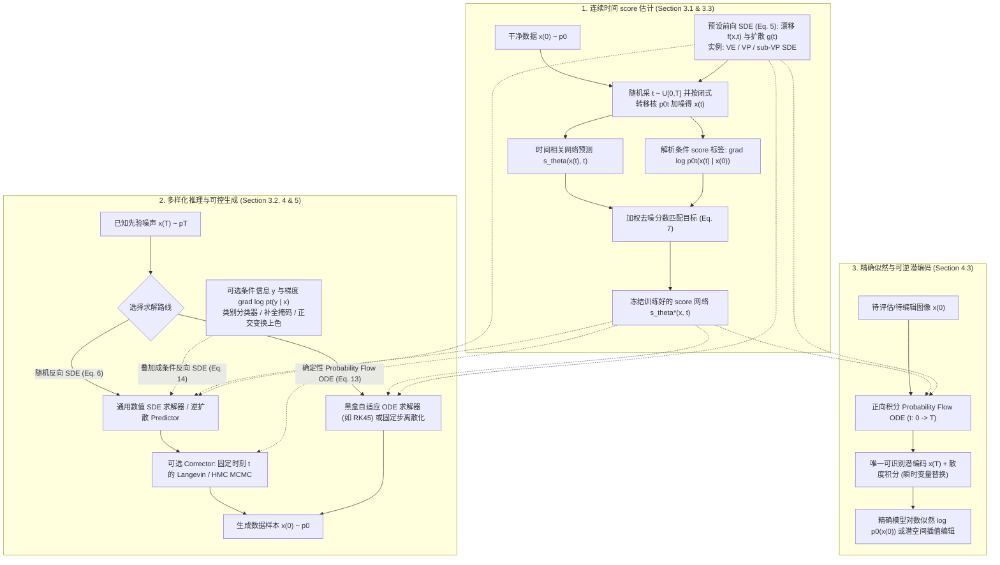

# Score-Based Generative Modeling through Stochastic Differential Equations

# First Time

## 1.Title & Authors
论文原标题：Score-Based Generative Modeling through Stochastic Differential Equations。
自然中文译法：通过随机微分方程实现基于分数的生成建模。
拆开标题里的三个关键词，整篇论文的骨架一目了然：
- Generative Modeling（生成建模）：从已有数据样本（比如成千上万张自然照片）中学会背后的概率分布规律，然后凭空画出服从同一规律的全新样本。
- Score-Based（基于分数）：这里说的“分数（score）”不是打分，而是概率密度的对数梯度 $\nabla_{\mathbf{x}}\log p_t(\mathbf{x})$。它是一个与数据同维的方向向量：站在高维空间的任意位置 $\mathbf{x}$，它像一根指南针，笔直指向“让当前加噪分布概率密度增长最快”的方向。相比直接估计带未知归一化常数的密度 $p_t(\mathbf{x})$，对数梯度把难以计算的归一化常数在求导瞬间直接消掉了，学起来干净得多。
- Stochastic Differential Equations（随机微分方程，简称 SDE）：描述一个状态如何在连续时间里一边受确定性推力（漂移）牵引、一边受随机噪声（扩散）扰动而平滑演化。本文用一条前向 SDE 把复杂数据慢慢化为简单噪声，再用对应的反向时间 SDE 把噪声一步步雕塑回逼真数据。
- 标题的核心主张：把离散噪声尺度的扩散与分数生成方法统一提升到连续时间 SDE 框架之下，既把此前两股独立路线（SMLD 与 DDPM）归为同一枚硬币的两面，又顺理成章地催生出 Predictor-Corrector 采样、等价的确定性 Probability Flow ODE（支持精确似然与可逆编码）以及免重训的可控生成与逆问题求解。
作者按原文顺序列出：Yang Song（Stanford University）、Jascha Sohl-Dickstein（Google Brain）、Diederik P. Kingma（Google Brain）、Abhishek Kumar（Google Brain）、Stefano Ermon（Stanford University）、Ben Poole（Google Brain）。原文首页脚注说明 Yang Song 的部分研究工作完成于 Google Brain 实习期间。这条作者阵容几乎汇集了现代扩散生成模型的几大奠基脉络：Yang Song 与 Stefano Ermon 于 2019–2020 年开创了基于 score 的生成模型（NCSN/SMLD）及 Sliced Score Matching；Jascha Sohl-Dickstein 是 2015 年扩散概率模型（热力学非平衡扩散）的奠基人及 RealNVP 共同作者；Diederik P. Kingma 是变分自编码器（VAE）与可逆流模型 Glow 的核心作者。这篇 ICLR 2021 杰出论文（Outstanding Paper Award）正是把“基于分数”与“扩散概率模型”两条路线彻底合流的历史性工作。

## 2.Abstract
摘要共九句话，节奏极有层次，从一句高度凝练的直觉开场，顺着“正反向 SDE 机制 → score 的唯一角色 → 统一前人 → 三大新能力 → 实验纪录”一路展开。下面按语义单元逐句精读。
1. 开篇金句（问题定义）：从数据制造噪声容易，从噪声制造数据才是生成建模。
   给一张清晰照片不断撒高斯雪花噪点，闭着眼睛也能把图搅成一团白噪声；但要从一团杂乱无章的白噪声里凭空生出一张光影逼真、结构合理的清晰照片，就必须吃透真实数据的概率分布。只要把“怎么破坏数据”写进精确的数学方程，就能去研究“怎么把破坏过程倒着演回来”。
2. 提出正反向 SDE 框架：提出一条前向 SDE，通过缓慢注入噪声，把复杂数据分布平滑变换成已知先验分布；同时给出对应的反向时间 SDE，通过缓慢剥离噪声，把先验分布重新变回数据分布。
   前向过程就像把一滴结构精致的墨水缓缓扩散成一杯均匀淡墨（例如标准高斯分布），全程由人预先设定，不含任何可训练参数；反向过程则负责把时间倒转，从已知先验采样起步，一路雕刻回数据分布。
3. 点破核心杠杆（score 的决定性作用）：最关键的是，只要前向 SDE 给定，反向时间 SDE 唯一需要从数据里学习的未知量，就是各时刻扰动数据分布的对数密度梯度（即 score）。
   直接拟合高维复杂密度 $p_t(\mathbf{x})$ 几乎寸步难行，但反向 SDE 压根不需要知道密度本身有多高，只需要知道在每个噪声时刻 $t$、每个位置 $\mathbf{x}$ 往哪儿走密度升得最快——也就是时间相关向量场 $\nabla_{\mathbf{x}}\log p_t(\mathbf{x})$。
4. 训练与采样的分工：借助分数生成建模的进展，我们可以用神经网络准确估计这些随时间变化的 score，再调用数值 SDE 求解器把样本一步步算出来。
   整套流程自然劈成清晰的两段：训练阶段只管教网络 $\mathbf{s}_{\boldsymbol{\theta}}(\mathbf{x},t)$ 认准每个时刻的导航方向；推理阶段把学好的方向场塞进反向 SDE，交给数值积分器沿时间倒推即可。
5. 统一既往两大流派：这套连续时间框架把此前的分数生成模型（SMLD）和扩散概率模型（DDPM）全部收编进来，并打开了全新采样算法和建模能力的设计空间。
   原本看似各讲各话的 SMLD（退火 Langevin 动力学）和 DDPM（变分马尔可夫反向链），在连续时间视角下其实只是两条不同前向 SDE 的离散切片。统一之后，前向过程、训练目标、网络结构和采样器可以自由拆解组合。
6. 创新能力一——Predictor-Corrector（PC）采样器：引入预测-校正框架，用来修正离散求解反向时间 SDE 时积累的分布误差。
   一般数值 SDE 求解器一步步离散推进时，每步都会偏离真实边缘分布 $p_t(\mathbf{x})$ 一点点。但我们手里握着当前时刻的 score，所以每走完一步数值预测（Predictor），就能立刻停在当前时刻做几步基于 score 的 MCMC（Corrector，如 Langevin 动力学），把跑偏的样本拉回正轨。
7. 创新能力二——等价的确定性神经 ODE（Probability Flow ODE）：导出一条与反向 SDE 拥有完全相同各时刻边缘分布的确定性常微分方程（神经 ODE），顺手解锁了精确似然计算与更高效的自适应采样。
   把反向 SDE 里的随机噪声项拿掉，同时把 score 前面的系数精准折半，就得到一条完全确定、可逆的平滑轨迹。虽然单条轨迹不再抖动，但大量粒子在任意时刻 $t$ 的整体分布密度与 SDE 一模一样！借用神经 ODE 的瞬时变量替换公式，可以直接算出数据点的精确模型似然（摆脱 ELBO 下界），还能用黑盒自适应步长求解器加速采样，并获得可逆潜编码。
8. 创新能力三——可控生成与逆问题求解：提供一套用分数模型求解逆问题的新范式，并在类别条件生成、图像修复（inpainting）和黑白上色（colorization）上做了展示。
   利用贝叶斯分解，条件 score 等于“无条件数据 score + 条件似然梯度”。这意味着只要训好一个无条件 score 大模型，推理时叠加上分类器梯度或观测约束，无需重训生成模型就能直接做多种条件生成与逆问题恢复。
9. 架构升级与标志性成果：结合多项网络架构改进，在 CIFAR-10 无条件图像生成上创下 Inception Score 9.89、FID 2.20 的新纪录，在均匀去量化 CIFAR-10 上取得 2.99 bits/dim 的强竞争似然，并首次用分数生成模型生成了 $1024\times 1024$ 高保真图像。
   结合正文 [Table2 精读](#table2) 与 [Table3 精读](#table3) 核对口径：FID 2.20 / IS 9.89 与 2.99 bits/dim 分别来自两种不同 SDE 与评估设置——前者来自 VE SDE 的加深连续模型 NCSN++ cont.（deep, VE）配 PC 采样与最佳 FID 检查点；后者来自 sub-VP SDE 的加深连续模型 DDPM++ cont.（deep, sub-VP）配黑盒 ODE 采样与末轮检查点；$1024\times 1024$ 高分辨率样本展示于 CelebA-HQ（正文第 4.4 节与附录 H.3）。
把摘要提炼为四个核心要素：

| 要素 | 本文核心内容 |
|---|---|
| 问题 | 现有的 SMLD 与 DDPM 局限于有限离散噪声步，理论割裂，且在采样精度、精确似然评估、潜空间操控和无重训可控生成上能力受限。 |
| 方法 | 以连续时间前向/反向 SDE 统一扩散与分数生成，用时间相关神经网络估计 score，并发展出 VE/VP/sub-VP SDE、PC 采样器、等价 Probability Flow ODE 与贝叶斯条件反向 SDE。 |
| 结果 | 在 CIFAR-10 上无条件生成达 FID 2.20、IS 9.89（NCSN++ cont. deep VE），均匀去量化负对数似然达 2.99 bits/dim（DDPM++ cont. deep sub-VP），首次实现 $1024\times 1024$ CelebA-HQ 高保真生成，并验证了条件生成、修补与上色。 |
| 意义 | 奠定了现代连续时间扩散生成模型的统一理论与工程底座，将前向扰动、训练目标、网络架构与采样求解彻底解耦，直接打通了扩散模型与神经 ODE 的桥梁。 |

## 3.Conclusion
原文第 6 节为独立的 Conclusion，共两段：第一段收拢全篇贡献与解锁的新能力，第二段坦率指出当下尚未攻克的两大工程痛点及后续方向。
1. 第一段——统一框架与六大能力总账：
   作者总结了基于 SDE 的分数生成建模框架，指出它既深化了对既有方法（SMLD 与 DDPM）的理解，又直接带来六项实用能力：全新采样算法（逆扩散求解与 PC 采样）、精确似然计算、可唯一确定的编码（uniquely identifiable encoding）、潜变量编辑操控，以及面向逆问题的条件生成。其中“可唯一确定的编码”与摘要相比是结论中格外凸显的亮点——因为前向 SDE 不含可训练参数，在充分数据、容量与优化下，任意网络学到的 score 场都趋近同一真实场，从而经由 Probability Flow ODE 给每张输入图像赋予唯一的潜编码。
2. 第二段——作者明确指出的两大限制与未来研究方向：
   - 采样速度仍慢于 GAN：尽管 PC 采样和自适应黑盒 ODE 显著提升了质量与效率，在相同数据集上仍需要数十到上千次网络前向评估，推理速度依然落后于单步前向的 GAN。作者指出，如何将分数模型“训练极其稳定”的优势与 GAN 等隐式模型“极速单步采样”的优势结合，是极具价值的研究方向。
   - 采样器丰富带来的超参数调优负担：手握 score 之后可选的求解器、步数、步长、预测器与校正器配比大幅增多，引入了大量超参数（如校正步数 $M$、信噪比 $r$、时间截断 $\epsilon$ 等）。自动选择与调优采样超参数，以及更系统地摸清各类采样器的优劣边界，是接下来需要补齐的工作。

## 4.Analogy
可以把整篇论文想象成“用物理振动把精美的沙画彻底摇散，再凭着逐帧记录的‘沙粒坡度罗盘’从均匀散沙里重新雕塑出全新沙画”。
- 前向 SDE（从数据到噪声）：把无数幅精美沙画（真实数据分布 $p_0$）放进一台沙盘。随着时间 $t$ 从 $0$ 走到 $T$，沙盘一边按固定坡度轻轻倾斜（确定性漂移 $\mathbf{f}(\mathbf{x},t)\mathrm{d}t$），一边持续高频随机震动（布朗扩散 $g(t)\mathrm{d}\mathbf{w}$）。慢慢地，沙画的精致轮廓被震碎，最终无论原本画的是小狗、汽车还是人脸，全都变成一盘平平无奇、毫无结构的均匀散沙（简单先验 $p_T$）。
- 时间相关 score（$\nabla_{\mathbf{x}}\log p_t(\mathbf{x})$）：神经网络在训练时反复观摩各种“震了一半的沙盘”，学会在任意时刻 $t$、任意散沙排布下指出一个精确方向——“往哪个方向推沙子，画面最像这一刻本该出现的半成品沙画？”这个方向场就是 score。
- 反向 SDE 与 PC 采样器：生成新沙画时，你从一盘全新的随机散沙起步，把时钟从 $T$ 倒拨回 $0$。反向 SDE 告诉你：逆着原来的倾斜方向推，再顺着两倍强度的罗盘方向拉聚沙粒，同时保留适度的随机震动，就能在随机探索中聚出千姿百态的新沙画。而 Predictor-Corrector 采样器更讲究：每往回拨一小格时间（Predictor），就先把时间定住，沿着当前时刻的罗盘微调震动几下（Corrector），把刚才跳步偏掉的沙粒理顺到完美状态，再走下一步。
- Probability Flow ODE：如果把随机震动彻底关掉，同时把罗盘拉力精准减半，每粒沙子就会沿着一条丝滑、唯一、绝不相交的轨道，从散沙平稳流回沙画。正因为轨道完全确定且可逆，你既能反向精确算出“某幅给定沙画对应多少散沙体积”（精确似然），又能把两幅沙画倒推成两份散沙编码、在中间混一混再顺流画出一幅自然过渡的融合沙画（潜空间插值）。
- 这个类比的适用边界：真实图像生活在数千到数百万维的像素空间，沙盘里的“坡度”本质上是高维概率密度的对数梯度；此外，反向生成追求的是从整个数据分布里采样出合情合理的新作品，而不是把某一盘散沙机械倒放回某张死记硬背的训练原图。

# Second Time

## 1.Notation & Parameters
正文公式从头到尾围绕“离散前身（SMLD/DDPM）→ 连续正反向 SDE → score 训练 → VE/VP/sub-VP 实例 → 概率流 ODE 与条件生成”五环展开。下表整理了打通全文主线的核心符号，严格保留论文原始的粗体向量与上下标记号。

| 符号/参数 | 含义与作用 | 关键设定/约束 |
|---|---|---|
| $\mathbf{x}$、$\tilde{\mathbf{x}}$ | 原始数据/过程状态向量、由干净数据加噪得到的样本 | $\mathbf{x},\tilde{\mathbf{x}}\in\mathbb{R}^d$（如展平后的图像像素向量） |
| $t$、$s$、$T$ | 连续时间变量、较早时刻、扩散终止时刻 | $0\le s<t\le T$；VE/VP/sub-VP 实例通常归一取 $T=1$ |
| $\mathbf{x}(t)$、$\mathbf{x}_i$ | 连续时刻 $t$ 的过程状态、离散第 $i$ 噪声等级状态 | $\mathbf{x}(0)\sim p_0$ 为数据分布，$\mathbf{x}(T)\sim p_T$ 为简单先验 |
| $p_{\mathrm{data}}(\mathbf{x})$、$p_0(\mathbf{x})$、$p_t(\mathbf{x})$、$p_T(\mathbf{x})$ | 真实数据分布、初始分布、时刻 $t$ 边缘密度、终点先验分布 | $p_0=p_{\mathrm{data}}$；$p_T$ 设计为不含 $p_0$ 信息且易采样的先验（如高斯） |
| $p_{st}(\mathbf{x}(t)\mid\mathbf{x}(s))$、$p_{0t}(\mathbf{x}(t)\mid\mathbf{x}(0))$ | 从 $s$ 到 $t$ 的 SDE 转移核、从干净数据到 $t$ 的扰动核 | 当 $\mathbf{f}(\cdot,t)$ 仿射时，$p_{0t}$ 为可闭式求解的高斯分布 |
| $\mathbf{f}(\mathbf{x},t)$、$g(t)$ | 前向 SDE 的漂移系数（drift）与扩散系数（diffusion） | 正文设 $\mathbf{f}(\cdot,t):\mathbb{R}^d\to\mathbb{R}^d$，$g:\mathbb{R}\to\mathbb{R}$；附录 A 推广至矩阵 $\mathbf{G}(\mathbf{x},t)$ |
| $\mathbf{w}$、$\bar{\mathbf{w}}$ | 前向与反向时间中的 $d$ 维标准 Wiener 过程（布朗运动） | 反向方程中时间从 $T$ 流向 $0$，配合无穷小负步长 $\mathrm{d}t$ |
| $\nabla_{\mathbf{x}}\log p_t(\mathbf{x})$ | 时刻 $t$ 扰动数据边缘分布的真实 score 函数 | 对状态 $\mathbf{x}$ 求梯度；是反向 SDE 与概率流 ODE 唯一的未知数据项 |
| $\mathbf{s}_{\boldsymbol{\theta}}(\mathbf{x},t)$、$\mathbf{s}_{\boldsymbol{\theta}^*}(\mathbf{x},t)$ | 参数为 $\boldsymbol{\theta}$ 的时间相关 score 网络及其理论最优解 | 离散背景下写作 $\mathbf{s}_{\boldsymbol{\theta}}(\mathbf{x},\sigma)$（SMLD）或 $\mathbf{s}_{\boldsymbol{\theta}}(\mathbf{x},i)$（DDPM） |
| $\lambda(t)$ | 连续时间去噪 score matching 损失的正权重函数 | $\lambda:[0,T]\to\mathbb{R}_{>0}$；常按条件 score 平方范数期望的倒数选取 |
| $\sigma_i$、$\sigma_{\min}$、$\sigma_{\max}$、$\sigma(t)$ | SMLD 离散噪声尺度序列与 VE SDE 连续标准差函数 | 约定 $\sigma_0=0$，$\sigma_{\min}=\sigma_1<\cdots<\sigma_N=\sigma_{\max}$；实验常设 $\sigma_{\min}=0.01$ |
| $\beta_i$、$\alpha_i$、$\beta(t)$ | DDPM 单步噪声系数、累计信号保留系数、VP/sub-VP 连续速率 | $0<\beta_i<1$；$\alpha_i:=\prod_{j=1}^i(1-\beta_j)$；连续化满足 $\bar{\beta}_i=N\beta_i\to\beta(t)$ |
| $N$、$M$ | 离散噪声等级/时间步总数、单噪声等级内的校正步数 | 主实验离散训练用 $N=1000$；PC1000 为每步预测配 $M=1$ 步校正 |
| $\epsilon_i$、$\mathbf{z}_i$、$\mathbf{z}_i^m$ | Langevin MCMC 步长与各步独立标准高斯随机向量 | $\epsilon_i>0$；$\mathbf{z}_i,\mathbf{z}_i^m\sim\mathcal{N}(\mathbf{0},\mathbf{I})$ |
| $p_{\sigma}(\tilde{\mathbf{x}}\mid\mathbf{x})$、$p_{\alpha_i}(\mathbf{x}_i\mid\mathbf{x}_0)$ | SMLD 与 DDPM 的离散高斯扰动核 | 分别为 $\mathcal{N}(\tilde{\mathbf{x}};\mathbf{x},\sigma^2\mathbf{I})$ 与 $\mathcal{N}(\mathbf{x}_i;\sqrt{\alpha_i}\mathbf{x}_0,(1-\alpha_i)\mathbf{I})$ |
| $p_{\boldsymbol{\theta}}(\mathbf{x}_{i-1}\mid\mathbf{x}_i)$ | DDPM 参数化的反向单步变分高斯转移核 | 均值 $\frac{1}{\sqrt{1-\beta_i}}(\mathbf{x}_i+\beta_i\mathbf{s}_{\boldsymbol{\theta}}(\mathbf{x}_i,i))$，协方差 $\beta_i\mathbf{I}$ |
| $\mathbf{y}$、$p_t(\mathbf{y}\mid\mathbf{x}(t))$、$\Omega(\mathbf{y})$ | 条件信息（类别或观测）、噪声时刻条件似然/分类器、补全已知维度 | 第 5 节可控生成核心量；经 $\nabla_{\mathbf{x}}\log p_t(\mathbf{y}\mid\mathbf{x})$ 引导无条件反向 SDE |

两个阅读前务必留心的符号习惯：第一，本文在 DDPM 中直接定义 $\alpha_i:=\prod_{j=1}^i(1-\beta_j)$ 为累计乘积（对应 Ho et al. 2020 原文里的 $\bar{\alpha}_i$），不再单独区分单步与累计符号；第二，正文式（2）的 $\epsilon_i$ 是 Langevin 步长，而附录 C/D 中的无下标 $\epsilon$（如 $10^{-5}$ 或 $10^{-3}$）是避开 $t=0$ 数值奇异点的最小截断时间，附录 D.2 的粗体 $\boldsymbol{\epsilon}$ 则是 Hutchinson 迹估计探针向量，随语境清晰区分即可。

## 2.Introduction
对应原文 Section 1。引言开门见山，把当时生成模型界两条如日中天但各自为战的技术路线摆到同一张桌子上：
1. 两条看似迥异的成功路线：
   - SMLD（Score Matching with Langevin Dynamics，Song & Ermon 2019）：给训练数据施加由小到大的一串离散噪声尺度，教网络在每个噪声尺度上估计 score（对数概率密度对数据的梯度），生成时再从最大噪声开始，按噪声递减顺序逐级跑退火 Langevin 动力学把样本抽出来。
   - DDPM（Denoising Diffusion Probabilistic Models，Sohl-Dickstein et al. 2015；Ho et al. 2020）：构造一条逐步加噪的离散马尔可夫链，利用已知的后验函数形式训练一系列反向概率转移模型，一步步把噪声倒推回数据。
2. 一语点破共同内核：在连续状态空间里，DDPM 的简化训练目标其实也在隐式估计各个噪声尺度下的 score！因此作者把 SMLD 和 DDPM 统称为基于分数的生成模型（score-based generative models），并指出它们都已经在图像、音频、图结构、3D 形状等领域展现出强大威力。
3. 从“有限离散梯子”跃升为“连续时间河流”：
   既然成功的关键在于用多尺度噪声扰动数据，为何不直接把噪声尺度推广到连续时间上的无穷多个？作者用一条预先规定、不含数据依赖也没有可训练参数的随机微分方程（SDE）描述数据如何平滑扩散成噪声；再引用 Anderson（1982）的经典时间反演定理——任何扩散过程的逆过程依然是一条反向时间 SDE，而且其漂移项只依赖各时刻边缘分布的 score $\nabla_{\mathbf{x}}\log p_t(\mathbf{x})$！于是只要训练一个时间相关神经网络估计 score，再拿数值 SDE 求解器积分反向方程，就完成了整套生成建模（直观全貌见 [Fig1 精读](#fig1) 与 [Fig2 精读](#fig2)）。
4. 统一框架带来的三大理论与实用贡献：
   - 灵活采样与精确似然：既可以接入任意通用数值 SDE 求解器，又发展出两种通用 SDE 无法享受的专用方法——一是把数值 SDE 预测器与基于 score 的 MCMC 校正器结合的 Predictor-Corrector（PC）采样器，二是与 SDE 共享完全相同边缘分布的确定性 Probability Flow ODE（支持自适应快速采样、潜码编辑、唯一可识别编码与精确似然计算）。
   - 免重训的可控生成：只用单个无条件 score 模型，在推理期接入条件梯度，就能直接求解类别条件生成、图像修补、上色乃至更一般的逆问题。
   - 统一探索平台与 SOTA 突破：把 SMLD 和 DDPM 收编为两条不同 SDE 的离散化，不仅帮助此前采样质量落后于 DDPM 的 SMLD 路线彻底反超（CIFAR-10 无条件 IS 9.89、FID 2.20，并首次实现分数模型 $1024\times 1024$ 高清生成），还顺手催生了全新的 sub-VP SDE，在均匀去量化 CIFAR-10 上创下 2.99 bits/dim 的似然新纪录。

## 3.Background
对应原文 Section 2。这一章的作用很明确：在迈入连续时间 SDE 之前，先把 SMLD 和 DDPM 写成完全对称的数学格式，让读者亲眼看见“两者表面上像两条路，拆开损失函数却长得几乎一模一样”。
读这一章时，脑子里始终把三个分布分清楚：
- 真实数据分布 $p_{\mathrm{data}}(\mathbf{x})$：我们只有样本（数据集），写不出密度公式；
- 条件扰动核 $p_{\sigma}(\tilde{\mathbf{x}}\mid\mathbf{x})$ 或 $p_{\alpha_i}(\mathbf{x}_i\mid\mathbf{x}_0)$：这是我们亲手设计的加噪规则（简单的高斯分布），均值、方差和对数梯度全都能一口气算出来；
- 扰动边缘分布 $p_{\sigma}(\tilde{\mathbf{x}})$ 或 $p_{\alpha_i}(\tilde{\mathbf{x}})$：所有真实数据点的“高斯噪声云”叠加混合后的总体分布，同样写不出闭式密度，但生成阶段真正需要的导航指南针恰恰是它的梯度 $\nabla_{\mathbf{x}}\log p_{\sigma}(\mathbf{x})$！
去噪分数匹配（Denoising Score Matching）最神奇的地方就在这里：它让我们只用好算的条件核梯度当监督标签，训练收敛后网络输出的最优解却自动等于难算的边缘分布梯度。

## 4.Denoising Score Matching with Langevin Dynamics (SMLD)
对应原文 Section 2.1。SMLD 的做法直截了当：直接往干净数据上加各向同性高斯噪声，按噪声从小到大排成一串尺度，训练一个噪声条件分数网络（NCSN），推理时从大噪声往小噪声逐级“退火”采样。
1. 扰动核与边缘分布（无编号定义）：
   定义高斯扰动核 $p_{\sigma}(\tilde{\mathbf{x}}\mid\mathbf{x}):=\mathcal{N}(\tilde{\mathbf{x}};\mathbf{x},\sigma^2\mathbf{I})$（等价于采 $\mathbf{z}\sim\mathcal{N}(\mathbf{0},\mathbf{I})$ 后构造 $\tilde{\mathbf{x}}=\mathbf{x}+\sigma\mathbf{z}$），将所有干净数据混合得到加噪边缘分布：
$$
p_{\sigma}(\tilde{\mathbf{x}}):=\int p_{\mathrm{data}}(\mathbf{x})p_{\sigma}(\tilde{\mathbf{x}}\mid\mathbf{x})\,\mathrm{d}\mathbf{x}.
$$
   取递增的正噪声尺度序列 $\sigma_{\min}=\sigma_1<\sigma_2<\cdots<\sigma_N=\sigma_{\max}$：$\sigma_{\min}$ 足够小使得 $p_{\sigma_{\min}}(\mathbf{x})\approx p_{\mathrm{data}}(\mathbf{x})$，保留数据细节；$\sigma_{\max}$ 足够大使得 $p_{\sigma_{\max}}(\mathbf{x})\approx\mathcal{N}(\mathbf{x};\mathbf{0},\sigma_{\max}^2\mathbf{I})$，抹掉原始数据结构变成易采样的先验。
2. 训练目标——公式（1）：
   训练噪声条件分数网络 $\mathbf{s}_{\boldsymbol{\theta}}(\mathbf{x},\sigma)$ 最小化加权去噪分数匹配（DSM）目标：
$$
\boldsymbol{\theta}^*=\arg\min_{\boldsymbol{\theta}}\sum_{i=1}^{N}\sigma_i^2\,\mathbb{E}_{p_{\mathrm{data}}(\mathbf{x})}\mathbb{E}_{p_{\sigma_i}(\tilde{\mathbf{x}}\mid\mathbf{x})}\!\left[\bigl\|\mathbf{s}_{\boldsymbol{\theta}}(\tilde{\mathbf{x}},\sigma_i)-\nabla_{\tilde{\mathbf{x}}}\log p_{\sigma_i}(\tilde{\mathbf{x}}\mid\mathbf{x})\bigr\|_2^2\right].
\tag{1}
$$
   逐行把式（1）背后的三个数学问题推透：
   - 第一步，监督标签为什么好算？写出高斯核对数密度 $\log p_{\sigma_i}(\tilde{\mathbf{x}}\mid\mathbf{x})=-\frac{\|\tilde{\mathbf{x}}-\mathbf{x}\|_2^2}{2\sigma_i^2}-\frac{d}{2}\log(2\pi\sigma_i^2)$，对 $\tilde{\mathbf{x}}$ 求梯度，常数项消去，立得：
$$
\nabla_{\tilde{\mathbf{x}}}\log p_{\sigma_i}(\tilde{\mathbf{x}}\mid\mathbf{x})=-\frac{\tilde{\mathbf{x}}-\mathbf{x}}{\sigma_i^2}=-\frac{\mathbf{z}}{\sigma_i}.
$$
     物理直觉非常生动：把干净点 $\mathbf{x}$ 往外推了噪声 $\sigma_i\mathbf{z}$ 到达 $\tilde{\mathbf{x}}$，那么条件 score 就像一条绷紧的橡皮筋，笔直指回原来的干净点 $\mathbf{x}$！
   - 第二步，为什么对着“单点橡皮筋”做回归，学出来的却是指向“全局高密度区”的边缘 score？
     因为均方误差在给定输入 $\tilde{\mathbf{x}}$ 时的最优预测就是监督目标的条件期望！直接计算 $\nabla_{\tilde{\mathbf{x}}}\log p_{\sigma_i}(\tilde{\mathbf{x}}\mid\mathbf{x})$ 在给定 $\tilde{\mathbf{x}}$ 下的后验期望（利用贝叶斯公式 $p_{\sigma_i}(\mathbf{x}\mid\tilde{\mathbf{x}})=p_{\mathrm{data}}(\mathbf{x})p_{\sigma_i}(\tilde{\mathbf{x}}\mid\mathbf{x})/p_{\sigma_i}(\tilde{\mathbf{x}})$ 与对数求导公式 $\nabla_{\tilde{\mathbf{x}}}\log p_{\sigma_i}(\tilde{\mathbf{x}}\mid\mathbf{x})=\frac{\nabla_{\tilde{\mathbf{x}}}p_{\sigma_i}(\tilde{\mathbf{x}}\mid\mathbf{x})}{p_{\sigma_i}(\tilde{\mathbf{x}}\mid\mathbf{x})}$）：
$$
\begin{aligned}
\mathbb{E}_{p_{\sigma_i}(\mathbf{x}\mid\tilde{\mathbf{x}})}\!\left[\nabla_{\tilde{\mathbf{x}}}\log p_{\sigma_i}(\tilde{\mathbf{x}}\mid\mathbf{x})\right]
&=\int\frac{p_{\mathrm{data}}(\mathbf{x})p_{\sigma_i}(\tilde{\mathbf{x}}\mid\mathbf{x})}{p_{\sigma_i}(\tilde{\mathbf{x}})}\cdot\frac{\nabla_{\tilde{\mathbf{x}}}p_{\sigma_i}(\tilde{\mathbf{x}}\mid\mathbf{x})}{p_{\sigma_i}(\tilde{\mathbf{x}}\mid\mathbf{x})}\,\mathrm{d}\mathbf{x}\\
&=\frac{\nabla_{\tilde{\mathbf{x}}}\int p_{\mathrm{data}}(\mathbf{x})p_{\sigma_i}(\tilde{\mathbf{x}}\mid\mathbf{x})\,\mathrm{d}\mathbf{x}}{p_{\sigma_i}(\tilde{\mathbf{x}})}
=\frac{\nabla_{\tilde{\mathbf{x}}}p_{\sigma_i}(\tilde{\mathbf{x}})}{p_{\sigma_i}(\tilde{\mathbf{x}})}
=\nabla_{\tilde{\mathbf{x}}}\log p_{\sigma_i}(\tilde{\mathbf{x}}).
\end{aligned}
$$
     再把式（1）的平方范数里加上并减去 $\nabla_{\tilde{\mathbf{x}}}\log p_{\sigma_i}(\tilde{\mathbf{x}})$ 展开，交叉项在固定 $\tilde{\mathbf{x}}$ 取条件期望后恰好等于零，只留下 $\mathbb{E}_{p_{\sigma_i}(\tilde{\mathbf{x}})}[\|\mathbf{s}_{\boldsymbol{\theta}}(\tilde{\mathbf{x}},\sigma_i)-\nabla_{\tilde{\mathbf{x}}}\log p_{\sigma_i}(\tilde{\mathbf{x}})\|_2^2]$ 再加一个与 $\boldsymbol{\theta}$ 无关的方差常数。因此在充分数据与网络容量下，最优网络 $\mathbf{s}_{\boldsymbol{\theta}^*}(\mathbf{x},\sigma)$ 在 $\sigma\in\{\sigma_i\}_{i=1}^N$ 上几乎处处精确等于 $\nabla_{\mathbf{x}}\log p_{\sigma}(\mathbf{x})$！
   - 第三步，为什么前面要乘权重 $\sigma_i^2$？
     因为条件标签是 $-\mathbf{z}/\sigma_i$，其期望平方范数为 $\mathbb{E}[\|\nabla_{\tilde{\mathbf{x}}}\log p_{\sigma_i}(\tilde{\mathbf{x}}\mid\mathbf{x})\|_2^2]=\mathbb{E}[\|\mathbf{z}\|_2^2]/\sigma_i^2=d/\sigma_i^2$。当 $\sigma_i$ 跨越几个数量级时，小噪声级的标签范数极大、大噪声级极小。乘上 $\sigma_i^2\propto 1/\mathbb{E}[\|\nabla_{\tilde{\mathbf{x}}}\log p_{\sigma_i}(\tilde{\mathbf{x}}\mid\mathbf{x})\|_2^2]$ 后，每个噪声尺度的目标量级被拉平到同一尺度（约为常数 $d$），训练梯度更均衡。
3. 退火 Langevin 采样——公式（2）：
   学好最优网络 $\mathbf{s}_{\boldsymbol{\theta}^*}(\mathbf{x},\sigma)$ 后，SMLD 从最大噪声先验 $\mathbf{x}_N^0\sim\mathcal{N}(\mathbf{x}\mid\mathbf{0},\sigma_{\max}^2\mathbf{I})$ 起步，按 $i=N,N-1,\cdots,1$ 依次降低噪声等级；每个等级内从上一级的终点接力（当 $i<N$ 时 $\mathbf{x}_i^0=\mathbf{x}_{i+1}^M$），执行 $M$ 步 Langevin MCMC：
$$
\mathbf{x}_i^m=\mathbf{x}_i^{m-1}+\epsilon_i\mathbf{s}_{\boldsymbol{\theta}^*}(\mathbf{x}_i^{m-1},\sigma_i)+\sqrt{2\epsilon_i}\mathbf{z}_i^m,
\qquad m=1,2,\cdots,M,
\tag{2}
$$
   其中 $\epsilon_i>0$ 是步长，$\mathbf{z}_i^m\sim\mathcal{N}(\mathbf{0},\mathbf{I})$。
   为什么随机噪声前的系数恰好是 $\sqrt{2\epsilon_i}$ 而不是别的数？把式（2）看成连续时间 Langevin 扩散 $\mathrm{d}\mathbf{x}=\nabla_{\mathbf{x}}\log p_{\sigma_i}(\mathbf{x})\,\mathrm{d}t+\sqrt{2}\,\mathrm{d}\mathbf{w}$ 按步长 $\epsilon_i$ 做 Euler–Maruyama 离散化。由 Fokker–Planck 方程，该连续过程密度的演化速率为 $-\nabla_{\mathbf{x}}\cdot[p_t(\mathbf{x})\nabla_{\mathbf{x}}\log p_{\sigma_i}(\mathbf{x})]+\frac{1}{2}(\sqrt{2})^2\nabla_{\mathbf{x}}\cdot\nabla_{\mathbf{x}}p_t(\mathbf{x})$。当密度恰好到达目标 $p_t(\mathbf{x})=p_{\sigma_i}(\mathbf{x})$ 时，第一项中 $p_{\sigma_i}(\mathbf{x})\nabla_{\mathbf{x}}\log p_{\sigma_i}(\mathbf{x})=\nabla_{\mathbf{x}}p_{\sigma_i}(\mathbf{x})$，与第二项 $+\nabla_{\mathbf{x}}\cdot\nabla_{\mathbf{x}}p_{\sigma_i}(\mathbf{x})$ 正负严丝合缝抵消为零！因此 $p_{\sigma_i}(\mathbf{x})$ 正是平稳分布：在正则条件下当 $M\to\infty$ 且 $\epsilon_i\to 0$ 时，$\mathbf{x}_1^M$ 收敛为 $p_{\sigma_{\min}}(\mathbf{x})\approx p_{\mathrm{data}}(\mathbf{x})$ 的精确样本。SMLD 采样与 PC 采样的对比实测见 [Table1 精读](#table1)。

## 5.Denoising Diffusion Probabilistic Models (DDPM)
对应原文 Section 2.2。与 SMLD 只管往上累加噪声不同，DDPM 在每一步加噪的同时把原有信号微微缩小一点，使得整个马尔可夫链的方差始终被温和锁住，终点稳稳落到标准高斯 $\mathcal{N}(\mathbf{0},\mathbf{I})$。
1. 单步与多步扰动核（无编号公式）：
   设定一组正噪声尺度 $0<\beta_1,\beta_2,\cdots,\beta_N<1$，对干净数据 $\mathbf{x}_0\sim p_{\mathrm{data}}(\mathbf{x})$ 构造离散马尔可夫链 $\{\mathbf{x}_0,\mathbf{x}_1,\cdots,\mathbf{x}_N\}$，单步转移为：
$$
p(\mathbf{x}_i\mid\mathbf{x}_{i-1})=\mathcal{N}\!\left(\mathbf{x}_i;\sqrt{1-\beta_i}\,\mathbf{x}_{i-1},\beta_i\mathbf{I}\right).
$$
   等价于 $\mathbf{x}_i=\sqrt{1-\beta_i}\,\mathbf{x}_{i-1}+\sqrt{\beta_i}\,\mathbf{z}_{i-1}$（$\mathbf{z}_{i-1}\sim\mathcal{N}(\mathbf{0},\mathbf{I})$）。定义累计乘积 $\alpha_i:=\prod_{j=1}^{i}(1-\beta_j)$，我们来一步步归纳推出多步闭式核 $p_{\alpha_i}(\mathbf{x}_i\mid\mathbf{x}_0)$：
   - $i=1$ 时显然成立：均值 $\sqrt{1-\beta_1}\mathbf{x}_0=\sqrt{\alpha_1}\mathbf{x}_0$，协方差 $\beta_1\mathbf{I}=(1-\alpha_1)\mathbf{I}$。
   - 若第 $i-1$ 步满足 $\mathbf{x}_{i-1}=\sqrt{\alpha_{i-1}}\mathbf{x}_0+\sqrt{1-\alpha_{i-1}}\mathbf{z}$（$\mathbf{z}$ 为独立标准高斯），代入第 $i$ 步更新：
$$
\mathbf{x}_i=\sqrt{1-\beta_i}\left(\sqrt{\alpha_{i-1}}\mathbf{x}_0+\sqrt{1-\alpha_{i-1}}\mathbf{z}\right)+\sqrt{\beta_i}\mathbf{z}_{i-1}.
$$
     信号系数变为 $\sqrt{(1-\beta_i)\alpha_{i-1}}=\sqrt{\alpha_i}$；两个独立高斯噪声项方差直接相加，得到 $(1-\beta_i)(1-\alpha_{i-1})+\beta_i=1-\beta_i-\alpha_i+\beta_i=1-\alpha_i$！于是立刻得到多步一步直达的闭式扰动核：
$$
p_{\alpha_i}(\mathbf{x}_i\mid\mathbf{x}_0)=\mathcal{N}\!\left(\mathbf{x}_i;\sqrt{\alpha_i}\mathbf{x}_0,(1-\alpha_i)\mathbf{I}\right),
$$
   对应的加噪边缘分布为 $p_{\alpha_i}(\tilde{\mathbf{x}}):=\int p_{\mathrm{data}}(\mathbf{x})p_{\alpha_i}(\tilde{\mathbf{x}}\mid\mathbf{x})\,\mathrm{d}\mathbf{x}$。合理设置 $\{\beta_i\}$ 使 $\alpha_N\approx 0$，则终点 $\mathbf{x}_N$ 近似服从标准高斯 $\mathcal{N}(\mathbf{0},\mathbf{I})$。
2. 反向变分马尔可夫链与重加权 ELBO——公式（3）：
   DDPM 将反向单步转移核参数化为高斯分布 $p_{\boldsymbol{\theta}}(\mathbf{x}_{i-1}\mid\mathbf{x}_i)=\mathcal{N}\!\left(\mathbf{x}_{i-1};\frac{1}{\sqrt{1-\beta_i}}(\mathbf{x}_i+\beta_i\mathbf{s}_{\boldsymbol{\theta}}(\mathbf{x}_i,i)),\beta_i\mathbf{I}\right)$，用重加权的证据下界（即 Ho et al. 2020 中的 $L_{\mathrm{simple}}$）训练参数：
$$
\boldsymbol{\theta}^*=\arg\min_{\boldsymbol{\theta}}\sum_{i=1}^{N}(1-\alpha_i)\,\mathbb{E}_{p_{\mathrm{data}}(\mathbf{x})}\mathbb{E}_{p_{\alpha_i}(\tilde{\mathbf{x}}\mid\mathbf{x})}\!\left[\bigl\|\mathbf{s}_{\boldsymbol{\theta}}(\tilde{\mathbf{x}},i)-\nabla_{\tilde{\mathbf{x}}}\log p_{\alpha_i}(\tilde{\mathbf{x}}\mid\mathbf{x})\bigr\|_2^2\right].
\tag{3}
$$
   把式（3）拆开看，立刻与 Ho et al.（2020）的“预测噪声”和 SMLD 的式（1）严丝合缝地对上号：
   - 对 $p_{\alpha_i}(\tilde{\mathbf{x}}\mid\mathbf{x})=\mathcal{N}(\tilde{\mathbf{x}};\sqrt{\alpha_i}\mathbf{x},(1-\alpha_i)\mathbf{I})$（即 $\tilde{\mathbf{x}}=\sqrt{\alpha_i}\mathbf{x}+\sqrt{1-\alpha_i}\mathbf{z}_i$）求对数梯度，得：
$$
\nabla_{\tilde{\mathbf{x}}}\log p_{\alpha_i}(\tilde{\mathbf{x}}\mid\mathbf{x})=-\frac{\tilde{\mathbf{x}}-\sqrt{\alpha_i}\mathbf{x}}{1-\alpha_i}=-\frac{\mathbf{z}_i}{\sqrt{1-\alpha_i}}.
$$
   - 把它代回式（3），并将前面的权重 $(1-\alpha_i)$ 吸进平方范数里：
$$
(1-\alpha_i)\left\|\mathbf{s}_{\boldsymbol{\theta}}(\tilde{\mathbf{x}},i)+\frac{\mathbf{z}_i}{\sqrt{1-\alpha_i}}\right\|_2^2
=\left\|-\sqrt{1-\alpha_i}\,\mathbf{s}_{\boldsymbol{\theta}}(\tilde{\mathbf{x}},i)-\mathbf{z}_i\right\|_2^2.
$$
     这就是 DDPM 著名的简化噪声预测损失 $L_{\mathrm{simple}}$！预测噪声 $-\sqrt{1-\alpha_i}\mathbf{s}_{\boldsymbol{\theta}}(\tilde{\mathbf{x}},i)$ 和预测 score $\mathbf{s}_{\boldsymbol{\theta}}(\tilde{\mathbf{x}},i)$ 之间只差一个已知的时间缩放因子 $-\sqrt{1-\alpha_i}$！
   - 沿用第 4 节完全相同的条件期望推导，式（3）的最优解同样满足 $\mathbf{s}_{\boldsymbol{\theta}^*}(\tilde{\mathbf{x}},i)=\nabla_{\tilde{\mathbf{x}}}\log p_{\alpha_i}(\tilde{\mathbf{x}})$。
   - 再看权重规律：$\mathbb{E}[\|\nabla_{\tilde{\mathbf{x}}}\log p_{\alpha_i}(\tilde{\mathbf{x}}\mid\mathbf{x})\|_2^2]=\mathbb{E}[\|\mathbf{z}_i\|_2^2]/(1-\alpha_i)=d/(1-\alpha_i)$，所以式（3）的权重 $(1-\alpha_i)$ 和式（1）的权重 $\sigma_i^2$ 遵循完全一致的倒数标度律！（核对原文排版时留意一个小笔误：原文 Section 2.2 末尾那两行行内比例式写成了对 $\mathbf{x}$ 求导 $\nabla_{\mathbf{x}}$，实际与式（1）、式（3）保持一致的应是对加噪样本求导 $\nabla_{\tilde{\mathbf{x}}}$——在 SMLD 里两者差负号但范数相等，而在 DDPM 里对 $\mathbf{x}$ 求导会多出一个 $\sqrt{\alpha_i}$ 因子。）
3. 祖先采样（Ancestral Sampling）——公式（4）：
   得到最优模型 $\mathbf{s}_{\boldsymbol{\theta}^*}(\mathbf{x},i)$ 后，从标准高斯 $\mathbf{x}_N\sim\mathcal{N}(\mathbf{0},\mathbf{I})$ 起步，按联合图形模型 $\prod_{i=1}^{N}p_{\boldsymbol{\theta}}(\mathbf{x}_{i-1}\mid\mathbf{x}_i)$（连同终点先验）逐步倒推：
$$
\mathbf{x}_{i-1}=\frac{1}{\sqrt{1-\beta_i}}\bigl(\mathbf{x}_i+\beta_i\mathbf{s}_{\boldsymbol{\theta}^*}(\mathbf{x}_i,i)\bigr)+\sqrt{\beta_i}\mathbf{z}_i,
\qquad i=N,N-1,\cdots,1.
\tag{4}
$$
   为什么反向均值恰好长成 $\frac{1}{\sqrt{1-\beta_i}}(\mathbf{x}_i+\beta_i\mathbf{s}_{\boldsymbol{\theta}^*}(\mathbf{x}_i,i))$？直接对单步前向核 $p(\mathbf{x}_i\mid\mathbf{x}_{i-1})=\mathcal{N}(\mathbf{x}_i;\sqrt{1-\beta_i}\mathbf{x}_{i-1},\beta_i\mathbf{I})$ 套用 Tweedie 恒等式（与第 4 节条件期望恒等式如出一辙）：
$$
\nabla_{\mathbf{x}_i}\log p_{\alpha_i}(\mathbf{x}_i)
=\mathbb{E}_{p(\mathbf{x}_{i-1}\mid\mathbf{x}_i)}\!\left[\nabla_{\mathbf{x}_i}\log p(\mathbf{x}_i\mid\mathbf{x}_{i-1})\right]
=-\frac{\mathbf{x}_i-\sqrt{1-\beta_i}\,\mathbb{E}[\mathbf{x}_{i-1}\mid\mathbf{x}_i]}{\beta_i}.
$$
   把 $\mathbb{E}[\mathbf{x}_{i-1}\mid\mathbf{x}_i]$ 解出来，正好就是 $\frac{1}{\sqrt{1-\beta_i}}(\mathbf{x}_i+\beta_i\nabla_{\mathbf{x}_i}\log p_{\alpha_i}(\mathbf{x}_i))$！而反向噪声方差选为 $\beta_i\mathbf{I}$ 则是 DDPM 的高斯近似参数化。DDPM 祖先采样在 CIFAR-10 上的系统评测见 [Table1 精读](#table1)、[Table2 精读](#table2) 与 [Table3 精读](#table3)。

## 6.Score-Based Generative Modeling with SDEs
对应原文 Section 3。走到这里，全篇最激动人心的转折正式上演：SMLD 和 DDPM 都靠多尺度加噪起家，作者把有限的 $N$ 个离散噪声台阶推向连续极限 $N\to\infty$，让扰动分布顺着连续时间 $t\in[0,T]$ 按一条 SDE 丝滑流淌。
这一跃迁带来的最大红利是彻底的“模块化解体”——前向加噪过程的设计、时间相关 score 网络的训练，以及推理阶段的采样器/似然计算/条件控制，彼此解耦、任意混搭！下面用一张 Mermaid 流程图把整篇论文的统一大蓝图串起来（图中省略网络具体 U-Net 层级、离散时间循环细节及数值求解器容差设置，虚线表示提供已知方程系数或已冻结的训练后 score 网络）：

总体视觉框架对照见 [Fig2 精读](#fig2)。接下来 7 至 10 节把这条核心链路里的每一个方程逐一推通。

## 7.Perturbing Data with SDEs
对应原文 Section 3.1。我们的第一步是搭建一座从复杂数据分布 $p_0$ 通往简单先验分布 $p_T$ 的连续桥梁：构造连续时间随机过程 $\{\mathbf{x}(t)\}_{t=0}^T$，满足起点 $\mathbf{x}(0)\sim p_0$（有独立同分布训练集样本）、终点 $\mathbf{x}(T)\sim p_T$（不含数据信息且极易采样，如固定均值方差的高斯分布）。
1. 前向 Itô SDE——公式（5）：
$$
\mathrm{d}\mathbf{x}=\mathbf{f}(\mathbf{x},t)\,\mathrm{d}t+g(t)\,\mathrm{d}\mathbf{w}.
\tag{5}
$$
   把式（5）的四个要素用直觉读活：
   - $\mathbf{f}(\cdot,t):\mathbb{R}^d\to\mathbb{R}^d$ 叫漂移系数（drift coefficient），代表确定性的推拉趋势（例如把数据慢慢往原点收拢）。
   - $g(\cdot):\mathbb{R}\to\mathbb{R}$ 叫扩散系数（diffusion coefficient），控制注入随机噪声的瞬时强度。正文为表达简洁假设 $g(t)$ 是不依赖状态 $\mathbf{x}$ 的标量；附录 A 完整给出了依赖状态的 $d\times d$ 矩阵扩散系数 $\mathbf{G}(\mathbf{x},t)$ 的一般理论。
   - $\mathbf{w}$ 是 $d$ 维标准 Wiener 过程（即标准布朗运动）。理解 SDE 最关键的一条物理直觉是：在极小时间步 $\Delta t$ 内，漂移位移与 $\Delta t$ 成正比，而布朗运动增量 $\Delta\mathbf{w}\sim\mathcal{N}(\mathbf{0},\Delta t\,\mathbf{I})$ 的典型幅度与 $\sqrt{\Delta t}$ 成正比！把它写成 Euler–Maruyama 离散近似一眼就懂：
$$
\mathbf{x}(t+\Delta t)\approx\mathbf{x}(t)+\mathbf{f}(\mathbf{x}(t),t)\Delta t+g(t)\sqrt{\Delta t}\,\mathbf{z},
\qquad \mathbf{z}\sim\mathcal{N}(\mathbf{0},\mathbf{I}).
$$
     正因为噪声幅度是 $\sqrt{\Delta t}$ 阶，它的方差是 $g(t)^2\Delta t\,\mathbf{I}$（正好是 $\Delta t$ 的一阶量），这才让连续极限下漂移与扩散可以同台竞技、谁也不会把谁淹没。
2. 唯一强解条件与分布记号：
   依据 Øksendal（2003），只要漂移 $\mathbf{f}$ 与扩散 $g$ 在状态和时间上都满足全局 Lipschitz 条件，式（5）就存在唯一强解。文中此后统一用 $p_t(\mathbf{x})$ 记时刻 $t$ 的边缘概率密度，用 $p_{st}(\mathbf{x}(t)\mid\mathbf{x}(s))$ 记从较早时刻 $s$ 到较晚时刻 $t$（$0\le s<t\le T$）的转移核。前向过程全程不含可训练参数，直观演化见 [Fig1 精读](#fig1) 与 [Fig2 精读](#fig2)。

## 8.Generating Samples by Reversing the SDE
对应原文 Section 3.2。前向 SDE 把数据吹散成噪声，现在要把它“时空倒流”——从 $\mathbf{x}(T)\sim p_T$ 出发，倒着跑回 $\mathbf{x}(0)\sim p_0$。
1. 反向时间 SDE——公式（6）：
   Anderson（1982）的著名时间反演定理指出，一个扩散过程在时间倒流时依然是一个扩散过程，满足如下反向时间 SDE：
$$
\mathrm{d}\mathbf{x}=\bigl[\mathbf{f}(\mathbf{x},t)-g(t)^2\nabla_{\mathbf{x}}\log p_t(\mathbf{x})\bigr]\mathrm{d}t+g(t)\,\mathrm{d}\bar{\mathbf{w}},
\tag{6}
$$
   其中 $\bar{\mathbf{w}}$ 是时间从 $T$ 倒流回 $0$ 时的标准 Wiener 过程，$\mathrm{d}t$ 是无穷小负时间步长。
2. 先讲物理直觉，再用三行 Fokker–Planck 恒等式证透式（6）！
   直觉上，千万别以为“把时间倒放”只需要把 $\mathrm{d}t$ 变负号、按原漂移倒推就行！前向过程里的随机扩散会把高密度的墨水不断往低密度空白处推散；现在倒流时间，我们不但要抹掉这股扩散散开效应，还要扛住反向方程里新加入的布朗噪声 $\mathrm{d}\bar{\mathbf{w}}$ 再次把粒子吹散——因此必须沿对数密度梯度 $\nabla_{\mathbf{x}}\log p_t(\mathbf{x})$ 施加两份往高密度区回拉的凝聚力（对应 $-g(t)^2\nabla_{\mathbf{x}}\log p_t(\mathbf{x})\mathrm{d}t$，注意因为 $\mathrm{d}t<0$，负负得正，所以实际上是沿着 $+\nabla_{\mathbf{x}}\log p_t(\mathbf{x})$ 往密度高处拉！）。
   下面严格验证：前向 SDE 式（5）对应的边缘密度 $p_t(\mathbf{x})$ 满足 Fokker–Planck 方程（即附录 D.1 式 35 在标量状态无关扩散 $g(t)$ 下的形式）：
$$
\frac{\partial p_t(\mathbf{x})}{\partial t}
=-\nabla_{\mathbf{x}}\cdot\bigl[\mathbf{f}(\mathbf{x},t)p_t(\mathbf{x})\bigr]
+\frac{1}{2}g(t)^2\nabla_{\mathbf{x}}\cdot\nabla_{\mathbf{x}}p_t(\mathbf{x}).
$$
   把第二项巧妙拆成“$+1$ 倍减 $\frac{1}{2}$ 倍”，再对其中 $+1$ 倍的那份代入对数求导恒等式 $\nabla_{\mathbf{x}}p_t(\mathbf{x})=p_t(\mathbf{x})\nabla_{\mathbf{x}}\log p_t(\mathbf{x})$，并收进第一项的散度括号里：
$$
\begin{aligned}
\frac{\partial p_t(\mathbf{x})}{\partial t}
&=-\nabla_{\mathbf{x}}\cdot\bigl[\mathbf{f}(\mathbf{x},t)p_t(\mathbf{x})\bigr]
+g(t)^2\nabla_{\mathbf{x}}\cdot\bigl[p_t(\mathbf{x})\nabla_{\mathbf{x}}\log p_t(\mathbf{x})\bigr]
-\frac{1}{2}g(t)^2\nabla_{\mathbf{x}}\cdot\nabla_{\mathbf{x}}p_t(\mathbf{x})\\
&=-\nabla_{\mathbf{x}}\cdot\Bigl[\bigl(\mathbf{f}(\mathbf{x},t)-g(t)^2\nabla_{\mathbf{x}}\log p_t(\mathbf{x})\bigr)p_t(\mathbf{x})\Bigr]
-\frac{1}{2}g(t)^2\nabla_{\mathbf{x}}\cdot\nabla_{\mathbf{x}}p_t(\mathbf{x}).
\end{aligned}
$$
   现在把时间倒过来走，方程两边同乘 $-1$（即考察沿倒流时钟 $-\mathrm{d}t>0$ 的密度演化速率 $-\frac{\partial p_t(\mathbf{x})}{\partial t}$）：
$$
-\frac{\partial p_t(\mathbf{x})}{\partial t}
=-\nabla_{\mathbf{x}}\cdot\Bigl[\bigl(-\mathbf{f}(\mathbf{x},t)+g(t)^2\nabla_{\mathbf{x}}\log p_t(\mathbf{x})\bigr)p_t(\mathbf{x})\Bigr]
+\frac{1}{2}g(t)^2\nabla_{\mathbf{x}}\cdot\nabla_{\mathbf{x}}p_t(\mathbf{x}).
$$
   仔细看右端两项：扩散项前的系数变成了正的 $+\frac{1}{2}g(t)^2$（正好对应反向标准布朗运动 $g(t)\mathrm{d}\bar{\mathbf{w}}$），漂移项恰好是 $-\mathbf{f}(\mathbf{x},t)+g(t)^2\nabla_{\mathbf{x}}\log p_t(\mathbf{x})$！把它用无穷小负步长 $\mathrm{d}t$ 写回原时钟，正是式（6）！这三行代数把“为什么 score 系数恰好是 $g(t)^2$（双倍）”讲得一清二楚——一半用来抵消前向扩散，另一半用来对抗反向布朗运动 $\bar{\mathbf{w}}$。这也为第 14 节 Probability Flow ODE 里系数折半成 $\frac{1}{2}g(t)^2$ 埋下了最漂亮的伏笔！
   核对实际更新方向时记住一个简单口诀：令负时间步为 $\mathrm{d}t<0$，式（6）漂移项贡献 $[-\mathbf{f}(\mathbf{x},t)+g(t)^2\nabla_{\mathbf{x}}\log p_t(\mathbf{x})]|\mathrm{d}t|$，score 始终朝着正方向把样本推向高概率数据区域。直觉图景见 [Fig1 精读](#fig1) 与 [Fig2 精读](#fig2)。

## 9.Estimating Scores for the SDE
对应原文 Section 3.3。反向 SDE 式（6）已经写好了，唯一的悬念是：怎么拿到整条连续时间轴 $t\in[0,T]$ 上所有时刻的 $\nabla_{\mathbf{x}}\log p_t(\mathbf{x})$？
1. 连续时间去噪分数匹配目标——公式（7）：
   作者把 SMLD 的式（1）和 DDPM 的式（3）中的有限求和直接推广为连续时间期望，训练时间相关神经网络 $\mathbf{s}_{\boldsymbol{\theta}}(\mathbf{x},t)$：
$$
\boldsymbol{\theta}^*=\arg\min_{\boldsymbol{\theta}}\,\mathbb{E}_{t}\!\left\{\lambda(t)\,\mathbb{E}_{\mathbf{x}(0)}\mathbb{E}_{\mathbf{x}(t)\mid\mathbf{x}(0)}\!\left[\bigl\|\mathbf{s}_{\boldsymbol{\theta}}(\mathbf{x}(t),t)-\nabla_{\mathbf{x}(t)}\log p_{0t}(\mathbf{x}(t)\mid\mathbf{x}(0))\bigr\|_2^2\right]\right\},
\tag{7}
$$
   其中 $t$ 在 $[0,T]$ 上均匀随机采样，$\mathbf{x}(0)\sim p_0(\mathbf{x})$，$\mathbf{x}(t)\sim p_{0t}(\mathbf{x}(t)\mid\mathbf{x}(0))$，$\lambda:[0,T]\to\mathbb{R}_{>0}$ 是正权重函数。
2. 训练流程与最优解性质：
   每个训练步只需四步轻量操作：从训练集抽干净图 $\mathbf{x}(0)$ → 在 $[0,T]$ 均匀抽一个时间 $t$ → 按解析转移核 $p_{0t}$ 一步直接生成加噪图 $\mathbf{x}(t)$ 并算出精确条件 score $\nabla_{\mathbf{x}(t)}\log p_{0t}(\mathbf{x}(t)\mid\mathbf{x}(0))$ → 计算加权平方误差并反向传播更新 $\boldsymbol{\theta}$。
   逐个时刻 $t$ 复用第 4 节的条件期望证明，只要数据与网络容量充分，式（7）的最优解 $\mathbf{s}_{\boldsymbol{\theta}^*}(\mathbf{x},t)$ 对几乎所有 $\mathbf{x}$ 和 $t$ 都精确等于真实的边缘 score $\nabla_{\mathbf{x}}\log p_t(\mathbf{x})$。
3. 权重函数 $\lambda(t)$ 的选取规律：
   沿用 SMLD 和 DDPM 的标度平衡思路，作者建议取 $\lambda(t)\propto 1/\mathbb{E}[\|\nabla_{\mathbf{x}(t)}\log p_{0t}(\mathbf{x}(t)\mid\mathbf{x}(0))\|_2^2]$。当转移核 $p_{0t}$ 是各向同性高斯分布时，该权重恰好正比于转移核的方差，让不同时间尺度的训练损失保持量级均衡。
4. 为什么偏爱仿射漂移 $\mathbf{f}(\cdot,t)$？
   训练式（7）的高效前提是能直接采样并求导 $\nabla_{\mathbf{x}(t)}\log p_{0t}(\mathbf{x}(t)\mid\mathbf{x}(0))$。只要 $\mathbf{f}(\cdot,t)$ 关于 $\mathbf{x}$ 是仿射函数且扩散不依赖状态，SDE 的转移核 $p_{0t}(\mathbf{x}(t)\mid\mathbf{x}(0))$ 就必然是高斯分布，均值和方差可通过标准线性 SDE 方程闭式求出（Särkkä & Solin 2019 第 5.5 节），完全不用在训练时一步步数值模拟前向 SDE！
   如果遇到更一般的非线性前向 SDE，作者也给出了两条备选出路：一是解 Kolmogorov 前向方程求 $p_{0t}$；二是直接模拟前向 SDE 得到 $\mathbf{x}(t)$，然后把式（7）换成不需要条件核对数梯度的替代目标，例如切片分数匹配（Sliced Score Matching，见附录 A 式 19）或有限差分分数匹配（Finite-Difference Score Matching）。整体闭环见 [Fig2 精读](#fig2)。

## 10.Examples: VE, VP SDEs and Beyond
对应原文 Section 3.4（结合附录 B 的完整推导）。这一节兑现了“统一 SMLD 与 DDPM”的核心承诺，并顺藤摸瓜构造出专为高似然设计的 sub-VP SDE。
1. 从 SMLD 到 VE SDE——公式（8）与公式（9）：
   回顾 SMLD 的噪声尺度序列 $\sigma_1<\cdots<\sigma_N$，为简化记号引入 $\sigma_0=0$。SMLD 的每个扰动核 $p_{\sigma_i}(\mathbf{x}\mid\mathbf{x}_0)=\mathcal{N}(\mathbf{x};\mathbf{x}_0,\sigma_i^2\mathbf{I})$ 正好等价于如下离散马尔可夫链的状态分布——公式（8）：
$$
\mathbf{x}_i=\mathbf{x}_{i-1}+\sqrt{\sigma_i^2-\sigma_{i-1}^2}\,\mathbf{z}_{i-1},
\qquad i=1,\cdots,N,
\tag{8}
$$
   其中 $\mathbf{z}_{i-1}\sim\mathcal{N}(\mathbf{0},\mathbf{I})$。因为各步高斯噪声相互独立，协方差直接裂项相加：$\sum_{j=1}^i(\sigma_j^2-\sigma_{j-1}^2)\mathbf{I}=(\sigma_i^2-\sigma_0^2)\mathbf{I}=\sigma_i^2\mathbf{I}$，精准还原 SMLD 的扰动核！
   现在取连续极限 $N\to\infty$，记 $\Delta t=\frac{1}{N}$，$t\in\{0,\frac{1}{N},\cdots,\frac{N-1}{N}\}$，令 $\mathbf{x}(\frac{i}{N})=\mathbf{x}_i$、$\sigma(\frac{i}{N})=\sigma_i$、$\mathbf{z}(\frac{i}{N})=\mathbf{z}_i$，把式（8）改写为（附录 B）：
$$
\mathbf{x}(t+\Delta t)=\mathbf{x}(t)+\sqrt{\sigma^2(t+\Delta t)-\sigma^2(t)}\,\mathbf{z}(t)
\approx\mathbf{x}(t)+\sqrt{\frac{\mathrm{d}[\sigma^2(t)]}{\mathrm{d}t}\Delta t}\,\mathbf{z}(t).
$$
   令 $\Delta t\to 0$，把 $\sqrt{\Delta t}\,\mathbf{z}(t)$ 过渡为标准布朗运动增量 $\mathrm{d}\mathbf{w}$，立刻得到方差爆炸 SDE（Variance Exploding SDE，简称 VE SDE）——公式（9）：
$$
\mathrm{d}\mathbf{x}=\sqrt{\frac{\mathrm{d}[\sigma^2(t)]}{\mathrm{d}t}}\,\mathrm{d}\mathbf{w}.
\tag{9}
$$
   这里漂移 $\mathbf{f}(\mathbf{x},t)\equiv\mathbf{0}$，积分即得闭式条件核 $p_{0t}(\mathbf{x}(t)\mid\mathbf{x}(0))=\mathcal{N}(\mathbf{x}(t);\mathbf{x}(0),[\sigma^2(t)-\sigma^2(0)]\mathbf{I})$。由于没有任何向原点拉回的漂移项，随着 $t\to\infty$ 注入噪声持续累加、过程方差无限增长，故称“方差爆炸”。
2. 从 DDPM 到 VP SDE——公式（10）与公式（11）：
   DDPM 的离散马尔可夫链由单步转移核直接写出——公式（10）：
$$
\mathbf{x}_i=\sqrt{1-\beta_i}\,\mathbf{x}_{i-1}+\sqrt{\beta_i}\,\mathbf{z}_{i-1},
\qquad i=1,\cdots,N.
\tag{10}
$$
   要让 $N\to\infty$ 时单步噪声不至于把总方差炸飞，必须让每步 $\beta_i$ 按 $\frac{1}{N}$ 缩小。按附录 B 定义辅助序列 $\bar{\beta}_i=N\beta_i$，并在极限下对应连续函数 $\beta(t)$（满足 $\beta(\frac{i}{N})=\bar{\beta}_i$），令 $\Delta t=\frac{1}{N}$ 将式（10）写为：
$$
\mathbf{x}(t+\Delta t)=\sqrt{1-\beta(t+\Delta t)\Delta t}\,\mathbf{x}(t)+\sqrt{\beta(t+\Delta t)\Delta t}\,\mathbf{z}(t).
$$
   对 $\Delta t\ll 1$ 用一阶泰勒展开 $\sqrt{1-\beta(t+\Delta t)\Delta t}=1-\frac{1}{2}\beta(t+\Delta t)\Delta t+o(\Delta t)\approx 1-\frac{1}{2}\beta(t)\Delta t$，整理得：
$$
\mathbf{x}(t+\Delta t)\approx\mathbf{x}(t)-\frac{1}{2}\beta(t)\Delta t\,\mathbf{x}(t)+\sqrt{\beta(t)\Delta t}\,\mathbf{z}(t).
$$
   令 $\Delta t\to 0$，即得方差保持 SDE（Variance Preserving SDE，简称 VP SDE）——公式（11）：
$$
\mathrm{d}\mathbf{x}=-\frac{1}{2}\beta(t)\mathbf{x}\,\mathrm{d}t+\sqrt{\beta(t)}\,\mathrm{d}\mathbf{w}.
\tag{11}
$$
   为什么叫“方差保持”？记总体协方差 $\boldsymbol{\Sigma}_{\mathrm{VP}}(t):=\mathrm{Cov}[\mathbf{x}(t)]$。对于线性漂移 $-\frac{1}{2}\beta(t)\mathbf{x}$ 与扩散 $\sqrt{\beta(t)}$，由线性 SDE 的协方差微分方程（Särkkä & Solin 2019 式 5.51）得：
$$
\frac{\mathrm{d}\boldsymbol{\Sigma}_{\mathrm{VP}}(t)}{\mathrm{d}t}=-\beta(t)\boldsymbol{\Sigma}_{\mathrm{VP}}(t)+\beta(t)\mathbf{I}=\beta(t)\bigl(\mathbf{I}-\boldsymbol{\Sigma}_{\mathrm{VP}}(t)\bigr).
$$
   两端同乘积分因子 $e^{\int_0^t\beta(s)\mathrm{d}s}$，有 $\frac{\mathrm{d}}{\mathrm{d}t}[e^{\int_0^t\beta(s)\mathrm{d}s}(\boldsymbol{\Sigma}_{\mathrm{VP}}(t)-\mathbf{I})]=\mathbf{0}$，从 $0$ 积到 $t$ 立刻解出附录 B 式（26）：
$$
\boldsymbol{\Sigma}_{\mathrm{VP}}(t)=\mathbf{I}+e^{-\int_0^t\beta(s)\mathrm{d}s}\bigl(\boldsymbol{\Sigma}_{\mathrm{VP}}(0)-\mathbf{I}\bigr).
$$
   结果极其漂亮：无论 $t$ 多大，协方差始终有界；如果初始数据本身是单位协方差 $\boldsymbol{\Sigma}_{\mathrm{VP}}(0)=\mathbf{I}$，那么对所有 $t\ge 0$ 都有 $\boldsymbol{\Sigma}_{\mathrm{VP}}(t)\equiv\mathbf{I}$，方差纹丝不动！而且把固定初始点 $\mathbf{x}(0)$ 的初值协方差设为 $\boldsymbol{\Sigma}_{\mathrm{VP}}(0)=\mathbf{0}$、配合均值衰减 $e^{-\frac{1}{2}\int_0^t\beta(s)\mathrm{d}s}\mathbf{x}(0)$，就立刻得到 VP SDE 的闭式扰动核：
$$
p_{0t}(\mathbf{x}(t)\mid\mathbf{x}(0))=\mathcal{N}\!\left(\mathbf{x}(t);\mathbf{x}(0)e^{-\frac{1}{2}\int_0^t\beta(s)\mathrm{d}s},\mathbf{I}-\mathbf{I}e^{-\int_0^t\beta(s)\mathrm{d}s}\right).
$$
   对应离散量正是 $\alpha_i\approx e^{-\int_0^{i/N}\beta(s)\mathrm{d}s}$！
3. 作者原创的 sub-VP SDE——公式（12）：
   受 VP SDE 启发，作者保留相同的均值衰减漂移，但给扩散项乘上一个小于 $1$ 的平滑衰减因子，提出在似然指标上格外惊艳的 sub-VP SDE——公式（12）：
$$
\mathrm{d}\mathbf{x}=-\frac{1}{2}\beta(t)\mathbf{x}\,\mathrm{d}t+\sqrt{\beta(t)\bigl(1-e^{-2\int_0^t\beta(s)\mathrm{d}s}\bigr)}\,\mathrm{d}\mathbf{w}.
\tag{12}
$$
   我们来直接解出它的协方差 $\boldsymbol{\Sigma}_{\mathrm{sub\text{-}VP}}(t):=\mathrm{Cov}[\mathbf{x}(t)]$！它的协方差 ODE 是：
$$
\frac{\mathrm{d}\boldsymbol{\Sigma}_{\mathrm{sub\text{-}VP}}(t)}{\mathrm{d}t}=-\beta(t)\boldsymbol{\Sigma}_{\mathrm{sub\text{-}VP}}(t)+\beta(t)\bigl(1-e^{-2\int_0^t\beta(s)\mathrm{d}s}\bigr)\mathbf{I}.
$$
   同样两端同乘积分因子 $e^{\int_0^t\beta(s)\mathrm{d}s}$：
$$
\frac{\mathrm{d}}{\mathrm{d}t}\!\left[e^{\int_0^t\beta(s)\mathrm{d}s}\boldsymbol{\Sigma}_{\mathrm{sub\text{-}VP}}(t)\right]
=\beta(t)\bigl(e^{\int_0^t\beta(s)\mathrm{d}s}-e^{-\int_0^t\beta(s)\mathrm{d}s}\bigr)\mathbf{I}
=\frac{\mathrm{d}}{\mathrm{d}t}\!\left[\bigl(e^{\int_0^t\beta(s)\mathrm{d}s}+e^{-\int_0^t\beta(s)\mathrm{d}s}\bigr)\mathbf{I}\right].
$$
   从 $0$ 积到 $t$（注意 $t=0$ 时右侧括号等于 $2\mathbf{I}$），再同乘 $e^{-\int_0^t\beta(s)\mathrm{d}s}$，便完整推出附录 B 式（28）：
$$
\boldsymbol{\Sigma}_{\mathrm{sub\text{-}VP}}(t)=\mathbf{I}+e^{-2\int_0^t\beta(s)\mathrm{d}s}\mathbf{I}+e^{-\int_0^t\beta(s)\mathrm{d}s}\bigl(\boldsymbol{\Sigma}_{\mathrm{sub\text{-}VP}}(0)-2\mathbf{I}\bigr).
$$
   把它和相同初始协方差、相同 $\beta(s)$ 下的 VP SDE 作个减法：
$$
\boldsymbol{\Sigma}_{\mathrm{sub\text{-}VP}}(t)-\boldsymbol{\Sigma}_{\mathrm{VP}}(t)
=e^{-\int_0^t\beta(s)\mathrm{d}s}\bigl(e^{-\int_0^t\beta(s)\mathrm{d}s}-1\bigr)\mathbf{I}\preceq\mathbf{0}.
$$
   两条关键性质一目了然：第一，在任意中间时刻 $t\ge 0$，sub-VP 的方差严格不超过 VP 的方差（这就是名字 sub-VP 的由来）；第二，只要 $\int_0^\infty\beta(s)\mathrm{d}s=\infty$，两者在 $t\to\infty$ 时同样稳稳收敛到标准高斯 $\mathcal{N}(\mathbf{0},\mathbf{I})$。设 $\boldsymbol{\Sigma}_{\mathrm{sub\text{-}VP}}(0)=\mathbf{0}$，立刻读出 sub-VP 的闭式扰动核：
$$
p_{0t}(\mathbf{x}(t)\mid\mathbf{x}(0))=\mathcal{N}\!\left(\mathbf{x}(t);\mathbf{x}(0)e^{-\frac{1}{2}\int_0^t\beta(s)\mathrm{d}s},\bigl[1-e^{-\int_0^t\beta(s)\mathrm{d}s}\bigr]^2\mathbf{I}\right).
$$
   把三种核心 SDE 排成一张对照表，差异和用途一眼尽收眼底：

| SDE 类型 | 对应离散前身 | 漂移 $\mathbf{f}(\mathbf{x},t)$ | 扩散 $g(t)$ | 闭式扰动核 $p_{0t}(\mathbf{x}(t)\mid\mathbf{x}(0))$ | 实证侧重表现 |
|---|---|---|---|---|---|
| VE SDE（式 9） | SMLD | $\mathbf{0}$ | $\sqrt{\frac{\mathrm{d}[\sigma^2(t)]}{\mathrm{d}t}}$ | $\mathcal{N}\bigl(\mathbf{x}(t);\mathbf{x}(0),[\sigma^2(t)-\sigma^2(0)]\mathbf{I}\bigr)$ | 样本质量（FID/IS）最强，支持 $1024\times 1024$ 生成 |
| VP SDE（式 11） | DDPM | $-\frac{1}{2}\beta(t)\mathbf{x}$ | $\sqrt{\beta(t)}$ | $\mathcal{N}\bigl(\mathbf{x}(t);\mathbf{x}(0)e^{-\frac{1}{2}\int_0^t\beta(s)\mathrm{d}s},\mathbf{I}-\mathbf{I}e^{-\int_0^t\beta(s)\mathrm{d}s}\bigr)$ | 质量与似然均衡，方差有界 |
| sub-VP SDE（式 12） | 本文新提出 | $-\frac{1}{2}\beta(t)\mathbf{x}$ | $\sqrt{\beta(t)(1-e^{-2\int_0^t\beta(s)\mathrm{d}s})}$ | $\mathcal{N}\bigl(\mathbf{x}(t);\mathbf{x}(0)e^{-\frac{1}{2}\int_0^t\beta(s)\mathrm{d}s},[1-e^{-\int_0^t\beta(s)\mathrm{d}s}]^2\mathbf{I}\bigr)$ | 中间方差更小，精确似然（bits/dim）全场最佳 |

三者都拥有仿射漂移，因此都具备闭式高斯扰动核，可以直接套用式（7）高效训练。实测比较见 [Table1 精读](#table1) 与 [Table2 精读](#table2)。

## 11.Solving the Reverse SDE
对应原文 Section 4。一旦训好时间相关 score 网络 $\mathbf{s}_{\boldsymbol{\theta}}$，模型训练与推理求解彻底分家——同一套训练权重可以搭配五花八门的数值求解算法。本章依次展开四条主线：通用数值 SDE 求解器与逆扩散采样器（4.1）、专门为分数模型定制的 Predictor-Corrector 采样器（4.2）、等价的确定性 Probability Flow ODE（4.3），以及把模型能力推向极致的架构改进（4.4）。系统采样对比先见 [Table1 精读](#table1)。

## 12.General-Purpose Numerical SDE Solvers
对应原文 Section 4.1。把反向时间 SDE 式（6）当成一条普通随机微分方程来看，应用数学界积累了几十年的通用数值 SDE 求解器——如 Euler–Maruyama 法、随机 Runge–Kutta 法（Kloeden & Platen 2013）——统统可以直接拿来生成样本。
作者在此给出两点贴合生成建模的精妙洞察：
1. 拆穿 DDPM 祖先采样的本质：DDPM 原论文中繁琐推导出的祖先采样式（4），其实不过是反向 VP SDE 式（11）的一种特定离散化！（附录 E 用泰勒展开严格证明了当 $\beta_i\to 0$ 时两者完全重合。）
2. 提出更通用的逆扩散采样器（Reverse Diffusion Samplers）：每换一条新设计的 SDE，都要像 DDPM 那样从头推导一套变分祖先采样规则非常麻烦（附录 F 甚至专门为 SMLD 补推了一套祖先采样公式）。作者干脆提出一条通用准则——前向 SDE 是怎么离散的，反向 SDE 就照着完全对称的函数形式离散！只需在原前向离散规则里把漂移取反、补上扩散方差乘 score 项即可（完整形式见附录 E 式 46）。在 [Table1 精读](#table1) 的 CIFAR-10 实测中，逆扩散采样器在 VE 和 VP 两条路线上都稳定略胜祖先采样。

## 13.Predictor-Corrector Samplers
对应原文 Section 4.2。通用数值 SDE 求解器把所有 SDE 一视同仁，但分数生成模型手里握着一张普通 SDE 求解器梦寐以求的王牌：我们直接知道每个时间截面 $t$ 上目标边缘分布的 score $\mathbf{s}_{\boldsymbol{\theta}^*}(\mathbf{x},t)\approx\nabla_{\mathbf{x}}\log p_t(\mathbf{x})$！
1. 核心思想——“走一步（预测），原地校准（校正）”：
   - Predictor（预测器）：任意固定步长的数值反向 SDE 求解器（例如逆扩散、祖先采样、甚至固定步概率流 ODE），负责把样本从上一噪声时刻推进到当前噪声时刻 $t$。因为是离散跳步，推过来的样本分布通常会稍微偏离真实的 $p_t(\mathbf{x})$。
   - Corrector（校正器）：任意基于 score 的 MCMC 算法（如 Langevin MCMC 或 HMC），把时间 $t$ 锁住不动，利用 $\mathbf{s}_{\boldsymbol{\theta}^*}(\mathbf{x},t)$ 做 $M$ 步原地采样微调，把刚才跳步积累的分布偏差拉回真正的边缘分布 $p_t(\mathbf{x})$ 上！
   这一设计灵感来自数值延拓法里的 Predictor-Corrector 思想（Allgower & Georg 2012），完整伪代码与信噪比步长规则见附录 G。
2. 优雅统一前人采样算法：
   - SMLD 的退火 Langevin 动力学 = 恒等函数（什么都不做）当 Predictor + 退火 Langevin 当 Corrector；
   - DDPM 的祖先采样 = 祖先采样当 Predictor + 恒等函数（什么都不做）当 Corrector！
   以前的两派采样方法，竟然一个是“只纠偏不赶路”、一个是“只赶路不纠偏”的两个极端特例，而 PC 采样器把两者的优势合二为一。
3. 兼容旧模型与等算力实测结论：
   PC 采样器不仅适用于连续目标式（7）训练的新模型，还能直接套在按离散目标式（1）、式（3）训好的老 SMLD/DDPM 模型上。对照 [Table1 精读](#table1) 的等算力（同为 2000 次 score 评估）结果：
   - 只做校正（C2000）在 2000 步预算下表现很差（VE FID 20.43，VP FID 19.06）；
   - 给每一步预测配一步校正（PC1000），在所有三种预测器上都显著优于只做 1000 步预测的 `P1000`，并且全面胜过把预测器硬翻倍到 2000 步的 `P2000`（后者还要对离散模型做临时时间插值）；
   - 在 $256\times 256$ LSUN 卧室与教堂的连续 VE 模型上（附录 G Fig9），把计算预算合理拆分给预测器与校正器同样带来清晰的视觉质量飞跃。

## 14.Probability Flow and Connection to Neural ODEs
对应原文 Section 4.3。这是整篇论文理论美感与实用价值双巅峰的一节：作者证明，对于任何一条充满随机抖动的扩散 SDE，都存在一条完全确定性的常微分方程（ODE），它的轨迹在每一个时刻 $t\in[0,T]$ 都拥有与原 SDE 一模一样的边缘概率密度 $\{p_t(\mathbf{x})\}_{t=0}^T$！
1. 概率流 ODE（Probability Flow ODE）——公式（13）：
$$
\mathrm{d}\mathbf{x}=\left[\mathbf{f}(\mathbf{x},t)-\frac{1}{2}g(t)^2\nabla_{\mathbf{x}}\log p_t(\mathbf{x})\right]\mathrm{d}t.
\tag{13}
$$
   先一眼抓住它和反向 SDE 式（6）的两大差别：第一，随机布朗噪声项 $g(t)\mathrm{d}\bar{\mathbf{w}}$ 彻底消失，变成纯粹的确定性流；第二，score 前面的系数从 $g(t)^2$ 精准折半成 $\frac{1}{2}g(t)^2$！如果粗心直接把式（6）的噪声项删掉却忘了把系数减半，算出来的边缘分布会彻底跑偏。
2. 为什么系数恰好折半？三行从 Fokker–Planck 推到连续性方程：
   回到前向 SDE 的 Fokker–Planck 方程，直接把二阶扩散项里的 $\nabla_{\mathbf{x}}p_t(\mathbf{x})$ 改写成 $p_t(\mathbf{x})\nabla_{\mathbf{x}}\log p_t(\mathbf{x})$，全部合并进一个散度号里面（附录 D.1 给出含矩阵扩散 $\mathbf{G}(\mathbf{x},t)$ 的完整版）：
$$
\begin{aligned}
\frac{\partial p_t(\mathbf{x})}{\partial t}
&=-\nabla_{\mathbf{x}}\cdot\bigl[\mathbf{f}(\mathbf{x},t)p_t(\mathbf{x})\bigr]
+\frac{1}{2}g(t)^2\nabla_{\mathbf{x}}\cdot\nabla_{\mathbf{x}}p_t(\mathbf{x})\\
&=-\nabla_{\mathbf{x}}\cdot\bigl[\mathbf{f}(\mathbf{x},t)p_t(\mathbf{x})\bigr]
+\frac{1}{2}g(t)^2\nabla_{\mathbf{x}}\cdot\bigl[p_t(\mathbf{x})\nabla_{\mathbf{x}}\log p_t(\mathbf{x})\bigr]\\
&=-\nabla_{\mathbf{x}}\cdot\left[\left(\mathbf{f}(\mathbf{x},t)-\frac{1}{2}g(t)^2\nabla_{\mathbf{x}}\log p_t(\mathbf{x})\right)p_t(\mathbf{x})\right].
\end{aligned}
$$
   把最后一行与无噪声常微分方程（零扩散 SDE）的 Liouville 连续性方程 $\frac{\partial p_t(\mathbf{x})}{\partial t}=-\nabla_{\mathbf{x}}\cdot[\tilde{\mathbf{f}}(\mathbf{x},t)p_t(\mathbf{x})]$ 对照——两者分毫不差！由于两边满足同一个密度演化偏微分方程，只要起点分布相同，所有时刻 $t\in[0,T]$ 的边缘密度 $p_t(\mathbf{x})$ 就完全一致！物理画面也非常通透：因为不再注入新的反向布朗噪声，我们只需保留一半的 score 拉力（$\frac{1}{2}g(t)^2$），刚好用来抵消前向扩散那一份即可。当真实 score 用神经网络 $\mathbf{s}_{\boldsymbol{\theta}}(\mathbf{x},t)$ 替代后，式（13）立刻成为一条标准的神经 ODE（Neural ODE，Chen et al. 2018），顺理成章解锁了四大重磅能力：
3. 能力一——精确似然计算（Exact Likelihood Computation）：
   把 $\tilde{\mathbf{f}}_{\boldsymbol{\theta}}(\mathbf{x},t):=\mathbf{f}(\mathbf{x},t)-\frac{1}{2}g(t)^2\mathbf{s}_{\boldsymbol{\theta}}(\mathbf{x},t)$ 接入神经 ODE 的瞬时变量替换公式（附录 D.2 式 39）：
$$
\log p_0(\mathbf{x}(0))=\log p_T(\mathbf{x}(T))+\int_0^T\nabla\cdot\tilde{\mathbf{f}}_{\boldsymbol{\theta}}(\mathbf{x}(t),t)\,\mathrm{d}t.
$$
   沿正向 ODE 把待评估数据 $\mathbf{x}(0)$ 积分到先验空间 $\mathbf{x}(T)$，同时用 Skilling–Hutchinson 随机迹估计器无偏计算速度场散度 $\nabla\cdot\tilde{\mathbf{f}}_{\boldsymbol{\theta}}(\mathbf{x},t)=\mathbb{E}_{p(\boldsymbol{\epsilon})}[\boldsymbol{\epsilon}^\top\nabla\tilde{\mathbf{f}}_{\boldsymbol{\theta}}(\mathbf{x},t)\boldsymbol{\epsilon}]$（每次仅需一次反向模式自动微分的向量-雅可比积），即可得到精确的模型对数似然，摆脱传统扩散模型只能算 ELBO 变分下界的局限。在 [Table2 精读](#table2) 的均匀去量化 CIFAR-10 上，同一套 DDPM 模型换用精确 ODE 似然立刻从 $\le 3.75$（ELBO）降到 3.28 bits/dim；配合连续目标、sub-VP SDE 与 DDPM++ 加深架构，在全程未用最大似然训练的前提下直接刷新纪录至 2.99 bits/dim！
4. 能力二——潜变量表示操控（Manipulating Latent Representations）：
   正向积分式（13）把任意数据 $\mathbf{x}(0)$ 唯一编码进先验潜空间 $\mathbf{x}(T)$，反向积分则精确解码回图像。这赋予了扩散模型与 Glow 等可逆流模型同款的潜空间编辑能力：球面插值（[Fig3 精读](#fig3) 右图）、温度缩放（缩小潜向量范数降低样本方差，见附录 D.4 Fig6）均可直接执行。
5. 能力三——唯一可识别编码（Uniquely Identifiable Encoding）：
   普通可逆流模型（如 RealNVP、Glow）每次换架构或换随机种子训练，学出来的潜空间坐标系完全不一样；而本文的编码却具有唯一可识别性！原因极简：前向 SDE 式（5）不含任何可训练参数，完全由人为指定；只要训练数据、网络容量与优化精度足够，不同架构训练出的 score 网络都会收敛到同一个真实 score 场 $\nabla_{\mathbf{x}}\log p_t(\mathbf{x})$，于是对应的 Probability Flow ODE 轨迹和最终潜编码 $\mathbf{x}(T)$ 被数据分布唯一锁定！（附录 D.5 用不同深度的 Model A 与 Model B 实测验证，编码维度相关性高达 $r=0.96$。）
6. 能力四——高效自适应采样（Efficient Sampling）：
   反向求解式（13）即可从 $\mathbf{x}(T)\sim p_T$ 确定性采样。固定离散化配合校正器时效果极佳（[Table1 精读](#table1) 中 VP 的 probability flow + PC1000 拿下全场最低 FID 3.06）；直接丢给 Dormand–Prince RK45 这类自适应步长黑盒 ODE 求解器时，只需放宽数值误差容差，就能灵活权衡精度与算力，在视觉质量几乎不受损的情况下削减超过 90% 的网络评估次数 NFE（[Fig3 精读](#fig3) 左、中两图及 [Table2 精读](#table2)）。直观总览见 [Fig2 精读](#fig2)。

## 15.Architecture Improvements
对应原文 Section 4.4（架构搜索细节见附录 H）。有了连续时间 SDE 理论框架，作者进一步打磨 score 神经网络架构，探索了多项受 StyleGAN-2 和 BigGAN 启发的结构改进（抗锯齿 FIR 上下采样、跳跃连接缩放 $1/\sqrt{2}$、BigGAN 残差块、每分辨率 4 个残差块、渐进式输入/输出路径等），并分别针对 VE 与 VP SDE 筛选出最优配置：
1. 两大明星架构与进阶路线：
   - NCSN++（面向 VE SDE）：采用全套改进配“residual 输入渐进路径”，仅用原始离散 SMLD 目标配 PC 采样，CIFAR-10 FID 就直降至 2.45。
   - DDPM++（面向 VP SDE，并因结构相近直接迁移给 sub-VP SDE）：取消 FIR 与渐进路径后在 VP 上最优，离散目标配 PC 采样达 FID 2.78。
   - 升级连续训练（`cont.`）与倍增深度（`deep`）：把离散时间位置编码换成随机傅里叶特征嵌入并改用连续目标式（7）后，NCSN++ cont.（VE）进一步降到 2.38，DDPM++ cont.（VP/sub-VP）降至 2.55/2.61；再把网络深度翻倍（每分辨率 8 个残差块），得到两大巅峰配置。
2. 读懂 [Table2 精读](#table2) 与 [Table3 精读](#table3) 必须分清的评估口径：
   - [Table3 精读](#table3) 报告的是训练过程中 FID 最小的检查点、用 PC 采样器生成的样本质量（附录 H.1 说明 VP 为省算力略去校正步）。
   - [Table2 精读](#table2) 报告的是训练最后一轮检查点、用黑盒 RK45 ODE 求解器算出的均匀去量化 NLL 和 ODE 采样 FID。
3. SDE 选型的鲜明权衡与三项纪录：
   - VE SDE 在样本感知质量上通常胜过 VP/sub-VP，但精确似然较差；VP/sub-VP（尤其 sub-VP）则稳居似然榜首。这意味着实际工程中要按“追求极致画质”还是“追求极致密度估计”挑选合适的 SDE。
   - 画质巅峰：NCSN++ cont.（deep, VE）在无条件 CIFAR-10 上创下 IS 9.89、FID 2.20 的新纪录——甚至在不用任何类别标签的前提下，FID 击败了当时最强的类别条件模型 StyleGAN2-ADA（2.42）！集齐所有改进后，作者还首次用分数生成模型在 $1024\times 1024$ CelebA-HQ 上生成了高保真图像（附录 H.3 Fig12）。
   - 似然巅峰：DDPM++ cont.（deep, sub-VP）以 2.99 bits/dim 创下均匀去量化 CIFAR-10 似然新高，同时 ODE 采样 FID 也低至 2.92。

## 16.Controllable Generation
对应原文 Section 5（完整算法见附录 I）。如果手里已经训好了一个无条件分数模型 $\mathbf{s}_{\boldsymbol{\theta}}(\mathbf{x},t)$，突然来了新任务——要求根据给定条件 $\mathbf{y}$（比如指定画“汽车”、给出残缺图像的已知像素、或者给一张黑白老照片）从条件分布 $p_0(\mathbf{x}(0)\mid\mathbf{y})$ 采样——难道必须把庞大的生成模型从头重训一遍吗？答案是完全不用！
1. 条件反向时间 SDE——公式（14）与贝叶斯推导：
   设起点条件分布为 $p_0(\mathbf{x}(0)\mid\mathbf{y})$，沿同一前向 SDE 式（5）扩散到时刻 $t$ 后的边缘分布为 $p_t(\mathbf{x}(t)\mid\mathbf{y})$。由贝叶斯定理 $p_t(\mathbf{x}\mid\mathbf{y})=\frac{p_t(\mathbf{x})p_t(\mathbf{y}\mid\mathbf{x})}{p_t(\mathbf{y})}$，两边取对数再对 $\mathbf{x}$ 求梯度，由于分母 $p_t(\mathbf{y})$ 与 $\mathbf{x}$ 无关直接求导为零：
$$
\nabla_{\mathbf{x}}\log p_t(\mathbf{x}\mid\mathbf{y})
=\nabla_{\mathbf{x}}\log p_t(\mathbf{x})+\nabla_{\mathbf{x}}\log p_t(\mathbf{y}\mid\mathbf{x}).
$$
   把这份条件 score 直接代入反向时间 SDE 式（6），即得从 $p_T(\mathbf{x}(T)\mid\mathbf{y})$ 出发的条件反向时间 SDE——公式（14）：
$$
\mathrm{d}\mathbf{x}=\Bigl\{\mathbf{f}(\mathbf{x},t)-g(t)^2\bigl[\nabla_{\mathbf{x}}\log p_t(\mathbf{x})+\nabla_{\mathbf{x}}\log p_t(\mathbf{y}\mid\mathbf{x})\bigr]\Bigr\}\mathrm{d}t+g(t)\,\mathrm{d}\bar{\mathbf{w}}.
\tag{14}
$$
   式（14）的几何力量分工极度优雅：第一项 $\nabla_{\mathbf{x}}\log p_t(\mathbf{x})$ 直接复用现成的无条件 score 大模型，负责把画面牢牢按在“像真实自然图像”的数据流形上；第二项 $\nabla_{\mathbf{x}}\log p_t(\mathbf{y}\mid\mathbf{x})$ 像一双条件之手，把演化轨迹温柔推向满足观测 $\mathbf{y}$ 的子区域。
2. 三大代表应用与一般逆问题求解：
   - 类别条件生成（Class-Conditional Generation）：当 $\mathbf{y}$ 是类别标签时，利用闭式前向核 $p_{0t}(\mathbf{x}(t)\mid\mathbf{x}(0))$ 可以轻松把带标签数据集 $(\mathbf{x}(0),\mathbf{y})$ 加噪成各种时刻的 $(\mathbf{x}(t),\mathbf{y})$ 训练对，用跨时间步混合交叉熵损失单独训一个轻量时间相关分类器 $p_t(\mathbf{y}\mid\mathbf{x}(t))$，推理时把它的输入梯度 $\nabla_{\mathbf{x}}\log p_t(\mathbf{y}\mid\mathbf{x})$ 塞进式（14）即可。这就是后来大名鼎鼎的“分类器引导（Classifier Guidance）”的源头！
   - 图像补全/修补（Imputation / Inpainting）：给定不完整数据 $\mathbf{y}$ 中已知的子集维度 $\Omega(\mathbf{y})$，目标是从 $p(\mathbf{x}(0)\mid\Omega(\mathbf{y}))$ 采样。借助无条件 score 模型配合逐时刻把已知区域替换成前向加噪观测样本的近似，完全无需训练任何辅助模型就能直接补全（推导见附录 I.2）。
   - 图像上色（Colorization）：黑白灰度图本质上是 RGB 三通道的线性加权（已知信息在通道间耦合）。作者巧妙地用一个 $3\times 3$ 正交线性矩阵把图像变换到新通道空间，使灰度图恰好独立占据一个已知通道、其余两个色度通道成为待补全的未知维度；因为正交变换保持标准布朗运动性质不变，上色问题瞬间严丝合缝地归约为上面的图像补全问题（推导见附录 I.3）！
   - 一般逆问题（General Inverse Problems）：只要已知前向观测模型 $p(\mathbf{y}\mid\mathbf{x})$，无论是单独训一个噪声条件观测网络，还是借助领域知识与附录 I.4 给出的免辅助模型通用近似（式 50），都能套进式（14）用无条件 score 模型直接求解。三类任务的定性效果展示见 [Fig4 精读](#fig4)。

## 17.Figure & Table
正文共包含 4 张图和 3 张表（共 7 项），以下严格按正文实际出现顺序逐项精读：Fig1 → Fig2 → Table1 → Table2 → Table3 → Fig3 → Fig4（Table2 与 Table3 在版面上左右并排，按从左到右顺序讲解；正文不含 Algorithm 算法框，5 个算法框均位于附录 G，在后文第 24 节汇总速读）。

#### Fig1:
位置与目的：位于第 1 节 Introduction，用一幅直观的视觉概念图把全篇核心思想压缩成一眼看懂的“双向桥”。
画面构成与读法：中间是一张约克夏小狗彩色照片连续 7 帧逐渐被彩噪吞没、最终化为纯噪点的演化序列。上方从左到右的箭头标为 `Forward SDE (data → noise)`，连接起点状态 $\mathbf{x}(0)$ 与终点状态 $\mathbf{x}(T)$，线上写着前向方程 $\mathrm{d}\mathbf{x}=\mathbf{f}(\mathbf{x},t)\mathrm{d}t+g(t)\mathrm{d}\mathbf{w}$；下方从右到左的箭头标为 `Reverse SDE (noise → data)`，由 $\mathbf{x}(T)$ 指回 $\mathbf{x}(0)$，线上写着反向方程 $\mathrm{d}\mathbf{x}=[\mathbf{f}(\mathbf{x},t)-g^2(t)\nabla_{\mathbf{x}}\log p_t(\mathbf{x})]\mathrm{d}t+g(t)\mathrm{d}\bar{\mathbf{w}}$。整张图唯一被蓝色圆角框特意圈出来并标注 `score function` 的项，正是 $\nabla_{\mathbf{x}}\log p_t(\mathbf{x})$。
核心传达机制：前向加噪由固定方程自动完成，反向生图只需把每一时刻的 score 填进蓝框，用数值 SDE 求解器把箭头倒着走完即可。该图重在传达总体机制，不包含具体网络结构、时间离散步数或实验数值。

#### Fig2:
这是全篇最重要的一张正文图，因为它在一张图里把“前向 SDE 破坏数据 → 反向 SDE 随机生成 → Probability Flow ODE 确定性生成”三大核心支柱的几何关系和边缘密度一致性画得淋漓尽致，回看第 3 节与第 4.3 节时只要看懂这张图，整篇论文的理论脉络就全部贯通。
画面结构与读法：这是一幅一维状态 $x$ 随时间演化的概率密度热力图（亮黄绿色代表概率密度高，深蓝紫色代表密度低）。图分左右两大半区，由中间的单峰高斯先验 $p_T(x)$（标为 `Prior`）衔接：
- 左半区（`Forward SDE`）：从最左侧双峰的复杂数据分布 $p_0(x)$（标为 `Data`）向右流向中间的单峰先验 $p_T(x)$。热力背景上叠加了两种轨迹——锯齿状剧烈震荡的红棕色细线是随机的 `SDE` 样本路径，丝滑平顺、毫不相交的浅色实线则是 `Probability Flow ODE` 轨迹。
- 右半区（`Reverse SDE`）：从中间的单峰先验 $p_T(x)$ 向右逆向流回最右侧与起点完全同构的双峰数据分布 $p_0(x)$。同样叠加了锯齿震荡的反向 SDE 轨迹（受布朗运动 $\bar{w}$ 驱动）与光滑平顺的反向 Probability Flow ODE 轨迹。
- 顶部示意流线写出了标量版的一维前向与反向方程（因是一维可视化，图中 $x,f,w,\bar{w}$ 采用斜体标量写法），底部同步标出各横截面的边缘密度 $p_0(x)\to p_t(x)\to p_T(x)\to p_t(x)\to p_0(x)$。
读图最关键的理论洞察：第一，SDE 轨迹随机曲折、同一终点可以分叉走回不同峰，而 ODE 轨迹光滑唯一、形成双峰数据与单峰先验之间的一一可逆映射；第二，不管走曲折的 SDE 还是光滑的 ODE，在任意纵向切面 $t$ 上统计所有粒子的密度分布，都严丝合缝吻合同一条 $p_t(x)$！这就是“边缘同分布、路径不同样”的最佳几何写照（当然这是便于直观理解的一维示意，真实图像对应极高维流形）。

#### Table1:
位置与目的：位于第 4 节，在 CIFAR-10 上横向评测不同反向 SDE 采样器组合，直接检验两个核心问题：（1）新提出的逆扩散采样器是否优于祖先采样？（2）在同等网络计算量下，加入 MCMC 校正器（PC）到底划不划算？
表格结构与指标：指标为 FID（越低越好），数值是 5 次采样运行的均值 $\pm$ 标准差。横向分两大块——左半为 `Variance Exploding SDE (SMLD)`，右半为 `Variance Preserving SDE (DDPM)`（两模型均按原始离散目标在 1000 噪声等级上训练）。每块有四列采样预算：`P1000`（仅 1000 步预测）、`P2000`（仅 2000 步预测，需对离散网络做时间线性插值）、`C2000`（仅 2000 步校正，因不涉及预测器故纵向合并跨越三行）、`PC1000`（1000 步预测 + 1000 步校正）。其中后三列带灰底阴影，代表完全相同的 2000 次 score 评估算力预算！纵向三行代表三种 Predictor：`ancestral sampling`、`reverse diffusion`、`probability flow`。
逐块读透核心战绩：
- VE SDE（SMLD）左侧战绩：
  - `ancestral sampling`：P1000 为 $4.98\pm .06$，P2000 为 $4.88\pm .06$，加校正后的 PC1000 骤降至 $\mathbf{3.62\pm .03}$；
  - `reverse diffusion`：P1000 为 $4.79\pm .07$，P2000 为 $4.74\pm .08$，PC1000 降至 $\mathbf{3.60\pm .02}$；
  - `probability flow`：单靠固定步 ODE 预测效果偏弱（P1000 高达 $15.41\pm .15$，P2000 仍有 $10.54\pm .08$），但一旦配上校正器，PC1000 竟然逆袭至 $\mathbf{3.51\pm .04}$，拿下 VE 半区全场第一！
  - 纯校正 `C2000` 高达 $20.43\pm .07$，远远落后于所有带预测器的方案。
- VP SDE（DDPM）右侧战绩：
  - `ancestral sampling`：P1000 $3.24\pm .02$，P2000 $3.24\pm .02$，PC1000 $\mathbf{3.21\pm .02}$；
  - `reverse diffusion`：P1000 $3.21\pm .02$，P2000 $3.19\pm .02$，PC1000 $\mathbf{3.18\pm .01}$；
  - `probability flow`：P1000 $3.59\pm .04$，P2000 $3.23\pm .03$，PC1000 一举降到 $\mathbf{3.06\pm .03}$，拿下整张表的最低 FID！
  - 纯校正 `C2000` 为 $19.06\pm .06$，同样大幅落后。
三条硬核结论与边界：第一，在全部同等列中，`reverse diffusion` 一律略优于 `ancestral sampling`；第二，同等 2000 NFE 算力下，`PC1000` 在全部 6 组组合里清一色击败 `P2000` 与 `C2000`，尤其在 VE 模型（改善超 1.1 至 7.0 个 FID 点）和固定步 `probability flow` 预测器上增益最为震撼；第三，VP 的 `ancestral` / `reverse diffusion` 加上校正后提升幅度很小（约 0.01–0.03），说明在 VP 离散链上原预测器本身离散误差已较小，这也是附录 H.1 里 VP 架构探索阶段省去校正步以换取双倍速度的直接依据。

#### Table2:
位置与目的：位于第 4.3 节左侧，在 CIFAR-10 测试集上评测精确概率流 ODE 负对数似然（`NLL Test ↓`，单位 bits/dim）以及黑盒 RK45 ODE 采样质量（`FID ↓`），所有本文结果均使用训练末轮检查点并在均匀去量化数据上计算（5 次运行的均值，`-` 表示原论文未报告）。
分组拆解数据亮点：
- 上半区（既有基线）：可逆流与连续归一化流模型（RealNVP 3.49、iResNet 3.45、Glow 3.35、MintNet 3.32、Residual Flow 3.28、FFJORD 3.40、Flow++ 3.29）中，似然最好的是 Residual Flow（3.28），但其样本 FID 高达 46.37；DDPM 原论文报告的是离散数据上的 ELBO 上界（标注星号 `*`），`DDPM (L)` 为 $\le 3.70^*$（FID 13.51），`DDPM (L_simple)` 为 $\le 3.75^*$（FID 3.17）。
- 下半区（本文模型，层层递进的因果链清晰可见）：
  1. 精确似然立竿见影：把 Ho et al.（2020）完全相同的 `DDPM` 权重直接换用 Probability Flow ODE 算精确似然，NLL 立刻从 ELBO 界 $\le 3.75^*$ 降到 $3.28$（与最佳流模型 Residual Flow 打平），同时 ODE 采样 FID 低至 $3.37$！
  2. 离散切连续目标：`DDPM cont. (VP)` 将 NLL 从 $3.28$ 推进到 $3.21$（不过 ODE FID 从 $3.37$ 略升至 $3.69$，体现出似然和 FID 并非时刻同步变动）。
  3. VP 换 sub-VP 全线碾压似然：在同一架构层级上，sub-VP 全面拉低 NLL——`DDPM cont.` 上从 $3.21$ 降到 $3.05$（FID 也降至 $3.56$）；`DDPM++ cont.` 上从 $3.16$ 降到 $3.02$（FID 从 $3.93$ 骤降至 $3.16$）；加深网络 `DDPM++ cont. (deep)` 上从 $3.13$ 降到全场最佳 $\mathbf{2.99}$ bits/dim，同时 ODE 采样 FID 也创下本表最优 $\mathbf{2.92}$！
适用边界：带 `*` 的两条 DDPM 基线评估在离散像素上且为变分上界，与其余均匀去量化精确似然属于不同口径；此外 Table2 采用末轮检查点 + 黑盒 ODE 采样，与 Table3 的最佳 FID 检查点 + PC 采样不可跨表直接做单因素对比。

#### Table3:
位置与目的：位于第 4.3/4.4 节右侧，集中呈现 CIFAR-10 样本生成质量的巅峰排行，双指标为 `FID↓` 与 `IS↑`（Inception Score）。所有本文条目均取训练过程最小 FID 检查点并采用 PC 框架采样。
逐组看清竞争格局：
- Conditional（类别条件基线）：BigGAN 为 FID 14.73 / IS 9.22；当时最强条件模型 StyleGAN2-ADA 达到 FID $\mathbf{2.42}$ / IS $\mathbf{10.14}$。
- Unconditional 既有模型：无条件 StyleGAN2-ADA 领先（FID 2.92 / IS 9.83），扩散前辈 DDPM（3.17 / $9.46\pm .11$）明显好于早期分数模型 NCSN（25.32 / $8.87\pm .12$）和 NCSNv2（10.87 / $8.40\pm .07$）。
- 本文 DDPM++ 家族：离散 `DDPM++` 拿到 2.78 / 9.64（已超过无条件 StyleGAN2-ADA 的 FID）；改连续训练后 `DDPM++ cont. (VP)` 升至 2.55 / 9.58、`sub-VP` 为 2.61 / 9.56；加深后 `DDPM++ cont. (deep, VP)` 与 `(deep, sub-VP)` 双双拿到 FID 2.41（IS 分别为 9.68 与 9.57）。
- 本文 NCSN++ 家族（逆袭夺冠）：离散 `NCSN++` 直接冲到 2.45 / 9.73；连续 `NCSN++ cont. (VE)` 达 2.38 / 9.83；加深连续 `NCSN++ cont. (deep, VE)` 创下无条件双料纪录——FID $\mathbf{2.20}$、IS $\mathbf{9.89}$！
核心洞察：第一，结合架构改进与 PC 采样，曾经在画质上掉队的 SMLD/VE 路线强势反超 DDPM/VP 成为样本质量王者；第二，无条件 `NCSN++ cont. (deep, VE)` 的 FID（2.20）甚至低于条件版 StyleGAN2-ADA（2.42），但在 IS 上仍略逊于条件版 StyleGAN2-ADA（9.89 对 10.14），需按具体指标客观区分。

#### Fig3:
位置与目的：位于第 4.3 节，在 $256\times 256$ CelebA-HQ（DDPM/VP 模型）上，通过左、中、右三联面板直观呈现 Probability Flow ODE 的两大独门绝技：自适应步长提速与可逆潜空间插值。
逐面板精读：
- 左面板（`ODE Evaluation Points`）：横轴是对数尺度的累计网络评估次数（`Evaluation number`，从 $10^0$ 到 $10^3$），纵轴是当前时间点（`Evaluation timepoint`，从 $1.0$ 降到 $0.0$）。三条折线对应 RK45 求解器的三档数值精度容差：蓝线 `1e-1`、橙线 `1e-3`、绿线 `1e-5`。曲线形态极具启发——求解器并非均匀撒步子，而是在前期高噪声段大步流星（约前 10 次评估就滑下大半时间），到了靠近 $t=0$ 的高频细节段自动加密步长；容差从 `1e-5` 放宽到 `1e-3` 和 `1e-1`，总评估步数呈数量级剧减。
- 中面板（不同 NFE 下的生成人脸对比）：两行人物在 `NFE=14`、`NFE=86`、`NFE=548` 三档预算下的并排对比。一眼看出明显的精度—效率权衡：`NFE=86` 相对 `NFE=548` 削减了 84.3% 的计算量，但人物五官、肤质和光影几乎肉眼无差；继续压到 `NFE=14`（削减 97.4%）时，脸颊与背景里已明显浮现残余颗粒噪声，画质出现可察觉退化。
- 右面板（`Interpolation`）：两组人脸（各 5 帧）在潜空间做球面插值后经反向 ODE 解码出的平滑渐变序列。从左到右，发型、肤色、眼鼻轮廓与表情过渡极其自然连贯，直观证明了 Probability Flow ODE 构造出的潜空间映射具有良好的连续语义几何。

#### Fig4:
位置与目的：位于第 5 节，定性展示条件反向时间 SDE 式（14）驱动的三类可控生成与逆问题恢复任务。
左右两大区块逐块拆解：
- 左区（类别条件生成，$32\times 32$ CIFAR-10）：共 8 行 $\times$ 6 列随机生成图——上四行全部是各种角度与颜色的汽车（automobiles），下四行全部是形态各异的马匹（horses）。这里复用了无条件 NCSN++（4 块/分辨率）score 网络，仅叠加一个在加噪图上训练的 Wide-ResNet-28-10 时间相关分类器梯度，通过 2000 步 PC 采样产出，类别准确且背景多样。
- 右区上两行（图像修补 Inpainting，$256\times 256$ LSUN 卧室与教堂）：第一列为参考原图，第二列为带大块黑色涂抹遮罩（如手写数字形状遮挡卧室和教堂主体）的退化观测，右侧五列为同一观测条件下的多个随机补全样本。不同列不仅与已知区域的透视、色调无缝衔接，而且在被遮挡的床头、拱门与屋顶处生成了多种合情合理的差异化细节。
- 右区下两行（图像上色 Colorization，$256\times 256$ LSUN 卧室与教堂）：第一列为原始彩色图，第二列为去色后的灰度观测，右侧五列为不同随机种子采出的彩色恢复结果。因为灰度本身丢掉了真实色相（本就是多解逆问题），各列合理地给出了暖木色/素雅灰白床品、晴蓝天空/微阴薄云等丰富自然的配色方案。
核心对比点：右区的修补与上色完全依靠单个无条件 score 模型零辅助网络完成，而左区的类别条件生成需要额外训练一个噪声条件分类器；作为定性展示，该图验证了统一框架的跨任务通用性，未在图中附带定量约束误差或分类准确率（分类器各噪声级准确率曲线另见附录 I.1 Fig13）。
## 18.The Framework for More General SDEs
对应原文 Appendix A（公式 15–19）。将正文标量状态无关的扩散系数 $g(t)$ 全面推广到依赖状态的 $d\times d$ 矩阵扩散系数 $\mathbf{G}(\mathbf{x},t)$，给出一般 Itô SDE（式 15）：$\mathrm{d}\mathbf{x}=\mathbf{f}(\mathbf{x},t)\mathrm{d}t+\mathbf{G}(\mathbf{x},t)\mathrm{d}\mathbf{w}$。此时反向时间 SDE（式 16）、Probability Flow ODE（式 17）和条件反向 SDE（式 18）中，原来的 $g(t)^2$ 全部升级为矩阵 $\mathbf{G}(\mathbf{x},t)\mathbf{G}(\mathbf{x},t)^\top$，并且因为扩散系数现在随 $\mathbf{x}$ 变化，漂移项里会多出一个按行求散度的修正项 $-\nabla\cdot[\mathbf{G}(\mathbf{x},t)\mathbf{G}(\mathbf{x},t)^\top]$（在概率流 ODE 中系数同样折半为 $-\frac{1}{2}$）。当漂移或扩散非仿射导致转移核 $p_{0t}$ 没有闭式解时，附录给出切片分数匹配目标（式 19），只需模拟前向轨迹采 $\mathbf{x}(t)$ 即可免去计算 $\nabla_{\mathbf{x}(t)}\log p_{0t}(\mathbf{x}(t)\mid\mathbf{x}(0))$（核对原页排版可见式 19 右项 $\mathbf{v}^\top\mathbf{s}_{\boldsymbol{\theta}}(\mathbf{x}(t),t)\mathbf{v}$ 漏印了雅可比算子 $\nabla_{\mathbf{x}}$，标准切片分数匹配形式应为 $\mathbf{v}^\top\nabla_{\mathbf{x}}\mathbf{s}_{\boldsymbol{\theta}}(\mathbf{x}(t),t)\mathbf{v}$）。

## 19.VE, VP and sub-VP SDEs
对应原文 Appendix B（公式 20–29）。完整证明了 SMLD 与 DDPM 离散马尔可夫链在 $N\to\infty$ 下的连续 SDE 极限（式 20–25），利用线性 SDE 协方差微分方程精确解出 $\boldsymbol{\Sigma}_{\mathrm{VP}}(t)$（式 26）与 $\boldsymbol{\Sigma}_{\mathrm{sub\text{-}VP}}(t)$（式 28），证明了 sub-VP 的方差上界性质 $\boldsymbol{\Sigma}_{\mathrm{sub\text{-}VP}}(t)\preceq\boldsymbol{\Sigma}_{\mathrm{VP}}(t)$ 与共同的标准高斯渐近极限，并在式（29）集中列出三大 SDE 的闭式高斯扰动核 $p_{0t}(\mathbf{x}(t)\mid\mathbf{x}(0))$。全部核心步骤已完整融入前文第 10 节推导。

## 20.SDEs in the Wild
对应原文 Appendix C（公式 30–34 及 Fig5）。面向工程落地的“调参说明书”，给出三大 SDE 在真实实验中的具体日程函数与数值避坑指南：
- VE SDE 实用配置（式 30–31）：像素归一化至 $[0,1]$，几何噪声日程取 $\sigma(t)=\sigma_{\min}(\frac{\sigma_{\max}}{\sigma_{\min}})^t$（$\sigma_{\min}=0.01$，$\sigma_{\max}$ 按 Song & Ermon 2020 技巧 1 选取）。作者特别提醒一个微妙的数学细节：约定 $\sigma(0)=0$，但右极限 $\sigma(0^+)=\sigma_{\min}\ne 0$，导致 $\sigma(t)$ 在 $t=0$ 处不连续不可微！工程上通过把求解区间截断到 $t\in[\epsilon,1]$ 绕开奇异点（VE 取 $\epsilon=10^{-5}$）。
- VP 与 sub-VP SDE 实用配置（式 32–34）：线性噪声速率 $\beta(t)=\bar{\beta}_{\min}+t(\bar{\beta}_{\max}-\bar{\beta}_{\min})$，沿用 Ho et al.（2020）取 $\bar{\beta}_{\min}=0.1$、$\bar{\beta}_{\max}=20$。虽然 VP 在 $t=0$ 连续，但方差趋零仍会造成训练和采样数值不稳定，因此同样截断至 $[\epsilon,1]$：采样取 $\epsilon=10^{-3}$（对齐 DDPM 第一步方差），训练与似然评估取 $\epsilon=10^{-5}$。
- 离散与连续核一致性检验（Fig5）：在 $N=1000$ 步下对比原离散链与连续 SDE 扰动核的均值缩放系数和方差曲线，肉眼几乎完全重合，为连续化近似的精度提供了实证背书。

## 21.Probability Flow ODE
对应原文 Appendix D（D.1–D.5，公式 35–44 及 Figs 6–8）。把第 4.3 节的全部数学与实证支柱补齐：
- D.1 推导（式 35–37）：从一般矩阵扩散 $\mathbf{G}(\mathbf{x},t)$ 的 Fokker–Planck 方程出发，按坐标逐项求导重写为确定性 Liouville 方程，严格证明式（17）与原 SDE 同边缘密度。
- D.2 精确似然计算（式 38–40）：给出瞬时变量替换公式（式 39）与 Skilling–Hutchinson 无偏迹估计（式 40）；实验统一调用 `scipy.integrate.solve_ivp` 的 RK45 求解器，设 `atol=1e-5`、`rtol=1e-5`、$\epsilon=10^{-5}$，在测试集上跑 5 次取平均报告 bits/dim。
- D.3 固定步概率流采样（式 41–44）：提出与前向离散对齐的确定性逆步迭代规则，分别写出 SMLD（式 43）和 DDPM（式 44）的闭式更新步（即 Table1 中 `probability flow` 预测器的具体实现）。
- D.4 黑盒 ODE 采样与潜操作（Fig6）：展示 $256\times 256$ CelebA-HQ 上的球面插值与温度缩放（缩小潜向量范数使画面更规整、方差降低）；同时坦诚交代一条经验限制——在不使用校正器时，纯 ODE 采样器的 FID 通常劣于随机 SDE 求解器，且在高维数据上 VE SDE 的纯 ODE 采样画质明显弱于 VP SDE。
- D.5 唯一可识别编码实证（Figs 7–8）：在 CIFAR-10 上用 VE SDE 分别训练 4 层/分辨率的 Model A 与 8 层/分辨率的 Model B。对比同一输入图像编出的潜向量，前 100 维曲线高度重合，16 张图像的逐维相关性直方图集中在 $r=0.96$ 附近，强有力地印证了唯一可识别性。

## 22.Reverse Diffusion Sampling
对应原文 Appendix E（公式 45–46）。对于任意按 $\mathbf{x}_{i+1}=\mathbf{x}_i+\mathbf{f}_i(\mathbf{x}_i)+\mathbf{G}_i\mathbf{z}_i$（时间步已吸收进 $\mathbf{f}_i,\mathbf{G}_i$）离散的前向 SDE，作者构造了形式完全镜像的逆扩散迭代规则（式 46）：$\mathbf{x}_i=\mathbf{x}_{i+1}-\mathbf{f}_{i+1}(\mathbf{x}_{i+1})+\mathbf{G}_{i+1}\mathbf{G}_{i+1}^\top\mathbf{s}_{\boldsymbol{\theta}^*}(\mathbf{x}_{i+1},i+1)+\mathbf{G}_{i+1}\mathbf{z}_{i+1}$。随后用清晰的多步泰勒展开证明，当 $\beta_i\to 0$ 时，DDPM 原始祖先采样式（4）与 VP 逆扩散采样规则一阶等价，从而在理论上正式把 Ho et al.（2020）的采样器收编为连续反向 VP SDE 的一种数值离散化。

## 23.Ancestral Sampling for SMLD Models
对应原文 Appendix F（公式 47）。为了让 [Table1 精读](#table1) 中的 `ancestral sampling` 同样能在 SMLD/VE 模型上公平参战，作者仿照 DDPM 的变分推导，算出 SMLD 前向链的闭式真实后验 $q(\mathbf{x}_{i-1}\mid\mathbf{x}_i,\mathbf{x}_0)$，把反向高斯均值参数化为 $\boldsymbol{\mu}_{\boldsymbol{\theta}}(\mathbf{x}_i,i)=\mathbf{x}_i+(\sigma_i^2-\sigma_{i-1}^2)\mathbf{s}_{\boldsymbol{\theta}}(\mathbf{x}_i,i)$、标准差取后验标准差 $\tau_i=\sqrt{\frac{\sigma_{i-1}^2(\sigma_i^2-\sigma_{i-1}^2)}{\sigma_i^2}}$，推导出 SMLD 专属祖先采样公式（式 47）。

## 24.Predictor-Corrector Samplers
对应原文 Appendix G（Algorithms 1–5、Tables 4–5 及 Fig9）。集中给出全部采样伪代码与工程调参细节：
- 5 个附录算法框结构：Algorithm 1 给出通用 PC 采样骨架（从 $\mathbf{x}_N\sim p_T(\mathbf{x})$ 出发，外循环 $i=N-1\to 0$ 先调一次 `Predictor`，再内循环 $j=1\to M$ 调 $M$ 次 `Corrector`）；Algorithm 2 与 3 分别给出 VE 与 VP 的逆扩散预测器 + Langevin 校正器完整实现；Algorithm 4 与 5 给出改进后的退火 Langevin 校正器——用信噪比参数 $r$ 自适应确定每步步长：VE 设 $\epsilon=2(r\|\mathbf{z}\|_2/\|\mathbf{g}\|_2)^2$，VP 设 $\epsilon=2\alpha_i(r\|\mathbf{z}\|_2/\|\mathbf{g}\|_2)^2$（$\mathbf{g}$ 为当前 score 输出，小批量时用 $\sqrt{d}$ 替代 $\|\mathbf{z}\|_2$），大幅提升了步长可解释性与稳定性。
- 极其关键的隐藏工程细节——末步 Tweedie 去噪：作者揭示了早期 SMLD（NCSN）模型 FID 显著差于 DDPM 的一个重要原因：生成样本末尾残留的肉眼难辨微噪会严重拉低 FID，DDPM 末步自带去噪而旧 NCSN 没加！本文所有实验均在采样最末端统一执行一步基于 Tweedie 公式（Efron 2011）的单步去噪。
- P2000 临时时间插值与超参表：对 1000 步离散模型跑 2000 步预测器时，作者对比了线性插值（Table1）与取整插值（Table4），趋势一致，PC 均占优或持平；Table5 给出 CIFAR-10 上网格搜索得到的最优信噪比 $r$（VE PC 约 0.16–0.17，VP PC 约 0.01–0.04）；Fig9 在 $256\times 256$ LSUN 卧室与教堂上直观证明了把算力合理分给 Predictor 与 Corrector 比纯预测或纯校正效果更好。

## 25.Architecture Improvements
对应原文 Appendix H（H.1–H.3 及 Figs 10–12）。系统记录了从原始 DDPM U-Net 进化出 NCSN++ 与 DDPM++ 的大规模架构探索：
- H.1–H.2 消融实验（Fig10 与 Fig11）：在 CIFAR-10 和 $64\times 64$ CelebA 上考察 5 类改进（StyleGAN-2 的 FIR 抗锯齿上下采样、跳跃连接乘 $1/\sqrt{2}$、BigGAN 残差块、每分辨率残差块从 2 增至 4、渐进式输入/输出架构）以及均等化学习率（早期发现有害故放弃）与 EMA 衰减率（VE 最优 0.999，VP 最优 0.9999）。VE 上全部 5 项均平均有效，组合出 NCSN++；VP 上共搜了 144 种配置，去掉 FIR 与渐进结构的 DDPM++ 夺冠。切到连续时间目标时改用尺度 16 的随机傅里叶特征嵌入时间，训练减至 0.95M 步防过拟合；连续 VP/sub-VP 模型改用 Euler–Maruyama 预测器（因原 DDPM 离散化在 $t\to 0$ 处方差不匹配会伤 FID）。Fig11 展示了最强模型 NCSN++ cont.（deep, VE）的 CIFAR-10 无条件样本。
- H.3 高分辨率生成（Fig12）：用批大小 8、EMA 0.9999、连续 VE 目标训练约 2.4M 步，采用带 `input skip` 与 `output skip` 的改进 NCSN++ 配合 2000 步 PC 采样（$r=0.15$），首次用分数模型生成了 $1024\times 1024$ CelebA-HQ 高清人脸（作者坦诚指出局部人脸对称性仍有可见瑕疵，但验证了框架向百万像素级扩展的可行性）。

## 26.Controllable Generation
对应原文 Appendix I（I.1–I.4，公式 48–50 及 Figs 13–17）。给出可控生成与一般逆问题的完整算法推演和海量扩展样例：
- I.1 类别条件生成（Fig13）：在 CIFAR-10 上用 VE 加噪训练 Wide-ResNet-28-10 噪声条件分类器（通过随机傅里叶特征输入 $\log\sigma_i$），Fig13 展示分类器准确率随噪声尺度从近 95% 平滑降至随机猜测水平，并附带全部 10 个类别的扩展生成图。
- I.2 图像补全（Figs 14–15）：用 $\Omega(\mathbf{x})$ 和 $\bar{\Omega}(\mathbf{x})$ 分别表示已知与未知维度，对逐元素漂移和对角扩散的 VE/VP SDE，把未知部分记为子过程 $\mathbf{z}(t)=\bar{\Omega}(\mathbf{x}(t))$。通过单样本蒙特卡洛近似将难以计算的条件密度 $p_t(\mathbf{z}(t)\mid\Omega(\mathbf{x}(0))=\mathbf{y})$ 替换为 $p_t(\mathbf{z}(t)\mid\hat{\Omega}(\mathbf{x}(t)))$（其中 $\hat{\Omega}(\mathbf{x}(t))$ 直接从已知观测的前向加噪分布采样），从而只需把未知状态与加噪已知观测拼成完整向量喂给无条件 score 网络即可求梯度！
- I.3 图像上色（Figs 16–17）：给出精确的 $3\times 3$ 正交通道解耦矩阵（第一列各元素为 $0.577\approx 1/\sqrt{3}$，把 RGB 均值灰度抽离到第一通道；后两列正交编码色度差）。由于正交变换保持标准 Wiener 过程 $\mathbf{w}(t)$ 不变，上色在变换空间直接调用 I.2 的补全算法完成。
- I.4 求解一般逆问题（式 50）：面向任意已知前向模型 $p(\mathbf{y}\mid\mathbf{x})$，引入与 $\mathbf{x}(t)$ 同步演化的观测变量 $\mathbf{y}(t)$，在假设 $p(\mathbf{y}(t)\mid\mathbf{y})$ 可采样且 $p_t(\mathbf{x}(t)\mid\mathbf{y}(t),\mathbf{y})\approx p_t(\mathbf{x}(t)\mid\mathbf{y}(t))$ 的前提下，推导出免训练辅助模型的通用条件 score 近似式（50）：$\nabla_{\mathbf{x}}\log p_t(\mathbf{x}(t)\mid\mathbf{y})\approx\mathbf{s}_{\boldsymbol{\theta}^*}(\mathbf{x}(t),t)+\nabla_{\mathbf{x}}\log p_t(\hat{\mathbf{y}}(t)\mid\mathbf{x}(t))$（$\hat{\mathbf{y}}(t)\sim p(\mathbf{y}(t)\mid\mathbf{y})$），为后世大批免训练扩散逆问题求解器奠定了统一公式雏形。

# Overall Review

- 主要贡献： 全篇做出了奠基性的“理论大一统”与“能力大爆发”。第一，通过连续时间前向/反向 SDE 框架，将此前分道扬镳的两大生成流派——SMLD（VE SDE 离散化）与 DDPM（VP SDE 离散化）——彻底统一在同一套随机过程与时间相关去噪分数匹配理论下（[Fig2 精读](#fig2)），并顺势提出在似然估计上表现突出的 sub-VP SDE。第二，基于统一框架发展出三大核心能力：把数值 SDE 预测与 score MCMC 校正融为一体的 Predictor-Corrector 采样器（[Table1 精读](#table1)）；与 SDE 共享完全相同边缘分布、打通扩散模型与神经 ODE 的确定性 Probability Flow ODE（解锁精确似然、唯一可识别编码、潜操控与自适应加速，[Table2 精读](#table2)、[Fig3 精读](#fig3)）；以及无需重训无条件 score 模型即可求解类别生成、修补、上色与一般逆问题的条件反向 SDE（[Fig4 精读](#fig4)）。
- 技术优点： 数学结构极其优雅，工程解耦极其干净。前向扩散、score 训练、网络架构和推理求解四层彻底分离，使得同一套训练好的权重既能走高画质的随机 PC 路线，又能切到精确似然与快速采样的确定性 ODE 路线，还能直接外挂条件梯度做零样本逆问题求解。借助仿射漂移的高斯闭式转移核，连续时间训练式（7）无需模拟前向轨迹、成本极低；而三行 Fokker–Planck 恒等式就把反向 SDE 的 $g^2$ 系数与概率流 ODE 的 $\frac{1}{2}g^2$ 系数讲得天衣无缝。实证上，架构改进叠加连续框架一举刷新了当时 CIFAR-10 无条件生成（FID 2.20、IS 9.89，[Table3 精读](#table3)）和均匀去量化似然（2.99 bits/dim，[Table2 精读](#table2)）两项纪录，并将分数生成首次推上 $1024\times 1024$ 分辨率。
- 潜在不足： 第一，正如作者在结论中坦承的，多步迭代求解导致采样速度依然明显慢于单步前向的 GAN，而且丰富的求解器组合带来了较高的超参数调优门槛（如信噪比 $r$、校正步数 $M$、截断时间 $\epsilon$ 等）。第二，单靠一套配置无法同时兼得极致画质与极致似然——最佳样本质量属于 VE SDE + PC 采样 + 最小 FID 检查点，而最佳似然属于 sub-VP SDE + 黑盒 ODE + 末轮检查点；此外纯 ODE 采样器在不加校正时 FID 往往不如随机 SDE 采样器，尤其在 VE SDE 高维图像上落差明显（附录 D.4）。第三，高分辨率 $1024\times 1024$ 生成、图像修补与上色主要以定性视觉展示为主（且 $1024\times 1024$ 人脸存在局部对称性瑕疵），尚未报告系统定量保真度与约束违背指标；附录 I.2 与 I.4 的免训练逆问题近似在强非线性或大噪声退化下的误差界也留待后续工作补齐。
- 相关工作定位： 这是现代扩散生成模型发展史上当之无愧的分水岭与总纲领。它向上承接了 Hyvärinen（2005）分数匹配、Vincent（2011）去噪分数匹配、Anderson（1982）扩散时间反演、Sohl-Dickstein（2015）与 Ho et al.（2020）DDPM、Song & Ermon（2019, 2020）SMLD/NCSN，以及 Chen et al.（2018）Neural ODE 与 FFJORD；向下则直接孕育了几乎整个 2021–2026 年的扩散与流匹配生态——包括 EDM（Karras et al. 2022 对设计空间的进一步解耦）、Classifier / Classifier-Free Guidance、DPM-Solver 等高阶 ODE 加速求解器、一致性模型（Consistency Models）、DPS/DAPS 等扩散后验采样逆问题算法，以及从 Probability Flow ODE 视角顺理成章演化出的 Flow Matching / Rectified Flow 范式。
- 启发与延伸： 读懂这篇论文后，后续研究有四条极具价值的延展主线：（1）把反向轨迹“拉直”或蒸馏，用极少步数（甚至 1–4 步）打破多步采样慢于 GAN 的瓶颈——这正是 Flow Matching、Rectified Flow 与 Consistency Models 的直接出发点；（2）沿着 Probability Flow ODE 设计专用高阶半线性数值求解器（如 DDIM、DPM-Solver），在 10–20 步内兼顾速度与低 FID；（3）沿着第 5 节与附录 I.4 的逆问题框架，改进似然梯度近似 $\nabla_{\mathbf{x}}\log p_t(\mathbf{y}\mid\mathbf{x})$（如 DPS、$\Pi$GDM、DAPS 以及潜空间混合域后验采样 HDPS）；（4）将这套连续时间得分框架迁移到离散状态、黎曼流形、蛋白质分子结构与视频多模态生成等更广阔领域。
- 适合谁读： 所有希望真正打通扩散模型、分数生成模型与流匹配底层数学的 AI 研究者与工程师的必读基石论文。具备多元微积分、基础概率论与深度学习训练常识即可顺畅读懂正文主线；如果正准备学习 DDIM、EDM、Flow Matching 或扩散逆问题求解器（如 DPS、DAPS、FLAIR、HDPS），建议重点吃透本文第 7–10 节的正反向 SDE 与三大实例、第 14 节的 Probability Flow ODE 推导（对照 [Fig2 精读](#fig2)），以及第 16 节的条件反向 SDE，后续再读近几年的扩散与流模型前沿论文会有“一通百通”的畅快感。
