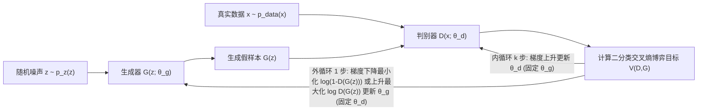

# Generative Adversarial Nets

# First Time

## 1.Title & Authors
论文原标题：Generative Adversarial Nets。
自然中文译法：生成对抗网络（简称 GAN）。
标题只有三个词，精准点出这套开创性生成框架的灵魂：
- Generative（生成）：核心任务是学习真实数据的概率分布，从而能够从零合成逼真的新样本（如图像、语音或文本）。
- Adversarial（对抗）：本文最具颠覆性的训练思想——不再费尽心思去算难以求积的配分函数或变分下界，而是直接让两个模型“左右互搏”：一个负责造假，一个负责打假，在互相博弈中倒逼造假者进化到以假乱真。
- Nets（网络）：具体落地时，生成器和判别器都可以直接由标准多层感知机（MLP）实现，全程只用最经典的反向传播与 Dropout 就能训练。标题的核心主张是：用双人极小极大博弈取代昂贵的马尔可夫链与近似推断，直接通过端到端反向传播训练深度生成模型。
作者按原文顺序列出：Ian J. Goodfellow、Jean Pouget-Abadie（访问学者，来自 Ecole Polytechnique）、Mehdi Mirza、Bing Xu、David Warde-Farley、Sherjil Ozair（访问学者，来自 IIT Delhi）、Aaron Courville、Yoshua Bengio（CIFAR Senior Fellow），团队主体位于蒙特利尔大学（Université de Montréal）。原文未标注共同第一作者脚注。从本文参考文献 [1]–[6]、[10]–[12] 可核实，Bengio 与 Goodfellow 团队此前在深度生成模型（GSN、MP-DBM）、Maxout 激活函数以及 Theano/Pylearn2 深度学习框架上积累深厚，GAN 正是他们突破传统概率图模型混合缓慢瓶颈的里程碑工作。

## 2.Abstract
摘要简明犀利，按“对抗双模型设定 → 极小极大博弈与唯一全局解 → 纯反向传播免 MCMC 优势 → 实验验证”四步直入主题。
1. 双模型对抗设定：作者提出通过“对抗过程”估计生成模型，同时训练两个角色——生成模型 $G$ 负责捕捉真实数据分布，判别模型 $D$ 负责估计一个样本来自真实训练数据（而非 $G$ 伪造）的概率；$G$ 的训练目标就是最大化 $D$ 犯错的概率。
2. 双人极小极大博弈与全局最优解：整个框架构成一个双人极小极大博弈（minimax two-player game）。在任意函数空间的理想容量下，博弈存在唯一全局解：$G$ 精确还原训练数据分布（$p_g=p_{\mathrm{data}}$），而判别器 $D$ 在处处都只能猜出 $\frac{1}{2}$（彻底分不清真假，只能抛硬币）。
3. 工程与计算红利：当 $G$ 和 $D$ 都由多层感知机定义时，整套系统只需标准反向传播就能训练。无论训练还是采样，全程不需要任何马尔可夫链（Markov chains），也不需要展开的近似推断网络。
   对比当时主流的玻尔兹曼机（DBM）和生成随机网络（GSN），采样只需把随机噪声经 $G$ 前向算一次就出图，速度和简洁度都是降维打击。
4. 实验验证：作者通过定性视觉展示（MNIST、TFD、CIFAR-10 样本与潜空间插值）和定量核密度似然估计（Parzen window）展示了该框架的潜力。
摘要四要素如下：

| 要素 | 本文核心内容 |
|---|---|
| 问题 | 传统深度生成模型受困于最大似然中难算的配分函数、马尔可夫链混合慢以及难以在反馈环中使用分段线性单元（如 ReLU）。 |
| 方法 | 让生成器 $G$ 与判别器 $D$ 进行双人极小极大对抗博弈，交替优化 $D$ 与 $G$，全程仅用标准反向传播训练、单次前向传播采样。 |
| 结果 | 理论上在非参数极限下证明存在唯一全局最优解 $p_g=p_{\mathrm{data}}$ 且 $D=\frac{1}{2}$；实验在 MNIST、TFD、CIFAR-10 上产出清晰、无相关性的随机样本，Parzen 窗似然与当时主流模型具有竞争力。 |
| 意义 | 开创了隐式对抗生成建模范式，摆脱了显式密度与 MCMC 采样的束缚，允许把几乎任意可微神经网络直接变成生成器。 |

## 3.Conclusions and future work
原文第 7 节为 `Conclusions and future work`，简洁总结了框架的可行性，并极富远见地列出了五个直接延伸方向（这五条后来几乎全部长成了深度学习史上的重量级分支）：
1. 条件生成模型（Conditional GAN）：把条件信息 $c$ 同时喂给 $G$ 和 $D$，即可直接建模条件分布 $p(\boldsymbol{x}\mid c)$。
2. 学习式近似推断（Learned approximate inference）：训练一个辅助网络从样本 $\boldsymbol{x}$ 反推潜变量 $\boldsymbol{z}$；相比经典 Wake-Sleep 算法，可以在生成器 $G$ 固定训完后再独立训练推断网络。
3. 任意条件子集补全：共享参数训练一族条件模型，近似建模所有子集条件分布 $p(\boldsymbol{x}_S\mid\boldsymbol{x}_{\not S})$（相当于确定性 MP-DBM 的随机版本）。
4. 半监督学习：当有标注数据稀缺时，复用判别器 $D$ 或推断网络学到的中间特征提升分类器性能。
5. 效率与稳定性改进：研究更好的机制来协调 $G$ 与 $D$ 的同步节奏，或寻找训练期采样 $\boldsymbol{z}$ 的更优分布，大幅加速收敛。
收尾一句话非常克制：本文已经证实了对抗建模框架的可行性，上述五个研究方向均属于待后续探索的展望。

## 4.Analogy
原文第 1 节直接给出了整个深度学习界流传最广的经典比喻——“假币团伙与警察”。
- 生成器 $G$ 是一伙造假币团伙：拿着一沓随机白纸（噪声 $\boldsymbol{z}$），绞尽脑汁印出逼真的假钞（$G(\boldsymbol{z})$），想骗过检测花出去。
- 判别器 $D$ 是反假币警察：左手拿真钞（真实数据 $\boldsymbol{x}$），右手拿假钞（$G(\boldsymbol{z})$），拼命练眼力，目标是给真钞打接近 1 的高分、给假钞打接近 0 的低分。
- 双方天天交手、互相逼着对方升级：警察一眼识破假钞哪儿印歪了（梯度回传给 $G$），造假团伙马上改进印版；假钞变逼真后，警察又得练出更毒辣的鉴定术。如此往复，直到假钞和真钞在统计上完全一模一样，警察再怎么火眼金睛也只能 50% 瞎猜（$D(\boldsymbol{x})=\frac{1}{2}$）。
- 类比边界：现实里博弈需要双方实力同步——如果造假团伙趁警察打盹偷偷连练好几轮，它可能发现只要反复印“某一张刚好能骗过当前警察的钞票”就能拿满分，于是干脆放弃多样性、把所有随机白纸全印成同一张假钞（这就是原文第 6 节提到的“赫尔维蒂卡场景 / 模式坍塌”）；另外，神经网络在有限参数空间里的梯度博弈并不像理论中的无限容量函数空间那样保证单调收敛。

# Second Time

## 1.Notation & Parameters
GAN 的核心理论只用 6 条编号公式就把“博弈目标 → 最优判别器 → JSD 散度等价 → 收敛性”一气呵成推完，重点符号如下表所示（完全保留原文记号）。

| 符号/参数 | 含义与作用 | 关键设定/约束 |
|---|---|---|
| $\boldsymbol{x}$、$p_{\mathrm{data}}(\boldsymbol{x})$ | 真实数据样本与真实数据生成分布 | 原文在 Fig1 题注与 Prop 2 末尾偶写 $p_x$，在式 (4) 偶印 $P_{\mathrm{data}}$，均指同一分布 |
| $\boldsymbol{z}$、$p_{\boldsymbol{z}}(\boldsymbol{z})$ | 输入随机噪声变量及其先验分布 | 简单易采样分布（如均匀分布或高斯）；Algorithm 1 中两处误印为 $p_g(\boldsymbol{z})$，实指 $p_{\boldsymbol{z}}(\boldsymbol{z})$ |
| $G(\boldsymbol{z};\theta_g)$、$p_g$ | 带参数 $\theta_g$ 的生成器网络，及其隐式诱导出的数据空间分布 | $G$ 为可微 MLP，单次前向即生成样本；无显式密度公式 |
| $D(\boldsymbol{x};\theta_d)$ | 带参数 $\theta_d$ 的判别器网络，输出标量概率 | 输出 $\in[0,1]$，估计 $\boldsymbol{x}$ 来自真实数据而非 $p_g$ 的概率 |
| $V(D,G)$ | 双人极小极大博弈的价值函数 | 原文在式 (1) 写 $V(D,G)$，在式 (3)、(4) 写 $V(G,D)$，为同一函数 |
| $D^*_G(\boldsymbol{x})$ | 固定生成器 $G$ 时的理论最优判别器 | 式 (2) 闭式解 $\frac{p_{\mathrm{data}}(\boldsymbol{x})}{p_{\mathrm{data}}(\boldsymbol{x})+p_g(\boldsymbol{x})}$ |
| $C(G)$、$C^*$ | 代入最优判别器后关于 $G$ 的虚拟训练准则及其全局最小值 | $C(G)=\max_D V(G,D)=-\log(4)+2\cdot JSD(p_{\mathrm{data}}\parallel p_g)$，$C^*=-\log 4$ |
| $U(p_g,D)$ | 证明收敛性时把 $V(G,D)$ 视作分布 $p_g$ 的函数记法 | 在概率密度函数空间中关于 $p_g$ 为凸函数 |
| $m$、$k$ | 每轮训练的小批量样本数、每更新 1 次 $G$ 前更新 $D$ 的步数 | 实验中取最省算力的 $k=1$ |
| $\sigma$ | 定量评估时高斯 Parzen 窗核密度估计的带宽标准差 | 在各数据集验证集上交叉验证选定 |

## 2.Introduction
对应原文 Section 1。引言开门见山点出 2014 年深度学习的“偏科现状”：
- 判别模型（如 AlexNet 图像分类、语音识别）靠着反向传播、Dropout 和梯度性质极佳的分段线性激活函数（ReLU、Maxout）一路狂飙突进；
- 生成模型却进展迟缓，原因卡在两座大山上：一是最大似然估计需要计算大量不可解的概率积分/配分函数；二是分段线性单元的激活值无上界，很难直接放进带反馈循环的传统生成模型里。
- 作者提出对抗网络框架直接绕过这两座大山：把生成器 $G$ 和判别器 $D$ 扔进“假币与警察”的对抗博弈，特例“对抗网络（adversarial nets）”让 $G$ 和 $D$ 都是标准 MLP——全程只靠反向传播和 Dropout 训练，采样只需一次前向传播，彻底告别马尔可夫链和近似推断网络。

## 3.Related Work
对应原文 Section 2，横向梳理了当时三大类深度生成模型，把 GAN 的独特生态位衬托得清清楚楚：
1. 无向图模型与混合模型（RBM、DBM、DBN）：用未归一化势函数乘积建模，归一化配分函数及其梯度几乎算不出来，只能依赖 MCMC 采样近似；而高维空间里马尔可夫链极易卡在局部模式里混合不动（mixing problem）。DBN 混接无向层与有向层，同时背上两边的计算包袱。
2. 绕开配分函数的替代准则（Score Matching、NCE）：虽然不直接算归一化常数，但仍要求能写出未归一化概率密度的解析式——对多层潜变量模型（DBM/DBN）连这都写不出来。另外，噪声对比估计（NCE）虽也用判别准则训练生成模型，但它拿模型自己去和“固定不变的噪声分布”做对比；一旦模型学到一点粗略分布，固定噪声就太容易认出来，训练信号急剧变弱。而 GAN 的巧妙之处在于：判别器面对的“假样本”是随生成器一起动态进化的！
3. 直接用反向传播训采样机器（GSN、VAE / 随机反向传播）：GSN 仍需要跑参数化马尔可夫链迭代采样，反馈循环让 ReLU 这类无界分段线性单元容易爆炸；与 GAN 同年的 VAE（Kingma & Welling 2014）和随机反向传播（Rezende et al. 2014）则引入了显式近似推断编码器。GAN 则彻底扔掉马尔可夫链，也无需训练期推断网络。

## 4.Adversarial nets
对应原文 Section 3。正式定义双人博弈方程，并点出一条拯救实际训练的工程神技。
1. 极小极大博弈目标——公式（1）：
$$
\min_G \max_D V(D,G)
=\mathbb{E}_{\boldsymbol{x}\sim p_{\mathrm{data}}(\boldsymbol{x})}[\log D(\boldsymbol{x})]
+\mathbb{E}_{\boldsymbol{z}\sim p_{\boldsymbol{z}}(\boldsymbol{z})}[\log(1-D(G(\boldsymbol{z})))].
$$
一眼看懂两方的拉锯战：
- 站在判别器 $D$ 的视角（最大化 $V$）：看到真样本 $\boldsymbol{x}$，想让 $D(\boldsymbol{x})\to 1$，使 $\log D(\boldsymbol{x})\to 0$（最大）；看到假样本 $G(\boldsymbol{z})$，想让 $D(G(\boldsymbol{z}))\to 0$，使 $\log(1-D(G(\boldsymbol{z})))\to 0$（最大）。合起来恰好是标准的二分类交叉熵最大似然！
- 站在生成器 $G$ 的视角（最小化 $V$）：第一项不含 $G$，所以 $G$ 只需最小化第二项 $\log(1-D(G(\boldsymbol{z})))$——拼命把 $D(G(\boldsymbol{z}))$ 推向 1，骗判别器把假货当真货。
2. 交替迭代的实操策略（见 [Algorithm1 精读](#algorithm1)）：
内循环如果每次都把 $D$ 训到完全最优，不仅算力炸裂，在有限训练集上还会把 $D$ 训过拟合。因此实践里采用“优化 $k$ 步 $D$、再优化 1 步 $G$”的交替节奏（实验取 $k=1$），只要 $G$ 每次挪得够慢，$D$ 就能紧紧贴在最优解附近（思路类比玻尔兹曼机的 PCD 持久链）。
3. 救命工程技巧——非饱和生成器损失：
虽然理论上 $G$ 应该最小化 $\log(1-D(G(\boldsymbol{z})))$，但训练刚起步时，$G$ 造出来的图一塌糊涂，$D$ 可以轻而易举以极高置信度拒收，也就是 $D(G(\boldsymbol{z}))\approx 0$。此时看看曲线 $y=\log(1-D)$ 在 $D\approx 0$ 附近的斜率：导数 $\frac{-1}{1-D}\approx -1$ 非常平缓，而经过 Sigmoid 后的综合梯度会趋近于零（严重饱和），$G$ 几乎拿不到有效改进信号！
作者的解法极妙：把 $G$ 的目标从“最小化 $\log(1-D(G(\boldsymbol{z})))$”改为“最大化 $\log D(G(\boldsymbol{z}))$”。
- 一阶导数在 $D\approx 0$ 处为 $\frac{1}{D}\to +\infty$，在训练早期 $G$ 最菜的时候反而给出最强烈的梯度推力；
- 并且当博弈走到平衡点时，它和原目标具有完全相同的不动点！
下面用 Mermaid 流程图直观展示 GAN 的对抗训练与单步前向采样机制（省略小批量求和与动量优化细节）：

直观四步演进图解见 [Fig1 精读](#fig1)。

## 5.Theoretical Results
对应原文 Section 4。作者在“非参数极限”（假设 $G$ 和 $D$ 拥有无限表达能力，直接在概率密度函数空间里优化 $p_g$ 和 $D$）下，用不到一页纸完成了一套极其优美的数学证明。下面逐式推透。

## 6.Global Optimality of pg = pdata
对应原文 Section 4.1，分两步证明“博弈的唯一全局最优点恰好是 $p_g=p_{\mathrm{data}}$”。
1. 第一步：固定生成器 $G$，求最优判别器——Proposition 1、公式（2）与（3）。
命题断言：对任意固定的 $G$，使 $V(G,D)$ 最大的最优判别器为：
$$
D^*_G(\boldsymbol{x})=\frac{p_{\mathrm{data}}(\boldsymbol{x})}{p_{\mathrm{data}}(\boldsymbol{x})+p_g(\boldsymbol{x})}.
$$
逐步推导（式 3）：先把期望写成积分，再利用随机变量变换（$\boldsymbol{x}=G(\boldsymbol{z})$ 服从分布 $p_g$，原文式 3 首行偶印小写 $g(\boldsymbol{z})$）把两个积分合并到同一个 $\boldsymbol{x}$ 空间下：
$$
V(G,D)
=\int_{\boldsymbol{x}}p_{\mathrm{data}}(\boldsymbol{x})\log(D(\boldsymbol{x}))\,\mathrm{d}\boldsymbol{x}
+\int_{\boldsymbol{z}}p_{\boldsymbol{z}}(\boldsymbol{z})\log(1-D(G(\boldsymbol{z})))\,\mathrm{d}\boldsymbol{z}
=\int_{\boldsymbol{x}}\bigl[p_{\mathrm{data}}(\boldsymbol{x})\log(D(\boldsymbol{x}))+p_g(\boldsymbol{x})\log(1-D(\boldsymbol{x}))\bigr]\,\mathrm{d}\boldsymbol{x}.
$$
要让整个积分最大，只需对支集 $\mathrm{Supp}(p_{\mathrm{data}})\cup\mathrm{Supp}(p_g)$ 里的每一个点 $\boldsymbol{x}$ 逐点最大化被积函数！把 $p_{\mathrm{data}}(\boldsymbol{x})$ 记为 $a$、$p_g(\boldsymbol{x})$ 记为 $b$、$D(\boldsymbol{x})$ 记为 $y\in[0,1]$（原文证明自带的局部字母），对 $a\log(y)+b\log(1-y)$ 关于 $y$ 求导令为零：
$$
\frac{a}{y}-\frac{b}{1-y}=0
\;\Longrightarrow\;
a(1-y)=by
\;\Longrightarrow\;
y=\frac{a}{a+b}.
$$
再检查二阶导 $-\frac{a}{y^2}-\frac{b}{(1-y)^2}<0$（$(a,b)\in\mathbb{R}^2\setminus\{0,0\}$ 且 $a,b\ge 0$），确认这是唯一极大值点！代回即得式 (2)。直觉极爽：在 $\boldsymbol{x}$ 处真样本和假样本出现概率相等时，按贝叶斯后验 $P(Y=1\mid\boldsymbol{x})$，该样本为真的概率恰好是两者密度之比 $\frac{p_{\mathrm{data}}}{p_{\mathrm{data}}+p_g}$。
2. 第二步：把最优判别器代回博弈，化出 Jensen–Shannon 散度——Theorem 1、公式（4）至（6）。
定义固定最优判别器后关于生成器 $G$ 的虚拟训练准则 $C(G)=\max_D V(G,D)$（公式 4，原文末行首项分母偶印大写 $P_{\mathrm{data}}$）：
$$
\begin{aligned}
C(G)
&=\mathbb{E}_{\boldsymbol{x}\sim p_{\mathrm{data}}}[\log D^*_G(\boldsymbol{x})]
+\mathbb{E}_{\boldsymbol{z}\sim p_{\boldsymbol{z}}}[\log(1-D^*_G(G(\boldsymbol{z})))] \\
&=\mathbb{E}_{\boldsymbol{x}\sim p_{\mathrm{data}}}[\log D^*_G(\boldsymbol{x})]
+\mathbb{E}_{\boldsymbol{x}\sim p_g}[\log(1-D^*_G(\boldsymbol{x}))] \\
&=\mathbb{E}_{\boldsymbol{x}\sim p_{\mathrm{data}}}\!\left[\log\frac{p_{\mathrm{data}}(\boldsymbol{x})}{p_{\mathrm{data}}(\boldsymbol{x})+p_g(\boldsymbol{x})}\right]
+\mathbb{E}_{\boldsymbol{x}\sim p_g}\!\left[\log\frac{p_g(\boldsymbol{x})}{p_{\mathrm{data}}(\boldsymbol{x})+p_g(\boldsymbol{x})}\right].
\end{aligned}
$$
接下来是最精妙的“凑常数 $-\log 4$”技巧！因为 $\mathbb{E}_{\boldsymbol{x}\sim p_{\mathrm{data}}}[-\log 2]+\mathbb{E}_{\boldsymbol{x}\sim p_g}[-\log 2]=-\log 2-\log 2=-\log 4$，把 $-\log 4$ 单独拆出来（等价于在两个对数分子分母里分别把分母除以 2，即凑出平均分布 $\frac{p_{\mathrm{data}}+p_g}{2}$）：
$$
C(G)
=-\log(4)
+\mathbb{E}_{\boldsymbol{x}\sim p_{\mathrm{data}}}\!\left[\log\frac{p_{\mathrm{data}}(\boldsymbol{x})}{(p_{\mathrm{data}}(\boldsymbol{x})+p_g(\boldsymbol{x}))/2}\right]
+\mathbb{E}_{\boldsymbol{x}\sim p_g}\!\left[\log\frac{p_g(\boldsymbol{x})}{(p_{\mathrm{data}}(\boldsymbol{x})+p_g(\boldsymbol{x}))/2}\right].
$$
右边两项正是两个 Kullback–Leibler（KL）散度的定义（公式 5）：
$$
C(G)=-\log(4)+KL\!\left(p_{\mathrm{data}}\,\Big\|\,\frac{p_{\mathrm{data}}+p_g}{2}\right)+KL\!\left(p_g\,\Big\|\,\frac{p_{\mathrm{data}}+p_g}{2}\right).
$$
而这两个 KL 散度的平均数，正好是经典的 Jensen–Shannon 散度 $JSD(p_{\mathrm{data}}\parallel p_g)$，所以原式立刻化为公式（6）：
$$
C(G)=-\log(4)+2\cdot JSD(p_{\mathrm{data}}\parallel p_g).
$$
Theorem 1 的结论瞬间水落石出：因为 JSD 散度恒非负，且当且仅当两个分布完全相等（$p_g=p_{\mathrm{data}}$）时取到 0，因此 $C(G)$ 的全局最小值唯一存在，取值 $C^*=-\log 4$，且仅当生成器完美复刻真实数据分布 $p_g=p_{\mathrm{data}}$ 时达到（此时 $D^*_G(\boldsymbol{x})=\frac{1}{2}$）。

## 7.Convergence of Algorithm 1
对应原文 Section 4.2，通过 Proposition 2 说明交替迭代为何在理想函数空间里收敛：
- 命题条件：假设 $G$ 和 $D$ 具备足够容量，且在 [Algorithm1 精读](#algorithm1) 的每一步中，判别器 $D$ 都能先达到当前 $G$ 对应的最优解 $D^*_G$，随后直接沿目标 $\mathbb{E}_{\boldsymbol{x}\sim p_{\mathrm{data}}}[\log D^*_G(\boldsymbol{x})]+\mathbb{E}_{\boldsymbol{x}\sim p_g}[\log(1-D^*_G(\boldsymbol{x}))]$ 改进分布 $p_g$，则 $p_g$ 收敛到 $p_{\mathrm{data}}$。
- 证明直觉：把 $V(G,D)$ 写成关于概率密度 $p_g$ 的泛函 $U(p_g,D)$。从式 (3) 可见，固定 $D$ 时 $U(p_g,D)$ 对 $p_g$ 是线性的（因而自然是凸的）。凸分析中有一个经典结论：一族凸函数的上确界 $f(x)=\sup_{\alpha\in\mathcal{A}}f_\alpha(x)$ 依然是凸函数，且在取到最大值的点 $\beta=\arg\sup_{\alpha\in\mathcal{A}}f_\alpha(x)$ 处，单个函数的导数 $\partial f_\beta(x)$ 属于上确界函数的次微分 $\partial f(x)$！
- 这意味着：只要每步先把 $D$ 优化到最优 $D^*_G$，再对 $p_g$ 做一小步梯度下降，就等价于在凸函数 $\sup_D U(p_g,D)$ 上做次梯度下降；又由 Theorem 1 它有唯一全局最小点 $p_{\mathrm{data}}$，所以步长足够小时 $p_g$ 必然收敛到真实分布。
- 理论与实践的鸿沟（作者坦诚说明）：现实中我们并不是直接在无限维密度空间里优化 $p_g$，而是优化有限维神经网络参数 $\theta_g$，且内循环只跑 $k=1$ 步而非把 $D$ 训到绝对最优。MLP 参数空间存在大量非凸临界点，因此上述收敛定理无法直接套用到实际神经网络训练上；实践效果依赖工程调优与博弈平衡。

## 8.Advantages and disadvantages
对应原文 Section 6（位于实验章之后的非实验核心分析，按规矩纳入正文精读）。作者极其客观地列出了 GAN 的两难短板与独特红利（系统对比见 [Table2 精读](#table2)）：
1. 两大明显短板：
   - 没有 $p_g(\boldsymbol{x})$ 的显式概率密度表达式，无法直接计算测试样本的对数似然；
   - 训练中 $D$ 和 $G$ 必须严密同步：绝不能在不更新 $D$ 的情况下过度训练 $G$，否则就会掉进“赫尔维蒂卡场景（the Helvetica scenario，后世通称模式坍塌 mode collapse）”——$G$ 把大量不同的随机噪声 $\boldsymbol{z}$ 全部折叠映射到同一个能骗过当前 $D$ 的样本 $\boldsymbol{x}$ 上，彻底丧失多样性。
2. 两大深层优势（不止算得快，还有统计学红利）：
   - 计算与建模自由度优势：全程无需 MCMC、无需训练期近似推断、只用反向传播即可训练，且理论上任意可微函数都能插进模型。
   - 统计学优势与锐利分布表达：生成器 $G$ 从不直接拿真实训练图像像素做拷贝式更新，而是只通过判别器传回来的梯度间接学习，降低了死记硬背输入像素的风险；而且相比依赖马尔可夫链（为了能在模式间顺畅跳转，分布不得不保持一定模糊）的模型，GAN 可以表达极其锐利、甚至退化在低维流形上的清晰分布。

## 9.Figure & Table
正文共有 3 张图、2 张表，合计 5 项，按原文出现顺序精读如下。

#### Fig1:
这是全篇最重要的一张正文图，用四格一维分布动画把抽象的极小极大博弈和 $D^*_G=\frac{p_{\mathrm{data}}}{p_{\mathrm{data}}+p_g}$ 变成了肉眼可见的动态过程。
读图要素：每格里有三条曲线和两组水平轴——下方水平线是均匀采样的噪声域 $\boldsymbol{z}$，上方水平线是数据域 $\boldsymbol{x}$，向上射出的箭头表示映射 $\boldsymbol{x}=G(\boldsymbol{z})$（箭头越密集的地方 $p_g$ 密度越高，箭头越稀疏的地方密度越低）；黑色点线是真实数据分布 $p_{\mathrm{data}}$，绿色实线是生成分布 $p_g$，蓝色虚线是判别器打分曲线 $D(\boldsymbol{x})$。
四格演变一目了然：
- （a）初始近收敛态：绿线 $p_g$ 和黑线 $p_{\mathrm{data}}$ 还有左右错位，蓝虚线 $D$ 是个略显颠簸的部分准确分类器。
- （b）内循环更新 $D$：固定绿线不变，训练 $D$ 收敛到最优解 $D^*(\boldsymbol{x})=\frac{p_{\mathrm{data}}(\boldsymbol{x})}{p_{\mathrm{data}}(\boldsymbol{x})+p_g(\boldsymbol{x})}$——在黑线高、绿线低的左侧蓝线接近 1，在绿线高、黑线低的右侧蓝线掉向 0，呈现平滑单调下降的 S 曲线。
- （c）外循环更新 $G$：沿着蓝线 $D$ 的梯度方向，生成器把原本偏右的 $\boldsymbol{z}\to\boldsymbol{x}$ 箭头向左拉向 $D$ 打分更高的真实数据峰，绿线明显向黑线靠拢。
- （d）博弈平衡终点：经过多轮交替，绿线与黑线彻底重合（$p_g=p_{\mathrm{data}}$），蓝虚线拉成一条恒等于 $\frac{1}{2}$ 的水平直线，双方都再也无法单方面占到便宜。

#### Table1:
位置与评测协议：位于第 5 节，报告各深度生成模型在 MNIST（实值版本，跨测试样本算均值标准误）和 TFD（多伦多人脸数据库，各折交叉验证选定带宽 $\sigma$ 并跨折算标准误）上，基于高斯 Parzen 窗估计的测试集对数似然（越高越好）。
核心读数：
- MNIST：Adversarial nets 拿到 $225\pm 2$，排在表中第一（超过 Deep GSN $214\pm 1.1$、DBN $138\pm 2$、Stacked CAE $121\pm 1.6$）。
- TFD：Adversarial nets 拿到 $2057\pm 26$，排第二（仅略低于 Stacked CAE $2110\pm 50$，高于 DBN $1909\pm 66$ 与 Deep GSN $1890\pm 29$）。
局限边界：作者在正文坦诚提醒，Parzen 窗密度估计在高维空间方差极大且并不靠谱，这里仅因当时缺乏更好标准才沿用，并呼吁社区开发专门针对“能采样但无显式密度”模型的新评测指标（后来催生了 IS、FID）。

#### Fig2:
位置与目的：位于第 5 节，展示四个模型无筛选（非 cherry-pick）随机采样的真实图像，最右侧加黄色边框的一列是与其相邻生成图最接近的训练集原图，专门用来证明生成器不是在死背训练集。
四块面板解读：（a）MNIST 手写数字轮廓锐利干净，明显区别于右侧最近邻训练数字；（b）TFD 灰度人脸五官清晰合理；（c）全连接版 CIFAR-10 与（d）卷积判别器 + 反卷积生成器版 CIFAR-10 呈现自然图像的颜色与宏观结构（虽在 2014 年仍较模糊，但已是无条件、无相关性的独立样本，而非隐藏单元的条件均值模糊图）。

#### Fig3:
位置与目的：位于第 5 节，展示在完整 MNIST 模型的潜噪声空间 $\boldsymbol{z}$ 中沿直线做线性插值生成的一串数字。
视觉亮点：从 `1` 平滑变形为 `5`，再从 `7` 平滑过渡成 `9` 再变回 `1`，中间每一个过渡态都是自然合理的手写数字，没有崩坏成无意义噪点——直观证实生成器学到了连续平滑的语义潜流形，而非孤立记忆离散样本。

#### Table2:
位置与目的：位于第 6 节，横向全景对比四类深度生成模型（深度有向图模型、深度无向图模型、生成自编码器、对抗模型）在五大核心操作上的痛点与门槛。
关键对比结论：
- 训练：有向/无向模型均需推断（无向还需 MCMC 估配分函数梯度），生成自编码器卡在混合速度与重建能力权衡，而对抗模型唯一的难题是同步 $D$ 与 $G$（防模式坍塌 `Helvetica`）。
- 采样：无向模型和生成自编码器都要跑马尔可夫链，而对抗模型与有向模型直接单次前向无困难（`No difficulties`）。
- 评估 $p(\boldsymbol{x})$：四类都算不出精确密度（前两类靠 AIS 近似，后两类无显式密度、文中写靠 Parzen 估计）。
- 模型设计自由度：前两类对网络结构限制极严，而对抗模型与生成自编码器理论上允许插进任意可微函数。
## 10.Algorithms
正文包含一套标准小批量随机梯度交替训练算法框，位于第 4 节开篇。

#### Algorithm1:
原题名为 Minibatch stochastic gradient descent training of generative adversarial nets，负责把公式 (1) 的理论博弈落地为可执行的数值交替优化。
- 核心超参数：每更新一次生成器前，先更新判别器的步数 $k$（作者在全部实验中均取计算开销最小的 $k=1$）；小批量大小 $m$；优化器可选任意标准梯度法（原文采用带动量的 SGD）。
- 外循环（`for number of training iterations do`）：重复执行以下两个顺序阶段直到收敛：
  1. 判别器内循环（`for k steps do`）：
     - 从噪声先验采样 $m$ 个噪声样本 $\{\boldsymbol{z}^{(1)},\dots,\boldsymbol{z}^{(m)}\}$（注：原算法框此处误印为 $p_g(\boldsymbol{z})$，按第 3 节实指噪声先验 $p_{\boldsymbol{z}}(\boldsymbol{z})$）。
     - 从真实数据分布 $p_{\mathrm{data}}(\boldsymbol{x})$ 采样 $m$ 个真样本 $\{\boldsymbol{x}^{(1)},\dots,\boldsymbol{x}^{(m)}\}$。
     - 固定 $\theta_g$，沿随机梯度上升方向更新判别器参数 $\theta_d$：
$$
\nabla_{\theta_d}\frac{1}{m}\sum_{i=1}^m\Bigl[\log D\bigl(\boldsymbol{x}^{(i)}\bigr)+\log\bigl(1-D(G(\boldsymbol{z}^{(i)}))\bigr)\Bigr].
$$
  2. 生成器单步更新（内循环结束后执行一次）：
     - 重新从噪声先验采样 $m$ 个噪声样本 $\{\boldsymbol{z}^{(1)},\dots,\boldsymbol{z}^{(m)}\}$（同上，原印 $p_g(\boldsymbol{z})$ 实指 $p_{\boldsymbol{z}}(\boldsymbol{z})$）。
     - 固定 $\theta_d$，沿随机梯度下降方向更新生成器参数 $\theta_g$：
$$
\nabla_{\theta_g}\frac{1}{m}\sum_{i=1}^m\log\bigl(1-D(G(\boldsymbol{z}^{(i)}))\bigr).
$$
- 与正文实操的衔接提示：算法框里写的是与理论式 (1) 严格一致的饱和损失 $\min\log(1-D(G(\boldsymbol{z})))$，但正文第 3 节明确建议实际训练时将其替换为梯度上升最大化 $\frac{1}{m}\sum_{i=1}^m\log D(G(\boldsymbol{z}^{(i)}))$，以避免训练初期梯度消失。
## 11.Experiments
对应原文 Section 5。在 MNIST、TFD 和 CIFAR-10 三个图像数据集上验证了 GAN 的实用性：生成器混合使用 ReLU 与 Sigmoid 激活（仅在最底层输入随机噪声，虽理论允许在中间层加噪声或 Dropout），判别器使用 Maxout 激活加 Dropout。定量方面用交叉验证带宽 $\sigma$ 的高斯 Parzen 窗估计对数似然，在 MNIST 上取得 $225\pm 2$、TFD 上取得 $2057\pm 26$（[Table1 精读](#table1)）；定性方面通过无筛选随机采样 + 最近邻训练图对照（[Fig2 精读](#fig2)）以及潜空间直线插值（[Fig3 精读](#fig3)），直观展示了清晰样本生成能力与平滑语义流形。全文无独立附录。

# Overall Review

- 主要贡献： 第一，开创了以双人极小极大博弈为核心的对抗生成建模范式，用判别器动态提供的梯度取代显式密度计算与马尔可夫链采样，将生成建模彻底带入“纯反向传播 + 单次前向出图”的现代轨道。第二，在非参数极限下给出简洁优美的理论基石：证明固定生成器时的最优判别器闭式解、极小极大目标等价于最小化 Jensen–Shannon 散度（全局唯一最优 $p_g=p_{\mathrm{data}}$），以及理想函数空间里的交替优化收敛性。
- 技术优点： 构思极简、建模自由度极高（几乎任意可微网络均可充当 $G$ 与 $D$）；采样一次前向完成、样本彼此独立无相关性、能够表达极其锐利的图像分布；提出非饱和生成器目标 $\max\log D(G(\boldsymbol{z}))$ 化解早期梯度消失，成为后续无数 GAN 工程实现的标配。
- 潜在不足： 第一，缺乏显式概率密度 $p_g(\boldsymbol{x})$，给定量似然评估带来困扰（文中 Parzen 窗在高维失效，作者亦明确承认）。第二，博弈训练极度脆弱：非参数收敛定理在有限参数非凸网络中不再成立，$D$ 和 $G$ 稍有失衡就会梯度消失、震荡不收敛或掉入模式坍塌（Helvetica 场景）。第三，初版全连接/浅卷积实验的图像清晰度与分辨率仍较初步（CIFAR-10 样本尚显模糊），真正的视觉爆发留待后续 DCGAN、WGAN、StyleGAN 接力完成。
- 相关工作定位： GAN 与同年诞生的 VAE 共同拉开了深度生成模型十年繁荣的序幕，彻底打破了此前 RBM/DBM/GSN 等依赖 MCMC 采样的旧路线；其“隐式密度 + 对抗判别”思路后来不仅衍生出 StyleGAN 等巅峰图像生成器，也广泛渗透到扩散/流模型的对抗微调（如 ADD、LADD）与超分辨率感知损失中。
- 启发与延伸： 本文最大的思想启示是“当目标损失（如真实图像分布距离）很难手工写出来时，可以用另一个神经网络动态学出这个损失函数”。后续围绕本文两大痛点催生了三大主线：用卷积与架构稳定训练（DCGAN、BigGAN、StyleGAN）、用更平滑的分布距离替换 JSD 根治梯度消失与模式坍塌（WGAN、WGAN-GP、Spectral Norm），以及论文结论中预言的 cGAN、BiGAN/ALI 与半监督 GAN。
- 适合谁读： 所有学习生成式 AI 的读者必读的开山经典，篇幅仅 8 页且推导极度丝滑。数学基础只需微积分与基本 KL 散度就能顺畅读通第 4–7 节完整证明；正在学习扩散模型和流匹配的同学，结合 [Table2 精读](#table2) 对比 GAN 与似然/扩散路线的优劣，能一眼看懂现代生成模型的完整版图。
