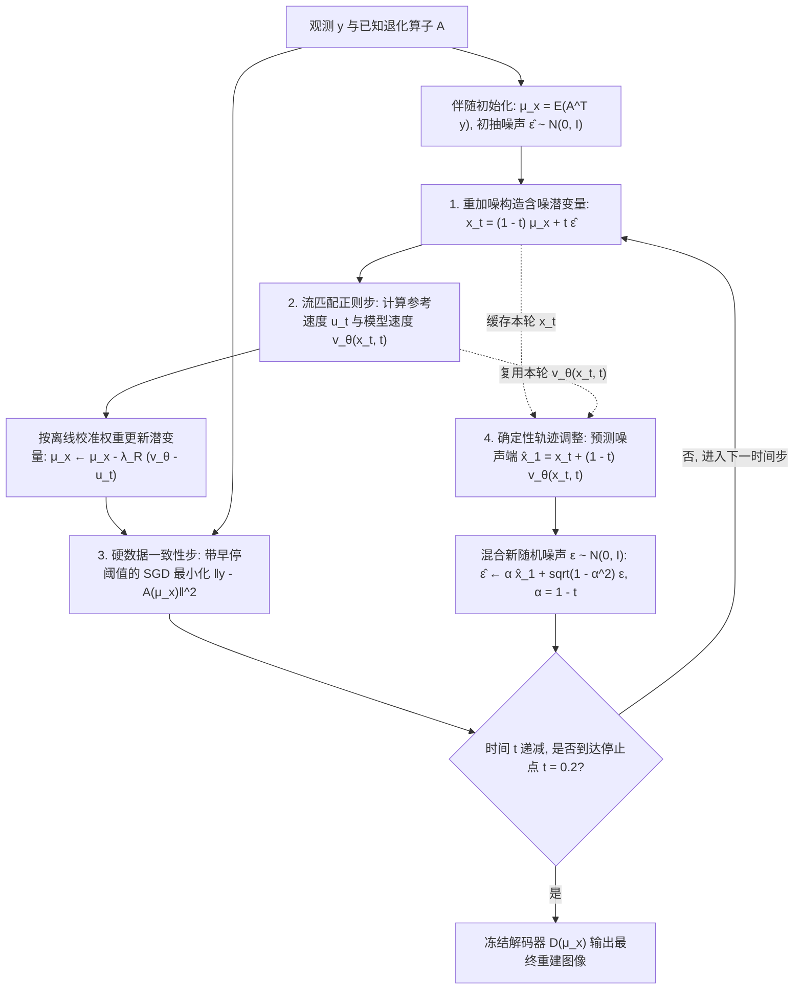

# Solving Inverse Problems with FLAIR

# First Time

## 1.Title & Authors
论文原标题：Solving Inverse Problems with FLAIR。
自然中文译法：使用 FLAIR 求解逆问题。
先拆解标题里的两个核心词，整篇论文的骨架立刻清晰：
- Inverse Problems（逆问题）：手里只有一张退化后的“坏图”（例如缩小 8 倍或 12 倍的模糊马赛克、剧烈运动模糊的照片、或被人挖掉一大块矩形的残缺图），要反推原本清晰的高质量图像。因为退化过程已经丢掉大量高频或空间信息，同一张观测往往对应很多张合理解，只靠“逆向反算”算不回来，必须请出强生成模型当图像先验来补全合理细节。
- FLAIR：原文在 Introduction 展开为 flow-based latent adaptive inference with deterministic re-noising（基于流模型的潜空间自适应推断与确定性重加噪）。这几个词正好把整套方法的四块核心积木全报了家门：flow-based latent 指复用预训练潜空间流匹配大模型（实验骨干为 Stable Diffusion 3.5-Medium，正文简称 SD3）；adaptive 指按模型在不同时间步的预测可靠度自适应调节正则权重；deterministic re-noising 指在重加噪环节引入模型引导的确定性成分，避免采样掉进先验低密度区。
标题的核心主张非常直接：不重新训练、不微调大模型，仅靠一套专门面向流匹配模型设计的变分推理求解器，就把预训练生成模型的强图像先验可靠地转化为高保真、高多样性的逆问题后验采样能力。
作者按原文顺序列出：
1. Julius Erbach（ETH Zürich、Max Planck Institute for Informatics, Saarland Informatics Campus）。
2. Dominik Narnhofer（ETH Zürich）。从参考文献 [35][36] 可知，他在变分与生成式逆问题（如加速 MRI 重建与贝叶斯不确定性估计）上有长期研究积累。
3. Andreas Dombos（ETH Zürich）。
4. Bernt Schiele（Max Planck Institute for Informatics, Saarland Informatics Campus），德国马克斯·普朗克信息学研究所所长，计算机视觉与感知建模领域资深学者。
5. Jan Eric Lenssen（Max Planck Institute for Informatics, Saarland Informatics Campus）。
6. Konrad Schindler（ETH Zürich），苏黎世联邦理工学院摄影测量与遥感教授，视觉重建与超分辨率领域资深学者（参考文献 [4] 即来自其课题组）。
原文未标注等贡献或通讯作者脚注，此处严格保留原始署名顺序与机构归属。

## 2.Abstract
摘要的叙事节奏很顺畅，沿着“生成先验潜力 → 落地三大障碍 → FLAIR 四步破局 → 效果与开源”四段推进，下面按语义单元逐句拆透。
1. 出发点（生成先验很强，但恢复没跟上）：以 Stable Diffusion 3 为代表的潜空间流匹配生成模型已经能画出照片级逼真图像，按理说应该成为图像逆问题的顶级先验，但在实际恢复任务里，大家还没把这份潜力榨出同等水准的保真度。
   直觉上很好理解：普通文生图只要画得“像一张好看的自然照片”就过关；逆问题恢复却带着镣铐跳舞——不仅要画得自然，还得严丝合缝地对上眼前这张退化观测图。
2. 拆出三大拦路虎：
   - 障碍一（数据似然难处理）：清晰图像上的观测似然其实很简单，但流/扩散模型每一步面对的都是随时间变化的含噪中间状态，而且还要穿过非线性的 VAE 解码器，没法把清晰观测直接套进带噪状态里算精确似然。
   - 障碍二（观测与先验打架）：预训练生成模型原本没学过直接拿“糊图/缺图”当条件。面对观测信息残缺或落在训练分布冷门区域的测试图，先验总想往常见的高密度模式上拉，和观测要求保留当前对象特征互相扯皮。
   - 障碍三（重建结果偏离观测）：哪怕生成的图肉眼看着很清晰，重新拿退化算子糊一遍或缩小一遍，却跟输入观测对不上号。
3. 亮出总框架（FLAIR）：作者提出免训练（training-free）的变分推断框架 FLAIR，直接把冻结的预训练流模型当作逆问题先验。这里“免训练”指不针对每种退化重新训练或微调生成模型；推理阶段仍需要对当前图像的潜变量做迭代优化，同时需要一次性的离线误差校准。
4. 核心机制一（通用流匹配变分目标 + 确定性轨迹调整）：作者构造了一个与具体退化类型无关的流匹配变分正则目标（换超分、去模糊或修补任务时先验正则写法不变，只有数据项换算子），并配合“确定性轨迹调整”（deterministic trajectory adjustments），把重加噪后的潜状态引向后验概率更高的区域，治住先验乱拉和画面变糊的毛病。
5. 核心机制二（数据项与正则项解耦优化）：为了强力保证重建结果紧贴观测，FLAIR 把数据保真优化和先验正则优化拆成独立步骤交替执行——先由流匹配先验补出自然细节，再由单独的数据一致性步强行把偏差拉回观测流形。
   这一“先验补细节 + 数据硬拉回”的交替分工，是看懂 FLAIR 工作循环的第一把钥匙。
6. 核心机制三（离线精度校准的时间相关权重）：预训练流模型在不同噪声时刻的预测准头大不相同。作者先在少量校准图上离线测出模型沿时间轴的预测误差，再按可靠度动态调整每一步的正则权重——模型准的地方多听它的，不准的地方少听甚至直接关掉。
7. 实验主张与开源：在标准图像逆问题基准上，FLAIR 在重建质量与样本多样性两方面都优于现有扩散和流式方法，并公开了项目主页与源码入口。
   对照正文 Table1 和 Fig3 看，主实验覆盖 FFHQ 与 DIV2K 两个 $768\times 768$ 高分辨率数据集的 8 倍/12 倍超分、运动去模糊和矩形修补（另有 CelebA-HQ $256\times 256$ 像素空间实验）。FLAIR 在全部 8 组潜空间任务上拿下最优感知指标 LPIPS 与 pFID（如 FFHQ 12 倍超分 LPIPS 为 0.271，对比 FlowDPS 的 0.413），同时在 32 次采样下展现出集中在高频纹理区的丰富多样性；在超分任务上，像素均方误差指标 PSNR 与 SSIM 则呈现经典的感知—失真权衡（部分超分组由 RSD 或 ReSample 略高）。
把摘要浓缩成四要素一览表：

| 要素 | 本文核心内容 |
|---|---|
| 问题 | 潜空间流模型生成力极强，但直接解逆问题时面临含噪似然难算、先验高密度偏好导致过平滑/偏离、以及软约束下观测一致性不足三大障碍。 |
| 方法 | 提出免训练变分框架 FLAIR：将变分 score 正则改写为流匹配速度差正则，叠加确定性轨迹调整重加噪、解耦的硬数据一致性优化，以及离线误差校准的时间自适应权重。 |
| 结果 | 在 FFHQ、DIV2K 四类高分辨率线性逆问题及 CelebA-HQ 像素空间任务上全面刷新感知指标（LPIPS、pFID），去模糊与修补同步领先失真指标，并在 12 倍超分上展现高频后验多样性。 |
| 意义 | 打通了“潜空间流匹配 + 变分后验推断 + 硬数据一致性 + 确定性重加噪”的免微调求解范式，让单粒子变分方法也能同时产出锐利画质与多解多样性。 |

## 3.Conclusion and Limitations
原文第 6 节为独立的 Conclusion and Limitations，共两段：第一段收束方法价值与实验战绩，第二段坦诚列出继承自生成骨干与框架设计的局限及风险。
1. 第一段——两大技术支柱与三目标协同：
   - 支柱一（定向先验引导）：借助与退化类型无关的流匹配正则损失，配合模型预测的确定性噪声向量，把生成先验精准引向契合当前观测的图像区域，解决传统变分蒸馏容易糊成平均图的问题。
   - 支柱二（硬一致性 + 离线自适应加权）：把数据一致性约束与正则更新彻底解耦，在保证紧贴输入观测的同时不牺牲样本多样性；并利用离线校准的预期预测精度动态调节正则强度，只在模型靠谱的时间段发力。
   - 实验总账：作者把 FLAIR 的核心成绩概括为“三件事同时做好”——高感知真实感、紧贴观测输入、以及高样本多样性。在多个数据集与退化任务上超越现有扩散和流匹配基线（对应正文 Table1、Table2 的定量表现，Fig3 的 32 样本高频方差图，以及 Table3、Fig6 的组件消融证据）。
2. 第二段——作者亲口承认的四项局限与一项伦理风险：
   - 继承训练数据偏差：FLAIR 直接复用冻结的预训练生成骨干，因此骨干在海量训练数据中习得的外观与语义偏好会原样传给恢复结果。
   - 分辨率受骨干限制：输出分辨率绑定在底层预训练流模型的能力与配置上（主实验为 $768\times 768$，像素空间实验为 $256\times 256$）。
   - 分布外（OOD）模式恢复乏力：遇到预训练先验几乎没见过的罕见材质、特殊光影或罕见结构时，先验难以提供合理候选，可能导致颗粒噪点或语义错位（Appendix A.14 展示了具体失败案例）。
   - 额外超参数成本：确定性轨迹调整引入了需要设定的控制参数（如混合系数 $\alpha$ 日程，以及数据步学习率与早停阈值等推理超参）。
   - 潜在误用风险：高保真图像恢复与文本编辑能力存在被用于不当图像篡改的伦理风险。
整节结论与摘要主线严丝合缝，同时把免训练框架“靠天吃饭（依赖预训练骨干）”的真实边界交代得十分清楚。

## 4.Analogy
可以把 FLAIR 想象成“用一张破损的旧照片，请一位看过千万张高清照的插画大师合作复原，旁边还配了一台高精度验片仪”。
- 预训练流模型 $v_\theta$ 是那位插画大师（活在草稿本/潜空间里），满脑子都是人脸、动物、自然光影的精细规律；退化算子 $\mathcal{A}$ 和手里那张旧照 $y$ 组成了一台验片仪——把画好的新图塞进去做同样的降采样或运动模糊，就能立刻量出它跟手里的旧照差多少。
- 传统变分方法为什么容易把图画糊？以前请大师改画，每回合都先把当前画稿随机泼一把墨水（加完全独立的随机噪声 $\epsilon$）再递给他修补。如果眼前这张照片角度独特或纹理少见，泼完墨水大师就认不出这是谁了，只能按脑子里“最普通的大众脸”去糊弄，多轮拉扯下来细节全磨平了；同时又把“像大师风格”和“通过验片仪”混在一起打分，两边互相妥协，最后既不锐利也没对准旧照。
- FLAIR 的四招怎么把协作理顺？
  1. 流匹配正则（先验步）：每回合问大师“照当前带噪草稿，你觉得该往哪儿推速度”，和当前草稿的参考速度一对比，推一步让画面更自然。
  2. 硬数据一致性（数据步）：大师推完这一笔，立刻停手把画稿送进验片仪里硬修，直到退化后的误差压进合格线，确保大师绝不会擅自把旧照原本清晰的大轮廓和颜色给改没了。
  3. 确定性轨迹调整（顺风重加噪）：下回合准备再泼墨水递给大师之前，不再闭着眼睛瞎泼，而是顺着大师上一回合指出来的方向先算出一个“合大师脾气的噪声方向 $\hat{x}_1$”，再按进度掺一点新随机噪声 $\epsilon$。前期多掺随机性，让大师自由探索多种合理画法（产生不同睫毛、发丝的多样化版本）；越到后期越顺着大师自己的节奏走，稳稳雕出锐利细节。
  4. 离线精度校准（体检表调权重）：开工前先拿 $N$ 张标准样图考考大师在“极糊、中糊、微糊”各个阶段的眼神准头，发现他在“已经快画完、只剩一点微噪”时反而容易把真毛孔当噪点乱改（$t<0.2$ 误差飙升）。于是定下规矩：大师眼神最准的中段放手让他画，快收尾时把他的发言权降到零，直接靠验片仪收官。
- 类比的边界也很清晰：真实算法工作在非线性的 VAE 潜空间里，数据步不是一次性闭式投影而是带早停阈值的多步梯度下降；离线校准测的是整个模型沿时间轴的平均误差而非针对单张测试图实时体检；另外，多个合理复原版本只代表在观测允许范围内补出了不同高频细节，并不意味着其中某一张必然还原了真实丢失的原像素。

# Second Time

## 1.Notation & Parameters
正文公式围绕“观测模型 → 流先验与变分目标 → 速度重参数化 → 精度校准与确定性轨迹调整”四条线展开。下表保留论文全部原始符号；原文在像素空间与潜空间之间复用部分记号（如 $x, x_0, \mathcal{A}$），且个别位置存在轻微书写变体，均在约束栏注明以便核对。

| 符号/参数 | 含义与作用 | 关键设定/约束 |
|---|---|---|
| $x$、$x_0$、$y$ | 原始清晰信号、流路径数据端干净状态、退化观测 | 第 3.1 节 $x\in\mathbb{R}^n$、$y\in\mathbb{R}^m$；潜空间方法中 $x_0$ 对应潜状态 |
| $\mathcal{A}$、$A^\top$、$A^\dagger$ | 正向退化算子、线性像素算子伴随、Fig1 标注记号 | $\mathcal{A}:\mathbb{R}^n\mapsto\mathbb{R}^m$；潜空间伪代码把“解码+退化”简写为 $\mathcal{A}(\mu_x)$；正文初始化写 $A^\top$，Fig1 图中印 $A^\dagger$ |
| $\nu$、$\sigma_\nu$、$\sigma$ | 加性高斯观测噪声及其标准差 | $\nu\in\mathbb{R}^m$；主实验 $\sigma_\nu=0.5\%$；式 (4) 下方似然写 $\sigma^2\mathrm{Id}$（即同一噪声方差，其中 $\mathrm{Id}$ 为单位阵） |
| $E$、$D$ | 预训练 VAE 编码器与解码器 | $E:\mathbb{R}^n\mapsto\mathbb{R}^d$，$D:\mathbb{R}^d\mapsto\mathbb{R}^n$，$d\ll n$；推理全程冻结 |
| $f(\mu_x)$ | 式 (7)、(9) 中从单粒子状态映射到观测空间的测量预测函数 | 像素空间中即 $\mathcal{A}\mu_x$，潜空间中对应复合映射 $\mathcal{A}(D(\mu_x))$ |
| $\mathcal{E}$、$\mathcal{D}$、$\mathcal{R}$ | 变分总能量、数据保真项、先验正则项 | 花体 $\mathcal{E},\mathcal{D}$ 区别于编码器 $E$、解码器 $D$；Algorithm1 简写正则为 $R$ |
| $p(x_0)$、$p(x_0\mid y)$ | 图像先验分布、给定观测的目标后验分布 | $p_1(x)$ 为 $t=1$ 简单噪声分布，$p_0(x)$ 为 $t=0$ 目标数据分布 |
| $q(x_0\mid y)$、$\mu_x$、$\sigma_x^2$ | 变分近似分布及其均值、方差 | $q(x_0\mid y)=\mathcal{N}(\mu_x,\sigma_x^2)$；正文令 $\sigma_x^2=0$ 退化为单粒子状态 $\mu_x$ |
| $x_t$、$q(x_t\mid y)$、$p(x_t)$ | 时刻 $t$ 的含噪状态、含噪变分分布、含噪先验边缘分布 | 基础路径 $q(x_t\mid y)=\mathcal{N}((1-t)\mu_x,t^2 I)$；轨迹调整后见式 (15) |
| $t$、$T$、$\Delta t$、$\delta t$ | 流时间、积分上界、算法离散步长、上一轮时间间隔 | 约定 $t=1$ 为纯噪声端、$t=0$ 为干净数据端；实际迭代从 $t=1$ 降至 $t=0.2$ 停止 |
| $\psi_t$ | 将数据端与噪声映射为时刻 $t$ 状态的流映射 | 基础线性条件路径 $\psi_t(x_0\mid\epsilon)=(1-t)x_0+t\epsilon$ |
| $v_\theta(x_t,t)$、$v_{\theta,t}$ | 预训练冻结流模型的预测速度场 | 沿时间增大方向（$0\to 1$）定义；推理全程冻结参数 $\theta$ |
| $u_t(x_t\mid\epsilon)$、$u_t(x_t\mid\hat{\epsilon})$ | 条件流路径的解析参考速度场 | 基础路径为 $(\epsilon-x_t)/(1-t)$；轨迹调整后见式 (16) |
| $\nabla_x\log q(x_t\mid y)$、$\nabla_x\log p(x_t)$ | 含噪变分分布与先验分布的对数密度梯度（score） | 附录亦写作 $\nabla_{x_t}\log q(x_t\mid y)$ 与 $\nabla_{x_t}\log p(x_t)$ |
| $\omega(t)$、$\beta(t)$ | score 匹配目标中的时间权重与扩散噪声日程系数 | 扩散 ELBO 对应 $\omega(t)=\beta(t)/2$；附录 A.1 用 $\omega(t)=t/(1-t)$ 连接速度差 |
| $\lambda_{\mathcal{R}}(t)$、$\lambda_R$ | 流匹配正则项的时间自适应权重 | 由式 (14) 离线误差倒数校准；$t<0.2$ 时置 0；Algorithm1 简写为 $\lambda_R$ |
| $\epsilon$、$\hat{\epsilon}$ | 独立采样的标准高斯噪声、跨轮传递的混合噪声状态 | $\epsilon\sim\mathcal{N}(0,I)$；$\hat{\epsilon}=\alpha\hat{x}_1+\sqrt{1-\alpha^2}\,\epsilon$ |
| $\hat{x}_1$ | 基于模型速度单步外推得到的确定性噪声端预测 | 下标 1 指向 $t=1$ 噪声端，而非清晰图像端 |
| $\alpha$ | 确定性噪声预测与随机噪声之间的混合权重 | $\alpha\in[0,1]$；Algorithm1 取线性日程 $\alpha=1-t$ |
| $N$、$\mu_{init}$ | 离线校准样本数、Algorithm1 的潜变量初值 | $N$ 张图在 100 个等距时间步上估误差；推荐 $\mu_{init}=E(A^\top y)$ |

精读前务必分清三个最容易看混的符号：一是 $\mu_x$（当前正在优化的单粒子干净潜变量）、$\hat{x}_1$（外推到 $t=1$ 的确定性噪声端预测）和 $\hat{\epsilon}$（混合后的噪声状态，供下一轮构造 $x_t$）各司其职，千万别把 $\hat{x}_1$ 误看成去噪后的清晰图像；二是式 (4) 下方似然里的 $\mathrm{Id}$ 是正体缩写“单位矩阵”（Identity matrix），并非以潜维度 $d$ 为下标的 $I_d$；三是算法里时间从 $1$ 倒走到 $0.2$，而速度场 $v_\theta$ 与 $u_t$ 均按 $t$ 增大方向（从干净图指向噪声）定义。

## 2.Introduction
对应原文 Section 1。引言干脆利落地回答了一个问题：既然 Stable Diffusion 和 FLUX 已经学到了覆盖互联网规模视觉世界的超强先验，为什么把它免训练搬来解逆问题还是困难重重？
1. 为什么非用大模型先验不可：传统逆问题靠稀疏性、全变分平滑这类手工正则，远比不上现代流匹配大模型学到的自然结构与纹理规律；而且用预训练大模型当通用先验，换个退化任务不用重新训练网络。
2. 挡在面前的三道真实关卡：
   - 潜空间带来的非线性：现代流模型活在低维 VAE 潜空间里。像素空间里原本规整的线性退化（如降采样、模糊卷积），一穿过非线性解码器 $D$，就变成了高度非线性的复合前向算子。
   - 迭代带噪让似然不可直接计算：流模型的每一步中间状态都掺着随时间变化的噪声，而手里拿到的观测 $y$ 来自干净原图，没法直接把带噪状态拿去算精确观测似然。
   - 分布高密度偏好（模式拉扯）：预训练生成模型天然偏爱训练数据里扎堆出现的高密度区域。一旦测试图落在低密度角落，先验就会拼命把它往“常见模式”上拽，最终丢掉观测独有的特征，甚至在变分优化中塌缩成过平滑的模糊图像。
3. 提出 FLAIR（flow-based latent adaptive inference with deterministic re-noising）：作者将其定位为把潜空间生成建模、流匹配与变分推断统一到同一逆问题框架的免训练方法，并列出四项对应贡献——流匹配变分正则目标、确定性轨迹调整、解耦的硬数据一致性优化，以及离线误差校准的时间自适应权重。整体交替循环直观看 [Fig1 精读](#fig1)，完整步骤见 [Algorithm1 精读](#algorithm1)。

## 3.Related Work
对应原文 Section 2，从“深度学习先验两条路”和“生成式后验采样诸流派”快速勾勒出 FLAIR 的生态位。
1. 深度学习逆问题的两大阵营：
   - 端到端学逆映射：拿配对数据直接训练网络把退化图映射回清晰图，效果好但换一种模糊核或倍率就得重训。
   - 学习图像先验：包括非生成式展开优化网络（unrolled optimization），以及生成式模型（GAN、扩散模型、流匹配模型）。生成式后验采样最诱人的地方在于“一套冻结先验通吃多种退化”。
2. 扩散/流后验采样的演进脉络：
   - 像素空间扩散派：为了解决含噪状态似然难算的问题，前人尝试了多种引导招数——拉回噪声流形（DPS、MCG 等）、奇异值分解谱域扩散（SNIPS）、值域—零空间分解（DDNM）、伪逆引导（$\Pi$GDM）。它们在像素空间表现不错，但一进潜空间就容易被 VAE 的非线性和显存开销卡住。
   - 潜空间扩散/流匹配派：ReSample 在反向扩散中引入显式优化与重采样来硬保数据一致性；PSLD 追加粘合项让潜空间梯度指向同一最优解；FlowChef 在 Rectified Flow 轨迹里注入引导；FlowDPS 则把更新拆成干净图估计和噪声估计两路。
3. FLAIR 的直系血缘（变分后验优化派）：
   - 不同于沿着采样 ODE 临时插引导项，变分派（如 RED-Diff [33]）直接写下逼近后验的变分 KL 目标来优化图像。RSD [61] 把这条路线搬进潜空间，并给多粒子之间加上“排斥力（repulsion）”来提升样本多样性。
   - 这条路线众所周知的痛点类似 Score Distillation Sampling（SDS [39]）——容易发生模态塌缩（mode collapse），优化出来的图像偏平滑、丢纹理。FLAIR 正是在这条变分血脉上，先完成从扩散 score 到流速度的改写，再靠“确定性轨迹调整 + 硬数据一致性 + 离线精度校准”一举治好变分过平滑。
   - 看后文实验对比时留心一个小细节：Table1 主表里的基线 RSD 关闭了排斥项（因为作者发现加排斥会拖累单图保真度），而 Fig3 的多样性对比则打开了排斥项（详见 [Table1 精读](#table1) 与 [Fig3 精读](#fig3)）。

## 4.Background
对应原文 Section 3。这一章用三小节搭起全篇的数学地基：3.1 节把逆问题写成能量泛函与贝叶斯后验；3.2 节交代流匹配 ODE 与潜空间 VAE 的设定；3.3 节一步步把抽象的变分 KL 散度化简成“不用对大模型反传梯度”的 Wasserstein 梯度流更新式（式 8）。下面逐节把每个公式推透。

## 5.Inverse problems
对应原文 Section 3.1。
1. 线性观测模型——公式（1）：
$$
y=\mathcal{A}x+\nu.
$$
清晰目标信号 $x\in\mathbb{R}^n$ 经正向退化算子 $\mathcal{A}:\mathbb{R}^n\mapsto\mathbb{R}^m$ 映射到观测空间，再叠加标准差为 $\sigma_\nu$ 的加性高斯噪声 $\nu\in\mathbb{R}^m$，得到观测 $y\in\mathbb{R}^m$。因为超分丢高频、修补丢像素、运动模糊压低频谱，算子 $\mathcal{A}$ 通常不可逆或严重病态（微小噪声会被无限放大），只看式（1）根本解不出唯一清晰图。
2. 变分能量泛函——公式（2）与贝叶斯解释（无编号关系）：
$$
\mathcal{E}(x,y)=\mathcal{D}(x,y)+\mathcal{R}(x).
$$
经典变分法通过最小化“数据保真项 $\mathcal{D}(x,y)$ + 先验正则项 $\mathcal{R}(x)$”来挑出合理解。换到贝叶斯视角，由贝叶斯定理：
$$
p(x\mid y)\propto p(y\mid x)p(x),
$$
对两边取负对数，乘积变成加法，立刻对应出式（2）的两项：
$$
\mathcal{D}(x,y)=-\log p(y\mid x),
\qquad
\mathcal{R}(x)=-\log p(x).
$$
代入式（1）的各向同性高斯噪声假设，给定 $x$ 时 $y-\mathcal{A}x=\nu\sim\mathcal{N}(0,\sigma_\nu^2\mathrm{Id})$，负对数似然去掉与 $x$ 无关的常数后就是经典的二次误差 $\frac{\|y-\mathcal{A}x\|^2}{2\sigma_\nu^2}$。如果直接最小化式（2）只求一个点，拿到的是最大后验（MAP）点估计；后文为了拥抱多解后验，将进一步升级为变分分布近似。

## 6.Flow based priors
对应原文 Section 3.2。
流匹配（Flow Matching）学一个随时间变化的速度场 $v_\theta(x_t,t)$，把容易采样的简单噪声分布 $p_1(x)$ 连续平滑地搬运到复杂的自然图像分布 $p_0(x)$。
1. 流匹配生成 ODE——公式（3）：
$$
\frac{\mathrm{d}}{\mathrm{d}t}\psi_t(x)=v_{\theta,t}(\psi_t(x)),
\qquad
t\in[0,1].
$$
牢记本文的时间方向约定：$t=1$ 是简单高斯噪声端，$t=0$ 是干净图像数据端；速度场 $v_{\theta,t}$ 沿 $t$ 增大方向（数据 $\to$ 噪声）定义，因此实际画图生成是从 $t=1$ 出发、沿时间递减积分到 $t=0$。这个正负号约定直接决定后文所有更新公式的符号方向。
2. 潜空间自编码器设定（无编号定义）：
为了在高分辨率（$768\times 768$）下算得动，FLAIR 沿用潜扩散（LDM）架构，用预训练 VAE 编码器 $E:\mathbb{R}^n\mapsto\mathbb{R}^d$ 和解码器 $D:\mathbb{R}^d\mapsto\mathbb{R}^n$（$d\ll n$）把流先验搬到低维潜空间。潜空间大幅降低了生成成本，但也带来一个直接后果：观测 $y$ 仍活在像素空间，想拿潜变量去比对观测就必须先过非线性解码器 $D$，原本线性的退化算子 $\mathcal{A}$ 变成非线性的复合算子 $\mathcal{A}\circ D$，像素空间里那些闭式线性投影公式没法直接照搬。

## 7.Variational flow sampling
对应原文 Section 3.3。这一节完成了全篇最关键的一段理论架桥：如何把“直接求不出来的后验采样”，一路变形为“只做一次模型前向就能推动潜变量”的变分更新？我们顺着式（4）到式（8）逐式推导。
1. 目标后验与高斯似然——公式（4）与无编号似然：
$$
p(x_0\mid y)\propto p(y\mid x_0)p(x_0),
\qquad
p(y\mid x_0)=\mathcal{N}(\mathcal{A}x_0,\sigma^2\mathrm{Id}).
$$
这里 $x_0$ 代表流路径数据端的干净目标，似然是以 $\mathcal{A}x_0$ 为均值、方差为 $\sigma^2\mathrm{Id}$ 的各向同性高斯分布（$\mathrm{Id}$ 为单位矩阵，$\sigma$ 对应式 1 的观测噪声标准差 $\sigma_\nu$），$p(x_0)$ 由预训练流模型刻画。
2. 用变分分布逼近后验——公式（5）：
真实后验 $p(x_0\mid y)$ 无法直接采样，因此引入一个简单的可优化高斯变分族 $q(x_0\mid y)=\mathcal{N}(\mu_x,\sigma_x^2)$，通过最小化从近似分布到真实后验的反向 KL 散度来逼近：
$$
q(x_0\mid y)\in\arg\min_{q(x_0\mid y)}\mathrm{KL}\bigl(q(x_0\mid y)\Vert p(x_0\mid y)\bigr).
$$
反向 KL 天然偏爱寻峰（mode-seeking），会重罚把概率质量放进真实后验低密度区域的解。
3. KL 散度展开为变分下界形式——公式（6）：
$$
\mathrm{KL}\bigl(q(x_0\mid y)\Vert p(x_0\mid y)\bigr)
=-\underbrace{\mathbb{E}_{q(x_0\mid y)}[\log p(y\mid x_0)]}_{\mathcal{D}(x,y)}
+\underbrace{\mathrm{KL}\bigl(q(x_0\mid y)\Vert p(x_0)\bigr)}_{\mathcal{R}(x)}
+\underbrace{\log p(y)}_{\text{const}}.
$$
推导只需三步，非常干净：
- 第一步，按 KL 散度定义写开：$\mathrm{KL}(q(x_0\mid y)\Vert p(x_0\mid y))=\mathbb{E}_{q(x_0\mid y)}\!\left[\log q(x_0\mid y)-\log p(x_0\mid y)\right]$。
- 第二步，代入贝叶斯公式 $p(x_0\mid y)=\frac{p(y\mid x_0)p(x_0)}{p(y)}$，把第二项拆成 $\log p(y\mid x_0)+\log p(x_0)-\log p(y)$。
- 第三步，重新归类：把 $-\mathbb{E}_{q(x_0\mid y)}[\log p(y\mid x_0)]$ 抽出来当作数据项 $\mathcal{D}(x,y)$；剩下的 $\mathbb{E}_{q(x_0\mid y)}[\log q(x_0\mid y)-\log p(x_0)]$ 恰好就是先验 KL 散度 $\mathrm{KL}(q(x_0\mid y)\Vert p(x_0))$，充当正则项 $\mathcal{R}(x)$；最后剩下一项 $+\log p(y)$，因为观测 $y$ 已固定，它对 $q$ 是常数，优化时直接丢掉即可。
4. 单粒子近似与多尺度 score 匹配目标——公式（7）：
作者指出，既然单个高斯本来也拟合不了多峰后验，索性直接令 $\sigma_x^2=0$，把变分分布退化成集中在点 $\mu_x$ 上的确定性单粒子（对应 Stein 变分推断中的单粒子近似）。此时面临的最大难题是：$\mathrm{KL}(q(x_0\mid y)\Vert p(x_0))$ 里需要干净数据的先验密度 $p(x_0)$，而扩散/流模型只擅长给不同噪声时刻 $t$ 下的带噪状态 $x_t$ 算 score 或速度！
于是作者援引 Song 等人 [50] 的最大似然扩散理论，将干净空间的 KL 散度改写为沿整条噪声轨迹 $t\in[0,T]$ 的加权 score 匹配积分，得到公式（7）：
$$
\arg\min_{q(x_0\mid y)}
\underbrace{\mathbb{E}_{q(x_0\mid y)}\!\left[\frac{\|y-f(\mu_x)\|^2}{2\sigma_\nu^2}\right]}_{\mathcal{D}(x,y)}
+\underbrace{\int_0^T\omega(t)\,\mathbb{E}_{q(x_t\mid y)}\!\left[\|\nabla_x\log q(x_t\mid y)-\nabla_x\log p(x_t)\|^2\right]dt}_{\mathcal{R}(x)}.
$$
看清式（7）里的每一块积木：
- 数据项 $\mathcal{D}(x,y)$：就是把高斯负对数似然代进单粒子分布后的平方残差。这里的 $f(\mu_x)$ 在像素空间即 $\mathcal{A}\mu_x$，在潜空间即经解码器后的 $\mathcal{A}(D(\mu_x))$。
- 正则项 $\mathcal{R}(x)$：不再强求算干净先验密度，而是把当前单粒子加噪到各个时刻 $t$ 得到含噪分布 $q(x_t\mid y)$，拿它的解析 score $\nabla_x\log q(x_t\mid y)$ 去跟预训练模型给出的先验 score $\nabla_x\log p(x_t)$ 比差距，沿 $t\in[0,T]$（归一化流时间下 $T=1$）按权重 $\omega(t)$ 积分。在标准扩散设定下，取 $\omega(t)=\beta(t)/2$ 时，该加权 score 匹配可恢复扩散模型 ELBO 的梯度 [50]。
- 理论直觉：如果两团分布在所有噪声尺度上的局部概率梯度（score）都一致，它们就指向同一图像分布；同时单粒子加噪到 $t>0$ 后密度光滑有定义，巧妙绕开了 Dirac 分布在 $t=0$ 处熵发散的麻烦。
5. 绕开大模型反传：Wasserstein 梯度流更新——公式（8）：
如果直接拿式（7）里的平方范数对 $\mu_x$ 求普通反向传播梯度，链式法则必须穿过庞大的生成网络去算 Jacobian（$\partial \nabla_x\log p(x_t)/\partial x_t$），显存和算力瞬间爆炸。作者援引 ProlificDreamer（VSD [53]）的 Wasserstein 梯度流表述，将正则项对粒子位置 $\mu_x$ 的更新方向直接写成两个 score 之差的期望——公式（8）：
$$
\nabla_{\mu_x}\mathcal{R}(x)
=\mathbb{E}_{t,q(x_t\mid y)}\!\left[\omega(t)\Bigl(\nabla_x\log q(x_t\mid y)-\nabla_x\log p(x_t)\Bigr)\right].
$$
这一步的计算红利巨大：只要把 $x_t$ 喂进冻结大模型做一次前向推理，拿回先验 score 减去解析算出的变分 score，直接用来挪动 $\mu_x$，全程不需要对生成模型做一次反向传播！原文顺带点明，如果扔掉数据项、只跑式（8）这一项正则，测试时优化就等价于大名鼎鼎的 Score Distillation Sampling（SDS [39]）。这也埋下了后文要解决的伏笔——SDS 天生容易过平滑与模态塌缩，FLAIR 马上要在第 4 节动手术解决它。

## 8.Method
对应原文 Section 4。整套 FLAIR 方法其实就是把刚刚得到的变分框架做四次精准手术：
1. Flow Formulation（流速度改写）：把式（7）（8）里的 score 差换成流匹配速度差，直接无缝接入 SD3。
2. Hard Data Consistency（硬数据一致性）：把数据项和正则项拆开交替优化，防止两者互相妥协导致偏离观测。
3. Accuracy Calibration（离线精度校准）：先测出 SD3 沿时间轴哪里准、哪里飘，按误差倒数动态给正则加权，并在 $t<0.2$ 果断关停。
4. Deterministic Trajectory Adjustment（确定性轨迹调整）：不再每轮给 $\mu_x$ 瞎加纯随机白噪声，而是把上一轮模型预测的噪声端 $\hat{x}_1$ 和新随机噪声 $\epsilon$ 混成引导噪声 $\hat{\epsilon}$，一举打破变分过平滑并保住后验多样性。
下面用一张可编辑 Mermaid 流程图把整条推理闭环串起来（图中省略 VAE 编码器/解码器内部结构、数据子问题的多步 SGD 细节以及离线误差曲线的预计算；流模型 $v_\theta$ 与 VAE 全程参数冻结，迭代更新的只是潜状态 $\mu_x$ 与噪声状态 $\hat{\epsilon}$）：

原图对应 [Fig1 精读](#fig1)，完整逐行伪代码见 [Algorithm1 精读](#algorithm1)。接下来第 9 至 13 节把这四个模块与全部公式逐行推导清楚。

## 9.Flow Formulation
对应原文 Section 4 的 Flow Formulation（Proposition 1）。我们要做的第一件事，是把扩散味道很浓的 score 匹配目标（式 7、式 8）彻底翻译成流匹配的速度场语言（式 9、式 10）。
先给几何直觉：在直线插值的 Optimal Transport 流匹配路径上，任意时刻 $t$ 的带噪点 $x_t$ 都站在“干净图 $x_0$”和“纯噪声 $\epsilon$”连成的笔直滑轨上。只要知道当前位置 $x_t$ 和时刻 $t$，“往哪儿去噪的 score”和“沿滑轨飞行的速度”之间就是一个简单的一元一次代数换算！下面按原文公式顺序把换算完整推一遍。
1. 基础线性条件路径与参考速度（无编号定义，对应附录 A.1 式 17–21）：
在单粒子近似 $x_0=\mu_x$ 下，把变分含噪分布设为线性高斯路径：
$$
q(x_t\mid y)=\mathcal{N}\bigl((1-t)\mu_x,\;t^2 I\bigr),
\qquad
\psi_t(x_0\mid\epsilon)=(1-t)x_0+t\epsilon,
\qquad
\epsilon\sim\mathcal{N}(0,I).
$$
这相当于确定性重参数化 $x_t=(1-t)\mu_x+t\epsilon$。把路径 $\psi_t(x_0\mid\epsilon)$ 对时间 $t$ 求导，立刻得到恒定的路径速度 $\frac{\mathrm{d}\psi_t}{\mathrm{d}t}=\epsilon-x_0$；再从 $x_t=(1-t)x_0+t\epsilon$ 里反解出干净端 $x_0=\psi_t^{-1}(x_t\mid\epsilon)=\frac{x_t-t\epsilon}{1-t}$（要求 $t\ne 1$），代回速度表达式并通分：
$$
u_t(x_t\mid\epsilon)=\epsilon-\frac{x_t-t\epsilon}{1-t}=\frac{(1-t)\epsilon-x_t+t\epsilon}{1-t}=\frac{\epsilon-x_t}{1-t}.
$$
这就是条件路径的解析参考速度 $u_t(x_t\mid\epsilon)$。
2. 把含噪变分 score 改写成参考速度——公式（11）：
先对高斯分布 $q(x_t\mid y)=\mathcal{N}((1-t)\mu_x,t^2 I)$ 的对数密度直接求关于 $x_t$ 的梯度（要求 $t>0$）：
$$
\nabla_x\log q(x_t\mid y)=-\frac{x_t-(1-t)\mu_x}{t^2}=-\frac{t\epsilon}{t^2}=-\frac{\epsilon}{t}.
$$
再从刚才的 $u_t(x_t\mid\epsilon)=\frac{\epsilon-x_t}{1-t}$ 里把 $\epsilon$ 解出来，得 $\epsilon=(1-t)u_t(x_t\mid\epsilon)+x_t$，代入 $-\frac{\epsilon}{t}$ 立刻得到公式（11）：
$$
\nabla_x\log q(x_t\mid y)=-\frac{(1-t)u_t(x_t\mid\epsilon)+x_t}{t}.
$$
3. 把先验 score 改写成预训练流速度——公式（12）与公式（13）：
为什么预训练速度场 $v_\theta(x_t,t)$ 和先验 score $\nabla_x\log p(x_t)$ 之间也长着一模一样的换算公式？结合 Appendix A.3（式 35–43）三步推完，彻底消除神秘感：
- 第一步（边缘 score 的条件期望表示）：对线性高斯扰动 $p_t(x_t\mid x_0)=\mathcal{N}((1-t)x_0, t^2 I)$，条件 score 是 $-\frac{x_t-(1-t)x_0}{t^2}$。边缘分布的 score 等于条件 score 在后验 $p_t(x_0\mid x_t)$ 下的平均，利用线性期望性质得到：
$$
\nabla_{x_t}\log p_t(x_t)=-\frac{x_t-(1-t)\mathbb{E}[x_0\mid x_t]}{t^2}.
$$
- 第二步（用最优速度反解干净条件期望）：在 OT 流匹配路径 $x_t=(1-t)x_0+tx_1$ 下，平方损失训练出来的理论最优速度是条件速度的期望 $v^*(x_t,t)=\mathbb{E}[x_1-x_0\mid x_t]$。把 $x_1=\frac{x_t-(1-t)x_0}{t}$ 代入右边：
$$
\mathbb{E}[x_1-x_0\mid x_t]=\mathbb{E}\!\left[\frac{x_t-x_0}{t}\,\middle|\,x_t\right]=\frac{x_t-\mathbb{E}[x_0\mid x_t]}{t}
\implies
\mathbb{E}[x_0\mid x_t]=x_t-t\mathbb{E}[x_1-x_0\mid x_t].
$$
- 第三步（代入化简）：将 $\mathbb{E}[x_0\mid x_t]$ 代回第一步的边缘 score 分子并合并同类项：
$$
\nabla_{x_t}\log p_t(x_t)
=-\frac{x_t-(1-t)\bigl(x_t-t v^*(x_t,t)\bigr)}{t^2}
=-\frac{t x_t+t(1-t)v^*(x_t,t)}{t^2}
=-\frac{(1-t)v^*(x_t,t)+x_t}{t}.
$$
反解 $v^*(x_t,t)$ 并用实际预训练网络 $v_\theta(x_t,t)$ 近似理论最优速度 $v^*(x_t,t)$，就同时得到正文公式（12）与公式（13）：
$$
v_\theta(x_t,t)\approx\frac{-t\nabla_x\log p(x_t)-x_t}{1-t},
$$
$$
\nabla_x\log p(x_t)\approx-\frac{(1-t)v_\theta(x_t,t)+x_t}{t}.
$$
4. 相减消元，引出 Proposition 1——公式（9）与公式（10）：
把式（11）和式（13）直接相减，共同项 $-\frac{x_t}{t}$ 干净抵消，剩下的竟然正好就是两个速度之差乘一个时间因子：
$$
\nabla_x\log q(x_t\mid y)-\nabla_x\log p(x_t)
\approx-\frac{(1-t)u_t(x_t\mid\epsilon)+x_t}{t}+\frac{(1-t)v_\theta(x_t,t)+x_t}{t}
=\frac{1-t}{t}\Bigl(v_\theta(x_t,t)-u_t(x_t\mid\epsilon)\Bigr).
$$
这就是整篇论文最漂亮的代数瞬间：在流匹配路径下，“缩小变分分布和先验分布的 score 差距”，直接等价于“把当前条件速度 $u_t$ 向预训练流模型的速度 $v_\theta$ 对齐”！由此作者在 Proposition 1 提出流匹配变分目标——公式（9）及其正则梯度更新——公式（10）：
$$
\arg\min_{q(x_0\mid y)}
\underbrace{\mathbb{E}_{q(x_0\mid y)}\!\left[\frac{\|y-f(\mu_x)\|^2}{2\sigma_\nu^2}\right]}_{\mathcal{D}(x,y)}
+\underbrace{\int_0^T\lambda_{\mathcal{R}}(t)\,\mathbb{E}_{q(x_t\mid y)}\!\left[\|v_\theta(x_t,t)-u_t(x_t\mid\epsilon)\|^2\right]dt}_{\mathcal{R}(x)},
$$
$$
\nabla_{\mu_x}\mathcal{R}(x)=\mathbb{E}_{t,q(x_t\mid y)}\bigl[\lambda_{\mathcal{R}}(t)v_\theta(x_t,t)-u_t(x_t\mid\epsilon)\bigr].
$$
顺手把式（9）（10）中两个非常值得留心的数学与排版细节一次说透，复现时绝不会踩坑：
- 式（10）缺了一对外括号（印刷笔误）：原文式（10）把 $\lambda_{\mathcal{R}}(t)$ 只印在了 $v_\theta(x_t,t)$ 前面，漏掉了包住整个速度差 $(v_\theta(x_t,t)-u_t(x_t\mid\epsilon))$ 的括号。从上面刚推完的 score 差以及 [Algorithm1 精读](#algorithm1) 第 5–6 行（先算 $\nabla_{\mu_x}R\leftarrow v_\theta(x_t,t)-u_t(x_t\mid\hat{\epsilon})$，再更新 $\mu_x\leftarrow\mu_x-\lambda_R\nabla_{\mu_x}R$）都能确认，实际算法是将权重乘在整个速度差上——否则当模型预测与参考速度已经完全相等（$v_\theta=u_t$）且 $\lambda_{\mathcal{R}}(t)\ne 1$ 时，更新量反而不为零。
- 时间权重的尺度关系：在式（8）的线性梯度里，令 $\omega(t)=\frac{t}{1-t}$ 正好把因子 $\frac{1-t}{t}$ 消成 1（这也是附录 A.1 选择 $\omega(t)=\frac{t}{1-t}$ 的原因）；若要让式（7）的平方范数与式（9）的平方范数逐项相等，则需匹配 $\lambda_{\mathcal{R}}(t)=\omega(t)\left(\frac{1-t}{t}\right)^2$。而在实际算法中，作者接下来会把 $\lambda_{\mathcal{R}}(t)$ 换成基于离线预测误差的经验校准权重，相当于把理论推导化为清晰可调的流速度蒸馏先验。

## 10.Hard Data Consistency
对应原文 Section 4 的 Hard Data Consistency。
如果像 RED-Diff 或 RSD 那样，把数据项梯度和正则项梯度按某个固定系数加在一起同时更新（软约束），潜空间里的先验与观测经常互相拉锯，调小正则图就噪、调大正则图就偏离观测。借鉴 ReSample [47] 在潜扩散逆问题上的成功经验，FLAIR 干脆把两项拆开交替优化：每跑完一步流匹配先验更新，立刻单独求解数据保真子问题（无编号式）：
$$
\min \mathbb{E}_{q(x_0\mid y)}\bigl[-\log p(y\mid x_0)\bigr].
$$
在单粒子高斯似然下，它具体落地为 Algorithm1 里的残差最小化 $\mu_x\leftarrow\arg\min_{\mu_x}\|y-\mathcal{A}(\mu_x)\|^2$（潜空间实现时内部包含冻结解码器 $D$，即最小化 $\|y-\mathcal{A}(D(\mu_x))\|^2$）。
这一设计带来两个实打实的好处：
1. 伴随热启动初始化（无编号式）：
$$
\mu_x=E(A^\top y).
$$
因为直接优化潜变量 $\mu_x$，不必从一团盲目纯噪声从零摸索，而是先用像素空间线性退化算子的伴随 $A^\top$ 把观测映射回图像空间拿到粗轮廓，再经编码器 $E$ 压进潜空间作为起点（原文也注明允许替换为其他初始化策略；顺带留意 Fig1 图中把初始化简写成了 $\mu_0=A^\dagger y$）。
2. 防止过拟合观测噪声的工程早停（结合 Appendix A.4）：
在代码实现中，这一步并不是求解析正交投影，而是跑多步 SGD，一旦测量残差平方和降到阈值 $1\times 10^{-4}\cdot\mathrm{len}(y)$ 就提前停止。既把观测能确定的低频结构和已知像素钉得死死的，又避免把观测噪声 $\nu$ 硬拟合进潜变量里。对应组件消融见 [Table3 精读](#table3) 与 [Fig6 精读](#fig6)。

## 11.Accuracy Calibration
对应原文 Section 4 的 Accuracy Calibration。
一个非常实在的工程洞见：预训练流模型在不同时间步 $t$ 上的预测准度天差地别（Karras 等人 EDM [21] 在扩散模型上早就指出了类似规律）。如果整条轨迹从 $t=1$ 到 $t=0$ 都用一样的权重听信 $v_\theta$，在模型容易算错的时间段反而会把修好的图带偏！
因为 FLAIR 的正则项 $\|v_\theta(x_t,t)-u_t(x_t\mid\epsilon)\|^2$ 恰好与流模型的预训练条件流匹配（CFM）损失长相完全一致，作者想到了一个极巧的办法——离线给模型做一次“全时段精准度体检”：
1. 抽一小批 $N$ 张校准图像（Appendix A.6 实测取 100 张），在 $[0,1]$ 之间均匀切出 100 个等距时间步 $t$；
2. 对每个时间步构造条件含噪样本 $x_t^{(i)}$，算模型预测速度 $v_\theta(x_t^{(i)},t)$ 和真实参考速度 $u_t(x_t^{(i)}\mid\epsilon)$ 之间的误差平方，在所有样本上汇总得到期望模型误差；
3. 按误差倒数设定时间自适应权重——公式（14）：
$$
\lambda_{\mathcal{R}}(t)=\frac{1}{N}\left(\sum_{i=1}^{N}\left\|v_\theta(x_t^{(i)},t)-u_t(x_t^{(i)}\mid\epsilon)\right\|^2\right)^{-1},
$$
并硬性规定：对于所有 $t<0.2$，直接令 $\lambda_{\mathcal{R}}(t)=0$。
为什么在 $t<0.2$ 要直接关掉正则？看看 Appendix A.6（原文附录 Fig 1）画出的 SD3 误差曲线就瞬间明白了：从 $t=1.0$ 往 $t=0.0$ 走，条件流匹配损失 $\mathcal{L}_{CFM}$ 先从约 $0.50$ 迅速降到中段（$t\approx 0.55\text{–}0.85$）约 $0.20$ 的黄金低谷，随后一路抬头，到了 $t\approx 0.2$ 时居然超过初始值 $0.50$，逼近 $t=0$ 时更是飙升到约 $1.00$！原因很符合直觉：在极低噪声区，图像本身的高频细纹理和残余微噪声很难区分，而且流模型对微小速度偏差极其敏感。所以取误差倒数天然在中段最靠谱的区域给高权重、在两端压低权重，到 $t=0.2$ 干脆收手停更。
核对式（14）的一个书写细节：正文文字写“先对 $N$ 张图平均误差，再取倒数”（附录 A.6 也简写为 $\lambda_{\mathcal{R}(t)}=\mathcal{L}_{CFM,t}^{-1}$），若先平均再取倒数应为 $\left(\frac{1}{N}\sum_{i=1}^N\|\cdot\|^2\right)^{-1}$，而式（14）把 $\frac{1}{N}$ 印在了括号外面，两者沿时间 $t$ 的曲线形状完全相同，仅相差全局常数倍 $N^2$，复现时直接按整体步长校准即可。消融实验将它换成简单线性权重 $\lambda_{\mathcal{R}}(t)=t$ 做对比，结果见 [Table3 精读](#table3) 与 [Fig6 精读](#fig6)。

## 12.Deterministic Trajectory Adjustment
对应原文 Section 4 的 Deterministic Trajectory Adjustment（Proposition 2）。这是 FLAIR 解决变分推理过平滑与模态塌缩、同时守住样本多样性的最核心创新（表 3 消融中去掉它会导致全篇最大的感知滑坡！）。
1. 先看清普通重加噪为什么会翻车：
标准 SDS / 变分流匹配每轮都用 $x_t=(1-t)\mu_x+t\epsilon$ 给当前干净估计 $\mu_x$ 撒一把完全独立的新白噪声 $\epsilon$。在文生图里，大家有极详细的长提示词死死锁住生成范围；但在逆问题里，提示词很宽泛（比如只给一句“A high quality photo of a face”），预训练流模型对潜空间里大片合理区域其实赋予了很低的先验密度。每轮都拿随机白噪声把 $\mu_x$ 往四周乱扔，扔出来的 $x_t$ 常常掉进先验不熟悉的低密度荒野，模型给出的速度更新方向就非常糟糕，把画面磨成塑料感模糊团。
2. FLAIR 的破局巧思——让模型自己指路“该怎么加噪”：
既然当前轨迹正沿着预训练流模型往干净端走，那上一轮时刻 $t+\delta t$ 处，模型已经给出过一次速度 $v_\theta(x_{t+\delta t}, t+\delta t)$！顺着这个速度往时间增大的方向（$t\to 1$）走完剩下的距离 $(1-t-\delta t)$，就能单步线性外推预测出一个紧贴模型生成流形的确定性噪声端（无编号式）：
$$
\hat{x}_1=x_{t+\delta t}+(1-t-\delta t)v_\theta(x_{t+\delta t},t+\delta t).
$$
务必盯紧下标 1 的方向：因为 $t=1$ 是噪声端，所以 $\hat{x}_1$ 预测的是“能通过流模型顺着当前轨迹回到这张图的确定性噪声向量”，而不是去噪后的清晰图像！（注：正文本段开头提到“额外条件化于估计的端点 $\mu$”，紧接着在 Proposition 2 正式落地为由 $\mu_x$ 与 $\hat{x}_1$ 共同决定。）
接着，作者不搞 100% 纯确定性（纯确定性会锁死在伴随初始化的单一轨迹上、丢掉多样性），而是把确定性噪声 $\hat{x}_1$ 和新抽的标准高斯噪声 $\epsilon\sim\mathcal{N}(0,I)$ 按系数 $\alpha\in[0,1]$ 球面混合成新噪声状态（对应附录 A.2 式 28）：
$$
\hat{\epsilon}=\alpha\hat{x}_1+\sqrt{1-\alpha^2}\,\epsilon,
\qquad
x_t=(1-t)\mu_x+t\hat{\epsilon}=(1-t)\mu_x+t\bigl(\alpha\hat{x}_1+\sqrt{1-\alpha^2}\,\epsilon\bigr).
$$
3. 推导 Proposition 2 的重参数化分布与参考速度——公式（15）与公式（16）：
- 推导式（15）（修改后的含噪变分分布）：在本轮迭代里，把当前潜状态 $\mu_x$、上一轮外推好的 $\hat{x}_1$ 和混合系数 $\alpha$ 视作已知量，唯一的随机源就是 $\epsilon\sim\mathcal{N}(0,I)$。对 $x_t=(1-t)\mu_x+t\alpha\hat{x}_1+t\sqrt{1-\alpha^2}\,\epsilon$ 做高斯仿射变换：均值直接是常数项 $(1-t)\mu_x+t\alpha\hat{x}_1$，协方差矩阵是随机项系数的平方 $\bigl(t\sqrt{1-\alpha^2}\bigr)^2 I=t^2(1-\alpha^2)I$，立刻得到公式（15）：
$$
q(x_t\mid y)=\mathcal{N}\Bigl((1-t)\mu_x+t\alpha\hat{x}_1,\;t^2(1-\alpha^2)I\Bigr).
$$
- 推导式（16）（对应的参考速度场，对应附录 A.2 式 31–34）：保持本轮 $(\hat{x}_1,\alpha)$ 固定，写出修改后的条件流路径：
$$
\psi_t(x_0\mid\epsilon)=(1-t)x_0+t\bigl(\alpha\hat{x}_1+\sqrt{1-\alpha^2}\,\epsilon\bigr).
$$
对时间 $t$ 求导得 $\frac{\mathrm{d}}{\mathrm{d}t}\psi_t(x_0\mid\epsilon)=\alpha\hat{x}_1+\sqrt{1-\alpha^2}\,\epsilon-x_0$；从路径中反解 $x_0=\frac{x_t-t\alpha\hat{x}_1-t\sqrt{1-\alpha^2}\,\epsilon}{1-t}$ 并代入导数式通分（$t\ne 1$）：
$$
u_t(x_t\mid\epsilon)
=\alpha\hat{x}_1+\sqrt{1-\alpha^2}\,\epsilon-\frac{x_t-t\alpha\hat{x}_1-t\sqrt{1-\alpha^2}\,\epsilon}{1-t}
=\frac{\alpha\hat{x}_1+\sqrt{1-\alpha^2}\,\epsilon-x_t}{1-t}.
$$
这就是公式（16）！把分子里的 $\alpha\hat{x}_1+\sqrt{1-\alpha^2}\,\epsilon$ 记作 $\hat{\epsilon}$，式（16）在算法里写出来简洁得惊人：$u_t(x_t\mid\hat{\epsilon})=\frac{\hat{\epsilon}-x_t}{1-t}$。
4. 看懂日程 $\alpha=1-t$ 的绝妙节奏：
- 采样初期（$t$ 接近 1，$\alpha$ 接近 0）：$\sqrt{1-\alpha^2}$ 占大头，注入大量新随机噪声 $\epsilon$，鼓励粒子打破伴随初值的束缚、大胆探索观测允许的各种合理后验分支；
- 采样中后期（$t$ 逐步降向 0.2，$\alpha$ 增至 0.8）：确定性引导 $\hat{x}_1$ 成为主力，牢牢把 $x_t$ 护送在预训练流形的高密度通道内，模型每一步给出的速度都精准锐利，彻底根除模糊塑料感！
- 顺带核对两处细节：第一，原文在段末把完整推导的交叉引用误写成了 subsection A.3，实际位于 subsection A.2（A.3 是 score 与 flow 的转换推导）；第二，对式（15）直接求变分 score 得 $\nabla_{x_t}\log q(x_t\mid y)=-\frac{\epsilon}{t\sqrt{1-\alpha^2}}$（附录式 30），上述推导是在单步局部冻结 $(\hat{x}_1,\alpha)$ 下完成的，没有把 $\alpha=1-t$ 和历史 $\hat{x}_1$ 的全局链式时间导数算进路径微分里。

## 13.Algorithm
对应原文 Section 4.1。这一小节用不到半页的篇幅把前面四块积木拼成完整可执行的测试时求解器（全部逐行剖析集中在 [Algorithm1 精读](#algorithm1)）：
- 时间日程：沿用变分扩散逆问题的标准线性递减时间表，从 $t=1$ 出发按步长 $-\Delta t$ 往下降，但遵照精度校准结论在 $t=0.2$ 提前终止，跳过 SD3 精度跳水的低噪声尾段。
- 混合比例日程：直接取 $\alpha=1-t$，无需额外设计复杂曲线，自然实现“早期强随机探索 → 后期强确定性保真”的平滑过渡。
- 数据一致性求解器：用 SGD 优化测量残差平方和，并配合 Appendix A.4 的残差早停阈值防止拟合观测噪声。
- 整个算法在推理时完全冻结 $v_\theta$ 与 VAE，迭代优化的只有潜状态 $\mu_x$ 和跨轮噪声 $\hat{\epsilon}$。

## 14.Figure & Table
正文共有 6 张图、3 张表，合计 9 项，下面严格按论文版面实际出现顺序逐项精读。

#### Fig1:
这是全篇最重要的一张正文图，位于 Introduction，用一幅直观的“上下交替阶梯图”把 FLAIR 的核心机制——“流匹配先验补细节”与“硬数据一致性拉回观测”——一图讲透。
读图方式与细节拆解：
- 左下角灰底方框是起点：一张被大块黑色矩形挡住中下半脸的青发年轻男子人像，下方标注 $\mu_0=A^\dagger y$（注：图里印的是伪逆记号 $\dagger$，而图题称 adjoint based initialization、正文第 4 节写 $\mu_x=E(A^\top y)$，属于示意简写与正式潜空间公式的细微差异）。
- 上方浅灰带红字区域代表流匹配正则步，上方标注 $-\lambda_R\nabla_{\mu_x}R\leftarrow v_\theta(x_t,t)-u_t(x_t\mid\hat{\epsilon})$（对应 Algorithm1 的正则速度更新步），红色向上/向右箭头把下方状态推到上方。能清楚看到，每经一次红色先验更新，被遮挡的鼻子和嘴部就补出更自然清晰的五官纹理，但同时未遮挡区域的轮廓或光影也可能出现轻微漂移。
- 下方浅灰带橙字区域代表硬数据一致性步，下方标注 $\arg\min_{\mu_x}\|y-A(\mu_x)\|^2$，橙色向下/向右箭头把上方修好的候选图重新投影回观测流形。从左到右经历 4 轮红橙交替后，画面由最初的一块黑斑逐步演化成右下角标注 `Result` 的自然清晰人像，与右上角标注 `Original` 的真值原图对照，既严丝合缝保留了原有眼睛、发型与背景，又自然无缝补全了缺失的下半张脸。
回看重点：图里省去了潜空间编解码器 $E,D$ 与每轮重加噪细节，重点传达“先验步管想象、数据步管守规矩，两步绝不在同一步里互相打架”的解耦理念。

#### Table1:
位置与评测协议：位于第 5.2 节，是全篇最核心的潜空间定量成绩单。纵向分为 `FFHQ 768×768`（前 1,000 张人脸验证图）与 `DIV2K 768×768`（800 张自然场景图）两大块；横向评测四种退化任务——8 倍双三次超分（`SR ×8`）、12 倍双三次超分（`SR ×12`）、61 核运动去模糊（`Motion Deblurring`）、大块矩形修补（`Inpainting`）。每任务报 4 项指标：感知指标 `LPIPS↓` 与 `FID↓`（正文明确按 $256\times 256$ 图块算，实为 pFID），失真指标 `SSIM↑` 与 `PSNR↑`；粗体第一、下划线第二。表题标明统一 50 NFE 与观测噪声 $\sigma_\nu=0.5\%$（核对附录 A.5 需注意：FlowChef 在修补上实际用了 200 NFE；另主表中的 RSD 关闭了排斥项以保画质）。对比基线为 ReSample、FlowDPS、RSD、FlowChef，本文标为 `Ours`。
逐块读出核心战绩与指标规律：
- 感知指标全线碾压（全部 8 组任务包揽 LPIPS 与 pFID 双冠）：
  - FFHQ 上优势极大：8 倍超分 LPIPS 压到 0.213、pFID 仅 13.3（次优 FlowChef 为 0.341 / 30.5）；12 倍超分 LPIPS 0.271、pFID 16.2（远低于次优的 0.373 / 44.0）；运动去模糊 LPIPS 0.236、pFID 10.7（次优 0.406 / 40.2）；修补 LPIPS 0.184、pFID 仅 8.7（次优 0.344 / 42.5）。
  - DIV2K 复杂自然场景上同样大幅拉开身位：8 倍超分 0.353 / 26.5（次优 0.476 / 36.5）；12 倍超分 0.421 / 32.1（次优 0.525 / 43.8）；运动去模糊 0.315 / 21.1（次优 0.556 / 49.6）；修补 0.163 / 11.0（次优 0.285 / 29.2）。
- 失真指标（SSIM/PSNR）按任务呈现清晰分化：
  - 在修补与去模糊上，FLAIR 的失真指标同样大面积夺冠——FFHQ 修补、DIV2K 运动去模糊、DIV2K 修补均包揽全部 4 项第一（如 DIV2K 去模糊 PSNR 24.44 dB 领先次优 RSD 的 22.10 dB 达 2.34 dB），FFHQ 运动去模糊 PSNR 29.61 dB 拿第一（SSIM 0.772 仅次于 ReSample 的 0.788）。
  - 在 8 倍与 12 倍超分上，出现典型的感知—失真权衡：RSD（PSNR 最优，如 FFHQ 12 倍超分 28.11 dB 对比 FLAIR 27.71 dB）与 ReSample（SSIM 最优，如 FFHQ 12 倍超分 0.786 对比 FLAIR 0.740）输出更偏平滑平均态，因此逐像素误差占微弱便宜，而 FLAIR 补出了更丰富的真实高频纹理。
使用边界：本表固定的是流模型前向评估次数（NFE），不包含每步硬数据一致性内循环的额外解码反传耗时，等时间效率对比需结合 Appendix A.10 的 Table 6 一起看。

#### Fig2:
位置与目的：位于第 5.2 节，通过三类高难度逆问题的整图与局部放大块，把 Table1 里惊人的 LPIPS/pFID 差距转成一眼看穿的视觉证据。五列从左至右依次为 `observation y`、`FlowDPS`、`FlowChef`、`FLAIR`、`ground truth`；每行上方是对应蓝色小框的高倍放大块。
逐行看清肉眼差距：
- 第一行 `Box inpainting`（戴绿里印花帽的幼儿，右半脸被大灰块遮住，放大块对准缺失的左眼）：FlowDPS 补出的眼睛歪斜发糊、边界生硬；FlowChef 直接把眼部补成一块毫无结构的混沌色斑；FLAIR 补出的眼球、睫毛和眼皮褶皱自然连贯，与未遮挡的另一侧脸浑然一体。
- 第二行 `×12 super-resolution`（草丛中的花纹箱龟，放大块对准龟头）：12 倍缩小的输入几乎只剩色块马赛克。FlowDPS 的龟头依然糊成一团；FlowChef 产生了怪异畸形的局部形状；FLAIR 恢复出锐利连贯的黄黑花纹与清晰眼廓，质感最接近真值（具体细纹分布与真值略有差异，这正是极端超分下合理的多解空间）。
- 第三行 `Motion deblurring`（绿枝上的帝王蝶，放大块对准黑边白点翅缘）：FlowDPS 残留大片涂抹拖影；FlowChef 彻底画散了翅膀轮廓、沦为抽象橙块；FLAIR 清晰复原出整齐的翅脉与颗粒分明的边缘白斑。
结论：这三组跨人脸、动物与昆虫的高清样例，直观印证了 FlowDPS 偏平滑、FlowChef 易崩坏语义，而 FLAIR 能同时拿捏锐利纹理与语义一致性。

#### Table2:
位置与目的：位于第 5.2 节（正文第 5.2 节末尾误将其交叉引用印为 `Table 5.2`），用于验证 FLAIR 并非绑定在 SD3 或 VAE 潜空间里，搬到像素空间照样能打。测试改用 $256\times 256$ CelebA-HQ 上预训练的像素流模型（Liu 等人 Rectified Flow [32]），在 1,000 张图像上评测矩形修补（`Inpainting`）和 8 倍超分（`SR ×8`），同样采用 50 NFE、$\sigma_\nu=0.5\%$；对比基线为像素扩散/流采样器 DDNM、DPS、MM（Moment Matching）、$\Pi$GDM（按 FlowDPS 方式改写至流框架并单独调优，详参 Appendix A.9）。
核心结果：FLAIR 在两个任务、共 8 项指标上实现全满贯第一！
- Inpainting：FLAIR 的 LPIPS 为 $0.097\pm 0.035$（其余基线在 0.158–0.195 之间）、FID 仅 14.2（其余 26.9–30.2）、SSIM 0.831（次优 DDNM 0.732）、PSNR 21.87 dB（次优 MM 20.59 dB）。
- SR ×8：FLAIR 的 LPIPS 为 $0.143\pm 0.039$、FID 22.9、SSIM 0.712、PSNR 25.93 dB，全部领先最接近的对手 $\Pi$GDM（0.157 / 26.5 / 0.677 / 24.98 dB）。
核对细节：表中 Inpainting 栏下 DPS 与 $\Pi$GDM 的四项数值及标准差完全一字不差（0.195、30.2、0.689、20.49），原文未解释是否为两者在掩码算子下退化一致或制表重复，阅读时记作待核对项；另外因骨干与分辨率全换了，本表用于验证跨空间通用性，不与 Table1 直接横比分数。

#### Fig3:
位置与目的：位于第 5.2 节，检验核心主张之一——“FLAIR 既不发生模态塌缩，又能产出符合物理约束的高频后验多样性”。任务为 12 倍超分（固定一张戴紫帽女性的眼部局部放大），三行依次为 `Ours`（FLAIR）、`FlowDPS`、`RSD`（此处专门开启了排斥项以公平比拼多样性）。前四列标为 $x_i\sim p(x\mid y)$，展示同一观测下独立采出的 4 个样本；第五列 $\mathbb{E}[x\mid y]$ 是 32 次采样的逐像素均值图；第六列 $\mathrm{Std}[x\mid y]$ 是 32 次采样的逐像素标准差热力图（色标从深紫 0 到亮黄 0.16，注意正文文字讨论 $\mathrm{Var}[x\mid y]$，图上实际可视化的是标准差）。
读图看清三行本质差异：
- `Ours`（FLAIR）：四个单样本个个睫毛根根分明、虹膜反光清透，同时样本间在睫毛排布、眉梢细丝和眼睑微纹上有真实自然的变化；32 样本均值图 $\mathbb{E}[x\mid y]$ 把这些微变平均后变柔和；最漂亮的是标准差热力图 $\mathrm{Std}[x\mid y]$——高亮区域精准集中在睫毛、眼眶边缘和眉毛等超分真正丢失高频信息的位置，而低频已被观测锁死的皮肤区域保持深紫低方差！
- `FlowDPS`：四个样本几乎长得一模一样且偏糊，标准差图一片死暗，几乎没有探索多样性。
- `RSD`（带排斥项）：单样本明显发糊且第四列出现网格状伪影，标准差热力图则呈一片漫散的青蓝色雾状，变化没有聚焦到合理的高频结构上。
结论：这张图极有说服力地展示了 FLAIR 如何在“观测锁死低频、先验探索高频”之间取得平衡，完整大图见附录 A.13。

#### Fig4:
位置与目的：位于第 5.2 节，展示 FLAIR 在图像恢复之外的零样本扩展玩法——文本引导的局部图像编辑。第一列是原图（灰墙前微笑的男士人像），后四列在统一前缀 `"A high resolution portrait of a..."` 下分别切换目标文本并配合左上角小图所示的白色编辑掩码：
1. `"man wearing aviator glasses."`（掩码罩住眼部）：自然戴上反光飞行员墨镜，脸型、表情和发型纹丝不动。
2. `"man wearing a wizard hat"`（掩码罩住头顶及上方背景）：头上无缝长出一顶灰棕色尖顶巫师帽。
3. `"man with a Mike Tyson facial tattoo"`（掩码罩住单侧眼周皮肤）：在皮肤曲面上贴合绘出经典面部纹身。
4. `"clown with a red nose, red makeup and a ruff"`（掩码罩住鼻颊与颈领区）：加上红鼻子、妆容和褶皱领饰，同时精准保留本人五官神态。
定位与边界：原理就是把想改的区域当成修补掩码、换上新提示词直接跑 FLAIR；图里展示的是令人惊艳的定性可行性示例，正文未对编辑任务做定量评测或与专用编辑模型对比。

#### Table3:
位置与目的：位于第 5.3 节，在 FFHQ 与 DIV2K 各 100 张图的 12 倍超分子集上，逐一拆解 FLAIR 三大核心组件——硬数据一致性（`HDC`）、确定性轨迹调整（`DTA`）、校准正则权重（`CRW`，关闭时改用线性权重 $\lambda_{\mathcal{R}}(t)=t$）——的真实贡献。共 5 行配置：全开、仅关 HDC、仅关 DTA、仅关 CRW、全关（因用 100 图子集，数值与 Table1 全集略有差别，应在表内纵向比较）。
逐行读出组件价值与微妙交互：
- 完整基线（`HDC✓ DTA✓ CRW✓`）：FFHQ LPIPS/PSNR 为 0.259 / 27.45 dB，DIV2K 为 0.427 / 21.05 dB。
- 去掉 `HDC`（软约束替代硬数据步）：两数据集的 LPIPS（0.259 $\to$ 0.297；0.427 $\to$ 0.467）和 PSNR（27.45 $\to$ 27.17；21.05 $\to$ 20.82）双双全面变差，证明解耦的硬数据步是锁住观测一致性的压舱石。
- 去掉 `DTA`（退回普通独立随机重加噪）：引发全表最惨重的单项感知崩塌——FFHQ LPIPS 飙升 +0.173（0.259 $\to$ 0.432），DIV2K 飙升 +0.195（0.427 $\to$ 0.622）！DIV2K 的 PSNR 反升 +0.64 dB，正是因为图像糊成了平滑均态。
- 去掉 `CRW`（改用 $\lambda_{\mathcal{R}}(t)=t$）：LPIPS 同样剧烈恶化（FFHQ 升至 0.363，DIV2K 升至 0.583），而 PSNR 反而飙到最高（28.58 / 21.98 dB），再次印证失掉模型精度校准会让画面发虚过平滑，虽然拉高了平方误差指标，感知质量却大打折扣。
- 三项全关（`HDC✗ DTA✗ CRW✗`）：LPIPS 为 0.392 / 0.605，竟然略好于“仅关 DTA”（0.432 / 0.622），说明三个组件存在非线性协同——当开启 CRW 和 HDC 时，如果失去 DTA 稳住重加噪轨迹，强正则叠加硬拉回反而比全关更容易互相拉扯。配套视觉消融见 [Fig6 精读](#fig6)。

#### Fig5:
位置与目的：位于第 5.2 节的像素空间视觉对照，与 Table2 配套（$256\times 256$ CelebA-HQ）。五列从左至右依次为 `observation y`、`ΠGDM`、`MM`、`FLAIR`、`ground truth`，展示两组人脸任务及眼部放大块：
- 第一行 `Box inpainting`（卷发微笑女士，右半脸被大灰块遮挡）：$\Pi$GDM 补出的眼睛略显生硬模糊，MM 眼睑结构偏弱，FLAIR 恢复的眼神、眼皮折痕与发际线衔接最自然锐利。
- 第二行 `×8 super-resolution`（棕发男士）：$\Pi$GDM 与 MM 的皮肤与眼周明显偏糊，FLAIR 还原出清晰的睫毛、瞳孔高光和自然肤质。
边界：图中挑选了 Table2 中表现最接近的两条基线展示视觉差异，完整五方法定量对比以 Table2 为准。

#### Fig6:
位置与目的：位于第 5.3 节，把 Table3 的 5 组消融配置直接画在同一张戴眼镜留胡须男士的 12 倍超分人像上（放大块锁定眼镜框与左眼）。六列依次为 `Ground truth`、`HDC✓, DTA✓, CRW✓`、`HDC✗, DTA✓, CRW✓`、`HDC✓, DTA✗, CRW✓`、`HDC✓, DTA✓, CRW✗`、`HDC✗, DTA✗, CRW✗`。
六张图并排一看，每个组件的物理分工立刻活灵活现：
- 完整版（第 2 列）：镜框线条利落、睫毛清晰、胡须质感真实，且脸型身份紧贴真值。
- 去掉 `HDC`（第 3 列）：画面依然清晰锐利，但镜框造型明显变细走样、眼角与脸廓悄悄偏离真值——直观告诉你“没了硬数据步，先验就开始自由发挥改人长相了”。
- 去掉 `DTA`（第 4 列）：整张脸瞬间像涂了一层厚厚磨皮滤镜，眼周和胡须塑料感十足，直观对应 Table3 里最惨的 LPIPS 崩塌。
- 去掉 `CRW`（第 5 列）：细节同样明显发虚变软，锐度大不如完整版。
- 全部去掉（第 6 列）：整图既模糊又缺乏纹理层次。
## 15.Algorithms
正文只有一个算法框，完整封装了 FLAIR 的测试时变分求解闭环。生成模型 $v_\theta$ 与自编码器 $(E,D)$ 全程冻结，所有更新均只作用在当前图像的潜状态 $\mu_x$ 与噪声状态 $\hat{\epsilon}$ 上。

#### Algorithm1:
原题名为 The FLAIR solver for inverse imaging problems，位于正文第 4.1 节。
- 输入与输出：
  - 输入：初始潜变量 $\mu_x=\mu_{init}$（正文推荐伴随初始化 $\mu_{init}=E(A^\top y)$）、离线校准好的正则权重 $\lambda_R$（随时间 $t$ 变化）、混合系数日程 $\alpha$（第 4.1 节设定 $\alpha=1-t$）、退化观测 $y$、正向退化算子 $\mathcal{A}$（潜空间执行时隐含冻结解码器 $D$）、预训练流速度模型 $v_\theta$。
  - 输出：优化完成后的潜变量 $\mu_x$（潜空间任务最后经冻结解码器 $D(\mu_x)$ 解码成最终清晰像素图）。
- 初始化（第 1 行，循环前执行一次）：
  - $\hat{\epsilon}\sim\mathcal{N}(0,I)$（`initial noise sample`）：第一轮还没有上一轮的模型外推噪声端，因此先抽一份标准高斯随机噪声作为起步噪声。
- 主时间循环（第 2 行，`for` $t\leftarrow 1$ `to` $0$ `by` $-\Delta t$ `do`）：
  按等距步长从噪声端向数据端倒推时间（注意：伪代码框循环头印到 $0$，但紧邻的第 4.1 节正文明确规定在 $t=0.2$ 提前停止，因为 $t<0.2$ 时 SD3 精度跳水且 $\lambda_{\mathcal{R}}(t)=0$）。每轮严格串行执行以下 8 步：
  1. 构造含噪潜变量（第 3 行）：$x_t\leftarrow(1-t)\mu_x+t\hat{\epsilon}$（`sample noisy latent`）。把上一轮经过数据步修好的干净潜变量 $\mu_x$，与上一轮更新好的引导噪声 $\hat{\epsilon}$ 按当前时刻 $t$ 线性混合，得到喂给流模型的带噪潜状态 $x_t$。
  2. 计算条件参考速度（第 4 行）：$u_t(x_t\mid\hat{\epsilon})\leftarrow\frac{\hat{\epsilon}-x_t}{1-t}$。把第 3 行代进去化简立刻发现：$\frac{\hat{\epsilon}-[(1-t)\mu_x+t\hat{\epsilon}]}{1-t}=\hat{\epsilon}-\mu_x$。所以它在代数上就是从 $\mu_x$ 指向 $\hat{\epsilon}$ 的恒定直线速度（复现时若首步取 $t=1$，直接算分式会遇到 $0/0$ 除零，用化简后的 $\hat{\epsilon}-\mu_x$ 或避开精确端点 $t=1$ 即可平滑消除奇点）。
  3. 算流匹配先验梯度方向（第 5 行）：$\nabla_{\mu_x}R\leftarrow v_\theta(x_t,t)-u_t(x_t\mid\hat{\epsilon})$。让冻结的 SD3 对 $(x_t,t)$ 做一次前向推理（带 CFG 引导），减去刚算出的参考速度。全程不反传速度网络，直接得到 Wasserstein 粒子移动方向。
  4. 按校准权重执行正则更新（第 6 行）：$\mu_x\leftarrow\mu_x-\lambda_R\nabla_{\mu_x}R$（`update w.r.t. regularizer`）。沿速度差负方向迈一步，把 $\mu_x$ 拉向预训练先验偏好的自然图像结构（附录 A.4 指出这一步用学习率为 1 的 SGD 实现，权重 $\lambda_R$ 乘在整个速度差上，修正了正文式 10 漏括号的排版笔误）。
  5. 硬数据一致性优化（第 7 行）：$\mu_x\leftarrow\arg\min_{\mu_x}\|y-\mathcal{A}(\mu_x)\|^2$（`hard data consistency`）。以刚做完正则更新的 $\mu_x$ 为起点，单独优化测量残差平方和，把正则步可能引入的观测偏离强行拉回测量流形。按附录 A.4，实际采用多步 SGD 反向传播穿过解码器 $D$ 与退化算子 $\mathcal{A}$，一旦平方残差和降到阈值 $1\times 10^{-4}\cdot\mathrm{len}(y)$ 就提前早停，避免拟合观测噪声。
  6. 抽一份全新随机探索噪声（第 8 行）：$\epsilon\sim\mathcal{N}(0,I)$。为下一轮保留后验随机探索能力，防止不同随机种子全塌缩成同一张图。
  7. 单步外推确定性噪声端（第 9 行）：$\hat{x}_1\leftarrow x_t+(1-t)v_\theta(x_t,t)$（`predict deterministic noise`）。实现时千万别搞错这里的输入：它直接复用第 3 行的 $x_t$ 和第 5 行已经算好的 $v_\theta(x_t,t)$，不需要在第 7 行数据更新后再重算一次模型前向！所以整轮循环只消耗 1 次流模型前向（1 NFE）。
  8. 球面混合更新下一轮噪声状态（第 10 行）：$\hat{\epsilon}\leftarrow\alpha\hat{x}_1+\sqrt{1-\alpha^2}\,\epsilon$（`update noise estimate`）。按 $\alpha=1-t$ 把模型预测的确定性噪声端和刚抽的新高斯噪声拌匀，交给下一轮第 3 行构造新的含噪潜状态。
- 循环结束与复现注意点：到达 $t=0.2$ 终止外循环（此时刚跑完最后一轮硬数据一致性步），返回潜变量 $\mu_x$ 并送进解码器 $D$ 输出重建图像。由于硬数据步每轮要穿过解码器 $D$ 跑多步 SGD，虽然总 NFE 只有 50，但解码器反传才是实际耗时大头（详见附录 A.10 Runtime Analysis）。
## 16.Experiments
对应原文 Section 5。以下对正文实验章节（5.1–5.3）以及全部附录（Appendix A.1–A.14）做结构化速读，把每一节“检验什么问题、怎么设实验、拿到什么结论、边界在哪”讲透；已精读的正文图表直接附跳转链接。
原文第 5 节开篇先定下评测基调：所有主实验均在单张 NVIDIA RTX 4090（24 GB 显存）上基于冻结的 SD3 骨干运行；指标涵盖 `SSIM`、`LPIPS`、`pFID`（在 $256\times 256$ 图块上用 InceptionV3 算）和 `PSNR`。作者特意借 Blau & Michaeli 的感知—失真权衡（perception-distortion tradeoff [6]）点明：PSNR 天然偏爱平滑模糊的后验均值，而后验采样的目标是产出单个锐利真实的样本，因此评估生成式逆问题时应以 LPIPS、pFID 为主，同时保留 PSNR 供完整参考；若真想要高 PSNR 的 MMSE 均值估计，对 FLAIR 独立采样 8 次取平均即可大幅拉升 PSNR（详见下文第 31 节 Ensembling Experiment）。

## 17.Setup
对应原文 Section 5.1。
- 数据集与分辨率：FFHQ 取前 1,000 张人脸图、DIV2K 取全部 800 张自然场景图（短边缩放到 768 后中心裁剪），统一在 $768\times 768$ 高分辨率评测，兼顾单领域人脸先验与复杂开放自然场景。
- 四类线性逆问题：8 倍与 12 倍双三次降采样超分、核大小 61 的运动去模糊、遮盖约三分之一画面面积的大块矩形修补；所有合成观测统一施加标准差 $\sigma_\nu=0.5\%$ 的加性高斯噪声。
- 文本条件：FFHQ 统一用固定提示 `"A high quality photo of a face"`；DIV2K 用 `"A high quality photo of"` 拼接 DAPE [55] 从退化观测自动提取的场景描述（完全不偷看真值原图）。
- 基线与预算：对比 ReSample、FlowDPS、FlowChef 与去掉排斥项的 RSD，正文标称统一 50 NFE（核对附录 A.5 发现 FlowChef 修补实际为 200 NFE，读取修补对比时需留意）。

## 18.Experimental Results
对应原文 Section 5.2，分四块展示全面战果：
1. 潜空间主基准（[Table1 精读](#table1)、[Fig2 精读](#fig2)）：FLAIR 在 FFHQ 与 DIV2K 共 8 组任务上包揽全部 LPIPS 和 pFID 第一，视觉上彻底摆脱 FlowDPS 的过平滑与 FlowChef 的语义崩坏；修补和运动去模糊上连 PSNR/SSIM 也大面积夺冠，超分上则体现出锐利后验样本与平滑均值基线之间的经典感知—失真权衡。
2. 后验方差与多样性（[Fig3 精读](#fig3)）：在 12 倍超分上对固定观测采样 32 次，FLAIR 在单样本锐利度与高频纹理区方差聚焦度上双双胜出 FlowDPS 和带排斥项的 RSD，证实了确定性重加噪与随机探索的配合有效避开了模态塌缩。
3. 零样本局部编辑（[Fig4 精读](#fig4)）：直接把想修改的区域设为修补掩码并切换目标提示词，成功完成墨镜、巫师帽、面部纹身与小丑妆容等局部编辑，展现同一推理框架的延展性。
4. 像素空间验证（[Table2 精读](#table2)、[Fig5 精读](#fig5)）：迁移到 $256\times 256$ CelebA-HQ 像素流模型后，在修补和 8 倍超分全部 8 项指标上超越 DDNM、DPS、MM 与 $\Pi$GDM，说明 FLAIR 的核心机制并不绑定 VAE 潜空间。

## 19.Ablation Studies
对应原文 Section 5.3，在 FFHQ 与 DIV2K 各 100 张图的 12 倍超分子集上逐一关闭硬数据一致性（HDC）、确定性轨迹调整（DTA）与校准正则权重（CRW，关闭时换用 $\lambda_{\mathcal{R}}(t)=t$），定量见 [Table3 精读](#table3)，单例视觉见 [Fig6 精读](#fig6)。
三大核心结论非常清晰：去掉 HDC 同时拖累 LPIPS 与 PSNR，视觉上出现身份/镜框偏离观测；去掉 DTA 造成全表最严重的 LPIPS 暴跌（FFHQ 涨 0.173、DIV2K 涨 0.195）与剧烈磨皮模糊；去掉 CRW 同样显著损害感知锐度（同时因画面变糊拉高了 PSNR）。此外，三项全关的 LPIPS 略优于仅关 DTA，说明组件之间存在非线性协同。

## 20.Derivations
对应原文 Appendix A 开篇。附录 A 由两部分组成：A.1–A.3 补全正文命题的逐行数学推导；A.4–A.14 提供详尽的实现超参、基线适配、校准曲线、文本条件消融、耗时内存实测、多样本集成、统计显著性检验、更多可视化以及失败案例。

## 21.Derivation of flow-based variational formulation
对应原文 Appendix A.1（式 17–26）。从直线条件路径 $\psi_t(x_0\mid\epsilon)=(1-t)x_0+t\epsilon$ 出发，完整推导出解析参考速度 $u_t(x_t\mid\epsilon)=\frac{\epsilon-x_t}{1-t}$、变分 score（式 22）以及先验速度—score 近似（式 23–24），与正文第 9 节推导一致。
精读核对发现两处细节：第一，作者在此令 $\omega(t)=\frac{t}{1-t}$ 直接写出无权重速度匹配目标（式 25）与梯度步（式 26）$\nabla_{\mu_x}\mathcal{R}(x)=\mathbb{E}_{t,q(x_t\mid y)}[v_\theta(x_t,t)-u_t(x_t\mid\epsilon)]$——在线性梯度式（8）里乘 $\frac{t}{1-t}$ 确实正好消掉 $\frac{1-t}{t}$，而若要在平方目标式（7）里精确消去，则需要 $\omega(t)=\left(\frac{t}{1-t}\right)^2$；第二，式（25）的数据项分母误印成 $2\nu^2$（正文为 $2\sigma_\nu^2$）。

## 22.Derivation of trajectory adjusted flow-based variational formulation
对应原文 Appendix A.2（式 27–34）。给出 Proposition 2 的完整逐行推导：先由上一轮状态单步外推噪声端 $\hat{x}_1$（式 27），混合出 $\hat{\epsilon}=\alpha\hat{x}_1+\sqrt{1-\alpha^2}\,\epsilon$（式 28），得到修改后的条件高斯分布（式 29）及其解析 score $-\frac{\epsilon}{t\sqrt{1-\alpha^2}}$（式 30），再固定 $(\hat{x}_1,\alpha)$ 对修改流路径求导并反解 $x_0$，严密导出参考速度式（34）（即正文式 16）。该推导刻画了单步局部路径关系，已完整融入第 12 节。

## 23.Derivation of Score from Flow
对应原文 Appendix A.3（式 35–43）。借助去噪 score 匹配的最优解等于条件 score 的后验均值，利用 OT 流匹配路径 $x_t=(1-t)x_0+tx_1$ 反推出条件干净期望 $\mathbb{E}[x_0\mid x_t]=x_t-t\mathbb{E}[x_1-x_0\mid x_t]$（式 41），从而严格推导出边缘 score 与最优速度场之间的代数换算（式 42–43，即正文式 12–13），已在第 9 节完整展开。注意式（35）左侧将 $\arg\min_\theta$ 形式化直接写为 $\nabla_{x_t}\ln p_t(x_t)$，理解上指最优参数对应的 score 函数。

## 24.Implementation details
对应原文 Appendix A.4。补齐了复现 FLAIR 必需的全部工程设定：
- 生成骨干：明确使用 Stable Diffusion 3.5-Medium（正文简称 SD3），CFG scale 统一为 2，正则更新使用学习率为 1 的 SGD。
- 硬数据一致性 SGD 设置：为了数值稳定，数据损失采用全部观测维度的残差平方和（而非均值），因此学习率按任务观测维度单独调节——12 倍超分学习率 12、8 倍超分学习率 6、运动去模糊（每图独立用 MotionBlur 包生成 61 核、强度 0.5）学习率 $10^{-1}$。所有任务统一在残差平方和降至 $1\times 10^{-4}\cdot\mathrm{len}(y)$ 时早停，防止过拟合观测噪声。
- 掩码与数据切分：FFHQ 修补使用固定位置矩形掩码（遮盖人脸右侧，见附录 Fig 3）；DIV2K 修补使用由六个随机矩形组成的固定掩码（见附录 Fig 6）。两个数据集均取自公开划分（FFHQ 评估集前 1,000 张、DIV2K 800 张训练图仅用于零样本推理评估）。

## 25.Baselines
对应原文 Appendix A.5。详细交代了各基线适配到 Stable Diffusion 3.5-Medium 与相同任务的调参配置：
- FlowDPS：50 NFE，CFG 2，步长修补取 15、其余任务取 10。
- FlowChef：CFG 2，步长 1，修补使用 200 NFE、其余任务 50 NFE（与正文 Table1 标称全员 50 NFE 存在差异）。
- RSD：改写到流匹配框架（取 $\omega(t)=t$），去掉在 SD3 VAE 下掉点的像素增强，主表关闭排斥项以保单图画质，仅在 Fig3 后验方差对比中打开。
- ReSample：以 $\bar{\alpha}_t=\frac{(1-t)^2}{t^2+(1-t)^2}$ 适配流匹配，每步都跑硬数据一致性（数据学习率 15）。
- PSLD：作者尝试按 500 NFE 适配，未能产出有意义结果，因此未列入主表。

## 26.Regularizer weighting
对应原文 Appendix A.6（含附录 Fig 1 与 Table 1）。在 100 张校准图上实测出 SD3 的条件流匹配误差 $\mathcal{L}_{CFM}$ 随 $t$ 的完整演化曲线：从 $t=1.0$ 的约 $0.50$ 速降至中段约 $0.20$，随后一路爬升，到 $t=0.2$ 超过初值并在 $t\to 0$ 处飙至约 $1.00$，直观坐实了 $t<0.2$ 截断置零的合理性。
作者还对比了默认截断倒数权重 $\lambda_{\mathcal{R}(t)}=\mathcal{L}_{CFM,t}^{-1}$（$t<0.2$ 置 0）与平移归零变体 $\lambda_{shift}=\mathcal{L}_{CFM,t}^{-1}-\mathcal{L}_{CFM,t=0}^{-1}$：默认方案在超分与运动去模糊的 LPIPS 和 pFID 上明显更好（如 FFHQ 12 倍超分 pFID 16.2 对 24.4），而 $\lambda_{shift}$ 在修补任务及多数 PSNR/SSIM 上略高，说明权重曲线本身存在温和的感知—失真调节空间。另核查发现，此处及 A.7、A.8 的表题印着 $\sigma_\nu=0.01$，但表内数值与正文 $\sigma_\nu=0.5\%$ 的 Table1 完全相同，属于正文与附录间的标签笔误，复现时需以代码为准。

## 27.Effect of captioning
对应原文 Appendix A.7（含附录 Table 2）。对比使用数据相关提示词（FFHQ 人脸句、DIV2K 的 DAPE 观测描述）与只用通用句 `"A high quality photo"` 的 12 倍超分效果：
- FFHQ 受益温和：LPIPS 从 0.278 微降至 0.271，pFID 从 17.0 降至 16.2，PSNR 几乎持平（27.66 $\to$ 27.71 dB）。
- DIV2K 感知跃升巨大：LPIPS 从 0.488 降至 0.421，pFID 从 51.5 暴降至 32.1，说明复杂开放场景下从退化观测提取语义提示能有效把潜变量导回正确的先验子空间；但同时 PSNR 从 21.82 略降至 21.39 dB，依然符合高频细节增加带来的感知—失真权衡。

## 28.Additional Experimental Results
对应原文 Appendix A.8（含附录 Table 3、Table 4）。将正文 Table1 拆成“超分”和“去模糊+修补”两张宽表，为每项任务补全了跨测试图像的逐图标准差（LPIPS、SSIM、PSNR 均报 `mean ± std`，pFID 仍为集合统计）。数据趋势与 [Table1 精读](#table1) 完全一致，同时揭示 DIV2K 自然场景的跨图方差显著大于同质性更高的 FFHQ 人脸（例如 DIV2K PSNR 跨图标准差约 2.7–3.1 dB，FFHQ 约 2.0–2.8 dB）。

## 29.FLAIR in Pixel Space
对应原文 Appendix A.9（含附录 Table 5 与 Fig 2）。给出 CelebA-HQ $256\times 256$ 像素空间实验的超参明细：除复现正文 [Table2 精读](#table2) 与 [Fig5 精读](#fig5) 的结果外，列出了所有方法调优后的似然权重（修补 | 8 倍超分）：DDNM（4 | 1）、DPS（64 | 512）、MM（4 | 8）、$\Pi$GDM（64 | 8），以及像素空间 FLAIR（似然权重 0.5 | 32，正则权重 0.4）。完整印证框架在像素空间的可用性与公平调参背景。

## 30.Runtime Analysis
对应原文 Appendix A.10（含附录 Table 6）。这一节揭开了 FLAIR 最大的工程瓶颈，也给出了极其务实的提速解法！在 FFHQ 100 张图、12 倍超分上实测单图耗时与显存占用：
- 完整大 VAE 版本（`FLAIR (HDC, large VAE)`）：由于每轮硬数据一致性都要反复穿过庞大的 SD3 VAE 解码器求梯度，单图耗时高达 172.34 s（显存 12,389.4 MB），远慢于 FlowChef（15.23 s）、RSD（21.19 s）、FlowDPS（34.15 s）和 ReSample（88.02 s）。
- 换装轻量 `tinyVAE` 后：耗时骤降 4.2 倍至 40.77 s，显存腰斩至 5,960.2 MB，而画质不降反升（LPIPS 从 0.259 降至 0.256，PSNR 从 27.42 升至 27.59 dB）！
- 再叠加限制每轮最多 5 步数据优化（`5 data term steps, tiny VAE`）：耗时进一步压到 22.46 s（比 FlowDPS 更快、与 RSD 持平），显存保持 5,960.2 MB，LPIPS 仅微增至 0.264，PSNR 微升至 27.61 dB。
这一结果直击要害：相同的 50 NFE 绝不代表相同的实际推理耗时，硬数据一致性穿过完整 VAE 才是主要瓶颈，而用轻量解码器配合限步优化几乎零损耗地把速度提了近 8 倍。

## 31.Ensembling Experiment
对应原文 Appendix A.11（含附录 Table 7）。对 FlowDPS、FlowChef 和 FLAIR 在 8 倍与 12 倍超分上各独立采样 8 次再做像素平均，检验“单样本后验采样”与“MMSE 后验均值估计”之间的关系：
- PSNR 全员大涨，且 FLAIR 涨幅最猛：FFHQ 12 倍超分上，FLAIR 从单样本 27.42 dB 一举跃升至 29.00 dB（+1.58 dB），反超 FlowDPS 集成（28.65 dB）与 FlowChef 集成（28.15 dB）；DIV2K 12 倍超分同样从 21.05 dB 跃至 22.27 dB（+1.22 dB），反超全部基线集成！8 倍超分规律完全一致（FFHQ 29.36 $\to$ 30.94 dB，DIV2K 22.83 $\to$ 23.79 dB）。这有力印证了 FLAIR 单样本并非偏离真值，而是以高方差围绕真实后验均值分布。
- 核对原文一处笔误：正文第 5 节和本节文字都写集成“improves PSNR values while reducing LPIPS”，对照 Table 7 实际数字看，FLAIR 平均 8 次后 LPIPS 其实全都升高变差了（FFHQ 12 倍从 0.2594 升至 0.2999，DIV2K 12 倍从 0.4270 升至 0.4930，因为平均抹平了高频锐度）。结合后半句作者强调“越贴近后验均值的输出在感知上越远离真值”，作者原意显然是“降低感知质量（即恶化 LPIPS）”，只是口误写成了 reducing LPIPS。

## 32.Statistical Relevance
对应原文 Appendix A.12（含附录 Table 8–15）。回应随机采样的稳定性疑虑：主表在 FFHQ 1,000 图 / DIV2K 800 图上评测（pFID 分别基于 9,000 和 7,200 个 $256\times 256$ 图块），所有方法采用相同随机种子。作者进一步在 100 张 FFHQ 和 80 张 DIV2K 图上，对每张图独立采样 3 次重建，报告 3 次整体指标均值的均值与标准差（覆盖两数据集全部 4 类任务）。结果显示 FLAIR 的感知领先跨随机运行非常稳健；同时因为 FLAIR 刻意保留了高频多样性，其 PSNR/SSIM 的运行间标准差（如 FFHQ 12 倍超分 $\pm 0.660$ dB）略大于塌缩到单一均值的 RSD（$\pm 0.001$ dB），正好与高多样性设计互为印证。

## 33.t-Test Analysis
对应原文 Appendix A.12.1（含附录 Table 16）。对 FLAIR 与强劲基线 FlowDPS 的 LPIPS 分数做配对 t 检验（零假设为两者平均 LPIPS 相同）。跨 FFHQ 与 DIV2K 全部 8 组任务，$p$ 值全部小于 $0.001$，具体落在 $3.00\times 10^{-5}$（FFHQ 修补）至 $7.19\times 10^{-4}$（DIV2K 12 倍超分）之间，为 FLAIR 相对 FlowDPS 的感知优势提供了明确的统计显著性支持。

## 34.Additional Qualitative Examples
对应原文 Appendix A.13（含附录 Fig 3–9，注意附录重新从 1 开始编号，与正文图号独立）。依次展示 FFHQ 与 DIV2K 上修补、12 倍超分、运动去模糊六整页大图（对比 Observation、RSD、ReSample、FlowDPS、FLAIR、Target），以及附录 Fig 9 给出的正文 [Fig3 精读](#fig3) 完整人像版与标准差热力图。多组自然街景、建筑、花卉和人物样例进一步展示了 FLAIR 在去模糊和修补中既保结构又出锐利纹理的稳定表现，以及未遮挡区域紧贴观测的优势。

## 35.Failure cases
对应原文 Appendix A.14（含附录 Fig 10）。作者坦诚亮出 FLAIR 的两类典型翻车场景，帮我们摸清方法边界：
1. 自然场景超分中的颗粒状噪点纹理（附录 Fig 10 上排）：主要出现在 DIV2K 中高频细节极度密集、光线反射复杂的区域（如繁复建筑雕饰、逆光水景与密集人群），而在人脸数据集 FFHQ 上未见此类现象。作者推测根源在于这些复杂自然纹理在预训练流先验中概率密度偏低。
2. 局部语义错位与幻觉（附录 Fig 10 下排）：即使画面细节很锐利，强生成先验偶尔也会在缺失信息过多的区域脑补出全局语义不协调的结构（特别是动物或人脸的五官相对位置与表情）。
失败案例给出了最清醒的工程认知：硬数据一致性只能把观测里看得到的信息钉死，绝无法替丢失的高频和遮挡区担保语义真实性；当观测信息严重不足或脱离先验舒适区时，强先验补出的高清细节同样可能“一本正经地胡说八道”。

# Overall Review

- 主要贡献： 整篇论文用一套极为顺手的组合拳，打通了“冻结潜空间流匹配大模型 + 变分后验采样”的落地闭环。核心贡献有两点：第一，给出流匹配版本的变分后验求解框架（[Fig1 精读](#fig1)、[Algorithm1 精读](#algorithm1)），把扩散 score 匹配转写成免反传的流速度匹配正则，将硬数据一致性拆为独立交替优化步，并首创基于离线条件流匹配误差倒数的时间自适应权重（在 $t<0.2$ 截断止损）。第二，提出确定性轨迹调整（Proposition 2），用上一轮模型速度外推的确定性噪声端 $\hat{x}_1$ 与新随机噪声按 $\alpha=1-t$ 混合重加噪，在单粒子变分框架下同时打破了 SDS 类方法的过平滑模态塌缩，并把高感知画质与高频后验多样性一举兼得（[Table1 精读](#table1)、[Fig3 精读](#fig3)、[Table3 精读](#table3)）。
- 技术优点： 每个模块都直击一个明确痛点，分工清晰且可迁移。第一，职责解耦极干净：流速度正则负责补自然纹理，硬数据优化负责锁观测相容，互不掣肘。第二，离线精度校准（$\lambda_{\mathcal{R}}(t)$）直接利用流模型自身训练损失做“全时段体检”，不引入额外网络就发现了 SD3 在低噪声区 $t<0.2$ 精度骤降的关键规律。第三，DTA 的日程 $\alpha=1-t$ 设计优雅，无需额外排斥损失或多粒子显存开销，就在单次采样中自然实现了“前期强随机探索、后期强确定性定型”。第四，实证扎实全面：横跨人脸与自然场景、高分辨率潜空间与像素空间，且通过 8 次集成实验（A.11）与 32 样本方差图（[Fig3 精读](#fig3)）清楚回应了“为何单图 PSNR 略低但后验采样更优”的质疑，同时主动给出了 tinyVAE 提速方案（A.10）和真实失败案例（A.14）。
- 潜在不足： 既有工程与方法本身的短板，也有若干需要读者复现时自行核对的文本/公式瑕疵。第一，推理成本悬殊：硬数据一致性步需反复对完整 VAE 解码器反向传播，默认大 VAE 单图耗时高达 172.34 s（是 FlowDPS 的 5 倍、FlowChef 的 11 倍），必须换用 tinyVAE 并限制数据步数才能压回 22.46 s（Appendix A.10）。第二，依赖强先验与已知线性算子：遇到先验低密度的复杂自然高频纹理会冒颗粒伪影，严重缺失区仍可能出现五官语义错位（Appendix A.14），且对 DIV2K 这类复杂场景的感知表现明显依赖观测提取的文本描述（Appendix A.7）。第三，理论表述与印刷存在几处小缝隙：式（10）漏印包住速度差的外括号；式（14）的 $1/N$ 印在求逆括号外导致与“平均误差倒数”差常数倍 $N^2$；附录 A.1 用 $\omega(t)=t/(1-t)$ 仅在线性梯度中精确消元，在平方目标中缺一次平方；Algorithm1 循环头印到 $t=0$ 而正文停在 $t=0.2$ 且首步 $t=1$ 存在可消去的 $0/0$ 形式；此外还存在 FlowChef 修补 200 NFE 与正文 50 NFE 不一致、附录表题 $\sigma_\nu=0.01$ 与正文 $0.5\%$ 不一致、以及集成实验“reduces LPIPS”的口误。
- 相关工作定位： FLAIR 站在“变分后验蒸馏派（RED-Diff、RSD）”与“潜空间硬数据一致性派（ReSample）”的交汇处，并将其完整迁移到了现代 Rectified Flow / Flow Matching 大模型（SD3.5）上。与同期的 FlowDPS、FlowChef 相比，FLAIR 不在采样 ODE 里塞入临时似然引导，而是走变分交替优化 + 确定性重加噪路线，换来了断层式的感知锐度与高频多样性优势；与随后提出的 HDPS 对比阅读时，分水岭尤为鲜明——FLAIR 坚持在潜空间经复合算子 $\mathcal{A}\circ D$ 跑多步硬数据一致性 SGD（因此在去模糊和修补上耗时偏高、且受限于解码器雅可比流形盲区），而 HDPS 则进一步把观测修正搬回像素空间并用解码器反演对齐回潜轨迹。
- 启发与延伸： 对生成式逆问题研究最有价值的启发有三条：一是“重加噪不能闭眼瞎加”——在重加噪里引入轨迹一致的确定性预测并随时间退火，是治理变分优化过平滑的通用利器；二是“别迷信固定时间权重”——在把任何新型预训练流/扩散模型拿来做即插即用先验前，先离线扫一遍它沿时间轴的预测误差曲线，往往能一眼避开低噪声灾难区；三是延伸方向明确，包括结合轻量代理解码器（如 tinyVAE）或像素—潜空间解耦来进一步压缩硬数据一致性耗时，探索针对分布外复杂纹理的自适应先验保护，以及把这套确定性重加噪思路拓展到盲退化、视频重建和三维逆渲染任务中。
- 适合谁读： 非常适合正在做扩散/流匹配图像恢复、潜空间后验采样、变分蒸馏（SDS/VSD/RED-Diff）或零样本图像编辑的研究生与算法工程师。想迅速复现或改造求解器的同学，直接精读第 1 节符号表、第 8–13 节配合 [Fig1 精读](#fig1) 和 [Algorithm1 精读](#algorithm1)，再扫一眼第 24、30 节实现与提速细节即可上手；关注“感知质量 vs 失真指标”权衡与后验不确定性建模的读者，强烈推荐细看 [Table1 精读](#table1)、[Fig3 精读](#fig3)、[Table3 精读](#table3) 以及第 31 节集成实验与第 35 节失败案例。
