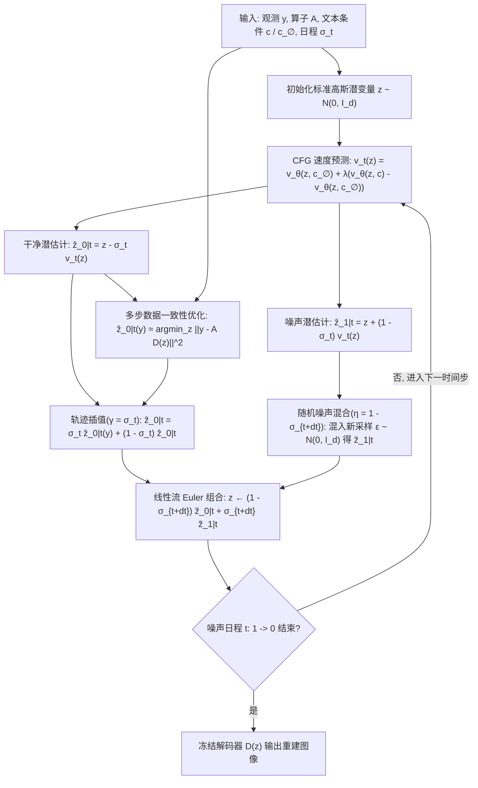

# FlowDPS: Flow-Driven Posterior Sampling for Inverse Problems

# First Time

## 1.Title & Authors
论文原标题：FlowDPS: Flow-Driven Posterior Sampling for Inverse Problems。
自然中文译法：FlowDPS：面向逆问题的流驱动后验采样。
把标题拆成三个核心词，就能立刻抓住全篇的骨架：
- Inverse Problems（逆问题）：手里只有经过降采样、模糊和加噪的退化观测图 $\boldsymbol{y}=\boldsymbol{A}\boldsymbol{x}_0+\boldsymbol{n}$，要反推原本清晰的原图 $\boldsymbol{x}_0$。由于降质过程丢掉了大量高频信息，无数张不同的原图都能对应同一张坏图，单靠“求逆”算不回来，必须借用强生成先验把合理细节补齐。
- Posterior Sampling（后验采样）：同时满足两个条件——生成结果既要“像真实世界的自然清晰图”（数据先验），又要“再套一遍已知退化算子 $\boldsymbol{A}$ 后，和手里的观测图 $\boldsymbol{y}$ 对得上”（测量似然）。
- Flow-Driven（流驱动）：本文不再局限于扩散模型（Diffusion Models），而是把这套后验采样思路系统搬进当前主流的流生成模型（Flow Matching / Rectified Flow，如 Stable Diffusion 3.0 与 FLUX）。标题最核心的主张是：把流模型的常微分方程（ODE）更新拆成“干净图像”和“噪声”两条独立支路，就能像扩散后验采样一样优雅地注入观测约束和随机探索，免训练实现高分辨率逆问题恢复。
作者按原文顺序列出：Jeongsol Kim、Bryan Sangwoo Kim、Jong Chul Ye。Jeongsol Kim 隶属 KAIST 生物与脑工程系（Department of Bio and Brain Engineering），Bryan Sangwoo Kim 与 Jong Chul Ye 隶属 KAIST 金在哲人工智能研究生院（Kim Jaechul Graduate School of AI）。原文脚注明确标注 Jeongsol Kim 与 Bryan Sangwoo Kim 为共同第一作者（Equal contribution）。从论文参考文献可知，Jong Chul Ye 与 Jeongsol Kim 所在的 KAIST 团队正是经典扩散逆问题求解器 DPS（参考文献 [3]，ICLR 2023）、MCG（参考文献 [2]）、DDS（参考文献 [5]，ICLR 2024）以及 TReg/DreamSampler（参考文献 [8, 9]）的核心作者群体；FlowDPS 可以看作这条经典研究主线向流匹配大模型时代的直接延伸。

## 2.Abstract
摘要的叙事节奏非常干脆，顺着“流模型兴起 → 逆问题缺口 → 核心分解招式 → 两条支路分别动手 → 接入潜空间大模型 → 实测战果”六步推进。下面按语义单元逐句拆透：
1. 生成范式背景：流匹配（Flow Matching）是当前领先的基于常微分方程（ODE）的生成建模框架。它与扩散模型（Diffusion Models）血脉相连，但用“概率路径 + 速度场”提供了更统一的生成视角。
   直觉上可以这样区分两者：扩散模型习惯按固定噪声表一步步去噪；流匹配直接学一个速度场 $v_t$，像导航仪一样指明每个时刻该往哪个方向飞，把高斯噪声沿更直的轨迹平滑送到数据分布。
2. 点出研究缺口：虽然扩散模型在逆问题恢复上已经百花齐放，但把逆问题求解放到更广义的流模型框架里做系统剖析的工作还很少。
   换句话说，大家手里都有了 SD3、FLUX 这样画质惊人的流模型底座，但“到底该怎么把观测约束塞进流 ODE，并且说清它和贝叶斯后验采样的数学关系”还没打通。
3. 确定迁移主线：作者把“结合去噪先验与似然梯度做后验采样”的扩散逆问题求解器（Diffusion Inverse Solvers, DIS，代表作即 DPS）系统推广到流模型框架中。
   全篇要解的核心命题就这一句话：如何在流模型的采样轨道上，同时听从先验速度场和观测似然梯度的指挥。
4. 亮出核心招式（流版 Tweedie 公式与 ODE 分解）：通过推导流版本的 Tweedie 公式，作者把原本混在一起的流 ODE 单步更新，干净利落地拆成了两块——一块是当前时刻对“干净图像”的估计，另一块是对“端点噪声”的估计。
   这个拆法非常妙：没拆之前，流模型只给你一个笼统的速度向量，你不知道该往哪儿加观测梯度、也不知道怎么加随机性；拆成“干净底稿 + 残余噪声”两截之后，每截该干什么一目了然。
5. 双管齐下的修正策略：作者把“似然梯度”精准打在干净图像估计上，把“随机噪声”精准混入噪声估计里（原文用 respectively 严格一一对应）。
   干净支路专管数据一致性（对上观测），噪声支路专管注入随机性（消除确定性 ODE 伪影、提升生成质量），这是 FlowDPS 最核心、也最好记的机制。
   注意区分两种噪声：观测模型里的 $\boldsymbol{n}$ 是成像硬件带来的真实退化噪声；混入噪声支路的 $\boldsymbol{\epsilon}$ 是采样器主动注入的随机探索噪声，用来帮采样摆脱伪影。
6. 无缝对接潜空间流大模型：FlowDPS 可以直接接入采用 Transformer 架构的潜空间流模型（实验主干为 Stable Diffusion 3.0-medium，附录还展示了 FLUX 1.0-schnell）。
   潜空间模型大幅降低了高分辨率（如 $768\times 768$、$1024\times 1408$）的内存与计算压力，并且天然支持文本提示引导；做数据一致性时只需把干净潜变量送进固定解码器，再套已知退化算子与观测对比即可。
7. 实验战绩与零训练特性：在四种线性逆问题上，FlowDPS 无需针对任务做任何额外训练（直接冻结预训练大模型权重），表现超越现有主流基线。
   对照正文 Section 4.2 和 [Table1 精读](#table1) 可知，四种任务分别是 12 倍平均池化超分、12 倍双三次超分、高斯去模糊和运动去模糊。跨三个数据集共 12 组评测中，FlowDPS 包揽全部 12 组感知指标（FID、LPIPS）第一和 11 组 PSNR 第一（仅 AFHQ 运动去模糊的 PSNR 略低于 FlowChef）；而 SSIM 上若干模糊基线得分偏高，体现了强生成模型恢复中典型的“感知—失真权衡”。
8. 开源说明：作者公开了代码仓库地址 `https://github.com/FlowDPS-Inverse/FlowDPS`。
把摘要收束为四要素速览表：

| 要素 | 本文核心内容 |
|---|---|
| 问题 | 如何把扩散逆问题求解器的后验采样范式系统迁移到流匹配模型，在免训练前提下恢复高分辨率、强退化的带噪观测图像。 |
| 方法 | 提出 FlowDPS：推导流版 Tweedie 公式，把流 ODE 单步更新拆解为干净图像估计与噪声估计；前者施加似然梯度（潜空间为多步优化加随时间插值）保证数据一致，后者混入随机噪声改善生成质量。 |
| 结果 | 在 AFHQ、FFHQ、DIV2K 三个 $768\times 768$ 数据集、四种线性逆问题上，包揽全部 12 组 FID/LPIPS 最优和 11 组 PSNR 最优，并在附录展示了 $1024\times 1408$ 高清去模糊与 FLUX 适配效果。 |
| 意义 | 打通了流匹配 ODE 与贝叶斯后验采样之间的理论桥梁，给出了一套结构清晰、可即插即用于 SD3.0 与 FLUX 等现代潜空间流大模型的逆问题求解框架。 |

## 3.Conclusion
原文 Section 5 为单段式的独立 Conclusion，文字紧凑，顺着六层意思给全篇收尾：
1. 回应研究缺口：指出当前急需一套面向流生成模型的通用逆问题求解框架，直接把潜空间扩散（LDM）的旧求解器硬搬到流模型上效果明显掉队。这里的“通用”指同一套框架只需替换已知前向算子 $\boldsymbol{A}$，就能统一应对多种线性退化（本文实证了两种 12 倍超分与两种去模糊）。
2. 重申方法核心：再次点明 FlowDPS 的灵魂在于把流 ODE 精确拆解为“干净图像估计”与“噪声估计”两个组成部分。这种分解把原本黑箱式的轨迹推动，变成了职责分明的双支路接口。
3. 点明双支路精准调控（targeted manipulation）：对干净估计注入观测一致性约束（在潜空间实现中落脚为多步梯度优化加随时间衰减的插值融合），对噪声估计混入随机噪声以维持自然纹理与生成质量。
4. 概括实验支撑：强调 FlowDPS 即使面对严重退化的高分辨率图像，仍能在线性逆问题上取得领先的恢复效果。具体证据对应正文 $768\times 768$ 分辨率下的 [Table1 精读](#table1) 与 [Fig3 精读](#fig3)，以及验证插值与随机性必要性的 [Table2 精读](#table2)、[Fig4 精读](#fig4) 和 [Fig5 精读](#fig5)。
5. 理论与实践并重：作者将本文定位为“既有理论透视，又有实用算法”——一方面借助流版 Tweedie 关系、高斯 score 恒等式和仿射子空间流形假设，说明流模型后验采样的几何结构与扩散模型异曲同工；另一方面通过绕开速度网络雅可比反传、改在干净潜变量上做解码器优化，落成可直接跑在 SD3.0 和 FLUX 上的实用算法。
6. 开放展望：结尾期待这一框架能启发更广泛的应用方向，没有在结论段落单列局限清单或具体后续计划（实测局限与理论核对点我们在 Second Time 中逐项拆解）。
总体来看，结论与摘要高度同频，牢牢扣紧“流 ODE 分解 → 双支路分别注入数据一致与随机性 → 高分辨率潜流模型落地”这条主线。

## 4.Analogy
可以把 FlowDPS 想象成“两位搭档一起在透明双层画板上修复一张严重糊掉的老照片”：
- 预训练流模型是经验老到的修复画师，从一团随机雪花噪点出发，一步步把画面画清。如果按普通流 ODE 的做法，每走一步只是笼统地把整张画往前推一点点，你很难插手去改它。
- FlowDPS 的第一招“分解”，相当于把画师每一步的草稿拆成两张透明胶片：底下一张叫“当前预测的清晰成品稿”（干净图像估计 $\hat{\boldsymbol{x}}_{0\mid t}$），上面盖着一张叫“还没擦干净的草稿噪点层”（噪声估计 $\hat{\boldsymbol{x}}_{1\mid t}$）。平时画师只是按比例把两张胶片叠在一起，准备画下一步。
- FlowDPS 的第二招“分头加工”，让两张胶片各司其职：
  - 对底下的“清晰成品稿”，你拿出老照片（观测 $\boldsymbol{y}$）比对一番，把画歪了的五官轮廓、建筑位置照着观测往回拉几下（似然梯度 / 数据一致性优化），同时用一根随时间变松的橡皮筋把它和画师原稿折中融合（前期死死咬住观测定好大结构，后期松手让画师自由雕琢毛发和皮肤纹理）。
  - 对上面的“噪点层”，你每次都抖掉一部分死板不变的旧噪点，撒进一点新鲜随机噪点（随机噪声混合 $\tilde{\boldsymbol{x}}_{1\mid t}$），这样画师下一步重画时不会死磕在局部网格伪影里，画出来的皮肤和纹理更加自然生动。
- 加工完两张胶片后，再按下一时刻的透明度重新叠在一起，交回画师继续画下一轮，直到噪点层完全褪去，露出最终高清修复图。
这个比喻的对应非常贴切：老照片是测量 $\boldsymbol{y}$，两张透明胶片分别是 $\hat{\boldsymbol{x}}_{0\mid t}$ 与 $\hat{\boldsymbol{x}}_{1\mid t}$，照观测拉位置是数据一致性更新，撒新噪点是随机混合。类比的边界也清晰明了：真实算法运行在高维潜空间里，每次比对观测都必须经过预训练 VAE 解码器 $\mathcal{D}$ 把潜变量画成像素图才能算误差，而且 12 倍超分丢失的信息不可能唯一还原，画师补出的高清纹理是在先验和观测共同约束下的合理生成。

# Second Time

## 1.Notation & Parameters
全文的数学主线非常清楚，可以串成五站：“观测建模 → 流匹配与仿射路径 → ODE 分解与 Tweedie 估计 → 后验速度与流形近似 → 潜空间实现”。下表整理了读懂全文最核心的符号与参数，全部严格沿用论文原记号：

| 符号/参数 | 含义与作用 | 关键设定/约束 |
|---|---|---|
| $\boldsymbol{x}_0,\boldsymbol{y},\boldsymbol{A},\boldsymbol{n}$ | 真实清晰图像、退化观测、已知线性前向算子、测量噪声 | $\boldsymbol{x}_0\in\mathbb{R}^d$，$\boldsymbol{y},\boldsymbol{n}\in\mathbb{R}^m$，$\boldsymbol{A}\in\mathbb{R}^{m\times d}$；观测方程 $\boldsymbol{y}=\boldsymbol{A}\boldsymbol{x}_0+\boldsymbol{n}$ |
| $\sigma_n$ | 观测高斯噪声的标准差 | $\boldsymbol{n}\sim\mathcal{N}(0,\sigma_n^2\boldsymbol{I}_m)$；主实验取 $\sigma_n=0.03$（原文口头称 variance，按协方差矩阵实为标准差） |
| $p,q,p_t$ | 源噪声分布、目标数据分布、时刻 $t$ 的边缘概率分布 | 边界 $p_1=p=\mathcal{N}(0,\boldsymbol{I})$，$p_0=q$，$0\le t\le 1$；时间倒序，生成方向 $t:1\to 0$ |
| $X_1,X_0,X_t$；$\boldsymbol{x}_1,\boldsymbol{x}_0,\boldsymbol{x}_t$ | 源端、数据端、中间时刻的随机变量及对应样本 | $\boldsymbol{x}_1$ 是流生成源端的标准高斯噪声，区别于物理测量噪声 $\boldsymbol{n}$ |
| $\psi_t,\dot{\psi}_t$ | 随时间变化的流映射及其对时间的导数 | $\psi_t(X_1):=X_t$，$\psi_1(\boldsymbol{x})=\boldsymbol{x}$；条件流写为 $\psi_t(\boldsymbol{x}\mid\boldsymbol{x}_0)$，$\dot{\psi}_t=d\psi_t/dt$ |
| $v_t,v_t^\theta,\theta$ | 理论边缘速度场、神经网络预测速度场及参数 | 预训练用条件流匹配回归 $v_t^\theta$；FlowDPS 推理时冻结 $\theta$（Algorithm 1 中写作粗体 $\boldsymbol{v}_t,\boldsymbol{v}_\theta$） |
| $a_t,b_t,\dot{a}_t,\dot{b}_t$ | 仿射条件路径的时间系数及其时间导数 | $\boldsymbol{x}_t=a_t\boldsymbol{x}_0+b_t\boldsymbol{x}_1$；边界 $a_0=1,b_0=0,a_1=0,b_1=1$；线性路径 $a_t=1-t,b_t=t$ |
| $dt,C_1(t),C_2(t)$ | 离散 Euler 步长，以及分解更新的两个权重系数 | $dt<0$；$C_1(t)=a_t+\dot{a}_t dt$，$C_2(t)=b_t+\dot{b}_t dt$；线性路径下精确等于 $a_{t+dt},b_{t+dt}$ |
| $\hat{\boldsymbol{x}}_{0\mid t},\hat{\boldsymbol{x}}_{1\mid t}$ | 给定中间状态 $\boldsymbol{x}_t$ 的干净图像条件均值、端点噪声条件均值 | $\hat{\boldsymbol{x}}_{0\mid t}:=\mathbb{E}[\boldsymbol{x}_0\mid\boldsymbol{x}_t]$，$\hat{\boldsymbol{x}}_{1\mid t}:=\mathbb{E}[\boldsymbol{x}_1\mid\boldsymbol{x}_t]$；由 Proposition 1 算得 |
| $\tilde{\boldsymbol{x}}_{0\mid t},\tilde{\boldsymbol{x}}_{1\mid t}$ | 经似然梯度修正后的干净估计、混入随机性后的噪声估计 | 分别替换原分解更新的两条分支，组合成下一步状态 $\boldsymbol{x}_{t+dt}$ |
| $\eta_t,\boldsymbol{\epsilon},k_t$ | 噪声混合的随机强度、新采样的标准高斯噪声、DDIM 形式系数 | $\boldsymbol{\epsilon}\sim\mathcal{N}(0,\boldsymbol{I})$，$0\le\eta_t\le 1$；$k_t=C_2(t)\sqrt{\eta_t}$；潜空间实现记作 $\eta=1-\sigma_{t+dt}$ |
| $J_\theta(\boldsymbol{x}_t),\mathcal{M},\mathcal{P}_{\mathcal{M}}$ | 干净估计对 $\boldsymbol{x}_t$ 的雅可比矩阵、干净数据流形及其正交投影算子 | $J_\theta(\boldsymbol{x}_t)=\partial\hat{\boldsymbol{x}}_{0\mid t}/\partial\boldsymbol{x}_t$；Proposition 2 在仿射子空间假设下得 $J_\theta(\boldsymbol{x}_t)=\frac{1}{a_t}\mathcal{P}_{\mathcal{M}}$ |
| $\zeta_t,\beta_t$ | 后验速度里的似然引导系数、折入干净分支的自适应步长系数 | $\beta_t:=\frac{\zeta_t}{a_t}\frac{dt}{C_1(t)}$；正文印刷的 $\zeta_t$ 存在 $\dot{a}_t b_t$ 与 $\dot{b}_t b_t$ 的笔误差异，第 8 节详核 |
| $\mathcal{E}_\phi,\mathcal{D}_\varphi$（简写 $\mathcal{E},\mathcal{D}$） | 预训练 VAE 编码器与解码器 | 推理时参数 $\phi,\varphi$ 全程冻结，简写为 $\mathcal{E},\mathcal{D}$ |
| $\boldsymbol{z}_0,\boldsymbol{z}_t,\hat{\boldsymbol{z}}_{0\mid t},\hat{\boldsymbol{z}}_{1\mid t}$ | 干净潜变量、中间潜状态，及其对应的干净估计与噪声估计 | 与图像空间完全同构；测量残差通过解码器映射 $\boldsymbol{A}\mathcal{D}(\hat{\boldsymbol{z}}_{0\mid t})$ 计算 |
| $\hat{\boldsymbol{z}}_{0\mid t}(\boldsymbol{y}),\tilde{\boldsymbol{z}}_{0\mid t},\gamma$ | 多步数据一致性优化后的潜估计、与原估计插值后的结果、插值系数 | $\tilde{\boldsymbol{z}}_{0\mid t}=(1-\gamma)\hat{\boldsymbol{z}}_{0\mid t}+\gamma\hat{\boldsymbol{z}}_{0\mid t}(\boldsymbol{y})$；算法取 $\gamma=\sigma_t$（附录 9.1 也写 $\gamma_t$） |
| $\sigma_t$ | 线性流实现中的噪声时间日程 | 理论线性路径中 $\sigma_t=t$，从大到小递减；与测量噪声标准差 $\sigma_n$ 完全无关 |
| $c_\emptyset,c,\lambda$ | 空文本嵌入、条件文本嵌入、无分类器引导（CFG）强度 | 主实验默认 $\lambda=2.0$，主评测默认 $\mathrm{NFE}=28$ |

读公式前先盯牢两个最容易混淆的细节：第一，时间方向与常规 Flow Matching 论文相反——本文特意令 $t=1$ 是纯高斯噪声、$t=0$ 是干净图像，生成过程沿时间倒走（$t:1\to 0$），所以步长 $dt<0$；第二，$\sigma_n$ 是观测图里的物理噪声标准差（固定小常数 $0.03$），而 $\sigma_t$ 是流模型的采样噪声日程（从 $1$ 降到 $0$），千万别串台。

## 2.Introduction
对应原文 Section 1。引言顺着“逆问题定义 → 从正则化到潜空间扩散 → 流模型时代的求解缺口 → FlowDPS 核心思路”铺开，目标非常明确：把大家在扩散模型上玩得滚瓜烂熟的后验采样，真正搬进流匹配大模型里。
1. 线性逆问题设定——公式（1）：
$$
\boldsymbol{y}=\boldsymbol{A}\boldsymbol{x}_0+\boldsymbol{n}\in\mathbb{R}^m,
$$
其中 $\boldsymbol{x}_0\in\mathbb{R}^d$ 是待恢复的真实清晰图像，$\boldsymbol{A}\in\mathbb{R}^{m\times d}$ 是已知的线性成像/退化算子（如降采样、高斯模糊或运动模糊），$\boldsymbol{n}\in\mathbb{R}^m\sim\mathcal{N}(0,\sigma_n^2\boldsymbol{I}_m)$ 是各向同性高斯观测噪声（正文紧跟其后将 $\sigma_n$ 误写为 variance，按协方差矩阵 $\sigma_n^2\boldsymbol{I}_m$ 应理解为标准差）。
为什么逆问题难？因为 $\boldsymbol{A}$ 常常不可逆甚至大幅降维，叠加噪声后，满足观测的候选原图无穷多（病态性）。几何上看，无噪声理想情况把解限定在仿射集合 $\boldsymbol{y}-\boldsymbol{A}\boldsymbol{x}_0=0$ 上；单靠这个线性方程组根本挑不出唯一好图，必须借用自然图像先验分布 $q(\boldsymbol{x}_0)$，从中找出既合理又最贴近观测约束的解。
2. 从传统 MAP 到潜空间扩散求解器：
   - 早期最大后验（MAP）方法靠手写正则项（如平滑先验、稀疏先验）缩小解空间，但表达力有限。
   - 扩散模型崛起后，DPS、MCG、$\Pi$GDM、DDNM 等方法在采样轨迹里注入观测引导，直接从先验分布 $q(\boldsymbol{x}_0)$ 做后验采样，效果大幅超越传统方法。
   - 随后基础模型全面迈入潜空间扩散时代（LDMs），借助大规模图文预训练先验，涌现出 PSLD、ReSample、DAPS 等零样本潜空间求解器，以及引入文本条件约束的 P2L、TReg、DreamSampler，成功把逆问题推向高分辨率场景。
3. 流模型崛起后的新缺口：
   基础生成模型已经迅速转向 Flow-based Models 搭配可扩展的 Diffusion Transformer 架构（如 Stable Diffusion 3.0 与 FLUX）。但作者发现，把原本给 LDM 设计的逆问题求解器照搬到流模型上，性能明显水土不服；而少数面向流模型的新方法（如 FlowChef 在局部线性场与局部常雅可比假设下用条件损失梯度推速度场，PnP-Flow 把流模型塞进即插即用去噪框架）多偏启发式构造，并没有说清楚“流模型里到底怎样严格对应贝叶斯后验采样”。
4. 本文的破题路线与贡献：
   作者先系统梳理流框架下的后验采样理论，再推出 FlowDPS：借助流版 Tweedie 公式把流 ODE 拆成“干净图像估计”和“噪声估计”两条支路——干净支路吃下似然梯度对齐观测，噪声支路混入随机噪声保住画质——由此证明流 ODE 的逆问题采样几何和扩散模型如出一辙，并顺畅接入 SD3.0 与 FLUX 等潜空间大模型。开篇的直观恢复效果见 [Fig1 精读](#fig1)，全数据集定量对比见 [Table1 精读](#table1)。

## 3.Background
对应原文 Section 2。这一章只有两小节，专门为后面拆解 ODE 准备数学零件：第一小节复习一般 Flow Matching 的速度场与条件流训练；第二小节聚焦实际大模型普遍采用的仿射条件流（Affine conditional flows），写明插值系数 $a_t,b_t$ 和线性路径。

## 4.Flow-based Models and Flow Matching
对应原文 Section 2 第一部分。先把流模型的物理画面立起来：想象空间 $\mathbb{R}^d$ 里有一团从源分布 $p$ 撒出来的尘埃（高斯噪声），有一阵随时间变化的风（速度场 $v_t$）吹动这些尘埃，让它们顺着各自轨迹飘移，最后正好聚成目标分布 $q$ 的样子（自然图像）。
1. 概率路径与时间约定：
   记源分布为 $p$、目标数据分布为 $q$，随机变量 $X_1\sim p$、$X_0\sim q$。定义一个随时间 $t\in[0,1]$ 变化的流映射 $\psi:(\boldsymbol{x},t)\mapsto\psi_t(\boldsymbol{x})$，把源分布搬运到中间时刻分布 $p_t$：
   $\psi_t(X_1):=X_t\sim p_t$，满足边界条件 $p_1=p$ 与 $p_0=q$。
   正如原文脚注提醒，常规 Flow Matching 论文常把噪声放 $t=0$、数据放 $t=1$，本文特意对调编号以贴合 SD3 等实际代码习惯，因此生成采样是从 $t=1$ 倒走到 $t=0$。
2. 流 ODE 定义——公式（2）：
$$
\frac{d\psi_t(\boldsymbol{x})}{dt}=v_t(\psi_t(\boldsymbol{x})),\qquad \text{where}\quad \psi_1(\boldsymbol{x})=\boldsymbol{x}.
$$
   直觉非常直白：对从源点 $\boldsymbol{x}$ 出发的粒子，它在时刻 $t$ 的位置是 $\psi_t(\boldsymbol{x})$，它此刻运动的速度（位置对时间的导数）就等于速度场 $v_t$ 在它当前位置给出的风向风速；而在起点 $t=1$，粒子还没动，所以 $\psi_1(\boldsymbol{x})=\boldsymbol{x}$。
3. 从轨迹坐标换到空间坐标——公式（3）：
   如果我们站在空间里一个固定坐标 $\boldsymbol{x}'$ 问“此刻吹过 $\boldsymbol{x}'$ 的风速 $v_t(\boldsymbol{x}')$ 是多少？”，只需反查“哪一颗源粒子在时刻 $t$ 刚好飘到了 $\boldsymbol{x}'$”，即做变量代换 $\boldsymbol{x}=\psi_t^{-1}(\boldsymbol{x}')$，再看那颗粒子的瞬时时间导数 $\dot{\psi}_t=d\psi_t/dt$：
$$
v_t(\boldsymbol{x}')=v_t(\psi_t(\boldsymbol{x}))=\frac{d}{dt}\psi_t(\boldsymbol{x})=\dot{\psi}_t(\psi_t^{-1}(\boldsymbol{x}')).
$$
   这要求流映射在时刻 $t$ 可逆；$\psi_t^{-1}$ 只是把当前空间位置映射回出发点坐标。
4. 理想流匹配训练目标——公式（4）：
$$
\min_\theta \mathbb{E}_{t,\boldsymbol{x}_t\sim p_t}\lVert v_t(\boldsymbol{x}_t)-v_t^\theta(\boldsymbol{x}_t)\rVert^2.
$$
   训练目标就是让神经网络 $v_t^\theta$ 直接拟合真实的边缘速度场 $v_t$。但麻烦在于，边缘速度场 $v_t(\boldsymbol{x}_t)$ 是经过 $\boldsymbol{x}_t$ 的所有可能数据路径速度的复杂平均，根本算不出来。
5. 绕过难关：条件速度场与条件流匹配——公式（5）与公式（6）：
   既然不知道整片森林的全局风场，那就先把终点盯死在某一张已知训练图 $\boldsymbol{x}_0$ 上！固定 $\boldsymbol{x}_0$ 后，构造一条简单的条件流 $\psi_t(\boldsymbol{x}\mid\boldsymbol{x}_0)$ 生成条件路径 $p_t(\boldsymbol{x}\mid\boldsymbol{x}_0)$，照搬式（3）立刻就能写出解析可算的条件速度场——公式（5）：
$$
v_t(\boldsymbol{x}\mid\boldsymbol{x}_0)=\dot{\psi}_t\bigl(\psi_t^{-1}(\boldsymbol{x}\mid\boldsymbol{x}_0)\mid\boldsymbol{x}_0\bigr).
$$
   于是用它替代式（4）里的未知真值，得到可实际训练的条件流匹配（CFM）损失——公式（6）：
$$
\min_\theta \mathbb{E}_{t,\boldsymbol{x}\sim p_{t\mid 0}(\boldsymbol{x}_t\mid\boldsymbol{x}_0)}\lVert v_t(\boldsymbol{x}_t\mid\boldsymbol{x}_0)-v_t^\theta(\boldsymbol{x}_t)\rVert^2.
$$
   注：原文期望下标为紧凑写法，完整采样顺序是先抽时间 $t$ 和数据 $\boldsymbol{x}_0\sim q$，再从 $p_{t\mid 0}(\boldsymbol{x}_t\mid\boldsymbol{x}_0)$ 抽 $\boldsymbol{x}_t$。
   为什么拿“单样本条件速度”当标签训练，对参数 $\theta$ 的梯度竟然和拟合“全局边缘速度”完全一样？一步平方展开就彻底看清！利用后文式（11）的条件均值关系 $v_t(\boldsymbol{x}_t)=\mathbb{E}[v_t(\boldsymbol{x}_t\mid\boldsymbol{x}_0)\mid\boldsymbol{x}_t]$，在范数里先减再加一个 $v_t(\boldsymbol{x}_t)$ 并展开：
$$
\begin{aligned}
\mathbb{E}\lVert v_t(\boldsymbol{x}_t\mid\boldsymbol{x}_0)-v_t^\theta(\boldsymbol{x}_t)\rVert^2
&=\mathbb{E}\lVert \bigl(v_t(\boldsymbol{x}_t\mid\boldsymbol{x}_0)-v_t(\boldsymbol{x}_t)\bigr)+\bigl(v_t(\boldsymbol{x}_t)-v_t^\theta(\boldsymbol{x}_t)\bigr)\rVert^2\\
&=\mathbb{E}\lVert v_t(\boldsymbol{x}_t\mid\boldsymbol{x}_0)-v_t(\boldsymbol{x}_t)\rVert^2
+\mathbb{E}\lVert v_t(\boldsymbol{x}_t)-v_t^\theta(\boldsymbol{x}_t)\rVert^2\\
&\quad+2\,\mathbb{E}\Bigl[\bigl\langle v_t(\boldsymbol{x}_t\mid\boldsymbol{x}_0)-v_t(\boldsymbol{x}_t),\,v_t(\boldsymbol{x}_t)-v_t^\theta(\boldsymbol{x}_t)\bigr\rangle\Bigr].
\end{aligned}
$$
   对交叉项先固定 $\boldsymbol{x}_t$ 取条件期望：后半个括号只依赖 $\boldsymbol{x}_t$ 可以提出来，前半个括号的条件期望 $\mathbb{E}[v_t(\boldsymbol{x}_t\mid\boldsymbol{x}_0)\mid\boldsymbol{x}_t]-v_t(\boldsymbol{x}_t)=0$，交叉项直接归零！剩下的第一项不含参数 $\theta$，求梯度也是零，所以式（6）与式（4）对 $\theta$ 的梯度完全相等。

## 5.Affine conditional flows
对应原文 Section 2 第二部分。理论框架搭好了，实践中大家怎么设计条件流 $\psi_t(\boldsymbol{x}\mid\boldsymbol{x}_0)$？最主流、也是 SD3 和 FLUX 采用的，就是极其简洁的“仿射条件流”——把干净图和噪声做加权线性叠加！
1. 独立耦合与仿射条件流——公式（7）：
   先规定源端和目标端独立采样：$\pi_{0,1}(\boldsymbol{x}_0,\boldsymbol{x}_1)=q(\boldsymbol{x}_0)p(\boldsymbol{x}_1)$，其中源分布为标准高斯 $p(\boldsymbol{x}_1)=\mathcal{N}(0,\boldsymbol{I})$。接着用两个只依赖时间的标量日程函数 $a_t,b_t$ 构造仿射条件流：
$$
\psi_t(\boldsymbol{x}\mid\boldsymbol{x}_0)=a_t\boldsymbol{x}_0+b_t\boldsymbol{x},
$$
   配边界条件 $a_0=1,b_0=0$ 与 $a_1=0,b_1=1$。代进去立刻验证：在 $t=0$ 时 $\psi_0(\boldsymbol{x}\mid\boldsymbol{x}_0)=\boldsymbol{x}_0$（精准收拢到目标图）；在 $t=1$ 时 $\psi_1(\boldsymbol{x}\mid\boldsymbol{x}_0)=\boldsymbol{x}$（原封不动留在源噪声点）。
2. 前向路径与条件速度——公式（8）与公式（9）：
   把一个具体的源噪声样本 $\boldsymbol{x}_1\sim p$ 代进式（7），得到时刻 $t$ 的中间带噪样本——公式（8）：
$$
\boldsymbol{x}_t=\psi_t(\boldsymbol{x}_1\mid\boldsymbol{x}_0)=a_t\boldsymbol{x}_0+b_t\boldsymbol{x}_1.
$$
   把端点 $\boldsymbol{x}_0,\boldsymbol{x}_1$ 钉住，直接对式（8）关于时间 $t$ 求导，只有标量系数被求导，立刻拿到条件速度——公式（9）：
$$
v_t(\boldsymbol{x}_t\mid\boldsymbol{x}_0)=\dot{\psi}_t(\boldsymbol{x}_1\mid\boldsymbol{x}_0)=\dot{a}_t\boldsymbol{x}_0+\dot{b}_t\boldsymbol{x}_1.
$$
   注意在 $b_t\neq 0$ 的中间时刻，由式（8）就能反解出源点 $\boldsymbol{x}_1=(\boldsymbol{x}_t-a_t\boldsymbol{x}_0)/b_t$；严格来说 $\dot{\psi}_t$ 评价在源点 $\boldsymbol{x}_1$ 上，后文部分地方简写成 $\dot{\psi}_t(\boldsymbol{x}_t\mid\boldsymbol{x}_0)$，按条件轨迹速度理解即可。
3. 最常用的特例：线性条件流——公式（10）：
   取最直白的一条直线插值 $a_t=1-t$、$b_t=t$，于是 $\dot{a}_t=-1$、$\dot{b}_t=1$，样本路径变成 $\boldsymbol{x}_t=(1-t)\boldsymbol{x}_0+t\boldsymbol{x}_1$，条件速度恒定为 $v_t(\boldsymbol{x}_t\mid\boldsymbol{x}_0)=\boldsymbol{x}_1-\boldsymbol{x}_0$（方向从干净图指向噪声）。代回式（6）就得到大名鼎鼎的 Rectified Flow / 线性流匹配训练损失：
$$
\min_\theta \mathbb{E}_{t,\boldsymbol{x}\sim p_{t\mid 0}}\lVert v_t^\theta(\boldsymbol{x}_t)-(\boldsymbol{x}_1-\boldsymbol{x}_0)\rVert^2.
$$
   作者在结尾敲了一个非常关键的警钟：虽然训练标签是单对样本的直线差 $\boldsymbol{x}_1-\boldsymbol{x}_0$，但因为无数条不同样本的直线会穿过同一个中间点 $\boldsymbol{x}_t$，平方损失逼出来的神经网络 $v_t^\theta(\boldsymbol{x}_t)$ 学到的是边缘速度 $v_t(\boldsymbol{x}_t)$（所有可能路径的条件平均），而不是某一条直线的条件速度 $v_t(\boldsymbol{x}_t\mid\boldsymbol{x}_0)$。这一认识恰好就是下一节推导 Tweedie 公式的基石。

## 6.Main Contribution
对应原文 Section 3。这是全篇最硬核的四节，逻辑层层递进：
- 3.1 节：把无条件流 ODE 单步更新劈成“干净估计 + 噪声估计”两半，并把随机噪声接入噪声支路；
- 3.2 节：推导出测量条件下的后验速度场，借 DPS 近似和仿射流形雅可比近似，把似然梯度干净利落地塞进干净支路；
- 3.3 节：与 FlowChef 正面对照，说清分解带来的自适应步长和随机性红利；
- 3.4 节：把像素空间的理论公式落地到 SD3/FLUX 这类潜空间大模型，加入多步优化和随日程插值，形成最终可跑的 Latent FlowDPS。

## 7.Decomposition of Flow ODE
对应原文 Section 3.1。这一节做了一件极其漂亮的事情：只用初等二元一次方程消元，就把黑箱似的流速度 $v_t(\boldsymbol{x}_t)$ 彻底解剖成“对干净图的猜测”和“对噪声的猜测”。
1. 边缘速度的条件期望拆解——公式（11）：
   给定中间位置 $\boldsymbol{x}_t=\boldsymbol{x}$，把式（9）的条件速度做条件平均，把只依赖时间的 $\dot{a}_t,\dot{b}_t$ 提出期望外：
$$
\begin{aligned}
v_t(\boldsymbol{x})
&=\mathbb{E}[v_t(\boldsymbol{x}_t\mid\boldsymbol{x}_0)\mid\boldsymbol{x}_t=\boldsymbol{x}]
=\mathbb{E}[\dot{\psi}_t(\boldsymbol{x}_t\mid\boldsymbol{x}_0)\mid\boldsymbol{x}_t=\boldsymbol{x}]\\
&=\dot{a}_t\mathbb{E}[\boldsymbol{x}_0\mid\boldsymbol{x}_t=\boldsymbol{x}]+\dot{b}_t\mathbb{E}[\boldsymbol{x}_1\mid\boldsymbol{x}_t=\boldsymbol{x}].
\end{aligned}
$$
   一眼就能看出对称之美：现在我们手里对同一个状态 $\boldsymbol{x}_t$ 握着两条线性方程，未知数正好是两个条件均值 $\mathbb{E}[\boldsymbol{x}_0\mid\boldsymbol{x}_t]$ 和 $\mathbb{E}[\boldsymbol{x}_1\mid\boldsymbol{x}_t]$！
   - 方程一（对式 8 取给定 $\boldsymbol{x}_t$ 的条件期望）：$\boldsymbol{x}_t = a_t\mathbb{E}[\boldsymbol{x}_0\mid\boldsymbol{x}_t] + b_t\mathbb{E}[\boldsymbol{x}_1\mid\boldsymbol{x}_t]$；
   - 方程二（式 11）：$v_t(\boldsymbol{x}_t) = \dot{a}_t\mathbb{E}[\boldsymbol{x}_0\mid\boldsymbol{x}_t] + \dot{b}_t\mathbb{E}[\boldsymbol{x}_1\mid\boldsymbol{x}_t]$。
2. 流版 Tweedie 公式——Proposition 1（两条无编号公式）：
   两个未知数、两条线性方程，直接做加减消元即可求解！
   - 消去 $\mathbb{E}[\boldsymbol{x}_1\mid\boldsymbol{x}_t]$：拿“方程一”减去 $\frac{b_t}{\dot{b}_t}$ 倍的“方程二”：
$$
\boldsymbol{x}_t-\frac{b_t}{\dot{b}_t}v_t(\boldsymbol{x}_t)
=\left(a_t-\dot{a}_t\frac{b_t}{\dot{b}_t}\right)\mathbb{E}[\boldsymbol{x}_0\mid\boldsymbol{x}_t],
$$
     两边同除以标量系数 $\left(a_t-\dot{a}_t\frac{b_t}{\dot{b}_t}\right)$，立刻得出干净图像估计：
$$
\mathbb{E}[\boldsymbol{x}_0\mid\boldsymbol{x}_t]
=\left[a_t-\dot{a}_t\frac{b_t}{\dot{b}_t}\right]^{-1}\left(\boldsymbol{x}_t-\frac{b_t}{\dot{b}_t}v_t(\boldsymbol{x}_t)\right).
$$
   - 消去 $\mathbb{E}[\boldsymbol{x}_0\mid\boldsymbol{x}_t]$：拿“方程一”减去 $\frac{a_t}{\dot{a}_t}$ 倍的“方程二”：
$$
\boldsymbol{x}_t-\frac{a_t}{\dot{a}_t}v_t(\boldsymbol{x}_t)
=\left(b_t-\dot{b}_t\frac{a_t}{\dot{a}_t}\right)\mathbb{E}[\boldsymbol{x}_1\mid\boldsymbol{x}_t],
$$
     两边同除以标量系数 $\left(b_t-\dot{b}_t\frac{a_t}{\dot{a}_t}\right)$，立刻得出噪声估计：
$$
\mathbb{E}[\boldsymbol{x}_1\mid\boldsymbol{x}_t]
=\left[b_t-\dot{b}_t\frac{a_t}{\dot{a}_t}\right]^{-1}\left(\boldsymbol{x}_t-\frac{a_t}{\dot{a}_t}v_t(\boldsymbol{x}_t)\right).
$$
   这里按原式分母需要 $\dot{b}_t\neq 0$、$\dot{a}_t\neq 0$，以及线性方程组行列式非零 $a_t\dot{b}_t-b_t\dot{a}_t\neq 0$。物理直觉极爽：只要调一次流网络拿到速度 $v_t(\boldsymbol{x}_t)$，就能用零额外算力同时读出“模型觉得清晰图长啥样（$\hat{\boldsymbol{x}}_{0\mid t}:=\mathbb{E}[\boldsymbol{x}_0\mid\boldsymbol{x}_t]$）”和“模型觉得当前图里混着哪份噪声（$\hat{\boldsymbol{x}}_{1\mid t}:=\mathbb{E}[\boldsymbol{x}_1\mid\boldsymbol{x}_t]$）”。
3. 劈开 Euler 单步更新——公式（12）与公式（13）：
   用最标准的 Euler 数值积分走一步流 ODE（因为从 $t=1$ 倒走到 $t=0$，步长 $dt<0$），得到式（12），再把 $\boldsymbol{x}_t=a_t\hat{\boldsymbol{x}}_{0\mid t}+b_t\hat{\boldsymbol{x}}_{1\mid t}$ 和 $v_t(\boldsymbol{x}_t)=\dot{a}_t\hat{\boldsymbol{x}}_{0\mid t}+\dot{b}_t\hat{\boldsymbol{x}}_{1\mid t}$ 直接代进去合并同类项，瞬间得到式（13）：
$$
\begin{aligned}
\boldsymbol{x}_{t+dt}
&=\boldsymbol{x}_t+v_t(\boldsymbol{x}_t)dt\\
&=\bigl(a_t\hat{\boldsymbol{x}}_{0\mid t}+b_t\hat{\boldsymbol{x}}_{1\mid t}\bigr)
+\bigl(\dot{a}_t\hat{\boldsymbol{x}}_{0\mid t}+\dot{b}_t\hat{\boldsymbol{x}}_{1\mid t}\bigr)dt\\
&=(a_t+\dot{a}_t dt)\hat{\boldsymbol{x}}_{0\mid t}+(b_t+\dot{b}_t dt)\hat{\boldsymbol{x}}_{1\mid t}\\
&=C_1(t)\hat{\boldsymbol{x}}_{0\mid t}+C_2(t)\hat{\boldsymbol{x}}_{1\mid t},
\end{aligned}
$$
   其中定义了两个标量系数 $C_1(t)=a_t+\dot{a}_t dt$、$C_2(t)=b_t+\dot{b}_t dt$。
   停下来欣赏一下式（13）的威力：原本一步平平无奇的 Euler 更新，居然等价于“先一步跳到干净图像流形算出 $\hat{\boldsymbol{x}}_{0\mid t}$，再按新比例 $C_1(t),C_2(t)$ 重新拌回确定性噪声 $\hat{\boldsymbol{x}}_{1\mid t}$”！这和 DDIM 采样“去噪 $\to$ 重加噪”的几何结构完全一模一样（直观画面见 [Fig2 精读](#fig2) 左图）。
4. 给噪声支路注入随机探索——公式（14）、（15）与（16）：
   确定性 ODE 采样在逆问题里容易卡出网格和斑点伪影。既然式（13）把确定性噪声支路 $\hat{\boldsymbol{x}}_{1\mid t}$ 单独拎出来了，作者借鉴 DDIM/SDE 采样的随机性红利，把它替换成与全新标准高斯噪声 $\boldsymbol{\epsilon}\sim\mathcal{N}(0,\boldsymbol{I})$ 的球面保方差混合——公式（14）与公式（15）：
$$
\boldsymbol{x}_{t+dt}=C_1(t)\hat{\boldsymbol{x}}_{0\mid t}+C_2(t)\tilde{\boldsymbol{x}}_{1\mid t},
$$
$$
\tilde{\boldsymbol{x}}_{1\mid t}=\sqrt{1-\eta_t}\,\hat{\boldsymbol{x}}_{1\mid t}+\sqrt{\eta_t}\,\boldsymbol{\epsilon},\qquad \boldsymbol{\epsilon}\sim\mathcal{N}(0,\boldsymbol{I}),
$$
   其中 $0\le\eta_t\le 1$ 控制随机注入比例：$\eta_t=0$ 退回纯确定性 ODE；$\eta_t=1$ 则完全扔掉旧噪声估计、换上全新高斯噪声。两个平方根系数满足 $(1-\eta_t)+\eta_t=1$，保证在 $\hat{\boldsymbol{x}}_{1\mid t}$ 与 $\boldsymbol{\epsilon}$ 独立同方差的理想情况下混合后方差不变。
   把式（15）代回式（14），再设 $k_t=C_2(t)\sqrt{\eta_t}$（在 $C_2(t)\ge 0$ 下，附录 Section 6 展开），立刻化为与广义 DDIM 形式完全一致的公式（16）：
$$
\boldsymbol{x}_{t+dt}=C_1(t)\hat{\boldsymbol{x}}_{0\mid t}+\sqrt{C_2(t)^2-k_t^2}\,\hat{\boldsymbol{x}}_{1\mid t}+\sqrt{k_t^2}\,\boldsymbol{\epsilon}.
$$
   注意原文紧跟式（16）把系数写作 $C_1(t)=a_t+\dot{a}_t dt=a_{t+dt}$ 和 $C_2(t)=b_t+\dot{b}_t dt=b_{t+dt}$：在线性路径（$a_t=1-t,b_t=t$）下二阶导数为零，等号精确成立；对一般非线性日程，这只是一阶泰勒近似。这套随机噪声设计在 SD3.0 上的强实证效果见 [Table2 精读](#table2) 与 [Fig5 精读](#fig5)。

## 8.Posterior Sampling via Flow Models
对应原文 Section 3.2。上一节把无条件流 ODE 劈成了两半、修好了噪声支路；这一节进入重头戏——怎么从贝叶斯定理出发，把观测 $\boldsymbol{y}$ 接进流速度，并顺理成章地落到干净图像支路上？整个推导分三幕展开：“速度变 score → 借贝叶斯加观测 → 两重近似省算力并落入干净支路”。
1. 第一幕：把边缘速度改写成 score 形式——公式（17）与公式（18）：
   先从 $\boldsymbol{x}_t=a_t\mathbb{E}[\boldsymbol{x}_0\mid\boldsymbol{x}_t]+b_t\mathbb{E}[\boldsymbol{x}_1\mid\boldsymbol{x}_t]$ 解出 $\mathbb{E}[\boldsymbol{x}_0\mid\boldsymbol{x}_t]=\frac{1}{a_t}(\boldsymbol{x}_t-b_t\mathbb{E}[\boldsymbol{x}_1\mid\boldsymbol{x}_t])$（要求 $a_t\neq 0$），代入式（11）立刻消去干净均值，得到式（17）第一行：
$$
\begin{aligned}
v_t(\boldsymbol{x}_t)
&=\frac{\dot{a}_t}{a_t}\boldsymbol{x}_t+\left[\dot{b}_t-b_t\frac{\dot{a}_t}{a_t}\right]\mathbb{E}[\boldsymbol{x}_1\mid\boldsymbol{x}_t]\\
&=\frac{\dot{a}_t}{a_t}\boldsymbol{x}_t-\left[\dot{b}_t b_t-b_t^2\frac{\dot{a}_t}{a_t}\right]\nabla\log p_t(\boldsymbol{x}_t).
\end{aligned}
$$
   怎么从第一行跳到第二行的 score（概率密度的对数梯度 $\nabla_{\boldsymbol{x}_t}\log p_t(\boldsymbol{x}_t)$）？关键桥梁就是公式（18）：
   由仿射路径 $\boldsymbol{x}_t=a_t\boldsymbol{x}_0+b_t\boldsymbol{x}_1$ 且 $\boldsymbol{x}_1\sim\mathcal{N}(0,\boldsymbol{I})$，给定 $\boldsymbol{x}_0$ 时中间状态服从高斯分布 $p_t(\boldsymbol{x}_t\mid\boldsymbol{x}_0)=\mathcal{N}(\boldsymbol{x}_t\mid a_t\boldsymbol{x}_0,b_t^2\boldsymbol{I})$。对其对数密度求梯度（$b_t\neq 0$）：
$$
\nabla_{\boldsymbol{x}_t}\log p(\boldsymbol{x}_t\mid\boldsymbol{x}_0)=-\frac{1}{b_t^2}(\boldsymbol{x}_t-a_t\boldsymbol{x}_0)=-\frac{1}{b_t}\boldsymbol{x}_1.
$$
   再对边缘密度 $p_t(\boldsymbol{x}_t)=\int p_t(\boldsymbol{x}_t\mid\boldsymbol{x}_0)q(\boldsymbol{x}_0)\,d\boldsymbol{x}_0$ 取对数求梯度（利用 $\nabla p_t(\boldsymbol{x}_t\mid\boldsymbol{x}_0)=p_t(\boldsymbol{x}_t\mid\boldsymbol{x}_0)\nabla\log p_t(\boldsymbol{x}_t\mid\boldsymbol{x}_0)$ 与贝叶斯权重 $p(\boldsymbol{x}_0\mid\boldsymbol{x}_t)=\frac{p_t(\boldsymbol{x}_t\mid\boldsymbol{x}_0)q(\boldsymbol{x}_0)}{p_t(\boldsymbol{x}_t)}$），即得经典的去噪 score 恒等式——公式（18）：
$$
\nabla_{\boldsymbol{x}_t}\log p_t(\boldsymbol{x}_t)
=\mathbb{E}_{\boldsymbol{x}_0\sim q}[\nabla_{\boldsymbol{x}_t}\log p_t(\boldsymbol{x}_t\mid\boldsymbol{x}_0)\mid\boldsymbol{x}_t]
=-\frac{1}{b_t}\mathbb{E}[\boldsymbol{x}_1\mid\boldsymbol{x}_t].
$$
   由此 $\mathbb{E}[\boldsymbol{x}_1\mid\boldsymbol{x}_t]=-b_t\nabla_{\boldsymbol{x}_t}\log p_t(\boldsymbol{x}_t)$，代回式（17）第一行便得到第二行！
2. 第二幕：接入观测 $\boldsymbol{y}$ 与贝叶斯分解——公式（19）、（20）与（21）：
   把目标分布从无条件先验 $q(\boldsymbol{x}_0)$ 换成观测后验 $q(\boldsymbol{x}_0\mid\boldsymbol{y})$，沿同一套仿射加噪路径就能得到后验速度场 $v_t(\boldsymbol{x}_t\mid\boldsymbol{y})$。先看原文印刷的公式（19）：
$$
v_t(\boldsymbol{x}_t\mid\boldsymbol{y})=\frac{\dot{a}_t}{a_t}\boldsymbol{x}_t-\left[\dot{a}_t b_t-b_t^2\frac{\dot{a}_t}{a_t}\right]\nabla_{\boldsymbol{x}_t}\log p_t(\boldsymbol{x}_t\mid\boldsymbol{y}).
$$
   再对后验分布 $p_t(\boldsymbol{x}_t\mid\boldsymbol{y})\propto p_t(\boldsymbol{y}\mid\boldsymbol{x}_t)p_t(\boldsymbol{x}_t)$ 取对数关于 $\boldsymbol{x}_t$ 求梯度（分母 $p(\boldsymbol{y})$ 与 $\boldsymbol{x}_t$ 无关，求导消去），得到精确的贝叶斯 score 分解——公式（20）：
$$
\nabla_{\boldsymbol{x}_t}\log p_t(\boldsymbol{x}_t\mid\boldsymbol{y})=\nabla_{\boldsymbol{x}_t}\log p_t(\boldsymbol{y}\mid\boldsymbol{x}_t)+\nabla_{\boldsymbol{x}_t}\log p_t(\boldsymbol{x}_t).
$$
   把式（20）代回后验速度表达式，拆出原无条件速度 $v_t(\boldsymbol{x}_t)$ 与似然引导项，原文写作公式（21）：
$$
v_t(\boldsymbol{x}_t\mid\boldsymbol{y})=v_t(\boldsymbol{x}_t)-\zeta_t\nabla_{\boldsymbol{x}_t}\log p_t(\boldsymbol{y}\mid\boldsymbol{x}_t),
$$
   其中原文印刷 $\zeta_t=\dot{a}_t b_t-b_t^2\frac{\dot{a}_t}{a_t}$。
   精读逐式核对发现一处清晰的作者笔误：对照紧挨着的式（17）可以看出，方括号里第一项应当是 $\dot{b}_t b_t$，原文在抄写式（19）时把 $\dot{b}_t$ 误印成了 $\dot{a}_t$，并顺带把 $\zeta_t=\dot{a}_t b_t-b_t^2\frac{\dot{a}_t}{a_t}$ 带进了式（21）、式（26）和附录式（56）–（57）。如果保持与式（17）和式（20）严格代数一致，正确系数应为 $\zeta_t=\dot{b}_t b_t-b_t^2\frac{\dot{a}_t}{a_t}$。这个小笔误在线性路径下会带来意想不到的“好消息”，我们到式（28）立刻验证！
3. 第三幕：两重近似，绕开难算积分和沉重网络反传——公式（22）至（26）与 Proposition 2：
   式（21）虽然优雅，但中间态似然 $p_t(\boldsymbol{y}\mid\boldsymbol{x}_t)=\int p(\boldsymbol{y}\mid\boldsymbol{x}_0)p(\boldsymbol{x}_0\mid\boldsymbol{x}_t)\,d\boldsymbol{x}_0$ 要对所有可能的干净图积分，根本算不动。作者连下两招化解：
   - 第一招（DPS 代表点近似）——公式（22）：
     借鉴 DPS，直接用条件均值 $\hat{\boldsymbol{x}}_{0\mid t}:=\mathbb{E}[\boldsymbol{x}_0\mid\boldsymbol{x}_t]$ 代表整团条件分布去评价测量似然：
$$
\nabla_{\boldsymbol{x}_t}\log p_t(\boldsymbol{y}\mid\boldsymbol{x}_t)\approx\nabla_{\boldsymbol{x}_t}\log p(\boldsymbol{y}\mid\mathbb{E}[\boldsymbol{x}_0\mid\boldsymbol{x}_t]).
$$
   - 第二招（借流形几何省掉神经网络雅可比）——公式（23）、Proposition 2（公式 24）与公式（25）：
     直接对式（22）右侧求关于 $\boldsymbol{x}_t$ 的梯度，由链式法则写出公式（23）：
$$
\nabla_{\boldsymbol{x}_t}\log p_t(\boldsymbol{y}\mid\hat{\boldsymbol{x}}_{0\mid t})=J_\theta(\boldsymbol{x}_t)\nabla_{\hat{\boldsymbol{x}}_{0\mid t}}\log p(\boldsymbol{y}\mid\hat{\boldsymbol{x}}_{0\mid t}),
$$
     其中 $J_\theta(\boldsymbol{x}_t)=\partial\hat{\boldsymbol{x}}_{0\mid t}/\partial\boldsymbol{x}_t$ 是去噪映射的雅可比矩阵（按列向量微分约定应带转置 $J_\theta(\boldsymbol{x}_t)^\top$；由于下一步将其简化为对称正交投影矩阵，转置自然消失）。直接算 $J_\theta(\boldsymbol{x}_t)$ 需要把梯度反向传播穿过大体量的 Transformer 速度网络 $v_t^\theta$，既慢又容易震荡。
     怎么把 $J_\theta(\boldsymbol{x}_t)$ 干掉？作者把 DDS 的经典流形假设搬进了流模型，给出 Proposition 2（公式 24）：假设干净图像流形 $\mathcal{M}$ 局部是一个仿射子空间，且数据在其上服从均匀分布，则
$$
J_\theta(\boldsymbol{x}_t)=\frac{\partial\hat{\boldsymbol{x}}_{0\mid t}}{\partial\boldsymbol{x}_t}=\frac{1}{a_t}\mathcal{P}_{\mathcal{M}},
$$
     其中 $\mathcal{P}_{\mathcal{M}}$ 是到 $\mathcal{M}$ 的正交投影算子。
     几何直觉非常透亮：既然干净图像都躺在子空间 $\mathcal{M}$ 上，那么当带噪点 $\boldsymbol{x}_t=a_t\boldsymbol{x}_0+b_t\boldsymbol{x}_1$ 发生微小挪动时，垂直于 $\mathcal{M}$ 的那部分挪动全被当成高斯噪声滤掉了，只有顺着 $\mathcal{M}$ 切向的挪动会被 $\hat{\boldsymbol{x}}_{0\mid t}$ 吸收，再除以缩放系数 $a_t$ 还原回原尺度——所以灵敏度正好是 $\frac{1}{a_t}\mathcal{P}_{\mathcal{M}}$！（具体高斯极限证明见第 18 节附录核对。）
     把式（24）代入式（23），再进一步假设似然梯度 $\nabla_{\hat{\boldsymbol{x}}_{0\mid t}}\log p(\boldsymbol{y}\mid\hat{\boldsymbol{x}}_{0\mid t})$ 本身不离开干净流形 $\mathcal{M}$（因而正交投影作用上去等于没变），就得到极其轻快的公式（25）：
$$
\nabla_{\boldsymbol{x}_t}\log p_t(\boldsymbol{y}\mid\hat{\boldsymbol{x}}_{0\mid t})
=\frac{1}{a_t}\mathcal{P}_{\mathcal{M}}\nabla_{\hat{\boldsymbol{x}}_{0\mid t}}\log p(\boldsymbol{y}\mid\hat{\boldsymbol{x}}_{0\mid t})
=\frac{1}{a_t}\nabla_{\hat{\boldsymbol{x}}_{0\mid t}}\log p(\boldsymbol{y}\mid\hat{\boldsymbol{x}}_{0\mid t}).
$$
     把式（22）和式（25）合起来代回式（21），彻底甩掉了速度网络的反向传播，拿到实用后验速度——公式（26）：
$$
v_t(\boldsymbol{x}_t\mid\boldsymbol{y})\approx v_t(\boldsymbol{x}_t)-\frac{\zeta_t}{a_t}\nabla_{\hat{\boldsymbol{x}}_{0\mid t}}\log p(\boldsymbol{y}\mid\hat{\boldsymbol{x}}_{0\mid t}),
$$
     原文按印刷 $\zeta_t$ 将系数展开为 $\frac{\zeta_t}{a_t}=\dot{a}_t\frac{b_t}{a_t}\left(1-\frac{b_t}{a_t}\right)$。
4. 收官落地：把似然梯度干净利落装进干净分支——公式（27）至（31）：
   把式（26）的后验速度塞回 Euler 更新 $\boldsymbol{x}_{t+dt}=\boldsymbol{x}_t+v_t(\boldsymbol{x}_t\mid\boldsymbol{y})dt$，并用式（13）替换 $\boldsymbol{x}_t+v_t(\boldsymbol{x}_t)dt=C_1(t)\hat{\boldsymbol{x}}_{0\mid t}+C_2(t)\hat{\boldsymbol{x}}_{1\mid t}$，再把多出来的似然梯度项整体吸进 $C_1(t)$ 的括号里（要求 $C_1(t)\neq 0$），水到渠成得到公式（27）与公式（28）：
$$
\begin{aligned}
\boldsymbol{x}_{t+dt}
&=\boldsymbol{x}_t+v_t(\boldsymbol{x}_t\mid\boldsymbol{y})dt\\
&=\boldsymbol{x}_t+\left(v_t(\boldsymbol{x}_t)-\frac{\zeta_t}{a_t}\nabla_{\hat{\boldsymbol{x}}_{0\mid t}}\log p(\boldsymbol{y}\mid\hat{\boldsymbol{x}}_{0\mid t})\right)dt\\
&=C_1(t)\tilde{\boldsymbol{x}}_{0\mid t}+C_2(t)\hat{\boldsymbol{x}}_{1\mid t},
\end{aligned}
$$
   其中修正后的干净图像估计为：
$$
\tilde{\boldsymbol{x}}_{0\mid t}=\hat{\boldsymbol{x}}_{0\mid t}-\beta_t\nabla_{\hat{\boldsymbol{x}}_{0\mid t}}\log p(\boldsymbol{y}\mid\hat{\boldsymbol{x}}_{0\mid t}),
\qquad \beta_t:=\frac{\zeta_t}{a_t}\frac{dt}{C_1(t)}.
$$
   验证只需把 $\tilde{\boldsymbol{x}}_{0\mid t}$ 乘回 $C_1(t)$：系数 $C_1(t)\beta_t$ 恰好消去分母还原为 $\frac{\zeta_t}{a_t}dt$！
   现在用线性路径 $a_t=1-t,b_t=t,\dot{a}_t=-1,\dot{b}_t=1$ 来检验刚才抓出的那处笔误，结果非常爽快：
   - 按与式（17）代数一致的正确系数 $\zeta_t=\dot{b}_t b_t-b_t^2\frac{\dot{a}_t}{a_t}=t+\frac{t^2}{1-t}=\frac{t}{1-t}$，代进去算出：
$$
\frac{\zeta_t}{a_t}=\frac{t}{(1-t)^2},
\qquad
\beta_t=\frac{dt\,t}{(1-t)^2(1-t-dt)}.
$$
     因为时间倒走 $dt<0$，在全部中间时刻 $t\in(0,1)$ 且下一步 $t+dt\in[0,1)$ 时，$\beta_t$ 严格为负！因此式（28）里的 $-\beta_t$ 严格为正，对干净估计执行的正是沿对数似然梯度上升（越改越符合观测），而且随着 $t$ 从 $1$ 降到 $0$，$-\beta_t$ 从极大值平滑单调递减到 $0$——完美吻合作者“前期重观测定结构、后期归零重先验画细节”的物理直觉！
   - 反观原文印刷的笔误 $\zeta_t=\dot{a}_t b_t-b_t^2\frac{\dot{a}_t}{a_t}=\frac{t(2t-1)}{1-t}$，算出的 $\beta_t=\frac{dt\,t(2t-1)}{(1-t)^2(1-t-dt)}$ 多出一个 $(2t-1)$ 因子，会在 $t<0.5$ 时意外反转符号（附录 Fig 6 纵轴高达 5000，把 $t<0.5$ 时贴近零轴的微弱负值淹没在了视觉比例里）。好在实际算法并没有直接代入这个含笔误的解析式，而是用显式插值权重 $\gamma=\sigma_t$ 替代（见第 10 节），因此笔误只停留在理论公式推演里，并未污染实际代码效果。
   最后，把第 7 节的随机噪声混合支路 $\tilde{\boldsymbol{x}}_{1\mid t}$（式 15）也接进来，就得到通用仿射流下的 FlowDPS 完整一步更新——公式（29）：
$$
\boldsymbol{x}_{t+dt}=C_1(t)\tilde{\boldsymbol{x}}_{0\mid t}+C_2(t)\tilde{\boldsymbol{x}}_{1\mid t}.
$$
   原文将其称作 DDIM 版本的 SDE 形式（本质是带随机噪声注入的离散更新）。
   落到 SD3.0 和 FLUX 所用的线性条件流（$a_t=1-t,b_t=t$，令日程 $\sigma_t=t$，从而 $C_1(t)=1-\sigma_{t+dt}$、$C_2(t)=\sigma_{t+dt}$），Proposition 1 的复杂分式瞬间化简成两行极其清爽的公式（30）：
$$
\hat{\boldsymbol{x}}_{0\mid t}=\boldsymbol{x}_t-t\,v_t(\boldsymbol{x}_t),
\qquad
\hat{\boldsymbol{x}}_{1\mid t}=\boldsymbol{x}_t+(1-t)\,v_t(\boldsymbol{x}_t).
$$
   手算一秒就能验明正身：$a_t-\dot{a}_t\frac{b_t}{\dot{b}_t}=(1-t)-(-1)\frac{t}{1}=1$，且 $\frac{b_t}{\dot{b}_t}=t$，立得 $\hat{\boldsymbol{x}}_{0\mid t}$；同理 $b_t-\dot{b}_t\frac{a_t}{\dot{a}_t}=t-(1)\frac{1-t}{-1}=1$，且 $-\frac{a_t}{\dot{a}_t}=+(1-t)$，立得 $\hat{\boldsymbol{x}}_{1\mid t}$。再把两项代回式（29），便得到线性流 FlowDPS 的终极更新式——公式（31）：
$$
\boldsymbol{x}_{t+dt}=(1-\sigma_{t+dt})\tilde{\boldsymbol{x}}_{0\mid t}+\sigma_{t+dt}\tilde{\boldsymbol{x}}_{1\mid t}.
$$
   整套几何图景见 [Fig2 精读](#fig2) 右图：从带噪状态 $\boldsymbol{x}_t$ 落到干净流形得 $\hat{\boldsymbol{x}}_{0\mid t}$，在干净流形上朝观测约束推进得 $\tilde{\boldsymbol{x}}_{0\mid t}$，再和随机扰动后的噪声端 $\tilde{\boldsymbol{x}}_{1\mid t}$ 按下一时刻噪声比例重新拌回 $\boldsymbol{x}_{t+dt}$。

## 9.Comparison with other methods
对应原文 Section 3.3。读到式（31）时，熟悉流逆问题的读者可能会冒出一个问题：“这跟之前的 FlowChef 有什么本质区别？”作者专门用一节把两者掰开对比。
1. FlowChef 的引导形式——公式（32）：
   原文将 FlowChef 对流 ODE 中间点的梯度引导概括为：
$$
\boldsymbol{x}_t \leftarrow \boldsymbol{x}_t - s\nabla_{\boldsymbol{x}_{0\mid t}}\mathcal{L}(\boldsymbol{A}\hat{\boldsymbol{x}}_{0\mid t},\boldsymbol{y}),
$$
   其中损失为观测平方残差 $\mathcal{L}(\boldsymbol{A}\hat{\boldsymbol{x}}_{0\mid t},\boldsymbol{y})=\lVert\boldsymbol{A}\hat{\boldsymbol{x}}_{0\mid t}-\boldsymbol{y}\rVert^2$（线性 $\boldsymbol{A}$ 下对干净估计的梯度为 $2\boldsymbol{A}^\top(\boldsymbol{A}\hat{\boldsymbol{x}}_{0\mid t}-\boldsymbol{y})$），$s$ 为全程不变的固定步长（原文梯度下标略去帽子写成 $\boldsymbol{x}_{0\mid t}$，语境上仍指对干净估计求导）。
2. 三处核心分水岭：
   - 修正位置不同：FlowChef 不拆解状态，直接拿固定步长的梯度往整体带噪状态 $\boldsymbol{x}_t$ 上硬推；FlowDPS 先把 ODE 拆成 $\hat{\boldsymbol{x}}_{0\mid t}$ 和 $\hat{\boldsymbol{x}}_{1\mid t}$，把观测梯度精准打在干净图像支路 $\hat{\boldsymbol{x}}_{0\mid t}$ 上。
   - 自适应步长日程：分解之后自然长出了随时间衰减的权重 $\beta_t$——早期强力拉向测量以钉死大块布局和轮廓，后期步长快速归零，把舞台交还给无约束流先验，既能修补前期引导带来的微偏离，又能放手画出细腻的高频纹理（对应后文潜空间的插值日程消融 [Fig4 精读](#fig4)）。而 FlowChef 靠固定步长 $s$ 贯穿全程，只能靠人工网格搜索折中。
   - 天然预留随机性接口：由于噪声支路 $\hat{\boldsymbol{x}}_{1\mid t}$ 已被独立剥离，FlowDPS 可以顺滑混入随机噪声 $\boldsymbol{\epsilon}$ 消除伪影，这在直接推 $\boldsymbol{x}_t$ 的 FlowChef 框架里很难自然植入。
   从理论上看，FlowDPS 相比启发式加向量的 FlowChef 和 PnP-Flow，更清晰地打通了流 ODE 与贝叶斯后验采样的对应关系。

## 10.Latent FlowDPS
对应原文 Section 3.4。前面全部推导都写在像素空间 $\boldsymbol{x}$ 里；但现代最强流模型（Stable Diffusion 3.0、FLUX）全部活在低维潜空间 $\boldsymbol{z}$ 里。这一节把像素公式平移进潜空间，并加入两项极其关键的工程设计（多步数据一致性优化 + 轨迹插值），构成最终跑出顶尖成绩的 Latent FlowDPS！
1. 潜空间编码解码约定——公式（33）：
   设预训练且全程冻结的自编码器（VAE）编码器为 $\mathcal{E}_\phi$、解码器为 $\mathcal{D}_\varphi$，满足：
$$
\boldsymbol{z}_0=\mathcal{E}_\phi(\boldsymbol{x}_0)=\mathcal{E}_\phi(\mathcal{D}_\varphi(\boldsymbol{z}_0)).
$$
   第一个等号定义干净图的潜码，第二个等号是自编码器近乎完美重建的理想化前提。下文因为权重固定，简写为 $\mathcal{E},\mathcal{D}$。把目标分布 $p_0$ 换作干净潜码分布，流模型就在潜空间里构造条件流 $\psi_t(\boldsymbol{z}\mid\boldsymbol{z}_0)$ 与条件速度 $v_t(\boldsymbol{z}\mid\boldsymbol{z}_0)$，同时解锁高分辨率生成与文本条件引导能力。
2. 潜空间干净估计的似然更新——公式（34）至（37）：
   直接照搬式（28）写出潜空间版本——公式（34）：
$$
\tilde{\boldsymbol{z}}_{0\mid t}=\hat{\boldsymbol{z}}_{0\mid t}-\beta_t\nabla_{\hat{\boldsymbol{z}}_{0\mid t}}\log p(\boldsymbol{y}\mid\hat{\boldsymbol{z}}_{0\mid t}).
$$
   难点在于：潜估计 $\hat{\boldsymbol{z}}_{0\mid t}$ 在潜空间，观测 $\boldsymbol{y}$ 却在像素测量空间！两者怎么接通？通过像素图像 $\boldsymbol{x}_0$ 做桥梁积分，并借助“近乎完美确定性解码器”的点质量假设 $p(\boldsymbol{x}_0\mid\boldsymbol{z}_0):=\delta(\boldsymbol{x}_0-\mathcal{D}(\boldsymbol{z}_0))$，由 Dirac delta 函数的抽样性质立刻把积分坍缩成解码器前向调用——公式（35）：
$$
\begin{aligned}
\nabla_{\hat{\boldsymbol{z}}_{0\mid t}}\log p(\boldsymbol{y}\mid\hat{\boldsymbol{z}}_{0\mid t})
&=\nabla_{\hat{\boldsymbol{z}}_{0\mid t}}\log\int p(\boldsymbol{y}\mid\boldsymbol{x}_0)p(\boldsymbol{x}_0\mid\hat{\boldsymbol{z}}_{0\mid t})\,d\boldsymbol{x}_0\\
&\simeq\nabla_{\hat{\boldsymbol{z}}_{0\mid t}}\log p(\boldsymbol{y}\mid\mathcal{D}(\hat{\boldsymbol{z}}_{0\mid t})).
\end{aligned}
$$
   由式（1）的加性高斯噪声，像素测量似然正是以 $\boldsymbol{A}\boldsymbol{x}_0$ 为均值的高斯分布——公式（36）：
$$
p(\boldsymbol{y}\mid\boldsymbol{x}_0)=\mathcal{N}(\boldsymbol{y}\mid\boldsymbol{A}\boldsymbol{x}_0,\sigma_n^2\boldsymbol{I}_m).
$$
   取对数求关于 $\hat{\boldsymbol{z}}_{0\mid t}$ 的梯度，去掉与潜变量无关的归一化常数，立刻得出潜空间似然梯度——公式（37）：
$$
\nabla_{\hat{\boldsymbol{z}}_{0\mid t}}\log p(\boldsymbol{y}\mid\mathcal{D}(\hat{\boldsymbol{z}}_{0\mid t}))
=-\nabla_{\hat{\boldsymbol{z}}_{0\mid t}}\frac{\lVert\boldsymbol{y}-\boldsymbol{A}\mathcal{D}(\hat{\boldsymbol{z}}_{0\mid t})\rVert^2}{2\sigma_n^2}.
$$
   顺手把链式求导展开，就能看清反向传播的真实路径：
$$
\nabla_{\hat{\boldsymbol{z}}_{0\mid t}}\log p(\boldsymbol{y}\mid\mathcal{D}(\hat{\boldsymbol{z}}_{0\mid t}))
=\frac{1}{\sigma_n^2}\left(\frac{\partial\mathcal{D}(\hat{\boldsymbol{z}}_{0\mid t})}{\partial\hat{\boldsymbol{z}}_{0\mid t}}\right)^\top\boldsymbol{A}^\top\bigl(\boldsymbol{y}-\boldsymbol{A}\mathcal{D}(\hat{\boldsymbol{z}}_{0\mid t})\bigr).
$$
   看出来了吗？虽然 Proposition 2 帮我们免掉了穿过庞大 Transformer 速度网络的反向传播，但梯度依然必须穿过非线性解码器 $\mathcal{D}$ 与物理算子 $\boldsymbol{A}$ 才能传回潜变量 $\hat{\boldsymbol{z}}_{0\mid t}$——这也是后面附录第 10 节提到的真正计算瓶颈所在。
3. 实战落地的两大点睛之笔（多步优化 + 随日程轨迹插值）：
   - 多步梯度优化替代单步更新：受 DDS（注：原文此处误标为参考文献 [3]，DDS 实际为参考文献 [5]）用多步共轭梯度加速收敛的启发，FlowDPS 不只做式（34）的一步梯度，而是在非线性解码目标 $\min_{\boldsymbol{z}}\lVert\boldsymbol{y}-\boldsymbol{A}\mathcal{D}(\boldsymbol{z})\rVert^2$ 上从 $\hat{\boldsymbol{z}}_{0\mid t}$ 出发跑多步梯度下降（SD3.0 默认 3 步、步长 15），得到更贴合观测的优化潜估计 $\hat{\boldsymbol{z}}_{0\mid t}(\boldsymbol{y})$。
   - 随时间日程插值拉回流轨迹（无编号核心公式）：连续跑多步数据一致性优化固然能让残差迅速变小，但容易把潜变量生生拽离预训练流模型熟悉的轨道，造成输出发糊。于是作者在原流预测 $\hat{\boldsymbol{z}}_{0\mid t}$ 和优化结果 $\hat{\boldsymbol{z}}_{0\mid t}(\boldsymbol{y})$ 之间拉一根插值绳：
$$
\tilde{\boldsymbol{z}}_{0\mid t}=(1-\gamma)\hat{\boldsymbol{z}}_{0\mid t}+\gamma\hat{\boldsymbol{z}}_{0\mid t}(\boldsymbol{y}),
$$
     并选用两套简洁利落的时间日程：
     1. 干净支路插值权重 $\gamma=\sigma_t$：用来模拟理论步长 $-\beta_t$ 从大到小归零的趋势——早期高噪阶段 $\sigma_t$ 接近 $1$，重押 $\hat{\boldsymbol{z}}_{0\mid t}(\boldsymbol{y})$ 迅速定牢符合观测的整体结构；后期低噪阶段 $\sigma_t\to 0$，重押流模型原预测 $\hat{\boldsymbol{z}}_{0\mid t}$ 放手雕琢自然高频细节（直观轨迹见 [Fig4 精读](#fig4)）。
     2. 噪声支路随机权重 $\eta=1-\sigma_{t+dt}$：代回式（15）后，混合权重变为 $\sqrt{\sigma_{t+dt}}$（旧确定性噪声估计）和 $\sqrt{1-\sigma_{t+dt}}$（新随机高斯噪声）。早期更多保留确定性噪声稳住大局，后期加大新随机噪声在噪声分支里的相对占比以打散伪影；同时因为下一步重加噪外面还要乘以 $\sigma_{t+dt}$，实际注入状态的绝对随机噪声幅度 $\sigma_{t+dt}\sqrt{1-\sigma_{t+dt}}$ 会在到达干净端（$\sigma_{t+dt}\to 0$）时自然归零！
   把整套潜空间算法画成一张可编辑 Mermaid 流程图，一目了然（省略文本编码器、Transformer 内部层与梯度下降内循环细节；预训练流模型 $\boldsymbol{v}_\theta$ 与解码器 $\mathcal{D}$ 全程冻结，循环内只更新潜状态 $\boldsymbol{z}$）：

完整逐行伪代码剖析见 [Algorithm1 精读](#algorithm1)，插值日程与随机混合的实证消融见 [Fig4 精读](#fig4)、[Table2 精读](#table2) 与 [Fig5 精读](#fig5)。

## 11.Figure & Table
正文共有 5 张图与 2 张表（合计 7 项），下面严格按原文版面出现顺序逐项精读。

#### Fig1:
位置与目的：位于引言开篇（论文首图），用一目了然的修复前后拼图向读者展示 FlowDPS 的核心任务版图与高分辨率恢复实力。
画面分为上下两排：
- 上排四幅左右竖线分割的对比图，从左到右正好对应正文评测的四种线性逆问题：平均池化超分（柯基犬，左侧马赛克状像素块恢复为毛发与吐舌清晰的犬脸）、双三次超分（虎斑猫，模糊猫脸恢复出锐利胡须与绿瞳细节）、高斯去模糊（男士人像，重度模糊脸庞恢复出清晰眉眼与自然肤色）、运动去模糊（戴绿帽幼儿，斜向拖影完全消除）。这四组展示了方法覆盖的退化类型，并非跨算法对比。
- 下排展示一张 $1024\times 1408$ 非方形超高分辨率的加拿大雁与幼雁运动去模糊示例，左为 Measurement、右为 Reconstruction。黄色框对准依偎在母雁身旁的幼雁头部，蓝色框对准成年雁的喙部，底部放大窗直观呈现出羽毛纹理、幼雁绒毛和黑色鸟喙边缘从严重拖影到锐利清晰的巨变。
使用边界：开篇展示的是精选定性样例，下排未并列展示真值参考（Ground Truth），全数据集客观量化表现见 [Table1 精读](#table1)。

#### Fig2:
这是全篇最重要的一张正文图，位于 Section 3.2。它用极简的水平流形层级示意图，把 FlowDPS “拆解 ODE → 干净流形上加似然修正 → 重新拌噪进入下一层”的几何全貌一眼讲透，读懂它就能记住全篇核心思想。
画面由左右两个子图组成，横向平行线代表从高噪到干净的各时刻流形层 $\mathcal{M}_t,\mathcal{M}_{t-1},\mathcal{M}_{t-2},\dots,\mathcal{M}_0$（最底线 $\mathcal{M}_0$ 是干净自然图像流形）：
- 子图 (a) 无条件流采样：从 $\mathcal{M}_t$ 上的带噪点 $\boldsymbol{x}_t$ 出发，黑色竖直向下箭头一步投影到干净流形 $\mathcal{M}_0$（底标 $C_1(t)\hat{\boldsymbol{x}}_{0\mid t}$，对应式 13 的干净项）；紧接着黑色斜向上箭头加上噪声分支，把点送回上一层 $\mathcal{M}_{t-1}$ 得到 $\boldsymbol{x}_{t-1}$；如此反复“去噪落底 $\to$ 重加噪上升”推进到 $\boldsymbol{x}_{t-2}$ 直至终点。这直观印证了作者的核心洞察：流 ODE 的几何结构与扩散模型 DDIM 采样如出一辙。
- 子图 (b) 后验采样（FlowDPS）：同样先从 $\boldsymbol{x}_t$ 竖直落到 $\mathcal{M}_0$ 拿到无条件干净估计；关键的新增动作是底部的橙色水平箭头——沿着干净流形 $\mathcal{M}_0$ 把点朝斜穿而过的橙色观测约束线 $\boldsymbol{y}=\boldsymbol{A}\boldsymbol{x}$ 推近一步，得到修正后的干净估计（底标 $C_1(t)\tilde{\boldsymbol{x}}_{0\mid t}(\boldsymbol{y})$），随后再从这个新落脚点斜向上拌入噪声分支进入 $\mathcal{M}_{t-1}$ 上的 $\boldsymbol{x}_{t-1}$，下一轮继续循环修正。
两个阅读细节点：第一，现实观测有高斯噪声，真实似然约束不是一条零厚度的直线 $\boldsymbol{y}=\boldsymbol{A}\boldsymbol{x}$，而是围绕该子空间的一条高斯概率带，示意图为突出几何直觉做了理想化绘制；第二，图注将橙色箭头索引到了潜空间的式（35），而图内符号采用像素空间写法，理解成“干净估计处的似然梯度方向”即可。回看推导对应第 7 节与第 8 节。

#### Fig3:
位置与目的：位于 Section 4.2（排布在 Section 3.4 末尾页），是正文最核心的跨方法定性大对比图，直观检验各方法在复杂自然场景（DIV2K）四种强退化下的肉眼表现。一个小细节：图题写的是 `DIV2K validation set`，而正文 Section 4.1 写的是 `0.8k training images of DIV2K`，两处表述存在划分名称出入。
矩阵式排布共 7 列 × 4 行：列从左到右依次为 Measurement、Resample、PSLD、LatentDAPS、FlowChef、Ours、Ground Truth；每幅图带有黄色局部框，右下角或左下角嵌入对应放大细节：
- 第一行 `SRx12 (avg-pool)`（小熊猫，黄框对准眼周与毛发）：PSLD 呈现严重的网格碎裂伪影，LatentDAPS 严重模糊发糊，ReSample 与 FlowChef 的眼周轮廓偏粗且纹理发脏；Ours 还原出根根分明的毛发质感与清亮眼神，最贴近真值。
- 第二行 `SRx12 (bicubic)`（雪山湖景，黄框对准天空云团与山脊）：PSLD 再次布满块状龟裂伪影，LatentDAPS 涂抹感极重；Ours 的云层层次、山体纹理与水面倒影最为干净自然。
- 第三行 `Deblur (Gaussian)`（花丛帝王蝶，黄框对准蝶翼黑黄斑纹）：PSLD 彻底发糊失真，LatentDAPS 与 ReSample 的翅脉偏钝，FlowChef 边缘略有振铃粗糙；Ours 精准还原出锐利的黑色翅脉与白点纹理。
- 第四行 `Deblur (motion)`（企鹅群，黄框对准企鹅头部与喙部）：ReSample 与 PSLD 残留严重拖影和颗粒感，LatentDAPS 整体偏雾；Ours 把鸟喙边界、眼部高光与黑白羽毛分界修得干脆利落。
观察提示：对于 12 倍超分这类信息极度缺失的任务，Ours 补出的细腻纹理非常自然逼真，但在局部高频纹路上仍属于“合理先验补全”，与 Ground Truth 的逐像素一致性需配合 [Table1 精读](#table1) 的 PSNR 共同研判。

#### Table1:
位置与目的：位于 Section 4.2，是全篇的核心定量成绩单。按三个 $768\times 768$ 数据集分块——AFHQ 1k、FFHQ 1k、DIV2K 0.8k——每块横向评测四种线性任务：平均池化 12 倍超分、双三次 12 倍超分、高斯去模糊、运动去模糊（统一观测噪声 $\sigma_n=0.03$）。纵向比较 ReSample、LatentDAPS、PSLD、FlowChef 和 Ours（全部统一到预训练 Stable Diffusion 3.0-medium 骨干，CFG $\lambda=2.0$）。每项任务报告四个指标：越高越好的 PSNR、SSIM（像素与结构保真度），以及越低越好的 FID、LPIPS（感知自然度）；粗体为第一名，下划线为第二名。
逐块读透核心战果与指标规律：
- AFHQ 1k（动物脸）：Ours 在两类 12 倍超分和高斯去模糊上包揽 PSNR、FID、LPIPS 三料第一——例如平均池化超分 PSNR 达 25.88 dB（比 FlowChef 的 23.93 dB 高 1.95 dB），FID 降至 16.85（对比 FlowChef 21.14），LPIPS 降至 0.198（对比 FlowChef 0.249）；双三次超分 PSNR 达 26.07 dB、FID 仅 15.71。唯一 PSNR 例外出现在运动去模糊：FlowChef 拿到 26.16 dB，Ours 以 25.61 dB 排第二，但 Ours 的 FID 砍半至 19.99（FlowChef 39.19）、LPIPS 也更优（0.222 对 0.246）。SSIM 上 Ours 在超分排第二，去模糊低于 FlowChef 与 ReSample。
- FFHQ 1k（高清人脸）：Ours 势头更猛，包揽全部四项任务的 PSNR、FID、LPIPS 第一！平均池化与双三次超分 PSNR 分别达到 26.81 dB 和 27.00 dB，FID 压到 33.78 和 33.75（ReSample 均在 102 以上，FlowChef 约 40–41），LPIPS 仅 0.159 与 0.154；高斯与运动去模糊 PSNR 分别达 26.23 dB 和 26.62 dB，FID 压到 41.31 和 38.14（FlowChef 高达 112.8 和 104.7）。SSIM 则由 ReSample（超分 0.734/0.732）与 FlowChef（去模糊 0.767/0.772）领跑，Ours 稳定在 0.699–0.703。
- DIV2K 0.8k（复杂自然场景）：Ours 同样拿下全部四项任务的 PSNR、FID、LPIPS 第一。平均池化超分 PSNR 20.84 dB（次优 ReSample 20.41 dB），FID 从 101.5 骤降至 58.29，LPIPS 从 0.352 降至 0.258；运动去模糊 PSNR 21.04 dB，FID 62.68（对比 FlowChef 88.86）。SSIM 方面 ReSample 与 FlowChef 仍稍高（如运动去模糊 FlowChef 0.546 对 Ours 0.495）。
- LDM 旧求解器的水土不服：直接把 PSLD 和 LatentDAPS 搬到 SD3.0 线性流上表现惨淡（PSLD 的 PSNR 掉到 13–15 dB、FID 飙升至 124–268），直观印证了专门针对流模型设计后验采样器的必要性。
整体汇总与解读边界：在表内全部 12 个“数据集 × 任务”组合中，FlowDPS 拿下全部 12 组 FID 和 LPIPS 第一、11 组 PSNR 第一，以及 0 组 SSIM 第一。作者引用感知—失真权衡文献解释称，部分基线偏模糊的输出反而容易骗取较高的 SSIM 分数，而 FID/LPIPS 和 [Fig3 精读](#fig3) 暴露出其视觉短板。另外注意：各方法统一了 SD3.0 骨干，但各自 NFE 和内循环优化预算并不相同（见附录第 19 节），且表内未提供多种子标准差。

#### Table2:
位置与目的：位于 Section 4.1–4.3 之间，专门定量检验“在噪声支路混入随机噪声 $\boldsymbol{\epsilon}$”（式 15）到底有没有用。对比两个变体：Ours (w/o $\epsilon$)（关闭新噪声，退回确定性 ODE 噪声支路）与 Ours (w/ $\epsilon$)（完整 FlowDPS）。评测覆盖 AFHQ 和 FFHQ 两个数据集的两种 12 倍超分（Avgpool 与 Bicubic），指标同 Table 1。
四组对比结果呈现压倒性的一致提升：
- AFHQ 平均池化：加入随机噪声后 PSNR 从 24.75 升至 25.88 dB（+1.13 dB），SSIM 从 0.609 升至 0.661，FID 直接腰斩（32.85 $\to$ 16.85），LPIPS 从 0.251 降至 0.198。
- AFHQ 双三次：PSNR 从 24.80 升至 26.07 dB（+1.27 dB），FID 暴降超过一半（34.81 $\to$ 15.71），LPIPS 从 0.268 降至 0.188。
- FFHQ 平均池化与双三次：PSNR 分别大涨 +1.20 dB（25.61 $\to$ 26.81）和 +1.47 dB（25.53 $\to$ 27.00），FID 双双骤降超过 55%（78.67 $\to$ 33.78；82.07 $\to$ 33.75），LPIPS 分别从 0.249 降至 0.159、从 0.275 降至 0.154。
结论与范围：与常见“加噪换感知、牺牲 PSNR”的直觉不同，这里混入随机噪声后 PSNR、SSIM、FID、LPIPS 四项指标全线大涨！原因在于它清除了确定性轨迹卡死的斑点伪影（见 [Fig5 精读](#fig5)）。该消融验证范围集中在 SD3.0 的超分辨率任务上，更换为 FLUX 骨干时作者在附录 11.2 中反而将 $\eta_t$ 设为 0，说明随机强度需结合骨干特性调节。

#### Fig4:
位置与目的：位于 Section 4.3，用逐阶段生成轨迹可视化检验潜空间插值日程 $\tilde{\boldsymbol{z}}_{0\mid t}=(1-\gamma)\hat{\boldsymbol{z}}_{0\mid t}+\gamma\hat{\boldsymbol{z}}_{0\mid t}(\boldsymbol{y})$ 中三种 $\gamma$ 策略的优劣。
版面横向展开：最左列是马赛克化的女性人脸 Measurement（带嘴部黄色放大框），最右列是 Ground Truth（带同区域放大）；中间五列按采样剩余步数标签 $T=28,21,14,7,0$ 展示各阶段的干净估计演化，紧接一列是最终 Reconstruction 的嘴部高清放大。三行分别对应三种日程：
- 第一行 $\gamma=1$（全程照单全收数据优化结果 $\hat{\boldsymbol{z}}_{0\mid t}(\boldsymbol{y})$）：早期五官位置很快就稳住了，但因为每一步都被强行拉偏预训练流轨道，走到 $T=0$ 时嘴唇和皮肤明显发糊、缺乏锐利纹理。
- 第二行 $\gamma=1-\sigma_t$（反着来——早期重流先验、后期重观测优化）：开头 $T=28$ 几乎一片灰糊，$T=21$ 和 $T=14$ 甚至冒出完全不对版的人物长相，到后期 $T=7,0$ 才急忙往回拗，结果轨迹被左右拉扯撕裂，最终嘴部不仅发虚还有重影错位。
- 第三行 $\gamma=\sigma_t$（本文默认策略——早期重观测定骨架、后期重流先验画细节）：在 $T=28\to 21$ 迅速对齐原人像的五官轮廓与表情，进入 $T=14\to 0$ 后平稳交还给流模型精雕细琢，最终放大的唇纹、牙齿高光和皮肤质感都干净清晰、忠实真值。
这道对比图把作者“早期定结构、后期修细节”的设计直觉讲得活灵活现。

#### Fig5:
位置与目的：位于 Section 4.3，是 [Table2 精读](#table2) 随机噪声消融的配套定性视觉图。
画面为 4 列（Measurement、No Stochastic Noise、Ours、Ground Truth）× 2 张 FFHQ 人脸样例（上排婴儿眼周红框、下排女孩鼻部黄框），底排将两处局部放大并列对照：
- `No Stochastic Noise`（关闭随机噪声）：在婴儿眼周和女孩鼻梁皮肤上清晰可见大量粗糙的斑点颗粒与不自然纹理伪影，显得又脏又假。
- `Ours`（混入随机噪声 $\boldsymbol{\epsilon}$）：斑点伪影一扫而空，皮肤过渡平滑柔和、睫毛与鼻翼轮廓细腻自然，视觉上大幅靠近右侧 Ground Truth。
一图一表相互印证：随机混合支路是 SD3.0 潜空间 FlowDPS 摆脱确定性伪影的关键一环。
## 12.Algorithms
正文唯一的算法框排在 Section 4.1 旁，汇总了潜空间 FlowDPS 在 SD3.0 与 FLUX 上的完整推理流水线。整个过程不更新任何神经网络权重，全部循环只迭代更新潜变量 $\boldsymbol{z}$。

#### Algorithm1:
原题名为 Algorithm of FlowDPS (SD3.0, FLUX)。
- 输入与输出：
  - 算法框列出输入：退化观测 $\boldsymbol{y}$、已知线性算子 $\boldsymbol{A}$、预训练流模型 $\boldsymbol{v}_\theta$、VAE 编码器与解码器 $\mathcal{E},\mathcal{D}$、空文本与条件文本嵌入 $c_\emptyset,c$、CFG 引导强度 $\lambda$、随机性强度 $\eta$、噪声日程 $\sigma_t$。
  - 输出：伪代码框末尾没有单列 `return` 行，循环结束后得到的最终潜变量 $\boldsymbol{z}$ 经固定解码器 $\mathcal{D}(\boldsymbol{z})$ 解码即为最终恢复图像。
- 逐行拆解（第 1–14 行）：
  - 第 1 行（初始化）：$\boldsymbol{z}\sim\mathcal{N}(0,\boldsymbol{I}_d)$。直接从标准高斯分布采样初始潜变量，不依赖观测热启动（这也是输入表虽列了编码器 $\mathcal{E}$，但算法体第 1–14 行全程并未调用 $\mathcal{E}$ 的原因）。
  - 第 2 行（外循环控制）：`for` $t:1\to 0$ `do`。沿预先排好的离散噪声日程 $\sigma_t$ 从高噪端走向干净端，每轮读入当前 $\sigma_t$ 与下一步 $\sigma_{t+dt}$（步长 $dt<0$），循环内无早停或条件分支。
  - 第 3 行（CFG 速度预测）：
$$
\boldsymbol{v}_t(\boldsymbol{z})\leftarrow\boldsymbol{v}_\theta(\boldsymbol{z},c_\emptyset)+\lambda\bigl(\boldsymbol{v}_\theta(\boldsymbol{z},c)-\boldsymbol{v}_\theta(\boldsymbol{z},c_\emptyset)\bigr).
$$
    分别用空文本 $c_\emptyset$ 和条件文本 $c$ 跑两次流模型前向，按引导强度 $\lambda$ 外推速度方向（$\lambda=0$ 为纯无条件，$\lambda=1$ 为标准条件，正文实验取 $\lambda=2.0$；时间步参数隐含在网络调用中；框内速度改用粗体 $\boldsymbol{v}_t,\boldsymbol{v}_\theta$）。
  - 第 4 行（干净潜估计）：$\hat{\boldsymbol{z}}_{0\mid t}\leftarrow\boldsymbol{z}-\sigma_t\boldsymbol{v}_t(\boldsymbol{z})$。直接套用线性流 Tweedie 公式（30）的第一式，一步预测当前对应的干净潜变量。
  - 第 5 行（噪声潜估计）：$\hat{\boldsymbol{z}}_{1\mid t}\leftarrow\boldsymbol{z}+(1-\sigma_t)\boldsymbol{v}_t(\boldsymbol{z})$。直接套用式（30）的第二式，用同一份速度预测同时算出端点噪声估计。注意必须趁 $\boldsymbol{z}$ 还没被观测改动之前先把两条分支都算好。
  - 第 6 行（区块注释）：`▷ 1. Likelihood Gradient`，标明进入干净支路的数据一致性修正。
  - 第 7 行（多步数据一致性优化）：$\hat{\boldsymbol{z}}_{0\mid t}(\boldsymbol{y})\leftarrow\arg\min_{\boldsymbol{z}}\lVert\boldsymbol{y}-\boldsymbol{A}\mathcal{D}(\boldsymbol{z})\rVert^2$。以第 4 行的 $\hat{\boldsymbol{z}}_{0\mid t}$ 为初值，冻结解码器 $\mathcal{D}$，只对潜变量执行多步梯度下降最小化观测平方残差（附录 Section 8 写明 SD3.0 用 3 步梯度下降、步长 15；FLUX 用 10 步、步长 7.0/12.0）。框内写成 $\arg\min$ 是优化目标简写，实际只跑有限步数。
  - 第 8 行（轨迹插值）：$\tilde{\boldsymbol{z}}_{0\mid t}\leftarrow\sigma_t\hat{\boldsymbol{z}}_{0\mid t}(\boldsymbol{y})+(1-\sigma_t)\hat{\boldsymbol{z}}_{0\mid t}$。按 $\gamma=\sigma_t$ 把优化结果和原流估计混合：高噪早期重观测定框架，低噪后期重先验修细节。
  - 第 9 行（区块注释）：`▷ 2. Stochasticity`，标明进入噪声支路的随机混合。
  - 第 10 行（采样新噪声）：$\epsilon\sim\mathcal{N}(0,\boldsymbol{I}_d)$。抽取与潜变量同维度的独立标准高斯噪声（框内 $\epsilon$ 未加粗）。
  - 第 11 行（噪声支路混合）：原文印刷 $\tilde{\boldsymbol{z}}_{1\mid t}\leftarrow\sqrt{\sigma_{t+dt}}\boldsymbol{z}_{1\mid t}+\sqrt{1-\sigma_{t+dt}}\epsilon$。
    核对两处伪代码细节：第一，等号右侧漏印了帽子写成 $\boldsymbol{z}_{1\mid t}$，对照第 5 行和式（15）显然应指代第 5 行刚算出的 $\hat{\boldsymbol{z}}_{1\mid t}$；第二，这一行直接硬编码了日程 $\eta=1-\sigma_{t+dt}$（从而 $\sqrt{1-\eta}=\sqrt{\sigma_{t+dt}}$），并未显式使用输入表里的自由参数 $\eta$——换用 FLUX 关闭随机性（$\eta_t=0$）时需切回式（15）的一般形式。
  - 第 12 行（区块注释）：`▷ 3. Euler update`，标明将两支路合流推进到下一时刻。
  - 第 13 行（状态更新）：$\boldsymbol{z}\leftarrow(1-\sigma_{t+dt})\tilde{\boldsymbol{z}}_{0\mid t}+\sigma_{t+dt}\tilde{\boldsymbol{z}}_{1\mid t}$。套用式（31）按下一时刻噪声水平重新拌匀干净与噪声两条支路，作为下一轮的输入状态；走到最后一步 $\sigma_{t+dt}=0$ 时，噪声项系数自然归零，只留下 $\tilde{\boldsymbol{z}}_{0\mid t}$。
  - 第 14 行：`end for`，结束外循环，随后将最终潜变量 $\boldsymbol{z}$ 送入解码器 $\mathcal{D}$ 输出恢复图像。
- 计算账小结：每轮外循环做两次流模型前向（CFG，不反传）+ 固定步数（如 3 步）的解码器前向与反向传播。因此正文所报 $\mathrm{NFE}=28$ 只统计外循环步数（流网络推理轮数），实际耗时大头在解码器反传，详见第 23 节。
## 13.Experiments
对应原文 Section 4。下面对正文实验章节（4.1–4.3）和全部补充材料（Sections 6–11）做结构化速读，把每节的设定、目的、关键结论与适用边界拎清；已详读的正文图表直接通过锚点回看。

## 14.Experimental setup
对应原文 Section 4.1。这一节确立了全篇的评测协议：
- 数据集与尺寸：涵盖动物脸 AFHQ（1k 验证图）、人脸 FFHQ（1k 验证图）和通用自然场景 DIV2K（正文称 0.8k 训练图，[Fig3 精读](#fig3) 图题称验证集），全部缩放至 $768\times 768$ 高分辨率进行定量评测。
- 评估指标：像素/结构保真度看 PSNR、SSIM，感知质量看 FID、LPIPS，兼顾误差与自然感。
- 对比基线与统一骨干：对比 PSLD、LatentDAPS、ReSample（三大 LDM 逆问题代表）与 FlowChef（流模型条件引导方法），全部统一重实现在预训练 Stable Diffusion 3.0-medium 骨干上（附录另补 FLUX 版本）。
- 文本条件：AFHQ 固定用 `"a photo of a closed face of a dog (cat)"`，FFHQ 固定用 `"a photo of a closed face"`；场景复杂的 DIV2K 用退化感知文本提取器 DAPE 直接从退化观测图自动抽提示词，所有实验 CFG 强度统一设 $\lambda=2.0$。

## 15.Experimental Results with Inverse Problems
对应原文 Section 4.2。评测覆盖四种加噪（$\sigma_n=0.03$）线性逆问题：平均池化 12 倍超分、双三次 12 倍超分、高斯去模糊（核 61，标准差 3.0）、运动去模糊（核 61，强度 0.5）。
核心结论由 [Table1 精读](#table1) 与 [Fig3 精读](#fig3) 共同支撑：
- LDM 旧求解器直接迁移到 SD3.0 线性流上水土不服，输出仍明显模糊或带噪；模糊结果虽偶尔推高 SSIM，但 FID 与 LPIPS 明显掉队。
- 面向流模型设计的 FlowChef 指标大幅回升，但在重度退化下视觉细节仍易粗糙或失真；FlowDPS 拿下全部 12 组 FID/LPIPS 最优与 11 组 PSNR 最优，在像素精度与感知锐度之间取得了最稳健的平衡。

## 16.Ablation study
对应原文 Section 4.3。针对 FlowDPS 的三项核心超参逐一开刀验证：
1. 插值权重 $\gamma$（[Fig4 精读](#fig4)）：对比全程全用优化解（$\gamma=1$，发糊）、前松后紧（$\gamma=1-\sigma_t$，早期身份跑偏、轨迹撕裂）与前紧后松（$\gamma=\sigma_t$，早期稳结构、后期出细节），直观支持选择 $\gamma=\sigma_t$。
2. 随机噪声注入 $\eta$（[Table2 精读](#table2)、[Fig5 精读](#fig5)）：在 AFHQ 与 FFHQ 两类 12 倍超分上，加入随机噪声清除了确定性轨迹留下的斑点伪影，把 PSNR 拉高 1.13–1.47 dB、FID 压低超过一半。
3. NFE 与 CFG 强度 $\lambda$：正文报告默认 $\mathrm{NFE}=28$、$\lambda=2.0$ 即可产出带清晰高频细节的高质量恢复，两者的联动效应留待附录 9.2 展示。

## 17.Derivation of DDIM form
对应补充材料 Section 6（式 38–40）。这一节用三行代数展开了正文式（14）的噪声支路：把 $C_2(t)\tilde{\boldsymbol{x}}_{1\mid t}=C_2(t)(\sqrt{1-\eta_t}\hat{\boldsymbol{x}}_{1\mid t}+\sqrt{\eta_t}\boldsymbol{\epsilon})$ 中的 $C_2(t)$ 推进根号内（式 38，隐含 $C_2(t)\ge 0$），设 $k_t=C_2(t)\sqrt{\eta_t}$ 得到 $\sqrt{C_2(t)^2-k_t^2}\hat{\boldsymbol{x}}_{1\mid t}+\sqrt{k_t^2}\boldsymbol{\epsilon}$（式 39），再加回干净支路 $C_1(t)\hat{\boldsymbol{x}}_{0\mid t}$ 复现式（16）（式 40）。结论是 FlowDPS 的单步更新与广义 DDIM 形式完全同构。

## 18.Proofs
对应补充材料 Section 7（式 41–55），分别给出正文两条核心命题的证明：
1. Proposition 1（流版 Tweedie 公式，式 41–42）：把式（9）解出的 $\boldsymbol{x}_1=\frac{v_t(\boldsymbol{x}_t\mid\boldsymbol{x}_0)-\dot{a}_t\boldsymbol{x}_0}{\dot{b}_t}$ 和 $\boldsymbol{x}_0=\frac{v_t(\boldsymbol{x}_t\mid\boldsymbol{x}_0)-\dot{b}_t\boldsymbol{x}_1}{\dot{a}_t}$ 分别代回式（8）$\boldsymbol{x}_t=a_t\boldsymbol{x}_0+b_t\boldsymbol{x}_1$，整理后两边对给定 $\boldsymbol{x}_t$ 取条件期望并代入 $\mathbb{E}[v_t(\boldsymbol{x}_t\mid\boldsymbol{x}_0)\mid\boldsymbol{x}_t]=v_t(\boldsymbol{x}_t)$，干脆利落推导出两条估计式，推导严谨无误。
2. Proposition 2（仿射子空间雅可比，式 43–55）：思路是先假设 $l$ 维子空间 $\mathcal{M}$ 上有各向同性高斯先验 $p(\boldsymbol{x}_0)\propto\exp(-\lVert\mathcal{P}_{\mathcal{M}}\boldsymbol{x}_0\rVert^2/(2\sigma^2))$（式 46），算出与条件高斯 $p(\boldsymbol{x}_t\mid\boldsymbol{x}_0)$（式 45）卷积后的边缘对数密度与 score（式 47–51），再令 $\sigma\to\infty$ 取极限逼近子空间均匀分布，得到极限 score $\lim_{\sigma\to\infty}\nabla_{\boldsymbol{x}_t}\log p(\boldsymbol{x}_t)=-\frac{1}{b_t^2}\mathcal{P}_{\mathcal{M}}^\perp\boldsymbol{x}_t$（式 52），从而推出 $J_\theta(\boldsymbol{x}_t)=\frac{1}{a_t}\mathcal{P}_{\mathcal{M}}$（式 55）。
   精读核对发现证明过程存在两处印刷笔误：
   - 符号错误：式（43）和式（53）把 $a_t\hat{\boldsymbol{x}}_{0\mid t}$ 写成了 $\boldsymbol{x}_t-b_t^2\nabla_{\boldsymbol{x}_t}\log p(\boldsymbol{x}_t)$，而由正文式（8）与式（18）$\mathbb{E}[\boldsymbol{x}_1\mid\boldsymbol{x}_t]=-b_t\nabla_{\boldsymbol{x}_t}\log p_t(\boldsymbol{x}_t)$ 联立，正确应为加号 $\boldsymbol{x}_t+b_t^2\nabla_{\boldsymbol{x}_t}\log p(\boldsymbol{x}_t)$！巧合的是，如果改回正确加号，再代入正确的式（52）$-\frac{1}{b_t^2}\mathcal{P}_{\mathcal{M}}^\perp\boldsymbol{x}_t$，正好得出 $\boldsymbol{x}_t-\mathcal{P}_{\mathcal{M}}^\perp\boldsymbol{x}_t=\mathcal{P}_{\mathcal{M}}\boldsymbol{x}_t$（式 54–55），结论本身完全成立！
   - 高斯配方系数错误：式（49）把 $c_t$ 错印为 $\frac{b_t^2}{b_t^2+\sigma^2+a_t^2}$（正确配方应为 $\frac{b_t^2}{b_t^2+a_t^2\sigma^2}$，且式 48、50、51 分子里的减号应为加号）；不过因为最终取 $\sigma\to\infty$ 使 $c_t\to 0$，该项在极限下消失，不影响最终的式（52）与命题结论。

## 19.Implementation details
对应补充材料 Section 8。详细交代了把所有方法统一搬到 Stable Diffusion 3.0（时间调度器 shift factor 设为 4.0）时的具体改造和超参：
- PSLD：直接在 Euler 步中保留对中间状态 $\boldsymbol{x}_t$ 求梯度，跑 200 NFE，沿用原论文 $\eta=1.0,\gamma=0.1$。
- ReSample：把线性流重参数化为扩散系数 $\bar{\alpha}_t=\frac{(1-\sigma_t)^2}{\sigma_t^2+(1-\sigma_t)^2}$，重采样参数 $\gamma=40$；作者发现原论文三阶段软/硬一致性策略在较少 Euler ODE 步数下极差，改为 skip step size $=1$ 全程做硬数据一致性。
- LatentDAPS：基于官方代码换上 SD3.0 与 Euler 求解器，设 $N_{ODE}=5$、退火步 $N_A=28$、Langevin 步数 $N=50$，原文报告总 NFE 为 120（按字面数字 $5\times 28=140$，原文报告的 120 应对应具体步数计数规则）。
- FlowChef：在 100 张图上网格搜索固定步长，超分选 200，去模糊选 50。
- FlowDPS：四种任务统一使用 3 步梯度下降、步长 15 完成数据一致性优化（补全了 [Algorithm1 精读](#algorithm1) 第 7 行的具体执行参数）。

## 20.Ablation Study
对应补充材料 Section 9，用两个小节深入补充正文 Section 4.3 留下的两个问题：自适应步长 $-\beta_t$ 的演化曲线，以及 NFE 与 CFG 强度 $\lambda$ 的联动关系。

## 21.Analysis on $\beta_t$ and $\gamma_t$
对应补充材料 Section 9.1（式 56–57 与 Fig 6）。这一节把正文印刷的 $\frac{\zeta_t}{a_t}$ 代入线性流 $\sigma_t=t$，写出式（56）与式（57）：
$$
\frac{\zeta_t}{a_t}=\frac{-\sigma_t}{1-\sigma_t}\left(1-\frac{\sigma_t}{1-\sigma_t}\right),
\qquad
\beta_t=\frac{dt\,\sigma_t(2\sigma_t-1)}{(1-\sigma_t)^2(1-\sigma_{t+dt})},
$$
并在 Fig 6 中画出 $-\beta_t$ 随时间步 $t$ 从 $1.0$ 降到 $0.0$ 的演化曲线：曲线在起点 $t\approx 1.0$ 处高达 $5000$ 以上，随后几步内断崖式骤降至接近 $0$。作者据此论证用 $\gamma_t=\sigma_t$（前期高权重、后期归零）模仿了理论步长的趋势。结合第 8 节的核对，若修正式（19）的 $\dot{a}_t b_t$ 笔误，则分子里多余的 $(2\sigma_t-1)$ 消失，曲线在 $(0,1)$ 全区间严格正值且单调趋零，更严密地支撑了同一设计直觉。

## 22.CFG scale and NFE
对应补充材料 Section 9.2（Fig 7）。在一张边境牧羊犬的退化恢复上，以 $3\times 3$ 网格对比 $\mathrm{NFE}\in\{28,50,100\}$ 与 CFG 强度 $\lambda\in\{0.0,2.0,7.5\}$ 的交互作用（配眼部红框与鼻部黄框放大）：
- $\lambda=0.0$（无文本引导）时，无论步数多少，毛发和眼部细节都明显发糊；
- 增大 $\lambda$ 能显著拉出清晰毛发纹理，但 $\lambda=7.5$ 过强时在低 NFE（28）下容易把外观推偏、显得过锐失真；
- 步数增多（50、100 NFE）时，模型反而需要更高的 $\lambda$ 来维持同样锐利的高频细节。因此正文选定 $\mathrm{NFE}=28$ 搭配 $\lambda=2.0$，在算力与细节锐度之间取得实用平衡。

## 23.Runtime Comparison
对应补充材料 Section 10。作者从计算图瓶颈定性比较五种方法的速度：
- PSLD 最慢，因为它必须反向传播穿过庞大的 Transformer 速度网络计算雅可比；
- ReSample、FlowChef、FlowDPS 均绕开了骨干网络反传，主要耗时集中在 VAE 解码器反向传播，三者理论运行时间接近；
- LatentDAPS 虽不做神经网络反传，但外层需要反复求解多步 ODE 并嵌套 50 步 Langevin 动力学，导致总耗时明显长于 FlowDPS。
本节为机理分析，未提供具体 GPU 型号与墙钟耗时实测表。

## 24.Additional Results
对应补充材料 Section 11，分三小节补充展示 FlowDPS 在更高分辨率、另一大流模型骨干 FLUX 以及 AFHQ/FFHQ 大批量视觉样例上的表现。

## 25.Higher pixel resolution
对应补充材料 Section 11.1（Fig 8）。利用 SD3.0 支持超 1K 分辨率与任意宽高比的特性，作者从 DIV2K 训练集中心裁剪出 $1024\times 1408$ 图像（毛虫、端星巴克咖啡杯女士、涉水老虎三组大图），用 LLaVA 提取文本描述，展示运动去模糊结果。放大框内毛虫斑点、杯身文字与虎纹毛发均清晰锐利，证明 FlowDPS 可顺畅走出 $768\times 768$ 方图限制。

## 26.Inverse problem solving with FLUX
对应补充材料 Section 11.2（Fig 9、Fig 10）。将 FlowDPS 无缝接入另一主流开源流模型 FLUX 1.0-schnell，在 $512\times 512$ 的 DIV2K 图像上展示 8 倍平均池化/双三次超分（Fig 9，6 组场景含雪山、蝴蝶、湖畔小镇、人物、老虎等）与高斯/运动去模糊（Fig 10，6 组场景含桥梁、绿头鸭、日式城堡、泰姬陵、士兵、山脉）。文本提示仍由 DAPE 提取。
值得留心的跨骨干超参切换：换成 FLUX 1.0-schnell 后，作者主动设 $\eta_t=0$（完全关闭随机噪声混合），并将数据一致性优化提高到 10 步（步长：超分 7.0、去模糊 12.0）。这说明框架本身能通用适配不同线性流骨干，但“是否加随机噪声、跑几步优化”需要根据具体骨干（尤其是蒸馏加速模型如 FLUX schnell）重新校准。

## 27.Additional Qualitative comparisons
对应补充材料 Section 11.3（Fig 11–Fig 18）。用整整八页大图补充展示了 AFHQ（Fig 11–14）与 FFHQ（Fig 15–18）在四种任务上的跨方法对比，每张图展示 Measurement、Resample、LatentDAPS、FlowChef、Ours、Ground Truth 六列（未再列视觉严重崩坏的 PSLD）。跨不同猫狗品种、年龄、发型与眼镜场景，趋势与正文一致：ReSample 常残留颗粒噪点，LatentDAPS 易过平滑或五官漂移，FlowChef 局部偶发条纹与过锐伪影，Ours 在保持自然纹理的同时更忠实于参考结构。

# Overall Review

- 主要贡献： 全篇最扎实的贡献落在两条主线上。第一，用流版 Tweedie 公式（Proposition 1）把任意仿射流模型的单步 Euler 更新干净地分解成“干净图像估计”与“端点噪声估计”两条独立支路，并借由高斯 score 恒等式和仿射子空间雅可比近似（Proposition 2），打通了流 ODE 与贝叶斯后验采样之间的理论联系（[Fig2 精读](#fig2)）。第二，提出免训练的潜空间求解器 Latent FlowDPS（[Algorithm1 精读](#algorithm1)）：在干净潜估计上做多步解码器数据一致性优化并按噪声日程 $\gamma=\sigma_t$ 插值回流轨迹，同时在噪声支路按 $\eta=1-\sigma_{t+dt}$ 混入随机噪声，在 SD3.0 与 FLUX 等现代流大模型上实现了高质量的高分辨率线性逆问题恢复。
- 技术优点： 框架的模块化设计极其直观且好用。第一，职责切分一目了然：干净支路专管物理测量一致性，噪声支路专管随机探索去伪影，彻底摆脱了把梯度硬塞进带噪状态 $\boldsymbol{x}_t$ 的黑箱做法。第二，潜空间的两项实战设计非常老道——“早期重观测定结构、后期重先验画细节”的插值日程 $\gamma=\sigma_t$ 避免轨迹偏离（[Fig4 精读](#fig4)），而随机噪声混合在 SD3.0 上实现了感知与失真指标同步大涨（FID 砍半、PSNR 提高 1.1–1.5 dB，[Table2 精读](#table2)）。第三，绕开了庞大 Transformer 速度网络的反向传播，用 28 步采样就在三个 $768\times 768$ 数据集、四种强退化上拿下 12/12 项 FID/LPIPS 第一和 11/12 项 PSNR 第一（[Table1 精读](#table1)），并验证了向 $1024\times 1408$ 高清图与 FLUX 骨干的迁移能力。
- 潜在不足： 精读核查暴露出四类需要注意的短板与边界。第一，文中存在多处数学推导印刷笔误：正文式（19）将式（17）括号中的 $\dot{b}_t b_t$ 误印为 $\dot{a}_t b_t$ 并沿用到式（21）、（26）及附录式（56）–（57），导致印刷的 $\beta_t$ 在 $t<0.5$ 意外变号（改回正确系数反而完美支持原文单调衰减直觉）；附录 Proposition 2 证明的式（43）、（49）、（53）也存在符号与配方系数笔误；Algorithm 1 第 11 行漏印帽子 $\hat{\boldsymbol{z}}_{1\mid t}$ 且硬编码了 $\eta$。第二，理论后验解释建立在四层强近似之上（干净均值替代似然积分、仿射子空间均匀分布假设、似然梯度不离流形、确定性完美解码器），且实验只评测单样本重建精度，未验证多样本后验多样性与不确定性校准。第三，计算仍须经由压缩解码器 $\mathcal{D}$ 做复合反传 $\boldsymbol{A}\circ\mathcal{D}$，既构成主要耗时瓶颈，也埋下了后续工作（如 HDPS）指出的潜空间高频梯度衰减隐患；同时附录缺少实测硬件墙钟耗时表，且各基线的 NFE 预算并不一致。第四，指标存在明显的感知—失真取舍（全部 12 组 SSIM 均未夺冠），且切换到 FLUX 骨干时不得不关闭随机噪声并改用 10 步优化，表明关键超参对骨干敏感。
- 相关工作定位： FlowDPS 站在扩散逆问题经典脉络（DPS、DDS）向流匹配大模型（SD3.0、FLUX）演进的枢纽位置。它直接继承了 DPS 的“干净估计近似似然”和 DDS 的“分解更新 + 仿射流形省雅可比”，又用严谨的双支路分解超越了同期启发式推动轨迹的 FlowChef 和 PnP-Flow。同时，它也是理解后续潜流逆问题工作的必读前作——例如 FLAIR 在其基础上引入免训练变分推断与确定性轨迹调整，而 HDPS 则直接针对 FlowDPS 经由 $\boldsymbol{A}\circ\mathcal{D}$ 复合反传导致的“一阶流形盲区”提出像素—潜空间混合域解耦。
- 启发与延伸： 最直接的工程启发是“拆解再操控”：拿到一个新生成范式的采样 ODE，先用 Tweedie 关系拆出干净端和噪声端，很多看似棘手的条件引导和随机控制问题立刻迎刃而解。值得进一步深挖的方向包括：将复合算子 $\boldsymbol{A}\circ\mathcal{D}$ 的潜空间反传替换为像素解耦或更优正则以进一步突破高频保真度上限；系统探究步数蒸馏流模型（如 FLUX schnell）与标准多步流模型（SD3.0）在随机噪声日程 $\eta_t$ 上的机制差异；把当前已知线性算子扩展到非线性或盲逆问题，并引入多样本后验覆盖率与校准度评测。
- 适合谁读： 非常适合已经掌握 Flow Matching 基础、贝叶斯逆问题建模与基本矩阵求导，准备上手做潜空间流模型（SD3 / FLUX）图像恢复、编辑或可控生成的同学和工程师。想快速复现代码或当基线使用，精读符号表、第 7 节、第 10 节与 [Algorithm1 精读](#algorithm1) 即可直接动手；想做理论改进或精读后续工作（FLAIR、HDPS）的读者，建议重点吃透第 8 节的后验速度推导（含笔误修正链）以及 [Fig2 精读](#fig2)、[Table1 精读](#table1) 和 [Table2 精读](#table2) 所呈现的机制与指标权衡。
